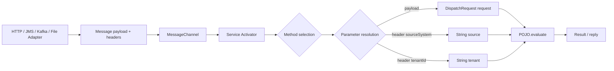
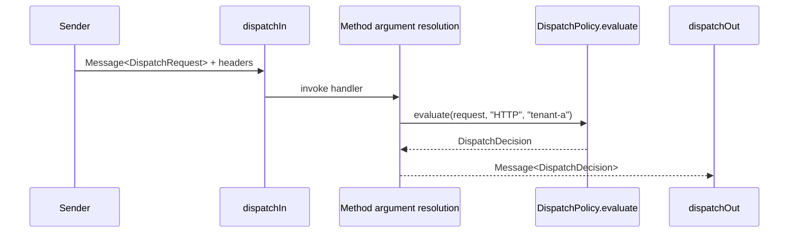
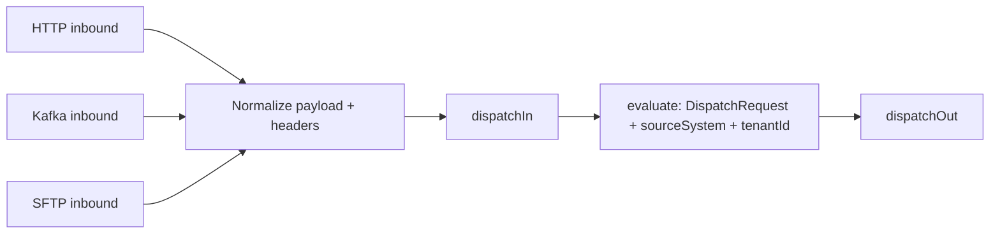

# Method parameter and payload resolution in Spring Integration

## 1. Problem: one message, many Java parameter shapes

A system receives delivery orders from HTTP, Kafka, JMS, or a legacy table. An inbound adapter puts data onto a `MessageChannel` as a `Message<DispatchRequest>`, along with source and tenant information. At the business-processing step, we want to call a POJO method:

```java
DispatchDecision evaluate(
        DispatchRequest request,
        String sourceSystem,
        String tenantId)
```

Yet a message only has **one payload and one set of headers**. Spring Integration must decide which parameter comes from the payload, which comes from a header, whether type conversion is needed, and what happens when data is missing.

In the **`SPRING_INTEGRATION_ADAPTERS`** module, inbound/outbound adapters, gateways, pollers, and `MessageChannel` connect files, SFTP, HTTP, JMS, AMQP, Kafka, databases, and existing Java systems. The **Method parameter and payload resolution** topic explains *mapping a message to POJO method parameters* once an adapter brings data into the flow. This is where many integration issues that appear to belong to an adapter actually stem from mismatches in payload/header contracts or method signatures.

Lesson objectives:

1. Explain how the framework selects the **method to invoke** and how it resolves **each parameter's value**.
2. Map the payload, individual headers, the full headers map, or the entire `Message<?>` using the right annotations.
3. Understand method selection by payload type, overloads, `@Default`, optional values, and type conversion.
4. Implement a POJO service activator accepting both payload and headers using annotations or Java DSL.
5. Diagnose missing headers, incompatible payloads, ambiguous methods, and systematically test input contracts.

## 2. Message model and the two resolution phases

A Spring Messaging message consists of:

```text
Message<DispatchRequest>
  payload = DispatchRequest(
      dispatchId = "D-501",
      destination = "Hanoi",
      packages = 2
  )
  headers = {
      sourceSystem = "HTTP",
      tenantId = "tenant-a",
      correlationId = "flow-123",
      id = <UUID>,
      timestamp = <time>,
      ...
  }
```

**Payload** is the primary business data. **Headers** are metadata for routing, tracing, content selection, or integration. Spring Integration typically creates a message from inbound adapter data and sends it across a channel to an endpoint, such as a service activator, transformer, filter, or router.



There are **two distinct concerns**:

- **Method selection:** For a bean with one or more methods, the framework must decide *which method* will receive the message. Configured method names, annotations, payload types, and candidate methods can all influence selection.
- **Parameter resolution:** Once a method is selected, the framework must produce Java arguments *for each parameter*: extracting payload, header, headers map, the full message, or converted values.

Do not lump these two together as "Spring auto-injects the payload." A class might resolve the right method yet still fail when a required header is missing. Conversely, a message might have complete headers while an ambiguous overload prevents the framework from picking a suitable method.

## 3. Common parameter-mapping rules

Spring Integration uses Spring Messaging's method-invocation mechanism for POJO endpoints. Common annotations are imported from `org.springframework.messaging.handler.annotation`:

```java
import org.springframework.messaging.handler.annotation.Payload;
import org.springframework.messaging.handler.annotation.Header;
import org.springframework.messaging.handler.annotation.Headers;
```

| Parameter signature | Value received | Notes |
|---|---|---|
| `DispatchRequest request` | Entire payload if type matches | Most concise form for a single well-typed payload |
| `@Payload DispatchRequest request` | Payload, specified explicitly | Easy to read when the method also takes headers |
| `@Header("sourceSystem") String source` | Header named `sourceSystem` | Required by default |
| `@Header(value = "tenantId", required = false) String tenant` | Header `tenantId` or `null` | Parameter type should accept `null` |
| `@Headers Map<String, Object> headers` | Map of headers | Useful when needing many headers or selective auditing |
| `Message<DispatchRequest> message` | Entire message | Allows direct access to payload and headers |
| `MessageHeaders headers` | `MessageHeaders` object | Suitable when only metadata is needed |
| `Optional<DispatchRequest> request` | Payload represented as `Optional` | Supported in POJO invocation; message payload itself must still be non-`null` |
| `@Header("tenantId") Optional<String> tenant` | Optional header as `Optional` | Handy when avoiding `null` values |

Valid signatures for **alternative handlers**:

```java
public void handle(DispatchRequest request) { ... }

public void handle(@Payload DispatchRequest request,
                   @Header("sourceSystem") String source) { ... }

public void handle(@Payload DispatchRequest request,
                   @Headers Map<String, Object> headers) { ... }

public void handle(Message<DispatchRequest> message) { ... }

public void audit(MessageHeaders headers) { ... }
```

Do not declare all of the above methods with the same name `handle` in one sample flow unless you have intentionally designed overload selection. Each snippet merely illustrates one **input contract**.

### 3.1. An unannotated parameter is normally treated as the payload

Suppose the message payload is `DispatchRequest`:

```java
@ServiceActivator(inputChannel = "dispatchIn")
public void process(DispatchRequest request) {
    System.out.println(request.dispatchId());
}
```

The framework passes `message.getPayload()` into `request`. This encourages POJOs to know only business data without depending on Spring's `Message` API. If only part of the payload is needed, normally accept the DTO and extract it in business code, or use a transformer ahead of the handler.

**Do not** assume any payload automatically converts to `DispatchRequest`: a JSON string, `byte[]`, `Map`, or a DTO from another schema version may need an explicit conversion step before the handler runs.

### 3.2. Use `@Payload` when there are multiple parameters

```java
@ServiceActivator(inputChannel = "dispatchIn")
public void process(
        @Payload DispatchRequest request,
        @Header("sourceSystem") String sourceSystem) {
    System.out.println(request.dispatchId() + " from " + sourceSystem);
}
```

`@Payload` clarifies which argument comes from the payload. `@Header` specifies metadata. Use this form when a signature mixes business data and integration metadata.

### 3.3. Accept the full message when needing payload alongside many metadata fields

```java
import org.springframework.messaging.Message;

public void process(Message<DispatchRequest> message) {
    DispatchRequest command = message.getPayload();
    Object source = message.getHeaders().get("sourceSystem");
    Object correlation = message.getHeaders().get("correlationId");
    System.out.println(command.dispatchId() + " / " + source + " / " + correlation);
}
```

With `Message<DispatchRequest>`, the method sees both payload and headers. The tradeoff is adding a Spring Messaging dependency to the business class. Use this only when you truly need the message as a unit; for one or two individual headers, `@Header` is usually cleaner.

### 3.4. Map payload and Map headers are two different objects

This is an easily confused case:

```java
// Message has a payload of type Map<String, Object>.
public void handle(@Payload Map<String, Object> body,
                   @Headers Map<String, Object> headers) {
    Object orderId = body.get("orderId");
    Object source = headers.get("sourceSystem");
}
```

If two unannotated `Map` parameters are used:

```java
public void handle(Map<String, Object> first,
                   Map<String, Object> second) { ... } // Easily ambiguous.
```

the framework has no clear way to tell which map is the payload and which is headers. Always **place `@Payload` on the business map and `@Headers` on the header map**. An unannotated `Map` may sometimes bind by convention, but never rely on guesswork in a long-lived integration contract.

## 4. Required headers, optional headers, and `Optional`

### Required headers

```java
public void process(@Payload DispatchRequest request,
                    @Header("sourceSystem") String source) {
    // Runs only when sourceSystem is present and resolved successfully.
}
```

`@Header("sourceSystem")` defaults to `required = true`. If the inbound adapter omits this header, resolution fails before executing the method body. This is usually a message-contract error, not an external connection failure.

### Optional headers

```java
public void process(@Payload DispatchRequest request,
                    @Header(value = "tenantId", required = false) String tenantId) {
    String tenant = tenantId == null ? "public" : tenantId;
    // ...
}
```

`required = false` permits the header to be missing; using a reference type like `String`, the value can be `null`. For optional headers, **do not** use primitive parameters (`int`, `boolean`) if the value may be absent without an appropriate default mechanism.

Some POJO invocation configurations also permit:

```java
public void process(@Payload DispatchRequest request,
                    @Header("tenantId") Optional<String> tenantId) {
    String tenant = tenantId.orElse("public");
}
```

`Optional` is a good choice to express optionality directly in the signature. `Optional` support is documented by Spring Integration for service activators, though verify it on your project's framework version, especially if custom resolvers or converters are involved.

### Do not repurpose system headers

Headers such as `id`, `timestamp`, `replyChannel`, and `errorChannel` carry meaning for the messaging infrastructure. For instance, `replyChannel` can be a `MessageChannel` or channel name and should not be treated as a plain business string. Use distinct, descriptive keys like `sourceSystem`, `tenantId`, `dispatchId`, and `correlationId`, and define header-mapping policies per adapter.

## 5. Method selection: picking the right method before resolving arguments

Before binding parameters, the endpoint needs to know which method to invoke. Two common configuration forms exist:

```java
// Selected by annotation on the method:
@ServiceActivator(inputChannel = "dispatchIn")
public DispatchDecision evaluate(DispatchRequest request) { ... }
```

```java
// Selected by method name in Java DSL:
IntegrationFlow.from("dispatchIn")
        .handle(dispatchPolicy, "evaluate")
        .channel("dispatchOut")
        .get();
```

When only one `evaluate` method matches, resolution is straightforward. However, a class may have multiple overloads:

```java
public String evaluate(DispatchRequest request) { return "DISPATCH"; }
public String evaluate(InventoryChange change) { return "INVENTORY"; }
```

The framework can select a method by payload type at runtime when the endpoint is configured to dispatch across multiple methods on a bean. Yet if broad overloads (`Object`, `Serializable`, parent/child types) or multi-target converters exist, method selection can become unpredictable.

### Ways to reduce ambiguity

1. Prefer one `public` method with an unambiguous signature per endpoint.
2. When multiple behaviors are needed, use distinct method names or route by message type before calling the POJO.
3. In DSL, pass the exact method name in `.handle(bean, "methodName")`; remember that **a single method name can still have overloads**.
4. Avoid `Object`, `Map`, or similar broad types that unnecessarily widen the candidate set.
5. Write integration tests for every payload type if your project actually uses overloading for dispatch.

Spring Integration provides `@org.springframework.integration.annotation.Default` as a fallback method when multi-method dispatch finds no payload type match. That is a *method fallback* mechanism, not an annotation for setting a header's default value. If a use case handles multiple event types, a router leading to dedicated handlers is usually easier to track.

### Is a no-argument method valid?

Yes. A service activator can invoke a no-argument method simply as a reaction to receiving a message:

```java
@ServiceActivator(inputChannel = "auditEvents")
public void incrementCounter() {
    counter.incrementAndGet();
}
```

The message still triggers the endpoint, even though the method body needs neither payload nor headers. This **differs** from an `@InboundChannelAdapter` source method, where a no-argument method is polled to **create** new messages.

## 6. Self-contained demo: binding payload and headers to a POJO

Example using **Java 17+, Spring Boot 3.x, and Spring Integration 6.x**. A channel receives delivery commands already deserialized into a `DispatchRequest` record; a service activator reads the payload, required header `sourceSystem`, and optional header `tenantId`, and produces a `DispatchDecision`.

### 6.1. Declaring dependencies

```groovy
// build.gradle (dependencies snippet)
dependencies {
    implementation 'org.springframework.boot:spring-boot-starter-integration'
    testImplementation 'org.springframework.boot:spring-boot-starter-test'
}
```

For Maven, the corresponding dependencies are `spring-boot-starter-integration` and `spring-boot-starter-test`. When integrating real Kafka, JMS, HTTP, or files, add the matching adapter starter/module at the project level; they are not required for this direct-channel demo.

### 6.2. Application and channels

The Java examples in this section share package `com.example.resolution` and live in their respective files.

```java
// ResolutionApplication.java
package com.example.resolution;

import org.springframework.boot.SpringApplication;
import org.springframework.boot.autoconfigure.SpringBootApplication;
import org.springframework.context.annotation.Bean;
import org.springframework.integration.channel.DirectChannel;
import org.springframework.integration.channel.QueueChannel;
import org.springframework.integration.config.EnableIntegration;
import org.springframework.messaging.MessageChannel;
import org.springframework.messaging.PollableChannel;

@SpringBootApplication
@EnableIntegration
public class ResolutionApplication {
    public static void main(String[] args) {
        SpringApplication.run(ResolutionApplication.class, args);
    }

    @Bean
    MessageChannel dispatchIn() {
        return new DirectChannel();
    }

    @Bean
    PollableChannel dispatchOut() {
        return new QueueChannel();
    }
}
```

`DirectChannel` pushes messages synchronously to the handler. `QueueChannel` holds replies so the demo or test can read them via `receive(timeout)`. There is no poller on the input channel because commands are sent directly by a sender; when connected to a polling inbound adapter, the schedule lives on the source-reading endpoint.

### 6.3. Defining payload and result models

```java
// DispatchRequest.java
package com.example.resolution;

public record DispatchRequest(
        String dispatchId,
        String destination,
        int packages) { }
```

```java
// DispatchDecision.java
package com.example.resolution;

public record DispatchDecision(
        String dispatchId,
        boolean accepted,
        String sourceSystem,
        String tenantId,
        String reason) { }
```

`DispatchRequest` holds business data; `sourceSystem` and `tenantId` travel in headers per the integration contract. Separating them lets you switch source protocols without changing the DTO every time an adapter adds metadata.

### 6.4. POJO method with three parameters

```java
// DispatchPolicy.java
package com.example.resolution;

import org.springframework.integration.annotation.ServiceActivator;
import org.springframework.messaging.handler.annotation.Header;
import org.springframework.messaging.handler.annotation.Payload;
import org.springframework.stereotype.Component;

@Component
public class DispatchPolicy {

    @ServiceActivator(inputChannel = "dispatchIn", outputChannel = "dispatchOut")
    public DispatchDecision evaluate(
            @Payload DispatchRequest request,
            @Header("sourceSystem") String sourceSystem,
            @Header(value = "tenantId", required = false) String tenantId) {

        String resolvedTenant = tenantId == null ? "public" : tenantId;
        boolean accepted = request.dispatchId() != null
                && !request.dispatchId().isBlank()
                && request.packages() > 0;

        return new DispatchDecision(
                request.dispatchId(),
                accepted,
                sourceSystem,
                resolvedTenant,
                accepted ? "ACCEPTED" : "INVALID_DISPATCH");
    }
}
```

Key aspects of the signature:

- `@Payload DispatchRequest request` receives the **entire payload**. The framework does not synthesize extra arguments from fields `dispatchId`, `destination`, or `packages` unless requested.
- `@Header("sourceSystem") String sourceSystem` extracts a required header. If missing, an error occurs during argument resolution.
- `@Header(value = "tenantId", required = false) String tenantId` extracts an optional header; the method defaults to `"public"` when absent.
- The method returns `DispatchDecision`, so the service activator creates a reply message and sends it to `dispatchOut`.

If `evaluate(...)` returned `void` or `null`, a standard service activator would emit no reply. That is an **output** contract decision, independent of binding **input** parameters.

### 6.5. Sender constructing an explicit message

```java
import org.springframework.messaging.MessageChannel;
import org.springframework.messaging.support.MessageBuilder;

void submit(MessageChannel dispatchIn) {
    boolean sent = dispatchIn.send(
            MessageBuilder
                    .withPayload(new DispatchRequest("D-501", "Hanoi", 2))
                    .setHeader("sourceSystem", "HTTP")
                    .setHeader("tenantId", "tenant-a")
                    .setHeader("correlationId", "flow-123")
                    .build());

    System.out.println("Channel accepted: " + sent);
}
```

With `dispatchIn` having a subscriber, a synchronous `send()` leads to the call:

```java
evaluate(
    new DispatchRequest("D-501", "Hanoi", 2),
    "HTTP",
    "tenant-a"
)
```

The result sent to `dispatchOut` carries payload `DispatchDecision("D-501", true, "HTTP", "tenant-a", "ACCEPTED")`.



### 6.6. When a header is not sent

If the sender includes `sourceSystem` but omits `tenantId`, the method runs with `tenantId == null` and returns a decision with tenant `"public"`.

If the sender also omits `sourceSystem`, Spring Messaging cannot satisfy the required `@Header("sourceSystem")`. Failure occurs **before** entering `evaluate(...)`. Therefore, to distinguish contract errors from business rejections, do not catch the failure and return a fake `DispatchDecision` pretending the command was evaluated.

## 7. Equivalent configuration using Java DSL

Java DSL lets you keep Spring Integration annotations out of handler classes. Keep the records and channels from section 6, but **remove `@ServiceActivator`** from `DispatchPolicy.evaluate(...)`. The class can remain a `@Component` whose method uses `@Payload` and `@Header`.

```java
// DispatchFlowConfig.java
package com.example.resolution;

import org.springframework.context.annotation.Bean;
import org.springframework.context.annotation.Configuration;
import org.springframework.integration.dsl.IntegrationFlow;

@Configuration
public class DispatchFlowConfig {

    @Bean
    IntegrationFlow dispatchFlow(DispatchPolicy policy) {
        return IntegrationFlow.from("dispatchIn")
                .handle(policy, "evaluate")
                .channel("dispatchOut")
                .get();
    }
}
```

`.handle(policy, "evaluate")` registers a handler invoking the POJO method named `evaluate`. Annotations **on parameters** still declare each argument's source. When the method returns a decision, the message continues to `dispatchOut` in the flow.

The approaches in section 6 (`@ServiceActivator`) and section 7 (DSL) **are mutually exclusive alternatives**. Do not register both on the same `DirectChannel`: they would create multiple subscribers and cause unexpected endpoint selection.

When the payload must be converted before calling the method, DSL makes the ordering explicit:

```text
Inbound adapter
  -> deserialize/transform JSON or byte[] into DispatchRequest
  -> header enrichment (if sourceSystem, tenantId are needed)
  -> .handle(dispatchPolicy, "evaluate")
  -> output channel / outbound adapter
```

That way, argument resolution operates on a **normalized data contract** instead of bearing responsibility for parsing raw external formats.

## 8. Conversion: how far does type conversion go?

Spring Messaging / Spring Integration supports type conversion in many common cases. For example, a header holding string `"3"` can convert to an `Integer` or `int` parameter if a matching converter supports it.

```java
public void process(
        @Payload DispatchRequest request,
        @Header("attempt") int attempt) {
    System.out.println(attempt);
}
```

However, **type conversion is not the same as serialization/deserialization**. The table below shows cases requiring separate evaluation:

| Input message | Method expects | What to check |
|---|---|---|
| Payload `DispatchRequest` | `@Payload DispatchRequest` | Direct match, simplest |
| Payload `String` containing JSON | `@Payload DispatchRequest` | Needs a configured JSON converter or transformer; do not assume DTO parsing from arbitrary strings |
| Payload `byte[]` from file/JMS | `@Payload String` | Must specify charset and converter; avoid arbitrary casting |
| Header `"attempt" = "3"` | `@Header("attempt") int` | String-to-number conversion may work; test with real config |
| Header `"attempt" = "many"` | `@Header("attempt") int` | Conversion fails before method executes |
| Payload `Map` | `@Payload DispatchRequest` | `Map` → record mapping needs a DTO-capable converter |
| Payload `List<Order>` | `@Payload Order` | Needs a Splitter or element selection; never auto-picks the first element |
| Payload `OrderV1` | `@Payload OrderV2` | Requires a versioning/transformation strategy |

At the inbound boundary, you can use `JsonToObjectTransformer`, a Jackson transformer, the adapter's message converter, or a dedicated Java step. Which mechanism to choose depends on the adapter and dependencies; the annotation/DSL examples above **assume the payload is already a `DispatchRequest`**.

### Changing the method signature alone will not fix a broken data contract

If a Kafka adapter emits `byte[]` while the method expects `DispatchRequest`, changing `@Payload` to `@Header` will not fix it. Establish the event structure, content type, charset, schema, and final payload type before entering the handler. Likewise, HTTP headers may be `String` or mapper-supplied types, whereas broker headers are decoded differently.

## 9. `null`, `Optional`, and a message without a payload

A standard Spring `Message` does not accept a `null` payload. Hence, **having no payload** differs from **a payload of `Optional.empty()`** or **a method returning `null`**:

- `Message<?>.getPayload()` must hold a valid non-null value per the Spring Messaging contract.
- `Optional<T>` in a method signature expresses an optional parameter to the resolver; do not use `Optional.empty()` as `MessageSource`'s "no message" signal.
- `MessageSource.receive()` returns **`null`** when no message is available yet.
- A service activator method returns **`null`** when no reply should be emitted (unless `requiresReply` is enabled).
- A header marked `required = false` can be absent without making the payload `null`.

The method below shows two distinct cases:

```java
public String format(
        @Payload DispatchRequest request,
        @Header(value = "tenantId", required = false) String tenantId) {
    if (request.packages() <= 0) {
        return null; // Produces no reply from a standard service activator.
    }
    return tenantId == null ? "public" : tenantId;
}
```

In production business logic, do not return `null` to hide invalid source data. A result DTO with status `REJECTED` is usually better if a caller or gateway expects a response. When you want to drop invalid messages cleanly, use a proper filter with explicit discard/error rules.

## 10. Mapping in the reverse direction: `@MessagingGateway`

So far we examined **message → handler parameters**. With `@MessagingGateway`, Spring Integration also supports the reverse direction: **Java method call arguments → message payload and headers**.

Gateway interface example:

```java
package com.example.resolution;

import org.springframework.integration.annotation.MessagingGateway;
import org.springframework.messaging.handler.annotation.Header;
import org.springframework.messaging.handler.annotation.Payload;

@MessagingGateway(defaultRequestChannel = "dispatchIn")
public interface DispatchIngress {
    void submit(
            @Payload DispatchRequest request,
            @Header("sourceSystem") String sourceSystem,
            @Header("tenantId") String tenantId);
}
```

When a caller invokes:

```java
gateway.submit(
    new DispatchRequest("D-777", "Da Nang", 1),
    "JMS",
    "tenant-b");
```

the gateway builds a request message with payload `DispatchRequest` and the two corresponding headers, sending it to `dispatchIn`. For the gateway interface to be registered as a bean, enable gateway scanning (such as `@IntegrationComponentScan` in Spring Integration configuration).

| Mapping direction | Question to answer | Example |
|---|---|---|
| **Gateway → message** | Which payload and headers do Java arguments become? | `submit(@Payload req, @Header("tenantId") tenant)` |
| **Message → POJO handler** | Which parameters receive the payload and headers? | `evaluate(@Payload req, @Header("tenantId") tenant)` |

A common mistake is reading `@Payload`/`@Headers` rules for gateways and applying them verbatim to service activators. Both directions share several annotations, yet their starting points differ. In either direction, **never mark two parameters with `@Payload`** expecting one message to carry two independent payloads.

## 11. Protecting the contract across multiple source adapters

Suppose three adapters all send to `dispatchIn`:



Each adapter may represent the raw message differently:

- HTTP receives JSON, query/path parameters, and HTTP headers.
- Kafka receives key/value bytes and record headers, needing deserializers/header mappers.
- SFTP receives files or file paths, with filename/timestamp metadata.
- JMS/AMQP have protocol-specific message properties and headers.
- Database pollers may return row objects or collections, depending on the adapter/source.

Before reaching `DispatchPolicy`, the **contract normalization** step should ensure:

1. The final payload has the exact `DispatchRequest` type, with necessary schema validation.
2. Header `sourceSystem` is always present with a trusted adapter/gateway-set value.
3. Header `tenantId` is supplied when meaningful, or marked optional with a clear default rule.
4. Traceability key `correlationId` is preserved across observable hops.
5. Untrusted external headers are never automatically used for authorization or tenant selection without verification.

This lets the POJO method keep a stable signature even when swapping HTTP for JMS or adding an SFTP source.

### Why aren't headers trusted by default?

Headers can be set by an upstream app, HTTP caller, or broker producer. If `tenantId` determines data scope, cross-check it against verified identity/authorization at a trusted boundary; merely binding `@Header("tenantId")` does not enforce security. Avoid logging all headers because they can contain tokens, personal data, or sensitive routing metadata.

## 12. Testing resolution in a Spring context

Directly unit testing `DispatchPolicy.evaluate(...)` verifies business logic, yet **does not verify Spring's mapping from `Message<?>` to parameters**. To verify mapping, run a flow with the real handler and send messages through the input channel.

### 12.1. Integration test: payload and complete headers

Using the beans from section 6:

```java
// DispatchResolutionTest.java
package com.example.resolution;

import static org.junit.jupiter.api.Assertions.*;

import org.junit.jupiter.api.Test;
import org.springframework.beans.factory.annotation.Autowired;
import org.springframework.beans.factory.annotation.Qualifier;
import org.springframework.boot.test.context.SpringBootTest;
import org.springframework.messaging.Message;
import org.springframework.messaging.MessageChannel;
import org.springframework.messaging.PollableChannel;
import org.springframework.messaging.support.MessageBuilder;

@SpringBootTest
class DispatchResolutionTest {

    @Autowired
    @Qualifier("dispatchIn")
    MessageChannel input;

    @Autowired
    @Qualifier("dispatchOut")
    PollableChannel output;

    @Test
    void resolvesPayloadAndHeaders() {
        boolean sent = input.send(
                MessageBuilder
                        .withPayload(new DispatchRequest("TEST-01", "Hanoi", 2))
                        .setHeader("sourceSystem", "HTTP")
                        .setHeader("tenantId", "tenant-a")
                        .build());

        assertTrue(sent);
        Message<?> reply = output.receive(1000);
        assertNotNull(reply);
        assertInstanceOf(DispatchDecision.class, reply.getPayload());

        DispatchDecision decision = (DispatchDecision) reply.getPayload();
        assertEquals("TEST-01", decision.dispatchId());
        assertTrue(decision.accepted());
        assertEquals("HTTP", decision.sourceSystem());
        assertEquals("tenant-a", decision.tenantId());
    }

    @Test
    void resolvesMissingOptionalHeader() {
        input.send(MessageBuilder
                .withPayload(new DispatchRequest("TEST-02", "Hue", 1))
                .setHeader("sourceSystem", "JMS")
                .build());

        Message<?> reply = output.receive(1000);
        assertNotNull(reply);
        DispatchDecision decision = (DispatchDecision) reply.getPayload();
        assertEquals("public", decision.tenantId());
    }
}
```

These two tests verify full headers and optional headers respectively. `QueueChannel.receive(1000)` avoids fixed `Thread.sleep()` calls. When multiple tests share a Spring context and queue concurrently, isolate contexts or control flows so messages from one test are not consumed by another; never depend on test execution order.

### 12.2. Testing a missing required header

With synchronous `DirectChannel`, mapping failures normally propagate back to the caller as exceptions along the message-handling path:

```java
import org.springframework.messaging.MessagingException;

@Test
void rejectsMissingRequiredHeader() {
    assertThrows(MessagingException.class, () ->
            input.send(MessageBuilder
                    .withPayload(new DispatchRequest("TEST-03", "Hanoi", 1))
                    // Intentionally omit sourceSystem.
                    .build()));
}
```

This test confirms the failure is observable; when debugging in detail, inspect the root `cause` to tell whether it came from a missing header, incompatible type, or unresolved method. Avoid hardcoding tests to an exact exception message string that a library upgrade might reword.

### 12.3. Testing an incompatible payload type

Clarify **conversion configuration** before setting expectations here. For instance, sending a JSON `String`:

```java
Message<?> raw = MessageBuilder
        .withPayload("{\"dispatchId\":\"TEST-04\",\"packages\":1}")
        .setHeader("sourceSystem", "HTTP")
        .build();
```

Without a proper converter or transformer, a handler expecting `DispatchRequest` can fail during method selection, argument resolution, or type conversion. Integration tests should assert the exact **post-deserialization result** rather than assuming `@Payload` parses arbitrary JSON by itself.

## 13. Debugging when a method is not called or receives wrong arguments

| Symptom | What to inspect | Resolution |
|---|---|---|
| Handler never runs | Input channel, subscribers, bean/method name, endpoint lifecycle | Check `@ServiceActivator` or DSL configuration and message flow |
| No suitable method found | Payload type, overloads, visibility, method name | Make method `public`, use clear names, normalize payload type |
| Missing header error | `@Header` defaults to `required = true`; adapter omitted header | Standardize header at inbound or set `required=false` if truly optional |
| Method receives `null` for optional header | Header absent and parameter allows `null` | Handle default value or `Optional` in the POJO |
| `ClassCastException` inside method body | Method manually casts from `Message<?>` or `Map` to wrong type | Use typed DTOs, converters, or type checks before casting |
| JSON payload remains a `String` | Adapter did not deserialize | Add converter/transformer matching schema, charset, and content type |
| Two `Map` parameters confused | Both payload and headers are Maps | Explicitly annotate `@Payload` and `@Headers` |
| Numeric header fails to parse | Header string does not match parameter type | Validate data, fix converter, or update header contract |
| Method runs yet no reply arrives | Method is `void` or returned `null` | Return a result DTO if pipeline/gateway needs a reply |
| Failure occurs yet caller sees nothing | Async channel or endpoint | Inspect `errorChannel`, error handlers, logs, and ack mechanics |
| Message hits wrong handler | Multiple subscribers or ambiguous overloads | Check flow registry, message classification, and method names |

### A practical debugging sequence

1. **Verify the incoming message**: controllably log `payload.getClass()`, header keys, and correlation ID. Avoid logging tokens, sensitive fields, or entire raw payloads.
2. **Verify the endpoint**: which `inputChannel` is the handler bound to; is the method chosen via annotation or DSL; are multiple endpoints subscribed to the same channel.
3. **Inspect the method signature**: does payload type match; which parameters use `@Payload`, `@Header`, `@Headers`; which headers are required.
4. **Verify conversion**: does the post-deserialization/transform result match the exact Java type the method expects; if not, fix it at the boundary before the handler.
5. **Verify reply/error paths**: what does the method return, which output/replyChannel is used, and do errors return to the caller or `errorChannel`.

With `DirectChannel`, handler errors normally return synchronously to the sender. With `ExecutorChannel`, polling consumers, or async adapters, exceptions may follow a different error path. Thus, sender logs alone cannot confirm handler parameter resolution succeeded.

## 14. Hands-on exercises

1. Starting from section 6, remove `@Payload` from `DispatchRequest` while keeping both `@Header` parameters. Run tests to confirm the framework still binds the payload via DTO type.
2. Omit `sourceSystem` from the message. Observe the failure before the method executes; add a test checking the exception's `cause`.
3. Make `tenantId` required; then switch it to `Optional<String>` and compare the contract when the header is missing.
4. Create a `Map<String, Object>` payload and write a method accepting `@Payload Map<String, Object>` alongside `@Headers Map<String, Object>`. Prove the two maps hold distinct data.
5. Send header `attempt = "3"` to a method expecting `@Header("attempt") int attempt`. Try `attempt = "three"` and explain where the conversion failure happens.
6. Change the sender to send a JSON `String`. Insert an explicit conversion step from JSON to `DispatchRequest` and rerun tests.
7. Write a class with two overloads `evaluate(DispatchRequest)` and `evaluate(InventoryChange)`; configure an endpoint with multiple candidate methods, and write tests for both payloads plus an unsupported type.
8. Create a `@MessagingGateway` with `submit(@Payload DispatchRequest, @Header("sourceSystem") String)`; verify argument-to-message mapping before the handler receives it.
9. Simulate two source adapters: one from HTTP and one from Kafka. Normalize both to the same payload type and headers, then share `DispatchPolicy.evaluate(...)`.
10. Create a case where the handler returns `null` on invalid validation. Analyze the impact on a gateway waiting for a reply and redesign with an explicit `DispatchDecision` DTO.

## 15. Takeaways for designing message → method contracts

- **Method selection** picks which method to call; **parameter resolution** supplies arguments to that method. These two steps can fail independently.
- A properly typed POJO parameter normally receives the **payload**; use `@Payload` when you want to state it explicitly.
- **`@Header`** extracts a single header (required by default). **`@Headers`** extracts the entire header map; annotate explicitly when the payload is also a `Map`.
- Accept **`Message<?>`** when needing both payload and full metadata; for framework-independent business logic, prefer DTOs plus specific headers.
- `Optional` and `required = false` express optional values, but do not replace message contract validation.
- Simple conversions may be built in; **JSON/Avro/byte[] → DTO** requires properly configured serializers, deserializers, or transformers with matching schemas.
- **`@MessagingGateway` maps arguments → message**; **service activators map message → arguments**. Sharing annotations does not mean both directions behave identically.
- Across multiple adapters (HTTP, JMS, Kafka, file, SFTP, database), normalize payloads/headers **before** invoking the POJO and test with realistic messages.

### References

- [Spring Integration 6.5 — Annotation Support: payload, `@Header`, `@Headers`](https://docs.spring.io/spring-integration/reference/6.5/configuration/annotations.html)
- [Spring Integration 6.5 — Service Activator: POJO parameters, method selection, `Optional`](https://docs.spring.io/spring-integration/reference/6.5/service-activator.html)
- [Spring Integration — Messaging Gateways: Mapping Method Arguments to a Message](https://docs.spring.io/spring-integration/reference/gateway.html)
- [Spring Framework API — `@Payload`](https://docs.spring.io/spring-framework/docs/current/javadoc-api/org/springframework/messaging/handler/annotation/Payload.html)
- [Spring Framework API — `@Header`](https://docs.spring.io/spring-framework/docs/current/javadoc-api/org/springframework/messaging/handler/annotation/Header.html)
- [Spring Framework API — `@Headers`](https://docs.spring.io/spring-framework/docs/current/javadoc-api/org/springframework/messaging/handler/annotation/Headers.html)
