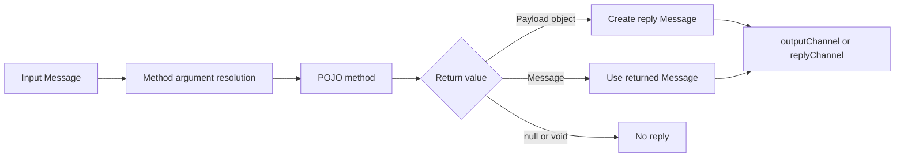

# Return value and message conversion

## Objectives

In Spring Integration, a POJO adapter invokes a Java method to process a message. The method's return value determines what data moves forward, while message conversion maps payloads and headers to the types the method expects. After this lesson, you will be able to:

- Explain how return values from `@ServiceActivator`, `@Transformer`, and `@InboundChannelAdapter` enter the message flow.
- Distinguish returning a payload, a `Message<?>`, `null`, and `void`.
- Use `@Payload`, `@Header`, `@Headers`, and `Message<?>` to extract input data.
- Configure `ConversionService` and custom converters for your application's payload types.
- Recognize when message-format conversion such as JSON is needed and how to handle conversion errors.

## How does a return value become a message?

A POJO endpoint is invoked by Spring Integration when a message arrives on the input channel or when a poller triggers an inbound adapter. For output-producing endpoints, the method's return value normally becomes the payload of the next message. The result is sent to the configured `outputChannel`; if the endpoint operates in request/reply mode, the result can be sent back to the reply channel specified in the `replyChannel` header.



With a `@ServiceActivator`, a method can accept a payload, execute business logic, and return a result:

```java
@Component
public class OrderHandler {

    @ServiceActivator(inputChannel = "orders.in",
                      outputChannel = "orders.accepted")
    public OrderReceipt accept(@Payload Order order,
                               @Header(name = "source", required = false) String source) {
        return new OrderReceipt(order.id(), "accepted", source);
    }
}
```

If the method returns `OrderReceipt`, the endpoint wraps that object as the payload of a reply message and sends it to `orders.accepted`. The consumer on the next channel processes `OrderReceipt`, not the incoming `Order` object. This is how a service activator both performs an action and produces a result for the flow.

If the method needs to decide headers or reply metadata itself, it can return a `Message<?>`:

```java
@ServiceActivator(inputChannel = "orders.in",
                  outputChannel = "orders.accepted")
public Message<OrderReceipt> accept(Message<Order> request) {
    Order order = request.getPayload();
    OrderReceipt receipt = new OrderReceipt(order.id(), "accepted", null);

    return MessageBuilder.withPayload(receipt)
            .copyHeaders(request.getHeaders())
            .setHeader("processing-status", "validated")
            .build();
}
```

When returning `Message<?>`, the method controls both the payload and headers of the outgoing message. `MessageHeaders` is immutable; to change headers, build a new message with `MessageBuilder` rather than mutating the input message's header map directly. Copy only the headers actually needed if you want to avoid leaking internal metadata or sensitive data to the next hop.

## Return value semantics by endpoint type

Not every annotation interprets return values the same way. Choose the method signature according to the endpoint's contract:

| Endpoint | Typical meaning of return value |
|---|---|
| `@ServiceActivator` | Payload of the reply message; if returning `Message<?>`, that message becomes the reply. |
| `@Transformer` | Transformed payload; return `Message<?>` when headers also need control. |
| `@InboundChannelAdapter` | Data generated on each poll and sent to the output channel; may return a payload or message. |
| `@Filter` | A `boolean` value deciding whether the message passes forward or is discarded. |
| `@Router` | Channel name, `MessageChannel`, or routing destination collection per router contract. |
| `@Splitter` | Collection, array, or items that the splitter emits as multiple messages. |
| `@Aggregator` | Aggregated result emitted as a message once a message group completes. |

Therefore, do not change a router or filter method to return a DTO simply because you want "a response." The return value must follow the endpoint's role.

### `null` and `void`

`void` indicates the method produces no return value. For reply-producing endpoints, `null` likewise means there is no reply message to emit. For instance, a service activator may perform a write operation and finish without an output channel.

If the flow strictly requires a result, configure `requiresReply = "true"` on the corresponding service activator. When the method produces no reply, the framework raises `ReplyRequiredException`, which can be handled via an error channel. Do not enable `requiresReply` on endpoints where `null` is a valid business outcome.

With `@Filter`, `false` is neither an error nor an empty reply: it means the message is filtered out from the filter's output flow. With `@Router`, returning `null` cannot be treated as a normal payload; define an explicit default output channel or a policy for unmatched routes.

## Extracting payload, headers, and the full message

Spring Integration resolves method parameters based on parameter types and annotations:

```java
@ServiceActivator(inputChannel = "orders.in")
public OrderReceipt inspect(
        @Payload Order order,
        @Header("correlationId") UUID correlationId,
        @Headers Map<String, Object> headers) {

    String source = (String) headers.get("source");
    return new OrderReceipt(order.id(), "accepted", source);
}
```

- `@Payload` extracts the body of the message. You can declare the expected payload type directly, such as `Order`.
- `@Header("correlationId")` extracts a specific header. Use `required = false` if the header may be absent; if required and missing, parameter resolution fails.
- `@Headers` receives the header collection as a map.
- `Message<?>` or `Message<Order>` gives access to both payload and headers. Use this when logic inspects metadata or constructs replies with custom headers.
- `MessageHeaders` provides a read-only view of headers.

If the method signature has only a single payload parameter, the framework can usually infer it is the payload without `@Payload`. With multiple parameters, use explicit annotations so the signature stays readable and prevents confusion between payload and headers.

## Message conversion and ConversionService

Incoming messages may carry payloads of type `String`, `byte[]`, JSON text, or domain objects. POJO methods usually prefer specific Java types. Spring uses conversion mechanisms to coerce values into compatible parameter types; when no matching converter exists, parameter resolution fails before the method body executes.

`ConversionService` converts between Java types—for example, `String` to `Order`, `String` to `BigDecimal`, or one application type to another. Spring provides many common conversions via `DefaultConversionService`. Applications can register custom `Converter<S, T>` implementations for domain types.

For example, when the input payload is the string `A-17|125.50` while the POJO expects an `Order`:

```java
public record Order(String id, BigDecimal amount) { }

@Configuration
public class IntegrationConversionConfiguration {

    @Bean("integrationConversionService")
    public ConversionService integrationConversionService() {
        DefaultConversionService service = new DefaultConversionService();
        service.addConverter(String.class, Order.class, value -> {
            String[] fields = value.split("\\|", -1);
            if (fields.length != 2 || fields[0].isBlank()) {
                throw new IllegalArgumentException("Invalid order payload");
            }
            return new Order(fields[0], new BigDecimal(fields[1]));
        });
        return service;
    }
}
```

Once the converter is registered in the conversion service used by Spring Integration, methods can declare the domain type directly:

```java
@ServiceActivator(inputChannel = "rawOrders",
                  outputChannel = "orders.accepted")
public OrderReceipt accept(@Payload Order order) {
    return new OrderReceipt(order.id(), "accepted", null);
}
```

The example above focuses on type mapping. In production applications, validate input data before constructing objects, handle `NumberFormatException` from `BigDecimal`, and return contextual errors so operators know which payload was invalid. If your application already defines `integrationConversionService`, add converters to the existing setup per your bean-management conventions rather than declaring a duplicate bean with the same name.

## How does ConversionService differ from MessageConverter?

Both mechanisms are related but solve different problems:

| Mechanism | Purpose | Example |
|---|---|---|
| `ConversionService` | Converts a Java value from one type to another. | `String` to `Order`, `String` to `BigDecimal`. |
| `MessageConverter` | Converts message contents according to formats or media types supported by the converter. | JSON payload to DTO, or object to JSON message. |
| Serializer | Transforms objects into byte representations for storage or protocol transport. | Java value to byte array when writing to Redis or a broker. |

For example, a `contentType` header may indicate the payload is `application/json`, yet setting that header alone does not turn JSON text into an `Order`. The flow needs an actual conversion step, such as a JSON-to-object transformer or a message converter configured on the right endpoint. Similarly, a Redis or broker adapter's serializer is not the same as the converter resolving POJO parameters.

For JSON payloads, you can place an explicit transformation step before the service activator:

```java
@Bean
IntegrationFlow jsonOrderFlow() {
    return IntegrationFlow.from("jsonOrders")
            .transform(new JsonToObjectTransformer(Order.class))
            .handle(orderHandler, "accept")
            .channel("orders.accepted")
            .get();
}
```

`JsonToObjectTransformer` converts the JSON payload into an `Order` before calling `accept`. Configure an object mapper, Java time modules, or custom types if the JSON structure requires them. When emitting JSON outbound, use a matching object-to-JSON transformation step and align `contentType` with the receiving system's contract.

## Headers and payloads when building replies

When a POJO returns a plain payload object, the framework builds a reply message and dispatches it via the endpoint's output/reply mechanism. If logic needs to preserve or add metadata, return an explicitly built `Message<?>`:

```java
public Message<OrderReceipt> enrich(Message<Order> request) {
    Order order = request.getPayload();
    OrderReceipt receipt = new OrderReceipt(order.id(), "accepted", null);

    return MessageBuilder.withPayload(receipt)
            .copyHeadersIfAbsent(request.getHeaders())
            .setHeader("result-version", 1)
            .build();
}
```

`copyHeadersIfAbsent` avoids overwriting headers already set in the builder. To drop a header, omit copying it or use `MessageBuilder` to create a fresh message with selected headers. Avoid copying headers such as `replyChannel` or `errorChannel` into messages persisted long-term or sent to external systems where they no longer have meaning across that boundary.

Correlation, sequence, and routing headers can affect downstream endpoints. When a transformer or service activator builds a new message, identify which headers must be preserved so splitters/aggregators, routers, or request-reply flows continue functioning properly.

## Conversion failures and error handling

Data conversion is part of the integration contract, so failures must be observable and categorized:

- No converter found for target parameter type: check actual payload, parameter type, and active conversion service.
- Malformed payload: validate schema or structure before building domain objects; do not substitute a default object that could corrupt business logic.
- Missing required header: check sender, header name, and `required` configuration.
- Header value cannot convert to parameter type: verify incoming header type or convert explicitly.
- Method returns `null` in a flow expecting a reply: check `requiresReply` and empty-result handling.
- Reply dispatch fails: check `outputChannel`, `replyChannel`, channel capacity limits, and send timeouts.

Parameter-resolution or method-invocation failures are normally wrapped in message-handling exceptions. Use an error channel, `errorChannel` header, error flow, or appropriate advice to log, route failed messages to a dead-letter flow, and notify upstream systems. On reprocessing, preserve correlation and message-origin metadata for traceability.

Do not catch every exception and return `null`: that turns conversion failures into silent no-reply cases, making it hard for upstream to distinguish invalid data from successful execution with no output. Let errors flow to error handling or return a structured error result with an explicit contract.

## Practice

1. Create a service activator receiving `Order` and returning `OrderReceipt`; observe the payload on the output channel.
2. Modify the method to accept `Message<Order>`, add a `processing-status` header to the reply, and verify required headers remain intact.
3. Send a `String` payload to an endpoint accepting `Order`. Register a custom converter and test valid strings, missing fields, and malformed amounts.
4. Send JSON text through a flow with `JsonToObjectTransformer`, then invoke the same POJO method. Compare with merely setting the `contentType` header without transforming the payload.
5. Test a method returning `null` with `requiresReply` disabled and enabled. Verify the error flow receives the failure when a reply is required.

## Common mistakes

- Assuming every return value is forwarded as a payload, even for routers, filters, and splitters that follow their own contracts.
- Returning `void` or `null` while expecting downstream to receive a message.
- Confusing payload conversion with JSON serialization or byte serialization.
- Setting `contentType` and expecting the framework to parse JSON automatically at every endpoint.
- Declaring a domain type in a POJO signature without registering a corresponding converter.
- Copying all headers into messages crossing system boundaries without evaluating internal headers.
- Swallowing conversion exceptions and returning `null`, hiding the root cause of invalid data.

## Conclusion

Return values determine what data a POJO endpoint feeds back into the flow; the endpoint type determines how the framework interprets that result. Use a payload object for standard replies, return `Message<?>` when header control is needed, and define clear semantics for `null` or `void`. For message conversion, distinguish Java type conversion via `ConversionService` from message format conversion via `MessageConverter` or dedicated transformers. Clear data-type contracts and error policies keep adapters exchanging messages reliably across heterogeneous systems.

## References

- [Spring Integration Reference — Message Handling and POJO Method Invocation](https://docs.spring.io/spring-integration/reference/handle-message.html)
- [Spring Integration Reference — Message Transformation](https://docs.spring.io/spring-integration/reference/message-transformation.html)
- [Spring Framework Reference — Type Conversion](https://docs.spring.io/spring-framework/reference/core/validation/convert.html)
