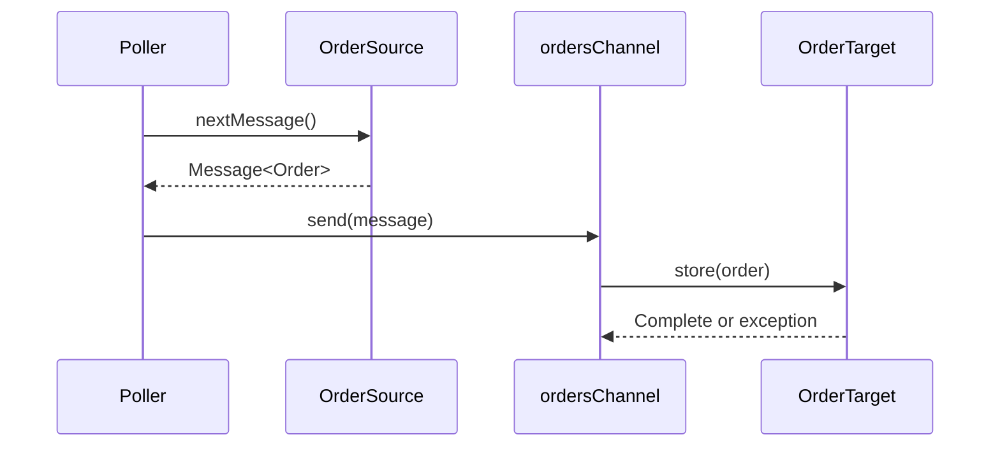

# Registering source and target beans

In Spring Integration, a POJO participates in a message flow only when it is managed by Spring and bound to an appropriate endpoint. A source bean produces messages to bring external data into the system; a target bean receives messages from a channel and performs work such as persisting data, calling services, or writing to another system.

Properly registering both kinds of beans lets the application separate business logic from message transport. POJOs can focus on reading or processing data, while Spring Integration manages pollers, channels, message conversion, and endpoint lifecycles.

Within the Spring Integration Adapters module, this structure is the foundation for connecting external systems via files, SFTP, HTTP, JMS, AMQP, Kafka, or databases. Even if the data source changes, the application can maintain a consistent internal message contract.

## 1. What are source beans and target beans?

A **source bean** supplies data to an inbound endpoint. For scheduled polling sources, Spring Integration invokes `MessageSource.receive()` via a poller. For event-push sources, the corresponding adapter receives callbacks or external events and constructs messages.

A **target bean** is the object that performs work when receiving a message. A POJO method can be registered as a service activator, transformer, router, or another handler. The endpoint type determines what the return value means and how the message continues through the flow.

Example of a simple flow:


Both roles can reside in separate classes or be registered from configuration methods. In either case, the objects must belong to the Spring `ApplicationContext` so the integration infrastructure can discover and manage them.

## 2. Registering beans in the ApplicationContext

There are two common ways to register a POJO:

- Use `@Component` and component scanning so Spring discovers the class automatically.
- Use `@Bean` methods inside a `@Configuration` class to instantiate and register objects.

Java configuration registration example:

```java
@Configuration
@EnableIntegration
public class OrderIntegrationConfiguration {

    @Bean
    public MessageChannel ordersChannel() {
        return new DirectChannel();
    }

    @Bean
    public OrderSource orderSource() {
        return new OrderSource();
    }

    @Bean
    public OrderTarget orderTarget(OrderRepository repository) {
        return new OrderTarget(repository);
    }
}
```

`@Configuration` marks the configuration class. `@Bean` registers the returned objects into the `ApplicationContext`. Method names become the default bean names—for example `orderSource`, `orderTarget`, and `ordersChannel`.

`@EnableIntegration` enables Spring Integration's annotation infrastructure in standard Spring configuration. If the application uses Spring Boot with the Spring Integration starter, check whether auto-configuration already supplies the infrastructure before declaring duplicate setup.

Another approach is annotating the POJO class with `@Component` and placing it under component scanning:

```java
@Component
public class OrderTarget {
    // Message-handling methods.
}
```

Do not instantiate objects with `new` outside Spring and expect endpoint annotations to be discovered automatically. If an object needs to participate in a flow, register it as a bean or supply it via a Spring-managed configuration mechanism.

## 3. Registering a source bean for an inbound adapter

For polling sources, `MessageSource<T>` is the contract supplying messages to an inbound channel adapter. The poller controls when the source is invoked and how many messages are fetched per poll.

First, write the source POJO focusing solely on creating messages:

```java
import java.util.concurrent.atomic.AtomicLong;

import org.springframework.messaging.Message;
import org.springframework.messaging.support.MessageBuilder;

public class OrderSource {

    private final AtomicLong sequence = new AtomicLong();

    public Message<Order> nextMessage() {
        long id = sequence.incrementAndGet();
        Order order = new Order("ORD-" + id, "NEW");

        return MessageBuilder.withPayload(order)
                .setHeader("sourceSystem", "legacy-pojo")
                .build();
    }
}
```

Register an inbound adapter using `MessageSource` to call the POJO:

```java
import org.springframework.context.annotation.Bean;
import org.springframework.integration.annotation.InboundChannelAdapter;
import org.springframework.integration.annotation.Poller;
import org.springframework.integration.core.MessageSource;

@Bean
@InboundChannelAdapter(
        channel = "ordersChannel",
        poller = @Poller(fixedDelay = "5000", maxMessagesPerPoll = "1"))
public MessageSource<Order> orderMessageSource(OrderSource source) {
    return source::nextMessage;
}
```

In the configuration above:

- `OrderSource` is the business bean supplying data.
- `orderMessageSource` is the source endpoint bean registered with Spring Integration.
- `channel = "ordersChannel"` identifies the channel receiving messages.
- `fixedDelay = "5000"` tells the poller to wait roughly 5 seconds after one poll completes before starting the next.
- `maxMessagesPerPoll = "1"` limits each poll to fetching one message.

The method reference `source::nextMessage` matches `MessageSource`'s `receive()` method. When the source has no data, a `MessageSource` may return `null`; the adapter emits no message for that poll. If the source is a queue, define clearly when records are acknowledged or deleted to avoid losing data when processing fails.

`fixedDelay` fits when you want a pause after the previous poll's work finishes. `fixedRate` schedules on a fixed cadence. Pick values based on source capacity and processing time, avoiding overly aggressive polling that overloads external systems.

## 4. Registering a target bean with a service activator

A service activator binds a handler method to an input channel. The POJO method can receive the payload converted to the matching parameter type, or receive the full `Message<?>` if headers are needed.

Target bean example:

```java
public class OrderTarget {

    private final OrderRepository repository;

    public OrderTarget(OrderRepository repository) {
        this.repository = repository;
    }

    @ServiceActivator(inputChannel = "ordersChannel")
    public void store(Order order) {
        repository.save(order);
    }
}
```

The `OrderTarget` bean was registered via a `@Bean` method in the earlier configuration. Spring Integration detects the `store` method annotated with `@ServiceActivator` and creates an endpoint listening on `ordersChannel`.

If you need both payload and headers, accept `Message<Order>`:

```java
@ServiceActivator(inputChannel = "ordersChannel")
public void store(Message<Order> message) {
    Order order = message.getPayload();
    String source = message.getHeaders().get("sourceSystem", String.class);

    repository.save(order, source);
}
```

If the service activator method returns a non-`void` value, that value can become a reply message sent onward via an output channel or appropriate reply channel. If the method returns `void`, the endpoint simply performs its work without emitting a reply from a return value.

A target method can accept just a plain payload when business logic needs no metadata. Use `Message<T>` when correlation IDs, source metadata, creation timestamps, or other control headers are required.

## 5. Connecting source and target through a channel

In the example, the inbound adapter publishes messages to `ordersChannel`, and the service activator receives from that exact channel. `DirectChannel` invokes the subscriber on the same execution thread as the message send. Therefore, exceptions from the handler can propagate back to the sender in a synchronous flow.



The channel is part of the wiring contract between endpoints. The channel name on the adapter and the channel name on the service activator must match exactly. When channels are declared explicitly via `@Bean`, the channel type also governs message delivery behavior:

| Channel | Behavior | Common use case |
|---|---|---|
| `DirectChannel` | Invokes subscriber synchronously; usually dispatches to one subscriber | Simple flows needing direct error propagation |
| `PublishSubscribeChannel` | Broadcasts messages to multiple subscribers | Multiple branches receiving the same event |
| `QueueChannel` | Buffers messages in a queue for consumers to pull later | Decoupling send and receive timing |
| `ExecutorChannel` | Dispatches via an executor for asynchronous processing | Offloading threads, increasing parallel throughput |

Never swap channel types purely to increase throughput without examining message ordering, backpressure, and error propagation. With asynchronous channels, exceptions do not necessarily propagate back to the sending thread; design an error channel or monitoring mechanism accordingly.

## 6. Using `@Component` for POJO endpoints

Instead of registering the target bean in a `@Bean` method, you can use component scanning. This is a concise option when the POJO class is a standalone component:

```java
@Component
public class OrderTarget {

    private final OrderRepository repository;

    public OrderTarget(OrderRepository repository) {
        this.repository = repository;
    }

    @ServiceActivator(inputChannel = "ordersChannel")
    public void store(Order order) {
        repository.save(order);
    }
}
```

For source beans, you can separate data generation from the adapter endpoint similarly: register the source POJO via `@Component` or `@Bean`, then expose a `MessageSource` for the inbound adapter. This separation is helpful when unit-testing the POJO without starting a poller.

Pick only one registration style per object. If the same class is both component-scanned and declared via `@Bean`, the application may instantiate two instances and accidentally register two endpoints handling the same channel.

## 7. Managing bean names, dependencies, and lifecycles

Bean names and channel names are distinct concepts. A bean name identifies an object in the `ApplicationContext`; a channel name identifies a message-routing point. One endpoint bean can reference a channel declared in another bean.

When multiple beans share the same type, use descriptive names and inject dependencies via constructors or `@Qualifier`:

```java
@Bean
public OrderSource partnerOrderSource() {
    return new OrderSource();
}

@Bean
public OrderTarget localOrderTarget(
        @Qualifier("orderRepository") OrderRepository repository) {
    return new OrderTarget(repository);
}
```

Do not rely on `@Bean` method declaration order to control message-processing order. Express relationships through dependency injection, channels, and endpoint configurations.

Spring manages bean lifecycles, including dependency initialization and invoking configured callbacks or destroy methods. For sources connected to external systems, close resources such as clients, sessions, or connections when beans are destroyed. For pollers, configure appropriate rates and timeouts so that during shutdown, tasks do not hold external resources longer than expected.

POJOs should favor constructor dependency injection and avoid creating fresh connections on every method call. When a client connection is long-lived, register the client as its own bean so timeouts, retries, authentication, and connection closing are managed centrally.

## 8. Testing source and target beans

Test POJO logic independently first, then test Spring Integration wiring.

**Testing the source:** call `nextMessage()` and assert payload, headers, and ID formatting. If the source reads from an external system, use mocks or fakes to simulate data available, empty source, and read failures.

**Testing the target:** call `store()` directly with a valid payload and verify the repository or client is invoked properly. Test missing data and business errors separately.

**Integration testing:** boot the `ApplicationContext`, send a message to the channel or trigger the source in a test profile, and assert the target endpoint receives the expected payload and headers. When testing pollers, use short test timings or swap the source for a test `MessageSource` to avoid relying on real wall-clock schedules.

Unit test example for the target POJO:

```java
@Test
void storesOrder() {
    OrderRepository repository = mock(OrderRepository.class);
    OrderTarget target = new OrderTarget(repository);
    Order order = new Order("ORD-42", "NEW");

    target.store(order);

    verify(repository).save(order);
}
```

This test verifies the POJO's business behavior. It does not prove Spring discovered the endpoint or wired the channel correctly; those require a separate `ApplicationContext` test.

## 9. Common mistakes when registering sources and targets

| Symptom | Possible cause | How to check |
|---|---|---|
| No messages are emitted | Source bean is not Spring-managed or adapter is not registered | Check `ApplicationContext`, `@Bean`, component scan, and endpoint annotations |
| Poller runs yet channel receives no messages | `MessageSource` returns `null`, wrong channel name, or empty source | Check `receive()` output, channel name, and poller logs |
| Target bean is never called | No subscriber on input channel or `@ServiceActivator` not detected | Check channel, target bean, and annotation infrastructure |
| A message is processed twice | Same endpoint registered via both `@Component` and `@Bean`, or source re-reads unacknowledged records | Check instance count and source acknowledgment strategy |
| Target errors do not return to source | Flow uses async channels or poller handles errors separately | Inspect error channel, executor, and error-handling config |
| Application hangs on shutdown | Poller or external client still holds resources | Inspect lifecycle, timeouts, and bean destroy methods |

When troubleshooting, verify each link in order: bean exists, endpoint is registered, poller or event source emitted the message, channel received the message, and target bean was invoked. Checking boundary by boundary isolates problems faster than scanning generic logs.

## 10. Hands-on exercise

Build a flow that receives orders from a source POJO and persists them through a target POJO.

1. Create `OrderSource` generating a `Message<Order>` with a unique ID and `sourceSystem` header.
2. Register `OrderSource` as a bean using `@Bean` or `@Component`.
3. Create an inbound adapter using `MessageSource<Order>` and a 5-second poller.
4. Declare a `DirectChannel` named `ordersChannel`.
5. Create `OrderTarget` with a `store(Order order)` method annotated with `@ServiceActivator` on that channel.
6. Inject a repository via constructor injection and verify orders are saved properly.
7. Write tests for the source POJO, target POJO, and an `ApplicationContext` test verifying wiring.
8. Try switching `DirectChannel` to `QueueChannel`; describe the differences in send timing, receive timing, and error handling.

## 11. Pre-production checklist

- [ ] Source and target beans are registered in the right `ApplicationContext`.
- [ ] Spring Integration annotation infrastructure is enabled or supplied by auto-configuration.
- [ ] Inbound adapter uses an appropriate `MessageSource` and reasonable poller cadence.
- [ ] Channel names on source and target match.
- [ ] Channel type fits synchronous, asynchronous, and message-distribution requirements.
- [ ] Payloads and headers follow an explicit contract.
- [ ] POJO dependencies are injected by Spring, not instantiated manually outside the container.
- [ ] No duplicate endpoint registrations exist accidentally.
- [ ] Connection resources have explicit lifecycles and cleanup mechanisms.
- [ ] Separate tests exist for POJO logic and integration wiring.

When source and target beans are registered cleanly, Spring Integration orchestrates message creation, transport, and dispatch while POJOs keep business logic simple. This is the foundational structure for swapping a specific source or target without rewriting the entire integration flow.
