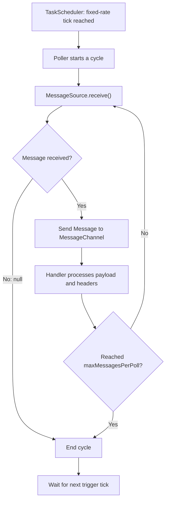

# Fixed-Rate Trigger for Polling Adapters in Spring Integration

## 1. Context: Why Does an Inbound Adapter Need a Poller?

Many external systems do not push events into your application when new data arrives. For example, a directory receiving CSV files from a partner, a database table holding records to synchronize, or an SFTP server storing newly uploaded files. The application must **actively check periodically** whether the source has data to retrieve. In Spring Integration, this is the *polling* model.

A **polling inbound adapter** combines two responsibilities:

- **Message source / inbound adapter:** reads the external source and converts the received data into a `Message<?>` according to the Spring Integration message contract. With `FileReadingMessageSource`, the payload is a `File` object.
- **Poller:** decides *when* to call `receive()` on the message source and *how many messages at most* to retrieve per poll. The poller coordinates with a `TaskScheduler` to perform the polling cycles.

`fixed-rate` is a way to configure the trigger for a poller: it sets the **period between scheduled start times**. For instance, `fixed-rate = 5000 ms` means the scheduler attempts to start a polling cycle every 5 seconds, following the schedule cadence, if execution resources allow.

This knowledge applies directly to pull-style inbound adapters in the **SPRING_INTEGRATION_ADAPTERS** module, including file, SFTP, and other data sources that require periodic polling. For HTTP/JMS/AMQP/Kafka, it is necessary to distinguish adapters that actively receive data via event-listening/push mechanisms from adapters that genuinely need a poller; **not every adapter needs a `fixed-rate` configuration**.

**Learning goal:** accurately explain fixed-rate, implement file polling inbound adapters using annotations, choose appropriate polling intervals and message limits, and identify the impact of slow processing, errors, and duplicates.

## 2. How Does Fixed-Rate Work?

Suppose the polling interval is 5 seconds (`fixedRate = "5000"`). If the work in each cycle finishes quickly and the scheduler has sufficient capacity, the expected schedule is:

```text
Time (seconds):     0         5        10        15        20
                    |---------|---------|---------|---------|
Polling cycle:      P1        P2        P3        P4        P5
                    ^         ^         ^         ^         ^
                    start points following the fixed-rate cadence
```

Each polling cycle can call `receive()` multiple times depending on the `maxMessagesPerPoll` configuration. If there is no data, the message source returns `null` and that cycle ends early; the next scheduled check still remains.

### How Does Fixed-Rate Differ from Fixed-Delay and Cron?

| Trigger | Scheduling Rule | Suitable Example |
| --- | --- | --- |
| **Fixed-rate** | Starts are scheduled at a periodic cadence from the previous scheduled start time. | Checking an input folder at a relatively steady cadence. |
| **Fixed-delay** | Waits a specified interval **after the previous cycle completes** before starting the next one. | Ensuring a rest period between two queries to a resource-intensive source. |
| **Cron** | Runs at specific wall-clock times according to a cron expression. | Synchronizing at the first minute of every hour or during business time windows. |

For example, if one cycle takes 7 seconds and the interval is 5 seconds:

```text
Fixed-rate (expected): 0s ---- 5s ---- 10s ---- 15s ---- 20s
Actual:                [7s processing][next cycle may start immediately after]

Fixed-delay 5s:        [7s processing] -- wait 5s -- [next processing]
                       0         7            12
```

This is an illustrative diagram, not a guarantee of exact execution times. **Fixed-rate does not guarantee that all cycles run strictly on time**. When a cycle runs longer than the period, tasks can be delayed and the next cycle runs immediately after the previous one; you must not rely on fixed-rate as a real-time guarantee. A periodic task in a standard synchronous scheduler configuration does not automatically run concurrently with itself, though processing can overlap if you offload work to a `TaskExecutor`, use asynchronous threads, or design independent pollers.

## 3. Lifecycle of a Polling Cycle



You need to distinguish three commonly confused parameters:

1. **`fixedRate`** determines the trigger cadence of polling cycles, for example every 5,000 milliseconds.
2. **`maxMessagesPerPoll`** limits the number of messages received **in a single cycle**, not messages per second or concurrent tasks.
3. **Actual processing time** includes time to read the source, send the message through the channel, and execute the handler (if the processing path is synchronous). This portion can cause the actual cycle to differ from the expected schedule.

With `fixedRate = 5000` and `maxMessagesPerPoll = 10`, suppose the directory already has 25 files, each file is processed very quickly, and no new files arrive: the first cycle can take 10 files, the second cycle takes 10 files, and the third cycle takes 5 files. The exact file order also depends on how the source lists/filters files. If the first cycle only finds 3 files, the poller stops after 3 messages instead of creating 7 dummy messages.

## 4. Complete Example: Scanning a CSV Directory Every 5 Seconds

The application receives `.csv` files placed into `data/inbox` by another system. Every 5 seconds, it checks the directory, takes at most 10 files per cycle, and forwards each file into a `DirectChannel` for processing. This is an example of a **file inbound adapter**; the same poller concept applies to other polling-capable message sources.

### 4.1. Dependencies

In a Spring Boot project managing dependency versions via BOM, you need Spring Integration and the file adapter module, for example with Maven:

```xml
<dependencies>
    <dependency>
        <groupId>org.springframework.boot</groupId>
        <artifactId>spring-boot-starter-integration</artifactId>
    </dependency>
    <dependency>
        <groupId>org.springframework.integration</groupId>
        <artifactId>spring-integration-file</artifactId>
    </dependency>
</dependencies>
```

The example below uses the familiar annotation-based Spring Integration configuration. Before running, create the `data/inbox` directory relative to the application's working directory and place a few valid `.csv` files in it.

### 4.2. Configuring the Inbound Adapter, Channel, and Handler

```java
import java.io.File;
import java.io.IOException;
import java.nio.charset.StandardCharsets;

import org.springframework.context.annotation.Bean;
import org.springframework.context.annotation.Configuration;
import org.springframework.integration.annotation.InboundChannelAdapter;
import org.springframework.integration.annotation.Poller;
import org.springframework.integration.annotation.ServiceActivator;
import org.springframework.integration.channel.DirectChannel;
import org.springframework.integration.config.EnableIntegration;
import org.springframework.integration.core.MessageSource;
import org.springframework.integration.file.FileReadingMessageSource;
import org.springframework.integration.file.filters.AcceptOnceFileListFilter;
import org.springframework.messaging.MessageChannel;

@Configuration
@EnableIntegration
public class FilePollingConfiguration {

    @Bean
    public MessageChannel incomingFiles() {
        return new DirectChannel();
    }

    @Bean
    @InboundChannelAdapter(
        channel = "incomingFiles",
        poller = @Poller(fixedRate = "5000", maxMessagesPerPoll = "10")
    )
    public MessageSource<File> csvFileSource() {
        FileReadingMessageSource source = new FileReadingMessageSource();
        source.setDirectory(new File("data/inbox"));
        source.setFilter(new AcceptOnceFileListFilter<>());
        return source;
    }

    @ServiceActivator(inputChannel = "incomingFiles")
    public void processCsv(File file) throws IOException {
        if (!file.getName().endsWith(".csv")) {
            return;
        }

        String content = java.nio.file.Files.readString(
            file.toPath(), StandardCharsets.UTF_8
        );
        System.out.printf("Processed %s (%d chars)%n",
            file.getName(), content.length());
    }
}
```

**Explanation of each part:**

- `FileReadingMessageSource` scans the directory and returns each `Message<File>`. It handles fetching data, while the poller decides when to call `receive()`.
- `@InboundChannelAdapter` binds the source to the `incomingFiles` channel; `@Poller(fixedRate = "5000", maxMessagesPerPoll = "10")` configures a 5-second cadence and a limit of 10 messages per cycle. The default unit for the interval here is **milliseconds**.
- `AcceptOnceFileListFilter` prevents a running instance from repeatedly picking up the same already-accepted file. This is an in-memory stateful filter; it does **not** provide persistent deduplication across restarts.
- `DirectChannel` invokes the handler on the same thread that sends the message in a synchronous model. Therefore, a long-running handler can make the polling cycle take longer than expected.
- `@ServiceActivator` processes the `File` payload. The `readString()` part only simulates business logic; a real system should parse the CSV content, validate it, and move the file to a completed or error area according to its own policy.

The example intentionally checks the file extension in the handler for readability. In a real application, you should **filter files right at the message source** (for example, a pattern filter combined with a deduplication filter) so irrelevant files do not consume poll quota and are not marked as received.

### 4.3. Observing Behavior

1. Start the application when `data/inbox` is empty. The poller still triggers periodically; if the source returns `null`, the handler receives no message.
2. Add `order-001.csv` and `order-002.csv` to the directory. On a subsequent polling cycle, the console prints processing information for both files.
3. Keep the application running without changing the files: `AcceptOnceFileListFilter` prevents re-processing the two already-accepted files.
4. Add more than 10 files before a new cycle: observe the number of files processed per cycle; do not assume all files will be processed at once.
5. Try making the handler take longer than 5 seconds to see how the actual cadence can lag and affect the backlog.

Do not use second-level log timestamps to conclude that the scheduler runs with millisecond precision: startup time, OS latency, source activity, and thread pool load can all have an effect.

## 5. Configuring Polling Cadence per Environment

In a development environment you might scan once every 2–5 seconds; in production, the cadence depends on SLAs, source resource limits, and processing speed. To avoid modifying code when changing configuration, you can use property placeholders:

```yaml
# application.yml
app:
  file-poller:
    fixed-rate-ms: 5000
    max-messages-per-poll: 10
```

```java
@InboundChannelAdapter(
    channel = "incomingFiles",
    poller = @Poller(
        fixedRate = "${app.file-poller.fixed-rate-ms:5000}",
        maxMessagesPerPoll = "${app.file-poller.max-messages-per-poll:10}"
    )
)
```

This second annotation snippet **replaces** the corresponding annotation in the Java configuration above; do not place two `@InboundChannelAdapter` annotations on a single source at the same time. Placeholder values are resolved when the context initializes; changing `application.yml` typically requires restarting the application to take effect, unless you explicitly build a dynamic configuration mechanism.

With Java DSL, the equivalent idea is declaring the poller right when creating the flow from the source, for example:

```java
IntegrationFlow.from(
    Files.inboundAdapter(new File("data/inbox")).patternFilter("*.csv"),
    endpoint -> endpoint.poller(
        Pollers.fixedRate(java.time.Duration.ofSeconds(5))
               .maxMessagesPerPoll(10)
    )
);
```

This is a **partial flow configuration snippet** to illustrate where `Pollers.fixedRate(...)` goes, not a complete `IntegrationFlow`; you must chain the appropriate handler/channel and call `.get()` inside a flow bean. `Files` here is the `org.springframework.integration.file.dsl.Files` factory, and `Pollers` belongs to `org.springframework.integration.dsl.Pollers`; do not confuse this `Files` with `java.nio.file.Files`.

## 6. Choosing fixed-rate and maxMessagesPerPoll Based on Load

### Two Limits Controlling Two Different Dimensions

| Scenario | Initial Choice | What to Check |
| --- | --- | --- |
| Low-volume source needing fast response | Short interval, e.g., 1–2 seconds; moderate message limit | Cost of each source call when no data is present. |
| Source with batches of hundreds of files | Suitable interval, `maxMessagesPerPoll` large enough to drain backlog | Whether processing one cycle exceeds the interval. |
| SFTP/DB with access limits | Lower check frequency or use fixed-delay | Request rate, connections, timeouts, and source-side quotas. |
| CPU/I/O-intensive handler | Reduce messages per poll or design bounded asynchronous processing | Queue depth, throughput, potential overlap, and processing order. |

An estimate **for planning purposes only** is `maxMessagesPerPoll / period`. For example, 10 messages every 5 seconds corresponds to a nominal ceiling of about 2 messages/second **if** every cycle actually retrieves all 10 messages and processes them quickly. This is not guaranteed throughput: data arrival rate, handler duration, network I/O, errors, and `TaskScheduler` capacity can all reduce it.

A fast cadence paired with a large batch size can pile a lot of work onto the poller thread. If multiple polling adapters share the same scheduler, one long-blocking task can affect the remaining tasks; you need to size the scheduler, design asynchronous processing, and apply backpressure based on actual load.

### What Fixed-Rate Does Not Solve by Itself

- **Does not guarantee exactly-once:** the poller decides when to read, not end-to-end transactions between the external system and business logic.
- **Does not replace retries:** if the adapter has already accepted a file but the handler fails, the next polling cycle is not guaranteed to pick up that file again; especially with an accept-once filter.
- **Does not prevent reading files still being written:** partners should write to a temporary directory and atomically rename/move to the inbox upon completion, or use a file-readiness confirmation mechanism.
- **Does not automatically preserve business order:** file listing order, parallel processing, and retries can change the order of receipt/completion.
- **Does not turn the source into push-based:** even with a short interval configured, the application still polls periodically and incurs polling overhead.

## 7. Errors, File State, and Connection Lifecycle

When using fixed-rate with files, SFTP, or databases, you must clearly define three states: **detected**, **accepted into the message flow**, and **business-completed**. These three moments do not always coincide.

**Risk example:** the message source accepts `order-123.csv` and sends it to `DirectChannel`; the handler encounters a DB write error. `AcceptOnceFileListFilter` may have already recorded the file in memory. At the next 5-second interval, the source does not automatically re-emit that file. Simply speeding up `fixedRate` will not recover the lost processing opportunity.

For systems with high reliability requirements:

1. Define file readiness criteria (finished writing, matching filename pattern, not currently changing); ingest the file using a safe mechanism appropriate for the source.
2. Use a filter or metadata store with **persistent** state if files must remain recognized across restarts. File acceptance state should be designed alongside retry policies, rather than treating the filter as confirmation of business success.
3. Design **idempotent** handlers keyed by a business identifier, such as an order ID or file key, so duplicate processing does not create duplicate orders.
4. Configure retry/backoff and an error route (typically via Spring Integration's `errorChannel`/error flow mechanism) so failures are recorded and have a clear recovery path.
5. After successful processing, move the file to an archive directory or mark its status in a controlled manner. For SFTP, also monitor connection sessions, timeouts, and recovery behavior during network interruptions.

**Note:** `maxMessagesPerPoll` is not a transaction size. Taking 10 messages in a single cycle does not mean all 10 messages commit or roll back together. Transaction boundaries depend on the specific adapter, channel, handler, and transaction advice configuration.

## 8. Observability and Diagnostics

In production deployments, you need to measure the **actual time between polls**, messages received per cycle, backlog depth, processing duration, error count, and retry rate. Some common symptoms:

| Symptom | Causes to Check | Remediation |
| --- | --- | --- |
| Poller runs but no messages arrive | Wrong directory, filter excludes all files, source has no data yet, or external connection failed. | Check source configuration, path, filter, access permissions, and error logs. |
| Files are available but picked up very slowly | Long `fixedRate`, high backlog, `maxMessagesPerPoll` too small, or slow handler. | Measure actual processing time, then tune interval/batch size. |
| Logs appear almost continuously despite 5-second fixed-rate | Previous cycle ran longer than the interval, or multiple pollers/threads run independently. | Inspect per-endpoint timestamps and scheduler utilization. |
| Files are re-ingested after restart | Filter is only stored in RAM or metadata storage is misconfigured. | Add persistent state and idempotent business logic. |
| Failed files are not re-read | Already accepted by the filter before the handler failed. | Build a retry/recovery policy aligned with the file lifecycle. |

You should also monitor the **age of the oldest remaining data** (lag) instead of only counting how many times the scheduler triggers. A poller running steadily every 5 seconds while the backlog grows continuously is still a pipeline failing to keep up with load.

## 9. Self-Check Exercises

**Exercise 1 — Predict the polling schedule.** A poller runs with `fixedRate = 3000 ms`, `maxMessagesPerPoll = 4`. One cycle receives all 4 files and processes them in 500 ms. Assuming the scheduler is not congested, how long after the previous scheduled start time is the next scheduled start time? **Answer:** about 3 seconds, not 3.5 seconds. If fixed-delay of 3 seconds were chosen instead, the next cycle would start about 3 seconds *after the previous cycle finished*.

**Exercise 2 — Calculate minimum cycles.** There are 23 files ready, the filter excludes none, `maxMessagesPerPoll = 5`, and the handler processes quickly with no errors. At least how many polling cycles are needed to receive them all? **Answer:** 5 cycles (5 + 5 + 5 + 5 + 3). `fixedRate` determines the scheduled spacing between those cycles.

**Exercise 3 — Error handling.** The handler fails on a file after `AcceptOnceFileListFilter` has already accepted it. Can you expect the poller to automatically re-read the file after 5 seconds? **Answer:** no; appropriate retry/recovery policies and acceptance state management are needed.

**Exercise 4 — Design.** An SFTP server limits access frequency, and each sync can take 20 seconds. Consider fixed-delay or a longer fixed-rate period, set appropriate timeouts and retries, and monitor the backlog. The poller cadence must be chosen based on source characteristics and acceptable latency, not merely a desire for "as fast as possible."

## 10. Takeaways

`fixed-rate` configures the **scheduled start cadence** for a polling endpoint in Spring Integration. `MessageSource` fetches data, the poller coordinates data retrieval, and `MessageChannel` plus handlers process the `Message`. Use `maxMessagesPerPoll` to bound the workload per cycle, monitor execution duration when handlers are slow, and design dedicated retry/idempotency mechanisms when data requires reliable processing. With fixed-rate, the goal is a steady checking cadence when conditions allow — not exact wall-clock timing or a guarantee against lost/duplicate messages.
