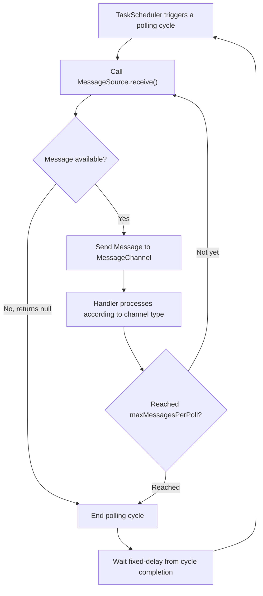

# Fixed-Delay Trigger and Differences from Fixed-Rate in Spring Integration

## 1. Problem Statement: Checking an External Source Without Overloading It

A Spring Integration application needs to fetch new files from a partner directory, synchronize data from an SFTP server, or read unprocessed records from a database. These sources typically do not actively push messages to the application; the application must **poll** them on a schedule. Checking too frequently can generate excessive requests against the source. If each cycle takes a long time while the schedule still tries to maintain a high frequency, consecutive cycles can run back-to-back and make the backlog hard to control.

In the **SPRING_INTEGRATION_ADAPTERS** module, an inbound adapter receives data from an external system and sends it into a **MessageChannel** as a **Message**; the **poller** decides when to invoke the message source to retrieve data. For polling-style adapters (such as file, SFTP, JDBC), a key choice is whether to use a **fixed-delay** or **fixed-rate** trigger.

**Fixed-delay** means: after **one polling cycle finishes**, wait for the full configured duration before starting the next cycle. As a result, the rest interval between two cycles is not shortened merely because the previous cycle took longer to process.

After this lesson, you will be able to:

- Distinguish the scheduling timestamps of fixed-delay and fixed-rate using concrete timelines.
- Configure `@Poller(fixedDelay = "...")` for an inbound adapter.
- Understand why `maxMessagesPerPoll`, synchronous/asynchronous channels, and handler duration affect the actual cadence.
- Choose the appropriate trigger for file, SFTP, and database adapters; handle backlog, retries, and duplicate messages.

## 2. From Which Point Is Fixed-Delay Measured?

Let:

- `D`: the configured fixed delay, for example 5 seconds.
- `Tₙ`: the duration from when polling cycle `n` starts until that cycle **finishes**.
- `Sₙ`: the start time of cycle `n`.

Assuming the scheduler can execute on schedule:

\[
S_{n+1} = S_n + T_n + D
\]

For example, if a poller uses a 5-second fixed-delay and the first cycle starts at second 0 and takes 2 seconds:

```text
Seconds:    0    2         7    9        14   16       21
            |----|---------|----|---------|----|--------|
Poll cycle: [ P1 ]-- 5s --[ P2 ]-- 5s --[ P3 ]-- 5s --[P4...]
            start end      start end      start end
```

The expected start times are **0, 7, 14, 21 seconds**, because each cycle works for 2 seconds and then rests for 5 seconds. If a cycle takes 8 seconds, the gap between two starts is correspondingly 13 seconds, not 5 seconds.

**Key point:** fixed-delay only guarantees how time is calculated *between the completion of a scheduled task and the start of the next task*. It is not a guarantee that the system will execute with millisecond precision; scheduler threads can be busy, the OS can introduce delays, and the data source can respond slowly.

In Spring Integration, a "polling cycle" can consist of **multiple calls to `MessageSource.receive()`**, until `maxMessagesPerPoll` is reached or the source returns `null`. The cycle end time therefore depends on all the work performed during that cycle.

## 3. Comparing Fixed-Delay and Fixed-Rate

### 3.1. Scheduling Differences

| Criterion | Fixed-delay | Fixed-rate |
| --- | --- | --- |
| Reference point for the next run | After **the previous cycle finishes** | According to the **periodic cadence between scheduled start times** |
| Configured interval 5s, cycle takes 2s | Expected starts at 0, 7, 14, 21 seconds | Expected starts at 0, 5, 10, 15 seconds |
| If the previous cycle took 8 seconds | Next cycle starts no earlier than 13 seconds from the start of the previous cycle | The 5-second tick is delayed; the next cycle may run immediately/right after the previous task finishes, depending on the scheduler |
| Rest interval after the previous cycle | Attempts to preserve the full configured delay | Can be short or nearly 0 when the previous cycle runs slowly |
| Common goal | Maintain rest time for the external source | Maintain a relatively steady check cadence |
| Limitation | Polling frequency drops if processing takes long | Slow cycles can delay the schedule and cause cycles to run back-to-back |

Suppose `D = 5 seconds` and all three cycles take 8 seconds to process:

```text
FIXED-DELAY
0s       8s    13s      21s   26s       34s
|-- P1 --|.....|-- P2 --|.....|-- P3 --|
         wait 5s       wait 5s

FIXED-RATE (scheduled ticks 0s, 5s, 10s, 15s, ...)
0s       8s       16s      24s
|-- P1 --|-- P2 --|-- P3 --|
        P2, P3 start late relative to expected ticks
```

In standard periodic execution by a `TaskScheduler`, consecutive runs of **the same task** do not overlap by default. Nevertheless, multiple independent polling endpoints, channels using an executor, or work offloaded to other threads can still run concurrently; choosing fixed-delay **does not replace concurrency limits**.

### 3.2. Is Fixed-Rate Always Faster?

No. When work is lightweight and steady, fixed-rate usually produces more polling cycles within the same time window because it does not add processing time to the interval. However, if the network source is slow or the scheduler is overloaded, the actual frequency can be lower than the expected schedule.

For example, if an SFTP call takes 12 seconds, each cycle using a 5-second fixed-delay will start roughly every 17 seconds (assuming no extra scheduler delay). A 5-second fixed-rate may try to run the next cycle right after the previous one finishes to catch up with the schedule. This behavior may be unsuitable if the external server needs breathing room between cycles.

### 3.3. What About Cron?

A cron trigger runs at **wall-clock times**, for example at the top of the hour or daily at 01:00. Choose cron when there is a business clock-time requirement; choose fixed-delay when you need a rest interval after processing; choose fixed-rate when you want a periodic check cadence measured from scheduled start times. All three depend on the scheduler's execution capacity.

## 4. How the Poller Coordinates the Inbound Adapter



Three concepts to keep separate:

1. **`fixedDelay`** is the rest interval between two polling *cycles*, not the pause between individual messages. The unit commonly used in `@Poller` is milliseconds.
2. **`maxMessagesPerPoll`** is the maximum number of messages received in **one cycle**, not the number of processing threads, throughput, or retry count.
3. **`MessageChannel`** determines how messages are dispatched. With `DirectChannel`, handler invocation typically happens synchronously on the poller thread; with an asynchronously configured channel, the poller can finish sending the message before business processing completes.

Thus, "the polling cycle finished" **does not necessarily mean** "all downstream business tasks have completed." You must examine the actual topology before relying on fixed-delay to throttle an external source.

## 5. Practice: Scanning CSV Files with Fixed-Delay

Suppose a partner places order files into the `data/inbox` directory. The application needs to check for new files, but must wait at least 5 seconds after **each scan-and-dispatch cycle** before scanning again.

### 5.1. Dependencies

In a Spring Boot application managing dependency versions with a BOM:

```xml
<dependencies>
    <dependency>
        <groupId>org.springframework.boot</groupId>
        <artifactId>spring-boot-starter-integration</artifactId>
    </dependency>
    <dependency>
        <groupId>org.springframework.integration</groupId>
        <artifactId>spring-integration-file</artifactId>
    </dependency>
</dependencies>
```

Create the `data/inbox` directory beforehand relative to the application's working directory. Place CSV content in each file to simulate incoming orders.

### 5.2. Spring Integration Configuration

```java
import java.io.File;
import java.io.IOException;
import java.nio.charset.StandardCharsets;
import java.nio.file.Files;

import org.springframework.context.annotation.Bean;
import org.springframework.context.annotation.Configuration;
import org.springframework.integration.annotation.InboundChannelAdapter;
import org.springframework.integration.annotation.Poller;
import org.springframework.integration.annotation.ServiceActivator;
import org.springframework.integration.channel.DirectChannel;
import org.springframework.integration.config.EnableIntegration;
import org.springframework.integration.core.MessageSource;
import org.springframework.integration.file.FileReadingMessageSource;
import org.springframework.integration.file.filters.AcceptOnceFileListFilter;
import org.springframework.integration.file.filters.CompositeFileListFilter;
import org.springframework.integration.file.filters.SimplePatternFileListFilter;
import org.springframework.messaging.MessageChannel;

@Configuration
@EnableIntegration
public class CsvInboundPollingConfig {

    @Bean
    public MessageChannel csvInputChannel() {
        return new DirectChannel();
    }

    @Bean
    @InboundChannelAdapter(
        channel = "csvInputChannel",
        poller = @Poller(
            fixedDelay = "5000",
            maxMessagesPerPoll = "5"
        )
    )
    public MessageSource<File> csvFileSource() {
        FileReadingMessageSource source = new FileReadingMessageSource();
        source.setDirectory(new File("data/inbox"));

        CompositeFileListFilter<File> filters =
            new CompositeFileListFilter<>();
        filters.addFilter(new SimplePatternFileListFilter("*.csv"));
        filters.addFilter(new AcceptOnceFileListFilter<>());
        source.setFilter(filters);

        return source;
    }

    @ServiceActivator(inputChannel = "csvInputChannel")
    public void handleCsv(File file) throws IOException {
        String csv = Files.readString(
            file.toPath(), StandardCharsets.UTF_8);

        System.out.printf(
            "Received %s (%d chars)%n",
            file.getName(), csv.length()
        );

        // TODO: parse, validate, and save the order according to business logic.
    }
}
```

**How to read the configuration:**

- `FileReadingMessageSource` is the inbound message source that reads files. It does not decide on its own when it gets called.
- `@InboundChannelAdapter` creates the polling endpoint and pushes received messages into `csvInputChannel`.
- `@Poller(fixedDelay = "5000", maxMessagesPerPoll = "5")` sets a **5,000 ms pause after the previous cycle completes**, with at most **5 files/messages per cycle**.
- `SimplePatternFileListFilter` filters filenames matching `*.csv`; `AcceptOnceFileListFilter` prevents re-emitting files already accepted by the filter during the instance's lifetime using in-RAM state. This filter **does not replace** a confirmed-success processing mechanism.
- `DirectChannel` and `@ServiceActivator` demonstrate how handler duration affects the duration of the polling cycle. Reading and processing each file runs on the default synchronous path.

The example above is sufficient for a practice environment. In production, you need to verify that files are completely written, define an archive/retry policy, and avoid running business handlers on files still being modified by a partner.

### 5.3. Observing Each Scenario

**Case A — no files.** Each cycle calls the source, finds no data, and ends early. The next run is scheduled roughly 5 seconds after that cycle completes. No empty message is generated to push to the handler.

**Case B — three files, total processing takes 1.5 seconds.** In one cycle, the source can dispatch all three files through `DirectChannel`; only when the cycle finishes does the poller start counting 5 more seconds before the next cycle. The interval between two start times is approximately **6.5 seconds** (excluding overhead).

**Case C — 14 files, at most 5 files per cycle.** If the source continues supplying files and no errors occur, at least **3 cycles** are needed to receive all of them (5 + 5 + 4 files). Each cycle starts only after the configured rest interval from when the previous cycle finished.

**Case D — handler takes 2 seconds per file.** A cycle taking 5 files can run for about 10 seconds (excluding other I/O), then wait 5 seconds before starting the next cycle. Thus the interval between two starts can be around **15 seconds**, even though `fixedDelay` is configured as only 5 seconds.

## 6. Configuring via Properties and Java DSL

### 6.1. Externalizing the Delay to application.yml

```yaml
app:
  adapters:
    file:
      poll-delay-ms: 5000
      batch-size: 5
```

In the `csvFileSource()` method, replace the `@InboundChannelAdapter` annotation with the property-referencing version:

```java
@InboundChannelAdapter(
    channel = "csvInputChannel",
    poller = @Poller(
        fixedDelay = "${app.adapters.file.poll-delay-ms:5000}",
        maxMessagesPerPoll = "${app.adapters.file.batch-size:5}"
    )
)
```

The `:` in the placeholder provides a default value if the property is not declared. Typically, values are resolved when the application context is created; editing the configuration file after the application is running does not mean the poller schedule updates automatically.

### 6.2. Java DSL

With Spring Integration's Java DSL, configure the trigger following the same principle:

```java
import java.io.File;
import java.time.Duration;

import org.springframework.context.annotation.Bean;
import org.springframework.integration.dsl.IntegrationFlow;
import org.springframework.integration.dsl.Pollers;
import org.springframework.integration.file.dsl.Files;

@Bean
IntegrationFlow fixedDelayFileFlow() {
    return IntegrationFlow
        .from(
            Files.inboundAdapter(new File("data/inbox"))
                 .patternFilter("*.csv"),
            endpoint -> endpoint.poller(
                Pollers.fixedDelay(Duration.ofSeconds(5))
                       .maxMessagesPerPoll(5)
            )
        )
        .handle(message -> {
            File file = (File) message.getPayload();
            System.out.println("Received: " + file.getName());
        })
        .get();
}
```

The DSL snippet illustrates how to connect the source, poller, and handler in a single flow. `org.springframework.integration.file.dsl.Files` is the factory for the file inbound adapter, distinct from `java.nio.file.Files`. When using both DSL and annotations in the same application, declare only **one polling endpoint** for the same processing flow unless duplicate reception is intentional.

## 7. When Should You Choose Fixed-Delay?

| Adapter Context | Why Fixed-Delay May Be Chosen | Additional Considerations |
| --- | --- | --- |
| **SFTP inbound** | Allows a rest interval between access rounds to the external server. | Connection limits, session timeouts, reconnects, file download speed. |
| **Database inbound** | Avoids issuing queries immediately after a heavy query/processing batch. | Transactions, locks, indexes, batch size, and processed-record status. |
| **File inbound** | Suitable when directory scanning or per-batch file processing is time-consuming. | Incomplete files, deduplication filters, archive directories. |
| **HTTP polling to external APIs** | Inserts a rest gap between request or sync rounds. | Rate limits, retry/backoff, timeouts, and response status codes. |

With JMS, AMQP, or Kafka, many common inbound configurations operate via **listener/event-driven** mechanisms rather than a periodic poller. Do not add fixed-delay to an adapter simply because it receives data from an external system; check whether that adapter is polling-based or message-driven. For an outbound adapter whose input is a `PollableChannel`, a poller can also coordinate pulling messages from the channel, though that is a different problem from an inbound message source.

**Practical selection rules:**

- Choose **fixed-delay** when prioritizing a steady rest interval after a processing cycle to avoid piling scans onto a slow source.
- Choose **fixed-rate** when you want a relatively uniform periodic start cadence and processing time is usually small compared to the interval.
- Choose **cron** when wall-clock timing is part of the business requirement.

No trigger guarantees an SLA by itself. You must measure message reception latency, backlog, and processing throughput on real data.

## 8. Common Pitfalls in Real-World Systems

### 8.1. Mistaking Fixed-Delay for a Pause Between Individual Messages

If `maxMessagesPerPoll = 5`, the poller can call `receive()` and send messages over the channel **up to five times within the same cycle** without inserting a 5-second pause between each message. Fixed-delay only starts counting when **the entire cycle** finishes.

If a source requires at most one request every 5 seconds, adjust how the source is invoked, limit `maxMessagesPerPoll`, or use an appropriate rate-limiting mechanism; a standalone fixed-delay configuration with a batch of 5 can still issue multiple consecutive calls within one cycle.

### 8.2. Assuming Fixed-Delay Waits Until Asynchronous Processing Finishes

The diagram below shows two different topologies:

```text
SYNCHRONOUS:
Poller -> MessageSource -> DirectChannel -> Handler (3 seconds)
                                              |
                                              +-- handler finishes
                                                  -> poll cycle finishes
                                                      -> wait delay

ASYNCHRONOUS:
Poller -> MessageSource -> ExecutorChannel -> submit work to executor
                                              |
                                              +-- poller may finish early
                                                  -> wait delay
          Another worker runs handler (may still be running)
```

Therefore, fixed-delay waits until the **polling task finishes**, without inherently knowing when a background worker completes business logic. If you need to cap total concurrent work, configure executor/queue limits, apply backpressure, or design explicit acknowledgements as required.

### 8.3. Assuming Polling Equals Exactly-Once Processing

Suppose `AcceptOnceFileListFilter` accepts `order-001.csv`, but the handler fails while writing to the database. The file may not be re-emitted in subsequent cycles because the filter already remembers it. Fixed-delay only controls the schedule; it does not restore business state.

In a pipeline requiring high reliability:

1. Confirm that source data is ready (e.g., files are renamed or moved into the inbox after writing completes).
2. Design **idempotency** based on a business key or source identifier.
3. Choose persistent metadata storage if files must be tracked across restarts.
4. Set up retry/backoff, an error-handling route, and a recovery workflow for failed data.
5. Distinguish between **detected**, **message sent**, and **successfully processed** states.

### 8.4. Backlog Growing When Processing Takes Long

Fixed-delay does not stack tasks to "catch up" with scheduled ticks, so for the same processing speed and batch size, the average ingestion rate can be lower than fixed-rate. If data arrives faster than it can be processed, the backlog will grow even though poll cycles keep firing normally.

A simple estimate for synchronous processing is:

\[
\text{Theoretical throughput (messages/s)}
\approx \frac{N}{T + D}
\]

Where `N` is the number of messages actually retrieved per cycle, `T` is the duration of that cycle, and `D` is the fixed-delay. For example, if each cycle receives 5 messages, takes 10 seconds to process, and waits 5 seconds, the nominal average rate is **5 / 15 ≈ 0.33 messages/second**. This formula is only for estimation under steady conditions; it does not fully reflect scheduler contention, network jitter, retries, or asynchronous execution.

### 8.5. Not Measuring Errors and Scheduler Latency

You need to observe the start/end time of each cycle, messages per cycle, `receive()` duration, backlog depth, error rate, and end-to-end processing time. If a poller shares a scheduler with many other tasks, long-blocking tasks can cause schedule drift. When a cycle throws an exception, error handling and continued scheduling depend on the error handler, advice, and endpoint configuration; test your recovery policy instead of assuming fixed-delay retries automatically.

## 9. Exercises with Answers

**Exercise 1 — Calculate start times.** A poller runs with `fixedDelay = 4000 ms`. The first cycle starts at second 0 and takes 3 seconds; the second cycle takes 6 seconds. Ignoring all other delays, when do the second and third cycles start?

**Answer:** Cycle 2 at second **7** (0 + 3 + 4); cycle 3 at second **17** (7 + 6 + 4).

**Exercise 2 — Replacing fixed-delay with fixed-rate.** With `fixedRate = 4000 ms` and all cycles taking 3 seconds, what is the expected start schedule?

**Answer:** Seconds **0, 4, 8, 12...**. Unlike a 4-second fixed-delay with 3-second processing time, which starts at **0, 7, 14, 21...**.

**Exercise 3 — Batch limit.** The source has 11 valid files, `maxMessagesPerPoll = 4`, each cycle processes quickly, and there are no errors. At least how many cycles are required?

**Answer:** **3 cycles**: 4 + 4 + 3 files. There is no mandatory fixed-delay between individual files within the same cycle.

**Exercise 4 — Topology analysis.** A 5-second fixed-delay poller sends files through an `ExecutorChannel`. The handler runs for 20 seconds. Will the next cycle only start after the handler finishes?

**Answer:** **Not necessarily.** The polling task can finish right after submitting work to the executor. The 5-second interval is measured from when the task finishes; the asynchronous handler may still be running.

**Exercise 5 — Engineering decision.** An SFTP system only allows sparse polling and one cycle can take 30 seconds. Choose fixed-delay or fixed-rate?

**Suggestion:** Prefer **fixed-delay** when you need a guaranteed rest interval after an access cycle, while controlling timeouts, batch size, rate limits, and retries. If the SLA demands lower latency than this cadence, balance it using real metrics and server capacity.

## 10. Takeaways

**Fixed-delay = finish one cycle, wait the full configured interval, then schedule the next cycle.** **Fixed-rate = try to maintain start ticks on the configured periodic cadence**, so when a task processes slowly, the actual schedule can lag and the next cycle runs right behind the previous one. In Spring Integration, the rest interval is measured over the **entire polling cycle**; it is affected by `maxMessagesPerPoll`, the `MessageChannel` type, and downstream handler duration under synchronous processing. Choose the trigger based on SLA, external system load, backlog, and error handling; a polling schedule alone cannot guarantee exactly-once delivery, retries, or business completion.
