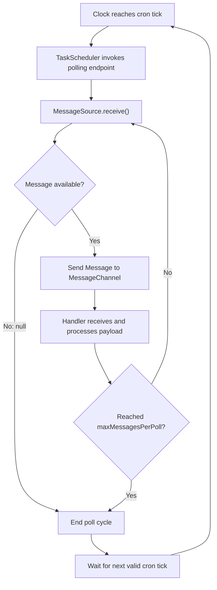

# Cron Trigger for Data Ingestion Schedules in Spring Integration

## 1. Problem Statement: Receiving Data at Exact Business Times

An ordering system receives reconciliation files at the top of every hour; a financial service pulls reports at 02:00 daily; an operations team only allows data scanning at 08:30 from Monday to Friday. These requirements are tied to **wall-clock times**, unlike the requirement "rest 5 seconds and check again."

In the **SPRING_INTEGRATION_ADAPTERS** module, a **polling inbound adapter** retrieves data from external systems such as a file directory, SFTP, or a database. The adapter or `MessageSource` decides *how* to receive data, while the **poller** decides *when* to call `receive()` and then send a `Message` to a `MessageChannel`. For schedules tied to real-world wall-clock time, Spring Integration supports the **cron trigger**.

For example, cron `0 0 2 * * *` requests triggering at **02:00:00 daily according to the trigger's time zone**. This instruction does not mean the work will finish at 02:00 or that all data will be received in a single run; it specifies the **poller trigger point**.

After this lesson, you will be able to read and write Spring's six-field cron expressions, declare `@Poller(cron = "...")`, use the Java DSL, choose the right time zone, and handle backlogs, slow handlers, errors, and daylight saving time changes.

## 2. Spring Cron Has Six Fields

Cron expressions used by Spring for polling typically have this format:

```text
┌───────────── second            (0-59)
│ ┌─────────── minute            (0-59)
│ │ ┌───────── hour              (0-23)
│ │ │ ┌─────── day of month      (1-31)
│ │ │ │ ┌───── month             (1-12 or JAN-DEC)
│ │ │ │ │ ┌─── day of week       (0-7 or MON-SUN; 0 and 7 are Sunday)
│ │ │ │ │ │
* * * * * *
```

**Note:** Spring's cron syntax has **six fields, starting with seconds**. Common cron on Linux usually has five fields and starts with minutes. Do not copy a five-field schedule directly from `crontab` into `@Poller(cron = ...)` without converting it. Some Quartz variants also have a year field at the end, which is not part of this basic format.

Commonly used characters:

| Symbol | Meaning | Example |
| --- | --- | --- |
| `*` | Every valid value for the field | `*` in month field = every month |
| `,` | List of values | `MON,WED,FRI` |
| `-` | A range of values | `MON-FRI` |
| `/` | Step increment | `*/15` in minute field = minutes 0, 15, 30, 45 |
| `?` | No specific value in day-of-month or day-of-week field | `0 0 9 ? * MON-FRI` |

Spring supports additional calendar-style syntax such as `L`, `W`, and `#` in modern versions. Only use them after checking the semantics and compatibility of your actual Spring version, especially for end-of-month schedules.

### Ready-to-Use Expressions

| Cron | When Is the Poller Scheduled? |
| --- | --- |
| `0 */5 * * * *` | Every 5 minutes, at second 0: 00, 05, 10, 15... |
| `0 0 * * * *` | Top of every hour, minute 0 second 0 |
| `0 30 8 * * MON-FRI` | 08:30:00 Monday through Friday |
| `0 0 2 * * *` | 02:00:00 every day |
| `0 0 0 1 * *` | 00:00:00 on the first day of every month |
| `0 0 9,17 * * MON-FRI` | 09:00 and 17:00 on weekdays |
| `0 */15 9-17 * * MON-FRI` | Every 15 minutes during hours 09 through 17 on workdays |

Interpretation of the last row: trigger times can be `09:00`, `09:15`, ..., `17:45`. If the business needs to **end at 17:00**, design the schedule to avoid `17:15`/`17:30`/`17:45`; do not just look at `9-17` and assume the entire window is from 09:00 to 17:00.

## 3. What Does a Cron Tick Trigger?



When cron triggers a cycle, the poller can call **`receive()` multiple times within the same cycle** depending on `maxMessagesPerPoll`. If the source has no messages, `receive()` returns `null` and that cycle ends early. If there is backlog exceeding the per-cycle limit, the remaining data waits for subsequent cycles or a separate processing mechanism.

For example, `cron = "0 */15 * * * *"` and `maxMessagesPerPoll = "10"`: polling ticks fall on minutes 00, 15, 30, 45 of each hour; each cycle can receive at most 10 messages. If there are initially 25 files and no new data arrives, by count at least three cycles are needed (10 + 10 + 5), provided the source supplies the files, the handler functions normally, and no errors occur. **Cron does not automatically turn the entire backlog into an unbounded single fetch.**

### What If the Handler Runs Longer Than the Interval Between Two Cron Ticks?

Suppose the schedule runs every minute, but one processing cycle takes 90 seconds. With a standard cron trigger, the scheduler does not guarantee running every missed tick; ticks can be skipped. Do not assume that being late by one minute will automatically trigger a catch-up run. Exact behavior depends on `CronTrigger`, how the next tick is computed, scheduler configuration, and whether processing is handed off to an executor.

Cron provides scheduling **by wall-clock time**, not a job queue or a history store of past runs. If you must ensure every data interval is processed, store checkpoints, process remaining backlog in the source data, and build a *catch-up* strategy.

## 4. Example: Fetching CSV Files at Minutes 0, 15, 30, 45

Suppose a Spring Boot application receives CSV files that a partner writes to `data/inbox`. The requirement is to scan the directory **every 15 minutes**, take at most 10 files per cycle, and forward each `File` to a handler via a `DirectChannel`.

### 4.1. Dependencies

With Maven in a project using the Spring Boot BOM for version management:

```xml
<dependencies>
    <dependency>
        <groupId>org.springframework.boot</groupId>
        <artifactId>spring-boot-starter-integration</artifactId>
    </dependency>
    <dependency>
        <groupId>org.springframework.integration</groupId>
        <artifactId>spring-integration-file</artifactId>
    </dependency>
</dependencies>
```

Create the `data/inbox` directory relative to the application's working directory and place a few `.csv` files inside before running.

### 4.2. Annotation Configuration

```java
import java.io.File;
import java.io.IOException;
import java.nio.charset.StandardCharsets;
import java.nio.file.Files;

import org.springframework.context.annotation.Bean;
import org.springframework.context.annotation.Configuration;
import org.springframework.integration.annotation.InboundChannelAdapter;
import org.springframework.integration.annotation.Poller;
import org.springframework.integration.annotation.ServiceActivator;
import org.springframework.integration.channel.DirectChannel;
import org.springframework.integration.config.EnableIntegration;
import org.springframework.integration.core.MessageSource;
import org.springframework.integration.file.FileReadingMessageSource;
import org.springframework.integration.file.filters.AcceptOnceFileListFilter;
import org.springframework.integration.file.filters.CompositeFileListFilter;
import org.springframework.integration.file.filters.SimplePatternFileListFilter;
import org.springframework.messaging.MessageChannel;

@Configuration
@EnableIntegration
public class CronFileAdapterConfig {

    @Bean
    public MessageChannel csvInputChannel() {
        return new DirectChannel();
    }

    @Bean
    @InboundChannelAdapter(
        channel = "csvInputChannel",
        poller = @Poller(
            cron = "0 */15 * * * *",
            maxMessagesPerPoll = "10"
        )
    )
    public MessageSource<File> csvFileSource() {
        FileReadingMessageSource source = new FileReadingMessageSource();
        source.setDirectory(new File("data/inbox"));

        CompositeFileListFilter<File> filter =
            new CompositeFileListFilter<>();
        filter.addFilter(new SimplePatternFileListFilter("*.csv"));
        filter.addFilter(new AcceptOnceFileListFilter<>());
        source.setFilter(filter);

        return source;
    }

    @ServiceActivator(inputChannel = "csvInputChannel")
    public void processCsv(File file) throws IOException {
        String data = Files.readString(
            file.toPath(), StandardCharsets.UTF_8
        );
        System.out.printf(
            "Received %s, length=%d%n",
            file.getName(), data.length()
        );

        // TODO: parse, validate, persist, and confirm successful processing.
    }
}
```

**Role of each part:**

- `@InboundChannelAdapter` turns `csvFileSource()` into a scheduled polling endpoint.
- `@Poller(cron = "0 */15 * * * *")` specifies the hour/minute/second to wake the endpoint; `maxMessagesPerPoll = "10"` limits the number of messages **per cycle**.
- `FileReadingMessageSource` searches for files in the directory. `SimplePatternFileListFilter` accepts files matching `*.csv`, while `AcceptOnceFileListFilter` avoids re-selecting files already accepted in the instance's in-memory state.
- `DirectChannel` synchronously transfers messages to `@ServiceActivator`. If the handler is slow, the polling cycle may extend past the next cron tick.

This example is for learning about the **cron trigger**, so file processing only logs output. In a real system, never treat the source finding a file or the filter marking a file as evidence that business processing succeeded.

### 4.3. Changing the Schedule via application.yml

```yaml
app:
  polling:
    file-cron: "0 */15 * * * *"
    max-messages: 10
```

Replace the annotation on the source factory method with:

```java
@InboundChannelAdapter(
    channel = "csvInputChannel",
    poller = @Poller(
        cron = "${app.polling.file-cron:0 */15 * * * *}",
        maxMessagesPerPoll = "${app.polling.max-messages:10}"
    )
)
```

Spring resolves property placeholders when initializing the configuration. Do not place a second `@InboundChannelAdapter` on the same source; the snippet above **replaces** the annotation from the previous example. Editing the YAML file of a running application does not automatically change the poller schedule; an appropriate endpoint/trigger update mechanism or restart per operational procedures is required.

### 4.4. Java DSL

Spring Integration Java DSL also allows setting cron directly on the polling endpoint:

```java
import java.io.File;

import org.springframework.context.annotation.Bean;
import org.springframework.integration.dsl.IntegrationFlow;
import org.springframework.integration.dsl.Pollers;
import org.springframework.integration.file.dsl.Files;

@Bean
IntegrationFlow cronFileFlow() {
    return IntegrationFlow
        .from(
            Files.inboundAdapter(new File("data/inbox"))
                 .patternFilter("*.csv"),
            endpoint -> endpoint.poller(
                Pollers.cron("0 */15 * * * *")
                       .maxMessagesPerPoll(10)
            )
        )
        .handle(message -> {
            File file = (File) message.getPayload();
            System.out.println("Received: " + file.getName());
        })
        .get();
}
```

`org.springframework.integration.file.dsl.Files` in the DSL is different from `java.nio.file.Files`. This is an alternative to annotation configuration; **do not instantiate both endpoints concurrently** for the same directory in the example unless competing consumption or duplicate processing is intentional.

## 5. Time Zones, Daylight Saving Time, and Business Calendars

### 5.1. "02:00 Daily" in Which Time Zone?

The expression `0 0 2 * * *` contains no time zone information. When deployed on two machines with different timezone settings, the two pollers can trigger at **two different absolute points in time**.

If business logic requires 08:30 Vietnam time, explicitly specify the `Asia/Ho_Chi_Minh` timezone in the trigger configuration or standardize the operating environment's timezone. Specifically, **`@Poller` should not be assumed to have a `zone` attribute identical to `@Scheduled`**.

With modern Spring Framework, you can create a `CronTrigger` specifying a `ZoneId`:

```java
import java.time.ZoneId;

import org.springframework.context.annotation.Bean;
import org.springframework.scheduling.Trigger;
import org.springframework.scheduling.support.CronTrigger;

@Bean
Trigger businessTimeCronTrigger() {
    return new CronTrigger(
        "0 30 8 * * MON-FRI",
        ZoneId.of("Asia/Ho_Chi_Minh")
    );
}
```

When using this trigger for an inbound adapter, configure the endpoint to reference the trigger bean, for example:

```java
@InboundChannelAdapter(
    channel = "csvInputChannel",
    poller = @Poller(
        trigger = "businessTimeCronTrigger",
        maxMessagesPerPoll = "10"
    )
)
```

In the snippet above, the annotation replaces `@Poller(cron = "...")` from the previous section. `trigger` points to the defined `Trigger` bean; do not configure both `cron` and `trigger` simultaneously on the same endpoint.

### 5.2. When Using a Time Zone with DST

In regions that observe Daylight Saving Time, a time like `02:30` may **not exist** on the day clocks spring forward, or may occur twice when clocks fall back. A cron expression in local time can therefore skip or hit repeated timestamps; behavior depends on timezone rules and the scheduler.

If processing critical financial data, store checkpoints/idempotency keys by data identifier, log timestamps in UTC alongside the business timezone, and test clock-transition days. Vietnam does not currently observe DST, but SFTP sources or international partners may reside in DST-observing regions.

### 5.3. Cron Does Not Know Company Holidays

`MON-FRI` only represents Monday through Friday; it does not automatically exclude public holidays or compensatory days off. If the requirement is "only pull data on **organization working days**," you must add a business calendar, a pre-processing guard check, or a scheduler solution with appropriate calendar/exclusion support.

## 6. Distinguishing Cron, Fixed-Rate, and Fixed-Delay

| Characteristic | Cron | Fixed-rate | Fixed-delay |
| --- | --- | --- | --- |
| How next trigger is determined | Calendar ticks by hour/day/month | Periodic cadence from scheduled start times | A fixed interval after the previous cycle finishes |
| Example | 08:30 Monday through Friday | Every 5 minutes on a cycle | Wait 5 minutes after each cycle |
| Best suited when | Syncing on reconciliation schedules, business windows | Checking relatively evenly | Needing breathing room for slow sources or handlers |
| If handler runs slowly | May miss cron ticks; does not catch up every missed tick by default | Schedule can lag and cycles run back-to-back | Next cycle is scheduled after the rest interval from completion |
| Time zone sensitivity | Very important | Usually less dependent on wall-clock hour | Usually less dependent on wall-clock hour |

For example, when an application starts at 08:11, "every 15 minutes" can be interpreted in two different ways:

- **Cron** `0 */15 * * * *`: expected to trigger at **08:15, 08:30, 08:45, 09:00**...
- **Fixed-rate** 15 minutes: expected start ticks are typically based on schedule initialization time, such as around **08:11, 08:26, 08:41**... if the trigger starts immediately with no initial delay.

Thus, cron fits when **:00, :15, :30, :45** marks are meaningful to a partner; fixed-rate fits when you only need a period measured from when the application starts running.

## 7. Capacity Planning and Handling Backlogs

When cron runs every 15 minutes and each cycle fetches at most 10 messages, the **nominal** intake rate in one hour is 4 × 10 = **40 messages/hour**, provided all four cycles occur, at least 10 messages are always ready at each cycle, and each cycle finishes in time. This is *scheduled intake* capacity, not successfully processed throughput.

Suppose a partner pushes 200 files at 08:01, and the schedule runs at 08:15, 08:30, 08:45, 09:00..., with each cycle fetching only 10 files. All else equal, at least 20 cycles are required to ingest 200 files, meaning the backlog could span several hours. Approaches to solve this include:

1. Increasing `maxMessagesPerPoll` within bounds, based on actual processing duration and external source capacity.
2. Letting cron trigger only **a sync job**, while the job itself drains data in batches/checkpoints until completion, with explicit timeouts and rate limits.
3. Offloading heavy processing to a separate queue/worker pool with bounded concurrency, while the poller maintains the ingestion contract and received state.
4. Separating the **data detection schedule** from the **business processing schedule** when backlog observability or maintenance windows are needed.

Do not set a huge `maxMessagesPerPoll` just to "read everything quickly": if the path uses `DirectChannel`, all synchronous handlers can stretch a polling cycle past subsequent cron ticks and put pressure on the scheduler.

## 8. Lifecycle, Errors, and Reliable Ingestion

Cron is a **trigger**, not a transactional mechanism or an *exactly-once* guarantee. Major risks include:

**Files not yet finished writing:** partners might create a file before finishing its contents. Agree on a protocol of writing to a temporary name/directory and renaming or moving into the inbox once ready; for remote sources, verify an appropriate transfer mechanism.

**A file is accepted and then the handler fails:** `AcceptOnceFileListFilter` may have already remembered the file when the handler fails. Cron at the next tick will not automatically make the file reappear. You need a retry strategy, error route, quarantine area, and a reprocessing policy tied to business state.

**Restart before a reconciliation tick:** an in-process scheduler does not inherently persist all cron ticks missed while the application was down. Data still present in the source will only be discovered on later cycles if the filter/checkpoint allows; catch-up runs must be designed explicitly.

**Multiple instances on the same schedule:** if three replicas all run an inbound poller with cron `0 0 * * * *`, all three may scan the source at the top of the hour. Multi-instance systems need partitioning, leader election, distributed locks, data-level claim/checkpointing, or proper idempotency. A cron expression does not automatically ensure cluster-wide single execution.

**SFTP or DB connection errors:** configure timeouts, backoff/retry policies, and session/transaction management. On error, record both the expected tick, actual execution time, and batch status; do not rely on cron to self-heal all failures.

**Asynchronous `MessageChannel` processing:** with `ExecutorChannel` or dedicated worker threads, the poller can finish right after handing off messages while business logic is still running. The next cron tick may arrive before the previous batch finishes. Bound queue depth and concurrency accordingly.

## 9. Observability, Diagnostics, and Operations

Monitor **both the schedule and business outcomes**:

| Metric / Signal | Meaning |
| --- | --- |
| Expected cron tick vs. actual poll time | Detects scheduler lag, blocked tasks, or wrong time zone |
| Duration of one poll cycle | Identifies risk of a cycle overrunning into the next tick |
| Messages received per cycle | Detects empty sources, overly strict filters, or batch limits |
| Age of the oldest unprocessed message/file | Measures backlog and true business lag rather than just counting cron runs |
| Error count, retries, quarantined files | Verifies recovery mechanisms |
| Scheduler/executor utilization and queue wait time | Identifies contention when multiple endpoints share the same schedule |

Situations to check:

- **Cron fires but no files arrive:** check directory path, permissions, pattern filter, accept-once state, file completion timing, and source connectivity.
- **Runs off-schedule relative to partner time:** check JVM/scheduler timezone, `ZoneId` configured on `CronTrigger`, DST, and system clock.
- **Missed a scheduled cycle:** check execution duration logs, errors, task scheduler busyness, and application status at that time. Do not conclude cron "lost data" without reconciling checkpoints and the source.
- **Same batch appears twice:** check whether multiple endpoints/replicas are polling concurrently, idempotency, and the adapter's metadata store.
- **Backlog grows despite cron running on time:** increase processing capacity or change batching/catch-up strategy; adjusting cron alone may not be enough.

## 10. Practice Exercises with Answers

**Exercise 1 — Write a schedule.** Need to sync at 07:45:00 Monday through Friday. Write the six-field cron expression.

**Answer:** `0 45 7 * * MON-FRI`.

**Exercise 2 — Read a schedule.** When does `0 0 6,18 * * *` trigger?

**Answer:** At **06:00 and 18:00 every day** in the trigger's time zone.

**Exercise 3 — Distinguish cron and fixed-rate.** The application starts at 10:07. The partner only wants requests at exact minutes 00, 15, 30, 45. Which mechanism should you choose?

**Answer:** **Cron** `0 */15 * * * *` because wall-clock minute marks are part of the requirement. A 15-minute fixed-rate from startup could produce ticks like 10:07, 10:22, 10:37...

**Exercise 4 — Number of cycles.** Cron runs every 30 minutes, `maxMessagesPerPoll = 6`, 20 files are ready, no new files arrive, and no errors occur. What is the minimum number of cycles to receive them all?

**Answer:** **4 cycles**: 6 + 6 + 6 + 2. The wait before the first cycle depends on the nearest upcoming cron tick.

**Exercise 5 — Multi-server deployment.** Two replicas both run a top-of-hour cron and read the same DB table. Can you rely solely on cron to avoid duplicate records?

**Answer:** **No.** Cron only governs each replica's local schedule; you must design proper claim/lock/checkpoint and idempotency mechanisms.

**Exercise 6 — Business calendar.** Does setting `0 30 8 * * MON-FRI` guarantee skipping all national holidays?

**Answer:** **No.** Cron only evaluates day-of-week, day-of-month, and month fields; you must supplement it with a business holiday calendar.

## 11. Takeaways

**Cron triggers control the wall-clock start schedule of a polling cycle**, making them suitable for top-of-hour, end-of-day, and business-window synchronization. In Spring Integration, `@Poller(cron = "...")` or `Pollers.cron(...)` attaches the schedule to a polling endpoint; `MessageSource` receives data, `MessageChannel` transports messages, and `maxMessagesPerPoll` bounds messages per cycle. Always define the **time zone**, backlog processing capacity, concurrency limits, and recovery strategies for missed cron ticks or business errors. Cron determines *when to attempt data retrieval*, not whether *all data has been processed successfully*.
