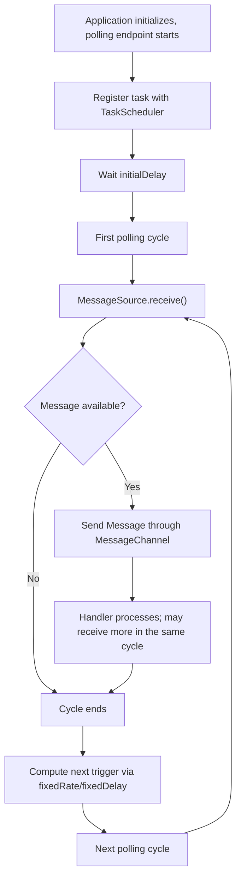

# initial-delay and First-Run Timing of a Poller in Spring Integration

## 1. Context: Why Delay the First Polling Cycle?

A newly started service might not be ready to receive data immediately: a partner's SFTP system has not opened its session yet, an input directory is not mounted yet, initialization data is incomplete, or multiple instances are simultaneously rolling out a new version. If a polling inbound adapter begins fetching data too early, the first call may return nothing, trigger connection errors, or create a sudden load spike on external systems.

In the **SPRING_INTEGRATION_ADAPTERS** module, an inbound adapter and `MessageSource` read external data (files, SFTP, databases, etc.), convert it into a `Message`, and send it through a `MessageChannel` for processing. A **poller** schedules calls to `MessageSource.receive()`. For periodic triggers, the **`initialDelay`** attribute determines the wait duration **before the first polling cycle** after the endpoint starts being scheduled.

For example, `initialDelay = "10000"` means the first poll cycle is expected to trigger **after roughly 10 seconds** from when the polling task begins getting registered/scheduled by the scheduler; the default unit in `@Poller` is **milliseconds**. It does not mean "wait 10 seconds from when a user calls an API" or "wait 10 seconds after all external systems are ready."

After this lesson, you will:

- Understand how `initialDelay` affects the first cycle and subsequent cycles.
- Compare first-run schedules when combined with `fixedRate` and `fixedDelay`.
- Configure an inbound file adapter using `@Poller(initialDelay = ...)`.
- Distinguish poller delay from readiness checks, retries, timeouts, and wall-clock schedules.
- Calculate the impact of restarts, multiple replicas, backlogs, and asynchronous processing.

## 2. What Does initial-delay Actually Control?

Suppose a polling endpoint is started at time `T₀`, when the scheduler receives the task and starts tracking the schedule. With `initialDelay = 10000 ms`:

```text
Time since the endpoint began scheduling
   T₀                                    T₀ + 10 s
   |-----------------------------------------|
   poller registered                       first poll cycle
                  initialDelay = 10 seconds
```

**Only the first cycle** incurs this startup wait. Subsequent cycles depend on the **primary trigger** such as fixed-rate or fixed-delay. If `maxMessagesPerPoll = 5`, the poller can receive up to 5 messages **within that same first cycle**; `initialDelay` does not insert pauses between individual messages.

A typical polling cycle goes through the following steps:



Three points in time must be distinguished:

1. **Application startup time**: the JVM and Spring Boot begin creating the application context.
2. **Endpoint start/scheduling time (`T₀`)**: the scheduler can measure `initialDelay` from here.
3. **Actual execution time (`T₁`)**: when the scheduler has an available thread and actually invokes the poller; this may be later than `T₀ + initialDelay`.

Because these points differ, do not measure `initialDelay` by taking the timestamp of the "Starting application" log line and expecting the first cycle to match to the millisecond. Context initialization latency, `TaskScheduler` execution timing, thread contention, and the OS all affect actual results.

## 3. initial-delay Combined with fixed-rate

With `fixedRate = 5000 ms`, `initialDelay = 10000 ms`, and fast processing cycles, the scheduler attempts to schedule at these ticks:

```text
Relative seconds:    0         5        10        15        20        25
                     |---------|---------|---------|---------|---------|
Endpoint starts:     ^
                                 P1        P2        P3        P4
                                 ^         ^         ^         ^
                        wait 10s   continue at 5s fixed-rate cadence
```

Starts are scheduled **approximately** at seconds 10, 15, 20, and 25 from `T₀`. Fixed-rate prioritizes spacing between **expected scheduled start times**.

If the first cycle takes 8 seconds while the period is only 5 seconds, the next run can be delayed and execute immediately after the previous cycle ends. `initialDelay` does not reduce pressure on subsequent cycles; it only shifts the start of the polling sequence.

Annotation example:

```java
@InboundChannelAdapter(
    channel = "incomingFiles",
    poller = @Poller(
        initialDelay = "10000",
        fixedRate = "5000",
        maxMessagesPerPoll = "5"
    )
)
```

When choosing fixed-rate, observe whether one cycle's processing duration frequently exceeds 5 seconds. Even with a 5-second cadence configured, there is no guarantee every cycle starts right on the tick; the scheduler and actual work can introduce lag.

## 4. initial-delay Combined with fixed-delay

With `fixedDelay = 5000 ms`, `initialDelay = 10000 ms`, and each cycle taking 2 seconds, the expected schedule is:

```text
Seconds:           0          10  12       17  19       24
                   |----------|---|--------|---|--------|
Endpoint starts:   ^
Poll cycle:                   [P1]          [P2]          [P3...]
                   wait 10s      wait 5s       wait 5s
```

- **First cycle:** starts around second 10.
- **Second cycle:** cycle one finishes at second 12, waits 5 more seconds, starts around second 17.
- **Third cycle:** cycle two finishes around second 19, waits 5 seconds, starts around second 24.

Illustrative formulas when the scheduler has no delay:

\[
S_1 \approx T_0 + D_0
\]

\[
S_{n+1} \approx S_n + T_n + D
\]

Where `Sₙ` is the start time of cycle `n`, `Tₙ` is the execution duration of that cycle, `D₀` is the initial delay, and `D` is the fixed delay.

This configuration is suitable when you want **both a one-time wait at startup** and a rest interval after each cycle to protect the file/SFTP/database system.

```java
@InboundChannelAdapter(
    channel = "incomingFiles",
    poller = @Poller(
        initialDelay = "10000",
        fixedDelay = "5000",
        maxMessagesPerPoll = "5"
    )
)
```

The two annotation examples in sections 3 and 4 are **mutually exclusive alternatives** for the same inbound adapter. Do not configure both fixed-rate and fixed-delay at the same time expecting the poller to pick one automatically.

### Quick Comparison Table

| Criterion | `initialDelay + fixedRate` | `initialDelay + fixedDelay` |
| --- | --- | --- |
| First cycle | After the initial delay | After the initial delay |
| How subsequent cycles are computed | On a periodic cadence between expected start times | After the previous cycle finishes, wait the full fixed delay |
| If handler runs longer than the interval | Schedule can lag, cycles run back-to-back | Next cycle still waits fixed delay after the previous cycle completes |
| Best suited for | Wanting a relatively steady data-fetching cadence | Wanting a rest interval between source checks |
| Does initialDelay repeat every cycle? | No | No |

## 5. Complete Example: Polling CSV Files, Waiting 10 Seconds After Startup

Suppose the application reads CSV files from `data/inbox`. A partner may start copying files as soon as the application deploys, so we want to delay the first scan by **10 seconds**. Thereafter, the application scans again **5 seconds after the previous cycle completes**, taking at most **5 files/messages per cycle**.

### 5.1. Dependencies

In a Spring Boot application using a BOM to manage dependency versions, declare:

```xml
<dependencies>
    <dependency>
        <groupId>org.springframework.boot</groupId>
        <artifactId>spring-boot-starter-integration</artifactId>
    </dependency>
    <dependency>
        <groupId>org.springframework.integration</groupId>
        <artifactId>spring-integration-file</artifactId>
    </dependency>
</dependencies>
```

Before running, create the `data/inbox` directory relative to the working directory. This is a practice example for polling schedules; a real system needs a file-completion protocol before reading.

### 5.2. Configuring the Inbound Adapter, Channel, and Handler

```java
import java.io.File;
import java.io.IOException;
import java.nio.charset.StandardCharsets;
import java.nio.file.Files;
import java.time.Instant;

import org.springframework.context.annotation.Bean;
import org.springframework.context.annotation.Configuration;
import org.springframework.integration.annotation.InboundChannelAdapter;
import org.springframework.integration.annotation.Poller;
import org.springframework.integration.annotation.ServiceActivator;
import org.springframework.integration.channel.DirectChannel;
import org.springframework.integration.config.EnableIntegration;
import org.springframework.integration.core.MessageSource;
import org.springframework.integration.file.FileReadingMessageSource;
import org.springframework.integration.file.filters.AcceptOnceFileListFilter;
import org.springframework.integration.file.filters.CompositeFileListFilter;
import org.springframework.integration.file.filters.SimplePatternFileListFilter;
import org.springframework.messaging.MessageChannel;

@Configuration
@EnableIntegration
public class DelayedFilePollingConfig {

    @Bean
    public MessageChannel incomingFiles() {
        return new DirectChannel();
    }

    @Bean
    @InboundChannelAdapter(
        channel = "incomingFiles",
        poller = @Poller(
            initialDelay = "10000",
            fixedDelay = "5000",
            maxMessagesPerPoll = "5"
        )
    )
    public MessageSource<File> csvFileSource() {
        FileReadingMessageSource source = new FileReadingMessageSource();
        source.setDirectory(new File("data/inbox"));

        CompositeFileListFilter<File> filter =
            new CompositeFileListFilter<>();
        filter.addFilter(new SimplePatternFileListFilter("*.csv"));
        filter.addFilter(new AcceptOnceFileListFilter<>());
        source.setFilter(filter);

        return source;
    }

    @ServiceActivator(inputChannel = "incomingFiles")
    public void processCsv(File file) throws IOException {
        String csv = Files.readString(
            file.toPath(), StandardCharsets.UTF_8
        );
        System.out.printf(
            "[%s] Processed %s (%d chars)%n",
            Instant.now(), file.getName(), csv.length()
        );

        // TODO: parse CSV, validate, and store according to business logic.
    }
}
```

Explanation of components:

- `FileReadingMessageSource` is called whenever the poller's turn arrives; the payload is `File`.
- `@InboundChannelAdapter` connects the source to `incomingFiles` through a polling endpoint.
- `@Poller(initialDelay = "10000", fixedDelay = "5000")` delays the **first cycle** by about 10 seconds, then waits 5 seconds after **each** subsequent cycle.
- `maxMessagesPerPoll = "5"` limits the number of files/messages in one cycle; it does not insert a delay between the 5 messages.
- `SimplePatternFileListFilter` accepts only `*.csv` names, while `AcceptOnceFileListFilter` avoids re-reading files already selected in the running instance's memory. This is not an idempotency or exactly-once guarantee.
- `DirectChannel` processes synchronously, so handler duration affects when the **polling cycle** completes and therefore affects the next fixed-delay schedule.

**How to observe:** start the application, add a valid CSV file shortly afterward, and watch the logs. The handler only logs **when it receives a file**, so the absence of handler log lines does not mean the poller did not trigger. To accurately measure poll ticks even when the directory is empty, enable endpoint logging/metrics or instrument `MessageSource.receive()` instead of relying only on handler logs.

## 6. Externalizing initialDelay to Configuration

The initial value should be configured per environment, especially when directory mount times or partner system startup times vary.

```yaml
# application.yml
app:
  polling:
    initial-delay-ms: 10000
    fixed-delay-ms: 5000
    max-messages-per-poll: 5
```

Replace the annotation in the example above with:

```java
@InboundChannelAdapter(
    channel = "incomingFiles",
    poller = @Poller(
        initialDelay = "${app.polling.initial-delay-ms:10000}",
        fixedDelay = "${app.polling.fixed-delay-ms:5000}",
        maxMessagesPerPoll = "${app.polling.max-messages-per-poll:5}"
    )
)
```

Values are resolved when Spring creates the endpoint configuration. Normally, modifying `application.yml` while the application is running **does not automatically change** the schedule of an active poller; a restart process or a dedicated dynamic configuration management mechanism is required.

### How to Choose an Initial Delay Value?

| Situation | Configuration Consideration | What to Verify |
| --- | --- | --- |
| File directory mounts slightly slowly | initial delay of a few seconds | Does the directory exist and remain readable at the time the source is created? |
| SFTP needs time to stabilize after deploy | delay before first cycle, batch limit, and connection timeout | Does connecting happen before the poll schedule? |
| Multiple replicas start concurrently | Stagger startup times via deployment orchestration or deliberate load spreading | Do all replicas still share the same initial delay and poll together? |
| Application needs immediate data response | small initial delay or 0 if appropriate | SLA and actual readiness level of the source |
| Source operates only during business hours | Use a timezone-aware cron trigger | Wall-clock ticks, holidays, and cron rules |

A large value helps avoid premature polling, but it also **increases latency to receive the first data**. There is no single 10-second number that fits every application.

## 7. How Does initialDelay Differ from Other Timing Mechanisms?

| Mechanism | What Does It Control? | What Does It Not Solve? |
| --- | --- | --- |
| `initialDelay` | Wait before starting the first poll cycle of a periodic task | Does not check whether the external service is ready |
| `fixedRate` | Cadence between scheduled start points | Does not automatically guarantee the handler finishes before the next tick |
| `fixedDelay` | Rest interval after a polling cycle finishes | Does not guarantee all asynchronous downstream messages have completed |
| `cron` | Schedule by wall-clock day/hour/minute/second | Does not store missed scheduled runs while the application was stopped |
| Connection/read timeout | Bounds wait time of an I/O call | Does not replace waiting before the first cycle |
| Retry/backoff | Decides when to retry after an error | Not equivalent to the schedule of a newly initialized poller |
| Readiness/lifecycle control | Decides when an endpoint can operate based on real conditions | Does not replace periodic data-fetching policies |

**Cron and initialDelay have two different meanings.** If the requirement is "run the first time at exactly 08:00," use a cron trigger with the appropriate timezone; a delay measured from startup will produce an actual wall-clock time that shifts depending on when the application is deployed. With cron, the first tick is determined by the calendar expression and trigger state, so do not assume `initialDelay` will be applied the same way as a `PeriodicTrigger`.

## 8. Error-Prone Misconceptions

### 8.1. initialDelay Does Not Guarantee the External Source Is Ready

Suppose you set a 10-second initial delay to wait for SFTP, but on that day SFTP takes 45 seconds to start. The first cycle can still fail. Additionally, some adapters initialize resources or validate configuration during bean creation, **even before the first polling cycle**; the delay does not necessarily postpone all resource initialization activity.

Solutions depend on the system: verify dependency readiness, set appropriate connect/read timeouts, retries and backoff, or control endpoint lifecycle (`SmartLifecycle`, endpoint control mechanisms) so polling starts only when conditions are met. For files, checking that the directory exists and has read permissions is independent of polling timing.

### 8.2. initialDelay Does Not Mean Startup Sleep

When using `@Poller(initialDelay = "...")`, Spring schedules the task; this configuration **does not block the entire application startup thread with `Thread.sleep(...)`**. Other components can still finish initializing and serve requests during the wait. If business rules require preventing the application from receiving traffic before initialization finishes, that is a separate readiness problem.

### 8.3. initialDelay Is Not a Timeout

A `MessageSource.receive()` call or a network call can hang longer than desired if timeouts are missing. Waiting 10 seconds before the first cycle does nothing to limit connection or processing wait times. For SFTP/HTTP/DB sources, configure client/session timeouts, transactions, and error handling according to the adapter's contract.

### 8.4. initialDelay Does Not Space Out Individual Messages

If the first cycle runs after 10 seconds and `maxMessagesPerPoll = 5`, the first 5 messages can be dispatched rapidly within **the same cycle**. If you want to throttle individual external calls, revisit batch size, rate limiting, or `MessageSource` design; merely increasing initial delay will not slow down the calls inside each cycle.

### 8.5. Restarts Reset the First-Run Calculation

When a polling endpoint is re-registered/rescheduled after a restart, initial delay is typically recalculated for the new task. For example, a 10-second setting can introduce a wait **every time an instance starts**. There is no built-in mechanism that remembers "already waited initial delay from the previous run."

If multiple pods restart simultaneously, they can all poll at once after the exact same delay. To avoid an ingestion burst, consider staggered rollouts, cluster coordination, data locking/claiming, or safe load-spreading designs. Using the exact same `initialDelay` value across all replicas does not automatically create jitter.

### 8.6. Asynchronous Channels Change the Meaning of "Cycle Finished"

```text
Synchronous flow:
Poller -> MessageSource -> DirectChannel -> Handler (DB read/write)
                                     handler finishes -> poll cycle finishes

Asynchronous flow:
Poller -> MessageSource -> ExecutorChannel -> worker queue
                                     handoff finishes -> poll cycle can finish
                                     worker keeps processing later
```

With `ExecutorChannel`, initial delay still applies only before the **first poll cycle**; subsequent cycles may occur while previously dispatched messages are still being processed by workers. Bound queue depth and concurrency, and design acknowledgements/idempotency if you do not want the backlog to grow silently.

## 9. initialDelay in Error Handling, Retries, and Reliability

Consider a CSV file flow: 10 seconds after application startup, the message source detects `orders-001.csv`, the accept-once filter accepts the file, and the message is sent to the handler. The handler fails while writing the order.

```text
T₀                      T₀+10s
|-------------------------|
endpoint start          poll #1 -> receives orders-001.csv
                                -> handler error
                                      |
                                      +-> deliberate retry/recovery needed
```

Increasing `initialDelay` to 20 seconds only pushes the error to a later point in time. It does not make the failed processing retry automatically; `AcceptOnceFileListFilter` may have already recorded the file, preventing the poller from picking it up again on the next cycle.

For real-world integration flows:

1. Define when data is **ready to receive**: e.g., the partner moves the file from a temp directory into the inbox after finishing writing.
2. Separate **detected**, **converted to message**, and **business-completed** states.
3. Design idempotent processing keyed by order ID or file/batch identifier.
4. Configure retry/backoff, exception handling, and appropriate Spring Integration error routes.
5. If survival across restarts is required, manage persistent metadata/checkpoints instead of relying solely on in-memory filters.
6. With multiple instances, resolve contention/data claiming at the source or business layer.

In JMS, AMQP, or Kafka adapters that typically use listener/message-driven mechanisms, data triggering works differently from a polling endpoint. **Do not apply a poller's initial delay to every kind of inbound adapter** if that adapter does not use a poller.

## 10. Measuring and Verifying First-Run Timing

### Observation Scenario

Set `initialDelay = 10000 ms`, `fixedDelay = 5000 ms`, `maxMessagesPerPoll = 3`:

| Event | Scheduler-Level Expectation |
| --- | --- |
| Endpoint starts scheduling at `T₀` | Does not poll immediately if a 10-second initial delay is configured |
| `T₀ + 4s`: drop 2 CSV files into inbox | Files wait; does not shorten initial delay |
| Around `T₀ + 10s` | First poll: may process both files in the same cycle |
| First cycle takes 2 seconds | Next cycle expected around `T₀ + 17s` with 5-second fixed-delay |
| No files left | That cycle ends after `receive()` returns `null`; no handler log |
| Instance restart | The new task incurs its own startup wait time |

What you should record:

- **Endpoint start timestamp** and **actual poll timestamp**, recorded as `Instant` to avoid timezone confusion.
- Duration of each cycle, messages per cycle, `receive()` duration, and inter-cycle intervals.
- Backlog and age of the oldest data; counts of connection errors, timeouts, retries, and failed files.
- `TaskScheduler`/executor utilization when multiple polling endpoints or workers run concurrently.

Note: `@ServiceActivator` only sees received messages, so logs inside the handler **cannot measure** polling cycles that return `null`. To verify the initial schedule when the source is empty, instrument `MessageSource.receive()` or use poller metrics/logging appropriate for your Spring Integration version.

### Three Simple Calculations

**Example 1:** initial delay 15 seconds, fixed-rate 10 seconds, fast handler. If the endpoint starts at 09:00:00, expected start times are **09:00:15, 09:00:25, 09:00:35**.

**Example 2:** initial delay 15 seconds, fixed-delay 10 seconds, first cycle processes for 3 seconds. If the endpoint starts at 09:00:00, the first cycle is expected at **09:00:15**, and the next at **09:00:28**.

**Example 3:** initial delay 15 seconds, fixed-delay 10 seconds, and `maxMessagesPerPoll = 4`. Right at the first cycle, 9 valid files are present, with no errors and no additional files. At least **3 cycles** are needed to ingest all of them (4 + 4 + 1). initial delay applies only before the first cycle; the next two cycles wait per fixed-delay after each cycle completes.

## 11. Practice Exercises with Answers

**Exercise 1 — Distinguish first run and subsequent runs.** `initialDelay = 8000 ms`, `fixedRate = 4000 ms`; each cycle is short. If the endpoint starts at second 0, what are the first three scheduled start ticks?

**Answer:** Seconds **8, 12, 16**. initial delay is not added repeatedly to every 4-second period.

**Exercise 2 — Slow processing duration.** `initialDelay = 6000 ms`, `fixedDelay = 3000 ms`. The first cycle takes 7 seconds. Ignoring scheduler jitter, at which second does the second cycle start?

**Answer:** Second **16** (6s initial wait + 7s processing + 3s rest after the first cycle).

**Exercise 3 — Reading multiple messages in one cycle.** `initialDelay = 10000 ms`, `maxMessagesPerPoll = 5`. 12 files are ready. Does the poller wait 10 seconds between each file?

**Answer:** **No.** initial delay is only before the **first cycle**. The poller can receive 5 files in that same first cycle; the minimum number of cycles to ingest 12 files is 3 under normal source and processing behavior.

**Exercise 4 — Source not ready.** SFTP is sometimes ready after 5 seconds and sometimes takes 1 minute. Is a fixed 20-second initial delay enough to guarantee no connection errors?

**Answer:** **No.** You need timeouts, retry/backoff, and/or a readiness gate. initial delay is only a planned wait period.

**Exercise 5 — Starting multiple replicas.** Four instances all start at 10:00 and all set `initialDelay = 10000 ms`. Will the instances automatically spread their poll schedules across the 10 seconds?

**Answer:** **No.** They may all execute near 10:00:10. You need cluster coordination and duplicate-processing prevention policies.

**Exercise 6 — Wall-clock requirement.** Business logic requires fetching data at exact 07:30 every day regardless of when the application starts. Should you use `initialDelay` to wait until 07:30?

**Answer:** **No.** Use a cron trigger in the business timezone, e.g., `0 30 7 * * *`, and also design handling for missed ticks.

## 12. Takeaways

**`initialDelay` is the wait before the first polling cycle**, measured when the polling endpoint begins getting scheduled by the scheduler. It combines with `fixedRate` to shift the start of a periodic cadence, or with `fixedDelay` to both wait initially and maintain a pause between cycles. This wait is not added per message, does not block the entire application startup, and does not prove external systems are ready. When designing inbound adapters in Spring Integration, pair polling schedules with timeouts, readiness checks, retries, idempotency, backlog handling, and monitoring of actual execution timestamps.
