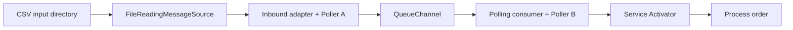
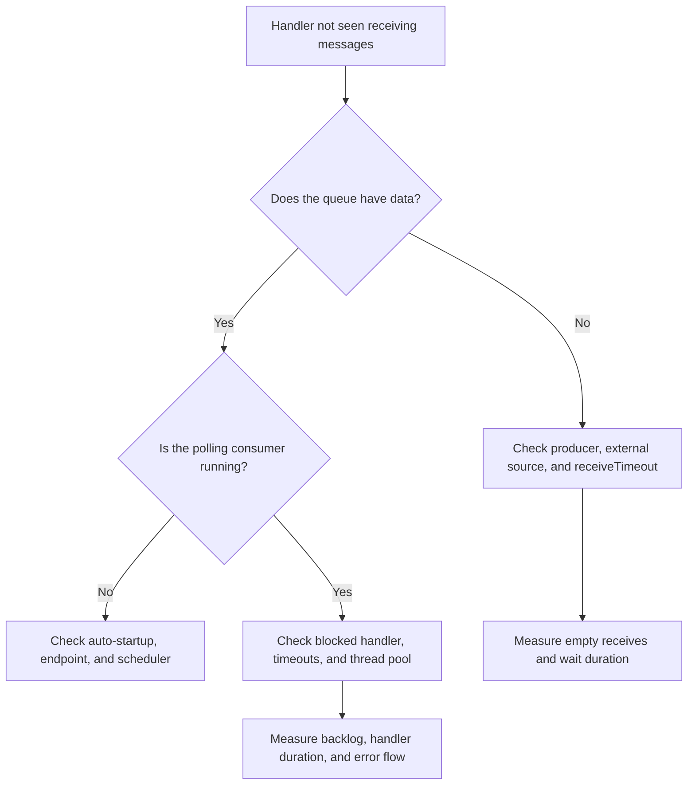

# receive-timeout When the Source Has No Data in Spring Integration

## 1. Practical Problem: What Should a Poller Do When No Message Is Available?

Suppose a system receives order files from a partner. A scheduled inbound adapter places files into a queue, while a business processing component reads messages from that queue. There are times when the queue is empty: no new files have arrived yet, all files have been processed, or the partner has temporarily stopped sending data. The consuming component has two choices: check the queue and return immediately, or **wait briefly** to see whether a new message arrives.

In Spring Integration, a poller's **`receiveTimeout`** attribute controls the wait duration when a polling endpoint receives messages from a **`PollableChannel`**, such as a `QueueChannel`. With a wait-capable channel, the poller can wait up to a maximum duration on the `receive(timeout)` call. If no message arrives before the timeout expires, the call typically returns `null`, the polling cycle stops fetching more data, and the scheduler computes the next schedule.

An essential point to grasp accurately in the **SPRING_INTEGRATION_ADAPTERS** module: **`receiveTimeout` is not automatically a timeout for every inbound adapter**. For a polling inbound adapter using a `MessageSource` like `FileReadingMessageSource`, the standard contract is `MessageSource.receive()`, which **accepts no timeout argument**. The source returns `null` when there is no data, while connection/I/O read timeouts for the external source must be configured through the adapter's or client's own capabilities.

This lesson focuses on that critical distinction, how to use `receiveTimeout` properly, and how to tell whether a pipeline is waiting for messages, scanning an empty source, or stuck in I/O.

**Learning Goals**

- Distinguish the message-waiting timeout on a `PollableChannel` from the interval between polling cycles.
- Understand when `@Poller(receiveTimeout = "...")` actually has effect.
- Configure a `QueueChannel` and polling consumer with a message-receive timeout.
- Know how to tune `fixedDelay`, `fixedRate`, and `maxMessagesPerPoll` alongside `receiveTimeout`.
- Design error handling, connection controls, backlog management, and operational observability when a source temporarily has no data.

## 2. Distinguishing Polling Inbound Adapters from Polling Consumers

Spring Integration has several ways to retrieve messages; two models that are easily confused are:

| Component | Where Does It Read Data From? | Data Retrieval Call | What Effect Does `receiveTimeout` Have? |
| --- | --- | --- | --- |
| **Polling inbound adapter** via `MessageSource` | External sources like files, SFTP, JDBC | `MessageSource.receive()` | Does not automatically impose a universal deadline on `receive()` across all sources. |
| **Polling consumer** reading from `PollableChannel` | A message queue, e.g., `QueueChannel` | `PollableChannel.receive(timeout)` | Specifies the wait time for receiving a message from a timeout-capable channel. |
| **Message-driven consumer** reading from `SubscribableChannel` | Messages pushed to subscribers, e.g., `DirectChannel` | Handler is invoked when a message arrives | No poller is needed to receive messages from the channel. |

A real-world model can combine an inbound adapter and a polling consumer:



- **Poller A** decides when to scan the directory and the maximum number of files/messages to emit per cycle. If the directory is empty, `FileReadingMessageSource.receive()` typically returns `null`.
- **Poller B** decides when the consumer checks the queue. When `QueueChannel` is empty, Poller B's `receiveTimeout` can make the receive operation **wait for a defined interval** before returning `null`.

Therefore, when saying "the source has no data," ask clearly: **does the external source lack files/records**, or **is the internal message queue empty**? The two cases have different throttling mechanisms and timeouts.

## 3. How Does the receive-timeout Mechanism Work?

A `PollableChannel` exposes the call:

```java
Message<?> message = channel.receive(timeoutMillis);
```

For example, when `channel` is a `QueueChannel`:

- If a message is already in the queue, `receive(300)` typically returns the message immediately.
- If the queue is empty at first but a message arrives after 100 ms, the call can receive that message before expiring.
- If the queue remains empty after roughly 300 ms, the call returns `null` (actual timing can vary due to scheduling).
- The call does not fabricate an empty message, does not throw an exception merely because the queue lacks data, and does not perform business retries automatically.

```text
Example: receiveTimeout = 300 ms

Case A: queue has a message
0 ms  --> receive immediately --> process

Case B: queue initially empty, message arrives at 100 ms
0 ms  --------- 100 ms --> receive message --> process

Case C: queue stays empty
0 ms  ------------------------------ 300 ms --> receive() returns null
```

**The timeout is the wait limit for a single message-receive operation**, not a time limit on the entire poll cycle or the maximum duration for a handler.

With `maxMessagesPerPoll = 5`, the consumer can issue multiple receive calls within **the same cycle**. If the first two messages are available, the consumer takes them immediately; the third receive call, seeing an empty queue, may wait up to 300 ms before ending the cycle. Thus, `receiveTimeout = 300` does not mean the entire polling cycle always finishes within 300 ms.

### Combining with a fixed-delay Schedule

Suppose a queue-consuming poller has:

```text
fixedDelay = 1000 ms
receiveTimeout = 300 ms
maxMessagesPerPoll = 1
```

If the queue stays empty and the scheduler has no lag:

```text
0 ms       300 ms           1300 ms       1600 ms
|--- wait ---|-- rest 1000ms --|--- wait ---|-- rest ... -->
receive(300) returns null      receive(300) returns null
```

The interval between **two starts** can be close to 1,300 ms: 300 ms waiting on receive plus 1,000 ms fixed-delay after the previous cycle ends. If a message is available and the handler runs quickly, the first cycle ends sooner, so the next cycle also arrives sooner.

With `fixedRate`, start ticks are scheduled periodically. If `receive` blocks for too long or the handler processes slowly, the next cycle can be delayed. **`fixedRate` does not cause `receive(timeout)` to return early**.

## 4. Complete Example: File Inbound Adapter Combined with QueueChannel

The exercise below simulates two stages:

1. **File inbound adapter** scans `data/inbox` every 5 seconds, taking at most 10 `.csv` files per cycle.
2. **Polling consumer** pulls at most 4 messages per cycle from the queue, waits up to 300 ms on each `receive()` call when the queue is empty, and then rests 1 second after the previous cycle.

This example directly demonstrates that `receiveTimeout` resides **on the `QueueChannel` reading side**.

### 4.1. Dependencies

With Maven in a Spring Boot project using a BOM to manage versions:

```xml
<dependencies>
    <dependency>
        <groupId>org.springframework.boot</groupId>
        <artifactId>spring-boot-starter-integration</artifactId>
    </dependency>
    <dependency>
        <groupId>org.springframework.integration</groupId>
        <artifactId>spring-integration-file</artifactId>
    </dependency>
</dependencies>
```

Create the `data/inbox` directory relative to the application's working directory before starting. Drop valid CSV files into it to observe.

### 4.2. Java Configuration

```java
import java.io.File;
import java.io.IOException;
import java.nio.charset.StandardCharsets;
import java.nio.file.Files;

import org.springframework.context.annotation.Bean;
import org.springframework.context.annotation.Configuration;
import org.springframework.integration.annotation.InboundChannelAdapter;
import org.springframework.integration.annotation.Poller;
import org.springframework.integration.annotation.ServiceActivator;
import org.springframework.integration.channel.QueueChannel;
import org.springframework.integration.config.EnableIntegration;
import org.springframework.integration.core.MessageSource;
import org.springframework.integration.file.FileReadingMessageSource;
import org.springframework.integration.file.filters.AcceptOnceFileListFilter;
import org.springframework.integration.file.filters.CompositeFileListFilter;
import org.springframework.integration.file.filters.SimplePatternFileListFilter;

@Configuration
@EnableIntegration
public class ReceiveTimeoutExample {

    // QueueChannel is a PollableChannel; capacity of 100 messages.
    @Bean
    public QueueChannel pendingCsvFiles() {
        return new QueueChannel(100);
    }

    // Poller A: checks the file source periodically.
    @Bean
    @InboundChannelAdapter(
        channel = "pendingCsvFiles",
        poller = @Poller(
            fixedRate = "5000",
            maxMessagesPerPoll = "10"
        )
    )
    public MessageSource<File> csvFileSource() {
        FileReadingMessageSource source = new FileReadingMessageSource();
        source.setDirectory(new File("data/inbox"));

        CompositeFileListFilter<File> filters =
            new CompositeFileListFilter<>();
        filters.addFilter(new SimplePatternFileListFilter("*.csv"));
        filters.addFilter(new AcceptOnceFileListFilter<>());
        source.setFilter(filters);

        return source;
    }

    // Poller B: waits for messages from QueueChannel for at most 300 ms per receive call.
    @ServiceActivator(
        inputChannel = "pendingCsvFiles",
        poller = @Poller(
            fixedDelay = "1000",
            receiveTimeout = "300",
            maxMessagesPerPoll = "4"
        )
    )
    public void processCsv(File file) throws IOException {
        String csv = Files.readString(
            file.toPath(), StandardCharsets.UTF_8
        );
        System.out.printf(
            "Processed %s (%d chars)%n",
            file.getName(), csv.length()
        );

        // TODO: parse, validate, save the order, and record completion.
    }
}
```

**Explanation of results:**

- `FileReadingMessageSource` scans the directory and returns each `Message<File>` when matching files exist. Accepted files are remembered by `AcceptOnceFileListFilter` within the running instance.
- `QueueChannel(100)` stores pending messages in memory with a capacity of 100. This is a **bounded buffer**, not a durable broker. When the queue is full, the sending flow needs its own timeout/backpressure policy and error handling.
- `@InboundChannelAdapter` creates Poller A with `fixedRate = 5000`: every 5 seconds on schedule, it calls the message source and forwards up to 10 files/messages into the queue.
- `@ServiceActivator` with a `poller` creates a **polling consumer** pulling messages from the queue. `receiveTimeout = 300` lets each receive call wait up to roughly 300 ms if no message is present yet.
- `maxMessagesPerPoll = 4` limits how much work the consumer takes per cycle. `fixedDelay = 1000` measures the rest interval **after the consumer cycle completes**.

Because the queue is consumed by a polling consumer, the handler receives a `File` payload and reads its content. `receive()` calls can execute consecutively within a cycle until 4 messages are reached or no messages remain after the wait timeout.

### 4.3. Testing Scenarios

**Scenario A — both directory and queue are empty:** Poller A scans for files and emits no messages. Poller B waits up to roughly 300 ms on the queue per cycle; the handler is not invoked. To confirm Poller B actually ran, measure/log at the poll or channel step, not only inside the handler.

**Scenario B — drop two files:** One Poller A cycle detects and sends two messages into the queue. Poller B receives and processes both messages; afterward it may wait up to 300 ms on the third `receive()` call before ending the cycle (since the 4-message limit was not reached).

**Scenario C — 12 files are ready:** Poller A has `maxMessagesPerPoll = 10`, so at least two source cycles are needed to push all 12 files into the queue. Poller B takes at most 4 messages/cycle; it may take at least three processing cycles, depending on queue insertion and processing speeds.

**Scenario D — slow read/write handler:** If processing one file takes 2 seconds and each consumer cycle receives 4 files, Poller B's cycle can run for around 8 seconds or more; `receiveTimeout = 300` **does not interrupt the handler** after 300 ms.

**Scenario E — queue full:** When the inbound adapter outpaces the consumer, `QueueChannel(100)` can eventually fill up. Poller B waiting 300 ms when empty does nothing to fix a full queue; monitor backlog and producer-side blocking/error policies.

## 5. When Does receiveTimeout Not Solve the Problem?

### 5.1. Inbound Adapter Reading an External Source with No Data

For example, having only an inbound adapter reading files:

```java
@InboundChannelAdapter(
    channel = "incomingFiles",
    poller = @Poller(
        fixedDelay = "5000",
        maxMessagesPerPoll = "10"
    )
)
public MessageSource<File> inboundFiles() {
    // Return the configured FileReadingMessageSource.
}
```

When the directory is empty, `FileReadingMessageSource.receive()` typically returns `null`. The poller ends the cycle and waits according to `fixedDelay`. There is no `QueueChannel.receive(300)` operation in this snippet, so **adding `receiveTimeout = "300"` to the inbound file source's poller is not a way to set a timeout for file discovery**.

Similarly, with inbound SFTP or databases:

- **SFTP connection** timeouts depend on the session/client, connection setup, and remote file operations.
- **SQL query** timeouts depend on the JDBC driver, transaction, query timeout, and adapter query mechanism.
- **HTTP request** timeouts depend on the HTTP client and connect/read/response timeout settings.

Do not assume a polling endpoint's `receiveTimeout` automatically bounds all this I/O. Use the corresponding timeout of each adapter or connection library.

### 5.2. DirectChannel or Push-Based Channels

`DirectChannel` is a `SubscribableChannel`: when a producer sends a message, the subscriber is invoked synchronously via dispatch. Handlers receiving messages over `DirectChannel` **do not use `PollableChannel.receive(timeout)`**.

Therefore, do not attach a poller with `receiveTimeout` to consume a `DirectChannel`. Use the proper endpoint/channel type for the message-driven model; when a buffer and polling consumer are needed, use an appropriate `PollableChannel`.

### 5.3. An Empty Queue Is Not a Business Error

If `QueueChannel.receive(300)` times out without receiving a message, the `null` result represents **no data available to process in that receive attempt**, not an exception by default. Retry/backoff mechanisms are generally used for real errors (broken connections, failed DB writes, etc.), whereas an empty queue can be a normal state that needs measurement and check-frequency management.

## 6. Four Commonly Confused Parameters

| Parameter | Meaning | Example | Does Not Mean |
| --- | --- | --- | --- |
| `receiveTimeout` | Maximum time to wait for **one receive from a channel** supporting blocking receive | `300 ms` on `QueueChannel` | Timeout for the entire handler or an external API |
| `fixedDelay` | Wait after **a poll cycle finishes** before starting the next cycle | `1000 ms` | Wait between individual messages in the same cycle |
| `fixedRate` | Cadence of **scheduled start ticks** | `1000 ms` | Guarantee that the task always launches on every tick |
| `maxMessagesPerPoll` | Maximum messages received in **one cycle** | `4` | Queue size or number of threads |

Also distinguish:

- **`sendTimeout`**: wait time on the **sending** side into a channel that can block; for example, a producer sending into a full `QueueChannel`.
- **Network I/O timeout**: limit on how long a client waits to connect/read/write with an external service, independent of a poller waiting for messages.
- **Handler timeout / transaction timeout**: limits or coordinates business logic after a message has arrived, depending on the processing technology and configuration.

Do not use the same value for every timeout simply because they are all measured in milliseconds. They protect different stages of the pipeline.

## 7. Choosing receiveTimeout Based on Load and Desired Latency

### 7.1. Short Wait or Immediate Check?

With `QueueChannel`, a positive wait value like 100–500 ms is often suitable in practice exercises when you want to give messages a chance to arrive within a brief window without tying up a scheduler thread for too long. This is just an example, not a default value or universal production recommendation.

Some considerations:

- **Short timeout:** empty polling cycles end quickly; the poller checks again on schedule, though you should track empty receive counts and message wait latency.
- **Long timeout:** the consumer can react quickly if a message arrives during the wait window, but keeps an execution thread busy waiting longer and can delay other cycles sharing the scheduler.
- **Zero timeout:** with `QueueChannel`, returns immediately if a message is present and returns `null` if the queue is empty; pair with an appropriate poll schedule to avoid overly tight checking loops.
- **Infinite wait:** unsuitable for many periodically scheduled pollers, as it risks holding threads indefinitely and complicates shutdown or monitoring. If the system truly needs continuous reception, consider a dedicated listener/broker/consumer architecture.

Specific timeout behaviors can vary across `PollableChannel` implementations, so check the contract of the channel in use. Examples in this lesson use `QueueChannel` with **non-negative values** for clear observation.

### 7.2. Impact of maxMessagesPerPoll

Suppose the queue is empty and the consumer has:

```text
fixedDelay = 1000 ms
receiveTimeout = 300 ms
maxMessagesPerPoll = 5
```

The first receive waits up to 300 ms and returns `null`; the poller typically **ends the cycle as soon as it receives `null`**, rather than waiting four more times. Thus, when no messages are present, it does not blindly take 5 × 300 = 1500 ms.

Conversely, if 4 consecutive messages arrive and the fifth is not yet present, the cycle duration includes **processing time for 4 messages** plus up to 300 ms for the final receive call. If all 5 messages are ready, the cycle can finish without waiting out any timeout.

### 7.3. Backlogs Are Not Solved by receiveTimeout

Suppose a source feeds the queue at an average of 20 messages/second while the consumer can only process 5 messages/second. Whether `receiveTimeout` is set to 0, 100, or 500 ms, the backlog still grows when intake exceeds sustained processing capacity.

To handle backlogs, look at `maxMessagesPerPoll`, handler duration, worker count, queue capacity, backpressure mechanisms, and idempotency. **The empty-queue wait timeout mainly affects wait time when no messages are available**, not the per-message processing speed.

## 8. Errors, State, and Connection Lifecycle

The "no data yet" symptom can stem from many causes and should be classified before deciding to retry:

| Observation | Possible Meaning | What to Check |
| --- | --- | --- |
| `QueueChannel.receive(timeout)` returns `null` | Queue was genuinely empty until timeout elapsed | Producer rate, receive duration, and queue depth |
| `MessageSource.receive()` returns `null` | File/DB source has no matching data yet or filter excluded all items | Path, query, filter, metadata state |
| SFTP/HTTP/DB call takes a long time | Slow I/O, client timeout, or overloaded source | Connect/read/query timeouts and network |
| Handler receives message then fails | Business error or downstream dependency failure | Retry, error flow, transaction, idempotency |
| No messages after restart | Possibly due to filter/metadata, checkpoint, or producer not emitting yet | Persistent state storage, recovery, and observability |

**What `receiveTimeout` does not guarantee:**

1. **Does not guarantee exactly-once.** A message can be received and fail processing, or a producer can send duplicates.
2. **Does not automatically recover filtered files.** `AcceptOnceFileListFilter` may have already marked a file before the handler failed. An explicit retry/recovery mechanism is needed.
3. **Does not make the queue durable.** Standard `QueueChannel` in the example uses memory; if survival across restarts is needed, use persistent storage or an appropriate broker.
4. **Does not manage end-to-end transactions.** Pulling from a queue, writing to a DB, and confirming business state are steps that require explicit transaction/acknowledgement boundaries.
5. **Does not prevent duplicates across multiple instances.** When multiple replicas read the same source or process messages, proper idempotency keys, claim/checkpointing, or partitioning is needed.

For external sources with connection lifecycles (SFTP/HTTP/JMS/AMQP/Kafka), distinguish polling adapters from listeners receiving broker-pushed messages. Do not try to force a polling consumer's `receiveTimeout` onto an adapter that operates via listeners and does not use `PollableChannel.receive(timeout)`.

## 9. Observing Whether a Consumer Is Waiting or Actually Blocked

Logs from `@ServiceActivator` only appear **after a message is received**. When the queue is empty, the handler does not run, so looking only at handler logs cannot tell you whether the polling consumer has stopped.

Metrics you should have:

- **Poll cycle count** and start/end timestamps of each cycle.
- **Successful receives vs. `null` receives due to timeout**, along with `receive()` duration.
- **Queue depth, rejected sends, or blocked producers**.
- **Handler processing duration**, error count, retries, and age of the oldest unfinished message.
- **Scheduler lag**, number of pollers sharing an executor, thread saturation, and shutdown time.

A simple diagnostic flowchart:



If multiple polling endpoints share the same `TaskScheduler`, waiting too long for messages can occupy scheduler threads and delay other endpoints. Thread pool configuration and eliminating unbounded blocking must go hand in hand with monitoring real load.

## 10. Practice Exercises with Answers

**Exercise 1 — Empty queue.** A polling consumer reads from `QueueChannel` with `receiveTimeout = 400 ms`, `fixedDelay = 1000 ms`, `maxMessagesPerPoll = 1`. The queue is always empty. Ignoring scheduler jitter, roughly how long is the interval between two starts?

**Answer:** Around **1400 ms**: the receive call waits 400 ms, the cycle ends, and then it rests 1000 ms per fixed-delay.

**Exercise 2 — Message arrives mid-wait.** The consumer starts `receive(400)` at 0 ms; the producer sends a message into the queue at 150 ms. When can the call return the message?

**Answer:** Approximately **150 ms** when the message arrives and wakes the consumer, without needing to wait the full 400 ms.

**Exercise 3 — Two messages available.** `maxMessagesPerPoll = 5`, `receiveTimeout = 300 ms`, the queue initially holds 2 messages, and no new messages arrive. Must the consumer wait 5 × 300 ms?

**Answer:** **No.** The first two receives succeed quickly; the next receive can wait roughly 300 ms and then return `null`, ending the cycle.

**Exercise 4 — Empty file source.** A `FileReadingMessageSource` has no files yet. Does adding `receiveTimeout = 300` to the inbound adapter's `@Poller` make `MessageSource.receive()` wait exactly 300 ms?

**Answer:** **There is no such guarantee.** The `MessageSource.receive()` interface does not pass a timeout parameter. The file source returns `null` when it finds no data; the next cycle's schedule is controlled by a trigger such as fixed-delay/fixed-rate.

**Exercise 5 — Slow handler.** `receiveTimeout = 200 ms`, and the handler takes 8 seconds to write to the database. Does the poller automatically stop the handler after 200 ms?

**Answer:** **No.** The timeout applies to the channel receive operation, not as an execution limit on the handler.

**Exercise 6 — Safe design.** The producer is sending faster than the consumer, and the queue is frequently full. Should you increase `receiveTimeout` to prevent queue overflow?

**Answer:** **No.** When the queue is full, the consumer already has data ready to receive immediately; you need to increase processing capacity, slow the producer, tune batching/concurrency, or apply backpressure and send-error policies.

**Exercise 7 — Architectural distinction.** A `DirectChannel` forwards messages from an HTTP inbound gateway to a synchronous handler. Does the handler need a poller with `receiveTimeout`?

**Answer:** **No.** `DirectChannel` is a synchronous publish/subscribe channel where the handler is invoked when a message arrives; a polling consumer is only used when the source channel supports polling, such as `QueueChannel`.

## 11. Takeaways

**`receiveTimeout` controls the wait duration for a single message receive from a timeout-capable `PollableChannel`**, typically a `QueueChannel` in a polling consumer. When the channel has no message by the end of the wait interval, the receive call returns `null`, the poll cycle ends, and the trigger determines the next schedule. `fixedRate`/`fixedDelay` control **when cycles start**, `maxMessagesPerPoll` controls **how many messages per cycle**, while connection/read timeouts for files, SFTP, HTTP, or databases are configured separately per source. Combine these parameters with queue observability, backlog management, retries, and idempotency so the integration flow operates reliably.
