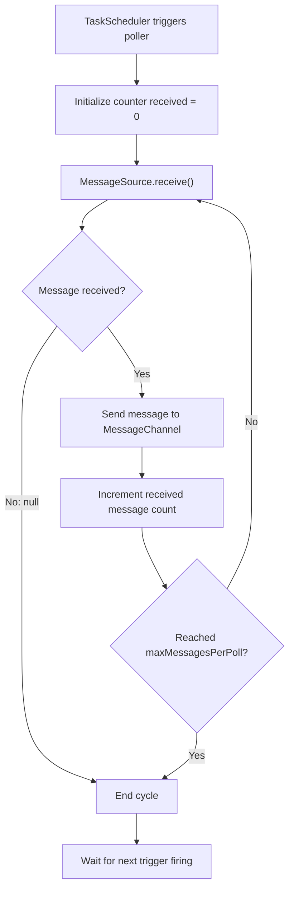

# max-messages-per-poll: Limiting Messages per Polling Cycle

## 1. Why Does a Polling Cycle Need a Message Limit?

An application receives thousands of CSV files from partners. After detecting new files, an inbound adapter can keep pulling files and feeding them into the processing flow. Without a per-cycle volume limit, a single scheduler invocation could run too long, tie up the poller thread, and delay other endpoints. Conversely, setting the limit too small can leave files queued up for too long, failing to meet the processing time required by the business.

In the **SPRING_INTEGRATION_ADAPTERS** module, inbound adapters, gateways, pollers, and `MessageChannel`s connect external systems to the internal message flow. For **polling-based adapters** such as file, SFTP, or database adapters, the poller decides *when* to invoke the source and *how many messages can be received each time it runs on schedule*. The **`maxMessagesPerPoll`** attribute controls the second limit.

For example, the configuration:

```java
@Poller(fixedDelay = "5000", maxMessagesPerPoll = "10")
```

means **each poll cycle** can receive **at most 10 messages** from the source, after which the endpoint waits for the next scheduled run. The actual count can be lower than 10 when the source runs out of data, a filter excludes items, or an error occurs.

**Lesson goal:** accurately interpret `maxMessagesPerPoll`, estimate the number of cycles needed to drain data, write annotation/Java DSL configurations, understand how triggers and channels affect throughput, and avoid confusing the per-cycle limit with concurrency or transaction batch size.

## 2. What Is a Poll Cycle?

A **poll cycle (polling cycle)** is a single invocation of a polling endpoint by the scheduler. During this cycle, the endpoint typically calls the source's `receive()`, sends the received message to a `MessageChannel`, and continues receiving until a stopping condition is met.



The diagram illustrates the normal case. Errors at the source, while sending the message, or inside a synchronous handler can interrupt the cycle and be handled by the endpoint's error flow/advice.

Two common termination conditions:

1. **Limit reached:** the number of received messages equals `maxMessagesPerPoll`.
2. **Source has no more messages at check time:** `receive()` returns `null` before the limit is reached.

If the source has exactly three messages and `maxMessagesPerPoll = 10`, the cycle can receive all three and stop when the next `receive()` call returns `null`. The poller does not fabricate seven empty messages to make ten.

### The Word "Cycle" Can Be Misleading

In this lesson, a "polling cycle" is **one invocation triggered by the trigger**, not the entire uptime of the application, not a transaction, and not necessarily an interval strictly equal to `fixedRate` or `fixedDelay`.

```text
Suppose fixedDelay=5 seconds, maxMessagesPerPoll=3:

Cycle 1: [receive M1][receive M2][receive M3] -- end
                                                 |
                                              wait 5s
                                                 |
Cycle 2: [receive M4][receive M5][receive null] -- end
                                                 |
                                              wait 5s
                                                 |
Cycle 3: [receive null] ------------------------- end
```

Key point: **there is no automatic fixed-delay pause between M1, M2, and M3**. The delay applies between *two cycles*, after the previous cycle completes.

## 3. Commonly Used Values

| Value | Interpretation | Things to Note |
| --- | --- | --- |
| Positive integer `1` | Receive at most one message per cycle | Easy to bound one cycle, but backlogs can grow quickly. |
| Positive integer `10` | Receive at most ten messages per cycle | Useful for sources with many files/records. |
| `-1` | No count limit; keep receiving until the source returns `null` or another condition ends the cycle | Risks a cycle running very long if the source continuously supplies messages. |
| `0` | In Spring Integration versions that support it, temporarily receive no messages at the poller | Must verify the contract of your version and endpoint management behavior. |

**Do not rely on default values when sizing load.** The default for `maxMessagesPerPoll` can vary by endpoint type and Spring Integration version; explicitly declare the intended limit in configuration so operators understand the expected throughput. When using `-1`, verify clearly that the source can return `null` and bound duration/volume with another mechanism if necessary.

This value is also **not**:

- The number of parallel processing threads.
- The capacity of a `QueueChannel`.
- A limit on rows returned by an SQL query or SFTP files listed by the client library.
- The number of retries when a handler throws an error.
- Transaction size or the number of messages committed together.

## 4. Comparing maxMessagesPerPoll with Triggers and Timeouts

| Attribute | Question It Answers | Example |
| --- | --- | --- |
| `maxMessagesPerPoll` | At most how many messages does one cycle receive? | 5 messages/cycle. |
| `fixedRate` | How far apart are scheduled start ticks? | About 5 seconds between expected starts. |
| `fixedDelay` | After the previous cycle completes, how long to wait before starting the next? | Rest 5 seconds after each cycle. |
| `cron` | Which wall-clock times trigger a cycle? | Minutes 0, 15, 30, 45 of every hour. |
| `initialDelay` | How long to wait before the first cycle on periodic schedules supporting this attribute? | Wait 10 seconds at startup. |
| `receiveTimeout` | When polling a wait-capable `PollableChannel`, how long can one `receive(timeout)` wait? | Wait 300 ms if the queue is empty. |

### Example with fixed-delay

Suppose:

```text
fixedDelay = 5000 ms
maxMessagesPerPoll = 4
synchronous processing time = 500 ms/message
source always has >= 4 messages
```

One cycle can take about `4 × 0.5 = 2` seconds to receive and process. Then the poller waits 5 more seconds before starting a new cycle. When the scheduler is not congested, the spacing between two starts is roughly **7 seconds**. Setting `maxMessagesPerPoll = 1` under the same conditions produces a start spacing of roughly **5.5 seconds**, while processing fewer messages per cycle.

With `fixedRate = 5000 ms`, start times are scheduled at roughly a 5-second cadence if work finishes in time. If a cycle receives and processes so many messages that it runs longer than 5 seconds, subsequent ticks can lag. Therefore, **increasing `maxMessagesPerPoll` can make a single cycle longer**, rather than always increasing actual throughput.

### When the Source Has No Data

With a polling inbound adapter using a `MessageSource`, `receive()` typically returns `null` if no matching data is ready. The cycle then stops early, whether `maxMessagesPerPoll` is 1, 10, or 100.

With a polling consumer pulling messages from a `PollableChannel` like `QueueChannel`, a `receive(timeout)` call can wait until a message arrives or the timeout expires; `maxMessagesPerPoll` still bounds **the number of messages received in the cycle**, rather than automatically applying a timeout to every kind of source.

## 5. Java Example: Limiting to 5 CSV Files per Cycle

Scenario: a partner drops order files into `data/inbox`; the application checks the directory on a 3-second fixed-delay schedule, receives at most five CSV files per cycle, and sends them over a `DirectChannel` to a handler. If 12 files are ready, at least three cycles are needed to ingest them (5 + 5 + 2), assuming no errors and the source supplies files as expected.

### 5.1. Dependencies

With Maven and the Spring Boot BOM managing versions:

```xml
<dependencies>
    <dependency>
        <groupId>org.springframework.boot</groupId>
        <artifactId>spring-boot-starter-integration</artifactId>
    </dependency>
    <dependency>
        <groupId>org.springframework.integration</groupId>
        <artifactId>spring-integration-file</artifactId>
    </dependency>
</dependencies>
```

Before running, create the `data/inbox` directory relative to the application's working directory and place files with a `.csv` extension inside.

### 5.2. Annotation Configuration

```java
import java.io.File;
import java.io.IOException;
import java.nio.charset.StandardCharsets;
import java.nio.file.Files;

import org.springframework.context.annotation.Bean;
import org.springframework.context.annotation.Configuration;
import org.springframework.integration.annotation.InboundChannelAdapter;
import org.springframework.integration.annotation.Poller;
import org.springframework.integration.annotation.ServiceActivator;
import org.springframework.integration.channel.DirectChannel;
import org.springframework.integration.config.EnableIntegration;
import org.springframework.integration.core.MessageSource;
import org.springframework.integration.file.FileReadingMessageSource;
import org.springframework.integration.file.filters.AcceptOnceFileListFilter;
import org.springframework.integration.file.filters.CompositeFileListFilter;
import org.springframework.integration.file.filters.SimplePatternFileListFilter;
import org.springframework.messaging.MessageChannel;

@Configuration
@EnableIntegration
public class BoundedFilePollingConfiguration {

    @Bean
    public MessageChannel csvInboundChannel() {
        return new DirectChannel();
    }

    @Bean
    @InboundChannelAdapter(
        channel = "csvInboundChannel",
        poller = @Poller(
            fixedDelay = "3000",
            maxMessagesPerPoll = "5"
        )
    )
    public MessageSource<File> csvSource() {
        FileReadingMessageSource source = new FileReadingMessageSource();
        source.setDirectory(new File("data/inbox"));

        CompositeFileListFilter<File> filters =
            new CompositeFileListFilter<>();
        filters.addFilter(new SimplePatternFileListFilter("*.csv"));
        filters.addFilter(new AcceptOnceFileListFilter<>());
        source.setFilter(filters);
        return source;
    }

    @ServiceActivator(inputChannel = "csvInboundChannel")
    public void handleCsv(File file) throws IOException {
        String csv = Files.readString(
            file.toPath(), StandardCharsets.UTF_8
        );

        System.out.printf(
            "Received: %s, chars=%d%n",
            file.getName(), csv.length()
        );

        // TODO: parse, validate, and record successful processing status.
    }
}
```

**Detailed explanation:**

- `FileReadingMessageSource` reads files from the directory. Each successful `receive()` produces a message carrying a `File` payload.
- `SimplePatternFileListFilter` accepts only `*.csv` files; `AcceptOnceFileListFilter` avoids re-selecting files already accepted in the instance's memory.
- `@Poller(fixedDelay = "3000", maxMessagesPerPoll = "5")` keeps a 3-second pause **after the polling cycle completes** and caps received messages at 5 per cycle.
- `DirectChannel` synchronously dispatches messages to `@ServiceActivator`; as the handler takes time to process, the poll cycle takes correspondingly longer.
- The handler here only reads content and logs it. Production systems need completion checks for files, CSV validation, data persistence, and archive/retry policies.

### 5.3. Observing a 12-File Scenario

When 12 valid files are ready before the first cycle:

| Cycle | Max Messages Received | Files Still Waiting After Cycle (Assumed) |
| --- | ---: | ---: |
| 1 | 5 | 7 |
| 2 | 5 | 2 |
| 3 | 2 | 0 |
| 4 | 0 (if no new files arrive) | 0 |

With the current source, the fourth cycle can return `null` on the very first `receive()` call. The table only illustrates counts when there are no errors and no new files; exact file order depends on listing and filter logic.

**Observing the schedule accurately:** Logs from `@ServiceActivator` only appear **when a message arrives**, not reflecting empty polling cycles. To confirm each cycle actually triggered, instrument `MessageSource.receive()` or use appropriate poller logging/metrics.

## 6. Configuring via application.yml and Java DSL

### 6.1. Do Not Hardcode Limits in Source Code

```yaml
# application.yml
app:
  file-polling:
    delay-ms: 3000
    max-per-poll: 5
```

Replace the `@InboundChannelAdapter` annotation in the Java example with:

```java
@InboundChannelAdapter(
    channel = "csvInboundChannel",
    poller = @Poller(
        fixedDelay = "${app.file-polling.delay-ms:3000}",
        maxMessagesPerPoll = "${app.file-polling.max-per-poll:5}"
    )
)
```

The `:` in the placeholder provides a default value when the property is missing. Values are typically resolved when the application context initializes; editing YAML while running does not automatically update the endpoint immediately. If dynamic tuning during operations is required, use endpoint/poller management mechanisms suitable for your Spring Integration version.

### 6.2. Equivalent Java DSL Syntax

```java
import java.io.File;
import java.time.Duration;

import org.springframework.context.annotation.Bean;
import org.springframework.integration.dsl.IntegrationFlow;
import org.springframework.integration.dsl.Pollers;
import org.springframework.integration.file.dsl.Files;

@Bean
IntegrationFlow boundedCsvFlow() {
    return IntegrationFlow
        .from(
            Files.inboundAdapter(new File("data/inbox"))
                 .patternFilter("*.csv"),
            endpoint -> endpoint.poller(
                Pollers.fixedDelay(Duration.ofSeconds(3))
                       .maxMessagesPerPoll(5)
            )
        )
        .handle(message -> {
            File file = (File) message.getPayload();
            System.out.println("Received " + file.getName());
        })
        .get();
}
```

This is an **alternative option** to the annotation configuration; do not run both endpoints concurrently scanning the example directory. `org.springframework.integration.file.dsl.Files` is the DSL factory for file adapters, distinct from `java.nio.file.Files` used to read file contents.

## 7. Using maxMessagesPerPoll with PollableChannel

Not only inbound adapters, a **polling consumer** can also retrieve messages from a `PollableChannel` such as `QueueChannel`. In that case, `maxMessagesPerPoll` specifies how many messages are polled from the queue in each cycle.

```java
import org.springframework.context.annotation.Bean;
import org.springframework.integration.annotation.Poller;
import org.springframework.integration.annotation.ServiceActivator;
import org.springframework.integration.channel.QueueChannel;

@Bean
public QueueChannel pendingOrders() {
    return new QueueChannel(100);
}

@ServiceActivator(
    inputChannel = "pendingOrders",
    poller = @Poller(
        fixedDelay = "1000",
        maxMessagesPerPoll = "4",
        receiveTimeout = "200"
    )
)
public void consumeOrder(String order) {
    System.out.println("Processing " + order);
}
```

This is an **illustrative configuration snippet** to be placed in a `@Configuration` class with `@EnableIntegration`. When `QueueChannel` is initially empty, `receiveTimeout = "200"` can cause a receive call to wait up to roughly 200 ms before returning `null`. If the queue already has four messages, the poller can take all four in the same cycle. With three messages, the fourth receive call can wait 200 ms and then end the cycle.

The three limits are completely independent:

- `QueueChannel(100)` sets the queue **capacity** to 100 messages.
- `maxMessagesPerPoll = 4` sets at most **four messages per polling consumer cycle**.
- `receiveTimeout = 200` sets the wait time **for each receive from the queue** supporting blocking receive.

With `DirectChannel`, the handler is called when a message is sent to subscribers; there is no need to configure a polling consumer reading `DirectChannel` because it is a `SubscribableChannel`, not a `PollableChannel`.

## 8. Backlog, Throughput, and Cycle Duration Limits

### 8.1. Estimating Intake Capacity

If a poller runs on a 5-second fixed-rate and receives all 10 messages on every cycle, the **nominal scheduled** message ceiling is:

\[
\frac{10\ \text{messages}}{5\ \text{seconds}}
= 2\ \text{messages/second}
\]

This is **not guaranteed throughput**. When the source only has 3 messages, the handler takes a long time, or network I/O is slow, actual speed is lower. With fixed-delay, each cycle's processing duration is added to the rest interval:

\[
\text{Approximate throughput}
=\frac{N}{T + D}
\]

Where `N` is the number of messages received in one cycle, `T` is the receive-and-process duration in the cycle, and `D` is the fixed delay. For example, if 10 messages are processed synchronously in 4 seconds followed by a 5-second wait, the nominal rate is close to `10/9 ≈ 1.11 messages/second` when backlog is continuously present.

### 8.2. Why Increasing maxMessagesPerPoll Isn't Always Faster

If a handler takes 2 seconds/message and `maxMessagesPerPoll = 100` on a `DirectChannel`, a single cycle can take about **200 seconds** of synchronous processing. This can delay subsequent polls, hold the scheduler thread for a long time, and increase recovery time when an error occurs mid-cycle.

Setting a smaller limit creates more frequent checkpoints, though if it is too small with a long fixed-delay, backlogs will drain very slowly. Choose the limit based on:

1. **SLA**: how long can the oldest data wait?
2. **Arrival rate**: how many files/records appear per minute?
3. **Per-message duration**: how long do I/O, CPU, queries, API calls, and retries take?
4. **Source resources**: does SFTP/API/DB have quotas, rate limits, or connection limits?
5. **Downstream capacity**: is the handler synchronous or handed off to an executor/queue? Is there backpressure?

### 8.3. Asynchrony Can Make a Cycle Finish Early

```text
Synchronous:
MessageSource -> DirectChannel -> Handler processes
                                  |
                                  +-- handler finishes before advancing in cycle

Asynchronous:
MessageSource -> ExecutorChannel -> submit work to executor
                                   |
                                   +-- poller can receive next message
                                       before previous handler finishes
```

Therefore, `maxMessagesPerPoll = 10` limits **messages received by the poller**, not total work currently executing in the executor. If the poll schedule is fast and workers are slow, the executor queue can still grow. Configure bounded queues, concurrency limits, rejection/backpressure, and completion acknowledgement mechanisms.

## 9. Risks with Specific Adapters

| Source | What Does maxMessagesPerPoll Help With? | What Can It Not Solve Alone? |
| --- | --- | --- |
| File inbound | Limits the number of files emitted as messages per cycle. | Does not guarantee files are finished writing; does not confirm business persistence. |
| SFTP inbound | Limits the number of messages returned by the source and processed by the adapter in a cycle. | Does not replace download/connection/session limits or duplicate-file handling. |
| JDBC/database inbound | Limits the number of messages emitted by the polling source in a cycle. | Does not automatically limit rows returned in **one** `receive()` or commit row-by-row. |
| PollableChannel/QueueChannel | Limits the number of messages the consumer receives in a cycle. | Does not replace queue capacity, receive timeout, concurrency, or transactions. |

Especially with databases: if a single `receive()` produces **one message containing a list of 500 records**, `maxMessagesPerPoll = 5` only limits five **messages**, without splitting the list into individual messages per record. To limit query row counts, configure pagination/fetch size/batch size on the JDBC source appropriately.

Common inbound adapters for JMS, AMQP, or Kafka typically use a **message listener** and do not require a scheduled poller. Do not force a polling source's `maxMessagesPerPoll` onto a listener without checking that adapter's mechanism. With a push-style HTTP inbound gateway, each request also follows its own HTTP lifecycle.

## 10. Errors, Retries, and Transaction Boundaries

A dangerous misconception is "`maxMessagesPerPoll = 10` means ten messages will be processed exactly once and committed together." In reality, the poller limit **does not create a shared transaction boundary for the ten messages**. If the handler successfully processes four files and fails on the fifth, the already-received files do not automatically return to the source merely because of `maxMessagesPerPoll`.

With `AcceptOnceFileListFilter`, a file can be marked accepted **before** business logic successfully saves to the database. On error, the next poll cycle may not pick up that file again. To avoid losing reprocessing capability or producing uncontrolled duplicates:

- Separate states: **detected → received as message → successfully processed**.
- Use idempotency keys based on order ID, versioned filename, or batch identifier.
- Design operational retry/backoff and error flows, such as moving failed files to a quarantine area or routing failed messages to a retry queue.
- Choose a persistent metadata store if files must be tracked across restarts; in-memory filters do not guarantee persistence.
- If atomicity across multiple messages is required, design transaction/batch processing according to source and downstream contracts, not inferred from `receive()` counts.

**The value `-1` requires caution:** when a source continuously produces messages, the poller can stretch a single cycle excessively. Keeping a finite limit is a simple work-chunking measure, though insufficient by itself to control timeouts, backpressure, or retries.

## 11. Monitoring and Diagnostics

To tell whether the limit is well-tuned, measure:

| Metric | Interpretation |
| --- | --- |
| Messages received per cycle | Consistently hitting exact `maxMessagesPerPoll` may indicate remaining backlog. |
| Cycles receiving 0 messages | Source may be empty, filter excludes data, or source is unreachable. |
| Duration of one poll cycle | Overly long cycles can cause scheduler drift and impact other sources. |
| Age of the oldest waiting message/file | Reflects SLA compliance better than merely counting poll cycles. |
| Queue depth, executor saturation | Evaluates whether work is pushed downstream faster than it can be processed. |
| Error rate, retries, and recovery time | Distinguishes load bottlenecks from failure bottlenecks. |

If every cycle keeps receiving exactly five files, do not rush to raise `maxMessagesPerPoll` to 500. Determine how large the backlog is, how long each file takes to process, whether the scheduler is being held too long, and whether the destination has rate limits.

If many cycles receive 0 messages while files exist in the directory, check path, permissions, pattern filter, accept-once metadata, and file readiness state. Increasing the limit will not help if `receive()` always returns `null`.

If the inbound adapter emits 10 messages/cycle while the downstream queue is constantly full, balance producer/consumer rates and queue bounds. Simply increasing the producer's `maxMessagesPerPoll` usually makes the problem worse.

## 12. Exercises with Answers

**Exercise 1 — Cycle count.** There are 23 valid files, `maxMessagesPerPoll = 6`, no new files arrive, and no errors occur. At least how many cycles are needed to receive all of them?

**Answer:** **4 cycles**: 6 + 6 + 6 + 5.

**Exercise 2 — Empty source.** `maxMessagesPerPoll = 10`, but `MessageSource.receive()` returns `null` on the very first call. Are ten empty messages created?

**Answer:** **No.** The cycle stops after `null`; the number of messages received in the cycle is 0.

**Exercise 3 — Fixed-delay.** A poller has `fixedDelay = 4000 ms`, `maxMessagesPerPoll = 5`; synchronous processing takes 300 ms/message, and every cycle gets all 5 messages. Ignoring overhead, roughly how long is the interval between two starts?

**Answer:** `5 × 0.3 + 4 = 5.5` seconds.

**Exercise 4 — Counting messages vs. records.** One `Message<List<Order>>` contains 100 `Order`s. If the poller receives one such message, does it count as 1 or 100 toward the limit?

**Answer:** **1 message**. To limit the number of `Order`s, configure the source or split the payload into individual messages.

**Exercise 5 — QueueChannel.** `QueueChannel(50)`, `maxMessagesPerPoll = 5`, `receiveTimeout = 200 ms`. When the queue already holds 30 messages, at most how many messages can the consumer receive in one cycle?

**Answer:** **5 messages**. The capacity of 50 is a property of the queue, not the poller's batch size.

**Exercise 6 — Prolonged cycle.** A synchronous handler takes 3 seconds/message, `maxMessagesPerPoll = 40`. If a cycle gets all 40 messages, how long can the task run (ignoring other I/O)?

**Answer:** About **120 seconds**. Consider lowering the limit, optimizing the handler, or moving to controlled asynchronous processing.

**Exercise 7 — Error handling.** The third file in a 5-file cycle fails during a DB write. Does `maxMessagesPerPoll = 5` guarantee the whole cycle is rolled back?

**Answer:** **No.** Transactions and retries must be configured separately; the per-cycle message limit does not equate to a single transaction.

**Exercise 8 — Value -1.** A source always emits messages and never returns `null`. Why is `maxMessagesPerPoll = -1` risky?

**Answer:** A poll cycle can run continuously, tying up the scheduler thread and making resource control, fairness across endpoints, and clean shutdown difficult.

## 13. Takeaways

**`maxMessagesPerPoll` limits how many messages are received within a single polling cycle**, not per-second rate, thread count, transaction size, or row count inside one payload. A cycle ends once the allowed message count is reached or the source returns `null`; error handling still depends on error flows and transaction boundaries. When combining with `fixedRate`, `fixedDelay`, `cron`, and `MessageChannel`, choose the limit based on actual processing capacity, data arrival rate, backlog, SLAs, and your integration system's retry/idempotency mechanisms.
