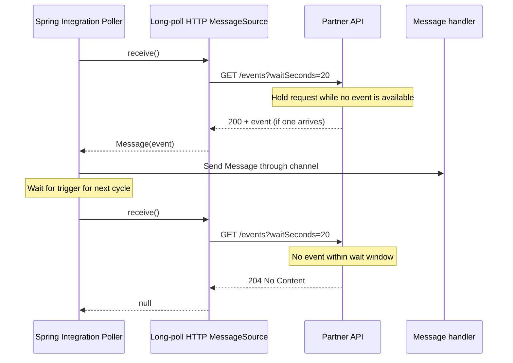

# Long Polling for Wait-Capable Sources in Spring Integration

## 1. Context: When a Source Has No Data Yet but Can Wait

An order-processing service frequently needs to receive events from a partner's API. If the application calls the API every second and most calls reply "no events yet," the system generates many empty requests. Some APIs allow **holding the request open to wait for events**: if an event arrives during the wait window, the server responds immediately; if time expires with no data, the server returns a "no events" response. This exchange pattern is called **long polling**.

The **Poller** chapter of the **SPRING_INTEGRATION_ADAPTERS** module places long polling into the Spring Integration architecture: a **polling inbound adapter** calls `MessageSource.receive()` to fetch external data, wraps the result into a `Message`, and sends it to a `MessageChannel`. The difference is that the source read operation **may block the thread for a period of time** before returning a message or `null`.

Long polling also appears in some queue or broker systems when the fetch call allows waiting. However, you must distinguish **external-source waiting** from a **polling consumer waiting on an internal `PollableChannel`**. The two mechanisms have different timeouts and configuration locations.

After this lesson, you will be able to:

- Explain the lifecycle of a long-polling request and why it reduces empty requests.
- Distinguish short polling, long polling, listener/push, and streaming.
- Integrate a long-polling HTTP source using `MessageSource` and `@InboundChannelAdapter`.
- Choose `fixedDelay`, `maxMessagesPerPoll`, and timeouts aligned with the server-side wait duration.
- Identify risks of tying up scheduler threads, handling duplicates/errors, retries, checkpoints, and application shutdown.

## 2. How Does Long Polling Work?

Suppose an API `GET /events?waitSeconds=20` has this contract:

1. If an event is already ready, the server responds immediately with HTTP `200` and the event payload.
2. If no event is available yet, the server holds the request for up to about 20 seconds.
3. If an event appears while waiting, the server returns `200` as soon as possible.
4. If the wait expires with still no event, the server returns `204 No Content`.
5. The client continues sending a new request according to its scheduling/backoff policy.

This is a **hypothetical API contract for learning**, not a mandatory rule for all long-polling APIs: some systems return `200` with an empty list, while others return a batch or include a cursor/receipt.



### A Timeline Scenario

```text
Server allows waiting up to 20 seconds

Cycle 1:
00s    Client opens GET /events
07s    Event A appears, server returns 200 immediately -> receive A

Cycle 2 (after configured rest interval):
08s    Client opens GET /events
28s    Wait expires, server returns 204 -> source returns null

Cycle 3 (after configured rest interval):
29s    Client opens GET /events
29s+   Event B is already ready -> server can return 200 quickly
```

The example above uses a 1-second pause between cycles. Actual timing depends on network, processing time, and the scheduler. The main benefit is that the application **does not have to send a request every second across 20 empty seconds**; the server responds early when data arrives. In return, HTTP requests and network connections stay open longer, consuming client, proxy, and server resources.

## 3. Distinguishing Four Data-Ingestion Mechanisms

| Mechanism | Who Initiates the Exchange? | When No Data Is Available | Notes |
| --- | --- | --- | --- |
| **Short polling** | Client sends requests periodically | Server quickly returns "empty" | Simple, but can produce many requests carrying no data. |
| **Long polling** | Client sends a request that can wait | Server holds the request until data arrives or wait expires | Fewer empty requests; requires timeouts, retries, and resource management. |
| **Push/listener** | Source or broker actively pushes events to subscribers | Listener needs no periodic check requests | Suitable when the external system supports a subscribe/push mechanism. |
| **Streaming** | Client establishes a long-lived data stream connection | Connection stays open, capable of emitting multiple events | Requires streaming protocol and dedicated connection/stream handling. |

Long polling is still **pull**: after each response, the client must decide when to send the next request. It does not magically turn an HTTP API into a WebSocket protocol or a JMS listener.

In the Spring Integration ecosystem, **polling inbound adapters** read data on a schedule; common JMS/AMQP/Kafka adapters use listeners or their own consumer loops instead. Do not force `@Poller` onto every adapter merely because they all receive data from external systems.

## 4. Two Places Where Waiting Can Happen: External Source vs. PollableChannel

This is the most important technical boundary of this lesson.

### 4.1. External Source Waits Inside MessageSource.receive()

```text
TaskScheduler -> Polling endpoint
                     |
                     v
              MessageSource.receive()
                     |
                     +--> HTTP GET with 20-second server wait
                     |      or broker receive call with wait timeout
                     |
              Message<?> or null
                     |
                     v
                MessageChannel -> Handler
```

The `MessageSource<T>` interface defines **`receive()` with no timeout parameter**. Therefore, for a source calling a long-polling API, the wait duration is designed **inside the source implementation or protocol client**, such as the HTTP request timeout and the `waitSeconds` parameter supported by the server.

Suppose you add `receiveTimeout = "200"` to the `@Poller` of an inbound adapter reading HTTP via `MessageSource.receive()`. You cannot rely on this value to guarantee the HTTP request will be cut off after 200 ms: the source's I/O operations need their own timeout.

### 4.2. Polling Consumer Waits on PollableChannel

```text
Producer --> QueueChannel (PollableChannel) --> Polling consumer
                                                 |
                                            receive(3000)
                                                 |
                                 wait for message or 3-second timeout
```

When a consumer pulls messages from a `QueueChannel`, `@Poller(receiveTimeout = "3000")` can be used to pass a wait duration to **`PollableChannel.receive(timeout)`**. An empty queue can hold the thread for up to roughly 3 seconds before returning `null`.

| Aspect | Long Poll at External Source | Waiting to Receive from QueueChannel |
| --- | --- | --- |
| Call | `MessageSource.receive()` | `PollableChannel.receive(timeout)` |
| Where wait time is defined | API/server protocol + HTTP/JMS/client timeout | `@Poller(receiveTimeout = "...")` on a polling consumer |
| When no data | Source may return `null` after normal protocol request timeout | Channel may return `null` when wait expires |
| Resources held | Poller thread and client request/connection; server may hold request | Poller thread waiting in the channel |
| Affected by network? | Yes | No if internal in-process queue; depends on channel implementation |

The name "long polling" can describe both waiting behaviors, but **never confuse the channel timeout with the external connection timeout**.

## 5. Complete Example: HTTP Long-Polling MessageSource

Suppose a partner provides the API:

```http
GET /api/events?waitSeconds=20
Accept: application/json
```

Example contract:

- `200 OK` and a non-empty JSON body: there is a **business message** to process.
- `204 No Content`: no message during this wait window.
- `429`, `5xx`, or network error: apply error/backoff policy; **must not be treated as a normal empty source**.

For demonstration, we use Java's synchronous `HttpClient` inside `MessageSource`. If a real API returns **a list of multiple events in one response**, each `Message` created from the whole response still counts as **one message toward `maxMessagesPerPoll`**; to process each event individually, split the payload with a splitter or design the source accordingly.

### 5.1. Dependency

With Spring Boot managing versions through a BOM, add Spring Integration:

```xml
<dependencies>
    <dependency>
        <groupId>org.springframework.boot</groupId>
        <artifactId>spring-boot-starter-integration</artifactId>
    </dependency>
</dependencies>
```

The example uses `java.net.http.HttpClient` built into modern Java; no extra HTTP library is needed. The partner URL below is only a placeholder and must be replaced with an actual endpoint matching the contract.

### 5.2. Creating a Wait-Capable MessageSource

```java
import java.io.IOException;
import java.net.URI;
import java.net.http.HttpClient;
import java.net.http.HttpRequest;
import java.net.http.HttpResponse;
import java.nio.charset.StandardCharsets;
import java.time.Duration;

import org.springframework.integration.core.MessageSource;
import org.springframework.messaging.Message;
import org.springframework.messaging.support.MessageBuilder;

public final class LongPollingHttpMessageSource
        implements MessageSource<String> {

    private final HttpClient client;
    private final URI endpoint;

    public LongPollingHttpMessageSource(HttpClient client, URI endpoint) {
        this.client = client;
        this.endpoint = endpoint;
    }

    @Override
    public Message<String> receive() {
        HttpRequest request = HttpRequest.newBuilder(endpoint)
            .timeout(Duration.ofSeconds(25))
            .header("Accept", "application/json")
            .GET()
            .build();

        try {
            HttpResponse<String> response = client.send(
                request,
                HttpResponse.BodyHandlers.ofString(StandardCharsets.UTF_8)
            );

            if (response.statusCode() == 204) {
                return null; // Server wait timed out, no events.
            }

            if (response.statusCode() == 200
                    && response.body() != null
                    && !response.body().isBlank()) {
                return MessageBuilder.withPayload(response.body())
                    .setHeader("event_source", "partner-http-long-poll")
                    .build();
            }

            throw new IllegalStateException(
                "Unexpected long-poll HTTP response: "
                    + response.statusCode()
            );
        } catch (InterruptedException ex) {
            Thread.currentThread().interrupt();
            throw new IllegalStateException(
                "Long polling was interrupted", ex
            );
        } catch (IOException ex) {
            throw new IllegalStateException(
                "Cannot receive events from partner API", ex
            );
        }
    }
}
```

**Key points in the source:**

1. `client.send(...)` is a **blocking** call. It holds the thread executing the poller until a response arrives or an error/timeout occurs.
2. The server is asked to wait up to 20 seconds via the URL; `HttpRequest.timeout(25 seconds)` is longer than the server-side wait to leave room for network latency and processing. The margin must be chosen according to SLAs, proxies, and partner behavior.
3. `204` represents the **no events** state per the example contract, so the source returns `null`, allowing the polling cycle to finish normally.
4. Network errors and unexpected status codes are **raised as exceptions**; handle them in an error flow/poller advice. Do not turn every exception into `null`, as that could silently swallow failures.
5. The code returns a `Message<String>` with raw JSON. The handler needs to parse, validate, attach an idempotency key, and manage business state.

In a real system, you may need authentication headers (tokens fetched from a secret store), cursors, or acknowledgements. Do not log tokens or sensitive payloads. If an API uses different response codes or JSON formats, adapt the source to match that API's contract.

### 5.3. Registering the Inbound Adapter with a Poller

```java
import java.net.URI;
import java.net.http.HttpClient;
import java.time.Duration;

import org.springframework.beans.factory.annotation.Value;
import org.springframework.context.annotation.Bean;
import org.springframework.context.annotation.Configuration;
import org.springframework.integration.annotation.InboundChannelAdapter;
import org.springframework.integration.annotation.Poller;
import org.springframework.integration.annotation.ServiceActivator;
import org.springframework.integration.channel.DirectChannel;
import org.springframework.integration.config.EnableIntegration;
import org.springframework.integration.core.MessageSource;
import org.springframework.messaging.MessageChannel;

@Configuration
@EnableIntegration
public class PartnerLongPollingConfig {

    @Bean
    public MessageChannel partnerEvents() {
        return new DirectChannel();
    }

    @Bean
    @InboundChannelAdapter(
        channel = "partnerEvents",
        poller = @Poller(
            fixedDelay = "1000",
            maxMessagesPerPoll = "1"
        )
    )
    public MessageSource<String> partnerEventSource(
            @Value("${app.partner.events-url}") String url) {
        HttpClient client = HttpClient.newBuilder()
            .connectTimeout(Duration.ofSeconds(3))
            .build();

        return new LongPollingHttpMessageSource(
            client, URI.create(url)
        );
    }

    @ServiceActivator(inputChannel = "partnerEvents")
    public void handleEvent(String json) {
        // TODO: parse JSON, validate, process idempotently,
        // save checkpoint/acknowledgement after success.
        System.out.println("Event received, chars=" + json.length());
    }
}
```

```yaml
# application.yml
app:
  partner:
    events-url: "https://partner.example/api/events?waitSeconds=20"
```

This configuration issues **one** HTTP long-poll request per cycle:

- `maxMessagesPerPoll = "1"` limits to **one successful receive** per cycle, avoiding accidentally opening multiple consecutive waiting requests within the same cycle when the server continuously has events.
- `fixedDelay = "1000"` waits roughly 1 second **after the entire cycle ends** before starting the next cycle. If a request takes 20 seconds with no data, the interval between two starts can be around 21 seconds.
- `DirectChannel` sends messages synchronously to the handler. Therefore, if the handler takes 2 seconds, the 1-second fixed-delay only starts after the cycle along with the synchronous handler finishes.

**This is a learning template.** Production requires deciding how to maintain cursors, acks, retries, authentication, state persistence across restarts, and how to coordinate one or multiple instances reading the source. You cannot infer exactly-once delivery from the fact that an API supports long polling.

## 6. Separate Example: Consumer Waiting on QueueChannel

If the wait happens **inside the application** rather than at an external API, you can configure a polling consumer for `QueueChannel`:

```java
import org.springframework.context.annotation.Bean;
import org.springframework.context.annotation.Configuration;
import org.springframework.integration.annotation.Poller;
import org.springframework.integration.annotation.ServiceActivator;
import org.springframework.integration.channel.QueueChannel;
import org.springframework.integration.config.EnableIntegration;

@Configuration
@EnableIntegration
public class QueueWaitingConsumerConfig {

    @Bean
    public QueueChannel bufferedEvents() {
        return new QueueChannel(100);
    }

    @ServiceActivator(
        inputChannel = "bufferedEvents",
        poller = @Poller(
            fixedDelay = "500",
            receiveTimeout = "3000",
            maxMessagesPerPoll = "1"
        )
    )
    public void process(String eventPayload) {
        System.out.println("Received: " + eventPayload);
    }
}
```

Suppose another producer has sent messages into `bufferedEvents`:

- If the queue already has a message, the consumer typically retrieves it immediately.
- If the queue is empty, the `receive(3000)` call can wait up to 3 seconds; if a message arrives midway, it returns early.
- If 3 seconds pass with the queue still empty, `receive()` returns `null`, the cycle ends, and the fixed-delay schedule starts counting 500 ms.

This is a **waiting receive on a PollableChannel**, not HTTP long polling to an external source. Increasing `receiveTimeout` on this consumer does not make HTTP or SFTP requests on another adapter wait longer.

## 7. Choosing Wait Times and Triggers

The parameters below control **different** parts:

| Parameter | Where? | What It Controls |
| --- | --- | --- |
| `waitSeconds=20` | Example API contract | How long the server is willing to hold the request waiting for an event. |
| `HttpRequest.timeout(25 s)` | HTTP client | Client-side request deadline before treating it as timeout/error. |
| `connectTimeout(3 s)` | HTTP client | Maximum time to establish a connection under applicable conditions. |
| `fixedDelay=1000` | Spring Integration poller | Rest interval after the previous cycle completes. |
| `maxMessagesPerPoll=1` | Spring Integration poller | Maximum successful receives in a single cycle. |
| `receiveTimeout=3000` | Polling consumer reading `PollableChannel` | Wait time for a single receive from a timeout-capable channel. |

For an API with a **20-second server wait**, consider an HTTP client timeout longer than this duration, with enough margin for network/proxies. If a reverse proxy drops requests after 15 seconds, setting a 25-second client timeout **will not stop the proxy from cutting it short**. Verify limits along the entire path from client to server.

### Fixed-delay Is Usually Clearer for Long-Waiting Tasks

```text
fixedDelay = 1 second
API server wait = up to 20 seconds
maxMessagesPerPoll = 1

00s  open request R1 -------------------- 20s (204)
20s  end cycle R1
20s  rest 1 second
21s  open request R2 ----- 25s (200, event arrived)
25s  process event; handler may take additional time
...  rest 1 second after cycle finishes
```

If you use `fixedRate=1000` when each request can wait 20 seconds, the 1-second periodic ticks will constantly lag. Fixed-rate does not automatically run 20 concurrent requests for **the same periodic task** under standard scheduler behavior, yet you should not rely on that as a system-wide concurrency cap. Multiple endpoints/replicas or async processing can still issue many parallel requests.

### Relationship with maxMessagesPerPoll

If `maxMessagesPerPoll = 5`, one cycle can call `MessageSource.receive()` **multiple times**. Suppose each time the API holds the request for 20 seconds and returns `204`: the first `null` return ends the cycle early without attempting all five times. However, if the API returns four quick events in a row and then holds the fifth call for 20 seconds, that cycle will extend by an extra 20 seconds before finishing.

For a simple HTTP long-poll source, `maxMessagesPerPoll = 1` usually helps bound sequential requests per cycle. If higher throughput is needed, design bounded concurrency with explicit batch/cursor/ack semantics rather than blindly raising the limit.

## 8. Why Should You Not Wait Indefinitely?

A task can remain blocked inside `receive()` longer than desired if timeouts are missing. When that happens:

1. **TaskScheduler threads are held:** other polling endpoints sharing the scheduler can lag, especially when the thread pool is too small.
2. **Hard to stop the application:** shutting down or stopping an endpoint must wait for the blocking call to return or be interrupted/cancelled by the client mechanism.
3. **Network failures are hard to detect:** without timeouts and monitoring, a "waiting for events" state can be mistaken for "disconnected or hung."
4. **Partner-side resources are occupied:** every waiting request consumes connections, concurrency slots, and server/proxy resources.
5. **Higher overload risk across multiple replicas:** 10 pods × 5 long-poll endpoints/pod can hold 50 open requests simultaneously.

For sources with long wait operations, provision a sufficiently sized `TaskScheduler` or isolate a scheduler for waiting endpoints, depending on the architecture. Offloading `MessageSource.receive()` to a bounded worker pool also requires careful design: asynchronous handoff does not automatically guarantee ordering or processing confirmation.

**Do not use unbounded blocking polling to simulate streaming.** If a source offers WebSocket, SSE, a broker consumer, or a suitable streaming API, choose that mechanism for long-lived connections; when HTTP long polling is required, configure explicit deadlines and connection recovery.

## 9. Error Handling, Retries, and Data Guarantees

A long-polling cycle can end in three outcome categories:

| Outcome | Example | Correct Behavior |
| --- | --- | --- |
| **Data available** | HTTP `200` + event | Create message, execute business logic, record idempotency/ack/checkpoint per contract. |
| **Normal wait expiration** | HTTP `204` per example API | Return `null`, wait for next cycle. This is not an error. |
| **Error** | Client timeout, HTTP `429/500`, network error, auth `401` | Classify error, log/record, apply backoff or fix configuration; do not silently turn into `null`. |

### Retries and Backoff

- For `429 Too Many Requests`, honor `Retry-After` if the API provides it or apply appropriate backoff.
- For `5xx` or network timeouts, use bounded retries, exponential backoff, and jitter where suitable to avoid multiple instances hammering a failing service at once.
- For `401/403`, check tokens, permissions, or configuration; retrying continuously with the same broken credentials rarely helps.
- For **no-event** outcomes, continue the normal polling schedule; do not turn this state into an exception to trigger error retries.

In the Java example, exceptions from the source must be handled via the polling endpoint's error handling (such as `errorChannel`, advice, or error flow depending on Spring Integration version). Do not rely on `fixedDelay` to replace a full error backoff policy: if a request fails immediately in a few milliseconds, a tight schedule can create a high-pressure error loop.

### Cursor, Ack, and Idempotency Mechanisms

Long polling **does not automatically guarantee exactly-once**. Consider an example with a cursor:

```text
GET /events?cursor=C10&waitSeconds=20
       |
       v
200 event E11, nextCursor=C11
       |
       v
Did business processing of E11 succeed?
   | Yes: save checkpoint C11 after commit
   | No: keep C10 to redetect/reprocess per contract
```

If the client updates the cursor **before** committing to the DB, a crash can leave the event unprocessed. If the client writes to the DB successfully but crashes before saving the cursor, the event may be re-emitted. Therefore, you need an **idempotency key** (e.g., `eventId`) and an appropriate commit/checkpoint strategy. Sending acks/receipts must follow the provider's specific contract.

If an API returns a **batch of 100 events in one HTTP response**, do not assume `maxMessagesPerPoll = 1` means only one business event: it counts one `Message` representing the batch. Define clearly how to split, persist individual results, retry per event, and update checkpoints.

### Multiple Instances and Endpoint Lifecycle

If every replica uses the same cursor and calls the long-poll API, results can race or duplicate depending on the source. Evaluate the contract for **consumer groups, locks/leases, partitions, per-consumer cursors, visibility timeouts, and acknowledgements**. Do not assume Spring Integration automatically distributes work simply because `@InboundChannelAdapter` is used.

When the application stops, a blocking call may still be waiting. Set finite timeouts, configure proper shutdown, handle interruption correctly, and verify connections are closed/released. If the source holds client resources or persistent sessions that need closing, manage them via the bean/adapter lifecycle rather than creating an unmanaged new connection per poll.

## 10. Observability and Troubleshooting

Long polling can produce **no handler logs for 20 seconds** while operating completely normally. Observing only the handler is insufficient; also measure cycles where `receive()` returns `null`.

| Metric | Helps Detect |
| --- | --- |
| Long-poll requests started and completion times | Are requests held too long or ending prematurely? |
| Counts of event / no-event / error outcomes | Is the source genuinely empty or failing? |
| `receive()` duration, p50/p95/p99 | Timeouts, network jitter, premature proxy disconnects, overloaded server. |
| Handler duration and event backlog | Is downstream keeping up with received events? |
| Busy scheduler threads, executor queue, concurrent requests | Is there resource contention due to blocking tasks? |
| Saved cursor, oldest event age, retried/duplicate counts | Progress stalls, abnormal replays, or broken ack contracts? |
| HTTP `429`, `5xx`, timeouts, and retry delays | Rate-limit violations or tight retry loops? |

### Common Symptoms

**No handler logs for 20 seconds.** Could be normal while the server holds the request; check request-open timestamps and `204` counts before assuming the endpoint is broken.

**Errors every 15 seconds despite a 20-second server wait.** Check reverse proxies, ingress, load balancers, or intermediate timeouts; raising the client timeout alone will not fix every intermediate cutoff.

**Request rate spikes when the partner fails.** `MessageSource.receive()` may throw immediately, causing the poller to restart after a short `fixedDelay`. Add error backoff, retry limits, and alerts.

**Other endpoints fall behind.** Blocking long-poll requests may be exhausting shared scheduler threads. Inspect the thread pool, number of long-poll tasks, and scheduler isolation.

**Events are re-received after restart.** Check cursor persistence, post-commit acks, idempotency state, multiple replicas reading simultaneously, and source visibility timeout limits.

## 11. Exercises with Answers

**Exercise 1 — Identifying long polling.** An API holds a request for up to 30 seconds, returns early when an event arrives, and returns an empty response when time expires. Is this short polling or long polling?

**Answer:** **Long polling**, because the request is held open waiting for events rather than responding immediately when the source has no data.

**Exercise 2 — Which timeout controls HTTP?** `@Poller(receiveTimeout = "500")` is placed on an inbound adapter that calls `HttpClient.send()` inside `MessageSource.receive()`. Will the HTTP request definitely stop within 500 ms?

**Answer:** **No.** `receiveTimeout` does not automatically configure the request timeout for a `MessageSource.receive()` implementation. You must set the HTTP client timeout and follow the server contract.

**Exercise 3 — Schedule with no events.** The server holds the request for the full 20 seconds and returns `204`; the poller uses `fixedDelay = 1000 ms`, `maxMessagesPerPoll = 1`. Ignoring overhead, roughly how far apart are two request starts?

**Answer:** About **21 seconds**, because the first cycle waits 20 seconds and then waits 1 second of fixed-delay.

**Exercise 4 — Event arrives early.** Server wait is up to 20 seconds, but an event arrives after 2 seconds. Must the client wait the full 20 seconds to get the event?

**Answer:** **No**, if the API follows the long-polling contract; the server can return the event right away, plus network/scheduling overhead.

**Exercise 5 — One response contains multiple events.** One HTTP response contains a JSON array of 50 events. Does `maxMessagesPerPoll = 1` automatically limit this to one event?

**Answer:** **No.** If the source returns a `Message<List<Event>>` or a `Message<String>` holding the entire array, the poller has received **one message**. To bound individual events, split the payload and design appropriate batching.

**Exercise 6 — Internal queue.** `QueueChannel.receive(3000)` initially has no messages, but a producer sends one after 600 ms. Must the call wait the full 3000 ms?

**Answer:** **No.** On a queue supporting blocking receive, the call can return after roughly 600 ms as soon as the message is enqueued.

**Exercise 7 — API returns 500 error.** Should the source return `null` to hide the error and make the poller think the source is empty?

**Answer:** **No.** Errors must be surfaced, recorded, and handled with policy-based retry/backoff; `null` is only for the contract-defined no-data state.

**Exercise 8 — Duplicate prevention.** The application saves the new cursor as soon as HTTP `200` arrives, but the DB write fails. Does long polling let the system recover the event automatically?

**Answer:** **No.** You can lose the chance to reprocess depending on the API contract. Save cursors/acks at the proper commit boundary and use idempotent handlers.

**Exercise 9 — Scheduler capacity.** There are 20 long-polling endpoints, each able to block for 20 seconds on a scheduler with few threads. Why might other endpoints run late?

**Answer:** Waiting `receive()` calls can hold scheduler threads; when the pool lacks enough threads, other tasks must wait. Adjust concurrency architecture and scheduler sizing for actual load.

## 12. Takeaways

**Long polling allows a data-fetch operation to wait until a message arrives or the allowed window expires.** In Spring Integration, when an external source has long-waiting requests, that logic typically lives in `MessageSource.receive()` and client/protocol timeouts; `@Poller` still controls when each cycle starts, how many messages are taken per cycle, and how messages enter `MessageChannel`. When waiting occurs on a `QueueChannel` or `PollableChannel`, the polling consumer's `receiveTimeout` controls `receive(timeout)`. Bound wait durations, scheduler resources, and concurrency; distinguish "no data" from "error," and design retries, cursors/checkpoints, and idempotency for reliable ingestion.
