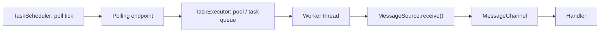

# task-executor and Asynchronous Polling Processing in Spring Integration

## 1. Problem Statement: Avoiding Letting One Polling Cycle Tie Up the Scheduling Thread

An application periodically ingests CSV files from a partner directory, downloads SFTP files, or checks records in a database. Each polling cycle can call the source multiple times and send messages into the processing flow. If reading the source or executing the handler takes tens of seconds, a scheduler thread can be tied up for a long time; other tasks sharing the scheduler can easily lag when resources are scarce.

In the **SPRING_INTEGRATION_ADAPTERS** module, `TaskScheduler` and `TaskExecutor` have different responsibilities:

- **`TaskScheduler`** determines *when* to trigger an endpoint according to fixed-rate, fixed-delay, cron, or a custom trigger.
- **`TaskExecutor`** performs the submitted *work*, potentially on a worker thread or a thread pool with a queue.
- **`MessageSource`** fetches data from an external system and returns `Message<?>`; **`MessageChannel`** delivers the message to the next handler or endpoint.

Spring Integration allows configuring `taskExecutor` **directly on the poller**. When configured, the polling task can be handed off to a worker instead of executing entirely on the scheduler thread. This separates the two responsibilities, while also introducing queues, potential overlapping runs, and error or transaction boundaries.

After this lesson, you will be able to distinguish a scheduler from an executor, write `@Poller(taskExecutor = "...")`, use bounded pools, explain why `ExecutorChannel` differs from a poller's task executor, and protect your pipeline when sources or handlers are slow.

## 2. What Happens When a Poller Runs Synchronously?

When no separate executor is specified for a polling task, the execution thread provided by the scheduler can directly perform reading from the source and sending messages:

```text
TaskScheduler triggers endpoint
         |
         v
   MessageSource.receive()
         |
         v
   MessageChannel.send(message)
         |
         v
   Handler runs business logic
         |
         +--> continue receive() in same cycle if quota remains
```

With `DirectChannel`, handler invocation is synchronous by default. Suppose `maxMessagesPerPoll = 4` and a handler takes 3 seconds per file; a single polling cycle can take roughly 12 seconds of processing, excluding I/O. If the scheduler has very few threads, other endpoints may have to wait.

However, **the scheduler can be configured with multiple threads**: do not assume one slow poller always blocks every other endpoint. Check the thread count, task durations, and channel types of your actual topology.

## 3. What Does Attaching a TaskExecutor to a Poller Change?

When a poller has a `taskExecutor`, the scheduler can submit the polling task to the executor; a worker executes `receive()`, sends messages, and—if using a synchronous channel—runs the handler.



Do not confuse **submitting a task** with **completing a cycle**. When the executor's queue is busy, the task sits waiting; when the executor rejects a task, the polling cycle may not run at all. The scheduler still schedules ticks, yet actual throughput depends on the workers.

If the executor has multiple workers, polling cycles can **overlap** when a new cycle is submitted while the previous cycle is still running. Some `MessageSource` implementations, file filters, SFTP sessions, or data-claiming logic are not safe for concurrent `receive()` calls. Before increasing pool size, understand thread safety and duplicate-handling contracts.

### Illustrative Timeline

A poller triggers every 5 seconds, and each cycle takes 8 seconds:

```text
Expected schedule:     0s        5s       10s       15s
                       |---------|---------|---------|

Without offloading to an executor:
Execution thread:      [Poll 1: 8s][Poll 2: ...]
                               the second cycle may be delayed

Executor with 2 workers, allowing additional task submissions:
Worker 1:              [Poll 1: 8s]
Worker 2:                       [Poll 2: 8s]
                               two cycles can overlap
```

This is a **possibility**, not a guaranteed real-time schedule. The actual outcome depends on the trigger, implementation, worker count, queue, load level, and rejection policy.

## 4. Distinguishing TaskScheduler, Poller taskExecutor, and ExecutorChannel

| Mechanism | Where Does the Work Run? | Main Consequence |
| --- | --- | --- |
| Multi-threaded `TaskScheduler` | Polling tasks execute on scheduler threads | Reduces contention between independent endpoints, though each cycle can still hold a scheduler thread. |
| `@Poller(taskExecutor = "...")` | Receiving from source and sending messages run on an assigned worker | Scheduler does less direct work; queue/rejection and concurrency must be controlled. |
| `ExecutorChannel` | Offloads **downstream work** to a worker when a message is sent to the channel | `receive()` may still run on the poller thread, while the handler becomes asynchronous. |

```text
Option A — taskExecutor on the poller:
Scheduler --> Worker A --> Source.receive() --> DirectChannel --> Handler
                                      (handler synchronous on same Worker A)

Option B — ExecutorChannel:
Scheduler --> Source.receive() --> ExecutorChannel --> Worker B --> Handler
                                 (handoff)          (processed later)
```

Option A is useful if **reading the source itself can block**, such as SFTP/HTTP long polling or slow DB queries. Option B is useful if reading the source is fast while the handler is CPU/I/O-heavy. You can also combine both, though you should do so with concrete metrics and goals because tracking completion, ordering, and errors becomes more complex.

## 5. Example: File Inbound Adapter Running via task-executor

The application reads CSV files in `data/inbox`, triggers polling every 5 seconds, and receives at most 3 files per cycle. Polling work is handed to **a single worker** with a bounded queue. A single worker illustrates decoupling from the scheduler while avoiding intentionally running multiple concurrent reads against the same source.

### 5.1. Dependencies

In a Spring Boot project using a BOM to manage versions:

```xml
<dependencies>
    <dependency>
        <groupId>org.springframework.boot</groupId>
        <artifactId>spring-boot-starter-integration</artifactId>
    </dependency>
    <dependency>
        <groupId>org.springframework.integration</groupId>
        <artifactId>spring-integration-file</artifactId>
    </dependency>
</dependencies>
```

Create `data/inbox` beforehand relative to the application's working directory.

### 5.2. Bounded Executor Bean

```java
import java.util.concurrent.ThreadPoolExecutor;

import org.springframework.context.annotation.Bean;
import org.springframework.context.annotation.Configuration;
import org.springframework.scheduling.concurrent.ThreadPoolTaskExecutor;

@Configuration
public class PollingWorkerConfiguration {

    @Bean("filePollingExecutor")
    public ThreadPoolTaskExecutor filePollingExecutor() {
        ThreadPoolTaskExecutor executor = new ThreadPoolTaskExecutor();
        executor.setCorePoolSize(1);
        executor.setMaxPoolSize(1);
        executor.setQueueCapacity(2);
        executor.setThreadNamePrefix("file-poll-worker-");
        executor.setRejectedExecutionHandler(
            new ThreadPoolExecutor.AbortPolicy()
        );
        executor.setWaitForTasksToCompleteOnShutdown(true);
        executor.setAwaitTerminationSeconds(30);
        executor.initialize();
        return executor;
    }
}
```

In this example:

- `corePoolSize = maxPoolSize = 1`: at most one polling task **running** in this pool.
- `queueCapacity = 2`: at most two tasks **waiting for the worker**. This queue holds *poll tasks*, not files or business messages directly.
- `AbortPolicy`: when the pool/queue is full, submission is rejected. The application must log, alert, and decide how to handle missed poll ticks; do not assume the scheduler automatically replays rejected tasks.
- `setAwaitTerminationSeconds(30)` supports bounded wait during shutdown; it is **not** a network timeout or a handler execution limit.

If a cycle takes 20 seconds while the schedule submits work every 5 seconds, a single-worker pool with a 2-task queue can saturate. Asynchrony moves the bottleneck to the queue; it does not make processing inherently faster.

### 5.3. Poller Wired with taskExecutor and Handler

```java
import java.io.File;
import java.io.IOException;
import java.nio.charset.StandardCharsets;
import java.nio.file.Files;

import org.springframework.context.annotation.Bean;
import org.springframework.context.annotation.Configuration;
import org.springframework.integration.annotation.InboundChannelAdapter;
import org.springframework.integration.annotation.Poller;
import org.springframework.integration.annotation.ServiceActivator;
import org.springframework.integration.channel.DirectChannel;
import org.springframework.integration.config.EnableIntegration;
import org.springframework.integration.core.MessageSource;
import org.springframework.integration.file.FileReadingMessageSource;
import org.springframework.integration.file.filters.AcceptOnceFileListFilter;
import org.springframework.integration.file.filters.CompositeFileListFilter;
import org.springframework.integration.file.filters.SimplePatternFileListFilter;
import org.springframework.messaging.MessageChannel;

@Configuration
@EnableIntegration
public class AsyncFilePollingConfiguration {

    @Bean
    public MessageChannel incomingCsvFiles() {
        return new DirectChannel();
    }

    @Bean
    @InboundChannelAdapter(
        channel = "incomingCsvFiles",
        poller = @Poller(
            fixedRate = "5000",
            maxMessagesPerPoll = "3",
            taskExecutor = "filePollingExecutor"
        )
    )
    public MessageSource<File> csvFileSource() {
        FileReadingMessageSource source = new FileReadingMessageSource();
        source.setDirectory(new File("data/inbox"));

        CompositeFileListFilter<File> filter =
            new CompositeFileListFilter<>();
        filter.addFilter(new SimplePatternFileListFilter("*.csv"));
        filter.addFilter(new AcceptOnceFileListFilter<>());
        source.setFilter(filter);
        return source;
    }

    @ServiceActivator(inputChannel = "incomingCsvFiles")
    public void processCsv(File file) throws IOException {
        String csv = Files.readString(
            file.toPath(), StandardCharsets.UTF_8
        );
        System.out.printf(
            "[%s] Processed %s (%d chars)%n",
            Thread.currentThread().getName(),
            file.getName(), csv.length()
        );
        // TODO: parse/validate CSV, save order, and archive.
    }
}
```

**Reading the configuration:**

1. `@InboundChannelAdapter` declares the source emitting messages into `incomingCsvFiles`.
2. `fixedRate = "5000"` sets an expected trigger cadence of every 5 seconds; `maxMessagesPerPoll = "3"` limits the number of messages in **one cycle**.
3. `taskExecutor = "filePollingExecutor"` references the executor bean name. Reading files and sending messages occur on the assigned worker.
4. `DirectChannel` executes the handler synchronously with the send operation, so handler logs typically carry the `file-poll-worker-` thread prefix.
5. `AcceptOnceFileListFilter` helps avoid re-selecting files already accepted by the filter in the instance's memory; it does not prove business processing succeeded and does not provide exactly-once delivery.

With 10 valid files ready, `maxMessagesPerPoll = 3` requires at least 4 successful cycles to ingest all of them (3 + 3 + 3 + 1), assuming no errors or new files. When those cycles **actually run** also depends on the executor's queue.

### 5.4. Experiments

1. Start when `data/inbox` is empty: the source can return `null`; the handler does not log, yet the poller can still be active.
2. Add 2 CSV files: on an appropriate ingestion cycle, the handler prints the filename and worker thread name.
3. Add more than 10 files: observe messages per cycle and backlog duration.
4. In a practice environment, simulate a slow handler: observe the executor queue and rejections when the schedule rate exceeds processing speed.
5. Restart the application: evaluate whether files get re-selected along with your retry/idempotency policy. An in-RAM filter does not automatically guarantee persistent metadata.

To see empty polling cycles, log/collect metrics at `MessageSource.receive()` or the polling endpoint. Logs inside the handler appear only when a message arrives.

## 6. Equivalent Configuration in Java DSL

When using the IntegrationFlow DSL, the executor is attached to the poller:

```java
import java.io.File;
import java.time.Duration;
import org.springframework.context.annotation.Bean;
import org.springframework.integration.dsl.IntegrationFlow;
import org.springframework.integration.dsl.Pollers;
import org.springframework.integration.file.dsl.Files;
import org.springframework.scheduling.concurrent.ThreadPoolTaskExecutor;

@Bean
IntegrationFlow asynchronousFileFlow(
        ThreadPoolTaskExecutor filePollingExecutor) {
    return IntegrationFlow
        .from(
            Files.inboundAdapter(new File("data/inbox"))
                 .patternFilter("*.csv"),
            endpoint -> endpoint.poller(
                Pollers.fixedRate(Duration.ofSeconds(5))
                       .maxMessagesPerPoll(3)
                       .taskExecutor(filePollingExecutor)
            )
        )
        .handle(message -> {
            File file = (File) message.getPayload();
            System.out.println(
                Thread.currentThread().getName() + ": " + file.getName()
            );
        })
        .get();
}
```

This is an **alternative syntax** to the annotations in section 5; do not run both endpoints concurrently scanning the example directory. The `filePollingExecutor` bean was created in section 5.2. If multiple beans of type `ThreadPoolTaskExecutor` exist, use `@Qualifier("filePollingExecutor")` to inject the right bean.

## 7. ExecutorChannel: Offloading Only Downstream Work to Workers

If `MessageSource.receive()` is fast while the handler is CPU/I/O-intensive, you can keep the poller reading the source on the scheduler and send messages through an `ExecutorChannel`:

```java
import org.springframework.context.annotation.Bean;
import org.springframework.integration.channel.ExecutorChannel;
import org.springframework.messaging.MessageChannel;
import org.springframework.scheduling.concurrent.ThreadPoolTaskExecutor;

@Bean
MessageChannel processingChannel(
        ThreadPoolTaskExecutor processingExecutor) {
    return new ExecutorChannel(processingExecutor);
}
```

This example requires a `processingExecutor` bean sized for real load; when used, the inbound adapter sends to `processingChannel` and the handler subscribes to that channel. It is an **alternative topology**:

```text
Poller taskExecutor:
Scheduler -> Worker A -> Source.receive() -> DirectChannel -> Handler

ExecutorChannel:
Scheduler -> Source.receive() -> ExecutorChannel -> Worker B -> Handler
```

When `ExecutorChannel.send()` succeeds, the message may have only been **submitted to the executor**, not business-completed. Exceptions from the asynchronous handler no longer propagate up the same call stack to the poller as with `DirectChannel`. If the queue fills or the application crashes, you need error-handling/re-ingestion policies, durable queues where required, and proper idempotency state.

## 8. maxMessagesPerPoll, Triggers, and Concurrency Limits

| Parameter | Controls | Does Not Directly Limit |
| --- | --- | --- |
| `fixedRate` / `fixedDelay` | When the scheduler wants to trigger a polling task | Worker count and in-flight messages |
| `maxMessagesPerPoll` | Maximum messages **in one cycle** | Number of concurrently running poll cycles |
| Pool size | Number of worker tasks that can execute simultaneously | Remaining data at the source |
| Executor queue capacity | Number of tasks allowed to wait | Total successfully processed messages |
| `receiveTimeout` of a PollableChannel consumer | Wait time for a single receive from the channel | HTTP/SFTP/DB timeouts or handler duration |

### 8.1. Increasing the Executor Pool Can Cause Multiple Cycles to Overlap

If `maxMessagesPerPoll = 5` and 3 polling cycles run concurrently, the overall system can have **more than 5 messages** in flight. This limit applies **per individual cycle**, not across the entire application.

Especially with SFTP, files, and databases, concurrent cycles can contend for resources, pick up duplicate records, or exceed quotas. Evaluate thread safety of the source, file filters, session factory, data-claiming logic, and connection limits.

### 8.2. Does fixed-delay Still Wait Until the Worker Finishes Processing?

When the scheduler submits a task to an executor, the moment task handoff completes can **differ** from when the work actually finishes. Therefore, do not assume `fixedDelay` still preserves an exact rest interval between two actual accesses to the external source once an executor is attached.

If an API/SFTP server requires at least a 10-second pause **after a request completes**, throttle at the request-issuing site itself, use a single-threaded sequential flow with an appropriate trigger, or use a stateful rate limiter. Verify behavior on the real topology, including when the executor is saturated.

### 8.3. Full Executor and Rejected Tasks

One worker and a queue capacity of 2 can hold **one running task and two waiting tasks**. If the schedule keeps submitting work, `AbortPolicy` rejects new tasks. That can cause a poll cycle to be skipped; files still at the source can still be read on another cycle if filters/checkpoints allow, yet **there is no automatic catch-up guarantee**.

| Rejection Policy | Impact | Risk |
| --- | --- | --- |
| Abort/reject | Raises an error when unable to accept a new task | Requires observability, alerts, and explicit catch-up |
| Caller-runs | Forces the submitting thread to run the task when the pool is full | Can tie up the scheduler thread and delay other endpoints |
| Discard | Drops the task | Easy to lose poll cycles silently without observability |

For critical business systems, use bounded queues, avoid silent task-discard policies, track rejection counts, and design handling for data remaining at the source.

## 9. Transactions, Error Handling, and Thread-Scoped Context

### 9.1. Thread Boundaries and Transactions

Spring transactions typically rely on thread-bound context. When polling is handed off to an executor, a transaction on another thread **does not automatically migrate** to the worker. When using `ExecutorChannel`, the sending thread's transaction also does not automatically span the downstream worker's handler.

For example, two workers concurrently reading `NEW` records from a database without an atomic claim mechanism can both process the same order. To prevent duplicates, use proper transactions and atomic claim/locking or conditional status updates; simply increasing the thread pool will not resolve contention.

To design correctly:

1. Identify which thread starts and ends the transaction; which `receive()`, `send()`, and handler calls it covers.
2. Ensure the source has a safe data distribution/claiming mechanism under concurrency.
3. Save checkpoints or acks after the business success point per contract.
4. Design idempotent handlers so work can be safely reprocessed after crashes or retries.

`maxMessagesPerPoll` **does not** turn all messages in a cycle into a single shared transaction.

### 9.2. Errors at Each Stage

| Stage | Symptom | What to Handle |
| --- | --- | --- |
| `MessageSource.receive()` on worker | File, SFTP, HTTP, or DB source error | Polling endpoint error handling/advice and suitable backoff |
| Sending message to channel | Timeout, channel rejection, or send error | Error monitoring, queue bounds, retry/recovery |
| Handler via `DirectChannel` | Synchronous exception on the sending worker | Transactions, rollbacks, and error flow in the synchronous path |
| Handler after `ExecutorChannel` | Exception occurs on downstream worker | Error channel, retries, dedicated DLQ/quarantine |
| Executor rejects task | Submission fails when pool is saturated | Monitor rejections, throttle schedule, and catch-up |

With `AcceptOnceFileListFilter`, a file can be marked accepted before the handler successfully writes to the DB. A message submitted to an executor **does not mean** business processing has completed. When high reliability is needed, use persistent checkpoints/metadata and idempotency keys per file or order.

### 9.3. Thread-Scoped Context Does Not Propagate Automatically

`ThreadLocal`-based contexts such as transactions, MDC logging, request contexts, or certain security contexts are not guaranteed to follow across workers. Pass correlation IDs using **message headers**; configure deliberate context propagation if needed, while avoiding logging secrets or exposing them through uncontrolled headers.

## 10. Backpressure and Sizing for Production Environments

```text
External data (file/SFTP/API/DB)
             |
             v
  MessageSource and poller
    (schedule, maxMessagesPerPoll)
             |
             v
   Executor / Channel queue
    (pool size, queue size, reject)
             |
             v
      Handler and target DB/API
    (processing duration, retry, quota)
```

Worker counts should be chosen according to **each layer's capacity**. If SFTP only allows two sessions, raising the pool to 20 can increase timeouts. If the target DB has already exhausted its connection pool, increasing concurrency can make processing take longer.

Measure the time from when data is **ready at the source** until business logic **commits successfully**. Logging "poller ran" or "message sent" only reflects a single stage. Key metrics include incoming data volume, completed messages/second, age of the oldest backlog item, and queue backlog.

If the source requires ordering guarantees, consider keeping a single reading worker and using a processing queue with appropriate ordering preservation. If higher throughput is needed, start from the actual bottleneck and clearly define work-partitioning boundaries, retries, and idempotency.

## 11. Monitoring and Diagnostics

| Metric | Meaning |
| --- | --- |
| Scheduler trigger time vs. worker start time | Queue wait latency inside the executor |
| Running tasks, queue depth, and rejections | Is the executor saturating? |
| `receive()` duration and total cycle duration | Is the bottleneck at the source or the handler? |
| Messages received per cycle | Is the source empty or frequently hitting the limit? |
| Age of the oldest unfinished file/message | Is the actual processing SLA being met? |
| Retries, timeouts, transaction errors, and duplicate messages | Reliability issues when increasing concurrency |
| Shutdown duration, remaining queued tasks | Does application exit release and complete work safely? |

**Scenario 1:** Poller triggers steadily but no handler logs appear. The source may be returning `null` or tasks may still sit in the worker queue; log both the start/end of `receive()` and the executor queue.

**Scenario 2:** Backlog grows even though worker threads are active. Actual processing capacity is lower than data arrival rate; adjust topology or source limits after measuring load, rather than just renaming threads.

**Scenario 3:** Seeing `TaskRejectedException` or rejection errors. Pool/queue is saturated; reduce submission rate, safely increase capacity, or change backpressure mechanisms. Check remaining source data for catch-up processing.

**Scenario 4:** A file is processed twice. Check concurrency, filters/checkpoints, multiple replicas reading simultaneously, retries, and business keys; do not immediately blame everything on the task executor.

## 12. Exercises with Answers

**Exercise 1 — Scheduler vs. executor.** Do `TaskScheduler` and `TaskExecutor` have the same role?

**Answer:** No. The scheduler decides **when to trigger**, while the executor decides **where to run the work** and manages pools/queues.

**Exercise 2 — Handler on DirectChannel.** A poller uses `taskExecutor="filePollingExecutor"` and sends to a `DirectChannel`. On which thread does the handler run by default?

**Answer:** On the worker executing the poll and message send, because `DirectChannel` invokes handlers synchronously.

**Exercise 3 — ExecutorChannel.** A poller has no task executor but sends messages into an `ExecutorChannel`. Does `MessageSource.receive()` automatically run in a downstream worker?

**Answer:** No. The source is still invoked on the poller thread; work after the channel is handed off to the executor.

**Exercise 4 — maxMessagesPerPoll.** `maxMessagesPerPoll = 5` and the executor has three poll cycles running concurrently. Can more than 5 messages be in processing at once?

**Answer:** Yes. The five-message limit is **per cycle**, not a system-wide concurrency cap.

**Exercise 5 — Full pool.** One worker is busy, two tasks are waiting in a capacity-2 queue, and a new task is submitted with `AbortPolicy`. What can happen?

**Answer:** The executor can reject the new task. You need logging/alerts and a catch-up mechanism on future cycles; do not assume rejected tasks automatically re-run.

**Exercise 6 — Transactions.** Is a handler on a worker after `ExecutorChannel` automatically part of the sending thread's transaction?

**Answer:** No. Transaction contexts are typically thread-bound; define transaction boundaries on the downstream worker.

**Exercise 7 — Non-thread-safe source.** An adapter reuses a session that is not safe for concurrent access. Is increasing the poller executor from 1 to 16 workers appropriate?

**Answer:** Not without redesigning session management/claiming or partitioning the source. You can use a single worker for reading or a verified resource-protection mechanism.

**Exercise 8 — Measuring SLA.** The scheduler runs on time, yet the executor queue holds messages for 15 minutes while the processing SLA is 1 minute. Is the SLA met?

**Answer:** No. Measure from when data is ready until business logic commits, and adjust capacity, backpressure, and queue policies.

**Exercise 9 — Reprocessing.** A file was accepted by an accept-once filter, but the asynchronous handler failed. Will the next cycle automatically re-fetch the file?

**Answer:** There is no guarantee. You must design retries, persistent state, and idempotent handlers.

## 13. Takeaways

**`taskExecutor` on a poller decouples polling execution from `TaskScheduler`**; the scheduler still triggers according to schedule. With `DirectChannel`, synchronous handlers typically run on the poller's worker; with `ExecutorChannel`, downstream processing is handed off across another asynchronous boundary. `maxMessagesPerPoll` bounds messages *per cycle*, not total concurrency or queue depth. When configuring for files, SFTP, HTTP, or databases, use bounded executors, ensure sources are safe under concurrency, and manage backpressure, timeouts, transactions, retries, and idempotency.
