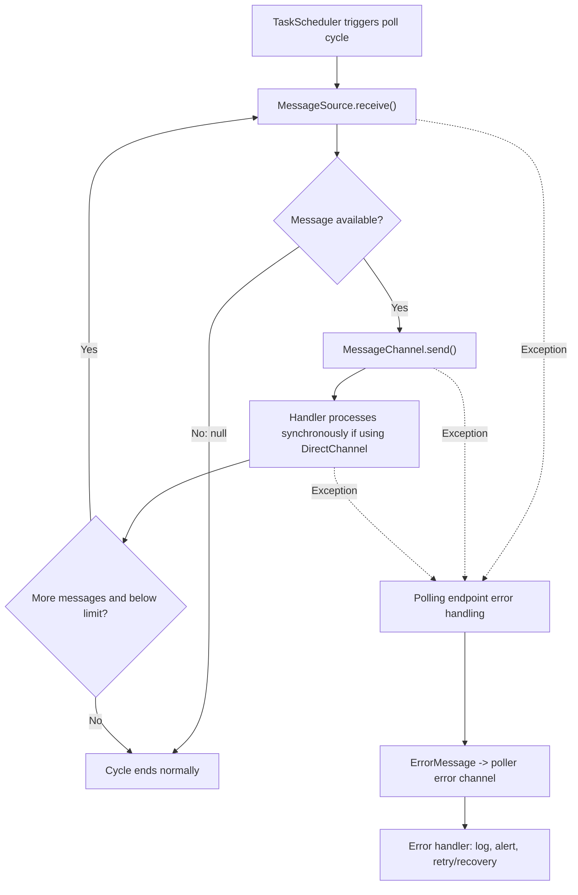
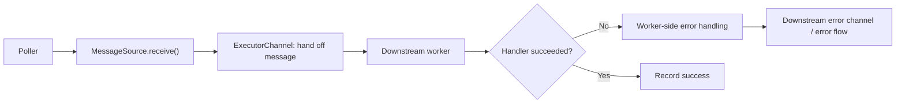

# Poller error-channel When Tasks Fail in Spring Integration

## 1. Context: The Poller Runs on Schedule but Data Ingestion Fails

An application receives CSV files from a partner via a shared directory. Every 5 seconds, an inbound adapter calls `MessageSource.receive()` to look for new files and sends `Message<File>` through a `MessageChannel` to a handler that writes data to a database. One day, a file has malformed content or the DB becomes unreachable. The poller still triggers on schedule, yet **an operation inside the polling cycle threw an exception**.

You need clear answers: where does that error go, who knows a file failed processing, and will the next polling cycle fix the error on its own?

In the **SPRING_INTEGRATION_ADAPTERS** module, inbound/outbound adapters, gateways, pollers, and `MessageChannel`s together form integration flows with external systems such as files, SFTP, HTTP, JMS, AMQP, Kafka, and databases. For **polling endpoints**, Spring Integration supports an error route via an **error channel**: when polling work fails and the error is converted into a message by the endpoint's error-handling mechanism, an `ErrorMessage` is sent to the designated error channel.

An `ErrorMessage` helps record, alert, or route data into a recovery workflow. However, **sending an exception to an error channel does not mean reprocessing succeeded**, does not create an automatic transaction, and does not guarantee exactly-once delivery.

After this lesson, you will be able to:

- Distinguish errors in `MessageSource.receive()`, `MessageChannel.send()`, and synchronous/asynchronous handlers.
- Configure `@Poller(errorChannel = "...")` for a polling inbound adapter.
- Receive an `ErrorMessage`, inspect the exception and `failedMessage` when present.
- Distinguish a poller's error channel from the `errorChannel` message header and the global `errorChannel`.
- Design retries, backoff, idempotency, quarantine, and error observability without losing data.

## 2. At Which Steps Do Errors Occur?

A typical polling cycle includes several steps:



Errors can occur at different places:

| Where the Error Occurs | Example | Can the Error Reach the Poller Error Channel? |
| --- | --- | --- |
| `MessageSource.receive()` | Cannot connect to SFTP, SQL timeout, file read error | Yes, when the exception arises in the poll task and is caught by the endpoint's error-handling mechanism. |
| Sending to `MessageChannel` | Channel has no subscriber, queue full, or send rejected | Yes, if the exception arises in the poller's synchronous send path. |
| Handler after `DirectChannel` | CSV parsing fails, DB write fails | Usually yes: `DirectChannel` invokes the handler synchronously and errors can propagate back to the poller. |
| Handler after `ExecutorChannel` | Asynchronous worker fails DB write | Does not automatically propagate back to the poller; must configure the error route of the **asynchronous step**. |
| Poller's executor rejects task | Thread pool/queue saturated | Depends on where and how rejection happens; monitor scheduler/executor too, do not assume every rejection becomes an `ErrorMessage` on the same channel. |
| Message-driven consumer without a poller | JMS/AMQP/Kafka listener fails processing message | Follows that listener/adapter's own error handling and acknowledgement, not this lesson's poller mechanism. |

**A source returning `null` because no data is available is a normal state**, not an exception to send to the error channel. This is an important distinction between "no messages" and "unable to fetch messages because the system failed."

## 3. What Does an ErrorMessage Contain?

A Spring Integration error channel receives an error message. The typical type is `org.springframework.messaging.support.ErrorMessage`; its payload is a `Throwable` (an exception or a framework-wrapped error).

```java
import org.springframework.messaging.Message;
import org.springframework.messaging.MessagingException;
import org.springframework.messaging.support.ErrorMessage;

public void inspectError(ErrorMessage errorMessage) {
    Throwable failure = errorMessage.getPayload();
    System.err.println("Failure type: " + failure.getClass().getName());
    System.err.println("Failure message: " + failure.getMessage());

    if (failure instanceof MessagingException messagingException) {
        Message<?> failedMessage = messagingException.getFailedMessage();
        if (failedMessage != null) {
            System.err.println(
                "Failed message ID: " + failedMessage.getHeaders().getId()
            );
        }
    }
}
```

**Do not assume every error has a `failedMessage`.** When `MessageSource.receive()` fails before constructing a message, there is no business payload attached to the exception yet. Even when the exception is a `MessagingException`, `getFailedMessage()` may return `null`. For handler errors, exceptions are sometimes wrapped in multiple layers; the message info may live in a `MessagingException` along the cause chain.

You should write structured logs containing:

- Polling endpoint or flow name, failure timestamp, and exception type.
- Correlation ID, filename, business key, or message ID **if present and allowed to be logged**.
- Error category: external source, channel, handler, transaction, executor.
- Retry count, backoff duration, and final recovery outcome.

Do not log entire file contents, access tokens, passwords, or sensitive payloads simply because `ErrorMessage` may retain references to the failed message.

## 4. Poller error channel, Header errorChannel, and Global errorChannel

Three concepts have similar names yet different scopes:

| Concept | Where Is It Used? | Meaning |
| --- | --- | --- |
| **Poller error channel** | `@Poller(errorChannel = "filePollErrors")` or equivalent configuration | Route publishing errors from the **polling task** when errors are handled by this mechanism. |
| **Header `errorChannel`** | Header of a `Message<?>` | Error destination carried along with the message, useful in many asynchronous flows and header-aware error-handling mechanisms. |
| **Global `errorChannel`** | Shared channel in the application context when configured by the framework | Central destination for errors not routed to a specific channel, depending on endpoint type and configuration. |

When operating file ingestion, SFTP ingestion, and database ingestion independently, assign a **dedicated error channel per poller**. This enables alerting and recovery tailored to the right data source, avoiding dumping every exception into an error queue where root causes cannot be distinguished.

If no dedicated error channel is configured, the framework may use default error handling/global channel behavior depending on the endpoint and version. Do not rely solely on a default logging subscriber to fulfill business retry or quarantine needs. Proactively build an error flow and verify it by inducing controlled failures.

**Errors from handlers behind an asynchronous boundary** (such as `ExecutorChannel`) need their own error flow or an appropriate `errorChannel` header. Depending on the processing path, the exception may occur on another worker **after the poller has already finished**, so the poller can no longer directly catch it.

## 5. Complete Example: Inbound File Poller Routing Errors to a Dedicated Channel

Suppose a partner places CSVs into `data/inbox`. The application scans every 5 seconds, processing up to 3 files per cycle. To make the error flow easy to observe, the handler intentionally throws an exception when a filename starts with `fail-`.

### 5.1. Dependencies

In a Spring Boot project with a BOM managing dependency versions:

```xml
<dependencies>
    <dependency>
        <groupId>org.springframework.boot</groupId>
        <artifactId>spring-boot-starter-integration</artifactId>
    </dependency>
    <dependency>
        <groupId>org.springframework.integration</groupId>
        <artifactId>spring-integration-file</artifactId>
    </dependency>
</dependencies>
```

Create the `data/inbox` directory relative to the application's working directory and ensure the application has read permissions. Files in this lesson are practice data only.

### 5.2. Java Configuration

```java
import java.io.File;
import java.io.IOException;
import java.nio.charset.StandardCharsets;
import java.nio.file.Files;

import org.springframework.context.annotation.Bean;
import org.springframework.context.annotation.Configuration;
import org.springframework.integration.annotation.InboundChannelAdapter;
import org.springframework.integration.annotation.Poller;
import org.springframework.integration.annotation.ServiceActivator;
import org.springframework.integration.channel.DirectChannel;
import org.springframework.integration.config.EnableIntegration;
import org.springframework.integration.core.MessageSource;
import org.springframework.integration.file.FileReadingMessageSource;
import org.springframework.integration.file.filters.AcceptOnceFileListFilter;
import org.springframework.integration.file.filters.CompositeFileListFilter;
import org.springframework.integration.file.filters.SimplePatternFileListFilter;
import org.springframework.messaging.Message;
import org.springframework.messaging.MessageChannel;
import org.springframework.messaging.MessagingException;
import org.springframework.messaging.support.ErrorMessage;

@Configuration
@EnableIntegration
public class FilePollErrorConfiguration {

    @Bean
    public MessageChannel incomingCsvFiles() {
        return new DirectChannel();
    }

    // Dedicated error route for the file-reading polling endpoint.
    @Bean
    public MessageChannel filePollErrors() {
        return new DirectChannel();
    }

    @Bean
    @InboundChannelAdapter(
        channel = "incomingCsvFiles",
        poller = @Poller(
            fixedDelay = "5000",
            maxMessagesPerPoll = "3",
            errorChannel = "filePollErrors"
        )
    )
    public MessageSource<File> csvFileSource() {
        FileReadingMessageSource source = new FileReadingMessageSource();
        source.setDirectory(new File("data/inbox"));

        CompositeFileListFilter<File> filters =
            new CompositeFileListFilter<>();
        filters.addFilter(new SimplePatternFileListFilter("*.csv"));
        filters.addFilter(new AcceptOnceFileListFilter<>());
        source.setFilter(filters);
        return source;
    }

    @ServiceActivator(inputChannel = "incomingCsvFiles")
    public void processCsv(File file) throws IOException {
        // Simulate business failure to test the error channel.
        if (file.getName().startsWith("fail-")) {
            throw new IllegalStateException(
                "Simulated CSV processing failure"
            );
        }

        String content = Files.readString(
            file.toPath(), StandardCharsets.UTF_8
        );
        System.out.printf(
            "Processed %s: %d chars%n",
            file.getName(), content.length()
        );
    }

    @ServiceActivator(inputChannel = "filePollErrors")
    public void handlePollingFailure(ErrorMessage errorMessage) {
        Throwable failure = errorMessage.getPayload();
        System.err.printf(
            "File polling failed: %s: %s%n",
            failure.getClass().getSimpleName(),
            failure.getMessage()
        );

        if (failure instanceof MessagingException messagingException) {
            Message<?> failed = messagingException.getFailedMessage();
            if (failed != null) {
                System.err.println(
                    "Failed message id: " + failed.getHeaders().getId()
                );
            }
        }

        // Production: send metrics/alerts and forward to recovery flow.
    }
}
```

**How the example works:**

1. `@InboundChannelAdapter` creates an endpoint receiving messages from `FileReadingMessageSource`.
2. `@Poller(fixedDelay = "5000", maxMessagesPerPoll = "3")` sets the inter-cycle schedule and limits each cycle to at most three messages.
3. `errorChannel = "filePollErrors"` designates the channel receiving errors published by the polling endpoint's error-handling mechanism.
4. `incomingCsvFiles` is a `DirectChannel`, so the handler runs synchronously on the poller's message-sending path. If the handler throws an exception, the error can reach the polling error-handling mechanism.
5. `filePollErrors` is also a `DirectChannel`: a service activator receives the `ErrorMessage` and records the cause. In a real application, this is where a recovery policy belongs.

The example intentionally skips deep CSV parsing and only simulates errors by filename. It shows the **exception-to-ErrorMessage routing path**, not a complete retry or transaction mechanism.

### 5.3. Testing Each Scenario

**Case A — empty directory:** `MessageSource.receive()` returns `null`; the poll cycle ends normally. The error handler is not called because no exception occurred.

**Case B — normal file:** place `orders-001.csv` in the inbox; the poller picks up the file, sends it through `DirectChannel`, and the handler logs successful processing.

**Case C — intentionally failing file:** place `fail-orders.csv`; the handler throws `IllegalStateException`, the exception is caught by the polling mechanism and published as an `ErrorMessage` to `filePollErrors` under proper configuration. The error handler logs the error type and message details if present.

**Case D — multiple files in one cycle:** if one file fails during synchronous processing, the current cycle may end early instead of continuing up to `maxMessagesPerPoll`. **Messages already processed successfully earlier are not automatically rolled back** merely because they belonged to the same poll cycle.

**Case E — rerunning after an error:** `AcceptOnceFileListFilter` may have already recorded `fail-orders.csv` before the handler failed. The next cycle **does not automatically re-read** this file. Separate recovery is needed, such as storing retry/quarantine state or designing proper acceptance/completion tracking.

**Observability note:** Handler logs appear only when a file is present. If you also want visibility into empty poll cycles, add logging/metrics at the polling endpoint or `MessageSource.receive()`.

## 6. Source-Reading Errors vs. Message-Processing Errors

### 6.1. Errors Occurring Before a Message Exists

For example, an SFTP server disconnects right inside `MessageSource.receive()`, or a JDBC query throws an exception before producing data. In that case there may be no `Message<?>`, and the error handler should rely on the exception and endpoint metadata rather than requiring `failedMessage`.

```text
Scheduler -> SftpMessageSource.receive()
                          |
                          +-- IOException / connection failure
                                       |
                                       v
                              Poller error handling
                                       |
                                       v
                            ErrorMessage(error)
                                       |
                                       v
                               sftpPollErrors
```

For SFTP/HTTP/database sources, configure connect/read/query timeouts and reconnect strategies per the client/adapter. `@Poller(errorChannel = "...")` **does not set I/O timeouts** and cannot repair network outages.

### 6.2. Errors Occurring After a Message Has Been Emitted

With `DirectChannel`, the handler may fail because data is invalid or the DB rejects the write. Spring Integration typically wraps the exception in a `MessagingException` referencing the failed message. Even so, the error handler must still handle cases where the message is absent or the exception is wrapped multiple times.

```text
MessageSource.receive() -> Message<File>
                             |
                             v
                          DirectChannel
                             |
                             v
                       Handler writes to DB
                             |
                             +-- business error
                                      |
                                      v
                           Poller error handling
                                      |
                                      v
                             ErrorMessage(Throwable)
```

Do not store `failedMessage` verbatim in an unbounded error store if payloads are large or sensitive. It is better to store **data identifiers, file location, error code, timestamp, and retry decision**, while complying with your system's security/retention policies.

## 7. Errors with Polling Consumers and PollableChannel

`errorChannel` on a poller is not limited to inbound adapters. A **polling consumer** reading messages from a `PollableChannel`, such as `QueueChannel`, can also fail during processing.

```java
import org.springframework.context.annotation.Bean;
import org.springframework.context.annotation.Configuration;
import org.springframework.integration.annotation.Poller;
import org.springframework.integration.annotation.ServiceActivator;
import org.springframework.integration.channel.QueueChannel;
import org.springframework.integration.config.EnableIntegration;

@Configuration
@EnableIntegration
public class QueueConsumerConfig {

    @Bean
    public QueueChannel pendingOrders() {
        return new QueueChannel(100);
    }

    @ServiceActivator(
        inputChannel = "pendingOrders",
        poller = @Poller(
            fixedDelay = "1000",
            receiveTimeout = "300",
            maxMessagesPerPoll = "4",
            errorChannel = "filePollErrors"
        )
    )
    public void handleOrder(String order) {
        if (order.isBlank()) {
            throw new IllegalArgumentException("Empty order payload");
        }
        System.out.println("Processed order: " + order);
    }
}
```

This is a **standalone example** requiring a `filePollErrors` bean and corresponding error consumer as in section 5, or using a separate channel name for the queue consumer. `receiveTimeout = "300"` is the wait time for a single read from `PollableChannel`, not a handler timeout.

Point of caution: a message pulled from `QueueChannel` is not automatically put back onto the queue when the handler fails. If using an in-memory queue, messages can also be lost on application restart. Design retries, persistent storage, and transactions appropriately instead of treating the error channel as a mechanism that automatically requeues messages.

## 8. Asynchronous Processing Paths: Errors May Fall Outside the Poller's Scope

When downstream uses `ExecutorChannel` or an asynchronous worker:



The poller can finish `send()` as soon as the executor accepts the message. If the handler on the worker fails afterward, the exception **does not unwind across a synchronous call stack** back to `@Poller(errorChannel = "...")`. Depending on the channel's dispatch/error-handling mechanism, the error may be routed via the `errorChannel` header, global `errorChannel`, or a dedicated downstream mechanism.

To ensure downstream errors remain observable:

1. Explicitly define an error channel for downstream workers or a dedicated flow.
2. Propagate correlation IDs/business keys via message headers and preserve traceability.
3. Design retry/idempotent handlers, and define when acks or checkpoints may be updated.
4. Provide storage for unrecoverable failures (*dead-letter/quarantine*) along with safe reprocessing tools.

Similarly, configuring `taskExecutor` on the poller can alter the execution flow and where exceptions are caught. Test endpoint error handling in your actual topology and running version. Do not assume all errors from every worker automatically converge onto a similarly named channel.

## 9. Error-channel Does Not Replace Retries and Transactions

**An error channel is an error notification and handling route.** Deciding whether to retry, when to retry, and confirming data completion are separate responsibilities.

### 9.1. Three Error Categories Requiring Different Actions

| Error Category | Example | Action to Take |
| --- | --- | --- |
| **Transient** | SFTP/HTTP disconnect, DB timeout, external service 503 | Bounded retries, exponential backoff, timeouts, and alerts. |
| **Invalid data** | CSV breaks schema, missing required field | Quarantine/dead-letter, notify partner or require data fix; identical retries rarely help. |
| **Configuration and permissions** | Wrong credentials, missing directory access | Urgent alert and fix config/permissions; avoid tight retry storms. |

**Do not turn every exception into `null`**: a source returning `null` means no data is available per contract; an exception is a failure that must be classified and tracked. Swallowing exceptions inside `MessageSource.receive()` prevents the error channel from ever knowing an error happened.

### 9.2. Retry Before or After the Error Channel?

Two recovery patterns serve different purposes:

```text
Pattern A — bounded retry within the same unit of work:
receive/send/handle -> error -> Retry advice/policy -> retry
                                               |
                                         attempts exhausted
                                               |
                                               v
                                        Poller error channel

Pattern B — decoupled recovery:
receive/send/handle -> error -> Poller error channel
                                    |
                                    v
                       Quarantine / retry queue / ops
                                    |
                                    v
                         Reprocess under separate policy
```

If using retry advice on an endpoint or handler, inspect the **retry conditions**, transaction boundaries, and when `ErrorMessage` is emitted. When advice recovers from an error and returns normally, no exception may remain to publish to the error channel. Conversely, if an exception is still thrown after retries are exhausted, the poller's error handling then publishes the error.

Do not perform unbounded retries inside the error handler itself without time/attempt limits. If the error handler runs synchronously, it can also tie up the poller thread or prolong the current cycle.

### 9.3. maxMessagesPerPoll Does Not Create a Shared Transaction

Suppose a cycle receives 5 files; the first four succeed and the fifth fails. `maxMessagesPerPoll = 5` only caps the number of messages in the cycle; **it does not mean all five files share one transaction**. The four already-committed files do not roll back automatically. If atomicity is required, design transactions at the database, batch, or source layer per its own contract.

### 9.4. Do Not Equate "Accepted" with "Successfully Processed"

With files/SFTP, an accept-once filter often marks a file as selected **at detection/receive time**, before business logic commits. The error channel receives the failure notification, yet does not automatically clear that filter state. A failed file might not reappear on the next poll cycle, even if the poller keeps running steadily.

A reliable workflow must distinguish:

- **Discovered:** the file or record was seen at the source.
- **Claimed/received:** a worker claimed processing rights or the adapter emitted a message.
- **Processed:** business logic committed with proof of completion.
- **Failed/retryable:** the failure was recorded with a reprocessing policy and attempt limit.

Idempotency keys based on order ID, event ID, or file version help prevent duplicate data creation during retries or restarts. An error handler that only logs without preserving recovery info can leave errors visible while the data never gets reprocessed.

## 10. Operating Error Channels Safely in Production

### 10.1. An Error Handler Can Fail Itself

An error handler is still a handler. If it throws an exception, forwards error notices to a channel with no subscriber, or makes an unbounded slow network call, poller error handling can become more complicated and even lose visibility into the original failure.

Keep initial error recording short and safe; offload heavy tasks like sending alerts, analyzing payloads, or calling management services to a bounded, resilient queue/worker. Whenever using asynchronous processing, clearly document handoff boundaries, failures, and durable storage.

### 10.2. Multiple Subscribers on One Error Channel

`DirectChannel` typically dispatches each message to **one** subscriber. If multiple systems need error notifications (logging, metrics, alerting), use a `PublishSubscribeChannel` with multiple subscribers, or create a clear orchestrating handler. Do not assume attaching two consumers to a `DirectChannel` sends the same `ErrorMessage` to both.

```text
Poller errorChannel
        |
        v
PublishSubscribeChannel
   |           |           |
  Log        Metrics      Alert
```

If one subscriber fails, the impact on other subscribers and propagation behavior depend on how the channel is configured (synchronous vs. executor, error handler...). Measure and test in practice instead of treating error emission as a guaranteed broadcast transaction.

### 10.3. Do Not Accidentally Create an Error Loop

Avoid designing an error handler that blindly re-sends the exact same message back into the same endpoint without limits. For invalid-data errors, infinite retries only inflate logs and waste resources.

A useful recovery policy includes max attempts, backoff intervals, skip conditions, quarantine, manual intervention capability, and an audit trail. For data that could be lost across restarts, store retry state in durable storage.

## 11. Observing and Diagnosing Errors

| Metric / Symptom | What to Check |
| --- | --- |
| Poll cycle count and messages received per cycle | Is the poller running and does the source have data? |
| `ErrorMessage` count by endpoint and error type | Is the source failing connectivity or is downstream failing processing? |
| Error ratio per processed message | Do errors spike with load or a specific file type? |
| Errors with `failedMessage` vs. without a message | Distinguish source failures from failures after message creation. |
| Error handler execution duration | Is the error route holding threads or slowing poll cycles? |
| Retry count and backoff intervals | Are retry loops too tight or have limits been exceeded? |
| Age of oldest unfinished item, quarantine count | Is business backlog building up even while the poller runs? |
| Executor rejections and queue depth | Did the failure happen at the scheduler/worker or in the handler? |

**Scenario: file is not re-ingested after an error.** Check file filters, metadata store, status-marking logic, and retry flows. Having the error channel log the error does not mean the file's state was reset.

**Scenario: errors only appear in worker logs.** Check whether the flow uses `ExecutorChannel`, a task executor, or an async listener; define the error flow on the side where the exception actually occurs.

**Scenario: SFTP source has no files.** If `receive()` returns `null`, that is an empty cycle and does not necessarily emit an error message. Only when the source throws an exception due to connection loss should it be treated as an error.

**Scenario: poller stops running after an error.** Check scheduler/trigger config, endpoint state, exceptions thrown by the error handler, executor rejections, and lifecycle management. Do not assume an error channel automatically keeps the poller running forever.

## 12. Exercises with Answers

**Exercise 1 — Distinguish empty vs. error.** `FileReadingMessageSource.receive()` returns `null` because the directory has no files yet. Should an `ErrorMessage` be created?

**Answer:** No. `null` is the no-data state per the source contract, not an exception.

**Exercise 2 — Error while reading source.** The SFTP connection drops before creating a `Message<?>`. Can the error handler always get the filename from `MessagingException.getFailedMessage()`?

**Answer:** No. Failures can happen before a message exists; `failedMessage` may not exist.

**Exercise 3 — DirectChannel.** An inbound file poller sends via `DirectChannel`; the handler throws `IllegalStateException`. Can the error be handled by the poller error channel?

**Answer:** Yes, when the exception propagates synchronously back to the polling task and error handling is configured to publish `ErrorMessage` to that channel.

**Exercise 4 — ExecutorChannel.** The poller successfully sends a message into `ExecutorChannel`, and later a handler on another worker fails. Can you configure only the poller's error channel to reliably receive the error?

**Answer:** No. You must configure error handling for the downstream asynchronous flow, such as an `errorChannel` header/channel or corresponding error flow.

**Exercise 5 — Automatic retry?** The error handler logs the exception without creating a retry flow. Will the failed file be automatically reprocessed on the next poll?

**Answer:** No guarantee. The filter/checkpoint may have already marked the file; retrying requires explicit state tracking and a reprocessing mechanism.

**Exercise 6 — Five messages per cycle.** `maxMessagesPerPoll = 5`; the handler processes four messages successfully and fails on the fifth. Do all five roll back together by default?

**Answer:** No. `maxMessagesPerPoll` bounds count, not transaction boundaries.

**Exercise 7 — Two subscribers.** Two handlers subscribe to the error `DirectChannel`. Is each `ErrorMessage` delivered to both handlers?

**Answer:** Not by default. `DirectChannel` dispatches to a single subscriber; if fan-out is needed, use `PublishSubscribeChannel` or an orchestrating handler.

**Exercise 8 — Transient failure.** A poller calls an external API and repeatedly receives HTTP 503. Should you speed up the poller or apply retries with backoff?

**Answer:** Classify errors and use bounded retries with backoff/jitter aligned with SLAs and rate limits; polling faster can overload the external system further.

**Exercise 9 — Message with an idempotency key.** A DB write commits, yet the checkpoint is not updated before the app restarts. Later the message is re-emitted. Which mechanism prevents creating duplicate orders?

**Answer:** An idempotent handler keyed by business/event ID, combined with checkpoints/acks aligned to the proper commit point.

## 13. Takeaways

**A poller's error channel is the route receiving `ErrorMessage` when a polling task fails and the endpoint's error handling publishes the exception.** Failures can arise when reading `MessageSource`, sending over `MessageChannel`, or running synchronous handlers; errors in asynchronous downstream paths require their own error routes. `ErrorMessage` carries a `Throwable` and may include `failedMessage` if a message had been formed, though not always. The error channel enables observability and recovery coordination; to safeguard data, you still must design timeouts, retry/backoff, transactions, checkpoints, idempotency, quarantine, and error testing aligned with your real topology.
