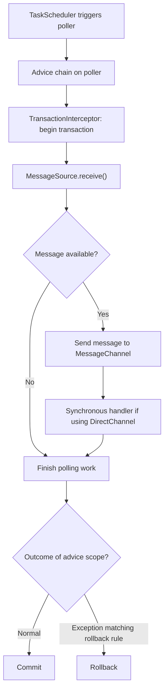

# Transaction Advice on Pollers in Spring Integration

## 1. Problem Statement: Receiving a Message but Processing Fails

An application periodically reads new order records from a database. The poller selects a record, marks it as in progress, creates a `Message`, and sends it to a handler that persists the result. Suppose the first operation updates the record state to `CLAIMED` successfully, yet the handler subsequently throws an exception. If the two operations do not belong to the same transaction, the record can remain stuck in `CLAIMED` without finishing processing.

In the **SPRING_INTEGRATION_ADAPTERS** module, polling inbound adapters receive data from external sources (files, SFTP, HTTP, databases, etc.), convert it into messages, and send it to a `MessageChannel`. For a database source capable of participating in a transaction, **transaction advice on the poller** opens a transaction around the polling work covered by the advice. When an error propagates out of that scope, the transaction manager can roll back operations on resources participating in that transaction.

This differs from putting `@Transactional` only on the handler: if the transaction starts only at the handler, the record-claiming operation in `MessageSource.receive()` **beforehand** may have already occurred outside that transaction.

**Learning Goals:**

- Distinguish poll schedule, messages per cycle, and transaction boundaries.
- Configure `TransactionInterceptor` as advice for `@Poller(adviceChain = "...")`.
- Observe commit/rollback when a JDBC source and a synchronous handler share the same `DataSource`.
- Understand transaction boundaries broken by `ExecutorChannel`, `QueueChannel`, `taskExecutor`, and asynchronous calls.
- Know the limits of local transactions when a poller interacts with files, SFTP, HTTP, and external brokers.
- Design retries, idempotency, checkpoints, error flows, and long-term handling of failing records.

## 2. Where Does Transaction Advice Sit?

Spring Integration uses an advice (AOP) mechanism to wrap behavior around a polling endpoint's work. With transaction advice, processing covered by the advice executes inside a transaction managed by `PlatformTransactionManager`.



**Transaction scope depends on advice placement and the synchronous execution path.** A transaction only covers operations using the participating transaction manager/resource; it does not automatically span every endpoint in an `IntegrationFlow` or every worker thread in the application.

Key terms:

| Component | Function |
| --- | --- |
| `TaskScheduler` | Determines when a polling cycle runs according to the trigger. |
| `TransactionInterceptor` | Advice that creates, joins, commits, or rolls back transactions per policy. |
| `PlatformTransactionManager` | Provides transaction boundaries for a specific resource, e.g., JDBC. |
| `MessageSource.receive()` | Fetches data from the source and returns `Message<?>` or `null`. |
| `DirectChannel` | Transfers messages synchronously; handler exceptions can usually propagate back to the sender. |
| `ExecutorChannel` | Hands downstream work to another worker; creates an asynchronous boundary. |
| `maxMessagesPerPoll` | Limits how many messages are received in one cycle; does not dictate commit or rollback by itself. |

**Important:** rollback happens only when the transaction advice *sees* an error matching a rollback rule. If a handler catches and swallows exceptions, or an asynchronous step fails after the poller has already finished, the advice cannot know to roll back.

## 3. Why Is @Transactional on the Handler Alone Often Insufficient?

Compare two designs:

```text
Design A — Transaction only on the handler:
Poller -> MessageSource: SELECT + UPDATE state='CLAIMED'
       -> DirectChannel
       -> @Transactional Handler: DB work -> exception

     Handler rolls back the handler's part.
     The UPDATE before the handler may have already committed independently.

Design B — Transaction advice on the poller:
Poller -> [ BEGIN
            MessageSource: SELECT + UPDATE state='CLAIMED'
            DirectChannel -> Handler: UPDATE state='DONE'
            COMMIT or ROLLBACK on exception
          ]
```

With Design B, if the SQL statements use **the same transaction manager and the same transaction-participating data source**, the claim operation and completion operation can be committed or rolled back together.

The diagram above holds only when the handler is invoked **synchronously within the advice scope** and exceptions are not swallowed. If `ExecutorChannel` is used, the poller's transaction does not automatically follow into the business-processing worker.

### When Is @Transactional Still Useful?

`@Transactional` on the handler is very useful when the handler is the **right transaction boundary**: for example, a message was already received from an independent broker/queue, and the handler simply needs a DB transaction to write tables. The problem arises only when business logic requires **the source's receive/claim step** and **subsequent processing** to share the same transactional scope.

## 4. Runnable Example: Polling an Inbox Table with H2

This lab simulates an inbound database adapter using a custom `MessageSource<Long>` backed by `JdbcTemplate`. This is a simple way to see transaction advice in action; when using Spring Integration's built-in JDBC inbound adapter, the advice/transaction principles remain similar, while queries, checkpoints, and message contracts depend on the actual adapter.

Suppose the `integration_inbox` table holds three pending order records. The poller:

1. Finds the first record with state `NEW`.
2. Conditionally updates it to `CLAIMED`.
3. Emits a message containing `id`.
4. The handler on `DirectChannel` transitions `CLAIMED` to `DONE` or throws an exception to test rollback.

We set `maxMessagesPerPoll = 1` to focus on **one message per cycle**, avoiding confusing transactions with multi-message batching.

### 4.1. Dependencies

In a Spring Boot project using a BOM to manage dependency versions, add:

```xml
<dependencies>
    <dependency>
        <groupId>org.springframework.boot</groupId>
        <artifactId>spring-boot-starter-integration</artifactId>
    </dependency>
    <dependency>
        <groupId>org.springframework.boot</groupId>
        <artifactId>spring-boot-starter-jdbc</artifactId>
    </dependency>
    <dependency>
        <groupId>com.h2database</groupId>
        <artifactId>h2</artifactId>
        <scope>runtime</scope>
    </dependency>
</dependencies>
```

This example uses `JdbcTemplate` as the data source, so `spring-integration-jdbc` is not needed yet. If replacing it with the built-in JDBC adapter, declare the dependency appropriate for your Spring Integration version.

### 4.2. Sample Data

In `src/main/resources/schema.sql` of the practice application:

```sql
CREATE TABLE integration_inbox (
    id BIGINT PRIMARY KEY,
    state VARCHAR(16) NOT NULL,
    content VARCHAR(255) NOT NULL
);
```

In `src/main/resources/data.sql`:

```sql
INSERT INTO integration_inbox (id, state, content)
VALUES (1, 'NEW', 'order-001');

INSERT INTO integration_inbox (id, state, content)
VALUES (2, 'NEW', 'order-002');

INSERT INTO integration_inbox (id, state, content)
VALUES (3, 'NEW', 'order-003');
```

To run with in-memory H2:

```yaml
# application.yml
spring:
  datasource:
    url: jdbc:h2:mem:integration-poll;DB_CLOSE_DELAY=-1
    username: sa
    password: ""
  sql:
    init:
      mode: always
```

The SQL `LIMIT 1` below is compatible with the example's H2 database; when moving to Oracle, SQL Server, or another database, adapt the single-row selection syntax and locking/claiming mechanism accordingly.

### 4.3. TransactionInterceptor as Advice

In Java configuration:

```java
import org.springframework.context.annotation.Bean;
import org.springframework.transaction.PlatformTransactionManager;
import org.springframework.transaction.TransactionDefinition;
import org.springframework.transaction.interceptor.DefaultTransactionAttribute;
import org.springframework.transaction.interceptor.TransactionInterceptor;

@Bean("inboxTransactionAdvice")
public TransactionInterceptor inboxTransactionAdvice(
        PlatformTransactionManager transactionManager) {

    DefaultTransactionAttribute attributes =
        new DefaultTransactionAttribute();
    attributes.setPropagationBehavior(
        TransactionDefinition.PROPAGATION_REQUIRED
    );

    return new TransactionInterceptor(transactionManager, attributes);
}
```

This is a **method snippet** that belongs inside the complete `@Configuration` class in the next section. `TransactionInterceptor` implements advice that can be used in a poller's `adviceChain`. `PROPAGATION_REQUIRED` joins an existing transaction if present, or opens a new transaction in normal circumstances.

With Spring Boot JDBC and a single `DataSource`, the framework usually auto-configures an appropriate transaction manager. If the application has multiple transaction managers, select the right bean explicitly and ensure the source's and handler's `JdbcTemplate` use the matching data source; do not leave injection ambiguous when multiple beans of the same type exist.

### 4.4. Complete Java Configuration

```java
import java.util.List;

import org.springframework.context.annotation.Bean;
import org.springframework.context.annotation.Configuration;
import org.springframework.integration.annotation.InboundChannelAdapter;
import org.springframework.integration.annotation.Poller;
import org.springframework.integration.annotation.ServiceActivator;
import org.springframework.integration.channel.DirectChannel;
import org.springframework.integration.config.EnableIntegration;
import org.springframework.integration.core.MessageSource;
import org.springframework.jdbc.core.JdbcTemplate;
import org.springframework.messaging.MessageChannel;
import org.springframework.messaging.support.MessageBuilder;
import org.springframework.transaction.PlatformTransactionManager;
import org.springframework.transaction.TransactionDefinition;
import org.springframework.transaction.interceptor.DefaultTransactionAttribute;
import org.springframework.transaction.interceptor.TransactionInterceptor;

@Configuration
@EnableIntegration
public class TransactionalInboxPollingConfiguration {

    private final JdbcTemplate jdbcTemplate;

    public TransactionalInboxPollingConfiguration(
            JdbcTemplate jdbcTemplate) {
        this.jdbcTemplate = jdbcTemplate;
    }

    @Bean
    public MessageChannel inboxEvents() {
        return new DirectChannel();
    }

    @Bean("inboxTransactionAdvice")
    public TransactionInterceptor inboxTransactionAdvice(
            PlatformTransactionManager transactionManager) {

        DefaultTransactionAttribute attributes =
            new DefaultTransactionAttribute();
        attributes.setPropagationBehavior(
            TransactionDefinition.PROPAGATION_REQUIRED
        );
        return new TransactionInterceptor(transactionManager, attributes);
    }

    @Bean
    @InboundChannelAdapter(
        channel = "inboxEvents",
        poller = @Poller(
            fixedDelay = "2000",
            maxMessagesPerPoll = "1",
            adviceChain = "inboxTransactionAdvice"
        )
    )
    public MessageSource<Long> orderIdSource() {
        return () -> {
            List<Long> ids = jdbcTemplate.query(
                """
                SELECT id
                FROM integration_inbox
                WHERE state = 'NEW'
                ORDER BY id
                LIMIT 1
                """,
                (rs, rowNum) -> rs.getLong("id")
            );

            if (ids.isEmpty()) {
                return null;
            }

            Long id = ids.get(0);
            int claimed = jdbcTemplate.update(
                """
                UPDATE integration_inbox
                SET state = 'CLAIMED'
                WHERE id = ? AND state = 'NEW'
                """,
                id
            );

            // Can lose to another worker under concurrent claiming.
            if (claimed != 1) {
                return null;
            }

            return MessageBuilder.withPayload(id).build();
        };
    }

    @ServiceActivator(inputChannel = "inboxEvents")
    public void processOrder(Long orderId) {
        // Create a "poison message" to observe rollback.
        if (orderId == 2L) {
            throw new IllegalStateException(
                "Simulated failure for order " + orderId
            );
        }

        int updated = jdbcTemplate.update(
            """
            UPDATE integration_inbox
            SET state = 'DONE'
            WHERE id = ? AND state = 'CLAIMED'
            """,
            orderId
        );
        if (updated != 1) {
            throw new IllegalStateException(
                "Unexpected inbox state for order " + orderId
            );
        }

        System.out.println("Completed order " + orderId);
    }
}
```

**Reading the configuration:**

- `@InboundChannelAdapter` creates a polling endpoint from `MessageSource<Long>`; a single `receive()` call reads and claims one row.
- `@Poller(adviceChain = "inboxTransactionAdvice")` attaches the transaction advice to the polling work.
- `maxMessagesPerPoll = "1"` limits each cycle to at most one message so transaction boundaries remain clear to observe.
- `DirectChannel` invokes `processOrder` synchronously on the poller's message-sending path.
- Source and handler share the same `JdbcTemplate`/`DataSource`, so JDBC operations can participate in the same transaction managed by the advice.
- `fixedDelay = "2000"` schedules the next cycle after the previous cycle completes and the configured pause elapses; this is **not** a transaction timeout.

Java text blocks (`"""`) require a Java version supporting the feature, such as Java 17. If your project uses an older Java version, replace the text blocks with standard SQL strings.

### 4.5. Observing Commit and Rollback

With three sample rows and a single sequentially running endpoint:

| Cycle | Selected Record | Business Outcome | State After Transaction |
| --- | --- | --- | --- |
| 1 | `id = 1` | Handler updates `DONE` successfully | `id=1` in `DONE` after commit |
| 2 | `id = 2` | Handler intentionally throws exception | `CLAIMED` update rolls back, `id=2` returns to `NEW` |
| 3... | `id = 2` | Continues failing in the example | `id=2` remains `NEW`; `id=3` can suffer starvation |

You can query:

```sql
SELECT id, state
FROM integration_inbox
ORDER BY id;
```

**Two important conclusions:** rollback prevents a row from getting stuck in `CLAIMED` on synchronous failure, yet **does not automatically fix bad data**. The example intentionally creates a permanently failing record so downstream rows may never be picked up. Production needs retry limits, transitioning to `FAILED` or quarantine, and policies preventing one failing record from blocking the whole queue.

The example only demonstrates a local DB transaction; `SELECT ... LIMIT 1` is not a complete concurrent claiming solution for multiple replicas. You need locks, optimistic claiming, `SKIP LOCKED` (if supported by the DB), or a purposefully designed claim/lease mechanism.

## 5. Java DSL and Advice Ordering

In Java DSL, a poller can declare transactions using the corresponding API for your Spring Integration version:

```java
import java.time.Duration;
import org.springframework.integration.dsl.IntegrationFlow;
import org.springframework.integration.dsl.Pollers;
import org.springframework.transaction.PlatformTransactionManager;

// Illustration: message source already declared elsewhere.
@Bean
IntegrationFlow transactionalInboxFlow(
        MessageSource<Long> orderIdSource,
        PlatformTransactionManager transactionManager) {
    return IntegrationFlow
        .from(
            orderIdSource,
            endpoint -> endpoint.poller(
                Pollers.fixedDelay(Duration.ofSeconds(2))
                       .maxMessagesPerPoll(1)
                       .transactional(transactionManager)
            )
        )
        .channel("inboxEvents")
        .get();
}
```

This is an **alternative option** to declaring the endpoint with `@InboundChannelAdapter`; do not enable both for the same source in the example application. When configuring the DSL separately, provide the corresponding `MessageSource`, channel, and handler; the snippet intentionally illustrates only the poller transaction part to avoid repeating the full example.

A poller can have multiple advice entries such as transactions, retries, or monitoring logic. **Advice order matters greatly**: a transaction wrapping a retry versus each retry running in its own transaction are two different behaviors. For retryable errors, specify the intended rollback/commit behavior per attempt and test in practice using stateful data.

Do not combine `@Transactional`, a `TransactionInterceptor` on the poller, and retry advice arbitrarily without defining propagation and ordering; multiple advice layers can lead to nested transactions or boundaries different from what you expect.

## 6. Does maxMessagesPerPoll Determine Transaction Boundaries?

**No.** `maxMessagesPerPoll` limits messages in one polling cycle; it does not determine rollback rules or transaction count. The exact transaction scope depends on advice configuration, how the endpoint executes receive/send operations, and the deployment version.

In the example, `maxMessagesPerPoll = 1` and a synchronous `DirectChannel` make it clear that one transaction wraps claiming and processing one message.

If changed to `maxMessagesPerPoll = 10`, do not automatically assume:

- Ten messages definitely form a single batch transaction.
- Each message definitely gets its own separate transaction.
- One failing message automatically rolls back all previously processed messages.

To guarantee **batch atomicity**, explicitly define transaction/batch boundaries at the appropriate business or adapter layer, verify how the advice is invoked, and write multi-message rollback tests. If requirements only need each order to commit individually, processing each message in its own transaction can be safer than a very long transaction.

## 7. Synchronous and Asynchronous Boundaries

### 7.1. DirectChannel Preserves the Synchronous Call Stack

```text
Poller transaction advice: BEGIN
  Source.receive()  -> DB UPDATE state='CLAIMED'
  DirectChannel.send(message)
    Handler            -> DB UPDATE state='DONE'
Poller transaction advice: COMMIT or ROLLBACK
```

When the handler uses the same JDBC source and exceptions propagate back on the same thread, the transaction advice has the chance to observe errors and roll back.

### 7.2. ExecutorChannel Splits Work onto Another Thread

```text
Poller thread                     Executor worker
-------------------------------   ----------------------------
BEGIN
Source.receive()
ExecutorChannel.send()
COMMIT                            Handler processes after receipt
                                  Handler error/rollback separately
```

An `ExecutorChannel` can return as soon as the message is handed off to the executor, before the handler completes. Standard Spring transactions are thread-bound, so **the poller's transaction does not automatically cross over to the worker**. When the worker fails later, the poller may have already committed claiming the data.

Solutions depend on the problem:

- Keep operations needing the same transaction on a synchronous processing path, if possible.
- If separate workers are required, design **claim/lease + ack/checkpoint** or transactional outbox/inbox for at-least-once processing and deduplication.
- Open a dedicated transaction on the handler/worker and define when data receipt state is confirmed.
- Use a retry queue or durable broker when survival across restarts is needed, instead of relying on an in-RAM queue.

### 7.3. QueueChannel Is Not Automatically Part of a DB Transaction

A standard `QueueChannel` stores messages in memory. Calling `send()` on this channel does not inherently join a JDBC transaction and is not rolled back merely because the database rolls back. With a polling consumer reading the queue, inspect the channel implementation, transaction synchronization, and separate processing boundaries.

Do not assume "both live inside Spring Integration" is enough to get a distributed transaction.

### 7.4. taskExecutor on the Poller

`taskExecutor` on a poller offloads polling work to a worker. Transaction advice only covers operations **executed inside the advice scope on the appropriate worker**; it does not automatically carry a transaction from the scheduler thread across to another thread.

Increasing worker count can also cause multiple cycles to claim data concurrently. Ensure transaction isolation, locking/claiming, and `MessageSource` thread safety. If the executor is overloaded or rejects tasks, poll cycles can be skipped even before any database operation opens.

## 8. Local Transactions Do Not Roll Back Files, SFTP, or HTTP

A JDBC transaction manager only manages participating JDBC resources. It **does not automatically reverse** side effects in external systems.

| Scenario | Can Roll Back with JDBC Transaction? | Notes |
| --- | --- | --- |
| Two `JdbcTemplate.update(...)` calls on same datasource, thread, and transaction | Yes, if DB supports it and no independent commit occurs | Suitable for demonstrating poller advice. |
| Reading a local file | Cannot "undo" reading a file in a DB-transaction sense | Filter may have already marked the file as received. |
| Deleting or moving a file | Not automatically undone by JDBC rollback | Needs dedicated archive/quarantine/recovery workflow. |
| Downloading/renaming an SFTP file | Not automatically reversed by local transaction | Track remote state and persistent metadata. |
| HTTP POST sent to a partner system | Does not automatically cancel an already succeeded request | Use idempotency keys, outbox, or compensation per contract. |
| Publishing a message to an external broker | Does not automatically join JDBC transaction | Check broker transaction/ack support, outbox, or transaction coordination. |

**Risk example:** the poller reads a file and the handler calls a partner API successfully, then an SQL statement fails and rolls back the JDBC transaction. The partner API may still have created the order. When the application retries, if the API does not support idempotency, the order may be created a second time.

Therefore, when integrating files, SFTP, HTTP, JMS, AMQP, or Kafka, distinguish **local transactions** from external protocol guarantees. Systems coordinating transactions across multiple resources must have an explicit model; do not assume transaction advice on a poller provides XA or end-to-end exactly-once semantics.

## 9. Retries, error-channel, and Poison Messages

### 9.1. An Exception Does Not Decide Retries by Itself

`TransactionInterceptor` decides commit/rollback from outcomes and rollback rules; it is not an automatic retry engine. With an exception thrown by a synchronous handler, the transaction may roll back, yet whether the next poll cycle picks up the message again depends on source state.

- With the **JDBC source** in this lesson, rollback reverts `CLAIMED` back to `NEW`, so the record can be seen again.
- With **`FileReadingMessageSource` + accept-once filter**, the filter may have remembered the file even when the DB rolls back; the file is not automatically re-emitted.
- With **SFTP/JMS/AMQP/Kafka** sources, return or redelivery mechanisms depend on the adapter, acks, sessions, transactions, and broker.

### 9.2. Error Channel Records, Does Not Replace Rollback

A polling endpoint can publish exceptions through an error channel, yet you must check **whether the error already passed through transaction advice**, how the transaction rolled back/committed, and whether the error handler rethrows exceptions.

```text
Poller work -> exception
    |
    v
Transaction advice observes error
    |
    +--> rollback per rules
    |
    v
Polling error handling
    |
    v
ErrorMessage -> error channel -> log / alert / retry workflow
```

This is a logical flow diagram; exact positions of error handling and advice depend on configuration. Never treat "the error channel received a message" as conclusive proof that all resources rolled back. **Verify rollback by reading DB or source state after failure.**

### 9.3. Poison Messages and Starvation

In the example in section 4, `id=2` always throws an exception. The transaction rolls back properly, yet because the source keeps picking the `NEW` row with the smallest `id`, `id=3` might never be processed.

A reliable system needs:

1. Bounded retry attempts and persistent storage of `attemptCount` or failure state.
2. Backoff and a `nextAttemptAt` timestamp for transient errors.
3. Moving permanent data errors to `FAILED` or quarantine without blocking all other records.
4. Keeping idempotency keys so reprocessing does not create duplicate results.
5. Allowing operators to inspect, fix data, or replay in a controlled manner.

If `attemptCount` is updated inside the same transaction that always rolls back, that counter rolls back too. Therefore **retry metadata must be recorded under an appropriate transaction boundary** (e.g., a separate error-management transaction), rather than just adding a column and hoping attempts always increment.

## 10. Transaction Isolation and Multi-Instance Processing

Adding transaction advice does not automatically resolve contention among multiple pollers/replicas. Two workers can read the same `NEW` candidate before one worker succeeds in claiming it.

In the example code, `UPDATE ... WHERE state = 'NEW'` is a conditional claim. Only one worker can successfully update the same row under suitable isolation conditions, while the other worker may get 0 updated rows and must try again on a later cycle. **It is not yet optimized to skip locked rows** and can suffer lock waits/deadlocks or starvation under heavy load.

For production, consider:

- Atomic read-and-claim mechanisms, row locks, or `SELECT ... FOR UPDATE SKIP LOCKED` if supported by the database.
- Transaction isolation, deadlock timeouts, and lock ordering.
- Leases/visibility timeouts when work runs long or is handed off to asynchronous workers.
- Idempotency keys on result tables to avoid duplicate writes during retries.
- Partitioning, consumer groups, or single-active-worker patterns for sources unsuitable for concurrent processing.

**Do not hold a database transaction open across slow HTTP/SFTP calls without a very strong reason.** Long transactions hold connections and may hold locks, bottlenecking other endpoints. In many problems, transactional outbox/inbox and asynchronous processing backed by persistent state are far more effective than wrapping an entire external flow in a single transaction.

## 11. Monitoring and Diagnostics

| Metric or Signal | Question to Answer |
| --- | --- |
| Poll cycles, received messages, and duration per cycle | Is the poller running too long or missing schedules? |
| Transaction commits / rollbacks | Are failures normal or causing a continuous rollback loop? |
| Connection hold time and database locks | Are transactions starving the pool or other queries? |
| Failed claims due to contention | Are multiple workers/replicas picking the same record? |
| `NEW/CLAIMED/DONE/FAILED` counts | Are records stuck mid-step? |
| Retry count, backoff delay, and oldest record age | Is a poison message causing starvation? |
| Errors from error channel and async downstream | Are error handlers receiving errors at the right boundary? |
| Duplicate processing counts and unique constraint violations | Is idempotency truly protecting business outcomes? |

**Scenario: state remains CLAIMED after an exception.** Check whether transaction advice is wired to the right endpoint, whether the claim uses the same datasource/transaction manager, and whether an async boundary or independent commit occurred before the handler failed. Also check if exceptions are caught/swallowed before exiting the advice.

**Scenario: failing record keeps reappearing.** Rollback may be working as designed; add a retry budget/quarantine rather than turning off transactions to "stop errors."

**Scenario: async handler fails while source already claimed.** The poller transaction may have already committed; add worker transactions/checkpoints and a recovery mechanism for `CLAIMED` records.

**Scenario: file disappears from the flow despite DB rollback.** Check the accept-once filter and archive/quarantine policies; JDBC rollback does not reset file filters or undo file operations that already happened.

## 12. Exercises with Answers

**Exercise 1 — Synchronous handler failure.** Poller advice opens a JDBC transaction, the source transitions `NEW → CLAIMED`, and a handler over `DirectChannel` throws `RuntimeException`. If both share the same transaction manager and the exception propagates to the advice, what is the state after rollback?

**Answer:** The claim operation rolls back, so the row returns to `NEW` (assuming no independent transaction and default rollback rules apply).

**Exercise 2 — @Transactional handler.** If only the handler has `@Transactional`, while the source updated `CLAIMED` and auto-committed before sending the message, does the handler's rollback undo the claim?

**Answer:** No. A transaction opened inside the handler cannot roll back an operation that already committed beforehand.

**Exercise 3 — ExecutorChannel.** The poller transaction commits after `ExecutorChannel.send()` accepts the message; a worker processes it later and fails. Does that error automatically roll back the poller's claim?

**Answer:** No. The asynchronous handler runs outside the previous transaction/thread; independent transactions and recovery are required.

**Exercise 4 — Five messages per cycle.** Is setting `maxMessagesPerPoll = 5` enough to guarantee all five messages commit/roll back as one atomic batch?

**Answer:** No. This limit only controls message count; define and verify advice and transaction scope separately.

**Exercise 5 — File source.** A poller has a JDBC transaction yet already renamed a file on SFTP, and then the DB fails. Does the SFTP rename automatically revert to the old name?

**Answer:** No. A JDBC transaction does not automatically undo SFTP protocol side effects.

**Exercise 6 — Swallowing exceptions.** The handler catches all exceptions, logs them, and returns normally. Does `TransactionInterceptor` roll back by default?

**Answer:** No. If no exception escapes and the transaction is not marked rollback-only, the advice may treat the work as successful and commit.

**Exercise 7 — Infinite retries.** Record `id=2` always has invalid data and is picked first after rollback. What can happen to `id=3`?

**Answer:** `id=3` can suffer starvation. Bound retries and move failing records to a separate status or delay retries.

**Exercise 8 — Multiple replicas.** Two instances both select `NEW` rows. Does transaction advice alone guarantee only one instance processes each row?

**Answer:** No. You need safe claiming/locking or partitioning, transaction isolation, and idempotency.

**Exercise 9 — Error channel.** The error handler receives an `ErrorMessage`. Can you conclude all effects on external systems rolled back?

**Answer:** No. An error message indicates a failure was published; rollback depends on transaction advice, participating resources, and synchronous boundaries.

**Exercise 10 — Counting retries.** If an `attempts` counter is incremented inside a transaction that always rolls back on processing failure, will `attempts` still increase across cycles?

**Answer:** No. Incrementing `attempts` may also roll back; retry state must be persisted under an appropriate transaction mechanism.

## 13. Takeaways

**Transaction advice on a poller creates a transaction boundary around the covered polling work**, especially useful when `MessageSource.receive()` and synchronous handlers operate on the same database. With `@Poller(adviceChain = "inboxTransactionAdvice")`, `TransactionInterceptor` and `PlatformTransactionManager` can coordinate commit/rollback when exceptions propagate out of the advice scope. However, `maxMessagesPerPoll` does not define transaction boundaries on its own; `ExecutorChannel`, asynchronous queues, and external resources such as files, SFTP, HTTP, or brokers do not automatically join a JDBC transaction. For reliable data ingestion, combine transactions with safe claiming, retry/backoff, error handling, checkpoints, idempotency, and restart recovery.
