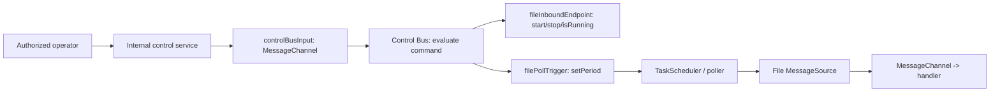

# Dynamically Changing a Poller via Control Bus in Spring Integration

## 1. Problem Statement: Adjusting the Data Ingestion Schedule Without Restarting the Application

A Spring Integration application checks a partner's order directory every 5 seconds. During peak hours, data arrives continuously and needs to be picked up faster; during maintenance, the operations team wants to **pause** file ingestion while keeping the application running. Once the partner system stabilizes, they want to **resume** polling and perhaps change the interval between cycles to 15 seconds. If every change required editing `application.yml` and restarting, operational changes would be slow and risk disrupting other integration flows.

In the **SPRING_INTEGRATION_ADAPTERS** module, polling inbound adapters use `MessageSource` to read data from files, SFTP, databases, or external systems, create a `Message`, and send it through a `MessageChannel`. The **Poller** decides when to call `receive()`. Spring Integration provides a **Control Bus** to send control commands to beans/endpoints in the application context; when combined with a **dynamically mutable trigger**, you can adjust state or polling cadence while the application is still running.

This lesson focuses on two **distinct** operations:

1. **Lifecycle management**: stopping, restarting, or querying the state of a polling endpoint via the Control Bus.
2. **Schedule modification**: updating the period of a trigger that supports runtime updates, such as `DynamicPeriodicTrigger`. The Control Bus is the **command delivery path**; the trigger is the component that **stores and applies the interval**.

After this lesson, you will be able to set up an inbound adapter flow using a dynamic trigger, send Control Bus commands, explain how changes take effect on already-scheduled tasks, and operate safely with authentication, audit logs, retries, idempotency, and multiple instances.

## 2. What Is the Control Bus in Spring Integration?

The **Control Bus** is an endpoint that receives messages containing **control expressions**, typically using Spring Expression Language (SpEL). Instead of merely carrying business data, a message is evaluated by the Control Bus to invoke an operation on a Spring-managed bean.

Examples of control intents:

```text
@fileInboundEndpoint.stop()
@fileInboundEndpoint.start()
@fileInboundEndpoint.isRunning()
@filePollTrigger.setPeriod(15000)
```

In these expressions:

- `@fileInboundEndpoint` is a reference to the **endpoint bean** with the corresponding ID in the application context.
- `stop()`, `start()`, and `isRunning()` are lifecycle/status operations when supported by the endpoint.
- `@filePollTrigger` is the trigger bean capable of schedule adjustment; `setPeriod(15000)` requests changing the period to **15,000 milliseconds** in the sample configuration.
- Whether an expression can execute depends on the bean, method signature, Control Bus configuration, framework version, and expression access policy.

The Control Bus is **not** a public administrative REST API by default. It is a **message endpoint inside the application context**. If you want to control it from an external management system, you must build an interface layer with explicit authentication and command restrictions.

### Position of the Control Bus in the Architecture



The **control plane** and **business data plane** are kept separate. A `stop()` command is not an order message; order messages should not be sent into the control channel.

## 3. Two Kinds of Changes: Lifecycle and Polling Schedule

| Need | Typical Operation | What Actually Changes? |
| --- | --- | --- |
| Pause source scanning | `@fileInboundEndpoint.stop()` | The endpoint's running state/execution schedule. |
| Resume scanning | `@fileInboundEndpoint.start()` | The endpoint is started/rescheduled according to its trigger. |
| Query status | `@fileInboundEndpoint.isRunning()` | Returns lifecycle status info, not processing status of all messages. |
| Reduce frequency from 5s to 15s | `@filePollTrigger.setPeriod(15000)` | The period value of the **dynamic trigger**. |
| Trying to change static `@Poller(fixedDelay = "5000")` | No automatic mutation merely from having a Control Bus | Constant configuration usually needs replacing with an updatable trigger or a different endpoint config mechanism. |

The Control Bus does not automatically turn every `PeriodicTrigger` or `fixedDelay` configuration string into a dynamically mutable property. If the requirement is changing the period at runtime, you must **design a dynamic trigger upfront** or use an appropriate orchestration solution.

**Common misconception:** changing the period does not mean creating another new poller. In a running application, you should **maintain a single polling endpoint** for a given source flow, and change either the state or the trigger used by that endpoint. Creating multiple endpoints scanning the same directory/SFTP/database without a claim mechanism can lead to duplicate processing.

## 4. DynamicPeriodicTrigger: The Component Producing a Mutable Schedule

Spring Integration provides `DynamicPeriodicTrigger`, which allows updating the period while the application runs. With this trigger, `period` is the duration between ticks computed in fixed-delay or fixed-rate mode depending on how the trigger is configured.

Bean creation example:

```java
import org.springframework.context.annotation.Bean;
import org.springframework.integration.util.DynamicPeriodicTrigger;

@Bean("filePollTrigger")
public DynamicPeriodicTrigger filePollTrigger() {
    DynamicPeriodicTrigger trigger = new DynamicPeriodicTrigger(5000);
    trigger.setFixedRate(false); // Illustrates fixed-delay mode.
    return trigger;
}
```

The snippet above goes inside a `@Configuration` class. The initial value `5000` represents **5 seconds** in the sample timing setup. Before changing timings, verify the method and unit of measurement in your framework version; passing seconds as milliseconds by mistake can cause the system to hammer the source.

When calling:

```text
@filePollTrigger.setPeriod(15000)
```

the trigger is requested to change its period to **15 seconds**. However:

- **It does not necessarily reschedule immediately** a task already computed and queued by the scheduler. The new value usually takes effect the next time the trigger is asked to compute the subsequent execution time.
- If a polling cycle is currently running, `setPeriod` **does not abort** that cycle mid-flight.
- If the poller is stopped, changing the trigger **does not automatically call `start()`**; the new schedule will be used when the endpoint is started/rescheduled again.
- If the application restarts, the trigger bean is typically recreated with its initial value unless you have a mechanism to persist and reload dynamic configuration.

### Fixed-delay and fixed-rate After Changing

Suppose a cycle finishes at second 10 and the trigger is running in fixed-delay mode:

```text
Initially: period = 5 seconds
10s: cycle finishes
15s: next cycle expected

Adjusted: period = 15 seconds
10s: cycle finishes and trigger computes schedule with new value
25s: next cycle expected
```

This is an **illustrative** calculation, assuming the update command is applied **before the scheduler computes the next tick**. If the 15-second tick was already computed and scheduled prior to issuing the command, do not treat changing `period` as a guarantee that the tick is canceled immediately.

With fixed-rate, expected ticks follow a periodic cadence; when a cycle takes too long, ticks can fall behind. Changing the period does not replace concurrency limits, timeouts, or backpressure.

## 5. Complete Example: Changing a File-Reading Poller via Control Bus

### 5.1. Scenario

The application reads `*.csv` files in `data/inbox`, taking at most 5 files per cycle. Initially the trigger uses a **5-second** fixed-delay; operators can pause the endpoint, resume it, or change the period to **15 seconds** without restarting the entire application.

We use:

- Spring Integration File inbound adapter.
- Java DSL to assign an **explicit ID** to the polling endpoint.
- A `DynamicPeriodicTrigger` bean named `filePollTrigger`.
- A `DirectChannel` dedicated solely to delivering **internal commands** to the Control Bus.

### 5.2. Dependencies

In a Spring Boot project using a BOM to manage versions:

```xml
<dependencies>
    <dependency>
        <groupId>org.springframework.boot</groupId>
        <artifactId>spring-boot-starter-integration</artifactId>
    </dependency>
    <dependency>
        <groupId>org.springframework.integration</groupId>
        <artifactId>spring-integration-file</artifactId>
    </dependency>
</dependencies>
```

Create `data/inbox` beforehand relative to the application's working directory. Test files should only contain non-sensitive CSV content.

### 5.3. Configuring the Polling Endpoint and Control Bus

```java
import java.io.File;

import org.springframework.context.annotation.Bean;
import org.springframework.context.annotation.Configuration;
import org.springframework.integration.channel.DirectChannel;
import org.springframework.integration.config.EnableIntegration;
import org.springframework.integration.dsl.IntegrationFlow;
import org.springframework.integration.dsl.Pollers;
import org.springframework.integration.file.dsl.Files;
import org.springframework.integration.util.DynamicPeriodicTrigger;
import org.springframework.messaging.MessageChannel;

@Configuration
@EnableIntegration
public class DynamicFilePollingConfiguration {

    @Bean("filePollTrigger")
    public DynamicPeriodicTrigger filePollTrigger() {
        DynamicPeriodicTrigger trigger = new DynamicPeriodicTrigger(5000);
        trigger.setFixedRate(false);
        return trigger;
    }

    @Bean
    public IntegrationFlow inboundCsvFlow(
            DynamicPeriodicTrigger filePollTrigger) {

        return IntegrationFlow
            .from(
                Files.inboundAdapter(new File("data/inbox"))
                     .patternFilter("*.csv"),
                endpoint -> endpoint
                    .id("fileInboundEndpoint")
                    .poller(
                        Pollers.trigger(filePollTrigger)
                               .maxMessagesPerPoll(5)
                    )
            )
            .handle(message -> {
                File file = (File) message.getPayload();
                System.out.printf(
                    "Processed by %s: %s%n",
                    Thread.currentThread().getName(),
                    file.getName()
                );
                // TODO: validate, persist, archive, and handle errors.
            })
            .get();
    }

    @Bean
    public MessageChannel controlBusInput() {
        return new DirectChannel();
    }

    @Bean
    public IntegrationFlow controlBusFlow() {
        return IntegrationFlow
            .from("controlBusInput")
            .controlBus()
            .get();
    }
}
```

**Explanation:**

1. `filePollTrigger` is a mutable trigger bean, initially set to a 5,000 ms interval between eligible cycles.
2. `Files.inboundAdapter(...)` creates the file message source. `patternFilter("*.csv")` selects only matching files.
3. `endpoint.id("fileInboundEndpoint")` assigns the **endpoint ID** so the Control Bus can reference it. Distinguish this endpoint ID from the bean name `inboundCsvFlow` that holds the `IntegrationFlow`.
4. `Pollers.trigger(filePollTrigger)` wires the dynamic trigger into the poller; `maxMessagesPerPoll(5)` limits files/messages per cycle, not concurrent processing count.
5. `.handle(...)` is a synchronous handler in this example; processing duration can affect when the fixed-delay cycle finishes.
6. `controlBusInput` is the channel for control commands; `.controlBus()` is the endpoint evaluating valid commands in the application context.

**Do not create an additional similar adapter** with `@InboundChannelAdapter` for the same directory while running this DSL example: two polling endpoints reading the same source can cause contention, duplicates, or altered file ordering.

### 5.4. Sending Commands from an Internal Management Service

Example of a service class that only sends **fixed, pre-approved commands**; it does not accept arbitrary SpEL strings from external users:

```java
import org.springframework.beans.factory.annotation.Qualifier;
import org.springframework.messaging.MessageChannel;
import org.springframework.messaging.support.MessageBuilder;
import org.springframework.stereotype.Service;

@Service
public class FilePollerControlService {

    private final MessageChannel controlBusInput;

    public FilePollerControlService(
            @Qualifier("controlBusInput") MessageChannel controlBusInput) {
        this.controlBusInput = controlBusInput;
    }

    public void pause() {
        sendCommand("@fileInboundEndpoint.stop()");
    }

    public void resume() {
        sendCommand("@fileInboundEndpoint.start()");
    }

    public void changePeriodTo15Seconds() {
        sendCommand("@filePollTrigger.setPeriod(15000)");
    }

    private void sendCommand(String expression) {
        boolean accepted = controlBusInput.send(
            MessageBuilder.withPayload(expression).build()
        );
        if (!accepted) {
            throw new IllegalStateException(
                "Control Bus did not accept the command"
            );
        }
    }
}
```

The `pause()`, `resume()`, and `changePeriodTo15Seconds()` methods should only be called by an **authenticated, authorized operations layer with audit logging**. The example intentionally omits a REST controller. Never expose an endpoint directly accepting arbitrary SpEL strings and forwarding them verbatim to the Control Bus.

A successful `send()` result only confirms message delivery per the channel contract; to verify whether the endpoint **actually stopped/started and which period it is currently using**, query bean status, inspect metrics, and observe the execution schedule. When the control endpoint uses a `DirectChannel`, expression evaluation errors can propagate synchronously back to the caller; log and handle them cleanly.

### 5.5. Querying State via Control Bus

Status-reading expressions typically look like:

```text
@fileInboundEndpoint.isRunning()
@filePollTrigger.getPeriod()
```

If you want to receive a **return value** from the Control Bus, use request-reply interaction with a `replyChannel` or a `MessagingTemplate` with an appropriate reply timeout, rather than sending a one-way message and inferring from `send()`'s boolean. Return value types and method evaluability depend on the bean/Spring Integration version. You can simultaneously read endpoint metrics and use a least-privilege management service to verify the result.

## 6. Operational Scenario Along a Timeline

Suppose the application context starts at 10:00:00 and the initial trigger is a 5-second fixed-delay. Ignoring startup duration, scheduler jitter, and file read time:

| Time | Action | Expectation |
| --- | --- | --- |
| 10:00 | Endpoint running with 5-second period | Poller is scheduled per initial trigger. |
| 10:02 | Ops requests `stop()` | Endpoint transitions to stopped per lifecycle; no new cycles scheduled normally. |
| 10:03 | Send `setPeriod(15000)` | Trigger updates period value; endpoint does not auto-restart. |
| 10:04 | Send `start()` | Endpoint is rescheduled, using the updated trigger according to its mechanism. |
| 10:05 | Higher-than-expected data intake | Backlog may grow due to sparser polling cadence; measure and tune. |

**Note on an already-started cycle:** `stop()` does not necessarily abort blocking `receive()` operations over HTTP/SFTP or a handler currently writing to the DB immediately. Full stopping also depends on source interrupt/timeout capabilities, lifecycle, and the scheduler. Therefore, a "Pause" button in an admin UI should not promise that all in-flight business work rolled back or halted instantaneously.

### How to Verify a Period Change

A test you can perform in a development environment:

1. Prepare a sample file source and measure actual polling timestamps, **even when there are no files**.
2. Let the endpoint run with a 5-second period and record start/end timestamps.
3. Stop the endpoint, change the period to 15 seconds, and start it again.
4. Observe subsequent cycles; account for trigger/scheduler behavior on the first cycle after restart.
5. Drop a few new files into `data/inbox` and verify each cycle does not exceed `maxMessagesPerPoll(5)`.

Because the handler is only invoked when files exist, **reading handler logs alone is insufficient to measure the polling period**. Instrument `MessageSource.receive()` or enable polling endpoint metrics/logging.

## 7. Can Control Bus Change Every Poller Attribute?

No. The Control Bus can send commands invoking **existing, accessible methods on beans**; it does not automatically:

- Mutate every `@Poller` annotation attribute initialized from static configuration.
- Turn an arbitrary `Trigger` into a dynamically period-mutable trigger.
- Change `cron`, `maxMessagesPerPoll`, transaction advice, error channel, or concurrency across all endpoints with one uniform syntax.
- Persist updated values across JVM restarts.
- Add authentication/authorization for an external admin interface.

If you want to change other attributes, check whether the specific endpoint/trigger has a **supported** setter or management API in your running framework version. Do not use reflection or arbitrary SpEL commands just to mutate internal fields lacking a stable contract.

### When the Requirement Is Changing a Cron Schedule

`DynamicPeriodicTrigger` serves periodic schedules, not an arbitrary cron expression like "08:30 Monday through Friday." If business logic requires changing cron dynamically, pick a `Trigger`/scheduler that supports updating expressions or manage the endpoint with a controlled stop–reconfigure–start workflow. Account for time zones, DST, schedule persistence, and handling missed ticks; you cannot simply call `setPeriod(...)` to switch from fixed-delay to cron.

## 8. Security: Control Bus Is a Sensitive Control Surface

The Control Bus uses expressions to interact with beans in the Spring application context. This capability is very powerful, since beans can represent DB connections, data sources, messaging endpoints, or lifecycle components.

**Never allow untrusted clients to submit control expressions directly.** If the application needs an HTTP admin UI, define only a fixed set of business operations and enforce matching authorization:

| Admin Operation | Required Permission/Check | Audit Data to Record |
| --- | --- | --- |
| Pause poller | Restricted to authorized ops role | Requester, endpoint, timestamp, outcome |
| Resume poller | Check dependency readiness and source state | Who resumed, period value, resume timestamp |
| Change period | Min/max period bounds and external source load | Old/new period, reason, and outcome |
| View status | Read-only permission | Endpoint, query timestamp |

For example, instead of an API accepting `{"expression":"..."}`, the application layer can expose only predefined operations such as `pauseFilePolling()` or `setFilePollingPeriod(15_000)` with strict validation. A general period-adjustment feature must reject negative/zero values or overly tiny periods if incompatible with the trigger's contract and load capacity.

When multiple environments exist (dev/staging/production), never share an untargeted admin endpoint. Enforce per-environment authorization and maintain a safe configuration rollback mechanism.

## 9. Multiple Instances, Persistent Configuration, and Deployment

A Control Bus call on **one JVM** directly modifies beans only inside **that JVM**. If the application has three replicas:

```text
Replica A: fileInboundEndpoint (period = 5s)
Replica B: fileInboundEndpoint (period = 5s)
Replica C: fileInboundEndpoint (period = 5s)

Send Control Bus command to Replica A:
    @filePollTrigger.setPeriod(15000)

Direct result:
Replica A: period = 15s
Replica B: period = 5s
Replica C: period = 5s
```

If **cluster-wide** adjustment is needed, you must have authenticated fan-out, centralized configuration, a controller/operator, or another operational workflow ensuring each instance receives the right command. Do not assume Spring Integration synchronizes triggers across pods.

At the same time, three running pollers may concurrently scan the file/SFTP/DB source. **Adjusting the period does not replace distributed locks, leader election, partitioning, or claim/idempotency mechanisms** to prevent duplicate processing.

### Values After Restart

In the example, the `filePollTrigger` bean is created with period `5000`. After calling `setPeriod(15000)` and restarting the application, the period reverts to its initial value unless a persistence mechanism stores the change.

For production, define:

1. Source of truth for dynamic config: durable config store, admin database, or deployment system.
2. Startup sequence: load the latest period **before the endpoint begins operating**, or follow a pause/apply/resume workflow.
3. Policy when external config is unavailable: safe fallback, rate bounds, clear error reporting.
4. Versioning/auditing: who changed it, when, from which value to which value, and why.
5. Rollback procedure: ability to revert to the previous period or operational state.

## 10. Impact on Backlogs, Duplicates, and Connection Lifecycles

### 10.1. Pausing Does Not Delete Source Data

When a polling inbound adapter is stopped, unread files or records generally **remain at the source** if the source and retention policies keep them. Upon resuming, the endpoint can read the backlog according to its filters/claims/checkpoints. However, this is not guaranteed if:

- The partner deletes files too early or API data has a short retention window.
- Another replica already read and marked the data.
- A filter or metadata store prevents re-ingesting a file previously accepted.
- An external call before stopping already fetched data without finishing business processing.

Therefore, pausing a poller should be paired with checking retention, backlog, and SLAs.

### 10.2. Changing from 5 Seconds to 15 Seconds Can Grow the Backlog

Suppose `maxMessagesPerPoll = 5`, each cycle processes quickly, and data is continuously present:

| Fixed Period | Nominal Cycles/Minute | Scheduled Intake Ceiling (5 messages/cycle) |
| --- | ---: | ---: |
| 5 seconds | ~12 | ~60 messages/minute |
| 15 seconds | ~4 | ~20 messages/minute |

This is a **nominal estimate** assuming the scheduler hits all ticks, the source always has data, cycles finish on time, and no errors occur. With fixed-delay, cycle processing duration is added to the wait time, so actual throughput can be lower.

If a partner sends 40 files/minute while you reduce intake capacity to around 20 files/minute, the backlog will grow even though the Control Bus change succeeded. Thus, period-change commands should be paired with alerts when the oldest data age breaches SLAs.

### 10.3. Sources May Not Be Thread-Safe

Changing a trigger does not introduce new concurrency if you only alter the period of a single endpoint, yet when stop/start operations overlap with running tasks or other executors/replicas exist, you must still review source access boundaries.

With SFTP, connection sessions and download/rename commands must follow lifecycle rules; with databases, claims/transactions must prevent multiple workers from selecting the same record; with files, ensure files finish writing before the poller selects them. The Control Bus does not provide exactly-once delivery or cross-system transactions.

### 10.4. Pausing Does Not Mean Ending Transactions

If a handler has already opened a JDBC transaction or is mid-API call, requesting the endpoint to stop does not automatically commit/roll back that transaction. You need proper timeouts, shutdown strategies, and connection release handling. If a cycle already ingested data and processing fails, retries/idempotency still must be handled at the business layer.

## 11. Monitoring and Diagnostics

To verify control tooling works properly, record both **admin commands** and **polling behavior**:

| Metric or Event | What to Verify |
| --- | --- |
| pause/resume/setPeriod command | Who sent it, to which instance/endpoint, did it succeed? |
| Period value before/after | Did the trigger retain the new value? |
| `isRunning()` status | Is the endpoint running per lifecycle or stopped? |
| Start/end timestamps of each poll cycle | Did the trigger actually switch cadence after the next schedule calculation? |
| Messages received per cycle | Does the source have data or is a filter excluding everything? |
| Age of oldest unfinished file/message | Did pausing or raising the period slow processing past SLAs? |
| Network/DB/handler errors and retries | Is changing the schedule masking an external source outage? |
| Queue/executor saturation | Did intake-rate changes increase backpressure? |

**No handler logs immediately after resume:** the scheduled tick may not have arrived yet, the source may have no data yet, or the source may return `null`. To confirm the poller actually triggered, instrument `receive()` or collect endpoint metrics instead of only counting handler logs.

**Called setPeriod yet the next run still used the old tick:** a cycle may have been scheduled before the update command arrived. Inspect cycles *after the trigger recalculates the schedule* rather than concluding the command failed from a single tick.

**Endpoint reports running yet no longer ingests files:** check scheduler thread pool, accept-once filter, source state, permissions, channel subscribers, and error flow.

**Command affects only one pod:** the Control Bus is instance-local. Check service routing and cluster-wide config sync policies.

**After restart the period reverts to 5 seconds:** the new bean initializes from defaults; a durable config store and approved-period loading flow are needed.

## 12. Exercises with Answers

**Exercise 1 — Distinguish responsibilities.** Do the Control Bus and `DynamicPeriodicTrigger` have the same role?

**Answer:** No. The Control Bus receives/evaluates control commands; the trigger stores and computes the polling schedule. The Control Bus simply invokes the corresponding API on the bean.

**Exercise 2 — Stop the poller.** You want to pause an endpoint with ID `fileInboundEndpoint`. Which Control Bus expression is appropriate?

**Answer:** `@fileInboundEndpoint.stop()`, provided that bean supports lifecycle operations and the Control Bus is allowed to invoke the method.

**Exercise 3 — Change the period.** Trigger `filePollTrigger` has `setPeriod(long)` and uses milliseconds. To change to 12 seconds, what command do you write?

**Answer:** `@filePollTrigger.setPeriod(12000)`.

**Exercise 4 — Stopped endpoint.** You send `@filePollTrigger.setPeriod(12000)` while the endpoint is stopped. Does this command automatically resume file ingestion?

**Answer:** No. Changing the trigger value does not call `start()`; the endpoint must be started via a separate workflow.

**Exercise 5 — Already-scheduled tick.** The scheduler already scheduled the poller to run at second 10. At second 9, you change the period. Can you guarantee the second-10 tick is canceled immediately?

**Answer:** No. An already-scheduled task may not be shifted instantaneously; observe subsequent schedule computations and trigger behavior.

**Exercise 6 — Throughput difference.** A poller receives at most 5 messages/cycle, processes very fast, and continuously has data. Changing the period from 5s to 15s changes the nominal per-minute intake ceiling from what to what?

**Answer:** Roughly from **60 messages/minute** down to **20 messages/minute**; this is a nominal ceiling excluding processing time and scheduler jitter.

**Exercise 7 — Three replicas.** Does a `setPeriod` command sent to replica A's Control Bus automatically update the trigger bean on B and C?

**Answer:** No. You need an orchestration or config/command distribution mechanism reaching each instance.

**Exercise 8 — Security.** Should you create a public HTTP endpoint accepting any SpEL string and passing it straight to the Control Bus?

**Answer:** No. You need authentication, authorization, an allowlisted command set, value validation, and auditing; prevent clients from calling arbitrary bean methods.

**Exercise 9 — Shutdown.** You send `stop()` while a poll cycle is holding a 30-second HTTP request. Can you claim the request cancels immediately and no transactions remain open?

**Answer:** No. You need timeouts/interrupts and source lifecycle management; `stop` does not automatically complete or roll back all in-flight work.

**Exercise 10 — Restart.** A trigger is created with a 5000 ms period, then changed via Control Bus to 15000 ms. The application restarts without config persistence. What is the period value on the new startup?

**Answer:** Typically it reverts to **5000 ms** per the bean factory code. Keeping 15000 ms requires persisting and reloading configuration.

## 13. Takeaways

**The Control Bus enables controlling a polling endpoint while the application is running**, typically via `start()`, `stop()`, and status queries. To **actually change the polling period**, use an updatable trigger such as `DynamicPeriodicTrigger` and send a command invoking `setPeriod(...)` on the trigger bean. Changes may take effect starting from the next schedule calculation; they do not necessarily cancel already-scheduled tasks immediately, do not persist across restarts automatically, and do not propagate to other replicas. In systems integrating files, SFTP, HTTP, or databases, protect the Control Bus with authorization, restricted commands, and auditing, alongside managing backlogs, timeouts, idempotency, retries, and connection lifecycles.
