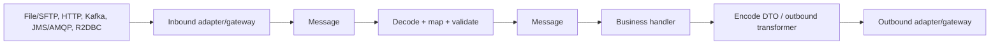
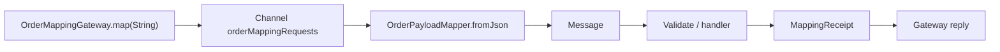
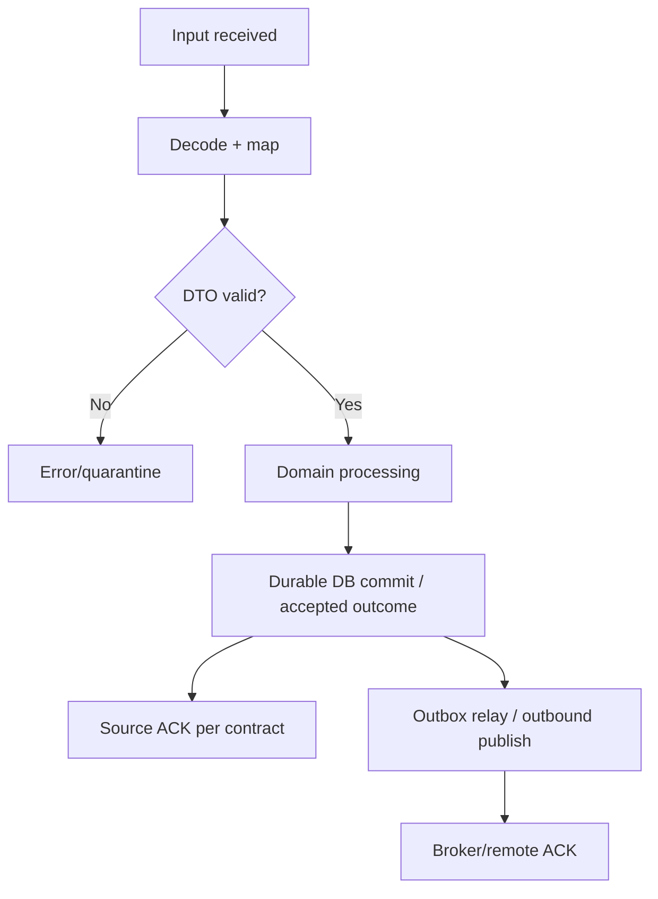

# Payload Mapping by Data Type

> **Chapter:** Message Mapping  
> **Module:** SPRING_INTEGRATION_ADAPTERS  
> **Context:** Connecting external systems to Spring Integration using inbound/outbound adapters, gateways, pollers, and `MessageChannel`. Practice exchange flows over files, SFTP, HTTP, JMS, AMQP, Kafka, and databases; manage message contracts, errors, processing state, and connection lifecycles.

## 1. Learning Objectives

After this lesson, you will be able to:

- Explain the purpose of **payload mapping**: converting a data representation at the integration boundary into a representation suitable for the next processing step.
- Distinguish between **payload Java type**, **wire format**, **MIME/content type**, **schema version**, and **message headers**.
- Create, read, and transform `Message<T>` without losing essential business identity/correlation metadata.
- Properly handle common payload types: `String`, `byte[]`, `Map<String,Object>`, `JsonNode`, Java record/POJO, `List<T>`, `File`, `Resource`, `InputStream`, `Flux<T>`/`Mono<T>`.
- Design Java DSL `transform(...)`, `filter(...)`, and `handle(...)` between inbound adapters, gateways, `MessageChannel`, and outbound adapters.
- Build a UTF-8 JSON → DTO → validation → domain result pipeline, and a DTO → JSON bytes pipeline for external systems.
- Clearly choose between a **transport-level converter** and a **transformer inside the Spring Integration flow**.
- Understand why a Kafka deserializer, HTTP message converter, JMS/AMQP message converter, and R2DBC row mapper can produce **different payload types from the same business data**.
- Handle SQL NULL, JSON null, missing fields, numeric precision, timestamps/zones, lists with generic types, and binary data without silently corrupting content.
- Apply schema validation, error routing, and idempotency; test mappers with JUnit, `StepVerifier`, and gateway/flow integration tests.

## 2. Where Does Payload Mapping Live?

A Spring message typically has a **payload** and **headers**:

```java
import org.springframework.messaging.Message;

Message<?> message =
        org.springframework.messaging.support.MessageBuilder
                .withPayload("example")
                .build();
Object payload = message.getPayload();
var headers = message.getHeaders();
```

`Message<?>` is an **internal application** transport contract, not a wire protocol. A Kafka record may contain bytes, an HTTP request may have a JSON body, a file adapter may send a `File`, and a database may return `Flux<DTO>`. All of them can be turned into a Spring Message, but the **inbound payload type differs**.



### 2.1. Four Kinds of "Type" That Must Not Be Confused

| Layer | Question | Example |
| --- | --- | --- |
| **Java type at an endpoint** | What class is `getPayload()`? | `byte[]`, `String`, `OrderCreated`, `File`. |
| **Wire format** | How does the external system send bytes? | UTF-8 JSON, XML, CSV, raw binary, Avro, Protobuf. |
| **Content type/MIME** | Metadata declaring how to interpret the body? | `application/json`, `text/csv`, `application/octet-stream`. |
| **Business schema/contract** | What are the required fields, version, and domain semantics? | `eventId`, `orderId`, `amount`, `occurredAt`, `schemaVersion`. |

For example, a `byte[]` with header `contentType=application/json` **is still a `byte[]`** until a decoder/converter/transformer runs. A header does not automatically turn bytes into `OrderCreated` without a component performing the conversion.

### 2.2. A Message Passes Through Multiple Representation Layers

```text
Kafka value bytes:
  7B 22 65 76 65 6E 74 49 64 22 ... 7D
             |
             | Kafka ByteArrayDeserializer
             v
Message<byte[]>
  contentType = application/json
             |
             | UTF-8 decode + Jackson
             v
Message<OrderCreated>
  eventId = "evt-501"
  orderId = "ord-101"
             |
             | business processing
             v
Message<PublishReceipt>
             |
             | JSON encoder for HTTP response
             v
JSON wire bytes
```

There is no need to turn the payload into JSON on **every** channel. Between business handlers inside the JVM, type-checked DTOs are usually much easier to maintain than JSON strings.

## 3. Common Payload Type Matrix

| Source/format | Possible Java payload | Mapper considerations |
| --- | --- | --- |
| File inbound | `java.io.File` | Read bytes/stream, decode charset, parse CSV/JSON/XML. |
| SFTP inbound synced to local | `File` | Handle local file and file completion/ACK rules. |
| HTTP inbound gateway | `String`, `byte[]`, DTO, or `Map` depending on converter | Content negotiation, JSON DTO conversion, validation. |
| Kafka inbound | `String`, `byte[]`, Avro/Protobuf object, POJO depending on deserializer | Do not assume payload is always `String`. |
| JMS/AMQP inbound | `String`, `byte[]`, DTO depending on MessageConverter | Converter, trusted packages/schema, headers/properties. |
| R2DBC read | `Map`/entity inside `Flux` or `Mono` | Row mapping then consume Publisher/split. |
| Raw TCP/UDP | Usually `byte[]` or `String` depending on serializer | Framing, charset, message boundaries, and binary codec. |
| WebSocket/STOMP/MQTT | Usually `String`/`byte[]`/message object depending on adapter | Text/binary codec, content type, schema. |
| Internal service | `OrderCreated`, `List<OrderCreated>`, domain command | Avoid unnecessary serialize-then-deserialize cycles. |

This table describes **possibilities**, not a claim that every adapter shares the same default. The actual type must be verified from the **adapter/deserializer/converter configuration** and endpoint contract.

### 3.1. Choosing Safe Types at the Boundary

Recommended rules:

1. If an external system sends JSON, decode it into a **DTO with a published schema** at the appropriate boundary.
2. When processing very large files, avoid reading the entire file into `String`/`byte[]` just to map a few fields.
3. If the format is binary (images, PDF, Protobuf), do not automatically convert it to UTF-8 text.
4. If the payload contains multiple records, clearly decide **batch vs. one event** before a splitter.
5. If the payload is `Publisher<T>`, define **who subscribes**, when complete/error/cancel occurs, and where per-row processing happens.

## 4. Message<T>: Payload and Headers

### 4.1. Creating a Message with a Typed Payload

```java
import java.math.BigDecimal;
import java.time.OffsetDateTime;

import org.springframework.messaging.Message;
import org.springframework.messaging.support.MessageBuilder;

OrderCreated event = new OrderCreated(
        "evt-501",
        "ord-101",
        new BigDecimal("125.50"),
        OffsetDateTime.parse("2026-11-23T08:30:00+07:00"),
        1
);

Message<OrderCreated> message = MessageBuilder
        .withPayload(event)
        .setHeader("eventId", event.eventId())
        .setHeader("schemaVersion", event.schemaVersion())
        .build();
```

`Message<OrderCreated>` lets the code know the type at compile time where the message is created. However, when passing through a `MessageChannel` with erased generic type or across an adapter boundary, runtime type and schema checks are still required.

### 4.2. Copying a Message When Changing Metadata

```java
Message<OrderCreated> withSource = MessageBuilder
        .fromMessage(message)
        .setHeader("sourceSystem", "kafka-payments")
        .build();
```

`fromMessage(...)` is convenient for preserving the original payload/headers when adding metadata. Do not treat every header from a caller as trusted data: headers may include transport-specific, correlation/reply, routing, trace, or security-sensitive values.

### 4.3. Which Headers Should Be Kept?

| Header/metadata | Purpose | Policy |
| --- | --- | --- |
| `MessageHeaders.ID` | Identifies **a single Spring Message** | Do not use as a replacement for a stable business event ID. |
| `MessageHeaders.TIMESTAMP` | Timestamp when the Spring Message was created | Do not replace event occurrence time. |
| `MessageHeaders.CONTENT_TYPE` | Hint for payload content type | Must match the new representation; do not keep a JSON label after converting to arbitrary binary. |
| `correlationId` | Links request-reply/trace | Preserve when needed by downstream contract. |
| `replyChannel` | Gateway reply route | Do not accidentally drop when a reply is still expected. |
| `errorChannel` | Error routing | Do not blindly copy across trust boundaries. |
| `eventId` / `idempotencyKey` | Business dedup across retries | Stable, validated, never regenerated per attempt. |
| `schemaVersion` | Helps select parser/schema | Must verify against body and allowlist. |
| Transport-specific headers | Kafka topic/partition/offset, JMS IDs, HTTP headers | Keep only when needed; do not mix with business payload. |

**Note:** Exact header names and Java types depend on the adapter. For instance, a Kafka consumer offset is source metadata—it does not become an ACK just because you copied it onto a new message.

### 4.4. Do Not Emit a Null Payload

A standard Spring `Message` requires a non-null payload. If JSON has a null field, the **field inside the DTO** may be null per contract, but that does not mean we should construct a `Message<null>`.

If you need to drop an invalid event, use `filter(...)` with an explicit reason/metrics or route it to an error/quarantine flow; never silently return null from a transformer and assume it succeeded.

## 5. Designing the Payload Contract Before Coding

This lesson uses an order event:

```json
{
  "eventId": "evt-501",
  "orderId": "ord-101",
  "amount": 125.50,
  "occurredAt": "2026-11-23T08:30:00+07:00",
  "schemaVersion": 1
}
```

### 5.1. Immutable DTO

Create `OrderCreated.java`:

```java
import java.math.BigDecimal;
import java.time.OffsetDateTime;

public record OrderCreated(
        String eventId,
        String orderId,
        BigDecimal amount,
        OffsetDateTime occurredAt,
        int schemaVersion
) {
}
```

Decisions to explain:

- `eventId` is a stable business event ID across redeliveries; do not substitute the Spring Message ID or Kafka offset.
- `orderId` correlates to the aggregate/domain object.
- `amount` uses `BigDecimal`, not `double`, when decimal precision is required.
- `occurredAt` uses `OffsetDateTime` to preserve the sender's time offset; normalize to UTC according to policy when storing in the DB.
- `schemaVersion` represents the payload contract version, **not** based on the Java class name.

### 5.2. Validation Policy

| Field | Minimum requirement | Invalid example |
| --- | --- | --- |
| `eventId` | Non-blank; allowed length and characters | `""` or a new ID per retry |
| `orderId` | Non-blank, matches domain rules | `null` |
| `amount` | Non-null; positive; valid scale/precision | `-3.50`, `1e400` |
| `occurredAt` | Non-null; reasonable timestamp | String without timezone, invalid offset |
| `schemaVersion` | Supported version, e.g., `1` | `999` with no mapper |

A DTO having the right fields/types **is not automatically valid**. Jackson can instantiate a record with null reference fields if the JSON payload omits fields; you must validate after parsing.

### 5.3. Schema Evolution

- **Additive optional field:** can be compatible if consumers tolerate unknown/new fields.
- **Rename/remove required field:** usually a breaking change or requires a legacy-version mapper.
- **Change numeric/time semantics:** risky even if JSON still parses cleanly.
- **Change meaning of `eventId`:** impacts idempotency and deduplication.
- **Multiple versions:** use a version router or separate DTOs/converters with an explicit list of supported versions.

Do not force a business service to guess the schema by trying to parse multiple versions until one succeeds without throwing an exception.

## 6. Dependencies and Lab Configuration

Examples target **Java 17+, Spring Boot 3.x, Spring Integration 6.x, and Spring Framework 6.x**, with versions managed via the Spring Boot BOM. For newer versions, verify API compatibility before applying.

### 6.1. Maven Dependencies

```xml
<dependencies>
    <dependency>
        <groupId>org.springframework.boot</groupId>
        <artifactId>spring-boot-starter-integration</artifactId>
    </dependency>
    <dependency>
        <groupId>org.springframework.boot</groupId>
        <artifactId>spring-boot-starter-json</artifactId>
    </dependency>
    <dependency>
        <groupId>org.springframework.boot</groupId>
        <artifactId>spring-boot-starter-test</artifactId>
        <scope>test</scope>
    </dependency>
    <dependency>
        <groupId>io.projectreactor</groupId>
        <artifactId>reactor-test</artifactId>
        <scope>test</scope>
    </dependency>
</dependencies>
```

`spring-boot-starter-json` provides Jackson and common modules, including Java Time support for `OffsetDateTime` under standard configuration. In Spring Boot, an `ObjectMapper` bean is typically auto-configured; when configuring manually, ensure the Java Time module is registered.

Specific Kafka/AMQP/JMS/SFTP/R2DBC dependencies are only added when practicing the corresponding adapter; you do not need all of them to run the core Java DSL example in Section 7.

### 6.2. Lab Without an External Broker

The main example uses an internal `MessageChannel` and `@MessagingGateway`, letting you learn mapping without needing a running Kafka, JMS, or PostgreSQL instance.

In production, the mapping layer can be reused across adapters, while the **wire boundary** (serializer/deserializer, ACK mode, headers) still needs dedicated configuration.

## 7. Runnable Example: JSON String → OrderCreated → MappingReceipt

### 7.1. What Will the Program Do?



In this demo, **business success** means the event has been parsed/validated and a receipt has been created in the JVM; there is **no** database commit or Kafka publish yet. Do not use this receipt to ACK a broker message with stronger delivery guarantees until durable processing is added.

### 7.2. Mapper Component

Create `OrderPayloadMapper.java`:

```java
import java.math.BigDecimal;
import java.nio.charset.StandardCharsets;
import java.time.OffsetDateTime;

import com.fasterxml.jackson.core.JsonProcessingException;
import com.fasterxml.jackson.databind.ObjectMapper;
import org.springframework.stereotype.Component;

@Component
public class OrderPayloadMapper {

    private final ObjectMapper objectMapper;

    public OrderPayloadMapper(ObjectMapper objectMapper) {
        this.objectMapper = objectMapper;
    }

    public OrderCreated fromJson(String json) {
        if (json == null || json.isBlank()
                || json.length() > 64_000) {
            throw new IllegalArgumentException(
                    "Empty or oversized order JSON");
        }

        try {
            OrderCreated event = objectMapper.readValue(
                    json, OrderCreated.class);
            validate(event);
            return event;
        }
        catch (JsonProcessingException ex) {
            throw new IllegalArgumentException(
                    "Invalid order JSON", ex);
        }
    }

    public OrderCreated fromJsonBytes(byte[] bytes) {
        if (bytes == null || bytes.length == 0
                || bytes.length > 64_000) {
            throw new IllegalArgumentException(
                    "Empty or oversized order bytes");
        }

        // Jackson reads JSON byte[] and detects encoding per contract.
        // The lab requires external sources to send UTF-8 JSON.
        try {
            OrderCreated event = objectMapper.readValue(
                    bytes, OrderCreated.class);
            validate(event);
            return event;
        }
        catch (JsonProcessingException ex) {
            throw new IllegalArgumentException(
                    "Invalid order JSON bytes", ex);
        }
    }

    public byte[] toJsonBytes(OrderCreated event) {
        validate(event);
        try {
            return objectMapper.writeValueAsBytes(event);
        }
        catch (JsonProcessingException ex) {
            throw new IllegalStateException(
                    "Cannot serialize order", ex);
        }
    }

    public String toJson(OrderCreated event) {
        return new String(
                toJsonBytes(event), StandardCharsets.UTF_8);
    }

    public void validate(OrderCreated event) {
        if (event == null
                || !validId(event.eventId(), 80)
                || !validId(event.orderId(), 80)
                || event.amount() == null
                || event.amount().compareTo(BigDecimal.ZERO) <= 0
                || event.amount().scale() > 2
                || event.amount().precision() > 12
                || event.occurredAt() == null
                || event.schemaVersion() != 1) {
            throw new IllegalArgumentException(
                    "Invalid OrderCreated event");
        }
    }

    private static boolean validId(String s, int max) {
        return s != null
                && s.length() <= max
                && s.matches("[A-Za-z0-9_-]+");
    }
}
```

**Intentional choices:**

1. `fromJson` checks size before parsing to avoid excessive memory allocation on huge strings.
2. Jackson converts JSON to a typed record; the JavaTime module supports `OffsetDateTime` per Boot configuration.
3. `validate` enforces domain invariants rather than relying solely on successful parsing.
4. `fromJsonBytes` accepts **JSON bytes**, not arbitrary binary files.
5. `toJsonBytes` produces UTF-8 bytes via Jackson; never use `event.toString()` as JSON.
6. The mapper is a pure representation conversion and **does not call Kafka, JDBC/R2DBC, or HTTP**.
7. Size/precision limits in the lab are a **demo contract**; production systems must define dedicated byte limits, JSON nesting limits, schema/amount scales, and authorization.

### 7.3. Result DTO

Create `MappingReceipt.java`:

```java
public record MappingReceipt(
        String eventId,
        String orderId,
        String result
) {
}
```

### 7.4. Java DSL Flow

Create `OrderMappingFlowConfiguration.java`:

```java
import org.springframework.context.annotation.Bean;
import org.springframework.context.annotation.Configuration;
import org.springframework.integration.config.EnableIntegration;
import org.springframework.integration.dsl.IntegrationFlow;

@Configuration
@EnableIntegration
public class OrderMappingFlowConfiguration {

    @Bean
    IntegrationFlow orderMappingFlow(OrderPayloadMapper mapper) {
        return IntegrationFlow
                .from("orderMappingRequests")
                .transform(String.class, mapper::fromJson)
                .handle(OrderCreated.class, (event, headers) ->
                        new MappingReceipt(
                                event.eventId(),
                                event.orderId(),
                                "VALIDATED"))
                .get();
    }
}
```

**Explanation:**

- The gateway sends a `String` into the `orderMappingRequests` channel.
- `transform(String.class, mapper::fromJson)` maps the `String` payload → `OrderCreated`.
- `handle(OrderCreated.class, ...)` processes the DTO and returns `MappingReceipt` as the **reply payload**.
- Because the flow runs synchronously on a gateway/DirectChannel in the lab and the handler returns a result, the gateway receives the reply.
- If the mapper throws an exception, the gateway **does not receive a success receipt**; the exception may be wrapped in a Spring Messaging exception, so inspect the cause.
- When switched to an async channel, timeout/reply channel and threading semantics change; do not assume a gateway always receives an immediate reply.

### 7.5. Messaging Gateway

Create `OrderMappingGateway.java`:

```java
import org.springframework.integration.annotation.MessagingGateway;

@MessagingGateway(defaultRequestChannel = "orderMappingRequests")
public interface OrderMappingGateway {

    MappingReceipt map(String json);
}
```

When `@EnableIntegration` is active and the gateway is registered, Spring creates a proxy that communicates with the flow through the channel.

### 7.6. Spring Boot Main and Demo

Create `MappingApplication.java`:

```java
import org.springframework.boot.CommandLineRunner;
import org.springframework.boot.SpringApplication;
import org.springframework.boot.autoconfigure.SpringBootApplication;
import org.springframework.context.annotation.Bean;

@SpringBootApplication
public class MappingApplication {

    public static void main(String[] args) {
        SpringApplication.run(MappingApplication.class, args);
    }

    @Bean
    CommandLineRunner runDemo(OrderMappingGateway gateway) {
        return args -> {
            String json = """
                    {
                      "eventId":"evt-501",
                      "orderId":"ord-101",
                      "amount":125.50,
                      "occurredAt":"2026-11-23T08:30:00+07:00",
                      "schemaVersion":1
                    }
                    """;

            MappingReceipt receipt = gateway.map(json);
            System.out.println(receipt);
        };
    }
}
```

**Expected** output:

```text
MappingReceipt[eventId=evt-501, orderId=ord-101, result=VALIDATED]
```

Classes should be placed in the same package or sub-packages under the `@SpringBootApplication` root so component scanning discovers them. If your real project already has a main Boot application, **do not create a duplicate main application**; only register the appropriate mapper/flow/gateway.

### 7.7. Variant: Source Emitting byte[] Instead of String

You can build an alternative flow:

```java
@Bean
IntegrationFlow byteOrderMappingFlow(OrderPayloadMapper mapper) {
    return IntegrationFlow
            .from("orderByteRequests")
            .transform(byte[].class, mapper::fromJsonBytes)
            .handle(OrderCreated.class, (event, headers) ->
                    new MappingReceipt(
                            event.eventId(),
                            event.orderId(),
                            "VALIDATED"))
            .get();
}
```

This is a bean method inside `@Configuration`, using a **different input channel** so it does not collide with the String flow's channel.

Do not cast `(String) message.getPayload()` when the Kafka deserializer produces `byte[]`; choose the matching mapper overload or configure the deserializer/converter upfront.


## 8. String, byte[], and JSON: Mapping Must Be Explicit About Encoding

### 8.1. A String Is Not a JSON Object

```java
String jsonText = "{\"eventId\":\"evt-501\"}";
String plainText = "hello world";
```

Both are `String`. A Java type alone does not tell you whether the content is JSON, CSV, XML, or free-form text. When the source is HTTP/Kafka, combine the **endpoint contract** with metadata such as `contentType`; do not guess the format merely by looking for a leading `{`.

Wrong:

```java
OrderCreated order = (OrderCreated) (Object) jsonText;
```

Casting does not deserialize. The right way is to invoke a mapper/converter:

```java
OrderCreated order = payloadMapper.fromJson(jsonText);
```

### 8.2. byte[] Requires Knowing the Format

```java
import java.nio.charset.StandardCharsets;

byte[] jsonBytes = jsonText.getBytes(StandardCharsets.UTF_8);

String restored = new String(
        jsonBytes, StandardCharsets.UTF_8);
```

Use UTF-8 **when the wire contract specifies UTF-8**. Do not call `new String(bytes)` without specifying a charset, as it depends on the platform default charset. When the body is an image, PDF, ZIP, Protobuf, or encrypted bytes, **do not** decode it as text.

### 8.3. JSON Null Differs From Missing Message Payload

JSON can contain:

```json
{
  "note": null,
  "amount": 125.50
}
```

A DTO can represent `note=null` if the schema allows it. However:

- The JSON literal `null` deserializes to Java null, which **does not** produce a valid `Flux` item if emitted directly.
- A transformer should not silently turn a business record into a null payload.
- A missing `eventId` field must be classified as a validation error, not filled with a random event ID just to "keep things running."
- To represent an absent value, use a meaningful domain outcome, `Optional` in an appropriate API, or a filter with an explicit policy.

### 8.4. JSON Serialization Is Also Part of the Contract

```java
byte[] outboundBytes = payloadMapper.toJsonBytes(order);
String outboundJson = payloadMapper.toJson(order);
```

Re-reading JSON may yield the same **semantics** without necessarily producing identical bytes:

- Property order may differ.
- `125.5` and `125.50` differ in representation even though they are numerically equal.
- Timestamps may have normalized offsets/precision.
- Null fields may be omitted depending on serialization configuration.
- Unicode escapes or whitespace may differ.

If you need to sign payloads or hash/deduplicate by content, define **canonicalization/versioning**; do not assume `JSON.stringify`/Jackson always produces byte-identical output.

### 8.5. Size and Parser Limits

Enforce input limits at every layer:

| Layer | Risk | Mitigation |
| --- | --- | --- |
| HTTP server | Oversized body | Request size limit, timeout, authentication. |
| Kafka/AMQP/JMS | Message exceeds quota | Broker limits, compression policy, DLQ. |
| Byte-array mapper | Large RAM allocation | Check `bytes.length` before parsing. |
| JSON tree | Deep nesting and excessive fields | Jackson stream constraints and schema limits. |
| Output encoder | Payload bloat when converting formats | Limit response/event size, measure bytes. |

Limiting `json.length()` counts Java characters, **not** UTF-8 byte count on the transport; multi-byte Unicode input requires separate byte-level checks.

## 9. Map, JsonNode, and Java DTO

### 9.1. Map Is Flexible but Not Type-Safe

```java
import java.util.Map;

Map<String, Object> fields = Map.of(
        "eventId", "evt-501",
        "orderId", "ord-101",
        "amount", "125.50"
);
```

`Map.of(...)` in this example rejects nulls, whereas a Map produced by a JSON/JDBC mapper may contain null values depending on the implementation. A Map avoids creating classes for dynamic projections, but forces consumers to validate keys and value types manually.

Do not write:

```java
BigDecimal amount = (BigDecimal) fields.get("amount");
```

In the Map above, `amount` is a **String**, so a direct cast will fail. If a Map comes from a Jackson JSON number without a target type, the numeric value may be `Integer`, `Long`, `Double`, or `BigDecimal` depending on configuration; never assume a single class.

### 9.2. Map → DTO via ObjectMapper Has Caveats

```java
import com.fasterxml.jackson.databind.ObjectMapper;
import java.util.Map;

public OrderCreated mapToOrder(
        Map<String, Object> map,
        ObjectMapper mapper,
        OrderPayloadMapper payloadMapper) {

    OrderCreated event = mapper.convertValue(
            map, OrderCreated.class);
    payloadMapper.validate(event);
    return event;
}
```

The snippet above is an **illustrative method inside a class**, where validation is performed by a domain validator (such as `payloadMapper.validate(event)` from Section 7). Do not assume `convertValue` automatically verifies required fields or `schemaVersion`.

You can configure the mapper to fail on unknown properties to catch schema drift; whether the policy is strict or forward-compatible must be explicitly decided and tested.

### 9.3. JsonNode for JSON Without a Fixed Schema

```java
import com.fasterxml.jackson.databind.JsonNode;
import com.fasterxml.jackson.databind.ObjectMapper;

JsonNode tree = mapper.readTree(jsonText);
JsonNode eventIdNode = tree.path("eventId");

if (!eventIdNode.isTextual()) {
    throw new IllegalArgumentException(
            "eventId must be text");
}

String eventId = eventIdNode.textValue();
```

`JsonNode` enables flexible structural inspection; however, `path("eventId")` can return a **MissingNode**, not Java null. Using `asText()` carelessly can blur the distinction between a wrong-type value and a missing value.

Prefer `isTextual()`/`isNumber()`/`isNull()`/`isMissingNode()` per schema before extracting a value. For stable contracts, a DTO remains the clearer choice.

### 9.4. Converting JsonNode to DTO

```java
OrderCreated event = mapper.treeToValue(
        tree, OrderCreated.class);
payloadMapper.validate(event);
```

`treeToValue` can throw a checked/processing exception depending on the API; this snippet assumes it sits inside a method declaring `throws JsonProcessingException` or handling the exception. **Parsed tree data still requires business validation.**

### 9.5. When to Use Map, JsonNode, or DTO?

| Need | Primary choice |
| --- | --- |
| API with a published schema and version | Typed DTO/record. |
| JSON allowing extension fields | DTO + controlled extension map. |
| Generic connector inspecting dynamic properties | `JsonNode` or `Map`. |
| Data cleansing before selecting a schema | `JsonNode`/structured intermediate representation. |
| Complex business logic | Typed DTO + domain validation. |
| JSON array needing `List<OrderCreated>` | Generic `TypeReference` or explicit collection DTO. |

Do not use `Map<String, Object>` as a way to avoid **designing data contracts** between services.

## 10. List<T>, Arrays, Batches, and Java Generics

### 10.1. One Message Containing a List Is Not N Messages

```text
Message<List<OrderCreated>>
       |
       | Payload contains 3 elements
       v
Message payload = [event1, event2, event3]

After splitter:
       +--> Message<OrderCreated> event1
       +--> Message<OrderCreated> event2
       +--> Message<OrderCreated> event3
```

When an inbound adapter receives a JSON array, you must decide whether to **process the whole batch** or **split into individual events**. The two choices have different ACK and partial-failure semantics.

### 10.2. Deserializing a JSON Array With the Right Generic Type

```java
import com.fasterxml.jackson.core.type.TypeReference;
import java.util.List;

List<OrderCreated> events = mapper.readValue(
        jsonArray,
        new TypeReference<List<OrderCreated>>() {});
```

This snippet belongs inside a method handling `JsonProcessingException` with `mapper`/`jsonArray` already in scope. `TypeReference` preserves the generic element type during deserialization.

Wrong/uncontrolled:

```java
List raw = mapper.readValue(jsonArray, List.class);
OrderCreated first = (OrderCreated) raw.get(0);
```

With raw `List.class`, JSON object elements are typically mapped to `LinkedHashMap`, not automatically converted into `OrderCreated`. Attempting to cast will fail.

### 10.3. Splitter in Spring Integration

```java
import org.springframework.context.annotation.Bean;
import org.springframework.integration.dsl.IntegrationFlow;

@Bean
IntegrationFlow splitOrderBatch(OrderHandler handler) {
    return IntegrationFlow
            .from("orderBatchRequests")
            .split()
            .handle(OrderCreated.class, (order, headers) -> {
                handler.accept(order);
                return null;
            })
            .get();
}
```

This is a bean method; `OrderHandler` is a user-defined interface/service with `void accept(OrderCreated)`. Given `List<OrderCreated>`, the splitter produces one `Message<OrderCreated>` per element.

**Note on ACK:** if each event causes significant side effects, `handler.accept(...)` must actually complete in accordance with the delivery contract; the fact that a splitter emitted N messages does not prove all of them were durably processed. With asynchronous handlers, use proper reactive completion/ACK orchestration matching the topology.

### 10.4. Batch vs. Per-Item Acknowledgement

| Design | Pros | Cons |
| --- | --- | --- |
| Single message containing `List`, ACK whole batch | Low overhead, simple for all-or-nothing. | One failing item can force reprocessing the entire batch. |
| Split N messages, ACK per item | Observable/retryable by event ID. | Requires managing correlation, partial success, and progress. |
| Durable batch with item ledger | More accurate recovery, crash-resilient. | More complex; requires storage/transactions. |

Do not treat `sequenceNumber` from a splitter as a business event ID; sequence/correlation headers only coordinate a single split execution.

## 11. File, Resource, and InputStream: Lifecycle Matters as Much as Type

### 11.1. File Inbound Adapters Typically Carry File

```java
import java.io.File;

File file = (File) message.getPayload();
```

With a file adapter, this may be a detected **file path/handle**, **not** the entire file's bytes held inside the message.

Advantage: it can be streamed with minimal memory copying when receiving the message.

Risk: the file may be moved, deleted, still being written to, or only partially read. You must design **a file-ready filter, exclusive ownership, post-success archive/rename**, and source-level retry.

### 11.2. File → JSON String With Explicit Charset

```java
import java.io.File;
import java.io.IOException;
import java.nio.charset.StandardCharsets;
import java.nio.file.Files;

public final class FilePayloadMapping {

    private FilePayloadMapping() {
    }

    public static String readSmallJson(File file) {
        if (file == null || !file.isFile()) {
            throw new IllegalArgumentException("Not a regular file");
        }

        try {
            long size = Files.size(file.toPath());
            if (size > 64_000) {
                throw new IllegalArgumentException(
                        "File too large for in-memory JSON mapping");
            }

            return Files.readString(
                    file.toPath(), StandardCharsets.UTF_8);
        }
        catch (IOException ex) {
            throw new IllegalStateException(
                    "Cannot read JSON file", ex);
        }
    }
}
```

This example only applies to **small JSON files** of controlled size. `Files.readString` reads the entire file and is unsuitable for multi-GB video, binary, or CSV files.

### 11.3. Java DSL File → JSON DTO

```java
import java.io.File;
import org.springframework.context.annotation.Bean;
import org.springframework.integration.dsl.IntegrationFlow;

@Bean
IntegrationFlow localFileMappingFlow(OrderPayloadMapper mapper) {
    return IntegrationFlow
            .from("localJsonFiles")
            .transform(File.class, FilePayloadMapping::readSmallJson)
            .transform(String.class, mapper::fromJson)
            .handle(OrderCreated.class, (event, headers) -> {
                System.out.println("Parsed event: " + event.eventId());
                return null;
            })
            .get();
}
```

Here `localJsonFiles` is the **channel fed by a file inbound adapter**, not the file watcher/poller configuration itself. In deployment, connect this channel to an adapter configured with file completion and retry controls.

**Never delete or move a file before the final business handler has durably completed.** If the flow only logs and the process crashes, there is no proof the event was delivered to downstream systems.

### 11.4. Resource and InputStream

`org.springframework.core.io.Resource` allows opening an `InputStream` from various sources. However, some `Resource` implementations provide single-read streams or differ in metadata behavior.

```java
import java.io.InputStream;
import org.springframework.core.io.Resource;

public byte[] readResource(Resource resource) throws Exception {
    try (InputStream in = resource.getInputStream()) {
        // Demo only: production must bound bytes before allocation.
        return in.readNBytes(64_001);
    }
}
```

This code reads **at most 64,001 bytes** and returns them, even if the source is larger. The caller must check if the result length is `>64_000` and reject it; if you need to detect actual end-of-stream, design appropriate limit/stream consumption logic.

Do not pass an already-closed `InputStream` as a downstream payload expecting another handler to read it. **Close/cancel ownership** must be clear when a message crosses asynchronous channels.

### 11.5. Map File/SFTP Only When the File Is Stable

In SFTP inbound synchronization, the inbound adapter can download files locally and then emit `File`, depending on mode/configuration. Remote streaming adapters have different payload semantics.

The receiver must determine:

- Has the source file finished uploading?
- Who owns the file when two pollers see it concurrently?
- Can a file still being written be half-read?
- How to retry if mapping or downstream HTTP/Kafka fails?
- When to archive/rename/delete to mark success?
- Is there a persistent accept filter or idempotency key by path/checksum?

Do not infer that `Message<File>` means "the file has been processed and ACKed."

## 12. R2DBC: Row Mapping and Publisher Payloads

### 12.1. DatabaseClient Maps SQL Sources → DTO

```java
import org.springframework.r2dbc.core.DatabaseClient;
import reactor.core.publisher.Flux;

Flux<OrderCreated> events = db.sql(
                "SELECT event_id, order_id, amount, " +
                "occurred_at, schema_version " +
                "FROM outbox_events WHERE status='NEW' " +
                "ORDER BY id LIMIT 25")
        .map((row, metadata) -> new OrderCreated(
                row.get("event_id", String.class),
                row.get("order_id", String.class),
                row.get("amount", java.math.BigDecimal.class),
                row.get("occurred_at",
                        java.time.OffsetDateTime.class),
                row.get("schema_version", Integer.class)
        ))
        .all();
```

This snippet resides in a repository with `DatabaseClient db` and uses an illustrative `outbox_events` table created in a dedicated lab. `Flux<OrderCreated>` does not execute the SELECT until subscribed.

### 12.2. R2dbcMessageSource: Message<Flux<T>> Differs From Message<T>

```text
R2dbcMessageSource.receive()
           |
           v
Message<Flux<OrderCreated>>
           |
           v
FluxMessageChannel
           |
           v
Splitter
           |
           +-- Message<OrderCreated> #1
           +-- Message<OrderCreated> #2
           +-- ...
```

A single poll can produce **one Spring Message containing a Publisher**. If handlers expect `OrderCreated`, you need a splitter or an appropriate Publisher consumer.

`payloadType(OrderCreated.class)` (when the schema/mapping class is compatible with Spring Data R2DBC) only determines the type of each row inside the Publisher; it **does not automatically split each row into its own Spring Message**.

#### 12.2.1. Table and Entity for the R2DBC Example

To run the database mapping section standalone, add `spring-boot-starter-data-r2dbc`, `spring-integration-r2dbc`, the PostgreSQL R2DBC driver, and `spring.r2dbc.*` settings in application config. Create the lab table:

```sql
CREATE TABLE outbox_events (
    id             BIGSERIAL PRIMARY KEY,
    event_id       VARCHAR(80) NOT NULL UNIQUE,
    order_id       VARCHAR(80) NOT NULL,
    amount         NUMERIC(12, 2) NOT NULL,
    occurred_at    TIMESTAMPTZ NOT NULL,
    schema_version INTEGER NOT NULL,
    status         VARCHAR(16) NOT NULL DEFAULT 'NEW'
);

INSERT INTO outbox_events(
    event_id, order_id, amount, occurred_at, schema_version, status)
VALUES (
    'evt-db-501', 'ord-db-101', 125.50,
    '2026-11-23T08:30:00+07:00', 1, 'NEW');
```

Create `OrderRowEntity.java`:

```java
import java.math.BigDecimal;
import java.time.OffsetDateTime;
import org.springframework.data.annotation.Id;
import org.springframework.data.relational.core.mapping.Column;
import org.springframework.data.relational.core.mapping.Table;

@Table("outbox_events")
public record OrderRowEntity(
        @Id Long id,
        @Column("event_id") String eventId,
        @Column("order_id") String orderId,
        BigDecimal amount,
        @Column("occurred_at") OffsetDateTime occurredAt,
        @Column("schema_version") Integer schemaVersion
) {
    public OrderCreated toDomainEvent() {
        if (schemaVersion == null) {
            throw new IllegalArgumentException(
                    "Missing schema version in database row");
        }

        return new OrderCreated(
                eventId,
                orderId,
                amount,
                occurredAt,
                schemaVersion);
    }
}
```

Here, the entity represents **one SQL row**, whereas `OrderCreated` is the **business contract**. When internal columns like `status`, `claim_owner`, or `attempt_count` are added, outbound events do not have to expose those internal columns.

### 12.3. R2DBC Inbound Java DSL

```java
import org.springframework.context.annotation.Bean;
import org.springframework.data.r2dbc.core.R2dbcEntityTemplate;
import org.springframework.integration.dsl.IntegrationFlow;
import org.springframework.integration.dsl.MessageChannels;
import org.springframework.integration.r2dbc.dsl.R2dbc;

@Bean
IntegrationFlow readMappedRows(
        R2dbcEntityTemplate template,
        OrderPayloadMapper mapper) {
    return IntegrationFlow
            .from(
                    R2dbc.inboundChannelAdapter(
                            template,
                            "SELECT id, event_id, order_id, amount, " +
                            "occurred_at, schema_version " +
                            "FROM outbox_events WHERE status='NEW' " +
                            "ORDER BY id LIMIT 25")
                            .payloadType(OrderRowEntity.class)
                            .expectSingleResult(false),
                    endpoint -> endpoint.poller(p ->
                            p.fixedDelay(2_000)
                             .maxMessagesPerPoll(1)))
            .channel(MessageChannels.flux())
            .split()
            .channel(MessageChannels.flux())
            .transform(OrderRowEntity.class,
                    OrderRowEntity::toDomainEvent)
            .transform(OrderCreated.class, event -> {
                mapper.validate(event);
                return event;
            })
            .handle(OrderCreated.class, (event, headers) -> {
                System.out.println("Mapped row: " + event.eventId());
                return null;
            })
            .get();
}
```

Here `OrderRowEntity` is defined in Section 12.2.1. The flow illustrates converting `row entity → domain DTO` and validating before the handler. Running it requires the appropriate dependencies, schema, database connection, and subscriber as instructed. The flow **only SELECTs and logs**, without claiming/ACKing, so subsequent polls may read the same rows again.

`maxMessagesPerPoll(1)` limits the number of `receive()` calls per poll cycle, **not** SQL rows to one. `LIMIT 25` is what limits the number of rows per query.

### 12.4. Do Not ACK Inside a Mapping Callback

```text
SQL Row -> RowMapper (copy fields into DTO) -> Flux<DTO>
```

A row mapper should only **read/copy/validate SQL columns**. It does not know whether downstream Kafka/HTTP publishing succeeded. Do not update `status=DONE` inside the mapper and treat that as an ACK.

For reliable delivery, use **atomic claim + lease + ACK after downstream completion**, a transactional outbox, stable event IDs, and proper retry/idempotency.

### 12.5. Publisher Lifecycle and Backpressure

- `Flux<T>` has `onNext`/`onError`/`onComplete` and subscriber demand.
- `request(n)` does not equal SQL `LIMIT n` or mean the driver fetches exactly `n` rows.
- A `Flux` subscribed multiple times may re-execute the SELECT query.
- Retrying after partial emission can re-emit rows that were already sent.
- Cancellation must clean up connections/results/transactions according to the driver/Spring contract.
- Unbounded `collectList()` on a SELECT can cause huge RAM growth.
- `FluxMessageChannel` supports reactive subscriptions, but does not solve broker ACK or DB claiming on its own.

## 13. Adapter Boundaries: HTTP, Kafka, JMS/AMQP, and TCP/SFTP

### 13.1. Why Does the Same JSON Produce Different Payload Types?

```text
HTTP content-type application/json
       | Configured HttpMessageConverter
       v
POJO / Map / String

Kafka value bytes
       | Kafka Deserializer
       v
byte[] / String / POJO

JMS/AMQP message
       | MessageConverter
       v
String / byte[] / POJO

SFTP/local file
       | File adapter + file reading transformer
       v
File -> String / byte[]

R2DBC SELECT
       | Row mapper
       v
Flux<Entity> / Flux<Map>
```

The payload is the result of **each adapter's configuration**, not just the MIME type.

### 13.2. HTTP Inbound Gateway

An HTTP inbound gateway can use Spring MVC/HTTP message converters to map a JSON request body to a DTO (depending on request mapping/target type), and then construct a Spring Message.

Distinguish clearly between:

- HTTP body bytes/string on the wire.
- The `Content-Type` declared by the client.
- The types permitted by the server/controller/gateway.
- The actual converter selected.
- DTO validation and error status codes (`400`/`415`/`422` per API contract).
- Response serialization and `Accept` negotiation.

Never assume that merely setting `Content-Type: application/json` guarantees the client sent valid JSON or a supported event `schemaVersion`.

### 13.3. Kafka Inbound Adapter

Kafka's `StringDeserializer` produces `String`, `ByteArrayDeserializer` produces `byte[]`, while JSON/Avro/Protobuf deserializers can produce POJOs/records or specialized types.

Place the mapper in the right spot:

- If the payload is already `OrderCreated`, **do not parse JSON a second time**.
- If it is a JSON `String`, use `fromJson`.
- If it is UTF-8 JSON `byte[]`, use `fromJsonBytes`.
- For Avro/Protobuf, use schema-aware mapping; do not force it through Jackson JSON.
- Business event IDs must remain stable across redeliveries; the Kafka offset is separate source metadata.

**Consumer offset ACK/commit must wait for durable processing** per contract—never ACK just after mapping to a DTO. Creating a DTO does not mean the database has committed.

### 13.4. JMS and AMQP Converters

JMS `TextMessage` typically represents text and `BytesMessage` represents bytes; AMQP brokers likewise store byte payloads alongside properties. The framework's message converter can yield `String`/`byte[]`/domain objects depending on configuration.

If the converter already returned a typed `OrderCreated`, a transformer should not try to cast it to `String`. When using JSON converters, enforce:

- Trusted packages/type allowlist—never deserialize arbitrary classes specified by untrusted headers.
- Schema version and content-type validation.
- A DLQ/error policy for invalid payloads.
- Correlation/reply metadata appropriate for request-reply.
- ACK/NACK/redelivery only after business work completes.

### 13.5. File/SFTP Outbound

If an outbound adapter accepts `File`/`Resource` and uploads the file, upstream mapping must produce a stable file with defined name, encoding, checksum, and atomic rename/upload completion if required.

If the outbound adapter accepts bytes, clarify:

- Are the bytes original binary or UTF-8 JSON?
- Are `filename`/`contentType` headers preserved?
- Is streaming/chunking needed instead of buffering?
- Did the remote upload succeed before marking the source as processed?
- Will retries create duplicate files, and is a stable filename/manifest needed?

### 13.6. TCP/UDP, WebSocket, STOMP, MQTT

For these transports, framing and codec are two distinct concerns:

- TCP is a byte stream requiring a delimiter, length header, or serializer to define message boundaries.
- UDP is datagram-based with no default delivery or ordering guarantees.
- WebSocket text and binary frames carry different payload types.
- STOMP/MQTT carry protocol-specific headers/properties.

**A payload mapper only interprets content after the adapter/codec has properly framed the data.** Do not delegate TCP frame splitting to a Jackson DTO mapper.


## 14. Content-Type, schemaVersion, and Header Routing

### 14.1. Content-Type Describes Representation, Not a Substitute for a Mapper

```java
import org.springframework.messaging.Message;
import org.springframework.messaging.MessageHeaders;
import org.springframework.messaging.support.MessageBuilder;
import org.springframework.util.MimeTypeUtils;

Message<byte[]> outbound = MessageBuilder
        .withPayload(payloadMapper.toJsonBytes(order))
        .setHeader(MessageHeaders.CONTENT_TYPE,
                MimeTypeUtils.APPLICATION_JSON)
        .setHeader("eventId", order.eventId())
        .setHeader("schemaVersion", order.schemaVersion())
        .build();
```

`contentType=application/json` fits this example because the payload **is JSON bytes**. A typed `OrderCreated` on an internal channel may not need a wire-representation header yet; when encoding outbound, set the content type for the bytes.

Do not copy an old `text/plain` header and emit JSON bytes without updating metadata; the receiver could pick the wrong decoder.

### 14.2. Do Not Trust a Client Just Because a Header Says application/json

An HTTP/Kafka client can set `contentType=application/json` while sending ZIP bytes, malformed JSON, or schema-invalid data.

At ingress you should:

1. Check which content types the transport allows.
2. Bound byte size and decoding work.
3. Decode according to charset/format.
4. Parse using the proper JSON/XML/CSV/Protobuf parser.
5. Validate DTO/schema version/domain contract.
6. Authenticate the source/sender and processing permissions.
7. Only then forward to the business handler.

Bad content does not become safe by wearing the right MIME label.

### 14.3. Example: Routing by Payload Type

Separate processing paths can be used when a single ingress genuinely accepts multiple Java payload types:

```java
import org.springframework.integration.annotation.Router;
import org.springframework.messaging.Message;
import org.springframework.stereotype.Component;

@Component
public class PayloadTypeRouter {

    @Router(inputChannel = "mixedInboundPayloads")
    public String route(Message<?> message) {
        Object value = message.getPayload();

        if (value instanceof OrderCreated) {
            return "typedOrderEvents";
        }
        if (value instanceof String) {
            return "jsonTextOrders";
        }
        if (value instanceof byte[]) {
            return "jsonByteOrders";
        }

        throw new IllegalArgumentException(
                "Unsupported payload type: " +
                value.getClass().getName());
    }
}
```

This is an annotation-based router. Its output channel names must be wired to **appropriate transformers/handlers**, such as:

```java
import org.springframework.integration.annotation.Transformer;
import org.springframework.stereotype.Component;

@Component
public class OrderTypeTransformers {

    private final OrderPayloadMapper mapper;

    public OrderTypeTransformers(OrderPayloadMapper mapper) {
        this.mapper = mapper;
    }

    @Transformer(
            inputChannel = "jsonTextOrders",
            outputChannel = "typedOrderEvents")
    public OrderCreated fromString(String json) {
        return mapper.fromJson(json);
    }

    @Transformer(
            inputChannel = "jsonByteOrders",
            outputChannel = "typedOrderEvents")
    public OrderCreated fromBytes(byte[] bytes) {
        return mapper.fromJsonBytes(bytes);
    }
}
```

This example illustrates **an alternative architecture** to the Java DSL in Section 7; do not activate multiple demo flows sharing the same input channel or duplicate handlers unless you intentionally design that topology. `typedOrderEvents` needs a dedicated subscriber/service activator to process the DTO.

### 14.4. When Should You Route by Content Type?

If a `byte[]` could be JSON or Protobuf, the Java type alone cannot distinguish them. You can route by **trusted format metadata**:

```text
Message<byte[]>
    |
    +-- contentType=application/json
    |      -> JSON decoder -> OrderCreated
    |
    +-- contentType=application/x-protobuf
    |      -> Protobuf decoder -> OrderCreated
    |
    +-- unsupported/missing
           -> reject/quarantine
```

Never route solely by `schemaVersion` and let Jackson deserialize an arbitrary Java class. Maintain a **whitelist** of supported formats/versions and verify the actual content.

### 14.5. Schema Version Should Accompany the Payload

Receiving an event with `schemaVersion=1` in the body while a gateway header claims `schemaVersion=2` is a contradiction. Establish a clear policy:

- Keep the authoritative version inside the payload and validate that metadata matches.
- Or keep the authoritative version in a verified envelope/header with a fixed payload schema.
- For different payload versions, use dedicated mappers and normalize to the **current internal DTO/version**.
- Fail on unsupported versions instead of silently dropping required fields.

The less business code knows about wire format versions, the easier it is to swap adapters without touching domain logic.

## 15. Transformer, Converter, and Serializer: Distinct Roles

### 15.1. Converter at the Adapter Boundary

A **MessageConverter** in HTTP/JMS/AMQP or a **Deserializer/Serializer** in Kafka typically runs as messages **enter or leave the transport**.

For instance, Kafka can deserialize JSON bytes into `OrderCreated` right at the consumer boundary. When it does, a downstream `String → OrderCreated` transformer is unnecessary and can cause a type mismatch.

### 15.2. Transformer in the Spring Integration Flow

A `Transformer` converts one Spring Message/payload into another **between endpoints**, usually to normalize data.

Java DSL:

```java
return IntegrationFlow
        .from("orderMappingRequests")
        .transform(String.class, mapper::fromJson)
        .handle(OrderCreated.class, (order, headers) ->
                new MappingReceipt(
                        order.eventId(), order.orderId(), "VALIDATED"))
        .get();
```

Equivalent in purpose using annotations:

```java
@Transformer(
        inputChannel = "jsonTextOrders",
        outputChannel = "typedOrderEvents")
public OrderCreated parse(String json) {
    return mapper.fromJson(json);
}
```

Use **one** appropriate mapping point in the flow; multiple chained deserializing transformers usually indicate an unclear type contract.

### 15.3. Serializer Produces Wire Representations

An outbound Kafka/HTTP/SFTP adapter may expect `String` or `byte[]`. In that case, convert the domain DTO into the target format:

```java
byte[] json = payloadMapper.toJsonBytes(order);
Message<byte[]> outbound = MessageBuilder
        .withPayload(json)
        .setHeader(MessageHeaders.CONTENT_TYPE,
                MimeTypeUtils.APPLICATION_JSON)
        .setHeader("eventId", order.eventId())
        .build();
```

If the Kafka producer already uses a JSON serializer accepting `OrderCreated`, manually serializing to `byte[]` beforehand can cause **wrong-layer handling or double serialization**. Verify the exact type expected by the producer serializer.

### 15.4. Quick Comparison

| Component | Layer | Example |
| --- | --- | --- |
| Kafka `Deserializer` | Kafka bytes → Java object | JSON bytes → `OrderCreated`. |
| HTTP `HttpMessageConverter` | HTTP body ↔ Java object | JSON request → DTO, DTO → JSON response. |
| JMS/AMQP `MessageConverter` | Broker body ↔ Java object | Text/byte message → DTO. |
| Spring Integration `Transformer` | Internal Spring Message | `Message<String>` → `Message<OrderCreated>`. |
| R2DBC `RowMapper`/converter | SQL result → Java object | `Row` → entity/DTO. |
| File charset/codec | Filesystem bytes ↔ text/objects | UTF-8 file → String → DTO. |

**Do not equate a transport "message converter" with a Spring Integration transformer** just because both change types.

## 16. Envelopes, Metadata, and Contracts Across Adapters

### 16.1. Domain Data vs. Transport Metadata

A design may use a JSON envelope:

```json
{
  "schemaVersion": 1,
  "eventId": "evt-501",
  "eventType": "ORDER_CREATED",
  "occurredAt": "2026-11-23T08:30:00+07:00",
  "data": {
    "orderId": "ord-101",
    "amount": 125.50
  }
}
```

Pros:

- Event metadata travels across Kafka → SFTP file → HTTP without depending on individual broker headers.
- Easier versioning and tracing.
- `eventId` stays stable across retries.

Cons:

- Every adapter must preserve the envelope accurately.
- Information can duplicate transport headers.
- Requires validation and rules for resolving conflicts between headers and payload.

### 16.2. Do Not Serialize a Spring Message Object Directly Onto the Wire

`org.springframework.messaging.Message<?>` often carries **internal** headers such as reply/error channels, runtime IDs, or transport-specific metadata.

Do not blindly JSON-serialize an entire `Message<?>` to send to an external service when the contract only expects the event. Instead:

1. Select the payload/domain event to export.
2. Add allowlisted public metadata.
3. Serialize according to the published schema.
4. Map required transport-specific headers via an official header mapper.
5. Strip secrets, Java class metadata, and internal framework state.

### 16.3. Business Identity Does Not Depend on Message ID

A Kafka source redelivering the same event can create a **new Spring Message** with a different ID and timestamp. If a consumer deduplicates by `MessageHeaders.ID`, it can process the event twice.

Use `eventId`/`operationId` or a stable business key in the **data contract**. For HTTP retries, use the same idempotency key; for file/SFTP retries, use a stable filename+checksum or an event ID inside the content.

### 16.4. Correlation and Request-Reply

In a Spring Integration gateway:

- `replyChannel` routes the corresponding response back.
- `errorChannel` routes errors according to the topology.
- `correlationId` can correlate requests and responses.
- A splitter/aggregator may add sequence headers.

Do not drop reply headers when constructing new messages mid-flow. At the same time, **never let untrusted inbound headers dictate an arbitrary `replyChannel` or bean/class to invoke**.

### 16.5. Header Propagation Is Not an Absolute Guarantee

Transformers, handlers, and the framework generally preserve or copy appropriate headers, but **do not assume every custom converter, outbound adapter, and mapping step preserves all headers**.

An integration test should verify:

- Business event ID/correlation ID survive mapping.
- Content type updates properly when payload representation changes.
- Required Kafka/JMS/HTTP headers map to the proper transport properties.
- Internal-only headers do not leak to external systems.
- Gateway replies still have a valid return path.
- Error paths retain enough context for investigation.

## 17. Validation, Filtering, and Error Contracts

### 17.1. Successful Mapping Differs From Successful Validation

`ObjectMapper.readValue(...)` can construct an `OrderCreated` with:

```text
eventId = null
orderId = "ord-101"
amount = -10.00
occurredAt = null
schemaVersion = 0
```

Syntactically valid JSON does not mean the event satisfies the contract. The lab calls `validate` inside the mapper to guarantee DTOs only advance when minimum invariants hold.

### 17.2. Do Not Use a Filter to Drop Critical Data

A simple filter:

```java
@Bean
IntegrationFlow filterHighValueOrders() {
    return IntegrationFlow
            .from("validatedOrders")
            .filter(OrderCreated.class,
                    order -> order.amount()
                            .compareTo(new java.math.BigDecimal("1000"))
                            > 0)
            .handle(OrderCreated.class, (order, headers) -> {
                System.out.println(order.eventId());
                return null;
            })
            .get();
}
```

This flow **only forwards orders above 1000**; it is not a policy for handling all order events. If filtered events must be ACKed, quarantined, or recorded, configure a discard path and metrics per contract.

Do not use filters for dangerous data errors on a "nothing happened = success" assumption if the source requires redelivery.

### 17.3. Classifying Mapping Errors

| Error | Typical handling |
| --- | --- |
| Invalid JSON syntax | Reject + quarantine/DLT when events must be retained. |
| Wrong `contentType` | Reject/415 or appropriate error route. |
| Unsupported schema version | Version error/DLT and compatibility alert. |
| Missing/null field violating contract | Validation error; do not blindly retry like a network outage. |
| Numeric overflow/invalid precision | Reject; review producer and precision contract. |
| `byte[]` with wrong encoding | Decode error; retain secured raw sample for investigation. |
| Unreadable file due to permissions | I/O error; may retry after fixing permissions. |
| DB connection reset while processing DTO | Infrastructure error; retry the **business operation** idempotently. |
| Broker publish timeout | Uncertain side effect; rely on stable event ID/reconciliation. |

**Permanent mapping errors** differ from **transient transport/database errors**. Enabling `retryWhen` on every `IllegalArgumentException` can create a poison-message loop.

### 17.4. Where Does an Exception in a Transformer Go?

In a synchronous `DirectChannel` + gateway flow, a mapper exception typically propagates to the caller, possibly wrapped in a `MessageTransformationException` or `MessageHandlingException`.

With an inbound poller or async channel, exceptions may be routed to an error channel or subscriber error path in the topology. **Do not** just put a `try/catch` around `MessageChannel.send(...)` and assume all downstream errors are handled.

For reliable ingestion:

- Preserve source message ID + business event ID + source location/offset.
- Route permanent errors to a durable DLT/quarantine.
- Only ACK/commit the source after durable business completion or durable recovery storage.
- Retry transient failures with backoff and bounded attempts/deadlines.
- Monitor redeliveries and partial completions.

### 17.5. Null Return From a Transformer

This pattern **must not be used** for meaningful business records:

```java
// DO NOT DO THIS: returning null on missing fields silently drops events from the flow.
OrderCreated unsafeMapper(String json) {
    if (json == null || json.isBlank()) {
        return null;
    }
    return payloadMapper.fromJson(json);
}
```

Spring Integration has specific semantics when a transformer produces no reply; null is not **a valid payload type** and does not replace a rejection, discard, or retry policy. To intentionally drop messages, use a filter/discard handler and document its impact on upstream ACKs.

## 18. Type Safety and Common Runtime Errors

### 18.1. Do Not Blindly Cast From Object

```java
Object payload = message.getPayload();

if (payload instanceof String json) {
    OrderCreated event = payloadMapper.fromJson(json);
    // process event
}
else if (payload instanceof byte[] bytes) {
    OrderCreated event = payloadMapper.fromJsonBytes(bytes);
    // process event
}
else {
    throw new IllegalArgumentException(
            "Unsupported payload type");
}
```

This demonstrates Java 17+ pattern matching for `instanceof`.

### 18.2. Common Errors

| Error | Cause | Fix |
| --- | --- | --- |
| `ClassCastException: byte[] → String` | Adapter configured with `ByteArrayDeserializer`. | Use a byte mapper or configure the intended deserializer. |
| `LinkedHashMap cannot be cast to OrderCreated` | Deserialized JSON object into raw `Map`/`List`. | Use typed `convertValue`/`TypeReference`. |
| `Message<Flux<T>>` cast to `Message<T>` | Confused a Publisher with individual items. | Use an appropriate splitter or reactive consumer. |
| Jackson fails to parse `OffsetDateTime` | Missing JavaTime module or wrong format. | Register module and enforce ISO-8601 contract. |
| Monetary amount corrupted with `double` | Lost decimal precision. | Use `BigDecimal` + explicit scale policy. |
| CSV column containing commas split wrongly | Used `String.split(",")` instead of a CSV parser. | Use a standard CSV parser supporting quotes/escapes. |
| Binary payload turned into garbled text | Decoded non-text bytes as UTF-8. | Follow actual `contentType`/codec. |
| Missing map field returns null | Contract not validated. | Validate required fields before business logic. |
| Gateway receives no reply | Handler returned nothing or `replyChannel` was lost. | Check request-reply flow/header propagation. |
| DLT lacks source metadata | Transformer/adapter dropped headers. | Preserve event ID/source pointer in the error envelope. |

### 18.3. Dynamic Type Routing Must Use an Allowlist

Some systems read a `"className":"com.example.SomeClass"` field from JSON and reflectively load that class to deserialize. With untrusted payloads, that is a severe security exposure.

Instead, use:

```text
switch (schemaVersion) {
    case 1 -> parseVersionOne(bytes);
    case 2 -> parseVersionTwo(bytes);
    default -> throw new UnsupportedOperationException(
            "Unknown schema version");
}
```

This is a **Java pseudocode fragment** requiring `parseVersionOne/Two` methods in context. Crucially, only pre-registered schemas/classes are permitted; never deserialize arbitrary classes named in the input.

## 19. Mapping Large Data, Backpressure, and Memory

### 19.1. Stream vs. Buffer

```text
Small, <=64 KiB JSON event
    -> byte[] / String -> DTO

Multi-GB CSV
    -> stream parser -> per-row DTO -> bounded processing

R2DBC SELECT many rows
    -> Flux<T> + SQL LIMIT + bounded concurrency

Large binary (PDF/video)
    -> File/Resource/InputStream + lifecycle + checksum
```

**Do not** apply these rigidly: JSON can be huge, small CSVs can be read in full, and policy depends on SLOs and size contracts.

### 19.2. Unbounded collectList() Is Dangerous

```java
Flux<OrderCreated> records = Flux.empty(); // Replace with real source.
Mono<java.util.List<OrderCreated>> all = records.collectList();
```

If `records` is an unbounded stream, `collectList()` can grow RAM until OOM. For small batches with SQL `LIMIT 25` and bounded field sizes, it can be reasonable.

### 19.3. Reactive Demand Does Not Change SQL LIMIT

- `request(10)` limits items emitted per subscription demand; it does not inject SQL `LIMIT 10`.
- `limitRate(16)` changes demand between operators, not what the server may already have prefetched.
- `flatMap(...,4)` bounds concurrent inner publishers in that pipeline, not application-wide concurrency.
- `maxMessagesPerPoll(1)` limits source receives, not a `Flux` containing N rows.

Coordinate SQL batch sizes, R2DBC pools, broker consumer prefetch, HTTP concurrency, and file sizes together.

### 19.4. Streaming Lifecycle

When the payload is an `InputStream`:

- Exactly one component clearly owns closing it.
- Never use the stream after closing.
- While an async handler is still running, the adapter must not delete/move the resource prematurely.
- Cleanup must execute when a subscriber cancels or times out.
- Do not send a raw `InputStream` to a Kafka serializer unless explicitly supported, as brokers typically need materialized bytes/frames.

### 19.5. Retries Can Replay Payloads

Resubscribing to a cold `Flux` may re-read the file/query. An exhausted `InputStream` may **not be replayable**. Before retrying, determine whether the source can recreate a fresh stream and how far prior side effects progressed.

For guaranteed delivery, you need **persistent source IDs/offsets/claims** and consumer idempotency; backpressure alone does not guarantee delivery.

## 20. Security During Payload Mapping

### 20.1. Deserialize Input as Untrusted Data

- Do not enable broad Jackson default typing for unauthenticated payloads.
- Do not use client-supplied Java class names/type headers to instantiate objects.
- Bound payload size, nesting depth, and field count.
- Validate enums, amounts, timestamps, identifiers, and `schemaVersion`.
- Allowlist supported media types and schema versions.
- For binaries, validate format/magic bytes when policy requires, not just filenames.
- Prevent path traversal if payloads contain filenames or relative paths.
- Prevent XML External Entity (XXE) attacks when parsing XML; configure parsers securely.
- Never execute expressions/SQL/scripts taken directly from payloads.

### 20.2. Headers Are Not Proof of Authentication

`eventId`, `userId`, and `tenantId` in headers can be self-asserted by external callers. Identity and authorization must come from trusted sources such as an authenticated security context, message signatures, or verified permission systems.

Across adapters, never accidentally trust a `tenantId` modified on another channel. Keep clear which fields form **trusted business context** and which are purely for observability.

### 20.3. Do Not Log Sensitive Payloads

When mapping fails, log:

- Event ID, source, `schemaVersion`, and detected type.
- Error class/categorization and trace ID.
- Size, encoding, and hash/checksum if permitted by contract.
- Policy-filtered source offset/file path.

Do not log raw payment payloads, credentials, tokens, PII, or large byte arrays. If failed payloads must be saved for replay, use a **quarantine store with access controls, retention limits, and encryption**.


## 21. Observability and Defining Mapping Success

### 21.1. Choosing the Right Measurement Points

| Suggested metric | What it tells you |
| --- | --- |
| `message_mapping_started_total` | How many inputs entered the mapper? |
| `message_mapping_succeeded_total` | How many payloads were parsed/validated into DTOs? |
| `message_mapping_failed_total` | Failures by source, format, `schemaVersion`, and sanitized error class. |
| `message_mapping_duration_p95` | Is parsing/validation becoming a bottleneck? |
| `message_mapping_payload_bytes_p95` | Are payload sizes growing and causing memory pressure? |
| `message_mapping_unsupported_schema_total` | Is a producer sending a new schema version? |
| `message_mapping_null_field_total` | Are there schema regressions on required fields? |
| `message_mapping_quarantined_total` | How many failed records were durably saved? |
| `source_redelivery_total` | How many events is the source redelivering? |
| `outbound_publish_ack_latency_p95` | Is the bottleneck in the mapper or the target system? |
| `r2dbc_pool_pending` | Is the downstream database backed up? |
| `inflight_mapping_operations` | How many mappings/handlers are currently active? |

These names are **instrumentation suggestions**, not a claim that Spring/Micrometer provides all of them out of the box. Never put each `eventId` into a metric label: cardinality will explode with event volume.

### 21.2. Mapping Success Is Not Delivery Success



An increment in `message_mapping_succeeded_total` only proves **the data was converted into a valid DTO**—it does not prove `source_ack_total` or `broker_publish_success_total`.

### 21.3. Safe Logging

```text
source=kafka eventId=evt-501
  payloadType=byte[] contentType=application/json
  schemaVersion=1 stage=mapping outcome=VALID

source=kafka eventId=evt-502
  payloadType=String contentType=application/json
  schemaVersion=3 stage=validation outcome=UNSUPPORTED_VERSION
```

These are illustrative logs, not default framework output. In practice, evaluate whether event IDs can contain sensitive data and mask/restrict them according to logging policy.

## 22. Testing Payload Mappers and IntegrationFlow

### 22.1. Unit Testing String → DTO

Create `OrderPayloadMapperTest.java` with an `ObjectMapper` configured with JavaTime:

```java
import com.fasterxml.jackson.databind.ObjectMapper;
import com.fasterxml.jackson.datatype.jsr310.JavaTimeModule;

import org.junit.jupiter.api.Test;
import static org.junit.jupiter.api.Assertions.*;

class OrderPayloadMapperTest {

    private final OrderPayloadMapper mapper;

    OrderPayloadMapperTest() {
        ObjectMapper objectMapper = new ObjectMapper();
        objectMapper.registerModule(new JavaTimeModule());
        mapper = new OrderPayloadMapper(objectMapper);
    }

    @Test
    void parsesValidJsonIntoTypedRecord() {
        String json = """
                {
                  "eventId": "evt-501",
                  "orderId": "ord-101",
                  "amount": 125.50,
                  "occurredAt": "2026-11-23T08:30:00+07:00",
                  "schemaVersion": 1
                }
                """;

        OrderCreated event = mapper.fromJson(json);

        assertEquals("evt-501", event.eventId());
        assertEquals("ord-101", event.orderId());
        assertEquals(
                0,
                new java.math.BigDecimal("125.50")
                        .compareTo(event.amount()));
        assertNotNull(event.occurredAt());
        assertEquals(1, event.schemaVersion());
    }

    @Test
    void rejectsMissingEventId() {
        String json = """
                {
                  "orderId":"ord-101",
                  "amount":125.50,
                  "occurredAt":"2026-11-23T08:30:00+07:00",
                  "schemaVersion":1
                }
                """;

        assertThrows(IllegalArgumentException.class,
                () -> mapper.fromJson(json));
    }

    @Test
    void rejectsUnsupportedSchemaVersion() {
        String json = """
                {
                  "eventId":"evt-501",
                  "orderId":"ord-101",
                  "amount":125.50,
                  "occurredAt":"2026-11-23T08:30:00+07:00",
                  "schemaVersion":999
                }
                """;

        assertThrows(IllegalArgumentException.class,
                () -> mapper.fromJson(json));
    }

    @Test
    void rejectsInvalidJsonSyntax() {
        assertThrows(IllegalArgumentException.class,
                () -> mapper.fromJson("{ not-json }"));
    }
}
```

The test creates its own `ObjectMapper` and registers `JavaTimeModule`, so it does not depend on a Boot context. In Spring Boot integration tests, use the configured `ObjectMapper` bean to test production behavior.

### 22.2. Testing JSON Bytes Round-Trip

```java
@Test
void convertsJsonBytesBothDirections() {
    OrderCreated event = new OrderCreated(
            "evt-501",
            "ord-101",
            new java.math.BigDecimal("125.50"),
            java.time.OffsetDateTime.parse(
                    "2026-11-23T08:30:00+07:00"),
            1);

    byte[] bytes = mapper.toJsonBytes(event);
    OrderCreated restored = mapper.fromJsonBytes(bytes);

    assertEquals(event.eventId(), restored.eventId());
    assertEquals(event.orderId(), restored.orderId());
    assertEquals(0,
            event.amount().compareTo(restored.amount()));
    assertEquals(event.occurredAt(), restored.occurredAt());
}
```

This method is added to `OrderPayloadMapperTest` from Section 22.1. It verifies **business values after round-trip**, without requiring JSON output to have identical property order or whitespace.

### 22.3. Testing Gateway and Java DSL Flow

```java
import org.junit.jupiter.api.Test;
import org.springframework.beans.factory.annotation.Autowired;
import org.springframework.boot.test.context.SpringBootTest;

import static org.junit.jupiter.api.Assertions.*;

@SpringBootTest
class OrderMappingGatewayTest {

    @Autowired
    OrderMappingGateway gateway;

    @Test
    void gatewayReturnsValidatedReceipt() {
        String json = """
                {
                  "eventId":"evt-777",
                  "orderId":"ord-777",
                  "amount":50.00,
                  "occurredAt":"2026-11-23T08:30:00+07:00",
                  "schemaVersion":1
                }
                """;

        MappingReceipt receipt = gateway.map(json);

        assertEquals("evt-777", receipt.eventId());
        assertEquals("ord-777", receipt.orderId());
        assertEquals("VALIDATED", receipt.result());
    }

    @Test
    void invalidPayloadDoesNotReturnSuccess() {
        String json = """
                {"eventId":"","orderId":"ord-777",
                 "amount":50.00,
                 "occurredAt":"2026-11-23T08:30:00+07:00",
                 "schemaVersion":1}
                """;

        // Spring Integration may wrap mapper exception.
        assertThrows(RuntimeException.class,
                () -> gateway.map(json));
    }
}
```

This test requires the beans/gateway from Section 7 in the application context. **Do not** run multiple demo flows sharing the same input/output channels and duplicate handlers simultaneously unless the topology is explicitly organized.

### 22.4. Testing Map Conversion and Numeric Precision

```java
import com.fasterxml.jackson.core.type.TypeReference;
import java.math.BigDecimal;
import java.util.Map;

@Test
void mapConversionRequiresValidation() {
    String json = """
            {
              "eventId":"evt-880",
              "orderId":"ord-880",
              "amount":99.90,
              "occurredAt":"2026-11-23T08:30:00+07:00",
              "schemaVersion":1
            }
            """;

    Map<String, Object> fields =
            objectMapper.readValue(
                    json,
                    new TypeReference<Map<String, Object>>() {});

    OrderCreated event = objectMapper.convertValue(
            fields, OrderCreated.class);
    mapper.validate(event);

    assertEquals(0,
            new BigDecimal("99.90").compareTo(event.amount()));
}
```

This snippet assumes the test class has `objectMapper` and `mapper` fields and the test method handles `JsonProcessingException` (e.g., `throws Exception`). To preserve decimal precision from Maps, configure the mapper to read floating-point numbers as `BigDecimal` or deserialize **directly into a DTO with a `BigDecimal` field**; never assume raw Maps preserve precision.

### 22.5. Testing File Payloads

```java
import java.nio.charset.StandardCharsets;
import java.nio.file.Files;
import java.nio.file.Path;

import org.junit.jupiter.api.Test;
import org.junit.jupiter.api.io.TempDir;

import static org.junit.jupiter.api.Assertions.*;

@Test
void readsSmallJsonFile(@TempDir Path folder) throws Exception {
    Path file = folder.resolve("event.json");

    Files.writeString(file,
            "{\"eventId\":\"evt-file\"}",
            StandardCharsets.UTF_8);

    String text = FilePayloadMapping.readSmallJson(
            file.toFile());

    assertTrue(text.contains("evt-file"));
}
```

This test only verifies **file-to-text mapping**, not full event JSON validation through the domain validator. For an end-to-end integration test, pass full fields to `payloadMapper.fromJson(text)` and test post-processing archive/ACK rules.

### 22.6. StepVerifier for Reactive Payloads

```java
import org.junit.jupiter.api.Test;
import reactor.core.publisher.Flux;
import reactor.test.StepVerifier;

@Test
void reactiveMappingEmitsOneDtoPerItem() {
    Flux<OrderCreated> events = Flux.just(
            new OrderCreated("evt-1", "ord-1",
                    new java.math.BigDecimal("1.00"),
                    java.time.OffsetDateTime.parse(
                            "2026-11-23T08:30:00+07:00"),
                    1),
            new OrderCreated("evt-2", "ord-2",
                    new java.math.BigDecimal("2.00"),
                    java.time.OffsetDateTime.parse(
                            "2026-11-23T08:31:00+07:00"),
                    1)
    );

    StepVerifier.create(events, 0)
            .thenRequest(1)
            .expectNextMatches(e -> "evt-1".equals(e.eventId()))
            .thenRequest(1)
            .expectNextMatches(e -> "evt-2".equals(e.eventId()))
            .verifyComplete();
}
```

This test illustrates Reactive Streams demand with an in-memory source. It **does not** prove the R2DBC driver fetches one row per network round trip, nor does it test the Spring Integration splitter. For real R2DBC flows, use PostgreSQL/Testcontainers and test `Message<Flux<T>>` → splitter → handler.

## 23. Essential Test Matrix

| Scenario | Expected result |
| --- | --- |
| Valid JSON String | DTO with exact fields/types, validation PASS. |
| Valid UTF-8 JSON `byte[]` | Decoded/parsed into equivalent DTO. |
| `byte[]` is PDF with JSON header | Rejected, not decoded as text/DTO. |
| Unsupported content type | Rejected/routed to error per contract. |
| Content-type header matches payload | Outbound adapter picks right encoder. |
| JSON missing `eventId` | Validation error. |
| JSON `eventId` is null | Validation error, no random ID generated. |
| JSON `amount = -10` | Validation error. |
| JSON `amount` exceeds precision/scale | Rejected per schema. |
| JSON timestamp without offset | Rejected or handled by explicit timezone policy. |
| Unsupported JSON `schemaVersion` | Error/quarantine, no silent downgrade. |
| JSON with extra unknown field | Follows tested strict/forward-compatible policy. |
| Deeply nested JSON / oversized input | Size/depth limits enforced cleanly. |
| Map `amount` is String instead of `BigDecimal` | Explicit conversion, no invalid cast. |
| Raw List JSON object | Never cast `LinkedHashMap` to DTO. |
| `TypeReference` `List<OrderCreated>` | Elements have proper generic type. |
| `Message<List<T>>` without splitter | Handler receives `List`, not N separate messages. |
| With splitter | N item messages, clear partial-failure/ACK handling. |
| Small stable JSON file | Read as UTF-8, parsed/validated properly. |
| File exceeds size limit | Rejected without loading entire file. |
| Already-closed `InputStream` | Lifecycle error detected/cleaned up. |
| SFTP file not yet finished uploading | Ready/rename filter prevents partial read. |
| R2DBC SELECT 0 rows | Publisher completes empty, no null item emitted. |
| R2DBC SELECT N rows | `Flux` emits N DTO items on subscription. |
| R2DBC inbound without splitter | Handler receives Publisher, not assumed DTO. |
| R2DBC inbound with splitter | Each row becomes an individual message. |
| Kafka `StringDeserializer` | `String` payload needs JSON mapping. |
| Kafka `ByteArrayDeserializer` | `byte[]` payload needs byte parser. |
| Kafka typed `JsonDeserializer` | No double-deserialization of DTO. |
| Different JMS/AMQP `MessageConverter` | Type mapping follows actual converter, no blind cast. |
| Gateway reply | Returns correct `MappingReceipt`, preserves reply channel. |
| Mapper throws exception | Does not return `VALIDATED`; error path carries source metadata. |
| Mapping succeeds but DB fails | Source not ACKed yet; retry/idempotency applies. |
| Retried source event | Stable business event ID, no duplicate side effects. |
| Binary outbound | Raw binary not converted to UTF-8 `String`. |
| Header contains untrusted `className` | No reflective/arbitrary class deserialization. |
| High-volume input | Bounded concurrency/buffers, metrics show backpressure. |

## 24. Symptom-Based Troubleshooting

| Symptom | Common cause | Check |
| --- | --- | --- |
| `ClassCastException` receiving from Kafka | Payload type mismatches deserializer contract. | Safely log payload class, inspect Kafka value deserializer. |
| JSON parse fails on `byte[]` | Not UTF-8 JSON, wrong content type. | Inspect codec/transport headers and sanitized sample. |
| `OffsetDateTime` fails to deserialize | Java Time module not registered. | Check `ObjectMapper` bean/Jackson modules. |
| Decimal money corrupted | Map/`double` conversion lost precision. | Use `BigDecimal`/SQL `NUMERIC` and round-trip tests. |
| JSON missing fields still builds DTO | Deserializer allows null/default; missing validation. | Check post-parse validator. |
| `LinkedHashMap` cast to record fails | JSON array/map not typed-converted. | Use `TypeReference`/`convertValue`. |
| Handler expects DTO but gets `Flux` | `R2dbcMessageSource` emits a Publisher. | Check `payloadType`/splitter/subscription. |
| File mapper reports missing file | File moved or deleted before processing. | Check ownership/archive/retention rules. |
| Mapping loses `contentType` | Header not updated/copied. | Check transform/header mapper and outbound representation. |
| Gateway timeout | Handler didn't reply, lost reply channel, slow async work. | Inspect synchronous vs. async flow, reply/error channels. |
| Source offset committed but DB row missing | ACKed before durable processing. | Review broker container/DB transaction boundaries. |
| Continuous mapper errors on new schema version | Producer/consumer incompatible. | Check schema registry/version policy, DLQ. |
| Huge logs containing PII | Printing raw payload in exceptions. | Apply redaction, logging policy, quarantine access controls. |
| OOM in file/CSV pipeline | Reading entire file or unbounded `collectList()`. | Switch to streaming parser, bounded batches/concurrency. |

## 25. Pre-Production Checklist for Payload Mappers

- [ ] Maintain a payload type contract table at **every ingress/egress**.
- [ ] Define wire format, charset, content type, and schema version.
- [ ] Clearly choose adapter decoder/converter vs. in-flow transformer.
- [ ] Avoid deserializing twice when the payload is already a DTO.
- [ ] Use typed DTOs for stable domain contracts.
- [ ] Validate required fields, domain ranges, version, and precision.
- [ ] Enforce size/depth/field-count limits before parsing.
- [ ] Never trust untrusted `contentType`/`className`/headers.
- [ ] Never enable broad Jackson default typing for external input.
- [ ] Preserve business event ID/correlation for retry and tracing.
- [ ] Never use Spring Message ID as a business idempotency key.
- [ ] Never emit null messages; filter/reject with explicit policies.
- [ ] Know whether `List`/batch payloads are split or kept whole.
- [ ] Know who subscribes to Publisher payloads and when they complete.
- [ ] Ensure File/SFTP has a ready filter, ownership, and post-processing archive/ACK.
- [ ] Ensure R2DBC row mappers never ACK on behalf of downstream steps.
- [ ] Wait for durable outcomes per contract before broker ACK/offset commit.
- [ ] Ensure error routes include source pointer + business ID without leaking sensitive data.
- [ ] Write tests covering `String`, `byte[]`, `Map`, `List`, `File`, and DTOs.
- [ ] Write tests for invalid JSON/schema, wrong `contentType`, and oversized payloads.
- [ ] Ensure observability separates mapping success from delivery success.

## 26. Hands-On Exercises

**Exercise 1 — Payload Classification.** Receive three Spring Messages carrying JSON `String`, JSON `byte[]`, and `OrderCreated` respectively. Design a router that routes all of them to the `typedOrderEvents` channel.

**Exercise 2 — DTO Contract.** Add a `currency` field to `OrderCreated` and define default/required rules when upgrading `schemaVersion` from 1 to 2; explain which cases constitute a breaking change.

**Exercise 3 — JSON Bytes.** Implement `byte[] → OrderCreated → byte[]` and verify round-trip behavior in a test; compare value equality against byte equality.

**Exercise 4 — Precision.** Parse monetary amount `125.50` into `BigDecimal`, test `125.555` and overflow values; document the scale/precision policy.

**Exercise 5 — Map Conversion.** Deserialize JSON into a `Map`, attempt casting raw values, and compare against `convertValue` + validation. Explain the `LinkedHashMap` error.

**Exercise 6 — Generic List.** Map a JSON array of 50 events into `List<OrderCreated>` using `TypeReference`, split into individual messages with a splitter, and measure partial-failure semantics.

**Exercise 7 — File/SFTP.** Design an inbound file pipeline that reads UTF-8 JSON, renames to a processing state, archives only after DB success, and retries/quarantines on failure.

**Exercise 8 — CSV.** Use a proper CSV parser (handling quotes/escapes), map each record to a DTO, and validate empty columns; avoid `split(",")` on quoted CSVs.

**Exercise 9 — Content Type.** Send Kafka value bytes containing ZIP data labeled with an `application/json` header. Ensure the parser rejects it and the error path preserves source topic/partition/offset.

**Exercise 10 — HTTP Gateway.** Compare an HTTP inbound gateway accepting JSON bodies as `String`, DTO, and `Map`; identify where conversion and validation occur in each approach.

**Exercise 11 — JMS/AMQP.** Swap the message converter, observe the payload before the mapper, and verify ACK/requeue behavior on mapping exceptions.

**Exercise 12 — R2DBC.** Use `R2dbcMessageSource` to read 25 rows, prove `Message<Flux<Entity>>` is not 25 messages; add a splitter and measure handler invocation counts.

**Exercise 13 — Reactive Backpressure.** Compare `flatMap(...,4)` vs. `concatMap` with a slow downstream API; observe memory, in-flight count, and ordering.

**Exercise 14 — Gateway Reply.** Remove the return value from the handler and observe request-reply gateway timeout/no-reply behavior; fix the flow to return `MappingReceipt` properly.

**Exercise 15 — Header Preservation.** Propagate `eventId`/`correlationId` from source through the transformer while stripping untrusted internal-only headers before sending to Kafka/HTTP.

**Exercise 16 — Security.** Send a payload with an arbitrary `className`; ensure the parser only accepts allowlisted `schemaVersion` values and never instantiates classes via reflection.

**Exercise 17 — Replay.** Resend the same `eventId` from Kafka and from an SFTP file; use a stable business ID + DB unique constraint to prove idempotent processing.

**Exercise 18 — Chaos Test.** Make the mapper succeed while the DB commit fails or broker ACK is lost. Document where mapping success ends, where delivery success begins, and when to ACK the source.

## 27. Self-Check Questions and Answers

1. How does `Message<T>` differ from a wire format?
2. Does header `contentType=application/json` automatically turn `byte[]` into a DTO?
3. Why can't a JSON `String` be cast to `OrderCreated`?
4. When should you use `String` vs. `byte[]`?
5. Why shouldn't PDF/Protobuf bytes be decoded with `new String(bytes, UTF_8)`?
6. What advantage does `BigDecimal` have over `double` for amounts?
7. What extra Jackson configuration does `OffsetDateTime` need if the default `ObjectMapper` doesn't support it?
8. Does a Java record automatically validate `eventId` and `schemaVersion`?
9. Does `ObjectMapper.convertValue` automatically verify authorization to process an event?
10. What node type does `JsonNode.path("missing")` typically return?
11. Why does raw `List.class` tend to produce `LinkedHashMap`?
12. What problem does `TypeReference<List<OrderCreated>>` solve?
13. Does `Message<List<T>>` create N Spring Messages by default?
14. Why must you consider ACKs after a splitter when there are multiple items?
15. When a file adapter emits `File`, are all the file bytes held in RAM as the payload?
16. Who is responsible for closing an `InputStream` payload?
17. Why can `R2dbcMessageSource` emit `Message<Flux<T>>`?
18. Does `payloadType(T.class)` cause a single poll to emit N messages?
19. Is `maxMessagesPerPoll(1)` equivalent to SQL `LIMIT 1`?
20. How does Kafka `StringDeserializer` differ from `ByteArrayDeserializer` in Java payload type?
21. How does a JMS/AMQP `MessageConverter` differ from an in-flow transformer?
22. Is `MessageHeaders.ID` suitable as an idempotency key?
23. When converting a DTO to JSON bytes, what should the content type reflect?
24. When encountering an unsupported `schemaVersion`, should you fall back to parsing with an arbitrary class?
25. What risk does returning null from a transformer to drop an event create?
26. Why shouldn't validation errors typically be retried like network timeouts?
27. If mapping succeeds but the DB rolls back, should you ACK the source as a success?
28. How do you preserve type safety for a stable integration contract?
29. Which metrics separate mapping success from downstream publish success?
30. When is streaming needed instead of `Files.readString`/`collectList()`?

**Suggested Answers:** (1) `Message<T>` is an internal object carrying payload/headers; wire format is the representation on the network/file. (2) No, a converter/transformer is required. (3) Casting does not deserialize. (4) Per transport format/contract; `byte[]` for raw bytes, `String` for decoded text. (5) Binary data is not text. (6) Preserves decimal precision. (7) Java Time module/appropriate configuration. (8) No, explicit validation is required. (9) No. (10) MissingNode. (11) Generic element type is erased. (12) Retains the element type during deserialization. (13) No, a splitter or list consumer is needed. (14) Partial-failure and per-item/batch ACK semantics must be explicit. (15) No, it is typically a reference to the file. (16) The component designated as the stream/lifecycle owner. (17) The source payload is a reactive Publisher of rows. (18) No. (19) No, receive count differs from SQL row count. (20) `String` versus `byte[]`. (21) Converter sits at the transport boundary; transformer sits inside `IntegrationFlow`. (22) No, each new message gets a new ID. (23) The JSON representation of the bytes, typically `application/json`. (24) No, use an explicit version/schema allowlist. (25) Silent data loss / improper ACK. (26) Bad data will not fix itself on retry. (27) No, trigger recovery/retry. (28) Typed DTO/record + explicit schema/validation. (29) Mapping success/error, DB commit, source ACK, publish ACK latency. (30) Large payloads or unbounded streams requiring bounded memory.

## 28. References

- [Spring Integration Reference — Message](https://docs.spring.io/spring-integration/reference/message.html).
- [Spring Integration Reference — Message Transformation](https://docs.spring.io/spring-integration/reference/transformer.html).
- [Spring Integration Reference — Java DSL](https://docs.spring.io/spring-integration/reference/dsl.html).
- [Spring Integration Reference — Message Routing](https://docs.spring.io/spring-integration/reference/router.html).
- [Spring Integration Reference — Splitter](https://docs.spring.io/spring-integration/reference/splitter.html).
- [Spring Integration Reference — File Support](https://docs.spring.io/spring-integration/reference/file.html).
- [Spring Integration Reference — SFTP Support](https://docs.spring.io/spring-integration/reference/sftp.html).
- [Spring Integration Reference — HTTP Support](https://docs.spring.io/spring-integration/reference/http.html).
- [Spring Integration Reference — JMS Support](https://docs.spring.io/spring-integration/reference/jms.html).
- [Spring Integration Reference — AMQP Support](https://docs.spring.io/spring-integration/reference/amqp.html).
- [Spring Integration Reference — Kafka Support](https://docs.spring.io/spring-integration/reference/kafka.html).
- [Spring Integration Reference — R2DBC Support](https://docs.spring.io/spring-integration/reference/r2dbc.html).
- [Spring Integration Reference — Reactive Streams](https://docs.spring.io/spring-integration/reference/reactive-streams.html).
- [Jackson Databind Project](https://github.com/FasterXML/jackson-databind).
- [Project Reactor Reference](https://projectreactor.io/docs/core/release/reference/).

**Key takeaway:** **Payload mapping by data type** is selecting the right conversion between **wire/native representations** (`String`, `byte[]`, `File`, `Map`, `Flux<T>`, etc.) and **domain contracts** (`OrderCreated`), combined with validation, schema versioning, and controlled headers. Kafka deserializers, HTTP/JMS/AMQP converters, R2DBC row mappers, and Spring Integration transformers each have distinct responsibilities. Avoid blind casts, double deserialization, null payloads, lost precision, lost correlation, loading huge data into RAM, or ACKing sources merely because a DTO parsed successfully. A reliable flow must also manage **subscription, error propagation, durable processing, retry, and idempotency** per adapter.
