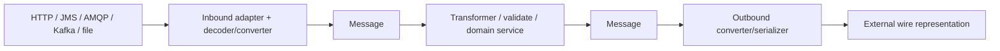
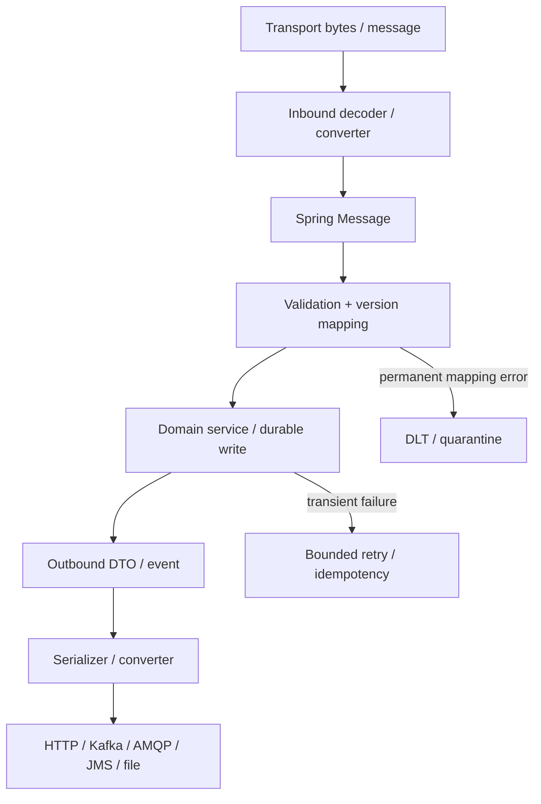
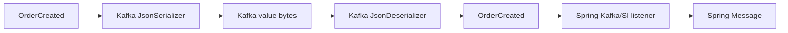
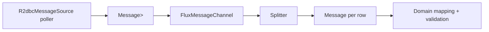
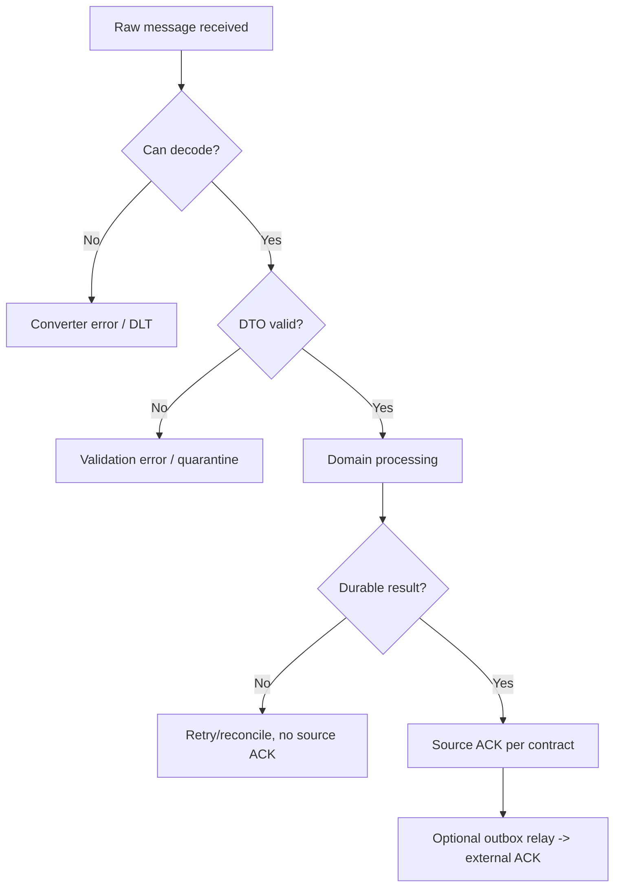

# Message Converters for Adapters

> **Chapter:** Message Mapping  
> **Module:** SPRING_INTEGRATION_ADAPTERS  
> **Context:** Connecting external systems to Spring Integration using inbound/outbound adapters, gateways, pollers, and `MessageChannel`; practicing exchange flows over files, SFTP, HTTP, JMS, AMQP, Kafka, and databases. This lesson focuses on **converters at the adapter boundary**, payload compatibility, message headers, error handling, security, and connection lifecycles.

## 1. Learning Objectives

After this lesson, you will be able to:

- Explain how a **message converter** translates data between external representations and Java objects at the **exact adapter boundary**.
- Distinguish `MessageConverter` in **Spring Messaging**, **Spring JMS**, **Spring AMQP**, HTTP `HttpMessageConverter`, Kafka `Serializer/Deserializer` and `RecordMessageConverter`, from a `Transformer` in Spring Integration.
- Accurately determine the message's **payload type** after an inbound adapter and the **expected type** of an outbound adapter before configuring a mapper.
- Apply UTF-8 JSON ↔ Java record/POJO conversion while explicitly controlling `Content-Type`, charset, schema version, enums, `BigDecimal`, and timestamps.
- Configure common converters in Spring Boot and Java: Jackson `ObjectMapper`, JMS `MappingJackson2MessageConverter`, AMQP `Jackson2JsonMessageConverter`, and Kafka JSON deserializer/serializer.
- Recognize when **no single unified converter exists**: File/SFTP requires resource reading/writing, R2DBC requires row mappers, TCP requires framing serializers/codecs, and JMS/AMQP/Kafka have their own protocols.
- Understand the roles of `MessageHeaders`, transport-specific headers/properties, trusted type metadata, and `correlationId` across transformations.
- Avoid **double conversion**, invalid casts, Java class names from untrusted inputs, lost precision, and "early ACK" right after parsing.
- Design conversion error handling: parsing errors, unknown schemas, size limits, poison messages, DLQ/quarantine, retry/backoff, idempotency, and source ACK after durable processing.
- Write unit and integration tests verifying round-trips, wire bodies, Java payload types, header mapping, and conversion failure behavior.

## 2. Where Do Message Converters Live in Spring Integration?

In practice, a message lives across at least two worlds:

1. **The transport world:** HTTP body, Kafka record value, JMS TextMessage/BytesMessage, AMQP body/properties, file bytes, TCP frame.
2. **The Spring Messaging world:** `Message<?>` with a Java `payload` and `MessageHeaders`, flowing through `MessageChannel`, transformers, routers, gateways, and handlers.



**Example:** Given the same JSON representing an order, a Kafka `StringDeserializer` may produce `String`, an AMQP JSON converter produces `OrderCreated`, an HTTP inbound gateway produces `Map` or DTO depending on message converters and request payload type, and a file inbound adapter may produce `File`.

### 2.1. Converter Is a Mechanism, Not One Shared Class for Every Adapter

**Similar API names with different contracts:**

| Ecosystem | Type/concept | Responsibility |
| --- | --- | --- |
| Spring Messaging | `org.springframework.messaging.converter.MessageConverter` | Converts between payloads and Spring `Message<?>` in the messaging abstraction. |
| Spring JMS | `org.springframework.jms.support.converter.MessageConverter` | Converts Java objects ↔ Jakarta JMS `Message`. |
| Spring AMQP | `org.springframework.amqp.support.converter.MessageConverter` | Converts Java objects ↔ AMQP `Message` (body + message properties). |
| Spring MVC HTTP | `org.springframework.http.converter.HttpMessageConverter<T>` | Reads/writes HTTP bodies by Java target type/media type. |
| Spring Kafka | `org.apache.kafka.common.serialization.Serializer/Deserializer` | Converts keys/values between Java objects and Kafka `byte[]`. |
| Spring Kafka | `RecordMessageConverter` / `MessagingMessageConverter` | Wraps a record into a Spring Message or maps payload/headers; distinct from value deserializer. |
| Spring Integration | `Transformer` or Java DSL `transform(...)` | Transforms a Spring Message **after** the adapter delivers the payload and **before** handlers/outbound adapters. |
| Spring Integration File/SFTP | File transformer/reader | `File`/`Resource`/stream ↔ bytes/text/DTO; depends on file lifecycle. |
| Spring R2DBC | `RowMapper`, `DatabaseClient.map(...)`, Spring Data converters | Maps SQL `Row` ↔ Java objects; **not** a JMS/AMQP `MessageConverter`. |
| Spring Integration IP | `Serializer/Deserializer`, framing codec | Splits TCP/UDP frames and encodes bytes; does not parse JSON into DTOs by default. |

The interfaces across these rows are **not interchangeable** even when named `MessageConverter`. Never pass a Spring JMS converter to `RabbitTemplate` or a Kafka producer expecting it to work.

### 2.2. Three Distinct Transformations

```text
Wire bytes / transport message
        |
        | transport decoder / MessageConverter / Deserializer
        v
Spring Message<String> or Message<byte[]> or Message<DTO>
        |
        | Spring Integration Transformer
        v
Spring Message<DomainDTO>
        |
        | outbound converter / Serializer
        v
Wire bytes / transport message
```

**The right design questions:** Which transformation did the adapter already perform? What is the type contract of the downstream channel? Which payload type does the outbound adapter expect? Without clear answers, it is easy to parse twice or mistakenly cast `byte[]` to `String`.

### 2.3. Message Object ≠ Wire Format

```java
import org.springframework.messaging.Message;
import org.springframework.messaging.support.MessageBuilder;

Message<String> inProcess = MessageBuilder
        .withPayload("{\"eventId\":\"evt-101\"}")
        .build();
```

An in-JVM Spring `Message<String>` **does not mean** a JMS `TextMessage` or Kafka record has been created. Only when an outbound adapter/converter/serializer executes is the target wire representation produced.

## 3. Defining a Cross-Transport Data Contract

This lesson uses a simple business event:

```json
{
  "eventId": "evt-101",
  "orderId": "ord-501",
  "amount": 125.50,
  "currency": "VND",
  "occurredAt": "2026-11-23T08:30:00+07:00",
  "schemaVersion": 1
}
```

### 3.1. Java DTO

Create `OrderCreated.java`:

```java
import java.math.BigDecimal;
import java.time.OffsetDateTime;

public record OrderCreated(
        String eventId,
        String orderId,
        BigDecimal amount,
        String currency,
        OffsetDateTime occurredAt,
        int schemaVersion
) {
}
```

`BigDecimal` is chosen to preserve decimal precision. `OffsetDateTime` preserves the explicit offset from the sender; DB persistence and time reconciliation require a consistent timezone policy. `eventId` is a **business event identity stable across retries**—never substitute Spring `MessageHeaders.ID` or Kafka offsets.

### 3.2. Contract Differs From Java Type

| Aspect | Demo rule | Reason |
| --- | --- | --- |
| `eventId` | Non-blank string, max 80 chars | Business dedup/correlation. |
| `orderId` | Non-blank string, max 80 chars | Aggregate identification. |
| `amount` | `>0`, precision ≤ 12, scale ≤ 2 | Prevents rounding errors/overflow. |
| `currency` | `VND` in lab | Never infer currency from locale. |
| `occurredAt` | ISO-8601 with offset; non-null | Contextual timestamp. |
| `schemaVersion` | Equals `1` in lab | Enables clean handling when versions change. |
| `Content-Type` | `application/json` for JSON bodies | Identifies representation; does not validate body. |
| Encoding | UTF-8 | Do not rely on platform default charset. |

**Domain note:** In real systems, VND is typically represented without fractional decimals; this lesson uses `125.50` to demonstrate converter decimal precision. Production systems must lock down amount units (major vs. minor units), currency scales, rounding, and ISO codes per actual contract.

### 3.3. Successful Parsing Is Not Successful Validation

Jackson can instantiate a record with null reference fields or a default `schemaVersion` if fields are omitted, depending on mapper configuration. Therefore, business validation must run **after conversion** and before executing any side effects.

A converter never replaces authentication, authorization, schema registry, or idempotency.

## 4. Preparing Spring Boot and ObjectMapper

Examples target **Java 17+, Spring Boot 3.x, Spring Integration 6.x, and Spring Framework 6.x**, with Spring Kafka/AMQP/JMS at matching versions managed by the Boot BOM. Some converter class and package names change across newer major versions; always verify APIs against your project's versions.

### 4.1. Maven for the Core Example

```xml
<dependencies>
    <dependency>
        <groupId>org.springframework.boot</groupId>
        <artifactId>spring-boot-starter-integration</artifactId>
    </dependency>
    <dependency>
        <groupId>org.springframework.boot</groupId>
        <artifactId>spring-boot-starter-json</artifactId>
    </dependency>
    <dependency>
        <groupId>org.springframework.boot</groupId>
        <artifactId>spring-boot-starter-test</artifactId>
        <scope>test</scope>
    </dependency>
</dependencies>
```

To run individual Kafka/JMS/Rabbit/R2DBC examples, add the exact starter/module/driver listed in each section. You do not need to set up all brokers just to run the core converter unit tests.

### 4.2. Sharing One JSON Contract via Jackson ObjectMapper

In Spring Boot, an `ObjectMapper` is normally auto-configured by Boot with standard modules and customizations. **Prefer injecting that bean** to keep formatting consistent across adapters:

```java
import com.fasterxml.jackson.databind.ObjectMapper;
import org.springframework.stereotype.Component;
import java.nio.charset.StandardCharsets;

@Component
public class OrderJsonCodec {

    private final ObjectMapper mapper;

    public OrderJsonCodec(ObjectMapper mapper) {
        this.mapper = mapper;
    }

    public OrderCreated fromJson(String json) {
        if (json == null || json.isBlank()
                || json.length() > 64_000
                || json.getBytes(StandardCharsets.UTF_8).length > 64_000) {
            throw new IllegalArgumentException(
                    "Empty or oversized JSON text");
        }
        try {
            return mapper.readValue(json, OrderCreated.class);
        }
        catch (com.fasterxml.jackson.core.JsonProcessingException ex) {
            throw new IllegalArgumentException(
                    "Invalid order JSON", ex);
        }
    }

    public OrderCreated fromJsonBytes(byte[] bytes) {
        if (bytes == null || bytes.length == 0
                || bytes.length > 64_000) {
            throw new IllegalArgumentException(
                    "Empty or oversized JSON bytes");
        }
        try {
            return mapper.readValue(bytes, OrderCreated.class);
        }
        catch (com.fasterxml.jackson.core.JsonProcessingException ex) {
            throw new IllegalArgumentException(
                    "Invalid order JSON bytes", ex);
        }
    }

    public byte[] toJsonBytes(OrderCreated event) {
        try {
            byte[] bytes = mapper.writeValueAsBytes(event);
            if (bytes.length > 64_000) {
                throw new IllegalArgumentException(
                        "Serialized JSON exceeds size limit");
            }
            return bytes;
        }
        catch (com.fasterxml.jackson.core.JsonProcessingException ex) {
            throw new IllegalStateException(
                    "Cannot serialize OrderCreated", ex);
        }
    }
}
```

This is a **JSON codec** with a 64,000-byte lab limit and does not check domain invariants yet. It does not replace request/broker size limits, parser nesting/decompression limits, or production schema validation. In production, validate before forwarding downstream.

### 4.3. Separating the Validator From the Decoder

Create `OrderContract.java`:

```java
import java.math.BigDecimal;
import org.springframework.stereotype.Component;

@Component
public class OrderContract {

    public OrderCreated requireValid(OrderCreated e) {
        if (e == null
                || !validId(e.eventId())
                || !validId(e.orderId())
                || e.amount() == null
                || e.amount().compareTo(BigDecimal.ZERO) <= 0
                || e.amount().precision() > 12
                || e.amount().scale() > 2
                || !"VND".equals(e.currency())
                || e.occurredAt() == null
                || e.schemaVersion() != 1) {
            throw new IllegalArgumentException(
                    "Invalid OrderCreated contract");
        }
        return e;
    }

    private static boolean validId(String value) {
        return value != null
                && !value.isBlank()
                && value.length() <= 80
                && value.matches("[A-Za-z0-9_-]+");
    }
}
```

`OrderContract` uses a method that returns the validated DTO directly, making it easy to compose into `transform`/`filter`. Validation must happen **before** any DB write, HTTP call, or Kafka publish with side effects.

### 4.4. Charset Must Be an Explicit Decision

```java
import java.nio.charset.StandardCharsets;

String jsonText =
        new String(jsonBytes, StandardCharsets.UTF_8);

byte[] utf8 = jsonText.getBytes(StandardCharsets.UTF_8);
```

Decode as UTF-8 only when the wire contract is UTF-8 text. For PDF, ZIP, image, Protobuf, or encrypted bytes, do not convert to `String` first, as that corrupts the data.

### 4.5. Handling JSON Trees and Dynamic Maps

`ObjectMapper.readTree(...)` returns a `JsonNode`; `convertValue(map, OrderCreated.class)` converts data from a `Map` to a DTO. These are **Jackson conversions**, distinct from JMS/AMQP/HTTP `MessageConverter`s.

```java
import com.fasterxml.jackson.databind.JsonNode;

JsonNode tree = mapper.readTree(json);
if (!tree.path("eventId").isTextual()) {
    throw new IllegalArgumentException("eventId must be a string");
}

OrderCreated event = mapper.treeToValue(
        tree, OrderCreated.class);
contract.requireValid(event);
```

This snippet belongs inside a method with `ObjectMapper mapper`, `String json`, and `OrderContract contract` handling `JsonProcessingException` appropriately. For stable schemas, deserializing directly into a record and validating is usually simpler than using an intermediate tree.

## 5. MessageHeaders and Content-Type in Adapters

### 5.1. Content-Type Describes Payload Representation

```java
import org.springframework.messaging.Message;
import org.springframework.messaging.MessageHeaders;
import org.springframework.messaging.support.MessageBuilder;
import org.springframework.util.MimeTypeUtils;

Message<byte[]> outbound = MessageBuilder
        .withPayload(jsonCodec.toJsonBytes(validOrder))
        .setHeader(MessageHeaders.CONTENT_TYPE,
                MimeTypeUtils.APPLICATION_JSON)
        .setHeader("eventId", validOrder.eventId())
        .setHeader("schemaVersion", validOrder.schemaVersion())
        .build();
```

`jsonCodec` and `validOrder` must be in scope. The `application/json` header fits because the body is JSON bytes. However, the header **does not decode bytes automatically** unless a configured converter actually inspects and acts on it.

### 5.2. Spring Headers Differ From Transport Properties

| Metadata | Inside Spring Message | Outside |
| --- | --- | --- |
| Content type | `MessageHeaders.CONTENT_TYPE` | HTTP `Content-Type`, AMQP `contentType`, Kafka/JMS header/property depending on mapping. |
| Event ID | `eventId` header or payload field | May travel in Kafka header, JMS property, or JSON envelope. |
| Correlation | `correlationId` | Kafka/JMS/AMQP correlation properties depending on adapter. |
| Reply channel | In-JVM `replyChannel` | Never serialize as a Java bean/class name to external systems. |
| Message ID | `MessageHeaders.ID` | Not a durable business ID across redeliveries. |
| Transport position | Kafka topic/partition/offset | Not a JMS delivery tag or DB checkpoint. |
| Schema version | Header or payload field | Must define the authoritative location and verify consistency. |

There is no guarantee that every adapter's header mapper copies all headers automatically. Always allowlist outbound headers and integration-test round-trip header mapping.

### 5.3. Update Metadata When Payload Format Changes

For example, when an inbound `Message<String>` is JSON text and a transformer converts it into a DTO:

```text
Message<String> + contentType=application/json
             |
             | Jackson parse + validation
             v
Message<OrderCreated> on internal domain channel
             |
             | encode UTF-8 JSON
             v
Message<byte[]> + contentType=application/json
```

Inside the JVM, `Message<OrderCreated>` should not be treated as JSON bytes. Some converters inspect content type to decide how to act; keeping a stale or mismatched header can cause failures.

### 5.4. Do Not Trust Type Headers From Untrusted Sources

A JMS/AMQP/Kafka message may carry metadata hinting at a class name. Never allow external senders to dictate arbitrary Java classes by passing `"@class"` or `"__TypeId__"` with overly broad polymorphic deserialization enabled.

Prefer:

- Server-configured type allowlists/aliases.
- A single explicit target DTO per consumer.
- A schema version router validated before deserialization.
- Narrowly scoped trusted packages.
- Keeping broad Jackson default typing disabled for external payloads.
- Verifying source identity, signatures/ACLs, and actual payload data.

## 6. Inbound/Outbound Conversion and Where Validation Belongs

### 6.1. Typical Flow



### 6.2. Three Places Where JSON Can Be Deserialized

Suppose a Kafka source sends JSON bytes:

1. **Kafka `JsonDeserializer`** produces `OrderCreated` before Spring Integration receives it.
2. Kafka `StringDeserializer` produces `String`; Spring Integration `transform(...)` uses `OrderJsonCodec` to build the DTO.
3. Kafka `ByteArrayDeserializer` produces `byte[]`; a transformer uses Jackson `readValue(byte[], DTO.class)`.

**Choose one intentionally.** Do not let `JsonDeserializer` produce a DTO and then run `transform(String.class, ...)` downstream; the failure can manifest as a type mismatch or a bypassed transformer.

### 6.3. A Converter Produces an Unvalidated Java Object

After deserialization, check:

- Required fields and schema version.
- Size, nesting depth, and array-length limits.
- Timezone, currency, and decimal precision.
- Stable event ID, authorization, and tenant identity.
- Compatibility with the business state transition.
- Required headers/properties to preserve for ACK or reply.

A `MessageConverter` returning a syntactically valid object **does not mean** the business operation succeeded.

## 7. HTTP: HttpMessageConverter and Spring Integration HTTP Adapters

### 7.1. HTTP Content Negotiation

To run the `@RestController` example below, add `spring-boot-starter-web` in addition to the core dependencies from Section 4:

```xml
<dependency>
    <groupId>org.springframework.boot</groupId>
    <artifactId>spring-boot-starter-web</artifactId>
</dependency>
```

HTTP body conversion generally depends on:

- HTTP `Content-Type` indicating the **request entity's** media type.
- The endpoint's target Java type (DTO, `String`, `byte[]`, `Map`).
- `Accept`/`produces` selecting the response representation.
- Registered `HttpMessageConverter` instances (e.g., Jackson JSON converter, String converter, byte-array converter).

Spring MVC example:

```java
import org.springframework.http.MediaType;
import org.springframework.web.bind.annotation.PostMapping;
import org.springframework.web.bind.annotation.RequestBody;
import org.springframework.web.bind.annotation.RequestMapping;
import org.springframework.web.bind.annotation.RestController;

@RestController
@RequestMapping("/api/orders")
public class OrderHttpEndpoint {

    private final OrderContract contract;

    public OrderHttpEndpoint(OrderContract contract) {
        this.contract = contract;
    }

    @PostMapping(
            path = "/events",
            consumes = MediaType.APPLICATION_JSON_VALUE,
            produces = MediaType.APPLICATION_JSON_VALUE)
    public AcceptedReceipt accept(@RequestBody OrderCreated event) {
        OrderCreated validated = contract.requireValid(event);
        return new AcceptedReceipt(validated.eventId(), "VALIDATED");
    }
}

record AcceptedReceipt(String eventId, String status) {
}
```

This is an **HTTP boundary demo**: JSON → `OrderCreated` via the Spring MVC HTTP converter, followed by validation. Returning `VALIDATED` does not prove the event was durably persisted or published to a broker. In a system requiring reliable ACKs, add durable persistence/idempotency before returning 2xx per contract.

### 7.2. HTTP Inbound Gateway in Spring Integration

A Spring Integration HTTP inbound gateway also processes requests and emits Spring Messages into a flow, with key nuances:

- It applies its own converters and target request payload type at the endpoint.
- A JSON HTTP body can arrive as `String` or DTO depending on configuration, not solely on the media type.
- Downstream Java DSL handlers receive the **actual Java payload type**.
- Reply messages must be converted into HTTP responses via an appropriate converter.
- `replyChannel`, timeouts, and error responses must be preserved across the topology.

Do not place another JSON converter inside the business flow when the inbound gateway already converts directly to a DTO.

### 7.3. HTTP Conversion Errors

| Case | Outcome to consider |
| --- | --- |
| Unsupported media type | HTTP 415 per API contract. |
| Invalid JSON syntax | HTTP 400; do not invoke business handler. |
| Missing/invalid required field or domain value | 400/422 per contract with clear field errors. |
| Unsupported new schema version | 400/422 or version-specific error. |
| Body exceeds allowed size | 413 or server limit error. |
| Downstream R2DBC/Kafka temporarily unavailable | 503/202/timeout per semantics; never pretend "validation failed." |

Never return HTTP 2xx merely because JSON deserialized if the API contract defines 2xx as **durably persisted**.

## 8. Converter vs. Transformer: Where Is the Right Place?

### 8.1. Converter at the Transport Boundary

Pros:

- Inbound code and message channels receive **typed DTOs** immediately.
- Avoids duplicating JSON parsing across multiple handlers.
- Rejects malformed wire formats/schemas early.
- Reuses HTTP/JMS/AMQP/Kafka converter configurations.

Cons:

- Serializer/converter is coupled to the transport framework.
- External type metadata must be strictly controlled.
- Converter errors can occur **before the Spring Integration flow receives the message**, requiring error handling at the adapter/listener container level.

### 8.2. Transformer Inside Spring Integration

Pros:

- Can keep `String`/`byte[]` at ingress and route by `contentType`/`schemaVersion`.
- Easy to record errors/quarantine along with source metadata.
- Applies the same mapper across multiple transports.
- Cleanly unit-testable as a pure Java function/bean.

Cons:

- Requires an explicit conversion step in the flow.
- Must know the exact payload type emitted by the adapter.
- If the inbound converter already produced a DTO, a transformer may be redundant or double-convert.
- Requires explicit management of header propagation and content type after transformation.

### 8.3. Selection Guidelines

| Scenario | Recommendation |
| --- | --- |
| HTTP endpoint with a fixed DTO contract | HTTP converter → DTO → validate. |
| Kafka topic carrying a single versioned event type | Kafka JSON deserializer with allowlist, or bytes → transformer. |
| Shared topic carrying multiple message types | Envelope/schema router before constructing domain DTOs. |
| JMS/AMQP with trusted JSON converter enabled | Do not re-parse JSON inside handlers. |
| File/SFTP receiving `File` or `Resource` | Read/stream file then parse by format; manage lifecycle. |
| TCP receiving custom length-delimited binary | Framing serializer first; Protobuf/JSON codec after. |
| R2DBC returning `Flux<Row>` | Row mapping/`payloadType`/splitter; do not use HTTP converters. |

**There is no single best choice** for every system; the contract at each boundary decides.


## 9. JMS: MappingJackson2MessageConverter

### 9.1. JMS Has Its Own Message Format and Protocol

JMS (Jakarta Messaging) defines message types such as `TextMessage`, `BytesMessage`, `MapMessage`, and `ObjectMessage`. A Spring JMS consumer can use a `MessageConverter` to convert from a JMS message into a Java object before the business handler runs.

**Do not conflate**:

- A JMS `TextMessage` holding JSON text.
- A Spring `Message<String>` holding a Java `String`.
- A Spring `Message<OrderCreated>` holding a DTO.
- A JSON `"@class"` or JMS type ID property—that is metadata, and must never dictate arbitrary class instantiation.

### 9.2. Adding Dependencies

```xml
<dependency>
    <groupId>org.springframework.boot</groupId>
    <artifactId>spring-boot-starter-activemq</artifactId>
</dependency>
<dependency>
    <groupId>org.springframework.integration</groupId>
    <artifactId>spring-integration-jms</artifactId>
</dependency>
```

This is an **example for ActiveMQ Classic** on Spring Boot 3.x; if using Artemis or another JMS provider, pick the matching Jakarta starter/driver and **do not add both providers needlessly**. Spring Integration JMS does not provision a broker automatically.

### 9.3. JSON ↔ JMS TextMessage Converter Bean

Create `JmsOrderConversionConfiguration.java`:

```java
import java.util.Map;

import com.fasterxml.jackson.databind.ObjectMapper;
import org.springframework.context.annotation.Bean;
import org.springframework.context.annotation.Configuration;
import org.springframework.jms.support.converter.MappingJackson2MessageConverter;
import org.springframework.jms.support.converter.MessageType;

@Configuration
public class JmsOrderConversionConfiguration {

    @Bean
    MappingJackson2MessageConverter orderJmsMessageConverter(
            ObjectMapper mapper) {

        var converter = new MappingJackson2MessageConverter();

        converter.setObjectMapper(mapper);
        converter.setTargetType(MessageType.TEXT);
        converter.setTypeIdPropertyName("_type");
        converter.setTypeIdMappings(
                Map.of("order-created-v1", OrderCreated.class));

        return converter;
    }
}
```

What this does:

1. `MessageType.TEXT` encodes outbound JSON into a JMS `TextMessage`.
2. `ObjectMapper` is injected to share Java Time and monetary amount conventions.
3. `_type` is the **JMS property** naming the type alias for conversion, **not an arbitrary class name supplied by the sender**.
4. `setTypeIdMappings(...)` establishes an allowlist mapping alias `order-created-v1` → `OrderCreated`.
5. The converter can throw exceptions when the JMS message type, metadata, or body is invalid; handle errors in the JMS adapter/container.

**Security:** Never take `_type` from an untrusted sender and pass it to `Class.forName(...)`. Every accepted type ID must map explicitly to a trusted schema.

### 9.4. Attaching the Converter to JmsTemplate

```java
import jakarta.jms.ConnectionFactory;
import org.springframework.context.annotation.Bean;
import org.springframework.jms.core.JmsTemplate;

@Bean
JmsTemplate orderJmsTemplate(
        ConnectionFactory factory,
        MappingJackson2MessageConverter converter) {

    JmsTemplate template = new JmsTemplate(factory);
    template.setMessageConverter(converter);
    return template;
}
```

This is a bean method in `@Configuration`, assuming the provider supplies `jakarta.jms.ConnectionFactory`. Sending:

```java
jmsTemplate.convertAndSend("orders.created", validatedOrder);
```

When the converter is wired to the template, the Java DTO is encoded into the matching JMS message. With Spring Integration JMS inbound/outbound adapters, you must configure the **converter on the specific JMS endpoint/container or `JmsTemplate` used by that adapter**; merely declaring a bean **does not guarantee every endpoint picks it up**.

### 9.5. The Receiving Side Needs Matching Aliases and Schema

```text
Producer:
  OrderCreated DTO
      |
      | MappingJackson2MessageConverter
      v
  JMS TextMessage:
    text = JSON
    property _type = order-created-v1

Consumer:
  JMS TextMessage
      |
      | Matching trusted type mapping
      v
  OrderCreated DTO
      |
      | Spring Integration channel
      v
  Business handler
```

A non-Spring JMS sender might not send `_type` with the expected alias. In that case, define an **explicit contract**: configure a fixed type/route, a custom converter, or normalized JMS properties on the consumer—do not expect the converter to guess the right Java class.

### 9.6. JMS Errors and ACKs

JMS redelivery depends on transacted session/ack mode and listener-container error handling, **not** solely on the JSON converter.

- Conversion can fail before the Spring Integration service activator runs.
- Parse exceptions must be handled by the listener container via rollback/recovery/DLQ per policy.
- If validation succeeds but the DB write fails, do not ACK JMS as succeeded.
- A transacted JMS session and a separate R2DBC DB transaction do not provide distributed atomicity automatically.
- If the DB commits and the JMS ACK is lost, the event may redeliver; rely on stable `eventId` and deduplication.

### 9.7. Avoid Arbitrary JMS ObjectMessage Deserialization

`ObjectMessage` can require Java serialization and class trust checks, introducing interoperability and security risks. Whenever possible, JSON/Avro/Protobuf with explicit schemas/allowlists are far safer for cross-system integration. Never disable deserialization trust checks to "fix" converter errors.

## 10. AMQP/RabbitMQ: Jackson2JsonMessageConverter

### 10.1. Distinguishing AMQP Body and Properties

An AMQP message typically consists of:

```text
AMQP Message
  body: byte[] (UTF-8 JSON)
  properties:
    contentType: application/json
    contentEncoding: UTF-8
    headers:
      __TypeId__: order-created-v1 (when configured accordingly)
```

`Jackson2JsonMessageConverter` belongs to **Spring AMQP**, not Spring JMS. It coordinates the body, message properties, and type mapping/trust rules to produce Java objects.

### 10.2. RabbitMQ Dependencies

```xml
<dependency>
    <groupId>org.springframework.boot</groupId>
    <artifactId>spring-boot-starter-amqp</artifactId>
</dependency>
<dependency>
    <groupId>org.springframework.integration</groupId>
    <artifactId>spring-integration-amqp</artifactId>
</dependency>
```

Spring AMQP/Rabbit client and Spring Integration AMQP must use compatible versions via the Boot BOM.

### 10.3. Converter Bean

Create `RabbitOrderConversionConfiguration.java`:

```java
import com.fasterxml.jackson.databind.ObjectMapper;
import org.springframework.amqp.support.converter.Jackson2JsonMessageConverter;
import org.springframework.context.annotation.Bean;
import org.springframework.context.annotation.Configuration;

@Configuration
public class RabbitOrderConversionConfiguration {

    @Bean
    Jackson2JsonMessageConverter orderAmqpMessageConverter(
            ObjectMapper mapper) {
        return new Jackson2JsonMessageConverter(mapper);
    }
}
```

This configures **JSON conversion**, not full trust/alias restrictions for untrusted external messages. How `ClassMapper`/`JavaTypeMapper`, trusted packages, and type precedence attach varies across Spring AMQP major versions. **Always restrict concrete target types** to known schemas and never let untrusted headers specify arbitrary Java classes.

### 10.4. Wiring Into RabbitTemplate

```java
import org.springframework.amqp.rabbit.core.RabbitTemplate;
import org.springframework.amqp.rabbit.connection.ConnectionFactory;
import org.springframework.context.annotation.Bean;

@Bean
RabbitTemplate orderRabbitTemplate(
        ConnectionFactory connectionFactory,
        Jackson2JsonMessageConverter converter) {

    RabbitTemplate template =
            new RabbitTemplate(connectionFactory);
    template.setMessageConverter(converter);
    return template;
}
```

Publishing an event:

```java
rabbitTemplate.convertAndSend(
        "orders.exchange",
        "orders.created",
        validatedOrder);
```

Here `orders.exchange` and routing key `orders.created` are illustrative; exchanges, queues, and bindings must be provisioned separately per architecture. `RabbitTemplate` does not provide publisher confirms or outbox semantics merely because it encodes JSON.

### 10.5. Consumers Need the Same Convention

Spring AMQP listener example:

```java
import org.springframework.amqp.rabbit.annotation.RabbitListener;
import org.springframework.stereotype.Component;

@Component
public class OrderRabbitConsumer {

    private final OrderContract contract;

    public OrderRabbitConsumer(OrderContract contract) {
        this.contract = contract;
    }

    @RabbitListener(queues = "orders.created")
    public void consume(OrderCreated order) {
        OrderCreated validated = contract.requireValid(order);

        // In practice: call a durable service; do not ACK merely because validation passed.
        System.out.println(validated.eventId());
    }
}
```

The listener requires a properly configured container factory/converter so `@RabbitListener` receives `OrderCreated`. Having a converter bean in context does not guarantee a **custom listener container** uses it; Boot may auto-configure certain components when a single matching bean exists, so verify the actual wiring.

**Important:** This listener only logs and is **not a reliable production consumer**. In durable workflows, handlers must execute DB transactions/outbox/idempotency before final ACK.

### 10.6. Type Metadata and Distrusting Arbitrary Class Headers

A producer may send a `__TypeId__` header. The consumer must decide which type aliases to accept rather than trusting arbitrary class names from the broker. For shared queues with multiple event types, require:

1. Published public event envelopes/type names.
2. Allowlists mapping aliases to DTO classes.
3. `schemaVersion` to select the parser.
4. Post-conversion validation.
5. DLQ/quarantine for unknown types or malformed payloads.

If handling a single event type, configuring a **fixed target type** at the boundary is usually easier to govern than inferring arbitrary types.

### 10.7. Text/Raw Fallback Behavior

When an AMQP message lacks `contentType=application/json`, the converter may fail to deserialize as expected or fall back to raw bytes depending on version/configuration. Never blindly cast `(OrderCreated) message.getPayload()` when the adapter actually receives `byte[]`.

When debugging, log the **payload class, `contentType`, safe event ID, and converter class** instead of dumping raw bodies containing sensitive data.

## 11. Kafka: Serializer/Deserializer First, RecordMessageConverter Second

### 11.1. Kafka Value Conversion Lives in Serializers/Deserializers

A Kafka record contains key/value bytes and headers. The Kafka client uses `Serializer<T>` when producing and `Deserializer<T>` when consuming. These are not HTTP/JMS/AMQP `MessageConverter`s.



If the deserializer is `StringDeserializer`, the output is `String`; if `ByteArrayDeserializer`, the output is `byte[]`. Spring Integration does not change that automatically just because the payload contains JSON.

### 11.2. Typed JSON Consumer With Spring Kafka Config

Dependencies:

```xml
<dependency>
    <groupId>org.springframework.kafka</groupId>
    <artifactId>spring-kafka</artifactId>
</dependency>
<dependency>
    <groupId>org.springframework.integration</groupId>
    <artifactId>spring-integration-kafka</artifactId>
</dependency>
```

`application.yml` for **a topic carrying only `OrderCreated` v1**, assuming DTO package `com.example.events`:

```yaml
spring:
  kafka:
    bootstrap-servers: localhost:9092
    consumer:
      group-id: order-mapping-demo
      enable-auto-commit: false
      key-deserializer: org.apache.kafka.common.serialization.StringDeserializer
      value-deserializer: org.springframework.kafka.support.serializer.ErrorHandlingDeserializer
      properties:
        spring.deserializer.value.delegate.class: org.springframework.kafka.support.serializer.JsonDeserializer
        spring.json.value.default.type: com.example.events.OrderCreated
        spring.json.trusted.packages: com.example.events
        spring.json.use.type.headers: false
```

**Key points:**

- Package/class `com.example.events.OrderCreated` is **illustrative**; replace it with your compiled application class.
- `ErrorHandlingDeserializer` wraps the delegate so the framework can handle deserialization errors occurring **before the listener**; you still need an error handler/DLT.
- `spring.json.value.default.type` sets the target class when type info is not read from headers.
- `spring.json.use.type.headers=false` ignores type headers so external inputs cannot pick arbitrary Java classes.
- `spring.json.trusted.packages` should be as narrow as possible—never set `*` for external data.
- `enable-auto-commit=false` **is not sufficient** by itself to ACK only after durable processing; you also need the right listener container ACK mode and error handler.

### 11.3. Kafka JSON Producer

```yaml
spring:
  kafka:
    producer:
      key-serializer: org.apache.kafka.common.serialization.StringSerializer
      value-serializer: org.springframework.kafka.support.serializer.JsonSerializer
      properties:
        spring.json.add.type.headers: false
```

Example `KafkaTemplate<String, OrderCreated>` with matching type configuration:

```java
import org.springframework.kafka.core.KafkaTemplate;

public class OrderPublisher {

    private final KafkaTemplate<String, OrderCreated> kafka;

    public OrderPublisher(KafkaTemplate<String, OrderCreated> kafka) {
        this.kafka = kafka;
    }

    public void send(OrderCreated event) {
        kafka.send("orders.created", event.orderId(), event);
    }
}
```

**This is a fire-and-forget demo, not a publish ACK:** `KafkaTemplate.send(...)` returns a future in Spring Kafka 3.x; the `void send` method above does not await broker confirmation. Production code must handle completion/failure, retry with a stable event ID, and use a transactional outbox when DB-broker consistency is required.

### 11.4. Why Kafka RecordMessageConverter Differs From JsonDeserializer

`JsonDeserializer` turns Kafka **value bytes** into a Java object. Afterward, Spring Kafka can use a `RecordMessageConverter`/`MessagingMessageConverter` to convert the entire `ConsumerRecord` into a Spring `Message<?>`, including payload and Kafka metadata headers.

Some record-level converters can convert JSON payloads from `String`/`byte[]` into a target object **depending on converter/handler target type and version**. However, never assume registering a `RecordMessageConverter` replaces the configured `Deserializer`.

**Decision model:**

```text
Kafka value bytes
    |
    +-- JsonDeserializer -> OrderCreated
    |                       |
    |                       +-- RecordMessageConverter -> Spring Message<OrderCreated>
    |
    +-- StringDeserializer -> String
    |                         |
    |                         +-- optional record JSON converter -> DTO
    |
    +-- ByteArrayDeserializer -> byte[]
                              |
                              +-- SI Transformer -> DTO
```

Distinguishing error origins:

- Deserializer errors occur **before the listener is invoked**.
- `RecordMessageConverter` errors occur while mapping the record into a Spring Message.
- Spring Integration transformer errors occur **after the message enters the flow**.

These three stages require distinct recovery/DLT handling.

### 11.5. Headers and Schema Registry

Kafka headers can carry content type, schema ID/version, event type, and correlation ID. With Avro/Protobuf or a schema registry, use compatible **schema-aware serializers/deserializers**; do not use Jackson JSON to "decode" bytes of a different wire format.

When a single topic carries multiple event types, consider an envelope + schema ID/trusted type mappings. Never use `spring.json.trusted.packages=*` as a quick fix when a consumer receives unfamiliar type headers.

### 11.6. Conversion OK ≠ Offset Commit

Suppose a JSON event converts cleanly into `OrderCreated`, but the R2DBC transaction fails. Never commit the Kafka consumer offset as processed just because conversion succeeded.

Conversely, when a broker redelivers after a DB commit succeeded but the offset commit was lost, the converter may construct a **new Spring Message** with a new `MessageHeaders.ID`: business `eventId` and a database unique constraint must detect the duplicate.

## 12. Spring Integration Java DSL: One Contract Across Adapters

### 12.1. Separating Conversion From Business Handlers

Assume inbound Kafka uses `StringDeserializer` or an HTTP/JMS inbound adapter already supplies a Java `String` JSON payload. Create the flow:

```java
import org.springframework.context.annotation.Bean;
import org.springframework.context.annotation.Configuration;
import org.springframework.integration.config.EnableIntegration;
import org.springframework.integration.dsl.IntegrationFlow;

@Configuration
@EnableIntegration
public class OrderMappingIntegrationConfiguration {

    @Bean
    IntegrationFlow jsonOrderMappingFlow(
            OrderJsonCodec codec, OrderContract contract) {

        return IntegrationFlow
                .from("incomingOrderJson")
                .transform(String.class, codec::fromJson)
                .transform(OrderCreated.class, contract::requireValid)
                .handle(OrderCreated.class, (event, headers) ->
                        new MappingReceipt(
                                event.eventId(),
                                event.orderId(),
                                "VALIDATED"))
                .get();
    }

    @Bean
    IntegrationFlow byteOrderMappingFlow(
            OrderJsonCodec codec, OrderContract contract) {

        return IntegrationFlow
                .from("incomingOrderBytes")
                .transform(byte[].class, codec::fromJsonBytes)
                .transform(OrderCreated.class, contract::requireValid)
                .handle(OrderCreated.class, (event, headers) ->
                        new MappingReceipt(
                                event.eventId(),
                                event.orderId(),
                                "VALIDATED"))
                .get();
    }
}
```

Create `MappingReceipt.java`:

```java
public record MappingReceipt(
        String eventId,
        String orderId,
        String result
) {
}
```

The two flows accept **two different Java payload types** via separate input channels so no handler performs an invalid cast.

### 12.2. Testing the Flow via Gateway Without an External Broker

```java
import org.springframework.integration.annotation.MessagingGateway;

@MessagingGateway(defaultRequestChannel = "incomingOrderJson")
public interface OrderMappingGateway {

    MappingReceipt map(String json);
}
```

Invoke it:

```java
String json = """
        {
          "eventId":"evt-101",
          "orderId":"ord-501",
          "amount":125.50,
          "currency":"VND",
          "occurredAt":"2026-11-23T08:30:00+07:00",
          "schemaVersion":1
        }
        """;

MappingReceipt result = gateway.map(json);
System.out.println(result);
```

Expected output:

```text
MappingReceipt[eventId=evt-101, orderId=ord-501, result=VALIDATED]
```

This example only verifies JSON mapping and validation inside the JVM. It **does not** prove Kafka offset commit, JMS ACK, or database persistence.

### 12.3. Choosing Between Pre-Converted vs. Raw Flows

| Source sending to Spring Integration channel | Flow to choose |
| --- | --- |
| `Message<String>` containing JSON | `incomingOrderJson`. |
| `Message<byte[]>` containing UTF-8 JSON | `incomingOrderBytes`. |
| `Message<OrderCreated>` already converted to DTO | Skip JSON parsing; go directly to validation + business handler. |
| `Message<File>` from File/SFTP adapter | File reader/stream → format parser → DTO. |
| `Message<Flux<OrderRow>>` from R2DBC source | Subscribe/splitter → row/entity mapping → DTO. |

Do not sprinkle `instanceof String` across every handler to guess the origin. In larger systems, **document the type contract at each channel** and route by type only when genuinely supporting multiple formats.

### 12.4. Typed DTO Differs From MessageHeaders.ID

The converter itself or a gateway may construct a new Spring Message. Never use `MessageHeaders.ID` to identify the same event across redeliveries. `OrderCreated.eventId()` must remain stable, validated, and persisted in a processed ledger/outbox during durable processing.

### 12.5. Outbound Mapping With Consistent Headers

When an external API expects JSON bytes:

```java
import org.springframework.messaging.Message;
import org.springframework.messaging.MessageHeaders;
import org.springframework.messaging.support.MessageBuilder;
import org.springframework.util.MimeTypeUtils;

public Message<byte[]> encodeForOutbound(
        OrderCreated event, OrderJsonCodec codec) {

    byte[] bytes = codec.toJsonBytes(event);

    return MessageBuilder.withPayload(bytes)
            .setHeader(MessageHeaders.CONTENT_TYPE,
                    MimeTypeUtils.APPLICATION_JSON)
            .setHeader("eventId", event.eventId())
            .setHeader("schemaVersion", event.schemaVersion())
            .build();
}
```

This is an illustrative method; the **specific outbound adapter's** converter/serializer must expect that payload type. Avoid double-encoding: if the Kafka producer already uses `JsonSerializer<OrderCreated>`, send the DTO rather than forcing it to re-handle JSON bytes.


## 13. Spring Messaging MessageConverter: Yet Another Layer

### 13.1. Same Name, Different Contract

`org.springframework.messaging.converter.MessageConverter` operates on **Spring Messages** (and target Java classes). It is **not** JMS `MessageConverter`, AMQP `MessageConverter`, or HTTP `HttpMessageConverter`.

An application can use Spring Messaging's `MappingJackson2MessageConverter` to convert JSON bytes/String payloads into a DTO when a messaging handler expects a specific target type.

### 13.2. Example Demonstrating Spring Messaging Converter

```java
import com.fasterxml.jackson.databind.ObjectMapper;

import org.springframework.messaging.Message;
import org.springframework.messaging.MessageHeaders;
import org.springframework.messaging.converter.MappingJackson2MessageConverter;
import org.springframework.messaging.support.MessageBuilder;
import org.springframework.util.MimeTypeUtils;

public OrderCreated springMessageToDto(
        byte[] jsonBytes, ObjectMapper mapper) {

    MappingJackson2MessageConverter converter =
            new MappingJackson2MessageConverter();
    converter.setObjectMapper(mapper);

    Message<byte[]> incoming = MessageBuilder
            .withPayload(jsonBytes)
            .setHeader(MessageHeaders.CONTENT_TYPE,
                    MimeTypeUtils.APPLICATION_JSON)
            .build();

    Object result = converter.fromMessage(
            incoming, OrderCreated.class);

    if (!(result instanceof OrderCreated order)) {
        throw new IllegalArgumentException(
                "Cannot convert Spring Message payload");
    }
    return order;
}
```

This is an **illustrative method** inside an appropriate class. The converter depends on target type and headers; conversion failures may return `null` or throw exceptions depending on implementation/policy. Never force a null result into a valid Spring Message payload.

### 13.3. Converters Do Not Automatically Run on Every MessageChannel

Having a `MappingJackson2MessageConverter` bean does not mean every `DirectChannel` or `FluxMessageChannel` automatically converts message payloads on send.

A `MessageChannel` primarily transports Spring Messages; **method-invoking handlers/gateways** apply their own argument resolution/conversion mechanisms when configured. In an `IntegrationFlow`, `transform(...)` is explicit and easy to verify.

**Verify with tests:** Does the handler actually receive `String`, `byte[]`, or a DTO? Never rely solely on the presence of a `MessageConverter` bean in the application context.

### 13.4. When Should You Use It?

- You have method handlers with explicit target types requiring messaging-layer conversion.
- You need message content-type negotiation within the Spring Messaging layer.
- You want to centralize message-to-method conversion under a controlled configuration.

If a flow simply performs one JSON/String → DTO conversion, an explicit transformer using `OrderJsonCodec` is usually clearer and less prone to overlap than globally registered converters.

## 14. File and SFTP: Resource/Stream Transformers, Not Broker Converters

### 14.1. File Inbound Usually Carries File, Not a JSON DTO

```text
Local/SFTP file inbound
    |
    v
Message<File> or Message<Resource>/stream depending on mode
    |
    v
File reader / streaming transformer
    |
    v
String / byte[] / CSV records
    |
    v
JSON/CSV/XML parser + validator
    |
    v
Message<Domain DTO>
```

An **SFTP inbound synchronizing adapter** typically downloads files locally and sends `File` into the flow; remote streaming adapters have different types and lifecycles. Do not apply JMS's `MappingJackson2MessageConverter` to a `Message<File>` expecting it to read the file directly.

### 14.2. Bounded Small JSON File Reader

```java
import java.io.File;
import java.io.IOException;
import java.nio.charset.StandardCharsets;
import java.nio.file.Files;

public final class FileJsonReader {

    private static final long MAX_BYTES = 64_000;

    private FileJsonReader() {
    }

    public static String readUtf8(File file) {
        if (file == null || !file.isFile()) {
            throw new IllegalArgumentException(
                    "Expected a readable regular file");
        }
        try {
            if (Files.size(file.toPath()) > MAX_BYTES) {
                throw new IllegalArgumentException(
                        "JSON file exceeds size limit");
            }
            return Files.readString(
                    file.toPath(), StandardCharsets.UTF_8);
        }
        catch (IOException ex) {
            throw new IllegalStateException(
                    "Cannot read JSON file", ex);
        }
    }
}
```

Note that the size check is for the lab and does not prevent races if the file changes between `Files.size(...)` and `Files.readString(...)`. Production systems should use readiness/atomic renames, exclusive file ownership, and byte-bounded stream reading for untrusted inputs.

### 14.3. Flow: File → String → DTO

```java
import java.io.File;
import org.springframework.context.annotation.Bean;
import org.springframework.integration.dsl.IntegrationFlow;

@Bean
IntegrationFlow fileToOrderFlow(
        OrderJsonCodec codec, OrderContract contract) {

    return IntegrationFlow
            .from("localOrderFiles")
            .transform(File.class, FileJsonReader::readUtf8)
            .transform(String.class, codec::fromJson)
            .transform(OrderCreated.class, contract::requireValid)
            .handle(OrderCreated.class, (event, headers) -> {
                // Lab: log only; production must persist/process durably.
                System.out.println(event.eventId());
                return null;
            })
            .get();
}
```

`localOrderFiles` is an **input channel fed by a File/SFTP inbound adapter**, not the file watcher configuration itself. This keeps the mapping layer reusable while the adapter manages pollers, filters, and file-readiness semantics separately.

### 14.4. When to ACK/Rename the File?

If a file holds one event:

1. The adapter acquires and locks/claims a ready file.
2. Read, parse, and validate.
3. Persist to DB transaction/outbox or complete the downstream requirement.
4. Only when durable completion is proven, rename/archive/mark accepted.
5. On permanent parse errors, quarantine with the reason and source identity.
6. On transient DB/broker errors, retain the file/metadata for retry.

Never delete a file right after `Files.readString(...)` because converter success does not equal delivery success.

### 14.5. InputStream and Resource

When the payload is `InputStream` or `Resource`:

- Designate which component owns closing the stream.
- Never pass a closed stream to an asynchronous channel.
- Avoid loading multi-GB video/CSV files completely into RAM.
- Streaming parsers need schemas, row/byte limits, and error recovery.
- Retries must be able to open a fresh stream or rely on a replayable source.
- Never receive an `InputStream` and try to cast it to `String`.

### 14.6. CSV/XML/Protobuf Are Not JSON

For CSV files, use a CSV parser that handles quotes, escapes, charsets, and headers—**never** `String.split(",")` when fields can contain commas. For XML, configure parsers against XXE; for Protobuf/Avro, use schema-aware codecs.

**Adapter converters** must follow the wire contract rather than forcing every file format through Jackson JSON simply for convenience.

## 15. TCP/UDP, WebSocket, MQTT: Framing and Payload Conversion

### 15.1. TCP Is a Byte Stream and Must Be Framed First

```text
TCP bytes stream
   |
   | length header / CRLF / custom frame serializer
   v
One complete logical message (byte[])
   |
   | JSON / Protobuf / custom DTO decoder
   v
Domain event
```

If the TCP serializer has not established proper frame boundaries, Jackson may receive **half a JSON document** or two concatenated JSON objects and fail to parse. That is a **framing** bug, not a "bad JSON converter" bug.

Spring Integration IP provides serializers/deserializers for delimiter/length-header framing; they **do not replace** domain DTO schema validation.

### 15.2. UDP Datagrams Differ From TCP

UDP preserves datagram boundaries but provides no default delivery, ordering, or deduplication guarantees. A message converter only processes a single datagram payload; deserializing JSON into a DTO cannot fabricate transport reliability.

### 15.3. WebSocket Text and Binary Frames

WebSocket text frames can map to JSON Strings; binary frames can map to bytes/Protobuf. STOMP has headers and payload converters; MQTT has byte payloads plus QoS/retained semantics.

Rules:

- Choose codecs matching text/binary/protocol semantics.
- Enforce framing and size limits before decoding.
- Preserve correlation/session metadata when a gateway needs to reply.
- For retries/redeliveries, rely on business IDs and idempotency.
- Do not conflate connection TLS/security state with payload validation.

### 15.4. External Adapter Lifecycles

A converter failure does not necessarily mean the connection should be torn down. For example, schema-invalid JSON inside a valid TCP frame is a **permanent payload error**; the connection itself can stay healthy. Conversely, socket EOF or partial frames are connection/framing errors—do not infinitely retry parsing incomplete bytes.

## 16. R2DBC: Row Conversion Instead of Transport MessageConverter

### 16.1. R2DBC Inbound Reads Rows From a Database

`DatabaseClient` commonly maps `io.r2dbc.spi.Row` to a DTO/entity:

```java
import org.springframework.r2dbc.core.DatabaseClient;
import reactor.core.publisher.Flux;

public Flux<OrderCreated> findPending(
        DatabaseClient db) {

    return db.sql(
                    "SELECT event_id, order_id, amount, currency, " +
                    "occurred_at, schema_version " +
                    "FROM order_outbox WHERE status='NEW' " +
                    "ORDER BY id LIMIT 25")
            .map((row, metadata) -> new OrderCreated(
                    row.get("event_id", String.class),
                    row.get("order_id", String.class),
                    row.get("amount", java.math.BigDecimal.class),
                    row.get("currency", String.class),
                    row.get("occurred_at",
                            java.time.OffsetDateTime.class),
                    row.get("schema_version", Integer.class)))
            .all();
}
```

This is a repository method assuming the `order_outbox` table and SQL schema exist. `DatabaseClient` maps **SQL row** data; it does not deserialize Kafka/JMS/HTTP bodies.

### 16.2. Spring Data R2dbcEntityTemplate

`R2dbcEntityTemplate` uses converters to map between Java entities and relational types. For dynamic mappings, `DatabaseClient.map(...)` gives explicit column control; for stable domain schemas, entities and typed projections may fit better.

Notes:

- SQL `NULL` produces Java `null`; validate required fields.
- PostgreSQL `NUMERIC` → `BigDecimal`; avoid going through `double`.
- `TIMESTAMPTZ` and UTC/timezone representations need a consistent policy.
- Driver/database types (UUID, JSONB, arrays) require dedicated converters.
- Never use a row mapper to ACK external Kafka/File sources before downstream completion.

### 16.3. R2dbcMessageSource Can Emit Publisher Payloads



When a source returns `Message<Flux<T>>`, `payloadType(T.class)` determines the **item type inside the Publisher** (per configuration), but does not automatically turn one poll into N Spring Messages. A splitter or reactive consumer handles splitting and subscription.

### 16.4. One Poll Is Not One ACK for N Rows

`maxMessagesPerPoll(1)` limits the number of `receive()` calls per polling run, not SQL `LIMIT`. If a `Flux` contains 25 rows, a worker might process 12 successfully and fail on the 13th.

For reliable ingestion:

- Claim DB batches with ownership/leases so concurrent workers do not SELECT the same `NEW` rows.
- Split items or process reactive batches with backpressure.
- ACK each row only after durable downstream side effects complete.
- On SQL/transaction errors, perform bounded retries while preserving business event IDs.
- Outbox relays must be idempotent because publishing can succeed right before the DB ACK fails.

### 16.5. R2DBC Outbound Adapter Is Not a JDBC MessageConverter

`R2dbcMessageHandler` takes a Spring Message and executes SQL statements per table/query configuration. It does not accept JMS's `MappingJackson2MessageConverter` to produce rows. For `UPDATE`s requiring strict `rowsUpdated` checks or multi-table transactions, consider a custom reactive service returning `Mono<BusinessOutcome>`.

A SQL statement finishing with **0 affected rows** can still complete normally; do not mislabel that as "converter failed."

## 17. Content-Type, Charset, and Versioning in Depth

### 17.1. Content-Type Pitfalls

| Input | Header | Failure if header is trusted unconditionally |
| --- | --- | --- |
| ZIP bytes | `application/json` | JSON parser errors out or wastes resources. |
| Schema-invalid JSON | `application/json` | DTO gets nulls/defaults violating contract. |
| UTF-16 JSON | `application/json; charset=UTF-8` | Corrupted decoding. |
| Binary Protobuf | `application/octet-stream` | Cannot infer schema ID from media type alone. |
| JSON text | Missing content type | Converter may not match, falling back to bytes/String. |
| Internal Java DTO | Leftover `application/json` header | Downstream converter may double-serialize. |

Boundary defenses include allowlisting media types, verifying actual formats, checking schema versions, enforcing size limits, validating payloads, and classifying errors.

### 17.2. Charset and Canonicalization

Two producers can emit semantically identical JSON with different bytes:

```json
{"eventId":"evt-101","amount":125.50}
```

and:

```json
{"amount":125.5,"eventId":"evt-101"}
```

If using checksums for deduplication or signing, define a **canonicalization algorithm/version**; never assume the same `ObjectMapper` reproduces exact original bytes, especially if serializer settings change.

### 17.3. Schema Evolution

Suppose `schemaVersion=1` requires `currency`, and version 2 adds `paymentMethod`:

- Producer and consumer must agree on **required vs. optional**.
- Unknown new fields may be intentionally ignored or rejected to detect schema drift.
- Renamed fields or changed field meanings are breaking changes without a legacy-version mapper.
- You can route by event envelope type/version and normalize to the **current domain DTO**.
- Never instantiate classes from external Java class names.

### 17.4. Numeric and Time Semantics

`BigDecimal("125.50")` and `BigDecimal("125.5")` are numerically equal (via `compareTo`) but have different scales. If defining signatures/digests over canonical JSON, standardize the representation.

`OffsetDateTime` retains the sender's offset; convert to UTC/`Instant` when comparing absolute instants. Never parse zoneless timestamps and implicitly apply the server's local timezone.

### 17.5. Headers: Trust and Allowlists

Transport headers should be mapped through a **controlled header mapper**. Never send Spring's `replyChannel`, `errorChannel` (object references), or arbitrary Java class names to a broker just because copying a Map is convenient.

Across Kafka/JMS/AMQP, transport headers/properties have varying name, type, and size constraints. Test string/binary header values and serialization across heterogeneous environments.

## 18. Conversion Errors, Retries, and Redeliveries

### 18.1. Three Failure Points

```text
Transport receive
     |
     +-- Deserializer/MessageConverter error
     |      => adapter/container error handler
     |
     v
Spring Message created
     |
     +-- SI Transformer/validator error
     |      => flow error channel / subscriber error
     |
     v
Domain processing
     |
     +-- DB/HTTP/broker error
            => business retry/idempotency
```

**Do not just catch exceptions around `MessageChannel.send(...)`** if errors occur after the channel hands off asynchronously to another subscriber/handler.

### 18.2. Permanent vs. Transient

| Error | Example | Policy |
| --- | --- | --- |
| Permanent wire error | Malformed JSON, unsupported media type, corrupted schema | Reject/quarantine/DLT with reason; do not blindly retry. |
| Permanent domain error | Missing event ID, wrong currency, negative amount | Validation error; do not treat as transient. |
| Security/type error | Type header not allowlisted, authorization failure | Reject + appropriate security alert. |
| Transient infrastructure | Connection refused, DB failover, broker unavailable | Retry/backoff/deadline + idempotency. |
| Unknown commit outcome | DB/broker accepted but response was lost | Reconcile using stable operation ID; do not assume rollback. |
| Outbound permanent format error | Converter does not support DTO/codec | Fix code/schema; do not retry identical payload forever. |

### 18.3. Handling Converter Failures Before the Listener

- Kafka: `ErrorHandlingDeserializer` and container error handlers can route deserialization failures to recovery/DLT. Verify actual behavior for your version.
- JMS: listener container/session ACK/transaction policies control redelivery; parse errors do not create dead-letter messages automatically.
- AMQP: listener container error handlers and reject/requeue/DLX policies govern attempts. Forever requeuing broken JSON creates a poison-message loop.
- HTTP: converter errors typically return client errors (e.g., 400/415) per handler config; never "retry on server" endlessly.
- File/SFTP: move/quarantine/rename per policy rather than endlessly re-discovering the same broken file without recording a reason.
- R2DBC: row mapping errors signal `onError` on the reactive Publisher; preserve state ownership and never ACK the row as processed.

### 18.4. Failures After Converter Success

Suppose Kafka JSON mapped cleanly into `OrderCreated`, but the R2DBC transaction fails to commit:

```text
Kafka record -> DTO success -> Database transaction fails
                                         |
                                         v
                    Do not commit offset as business success
```

Never place ACK logic inside a transformer. If the DB commits and the offset commit fails, the Kafka record may redeliver; the business event ID and unique ledger must detect `ALREADY_APPLIED`.

### 18.5. DLQ Is Not an Unconditional Trash Bin

A schema-invalid event can be considered "adequately handled" **only when** policy permits quarantine/DLT and the event is durably stored with metadata for recovery/investigation.

A DLQ envelope typically needs:

- Source system/topic/partition/offset or file identity.
- Business event ID if safely parseable.
- Error category, `schemaVersion`, and format/`contentType`.
- Non-sensitive trace/correlation identifiers.
- Payload stored separately under encryption, access control, and retention policies.
- Replay procedure and version compatibility plan.

Never ACK the source before DLT persistence completes if zero-event-loss is required.

## 19. Deserialization Security and Resource Bounds

### 19.1. Do Not Let Input Choose Arbitrary Java Classes

Typical risk: a sender attaches `__TypeId__: com.internal.SecretClass`, and the receiver trusts all packages and deserializes it. That is not schema evolution—it is a **dangerous deserialization attack surface**.

Solutions:

- Fixed target DTO per endpoint.
- Versioned alias/class mapping allowlist.
- Narrowly scoped trusted packages when needed.
- Keep uncontrolled default polymorphic typing disabled.
- Never use Java serialization for untrusted external messages.
- Authenticate/authorize sources and enforce ACLs.

### 19.2. Defending Against Oversized Payloads and Deeply Nested JSON

Even a small payload in bytes can have deep nesting or many fields that exhaust CPU/stack. Configure parser stream constraints (max size, depth, field count) per Jackson version; enforce body limits at HTTP/broker/file adapters, then apply business limits.

`json.length()` counts Java characters, not `bytes.length` or HTTP `Content-Length`. If the transport compresses payloads, bound the **decompressed size** as well.

### 19.3. Never Turn Conversion Into Code Execution

Never run reflection class loaders, SpEL, dynamic SQL, OS commands, or arbitrary scripts taken from payloads/headers to select a mapper. Only use explicitly registered converters and routing policies.

### 19.4. Never Log Raw Payloads

When conversion fails, log:

- Adapter/source identifier.
- Java payload class (if constructed).
- Expected vs. detected `contentType`/`schemaVersion`.
- Error class/category.
- Stable event ID if present and safe to log.
- Payload size and sanitized checksum if helpful.

Never log credentials, PII, financial details, binary blobs, or full HTTP/JMS/Kafka headers containing secrets.

## 20. Backpressure, Memory, and Converter CPU

### 20.1. Converters Do Not Have Infinite Throughput

Jackson parsing consumes CPU and memory; under large payloads or high message rates, the converter can become a bottleneck before the DB or network saturates.

```text
Broker high throughput
        |
        v
Message conversion (CPU, memory)
        |
        v
Validation / business handler
        |
        v
R2DBC pool / HTTP downstream (bounded capacity)
```

If sources outpace consumers, apply backpressure, bounded buffers/queues, and concurrency limits suited to the topology. Do not increase consumer counts unboundedly to compensate for slow parsing.

### 20.2. Batches and Lists

One `Message<List<OrderCreated>>` **differs from** N `Message<OrderCreated>`. For JSON array batches, use `TypeReference<List<OrderCreated>>` with Jackson:

```java
import com.fasterxml.jackson.core.type.TypeReference;
import java.util.List;

List<OrderCreated> items = mapper.readValue(
        jsonArray,
        new TypeReference<List<OrderCreated>>() {});
```

This snippet goes inside a method handling `JsonProcessingException`. Using raw `List.class` turns nested JSON objects into `LinkedHashMap`s; casting them to `OrderCreated` will fail.

### 20.3. Splitters and Per-Item ACKs

`Spring Integration .split()` can split a `List` into multiple Spring Messages. However, if one item fails, determine:

- ACK the entire batch or per record?
- Does each item have its own business event ID?
- Can already-completed items be redelivered?
- Is there aggregator/correlation state that needs cleanup on timeout?
- How do you avoid sending duplicate Kafka/HTTP side effects?

A converter turning a JSON array → `List` **does not answer** those delivery questions.

### 20.4. R2DBC Flux and Memory

`Flux<T>` respects subscription demand, yet `collectList()` on an unbounded query can load every row into RAM. Enforce SQL `LIMIT`, keyset pagination, bounded concurrency, and claim/ACK when using a table as a work queue.

Never confuse `maxMessagesPerPoll(1)` with `LIMIT 1`, or Reactor `request(10)` with SQL fetching exactly 10 rows.

### 20.5. InputStream Is Not Replayable by Default

If an inbound File/SFTP payload is an exhausted stream, `retry()` on a transformer cannot replay the original bytes. Retrying requires either **opening a fresh stream** or relying on a durable source and idempotent side effects.

## 21. Observing Converters and Wire Contracts

### 21.1. Suggested Metrics

| Metric | Purpose |
| --- | --- |
| `adapter_conversion_started_total` | Conversion attempts per adapter. |
| `adapter_conversion_success_total` | Syntactically successful conversions. |
| `adapter_conversion_failure_total` | Failures by source/format/schema/type (bounded labels). |
| `adapter_conversion_duration_p95` | Parse/encode CPU latency. |
| `adapter_payload_bytes_p95` | Payload sizes crossing the adapter. |
| `adapter_unsupported_schema_total` | Schema drift when producers upgrade versions. |
| `adapter_poison_message_total` | Detected permanent payload failures. |
| `adapter_quarantined_total` | Records durably saved to DLT/quarantine. |
| `business_db_commit_total` | Events durably processed. |
| `source_ack_total` | Messages/offsets ACKed. |
| `outbox_backlog_oldest_age` | Age of oldest unpublished event. |
| `broker_publish_ack_latency_p95` | Downstream latency after conversion. |

These metric names are **design suggestions**, not built-in Spring/Micrometer defaults. Never use individual event IDs as metric labels due to high cardinality.

### 21.2. Conversion Success Differs From Business Success



Dashboards must separate `converter_success` from `business_committed` and `source_ack`; otherwise operators may believe events were delivered simply because the parser success rate is high.

### 21.3. Sample Logs

```text
source=kafka.orders eventId=evt-101
  wireType=byte[] converter=JsonDeserializer
  javaType=OrderCreated schemaVersion=1
  stage=conversion outcome=SUCCESS

source=amqp.orders eventId=unknown
  wireType=byte[] converter=Jackson2JsonMessageConverter
  contentType=application/json
  stage=conversion outcome=UNSUPPORTED_SCHEMA
```

This is an illustrative log format. Real logs should include useful trace/span IDs and redact sensitive data. Never blindly log `exception.getMessage()` verbatim, as it may contain raw payloads.


## 22. Testing MessageConverters Across Layers

The tests below are **independent approaches**: core JSON tests run without brokers, while JMS/AMQP/Kafka tests require their respective dependencies and configs. Do not throw all examples into one application context with multiple provider/converter beans without qualifiers and blame type mismatches on the framework.

### 22.1. Unit Testing JSON Codec: String and byte[]

Create `OrderJsonCodecTest.java`:

```java
import java.math.BigDecimal;
import java.time.OffsetDateTime;

import com.fasterxml.jackson.databind.ObjectMapper;
import com.fasterxml.jackson.datatype.jsr310.JavaTimeModule;
import org.junit.jupiter.api.BeforeEach;
import org.junit.jupiter.api.Test;

import static org.junit.jupiter.api.Assertions.*;

class OrderJsonCodecTest {

    private OrderJsonCodec codec;
    private OrderContract contract;

    @BeforeEach
    void setUp() {
        ObjectMapper mapper = new ObjectMapper()
                .registerModule(new JavaTimeModule());
        codec = new OrderJsonCodec(mapper);
        contract = new OrderContract();
    }

    @Test
    void roundTripJsonBytes() {
        OrderCreated event = new OrderCreated(
                "evt-101",
                "ord-501",
                new BigDecimal("125.50"),
                "VND",
                OffsetDateTime.parse(
                        "2026-11-23T08:30:00+07:00"),
                1);

        byte[] bytes = codec.toJsonBytes(event);
        OrderCreated restored = contract.requireValid(
                codec.fromJsonBytes(bytes));

        assertEquals(event.eventId(), restored.eventId());
        assertEquals(event.orderId(), restored.orderId());
        assertEquals(0,
                event.amount().compareTo(restored.amount()));
        assertEquals(event.currency(), restored.currency());
        assertEquals(event.occurredAt(), restored.occurredAt());
    }

    @Test
    void invalidSyntaxFails() {
        assertThrows(IllegalArgumentException.class,
                () -> codec.fromJson("{ bad-json }"));
    }

    @Test
    void unsupportedSchemaFailsValidation() {
        String json = """
                {
                  "eventId":"evt-102",
                  "orderId":"ord-502",
                  "amount":125.50,
                  "currency":"VND",
                  "occurredAt":"2026-11-23T08:30:00+07:00",
                  "schemaVersion":999
                }
                """;

        OrderCreated converted = codec.fromJson(json);

        assertThrows(IllegalArgumentException.class,
                () -> contract.requireValid(converted));
    }
}
```

This test exercises **conversion** and **validation** independently. Jackson can deserialize an event with an invalid `schemaVersion` without throwing; `OrderContract.requireValid(...)` rejects it per domain policy.

### 22.2. Testing the Spring Integration Gateway

Assuming the beans from Section 12 are registered in the Spring Boot test context:

```java
import org.junit.jupiter.api.Test;
import org.springframework.beans.factory.annotation.Autowired;
import org.springframework.boot.test.context.SpringBootTest;

import static org.junit.jupiter.api.Assertions.*;

@SpringBootTest
class OrderMappingGatewayTest {

    @Autowired
    OrderMappingGateway gateway;

    @Test
    void returnsValidatedReceipt() {
        String json = """
                {
                  "eventId":"evt-201",
                  "orderId":"ord-501",
                  "amount":125.50,
                  "currency":"VND",
                  "occurredAt":"2026-11-23T08:30:00+07:00",
                  "schemaVersion":1
                }
                """;

        MappingReceipt receipt = gateway.map(json);

        assertEquals("evt-201", receipt.eventId());
        assertEquals("ord-501", receipt.orderId());
        assertEquals("VALIDATED", receipt.result());
    }

    @Test
    void rejectsMalformedJson() {
        assertThrows(RuntimeException.class,
                () -> gateway.map("{ bad-json }"));
    }
}
```

Gateway/transformer exceptions may be wrapped by Spring Messaging in `MessagingException`; avoid asserting too strictly on the outer exception class if your goal is simply ensuring no success receipt is returned. In deeper integration tests, inspect the cause and error channel.

### 22.3. Testing Spring Messaging MappingJackson2MessageConverter

```java
import com.fasterxml.jackson.databind.ObjectMapper;
import com.fasterxml.jackson.datatype.jsr310.JavaTimeModule;
import org.junit.jupiter.api.Test;
import org.springframework.messaging.Message;
import org.springframework.messaging.MessageHeaders;
import org.springframework.messaging.converter.MappingJackson2MessageConverter;
import org.springframework.messaging.support.MessageBuilder;
import org.springframework.util.MimeTypeUtils;

import static org.junit.jupiter.api.Assertions.*;

@Test
void messagingConverterReadsJsonBytePayload() {
    ObjectMapper mapper = new ObjectMapper()
            .registerModule(new JavaTimeModule());

    MappingJackson2MessageConverter converter =
            new MappingJackson2MessageConverter();
    converter.setObjectMapper(mapper);

    String json = """
            {
              "eventId":"evt-301",
              "orderId":"ord-501",
              "amount":125.50,
              "currency":"VND",
              "occurredAt":"2026-11-23T08:30:00+07:00",
              "schemaVersion":1
            }
            """;

    Message<byte[]> wire = MessageBuilder
            .withPayload(
                    json.getBytes(java.nio.charset.StandardCharsets.UTF_8))
            .setHeader(MessageHeaders.CONTENT_TYPE,
                    MimeTypeUtils.APPLICATION_JSON)
            .build();

    Object decoded =
            converter.fromMessage(wire, OrderCreated.class);

    assertInstanceOf(OrderCreated.class, decoded);
    assertEquals("evt-301",
            ((OrderCreated) decoded).eventId());
}
```

This is a **method inside a JUnit test class**, not a standalone file. Its goal is testing the Spring Messaging converter **on a Spring Message**, distinct from JMS/Rabbit wire messages.

### 22.4. Testing JMS Converter With a Mock JMS Session

With Spring JMS dependencies and Mockito/JUnit:

```java
import jakarta.jms.Session;
import jakarta.jms.TextMessage;

import org.junit.jupiter.api.Test;
import org.springframework.jms.support.converter.MappingJackson2MessageConverter;

import static org.mockito.ArgumentMatchers.anyString;
import static org.mockito.Mockito.*;
import static org.junit.jupiter.api.Assertions.*;

@Test
void jmsConverterUsesTrustedAlias() throws Exception {
    Session session = mock(Session.class);
    TextMessage textMessage = mock(TextMessage.class);

    when(session.createTextMessage(anyString()))
            .thenReturn(textMessage);

    MappingJackson2MessageConverter converter =
            jmsConversionConfiguration
                    .orderJmsMessageConverter(objectMapper);

    OrderCreated event = validOrderFixture();

    converter.toMessage(event, session);

    verify(textMessage).setStringProperty(
            "_type", "order-created-v1");
}
```

`jmsConversionConfiguration`, `objectMapper`, and `validOrderFixture()` are **test fixture dependencies** created or injected by the test class; the code asserts JMS wire metadata without opening a broker connection.

To test inbound conversion, mock `textMessage.getStringProperty("_type")` and `getText()`, call `converter.fromMessage(textMessage)`, and validate the DTO. Against a real provider, add JMS integration tests for `TextMessage`/`BytesMessage`, redelivery, and ACKs.

### 22.5. Testing AMQP Body and contentType

```java
import com.fasterxml.jackson.databind.ObjectMapper;
import org.junit.jupiter.api.Test;
import org.springframework.amqp.core.Message;
import org.springframework.amqp.core.MessageProperties;
import org.springframework.amqp.support.converter.Jackson2JsonMessageConverter;

import static org.junit.jupiter.api.Assertions.*;

@Test
void amqpConverterCreatesJsonBody() {
    Jackson2JsonMessageConverter converter =
            new Jackson2JsonMessageConverter(objectMapper);

    OrderCreated event = validOrderFixture();

    Message wire = converter.toMessage(
            event, new MessageProperties());

    assertNotNull(wire.getBody());
    assertEquals("application/json",
            wire.getMessageProperties().getContentType());

    // The inbound direction requires explicit trusted type/alias configuration
    // and must be tested with an actual producer/consumer.
}
```

`objectMapper`/`validOrderFixture()` are fixtures from the test class. This is a **Spring AMQP Message**, not `org.springframework.messaging.Message`. Verify actual body bytes, `contentType`, type headers, and type trust in integration tests with RabbitMQ/Testcontainers.

### 22.6. Kafka Serializer/Deserializer Integration Testing

A real integration test should verify:

1. Producer Kafka `JsonSerializer<OrderCreated>` produces valid JSON bytes.
2. Consumer `ErrorHandlingDeserializer` + `JsonDeserializer<OrderCreated>` produces record values of the right Java type.
3. Unexpected headers cannot force the deserializer to instantiate arbitrary classes.
4. Corrupted records route to recovery/DLT instead of vanishing silently.
5. Unsupported schema versions are rejected by validation.
6. When DB commit succeeds but offset commit fails, redelivery preserves `eventId` and the consumer deduplicates.
7. Source is never ACKed merely because `JsonDeserializer` did not throw.

When using embedded Kafka/Testcontainers, configure dedicated test listener containers/groups so tests never consume production records. Mocking converters/DTOs alone does not verify Kafka offset semantics.

### 22.7. Testing contentType and Header Propagation

Creating a Spring Message from JSON bytes:

```java
import org.springframework.messaging.Message;
import org.springframework.messaging.MessageHeaders;
import org.springframework.messaging.support.MessageBuilder;
import org.springframework.util.MimeTypeUtils;

Message<byte[]> msg = MessageBuilder
        .withPayload(codec.toJsonBytes(validOrder))
        .setHeader(MessageHeaders.CONTENT_TYPE,
                MimeTypeUtils.APPLICATION_JSON)
        .setHeader("eventId", validOrder.eventId())
        .setHeader("correlationId", "corr-301")
        .build();

assertEquals(validOrder.eventId(),
        msg.getHeaders().get("eventId"));
assertEquals(MimeTypeUtils.APPLICATION_JSON,
        msg.getHeaders().get(MessageHeaders.CONTENT_TYPE));
```

This snippet belongs in a JUnit method/class with `codec` and `validOrder` prepared. Next, send it through the **actual converter/adapter** and verify the header mapper retains `eventId`/`correlationId` while stripping internal `replyChannel`/`errorChannel` outbound.

### 22.8. Fault Injection for Conversion vs. Delivery

Test scenarios:

- Valid converter receiving an unsupported new `schemaVersion`.
- Payload exceeding size limits.
- Malformed UTF-8 JSON or excessively deep nesting.
- Unexpected type header.
- Converter succeeds during a DB outage.
- DB commit succeeds followed by lost broker ACK.
- File read completes but process crashes before archiving.
- Kafka deserialization failure before the listener.
- JMS/AMQP conversion errors and redelivery/DLQ policies.
- R2DBC row mapper exception partway through multiple rows.

For each case, explicitly record **conversion success/failure**, **durable processing status**, and **source ACK/redelivery outcome**—never conflate the three.

## 23. Adapter Test Matrix

| Adapter/boundary | Test data | Expectation |
| --- | --- | --- |
| HTTP inbound | `application/json` + valid DTO | Creates `OrderCreated` and validates. |
| HTTP inbound | `text/plain` when only JSON accepted | Rejects media type; skips business processing. |
| HTTP inbound | Malformed JSON | Client error; no success receipt returned. |
| HTTP outbound | DTO + produces JSON | Serializes response per contract. |
| JMS outbound | `OrderCreated` | JSON `TextMessage` with matching `_type` alias. |
| JMS inbound | Trusted alias | Builds DTO; validation runs. |
| JMS inbound | Unknown alias | Conversion error + recovery/DLQ policy. |
| JMS redelivery | Same event ID | Business idempotency avoids duplicate writes. |
| AMQP outbound | `OrderCreated` | JSON byte body, matching `contentType`. |
| AMQP inbound | Trusted type header/target | DTO of expected type. |
| AMQP inbound | Untrusted type header | Reject/quarantine; no arbitrary deserialization. |
| AMQP inbound | Missing `contentType` | Explicit raw bytes/fallback handling or rejection. |
| Kafka `StringDeserializer` | JSON bytes from broker | Java `String`, transformer JSON → DTO. |
| Kafka `ByteArrayDeserializer` | JSON bytes | Java `byte[]`, byte mapper. |
| Kafka `JsonDeserializer` | JSON bytes | Java `OrderCreated` per allowed target. |
| Kafka `ErrorHandlingDeserializer` | Invalid JSON | Recovery/DLT per container policy. |
| Kafka producer `JsonSerializer` | `OrderCreated` | JSON bytes, no double serialization. |
| Kafka type headers disabled | Strange external type header | Fixed target DTO cannot be overridden. |
| Spring Messaging converter | `Message<byte[]>` + JSON MIME | `OrderCreated` when target type is explicit. |
| Spring Integration transformer | JSON `Message<String>` | `Message<OrderCreated>` plus validation. |
| Spring Integration wrong channel type | `byte[]` sent to String-only flow | Clear failure; no invalid cast. |
| `MessageHeaders` | `eventId`/`correlationId` | Retained sufficiently for tracing/replies. |
| File inbound | Small UTF-8 JSON | `File` → `String` → DTO. |
| File inbound | Oversized file | Rejected/quarantined without OOM. |
| File/SFTP inbound | File still uploading | Ready/filter prevents partial reads. |
| File/SFTP outbound | JSON file | Proper bytes/charset/name/rename. |
| R2DBC inbound | Valid `Row` | Typed entity/DTO mapping. |
| R2DBC multi-row source | `Message<Flux<T>>` | Splitter produces per-item messages. |
| R2DBC row `NULL` | Missing required column | Validation error; no ACK. |
| TCP inbound | Incomplete length/CRLF frame | Framing failure; no broken JSON parse. |
| TCP inbound | Complete frame, valid JSON | DTO of expected type. |
| Binary/Protobuf | Non-JSON bytes | Not decoded as UTF-8 `String`. |
| Converter timeout/backpressure | High-volume input | Bounded resources, metrics/alerts triggered. |
| Poison event | Schema mismatch | Durable quarantine/DLT; no infinite retry. |
| DB failure after parse | DTO already created | Source not ACKed if business isn't durable. |
| Duplicate delivery | Unchanged `eventId` | Exactly-once **business effect** via dedup; do not claim exactly-once broker delivery. |

## 24. Quick Troubleshooting

| Symptom | Possible cause | Investigation / fix |
| --- | --- | --- |
| `ClassCastException: [B cannot be cast to String` | `ByteArrayDeserializer`/AMQP raw body | Inspect payload class; use byte mapper. |
| `LinkedHashMap cannot be cast to OrderCreated` | Raw Map/List JSON untyped | Use `TypeReference`/`convertValue`/typed DTO target. |
| `UnrecognizedPropertyException` | Producer added field with strict `ObjectMapper` | Apply schema evolution policy; version router. |
| `InvalidDefinitionException` on `OffsetDateTime` | Missing JavaTime module | Use Boot `ObjectMapper` or register Java Time module. |
| JMS receiver gets raw `TextMessage` instead of DTO | Converter not attached to the endpoint | Check Spring JMS adapter/`JmsTemplate` config. |
| JMS converter cannot find type ID | Producer missing `_type` or alias mismatch | Align allowlist/type ID mappings. |
| Rabbit consumer gets `byte[]` instead of DTO | Jackson converter/`contentType` not matched | Check listener container factory and properties. |
| Rabbit untrusted package error | Type header not trusted | Configure fixed target/alias; do not blindly enable `*`. |
| Kafka listener fails deserialization before running | Pre-listener error | Add `ErrorHandlingDeserializer`/container DLT. |
| Kafka listener already typed but transformer wants `String` | Double conversion | Remove redundant transformer or adjust deserializer. |
| HTTP 415 | Unsupported `Content-Type` | Align `consumes`/media types. |
| HTTP 400 despite JSON body | Invalid field/timestamp or converter error | Safely log error category; run contract tests. |
| Stale `MessageHeaders.CONTENT_TYPE` | Converted DTO ↔ JSON bytes without updating header | Fix outbound header/transformer. |
| Converter succeeded but Kafka offset committed before DB | Wrong ACK boundary | Wait for durable write/reconciliation. |
| Unexpected EOF parsing file | File read while still uploading | Add ready filter/atomic rename. |
| TCP JSON parse fails mid-chunk | Improper framing | Place framing serializer/deserializer before DTO converter. |
| R2DBC handler gets `Flux` instead of row | Message source emits Publisher | Add splitter/reactive consumer. |
| R2DBC `NUMERIC` loses accuracy | Passed through `double` | Use `BigDecimal` + precision tests. |
| JSON null enters Spring Message | Transformer returned null | Enforce domain error/filter/discard policy. |
| CPU/GC spikes during bursts | Huge JSON parsing, unbounded concurrency | Add size/depth limits, bounded concurrency/batching. |
| Infinite source redelivery of bad payload | Retrying permanent error | Route to DLT/quarantine and commit recovery cleanly. |

## 25. Pre-Production Checklist

- [ ] Inventory all inbound/outbound adapters and verify **actual** payload types after each conversion.
- [ ] Distinguish Spring JMS, Spring AMQP, Spring Messaging, HTTP, and Kafka converter interfaces.
- [ ] Confirm converters are attached to the **right adapters/containers/templates**, not just sitting as unused beans.
- [ ] Lock down wire format, `Content-Type`, charset, and schema version.
- [ ] Use a consistent Jackson `ObjectMapper` with Java Time and decimal settings.
- [ ] Run typed DTO conversion and domain validation after parsing and before side effects.
- [ ] Restrict type headers/packages; never accept arbitrary Java class names from untrusted inputs.
- [ ] Keep unsafe default polymorphic typing and Java Object deserialization disabled.
- [ ] Enforce limits on byte size, depth, field count, array length, and decompressed size.
- [ ] Eliminate double JSON serialization/deserialization.
- [ ] Preserve `eventId`, correlation, and schema version headers; prevent internal reply/error channels from leaking.
- [ ] Never use Spring Message ID to deduplicate business redeliveries.
- [ ] Configure Kafka `JsonDeserializer` with `ErrorHandlingDeserializer`/recoverer where needed.
- [ ] Define explicit ACK/NACK/redelivery/DLQ policies on JMS/AMQP listener containers.
- [ ] Return appropriate client errors on HTTP converter failures without calling domain services.
- [ ] Implement File/SFTP readiness, ownership, stream lifecycle, and post-durable-processing archiving.
- [ ] Ensure TCP codecs finish framing before domain payload parsing.
- [ ] Handle R2DBC Publisher/splitter and row validation properly.
- [ ] ACK/commit sources only after durable outcomes or durable DLT persistence per policy.
- [ ] Configure dedicated ACK/retry/idempotency for outbound broker publishes.
- [ ] Test round-trips for `String`/`byte[]`, JMS, AMQP, Kafka, HTTP, files, and R2DBC.
- [ ] Fault-inject pre-listener conversion failures, post-conversion DB failures, and lost broker ACKs.
- [ ] Track separate metrics for conversion success, business commits, source ACKs, and DLTs.
- [ ] Keep logs sanitized without leaking PII, credentials, or raw payloads.

## 26. Hands-On Exercises

**Exercise 1 — Converter Mapping.** For HTTP, Kafka, JMS, AMQP, and R2DBC, identify the interface/class converting payloads and explain why they cannot be substituted for one another.

**Exercise 2 — JSON Event.** Create the `OrderCreated` record from Section 3, implement an `ObjectMapper` codec for `String`/`byte[]`, and test round-trip, precision, and timezones.

**Exercise 3 — Typed JMS.** Configure `MappingJackson2MessageConverter` to produce `TextMessage` with a `_type` alias property. Test an unknown alias and design DLT handling.

**Exercise 4 — AMQP.** Configure `Jackson2JsonMessageConverter` on `RabbitTemplate`/listener and verify `contentType` and type trust rules.

**Exercise 5 — Typed Kafka JSON.** Compare a `StringDeserializer` + transformer consumer against a typed `JsonDeserializer`. Inspect the actual payload received by the Spring Integration handler.

**Exercise 6 — Kafka Errors.** Send invalid JSON with `ErrorHandlingDeserializer` enabled, trace the container error path, and verify when DLT routing and offset commits occur.

**Exercise 7 — HTTP.** Build an HTTP JSON endpoint accepting `OrderCreated`; test `Content-Type: text/plain` and malformed JSON, distinguishing conversion vs. validation errors.

**Exercise 8 — Header Propagation.** Construct a `Message<byte[]>` with `contentType`/`eventId`/`correlationId`, map to a DTO, then encode outbound; verify which headers remain or are stripped.

**Exercise 9 — Schema Upgrade.** Add `currency`/`schemaVersion` in a new event version, build a version router/mapper supporting v1 and v2, and reject unsupported versions.

**Exercise 10 — Precision.** Test `125.50`/`125.5`/`125.555`, explain `BigDecimal.compareTo` vs. scale, and analyze the impact on checksums.

**Exercise 11 — Dynamic List.** Deserialize a JSON array into `List<OrderCreated>` using `TypeReference`, apply a splitter, and design per-item vs. batch ACK rules.

**Exercise 12 — File/SFTP.** Use File inbound to read UTF-8 JSON, parse/validate, and archive only after durable business completion; test partially uploaded files.

**Exercise 13 — TCP.** Simulate a length-prefixed frame containing JSON split across two TCP reads; demonstrate framing errors if parsing before all bytes arrive.

**Exercise 14 — R2DBC.** Use `DatabaseClient` to map 25 rows to DTOs, contrast `Message<Flux<T>>` with `Message<T>`, and add a splitter.

**Exercise 15 — Security.** Send `__TypeId__` or `className` pointing to a class outside the allowlist; verify no arbitrary class is deserialized.

**Exercise 16 — Error Routing.** Build a decision table for malformed JSON, unknown schema, DB failover, broker publish timeout, and wrong currency, choosing retry, DLT, or reconciliation.

**Exercise 17 — Backpressure.** At 1,000 events/s with bounded conversion+DB latency, design bounded concurrency, buffers, and producer throttling without unbounded pool growth.

**Exercise 18 — End-to-End.** Let the converter succeed and R2DBC commit, then fail the Kafka source offset commit. Restart the consumer and prove the business ID prevents duplicate effects.

## 27. Self-Check Questions and Suggested Answers

1. At which boundary does a message converter operate?  
2. Are Spring JMS `MessageConverter` and Spring AMQP `MessageConverter` the same interface?  
3. Does Kafka `Deserializer` run before or after a Spring Integration transformer?  
4. Does HTTP `Content-Type` prove the body is valid JSON?  
5. Why isn't a `byte[]` with a JSON MIME header already a DTO?  
6. When should you use Spring Messaging's `MappingJackson2MessageConverter`?  
7. Why doesn't creating a converter bean guarantee every `MessageChannel` uses it automatically?  
8. Which Java type should be used for decimal monetary amounts?  
9. Why is validation still needed after Jackson deserializes a record?  
10. What does JMS `_type` aliasing help achieve?  
11. Why does JMS `ObjectMessage` raise security and interoperability concerns?  
12. What Java type typically holds the JSON body at the AMQP wire layer?  
13. How should the `__TypeId__` header be handled safely?  
14. How does Kafka `JsonDeserializer` differ from `RecordMessageConverter`?  
15. Why is `ErrorHandlingDeserializer` useful in Kafka?  
16. Should you use `spring.json.trusted.packages=*` for untrusted Kafka topics?  
17. What is double conversion?  
18. Does a transport-layer converter replace validation or domain services?  
19. Why is a UTF-8 JSON decoder unsuitable for Protobuf/ZIP bytes?  
20. When File inbound emits `File`, is the entire file already loaded into RAM?  
21. Why might an SFTP file be read only partially?  
22. What problem does a TCP framing codec solve before JSON parsing?  
23. Which layer does `DatabaseClient.map(...)` belong to?  
24. Does `Message<Flux<T>>` from an R2DBC source mean one poll created N messages?  
25. Why shouldn't you ACK Kafka/JMS/AMQP immediately after conversion succeeds?  
26. Can schema version live in a header without checking the payload?  
27. Is `MessageHeaders.ID` suitable as a business idempotency key?  
28. When a converter sees an unknown type, should it retry forever?  
29. Which metrics separate converter failures from database and broker failures?  
30. How do you prove a converter is actually wired to the right adapter?

**Suggested Answers:** (1) Between wire/transport representations and Java payloads. (2) No, they belong to different packages and contracts. (3) `Deserializer` runs before the listener/`IntegrationFlow`. (4) No. (5) A parser with a target type is required. (6) When conversion on Spring Messages with an explicit target type is needed. (7) `MessageChannel` does not auto-convert payloads. (8) `BigDecimal`. (9) Required fields and domain invariants are not automatically enforced. (10) Mapping trusted aliases to Java types. (11) Java serialization/trust risks. (12) Byte array body paired with AMQP properties. (13) Type allowlists/fixed targets, never arbitrary classes. (14) `Deserializer` handles record value bytes; `RecordMessageConverter` maps `ConsumerRecord` to a Spring Message. (15) It routes pre-listener deserialization failures into recovery paths. (16) No. (17) Deserializing or encoding an already-converted DTO twice. (18) No. (19) Binary formats are not JSON text. (20) No, it is normally a file reference. (21) Missing readiness/atomic rename/filter controls. (22) Determining logical message boundaries within a byte stream. (23) SQL row → Java DTO/entity mapping. (24) No, a splitter/subscriber is needed. (25) Because business processing is not yet durable. (26) No, an authoritative schema/version policy and consistency check are required. (27) No, each delivery can generate a new message ID. (28) No; permanent errors require rejection/DLT. (29) Conversion success/error, DB commit, source ACK, outbox backlog, broker publish ACK. (30) Integration tests at the adapter boundary asserting wire bodies/headers and the actual post-inbound payload class.

## 28. References

- [Spring Integration Reference — Messaging Endpoints and Adapters](https://docs.spring.io/spring-integration/reference/endpoint.html).
- [Spring Integration Reference — Message Transformation](https://docs.spring.io/spring-integration/reference/transformer.html).
- [Spring Integration Reference — Java DSL](https://docs.spring.io/spring-integration/reference/dsl.html).
- [Spring Integration Reference — HTTP Support](https://docs.spring.io/spring-integration/reference/http.html).
- [Spring Integration Reference — JMS Support](https://docs.spring.io/spring-integration/reference/jms.html).
- [Spring Integration Reference — AMQP Support](https://docs.spring.io/spring-integration/reference/amqp.html).
- [Spring Integration Reference — Kafka Support](https://docs.spring.io/spring-integration/reference/kafka.html).
- [Spring Integration Reference — File Support](https://docs.spring.io/spring-integration/reference/file.html).
- [Spring Integration Reference — SFTP Support](https://docs.spring.io/spring-integration/reference/sftp.html).
- [Spring Integration Reference — R2DBC Support](https://docs.spring.io/spring-integration/reference/r2dbc.html).
- [Spring Integration Reference — TCP/UDP Support](https://docs.spring.io/spring-integration/reference/ip.html).
- [Spring Framework — HTTP Message Conversion](https://docs.spring.io/spring-framework/reference/web/webmvc/message-converters.html).
- [Spring Framework — Spring Messaging](https://docs.spring.io/spring-framework/reference/integration.html).
- [Spring JMS — Message Conversion](https://docs.spring.io/spring-framework/reference/integration/jms/using.html).
- [Spring AMQP Reference — Message Converters](https://docs.spring.io/spring-amqp/reference/amqp/message-converters.html).
- [Spring for Apache Kafka — Serialization, Deserialization and Message Conversion](https://docs.spring.io/spring-kafka/reference/kafka/serdes.html).
- [Jackson Databind](https://github.com/FasterXML/jackson-databind).
- [Project Reactor Reference](https://projectreactor.io/docs/core/release/reference/).

**Key takeaway:** **Message converters for adapters** are not a single shared API across all transports. Spring JMS and AMQP have distinct `MessageConverter`s, HTTP uses `HttpMessageConverter`, Kafka uses `Serializer/Deserializer` alongside `RecordMessageConverter`, and Spring Integration uses `Transformer` inside flows; File/SFTP, TCP, and R2DBC require readers/codecs/row mappers under their own contracts. Choose **one clear conversion boundary**, know the Java payload type produced by the adapter, protect `Content-Type`/schema/type metadata, validate domain rules, preserve event ID/correlation, and avoid double conversion. Above all, **converter success only means parsing/encoding succeeded**—it never proves the database committed, the broker ACKed, or the file was durably processed: every adapter requires retry, quarantine, ACK, and idempotency tailored to its protocol.
