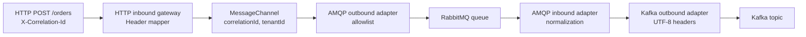

# Protocol-Specific Header Mappers

## 1. The Problem: One Internal Message, Many External Protocols

In **Spring Integration Adapters**, every inbound adapter, outbound adapter, or gateway sits at the boundary between an external system and a processing flow built on `Message<?>` and `MessageChannel`. A `Message` has two parts: a `payload` carrying business data and `headers` carrying coordination, routing, correlation, content type, or metadata.

Across HTTP, JMS, AMQP, Kafka, SOAP, File/SFTP, and other systems, header names, data types, limits, and semantics differ. **Protocol-specific header mappers** translate metadata between Spring's `MessageHeaders` and each protocol's native representation. They solve three problems:

1. **Preserve required context**: e.g., `traceparent`, correlation ID, content type, and reply destinations when crossing an adapter/gateway.
2. **Respect transport contracts**: HTTP uses HTTP-valid header names and values, JMS only accepts valid property types, Kafka represents headers as bytes, and AMQP distinguishes standard properties from application headers.
3. **Enforce trust boundaries**: avoid automatically leaking internal headers, authentication credentials, incompatible Java objects, or consumer-only metadata outbound.

**After this lesson**, you will be able to distinguish inbound/outbound and request/reply mappings; select, configure, and test protocol-appropriate header mappers; and diagnose dropped headers, type mismatches, confused correlation IDs, and metadata leaks across adapters.

## 2. General Mechanism of Header Mapping

### 2.1. HeaderMapper and MessageConverter Do Two Different Jobs

A logical model:

```text
External system               Spring Integration               External system
HTTP / JMS / AMQP             Message<?>                      Kafka / SOAP / ...
  native headers ──> [HeaderMapper] ──> MessageHeaders ──> [HeaderMapper] ──> native headers
  native body    ──> [Converter]    ──> payload        ──> [Converter]    ──> native body
                               MessageChannel / IntegrationFlow
```

`HeaderMapper<T>` is the general strategy for a native header representation `T`. Two conceptually key operations:

- `toHeaders(nativeMessage)`: reads native metadata and populates headers in `MessageHeaders`.
- `fromHeaders(messageHeaders, nativeMessage)`: writes permitted Spring headers into the native message's metadata.

For request/reply protocols, `RequestReplyHeaderMapper<T>` further separates request and reply (`toHeadersFromRequest`, `fromHeadersToRequest`, `toHeadersFromReply`, `fromHeadersToReply`). Concrete mappers are normally invoked automatically by the adapter/gateway. Exact method names and parameters depend on the protocol's mapper interface.

**Do not confuse a header mapper with:**

- `MessageConverter` or serializer/deserializer: converts the **payload** (and sometimes participates in header conversion), which is a different contract.
- `HeaderEnricher`: adds or computes new headers **inside** the flow; for those headers to appear on HTTP/JMS/Kafka, they still must pass through outbound native mapping.
- `HeaderFilter`: removes headers from `Message<?>` within a flow segment; useful as defense-in-depth, but not a substitute for an adapter allowlist.
- `MessageHeaders.ID` and `MessageHeaders.TIMESTAMP`: Spring-generated message metadata; not automatically the broker's ID/timestamp.

### 2.2. Two Directions and Two Request/Reply Sides

The terms *inbound/outbound* must be understood relative to the **Spring Integration application**:

| Connection point | Data crossing the boundary | What the mapper does |
|---|---|---|
| Inbound HTTP adapter/gateway | HTTP request → Spring message | Reads request headers into `MessageHeaders` |
| Inbound HTTP gateway reply | Spring reply → HTTP response | Writes selected headers to response |
| Outbound HTTP gateway | Spring request → HTTP request | Writes selected headers to HTTP request |
| Outbound HTTP gateway receiving reply | HTTP response → Spring reply | Reads response headers into `MessageHeaders` |
| JMS/AMQP/Kafka inbound | Broker record/message → Spring message | Reads native properties and headers |
| JMS/AMQP/Kafka outbound | Spring message → broker record/message | Writes native properties and headers |

For example, an **outbound HTTP gateway** still performs a *native → Spring* step when receiving the HTTP response. Therefore, you must check both mapped request headers and mapped response headers.

### 2.3. Header Policies Need an Explicit Contract

Before configuring a mapper, define for every header:

| Question | Example decision |
|---|---|
| Is it business-facing or purely technical metadata? | `tenantId` is used in processing; `retryAttemptLocal` is internal retry state only |
| What native name does the partner accept? | HTTP `X-Correlation-Id`, JMS `JMSCorrelationID`, Kafka `correlation-id` |
| What type travels on the wire? | `String` or primitive/simple values for JMS; `byte[]` for Kafka |
| Can the header cross the trust boundary? | Do not forward raw client `Authorization` tokens to another partner |
| Which direction needs mapping? | `traceparent` goes outbound; `X-Request-Id` from response is read inbound |
| What if the header is missing? | Generate a new correlation ID at ingress or reject per contract |
| Who owns the header? | `kafka_receivedTopic` is consume-side metadata; outbound topic must be configured separately |

Practical rule: prefer an **explicit allowlist** on each adapter, then add name/value conversion rules where protocols are incompatible. Wildcards like `*` or special mapper tokens often expand header scope; understand the exact defaults for your library version before using them.

## 3. HTTP: Mapping Request and Response Headers

Spring Integration provides `DefaultHttpHeaderMapper` for HTTP inbound/outbound adapters and gateways. The mapper knows standard request/response header groups and supports `inboundHeaderNames` and `outboundHeaderNames`, including `*` patterns. Here `inbound` means **native HTTP → Spring**, and `outbound` means **Spring → native HTTP**.

On an HTTP outbound gateway, two common settings are:

- `mapped-request-headers` selects headers from the Spring message to populate the HTTP request.
- `mapped-response-headers` selects headers from the HTTP response to populate the Spring reply.

Declaring a custom list **replaces the default mapping set** at that configuration point. To keep the entire corresponding standard HTTP header group, include the `HTTP_REQUEST_HEADERS` or `HTTP_RESPONSE_HEADERS` token; for tight control, list each header explicitly.

### 3.1. Example HTTP Outbound Gateway Configuration

The XML example below focuses on mapping; the `int-http` namespace and referenced beans/channels must be declared in application configuration:

```xml
<int-http:outbound-gateway
    id="partnerOrderGateway"
    channel="ordersToPartner"
    url="https://partner.example/api/orders"
    http-method="POST"
    mapped-request-headers="Content-Type, Accept, X-Correlation-Id"
    mapped-response-headers="Content-Type, X-Correlation-Id"
    expected-response-type="java.lang.String"/>
```

Suppose the input message has these headers:

```text
Content-Type        = application/json
Accept              = application/json
X-Correlation-Id    = order-2026-042
internalRetryCount  = 3
replyChannel        = <DirectChannel ...>
Authorization       = Bearer <incoming-client-token>
```

This policy only puts `Content-Type`, `Accept`, and `X-Correlation-Id` onto the HTTP request. `internalRetryCount`, `replyChannel`, and the inbound token are not in the list and are excluded by the mapper. Credentials for calling the partner must be generated separately under the **outbound service's own identity**.

### 3.2. Practicing With DefaultHttpHeaderMapper

The Java snippet below illustrates how the mapper converts Spring headers into `HttpHeaders`. In actual application wiring, the adapter/gateway usually performs this call:

```java
import org.springframework.http.HttpHeaders;
import org.springframework.integration.http.support.DefaultHttpHeaderMapper;
import org.springframework.messaging.Message;
import org.springframework.messaging.support.MessageBuilder;

// Create a Spring message with both outbound headers and internal-only headers.
Message<String> message = MessageBuilder
        .withPayload("{\"orderId\":\"O-42\"}")
        .setHeader("X-Correlation-Id", "corr-42")
        .setHeader("Content-Type", "application/json")
        .setHeader("internalRetryCount", 2)
        .build();

// Mapper for the HTTP outbound side.
DefaultHttpHeaderMapper mapper = DefaultHttpHeaderMapper.outboundMapper();
mapper.setOutboundHeaderNames("Content-Type", "X-Correlation-Id");

HttpHeaders httpHeaders = new HttpHeaders();
mapper.fromHeaders(message.getHeaders(), httpHeaders);

// Contains correlation ID and content type; does not contain internalRetryCount.
System.out.println(httpHeaders.getFirst("X-Correlation-Id"));
System.out.println(httpHeaders.getFirst("internalRetryCount")); // null
```

For the reverse direction (HTTP response → Spring reply), configure `setInboundHeaderNames(...)` accordingly or use `mapped-response-headers` on the outbound gateway. Both directions must be tested independently.

**Practical notes:**

- HTTP header names are case-insensitive at the protocol level; do not assume the same holds for JMS or Kafka.
- `Content-Type` also drives body conversion via `HttpMessageConverter`; the header mapper will not fix malformed JSON payloads.
- Headers like `Host`, `Content-Length`, and `Transfer-Encoding` are managed by the HTTP client/server in context. Never copy them from an old request onto a new request arbitrarily.
- HTTP headers can be multi-valued (`List<String>`); if the target system only accepts a single value, establish a clear selection or joining convention.
- The HTTP header `X-Correlation-Id` is a **system-agreed name**, not automatically synonymous with Spring Integration's `correlationId` header or a broker correlation ID.

## 4. JMS: Distinguishing JMS API Headers and Message Properties

A JMS message has JMS API headers (`JMSMessageID`, `JMSCorrelationID`, `JMSReplyTo`, `JMSType`, etc.) and application-set **message properties**. `DefaultJmsHeaderMapper` maps these values to Spring message headers and back.

Meaningful mapping examples:

| JMS native | Spring Integration | Notes |
|---|---|---|
| `JMSCorrelationID` | `jms_correlationId` | Used for JMS request/reply; distinct from generic `correlationId` header |
| `JMSReplyTo` | `jms_replyTo` | JMS reply destination, not Spring `replyChannel` |
| `JMSType` | `jms_type` | Message classification per JMS contract |
| Property `tenantId` | Header `tenantId` if permitted by mapper | Must have valid JMS property type and name |
| `JMSMessageID` | Receive-side header `jms_messageId` | Typically generated by JMS provider on send; not Spring `id` |

JMS properties only support JMS-defined types (boolean, byte, short, int, long, float, double, `String`, and their corresponding wrappers in Java APIs). You cannot pass an arbitrary `Map`/POJO as a JMS property and expect the mapper to serialize it. Property names are also subject to identifier rules and JMS reserved prefixes; choose simple names like `tenantId` or `traceparent`.

Specifically, `correlationId` in Spring Integration may be a `UUID` grouping messages, whereas `jms_correlationId` feeds JMS `JMSCorrelationID`. Do not mechanically rename one to the other without confirming how the gateway matches replies. A JMS gateway may generate/select correlation IDs based on `correlation-key` and reply destination configuration.

**About QoS:** `JMSPriority`, delivery mode, and TTL are normally applied when the producer sends (`MessageProducer.send`), not simply by setting a header. To control these attributes, configure the template/adapter and verify explicit QoS settings.

A JMS request/reply contract might specify:

```text
Spring Request:
    payload = "calculate shipping"
    headers["jms_correlationId"] = "req-42"
    headers["tenantId"] = "north"

JMS request:
    JMSCorrelationID = "req-42"
    property tenantId = "north"

JMS reply:
    JMSCorrelationID = "req-42"  (per responder contract)
```

This is the **intended data diagram**; actual values are governed by the gateway/mapper and `correlation-key` configuration. Do not manually overwrite gateway-generated headers when correlation is managed by the framework.

## 5. AMQP/RabbitMQ: MessageProperties and Application Headers

In AMQP, certain properties have dedicated meanings: `contentType`, `correlationId`, `replyTo`, `messageId`, `deliveryMode`, `expiration`, `receivedRoutingKey`, etc. Alongside them are publisher-defined application headers.

Spring Integration uses `DefaultAmqpHeaderMapper` with `amqp_*` header names (e.g., `amqp_correlationId`, `amqp_replyTo`, `amqp_receivedRoutingKey`); content type can use Spring's common `contentType` name. `received*` attributes reflect consumer-side metadata and are not valid controls for routing a new outbound message.

| Need | How to handle |
|---|---|
| Publish to exchange/routing key | Configure outbound adapter/gateway or appropriate outbound routing headers |
| Pass correlation ID | Use `amqp_correlationId` or an agreed application header |
| Pass tenant/trace ID | Allowlist the corresponding application headers in the mapper |
| Check redelivery | Read inbound metadata; handle retry/DLQ via broker mechanisms |
| Keep content type consistent | Align `contentType` with the body produced by the converter |

The AMQP mapper supports groups such as `STANDARD_REQUEST_HEADERS`, `STANDARD_REPLY_HEADERS`, `NON_STANDARD_HEADERS`, and custom names/patterns. Default behavior for application headers varies by request/reply direction and version; configure explicitly to avoid implicit assumptions. Additionally, many `x-*` AMQP headers are reserved by the broker or plugins and should never be copied blindly from inbound messages onto new messages.

Example **policy** for an AMQP outbound channel:

```text
Allowed:
    contentType, amqp_correlationId, traceparent, tenantId
Rejected:
    Authorization, internalRetryCount, errorChannel,
    amqp_receivedRoutingKey, x-death, x-first-death-*
```

On the adapter/gateway, declare these names via the mapper properties or mapped request/reply headers supported by your version. That ensures a message forwarded to another exchange does not carry stale retry/dead-letter history from a previous broker.

## 6. Kafka: Headers Are Name and byte[] Pairs

Every Kafka record has `key`, `value`, `topic`, `partition`, `timestamp`, and a set of `Headers`. A native Kafka header is a `(String key, byte[] value)` pair; the same key may appear multiple times. Data types and multiplicity must therefore be decided before mapping.

In Spring Kafka, `KafkaHeaderMapper` implementations (such as `SimpleKafkaHeaderMapper` or JSON-based mappers depending on version) are used by `MessagingMessageConverter` or equivalent components to translate with `MessageHeaders`. JSON header mapping can store value type metadata in a special `spring_json_header_types` header; both ends must agree on serializer, converter, charset, and trusted types.

| Spring-side | Kafka-side | Points to watch |
|---|---|---|
| `traceparent = "00-..."` | `traceparent` header, typically UTF-8 bytes | Receiver must know how to decode |
| `tenantId = "north"` | `tenantId` header | Java type can be lost when only raw bytes arrive |
| `KafkaHeaders.KEY` / record key | Kafka record key | Record attribute, not an ordinary header |
| Received topic/partition/offset metadata | `ConsumerRecord` metadata | Describes received record only; not a default publish directive |
| Duplicate header names | Multiple entries in Kafka `Headers` | Mapper/converter may take last value or require multi-value config |

Example native Kafka headers using UTF-8:

```java
import java.nio.charset.StandardCharsets;
import org.apache.kafka.common.header.internals.RecordHeaders;

RecordHeaders headers = new RecordHeaders();
headers.add("traceparent",
        "00-4bf92f3577b34da6a3ce929d0e0e4736-00f067aa0ba902b7-01"
                .getBytes(StandardCharsets.UTF_8));
headers.add("tenantId", "north".getBytes(StandardCharsets.UTF_8));
```

This is raw Kafka API usage illustrating the wire representation before Spring `MessageHeaders` is involved. When configuring Spring Integration Kafka adapters, attach the appropriate `KafkaHeaderMapper` on the converter/endpoint supported by your version.

**Common traps:**

- Non-Spring Kafka partners may not understand `spring_json_header_types`; exchange cross-system headers as UTF-8 strings or bytes with an agreed schema.
- Never deserialize arbitrary classes named in headers from untrusted sources; trust only strictly required types/packages.
- When defining custom outbound patterns, keep Spring's `id` and `timestamp` excluded and do not turn `ConsumerRecord` metadata into arbitrary outbound headers.
- The Kafka record key determines partitioning and ordering; a `correlationId` header does not replace the record key.
- Headers do not guarantee idempotency. Deduplication requires a business ID and idempotency logic/storage.

## 7. SOAP, Mail, File/SFTP, and Other Endpoints

### 7.1. SOAP/Web Services

SOAP uses an `Envelope` containing `Header` and `Body`. `DefaultSoapHeaderMapper` in Spring Integration WS handles SOAP actions and configured SOAP headers. Custom headers (e.g., SOAP-schema authentication metadata) are not automatically copied under all setups; explicitly specify `requestHeaderNames` / `replyHeaderNames` or `mapped-request-headers` / `mapped-reply-headers` on the gateway.

A SOAP header can be an **XML structure**, not a plain string. For example:

```xml
<soap:Header xmlns:soap="http://schemas.xmlsoap.org/soap/envelope/">
    <ctx:Tracking xmlns:ctx="urn:example:tracking">
        <ctx:CorrelationId>order-42</ctx:CorrelationId>
    </ctx:Tracking>
</soap:Header>
```

If the target system expects that SOAP structure, setting Spring header `"X-Correlation-Id" = "order-42"` alone is insufficient. You need a mapper/transformer that creates the XML element with the proper namespace and schema.

### 7.2. Mail

Email has `From`, `To`, `Subject`, `Reply-To`, and MIME content metadata. Spring Integration provides `DefaultMailHeaderMapper` for inbound mail mapping. Names like `mail_from`, `mail_subject`, and `mail_replyTo` represent email metadata; outbound mail adapters also use dedicated mail headers to construct messages.

Multipart MIME payloads are more complex than single strings, especially multipart attachments. Check payload/transformer handling separately; a header mapper does not turn attachments into application data.

### 7.3. File/SFTP

File/SFTP has no per-file application header envelope equivalent to HTTP/JMS/Kafka. Adapters produce and consume `MessageHeaders` for naming, target directories, and file metadata, but these do not magically materialize as arbitrary metadata on an SFTP server.

For instance, if the receiver needs a file's `correlationId`, design an explicit **contract**: filename encoding, a JSON sidecar/manifest, metadata inside the content, or a reconciliation table. Never assume a generic `HeaderMapper` can turn `traceparent` into an SFTP protocol attribute.

For raw TCP/UDP or plain byte streams, boundaries carry minimal native metadata; use a wire format/framing or protocol-level header mechanism to preserve cross-system context.

## 8. Cross-Protocol Example: HTTP → AMQP → Kafka

Suppose a service receives an HTTP order, forwards it via RabbitMQ for async processing, and publishes a result event to Kafka. The business rule is to preserve `correlationId` and `tenantId` across the flow, while **never** copying HTTP `Authorization`, `replyChannel`, or broker-received metadata onto the outbound event.



### 8.1. Defining a Stable Internal Header Contract

Design semantic keys; at ingress boundaries, map/normalize native naming differences into internal headers:

| Boundary | Correlation ID | Tenant | Forwarded? |
|---|---|---|---|
| HTTP inbound | `X-Correlation-Id` → internal `correlationId` | Authenticated `X-Tenant-Id` → `tenantId` | Only validated/normalized values |
| AMQP outbound | `correlationId` → `amqp_correlationId` or agreed application header | `tenantId` → application header | Yes, after allowlist |
| AMQP inbound | `amqp_correlationId`/application header → `correlationId` | application header → `tenantId` | Yes, re-validated |
| Kafka outbound | `correlationId` → `correlation-id` header bytes | `tenantId` → `tenant-id` header bytes | Yes, per UTF-8 schema |

This table reflects **team-chosen conventions**. The framework does not automatically rename `X-Correlation-Id` to `correlationId`, `amqp_correlationId`, or `correlation-id`. Name/value translations must be configured with header enrichers, transformers, or custom mappers at the appropriate points.

### 8.2. Normalizing the Spring Message at Ingress

One way to build a clean message after validating inputs and identifying the tenant:

```java
import org.springframework.messaging.Message;
import org.springframework.messaging.support.MessageBuilder;

Message<?> normalized = MessageBuilder
        .fromMessage(inboundMessage) // inboundMessage: HTTP request already converted into Message<?>
        .setHeader("correlationId", validatedCorrelationId)
        .setHeader("tenantId", authenticatedTenantId)
        .removeHeader("Authorization")
        .removeHeader("Cookie")
        .build();
```

This illustrative logic runs **inside a handler/transformer**; `validatedCorrelationId` and `authenticatedTenantId` must already be derived from verified inputs. If the HTTP request lacks a valid correlation ID, the system can generate one and echo it in the response per contract. Every outbound step still requires its own allowlist.

### 8.3. Right Rules at Every Hop

1. **HTTP inbound**: read trace/correlation from permitted sources; normalize value, length, and format. Derive tenant from authenticated context—never blindly trust raw client-supplied headers.
2. **AMQP outbound**: map only normalized `correlationId`/`tenantId` and matching content type; do not copy `Authorization` or `errorChannel`. For request/reply, configure `replyTo` and broker correlation ID per contract.
3. **AMQP inbound**: validate incoming messages against schema and separate broker metadata from application headers. Do not pass `x-death`/`receivedRoutingKey` forward to Kafka.
4. **Kafka outbound**: encode agreed strings as UTF-8 bytes or use a converter matching the consumer's convention; do not copy internal `MessageHeaders.ID`/`TIMESTAMP` as event IDs.
5. **Errors and retries**: handle via error channels, retry advice, DLQs, and idempotency at the right layers. Headers carry context only; they do not implement delivery guarantees.

## 9. Testing Header Mappers as Contracts

Write tests at the **protocol boundary**, not just checking maps inside Java. A strategy applicable to each adapter:

| Test case | Input | Expected result |
|---|---|---|
| Standard inbound header | HTTP `Content-Type` or JMS `JMSCorrelationID` | Matching name/value in `MessageHeaders` |
| Outbound allowlist | `correlationId` and `internalRetryCount` | Only permitted headers appear on the native message |
| Missing optional header | Request lacking `X-Correlation-Id` | Flow applies agreed fallback with no null failure |
| Unsupported type | JMS property as `Map`, Kafka header as POJO | Intentional conversion or explicit rejection |
| Request/reply | Request with correlation ID and matching reply | Gateway correlates reply properly; no misrouted `replyChannel` |
| Duplicate Kafka header | Two headers with same name, different byte values | Parser behavior verified, never silently guessed |
| Security | `Authorization`, `Cookie`, `errorChannel` headers | Absent on external brokers/partners outside allowlist |
| Retry/DLQ | AMQP message previously dead-lettered | Old broker metadata not copied onto new outbound message |
| Encoding | Unicode in `tenantId`/baggage | Producer and consumer decode identically |
| Version compatibility | Producer/consumer on different library versions | Both interpret actual wire representation identically |

Direct HTTP mapper test example (assertions use JUnit 5):

```java
import static org.junit.jupiter.api.Assertions.assertEquals;
import static org.junit.jupiter.api.Assertions.assertNull;

import org.junit.jupiter.api.Test;
import org.springframework.http.HttpHeaders;
import org.springframework.integration.http.support.DefaultHttpHeaderMapper;
import org.springframework.messaging.support.MessageBuilder;

class HeaderMappingTest {

    @Test
    void httpOutboundMapperOnlyCopiesExplicitHeaders() {
        var source = MessageBuilder.withPayload("order-42")
                .setHeader("X-Correlation-Id", "corr-42")
                .setHeader("internalRetryCount", 7)
                .setHeader("Authorization", "Bearer should-not-leak")
                .build();

        var mapper = DefaultHttpHeaderMapper.outboundMapper();
        mapper.setOutboundHeaderNames("X-Correlation-Id");

        HttpHeaders nativeHeaders = new HttpHeaders();
        mapper.fromHeaders(source.getHeaders(), nativeHeaders);

        assertEquals("corr-42",
                nativeHeaders.getFirst("X-Correlation-Id"));
        assertNull(nativeHeaders.getFirst("internalRetryCount"));
        assertNull(nativeHeaders.getFirst("Authorization"));
    }
}
```

This test verifies the HTTP mapper's header policy. At the integration level, add tests with an HTTP mock server, JMS/AMQP broker, or Kafka test container to verify converters, adapters, and actual on-the-wire metadata.

## 10. Common Design Mistakes and Fixes

| Symptom | Common cause | Fix |
|---|---|---|
| `traceparent` exists in flow but disappears outbound | Mapper omits custom header on outbound side | Add name to allowlist on the right adapter direction |
| HTTP response loses correlation ID | Only `mapped-request-headers` configured | Configure `mapped-response-headers` and reply mapping |
| JMS request/reply fails to correlate | Confused `correlationId` with `jms_correlationId`, or responder echoed wrong value | Set `correlation-key` and inspect native `JMSCorrelationID` on both sides |
| JMS producer fails setting property | Invalid property name or unsupported value type | Use valid names and primitive/`String` types |
| Kafka consumer receives garbled bytes/JSON | Producer/consumer use mismatched mappers or charsets | Standardize wire schema, UTF-8, and header types |
| Kafka event carries prior consumer metadata | Copied all inbound `MessageHeaders` to outbound | Build a fresh record, allowlist headers, explicitly set topic/key |
| New AMQP message carries stale DLQ headers | Copied `x-*` or `received*` metadata | Exclude reserved headers and separate directions |
| SOAP header still missing | Passed a plain string when partner expects an XML element | Construct SOAP header with proper XML structure and namespace |
| Internal headers leak externally | Used `*` / all-headers without filtering | Switch to allowlists, strip sensitive headers, and inspect wire output |

## 11. Hands-On Exercise

**Task:** Build a flow receiving an HTTP order, processing asynchronously over AMQP or JMS, and publishing a Kafka event. You do not need full brokers running to begin: simulate messages and test the mappers directly first.

1. Design a contract table for `correlationId`, `tenantId`, `contentType`, and `traceparent`: native names per protocol, directions, data types, and missing-value rules.
2. Create an HTTP outbound mapper exporting only `Content-Type` and `X-Correlation-Id`. Prove `internalRetryCount` and `Authorization` never appear in `HttpHeaders`.
3. Pick one broker: for JMS, define `JMSCorrelationID` and property types; for AMQP, distinguish `amqp_correlationId` from application headers.
4. Implement Kafka header mapping as UTF-8 bytes or an agreed converter. Test both a producer writing `String` and a consumer reading raw `byte[]`.
5. Add a reply or retry scenario and verify that business correlation survives while internal/broker metadata is not blindly forwarded.

**Completion criteria:** every boundary has an allowlist/typing table, tests prove headers are kept or stripped as designed, and Spring, gateway, JMS/AMQP correlation IDs, and Kafka record keys are never confused.

## 12. Key Takeaways

- Header mappers translate **protocol metadata ↔ `MessageHeaders`**; payload converters handle body data.
- Read mapping direction from the native/Spring perspective and request/reply side; an inbound adapter does not always mean inbound mapping at every step.
- In HTTP, custom mapped header lists can replace defaults; in JMS, watch property types and correlation; in AMQP, separate broker properties from application headers; in Kafka, understand `byte[]` and converters.
- Protect trust boundaries with allowlists, explicit name/type rules, and native-protocol tests. Correlation, retries, routing, and security each need dedicated policies tailored to the adapter/gateway.

## References

- [Spring Integration — HTTP Header Mappings](https://docs.spring.io/spring-integration/reference/http/header-mapping.html)
- [Spring Integration — JMS Support](https://docs.spring.io/spring-integration/reference/jms.html)
- [Spring Integration — AMQP Message Headers](https://docs.spring.io/spring-integration/reference/amqp/message-headers.html)
- [Spring Kafka — Message Headers](https://docs.spring.io/spring-kafka/reference/kafka/headers.html)
- [Spring Integration — Web Services Support](https://docs.spring.io/spring-integration/reference/ws.html)
- [Spring Integration — Mail Support](https://docs.spring.io/spring-integration/reference/mail.html)

*Class/method names and default mappings may differ across Spring Integration, Spring AMQP, and Spring Kafka branches. When applying to a project, verify APIs against your exact dependency versions, especially for Kafka mappers/converters.*
