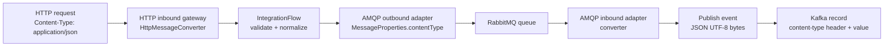

# Content-Type and MimeType

## 1. Why Does Content-Type Matter in System Integration?

In the **SPRING_INTEGRATION_ADAPTERS** module, a Spring Integration flow receives data from HTTP, JMS, AMQP, Kafka, files/SFTP, or databases and forwards it through `MessageChannel`, adapters, and gateways. Payloads can be `String`, `byte[]`, Java objects, XML documents, or files. For components to know *how that data is represented*, they usually need metadata describing the **media type**.

For example, the exact same byte array could represent:

- UTF-8 text: `text/plain; charset=UTF-8`.
- A JSON document: `application/json`.
- An XML document: `application/xml`.
- Unstructured binary data: `application/octet-stream`.
- A PDF file: `application/pdf`.

No single conversion mechanism guarantees decoding every representation accurately. When metadata is wrong, a message converter may pick the wrong reader, Vietnamese/Unicode characters get corrupted, the system returns `415 Unsupported Media Type`, or a service silently misinterprets the format.

**Lesson objectives**:

1. Understand media type / MIME type syntax, the `type/subtype` pair, and parameters such as `charset`.
2. Distinguish HTTP `Content-Type`, HTTP `Accept`, Spring header `contentType`, and the payload's Java type.
3. Use `MimeType`, `MimeTypeUtils`, and `MediaType` to parse, inspect, and compare media types.
4. Set and normalize `contentType` at inbound/outbound boundaries; wire the right `MessageConverter`, transformer, and header mapper.
5. Handle differences across HTTP, AMQP, JMS, Kafka, File/SFTP, and adapters lacking native MIME metadata.
6. Design tests ensuring **payload, charset, media type, and wire representation stay consistent**.

## 2. MIME Terminology and Syntax

### 2.1. A Media Type Is a Label Describing Representation

A media type value typically looks like:

```text
type/subtype; parameter=value; parameter=value
```

Examples:

```text
application/json
application/json; charset=UTF-8
text/plain; charset=UTF-8
application/xml
application/problem+json
application/vnd.acme.order.v2+json
multipart/form-data; boundary=----part123
application/octet-stream
```

| Part | Meaning | Example |
|---|---|---|
| `type` | High-level content category | `application`, `text`, `image`, `multipart` |
| `subtype` | Specific representation | `json`, `plain`, `xml`, `pdf` |
| Structured suffix | Indicates underlying syntax | `+json`, `+xml` |
| `charset` | Character encoding when applicable | `UTF-8` |
| `boundary` | Delimiter separating multipart parts | `boundary=----part123` |
| Custom parameters | Depends on protocol contract | `version=2`, `profile=...` |

**MIME types** originated from MIME conventions and were adopted across many protocols. In Spring, `MimeType` is a value type representing a media type; in HTTP contexts, `MediaType` adds HTTP-specific features, notably the quality parameter `q` for content negotiation. The term *content type* typically refers to the **metadata/header** carrying a media type value, such as HTTP `Content-Type: application/json`.

MIME is not content validation. Setting `application/json` does not automatically turn an arbitrary string into valid JSON.

### 2.2. Content-Type Differs From Accept, Content-Encoding, and Java Type

| Information | Answers the question | Example |
|---|---|---|
| HTTP `Content-Type` | What type is the content **being sent**? | `Content-Type: application/json` |
| HTTP `Accept` | Which media types does the caller **want back**? | `Accept: application/json, application/problem+json` |
| HTTP `Content-Encoding` | Is the HTTP payload transformed/encoded at the HTTP layer, such as compressed? | `Content-Encoding: gzip` |
| HTTP `Content-Length` | Body length at the HTTP level | `Content-Length: 120` |
| Spring `MessageHeaders.CONTENT_TYPE` | Header representing the Spring message's media type | `contentType = application/json` |
| Payload Java type | What runtime object sits inside the message? | `String`, `byte[]`, `Order` |

**Two contrasting examples:**

```http
POST /orders HTTP/1.1
Content-Type: application/json
Accept: application/problem+json, application/json

{"orderId":"O-42"}
```

The request body is JSON; the client states that the response may be Problem JSON or plain JSON. Conversely:

```http
HTTP/1.1 200 OK
Content-Type: application/json; charset=UTF-8

{"status":"CREATED"}
```

The response content type describes the **response body**, saying nothing about the preceding request format.

HTTP typically returns `415 Unsupported Media Type` when the **request** media type is not supported by the endpoint, and `406 Not Acceptable` when the endpoint cannot produce a representation matching `Accept`. Actual status codes also depend on routing, converters, and the application's error-handling rules.

### 2.3. Charset Is a Contract for Text Data

The following four values are related but **not interchangeable**:

```text
application/json
application/json; charset=UTF-8
text/plain
text/plain; charset=ISO-8859-1
```

Given the same character string, UTF-8 and ISO-8859-1 produce different bytes, and certain characters (such as Vietnamese diacritics) cannot be represented in ISO-8859-1 at all. Across system boundaries, agree explicitly on encoding, prefer UTF-8 for JSON, and verify payloads are actually encoded/decoded per that agreement.

**Notes:**

- The `charset` parameter only matters when the format and converter use it. Many binary formats do not use `charset`.
- For modern JSON, UTF-8 is the universal cross-system interchange choice. Avoid machine/OS-dependent default charsets.
- `Content-Encoding: gzip` is a compression mechanism, not a `charset`. An `application/json` message can simultaneously be gzip-compressed.
- For `multipart/form-data`, `boundary` is bound to the serialized body bytes. Never set a boundary manually that mismatches the actual body.

## 3. MimeType, MediaType, and Core Spring APIs

### 3.1. Key Classes to Know

| Class/constant | Package | Role |
|---|---|---|
| `MimeType` | `org.springframework.util` | Holds `type/subtype`, parameters, and matching operations |
| `MimeTypeUtils` | `org.springframework.util` | Parses MIME strings and provides common constants |
| `MediaType` | `org.springframework.http` | Extends `MimeType` for HTTP, adding `q` and HTTP constants |
| `MediaTypeFactory` | `org.springframework.http` | Infers media type from filename/resource extension when mapped |
| `MessageHeaders.CONTENT_TYPE` | `org.springframework.messaging` | Standard Spring messaging header name: `contentType` |
| `MessageBuilder` | `org.springframework.messaging.support` | Builds messages and adds/updates headers immutably |
| `MessageConverter` | `org.springframework.messaging.converter` | Converts payloads by source, target, media type, and selected converter |
| `HttpMessageConverter` | `org.springframework.http.converter` | Reads/writes HTTP bodies by Java type and media type |

The Spring ecosystem uses both `MimeType` and `MediaType`; `MediaType` extends `MimeType`. However, **not every endpoint uses the same converter**, even when two endpoints both see `application/json`.

### 3.2. Parsing and Reading Parameters

The Java snippet below can be placed inside a method using standard Spring Framework APIs:

```java
import java.nio.charset.StandardCharsets;
import org.springframework.util.MimeType;
import org.springframework.util.MimeTypeUtils;

MimeType json = MimeTypeUtils.parseMimeType(
        "application/json; charset=UTF-8");

System.out.println(json.getType());       // application
System.out.println(json.getSubtype());    // json
System.out.println(json.getCharset());    // UTF-8
System.out.println(json.getParameter("charset")); // UTF-8

boolean isJson = MimeTypeUtils.APPLICATION_JSON
        .isCompatibleWith(json);           // true

boolean expectedUtf8 =
        StandardCharsets.UTF_8.equals(json.getCharset()); // true
```

`MimeTypeUtils.parseMimeType(...)` throws `InvalidMimeTypeException` on invalid strings. At an ingress boundary, catch this error and return an appropriate status or route to an error flow; never let ambiguous parse errors push the payload into a converter.

### 3.3. includes vs. isCompatibleWith

`MimeType.includes(other)` tests a **one-way** relationship: whether the caller's pattern encompasses the other type. `isCompatibleWith(other)` tests **compatibility** symmetrically.

```java
import org.springframework.util.MimeType;
import org.springframework.util.MimeTypeUtils;

MimeType anyText = MimeTypeUtils.parseMimeType("text/*");
MimeType textPlain = MimeTypeUtils.parseMimeType("text/plain");

System.out.println(anyText.includes(textPlain));        // true
System.out.println(textPlain.includes(anyText));        // false
System.out.println(textPlain.isCompatibleWith(anyText)); // true

MimeType vendorJson = MimeTypeUtils.parseMimeType(
        "application/vnd.acme.order.v2+json");
MimeType jsonSuffix = MimeTypeUtils.parseMimeType(
        "application/*+json");

System.out.println(jsonSuffix.includes(vendorJson));    // true
```

When writing policies for **inbound** messages, usually check `allowedType.includes(actualType)` so you do not accidentally accept a client-supplied wildcard in place of a concrete format. `isCompatibleWith` is useful for capability matching, not as a substitute for a content allowlist policy.

An important detail: `application/json` and `application/*+json` are not the same pattern. If an API accepts both plain JSON and `+json`-suffixed media types, declare both explicitly and verify converters support them.

### 3.4. HTTP Accept Uses MediaType

`Accept` can list multiple media types with weights:

```http
Accept: application/json; q=1.0, application/xml; q=0.7
```

Spring's `MediaType` supports parsing and reading `q`:

```java
import java.util.List;
import org.springframework.http.MediaType;

List<MediaType> accepted = MediaType.parseMediaTypes(
        "application/json;q=1.0, application/xml;q=0.7");

for (MediaType type : accepted) {
    System.out.println(type + " -> q=" + type.getQualityValue());
}
```

This demonstrates **parsing** an `Accept` list. Selecting the final response representation should rely on HTTP content negotiation algorithms and the endpoint's actual converters rather than naively picking the first item from string parsing.

## 4. Spring MessageHeaders.CONTENT_TYPE in IntegrationFlow

`MessageHeaders.CONTENT_TYPE` has the string value `"contentType"`. This header sits in `MessageHeaders` alongside metadata such as ID, timestamp, correlation, or adapter info. Its value is typically a `MimeType` or media-type string understood by the relevant component's converter.

Example creating a message carrying UTF-8 JSON:

```java
import java.nio.charset.StandardCharsets;
import org.springframework.messaging.Message;
import org.springframework.messaging.MessageHeaders;
import org.springframework.messaging.support.MessageBuilder;
import org.springframework.util.MimeTypeUtils;

String json = "{\"orderId\":\"O-42\",\"amount\":120000}";

Message<byte[]> message = MessageBuilder
        .withPayload(json.getBytes(StandardCharsets.UTF_8))
        .setHeader(MessageHeaders.CONTENT_TYPE,
                MimeTypeUtils.parseMimeType("application/json;charset=UTF-8"))
        .setHeader("correlationId", "order-42")
        .build();
```

This snippet **actually encodes** the JSON string into UTF-8 bytes and attaches matching metadata. If the original payload were an `Order` POJO, simply setting `contentType = application/json` would not convert the POJO into JSON bytes. A compatible JSON serializer/transformer or message converter is required.

### 4.1. Safely Reading Content-Type at Boundaries

Never blindly cast the raw header directly to `String` or `MimeType`; different message sources can supply either representation.

```java
import org.springframework.messaging.Message;
import org.springframework.messaging.MessageHeaders;
import org.springframework.util.MimeType;
import org.springframework.util.MimeTypeUtils;

static MimeType readContentType(Message<?> message) {
    Object value = message.getHeaders().get(MessageHeaders.CONTENT_TYPE);

    if (value instanceof MimeType mimeType) {
        return mimeType;
    }
    if (value instanceof String text) {
        return MimeTypeUtils.parseMimeType(text);
    }
    if (value == null) {
        throw new IllegalArgumentException("Missing contentType");
    }
    throw new IllegalArgumentException(
            "Unsupported contentType header value: "
                    + value.getClass().getName());
}
```

This helper enforces a **strict contract policy** requiring the header; for sources lacking native MIME metadata (such as File/SFTP), set the media type upfront or define a fallback from a trusted source before calling it. For HTTP, use HTTP adapters and converters for request/response semantics; the snippet above illustrates message-level logic.

### 4.2. Do Not Mutate MessageHeaders in Place

`MessageHeaders` is immutable at the map level. After converting a payload or verifying a media type, construct a new message with `MessageBuilder`:

```java
import org.springframework.messaging.Message;
import org.springframework.messaging.MessageHeaders;
import org.springframework.messaging.support.MessageBuilder;
import org.springframework.util.MimeTypeUtils;

Message<?> normalized = MessageBuilder.fromMessage(inputMessage)
        .setHeader(MessageHeaders.CONTENT_TYPE,
                MimeTypeUtils.APPLICATION_JSON)
        .build();
```

**Correctness warning:** changing this header is valid only if `inputMessage` already holds **actual JSON**. If the payload is still XML or an unserialized POJO, convert the payload beforehand or at the same time. Metadata describes representation; it does not convert it.

### 4.3. Content-Type in Routing and Input Checks

A gateway may route JSON or XML based on headers, but routing must rely on parsed and validated values. Illustrative logic:

```text
Message<?> inbound
  ├─ parse contentType
  ├─ application/json           → JSON converter/parser
  ├─ application/*+json         → JSON converter/parser (if supported)
  ├─ application/xml, text/xml  → XML converter/parser (if supported)
  └─ otherwise                  → reject/errorChannel
```

A router cannot guarantee valid JSON merely because the header contains the word `json`. Always validate data after deserialization, handle parse failures, and enforce payload size limits.

## 5. How Content-Type Drives MessageConverters

Spring Integration works with two related conversion groups with distinct scopes:

1. **Spring messaging `MessageConverter`**: uses `contentType` together with payload type and target type when delivering a message to a matching handler. Spring Integration provides `ConfigurableCompositeMessageConverter` to coordinate multiple converters (e.g., Jackson, byte array, string, and generic converters when configured/present).
2. **HTTP `HttpMessageConverter`**: reads/writes HTTP bodies inside inbound/outbound adapters and gateways. It is also governed by HTTP `Content-Type`, `Accept`, target type, supported media types, and endpoint configuration.

Thus, the exact same `Message<byte[]>` with `application/json` can be handled differently depending on which endpoint invokes which converter and how converters are configured.

### 5.1. Same Media Type, Different Java Types

Consider an HTTP request:

```http
POST /orders HTTP/1.1
Content-Type: application/json

{"orderId":"O-42"}
```

Possible states at different points in the flow:

| Location | Java payload | Content type | Meaning |
|---|---|---|---|
| HTTP before conversion | HTTP body bytes | HTTP `application/json` | Wire data |
| After inbound converter | `String` or `Order` | `contentType` header if mapped | Depends on target type and converter |
| After JSON transformer | `Order` or `String`/`byte[]` | Should reflect **new** representation | Parsed or serialized |
| Before broker outbound | `byte[]` or `String` | Broker-specific content type / app header | Needs broker converter |
| After Kafka consumer | `byte[]`/`String`/`Order` | Application metadata if present | Depends on deserializer/converter |

**Never infer Java type rigidly from Content-Type.** JSON on the wire might arrive as `byte[]`, `String`, or already parsed into an object. Conversely, a Java object has no wire representation until serialized.

### 5.2. Wrong Example and Fix

Wrong case:

```java
// The payload is still a Java object, not JSON wire content yet.
Message<Order> wrong = MessageBuilder.withPayload(order)
        .setHeader(MessageHeaders.CONTENT_TYPE,
                MimeTypeUtils.APPLICATION_JSON)
        .build();
```

This does not guarantee the outbound adapter will send JSON: the adapter still needs a matching serializer; if it sends `order.toString()` or uses Java serialization, the header and body will contradict each other.

An explicit way when you want direct control over wire bytes:

```java
// objectMapper and order are objects provided by the application.
String jsonBody = objectMapper.writeValueAsString(order);

Message<byte[]> outbound = MessageBuilder
        .withPayload(jsonBody.getBytes(StandardCharsets.UTF_8))
        .setHeader(MessageHeaders.CONTENT_TYPE,
                MimeTypeUtils.parseMimeType("application/json;charset=UTF-8"))
        .build();
```

This assumes `objectMapper` is a configured JSON serializer and `order` is business data. In practice, a converter/transformer can handle serialization; the core requirement is that **headers reflect the post-conversion data**.

### 5.3. Transformers Can Update Content-Type

Spring Integration's JSON transformers can set or update JSON metadata automatically. For instance, `ObjectToJsonTransformer` sets JSON content type by default where appropriate; whether existing headers are overwritten and what output payload type is produced depend on configuration/version.

When placing a transformer mid-flow, check three things:

- What Java types does the payload have **before** and **after** the transformer?
- Does the `contentType` header before and after still accurately describe the representation?
- Which converter will the outbound adapter use to write to the external system?

Never use `HeaderEnricher` to "patch" a wrong content type if the payload itself has not been converted.

## 6. Protocol-by-Protocol Content-Type Mapping

### 6.1. HTTP: Content-Type Is a Standard Request and Response Header

For HTTP adapters/gateways, `DefaultHttpHeaderMapper` maps between HTTP headers and `MessageHeaders`. HTTP inbound also uses `HttpMessageConverter` to parse bodies; outbound uses it to write bodies. Both mechanisms collaborate, but serve distinct purposes.

Example XML configuration for an HTTP outbound gateway:

```xml
<int-http:outbound-gateway
    id="partnerGateway"
    channel="outboundOrders"
    url="https://partner.example/api/orders"
    http-method="POST"
    mapped-request-headers="Content-Type, Accept, X-Correlation-Id"
    mapped-response-headers="Content-Type, X-Correlation-Id"
    expected-response-type="java.lang.String"/>
```

Here:

- `mapped-request-headers` allows forwarding headers onto the **HTTP request**.
- `mapped-response-headers` controls headers read from the **HTTP response** into the Spring message.
- `Content-Type` describes the body being sent; `Accept` specifies the desired response format.
- `expected-response-type` guides the converter on how to read the response payload.

When configuring an explicit header list like this, review which standard HTTP headers must be kept. This is an intentional boundary choice; avoid copying everything by default, especially `Authorization` or internal metadata.

**When Content-Type is absent:** in Spring Integration HTTP inbound, requests without a `Content-Type` are handled according to endpoint/converter defaults; Spring Integration documentation notes that the inbound path defaults to `application/octet-stream` in that case since version 4.3. However, if your API contract requires JSON, **check and reject explicitly** rather than blindly parsing everything as JSON.

**For multipart:** `Content-Type: multipart/form-data; boundary=...` must match the multipart body's actual boundary; let the HTTP client/converter generate boundaries when constructing payloads from parts. Individual part media types can differ from the overall request media type.

### 6.2. AMQP/RabbitMQ: contentType and contentEncoding Belong to MessageProperties

AMQP has dedicated **basic properties** for `contentType` and `contentEncoding`, separate from application headers. Spring AMQP converters and Spring Integration AMQP adapters/gateways read and write these properties per configuration.

| AMQP property | Example | Role |
|---|---|---|
| `contentType` | `application/json` | Describes AMQP body |
| `contentEncoding` | `UTF-8` | Encoding info when applied by converter/protocol |
| `correlationId` | `order-42` | Links request/reply; distinct from media type |
| Application header `schemaVersion` | `2` | Application convention; does not replace `contentType` |

Common pitfall: Spring AMQP's `contentEncoding` typically indicates **character encoding** for text bodies, whereas HTTP `Content-Encoding` describes content coding such as `gzip`. Despite similar names, follow each protocol's own contract.

If a producer sends JSON bytes with `contentType = application/json`, the consumer still needs the right charset, JSON converter, and target type. Never assume every consumer automatically parses JSON just from this property.

During broker retries or dead-lettering, preserve or update metadata to match the **actual existing body**—never copy a content type unconditionally from another message.

### 6.3. JMS: No Universal Standard MIME Header for Applications

JMS defines fields such as `JMSMessageID`, `JMSCorrelationID`, `JMSType`, and application properties. **`JMSType` is not HTTP `Content-Type`**; it is a message-type identifier defined by JMS/application conventions.

To pass media type between two JMS systems, parties may agree on a `String` property named `contentType`:

```text
JMS message body: BytesMessage containing UTF-8 JSON
JMS application property "contentType" = "application/json"
JMS application property "schemaVersion" = "2"
JMSCorrelationID = "order-42"
```

This is an **example contract**, not a guarantee that every JMS provider or Spring mapper sets the same property automatically. Ensure mappers/converters actually write and read the property, JMS properties use valid types, and consumers parse JSON properly from `BytesMessage`.

Do not misuse `JMSType = "application/json"` as a default workaround unless both sides explicitly define that meaning.

### 6.4. Kafka: Native Headers Are byte[], Content Type Is an Application Convention

A Kafka record has key/value, timestamp, and native headers `(String key, byte[] value)`. **Kafka has no built-in record-level MIME/Content-Type property** like HTTP. To let consumers know whether a payload is JSON or Avro, you can:

- Agree explicitly on schema/serializer per **topic**.
- Put the media type in an application Kafka header, such as `content-type` as UTF-8 bytes.
- Use a schema registry and content schema versions per infrastructure.

Raw Kafka header example:

```java
import java.nio.charset.StandardCharsets;
import org.apache.kafka.common.header.internals.RecordHeaders;

RecordHeaders kafkaHeaders = new RecordHeaders()
        .add("content-type", "application/json"
                .getBytes(StandardCharsets.UTF_8))
        .add("schema-version", "2"
                .getBytes(StandardCharsets.UTF_8));
```

The producer must still serialize the value into valid JSON bytes. A consumer reading `content-type` must decode the native bytes and select an allowlisted parser. When using Spring Kafka `KafkaHeaderMapper` and message converters, verify how the converter maps `MessageHeaders.CONTENT_TYPE` to native headers (header name, type, and encoding can differ from the manual setup above).

Never assume Spring `contentType` is present on raw Kafka records produced by other tools.

### 6.5. File/SFTP: No Inherent Application Content-Type Attached to Files

With File/SFTP adapters, payloads may be `File`, `Path`, `byte[]`, or resources. File protocols do not carry a standard per-file application MIME property like HTTP `Content-Type`. Options include:

| Information source | Pros | Limitations |
|---|---|---|
| Extensions like `.json` / `.csv` | Easy to standardize and operate | Can be wrong; renaming does not change content |
| Manifest/sidecar `.json` file | Holds content type, charset, schema version | Must synchronize two files; handle missing/delayed manifests |
| In-content metadata | Better self-description in some formats | Requires a format-aware parser |
| Per-remote-directory config | Useful when a directory holds one data type | Breaks easily if producer switches format |

`MediaTypeFactory` can suggest a media type from a filename/extension when mapped, but does not verify actual content. High reliability requires a producer contract plus parsing and validation.

### 6.6. Databases, TCP/UDP, and Web Services

- **Database inbound/outbound:** JDBC result rows have no uniform native MIME field. If a column stores JSON/XML/BLOB, the table schema and column contract must specify the format; `contentType` headers are only attached at the message layer when mapping rows to payloads.
- **TCP/UDP:** data is a byte stream/frame; exchanging media types requires defining an envelope/framing format or relying on a mutually agreed protocol default. `TcpHeaderMapper` can support a Spring-side content-type header per configuration, but does not create an HTTP-like wire header.
- **SOAP/Web Services:** SOAP uses an XML envelope, while the HTTP transport carries its own `Content-Type`. `text/xml` and `application/soap+xml` carry distinct meanings across SOAP bindings and versions; rely on the SOAP version and WS library rather than relabeling headers and assuming validity.
- **Cloud/object storage:** object storage services often support object `Content-Type` metadata; that is object metadata persisted via the storage API, not synonymous with Spring `MessageHeaders.CONTENT_TYPE` unless explicitly mapped.

## 7. Real-World Flow Example: HTTP JSON → AMQP → Kafka

Suppose a service accepts orders over HTTP, forwards them to RabbitMQ for async processing, and publishes an `OrderAccepted` event to Kafka. All systems agree on UTF-8 JSON, yet each boundary carries content type differently.



**Example contract**:

| Hop | Wire payload | Content type metadata | Check |
|---|---|---|---|
| HTTP → service | UTF-8 JSON | HTTP `Content-Type: application/json` | Endpoint requires JSON; converter parses into target type |
| Service → AMQP | UTF-8 JSON bytes | AMQP `MessageProperties.contentType = application/json` | Producer converter output and properties align |
| AMQP → service | UTF-8 JSON bytes | Reads AMQP basic properties | Consumer parses with matching converter |
| Service → Kafka | UTF-8 JSON bytes | Agreed UTF-8 `content-type` bytes header | Serializer, schema, and header agree |
| Kafka → downstream | UTF-8 JSON bytes | Consumer reads header/topic contract | Validates JSON/schema; rejects unexpected media types |

Spring's `contentType` header is an **internal** representation assisting mappers and converters. Whether it appears in native output depends on the endpoint; hence the table requires verifying **actual wire metadata**, not just logging `MessageHeaders`.

### 7.1. Processing Steps at Each Boundary

1. **Inbound HTTP**: check media type against API contract, charset, body size, and parser; produce a domain object or JSON payload per design.
2. **Before AMQP**: serialize to JSON or let the JSON converter do it; write `contentType` and proper encoding into AMQP `MessageProperties`.
3. **After AMQP**: read broker properties; verify type/encoding; deserialize into event or DTO; reject unsupported schemas.
4. **Before Kafka**: select serializer and schema version, producing Kafka value bytes and native headers per consumer contract.
5. **After Kafka**: verify decoding and mapping using a real consumer or integration test rather than relying solely on message-builder unit tests.

### 7.2. Real-World Bug: Changing Representation While Keeping a Stale Content Type

```text
HTTP inbound:
    payload = "<order>...</order>"
    contentType = application/xml

Transformer serializes Order into JSON:
    payload = "{\"orderId\":\"O-42\"}"

If old header remains application/xml:
    AMQP/Kafka outbound may emit JSON body + XML label
    → consumer picks XML parser and fails
```

Fix: the converter/transformer must **update the content type at the moment representation changes**; the adapter then maps that updated metadata to the target native property/header. If a transform merely converts one Java object into another without serializing, clarify which layer determines the wire media type.

## 8. Validation and Error Handling for Bad Content-Types

### 8.1. A Minimal MIME Gatekeeper

Example message-layer validator accepting standard JSON and vendor `+json` suffixes:

```java
import org.springframework.messaging.Message;
import org.springframework.util.MimeType;
import org.springframework.util.MimeTypeUtils;

final class ContentTypePolicy {
    private static final MimeType JSON =
            MimeTypeUtils.APPLICATION_JSON;
    private static final MimeType VENDOR_JSON =
            MimeTypeUtils.parseMimeType("application/*+json");

    static void requireJson(Message<?> message) {
        MimeType actual = readContentType(message);

        boolean supported = JSON.includes(actual)
                || VENDOR_JSON.includes(actual);

        if (!supported) {
            throw new IllegalArgumentException(
                    "Unsupported content type: " + actual);
        }
    }

    // readContentType(Message<?>) is defined in Section 4.1.
}
```

Here `readContentType` is the helper from Section 4.1 and can live in a shared utility class. This policy checks only **media type**; you must still verify the payload is valid JSON, matches the schema, fits size limits, and satisfies business rules after parsing.

Missing or syntactically invalid content types should be handled intentionally. Over HTTP, map them to `400`/`415` per API rules; over queues/brokers, use error channels and classified retry/DLQ policies. **Statically malformed JSON will never become valid through infinite retries.**

### 8.2. Security Controls When Receiving Data

- **Do not trust labels from unauthenticated sources:** a client can attach `application/json` to non-JSON bytes; never use media type as sender authentication.
- **Allowlist formats:** support only tested media types, restricting converters from guessing formats on ambiguous inputs.
- **Enforce size limits:** bound request body and message sizes before or during parsing to prevent oversized or deeply nested payloads.
- **Disable XML external entities/DTDs in converters:** if XML is accepted, harden parsers accordingly.
- **Never deserialize native Java objects from untrusted sources:** `application/x-java-serialized-object` or object-type headers are never proof of safety.
- **Preserve encoding:** never convert bytes to `String` with the platform default charset; enforce UTF-8 when required by contract.
- **Separate media type from schema version:** `application/json` describes syntax, not conformance to `OrderV2`.

## 9. Testing Content-Type Together With Payloads and Converters

Tests must prove **header + body + converter** work together. Asserting a header equals `application/json` alone does not verify the wire payload is JSON.

### 9.1. Unit Testing MimeType and Spring Messages

JUnit 5 example (assuming Spring Framework and Spring Messaging on the classpath):

```java
import static org.junit.jupiter.api.Assertions.*;

import java.nio.charset.StandardCharsets;
import org.junit.jupiter.api.Test;
import org.springframework.messaging.Message;
import org.springframework.messaging.MessageHeaders;
import org.springframework.messaging.support.MessageBuilder;
import org.springframework.util.InvalidMimeTypeException;
import org.springframework.util.MimeType;
import org.springframework.util.MimeTypeUtils;

class ContentTypeTest {

    @Test
    void parsesJsonAndCharset() {
        MimeType type = MimeTypeUtils.parseMimeType(
                "application/json; charset=UTF-8");

        assertTrue(MimeTypeUtils.APPLICATION_JSON.includes(type));
        assertEquals(StandardCharsets.UTF_8, type.getCharset());
    }

    @Test
    void acceptsStructuredJsonSuffix() {
        MimeType allowed = MimeTypeUtils.parseMimeType(
                "application/*+json");
        MimeType actual = MimeTypeUtils.parseMimeType(
                "application/problem+json");

        assertTrue(allowed.includes(actual));
        assertFalse(MimeTypeUtils.APPLICATION_JSON.includes(actual));
    }

    @Test
    void rejectsMalformedMimeString() {
        assertThrows(InvalidMimeTypeException.class,
                () -> MimeTypeUtils.parseMimeType("application"));
    }

    @Test
    void messageCarriesExpectedMetadataAndBytes() {
        byte[] bytes = "{\"ok\":true}".getBytes(StandardCharsets.UTF_8);
        Message<byte[]> message = MessageBuilder.withPayload(bytes)
                .setHeader(MessageHeaders.CONTENT_TYPE,
                        MimeTypeUtils.APPLICATION_JSON)
                .build();

        Object raw = message.getHeaders()
                .get(MessageHeaders.CONTENT_TYPE);

        assertTrue(raw instanceof MimeType);
        assertTrue(MimeTypeUtils.APPLICATION_JSON.includes((MimeType) raw));
        assertEquals("{\"ok\":true}",
                new String(message.getPayload(), StandardCharsets.UTF_8));
    }
}
```

These tests verify `MimeType` and message-header semantics. **They do not prove** HTTP gateways, AMQP converters, or Kafka serializers work end-to-end; add integration tests next.

### 9.2. Adapter Integration Test Matrix

| Scenario | Input | Expectation |
|---|---|---|
| Valid HTTP JSON | JSON body + `application/json` | Handler receives expected content and type |
| Unsupported HTTP type | XML body + `application/xml` on JSON-only API | Contract error returned; not processed as JSON |
| Missing HTTP type | No `Content-Type` sent | Configured policy applied (reject/fallback) |
| Different HTTP charset | Accented text with declared charset | No character loss, or unsupported charset rejected |
| HTTP `Accept` | Client accepts only XML; endpoint serves JSON | Content negotiation runs; returns `406` if appropriate |
| AMQP JSON | JSON body + `contentType=application/json` | Receiving converter parses properly |
| AMQP mismatch | JSON body + `contentType=application/xml` | Fails clearly; not misprocessed |
| JMS `BytesMessage` | Property `contentType=application/json` per contract | Consumer reads property and schema accurately |
| Raw Kafka | UTF-8 `content-type` bytes header + JSON bytes value | Consumer decodes and validates content |
| Kafka missing header | Topic contract with or without media type | Documented fallback applied; no blind guessing |
| Fake `.json` file | `.json` extension with non-JSON content | Validator catches wrong representation |
| Multipart | Matching boundary in header and body | Each part reads data and metadata accurately |

For brokers, inspect **native AMQP `MessageProperties`, JMS properties, and Kafka `Headers`**, since those are what non-Spring-Integration clients actually receive.

### 9.3. Checklist When a Converter Fails

1. **Inspect raw body:** is it actually XML, JSON, text, Avro, or arbitrary bytes?
2. **Inspect native headers:** what do HTTP `Content-Type`, AMQP `contentType`, Kafka `Headers`, or JMS properties currently hold?
3. **Inspect Spring message:** do `payload.getClass()` and `headers[contentType]` agree?
4. **Inspect converter config:** which converter receives the message, which media types does it support, and what is the target class?
5. **Inspect charset/encoding:** do HTTP charset, AMQP encoding, and producer/consumer serializers match?
6. **Inspect schema:** syntactically valid JSON can still violate the target DTO.
7. **Inspect error/retry classification:** permanent schema/converter errors must be classified separately to avoid infinite retries.

## 10. Common Mistakes and Fixes

| Mistake | Consequence | Fix |
|---|---|---|
| Thinking setting `contentType=application/json` serializes a POJO | Body is not valid JSON | Use a JSON converter or serialize the payload explicitly |
| Confusing `Accept` with `Content-Type` | Mixing up request and response formats | Read the right header for each role |
| Casting `headers.get("contentType")` directly to `String` | `ClassCastException` when value is `MimeType` | Support both `String` and `MimeType` with controlled parsing |
| Checking MIME via `contains("json")` | Accepts invalid or dangerous strings | Use `MimeTypeUtils` and an explicit allowlist |
| Using only `isCompatibleWith` against client wildcards | May accept broader types than intended | Check `allowed.includes(actual)` plus explicit rules |
| Copying old content type after converting XML to JSON | Consumer selects wrong parser | Update the header whenever representation changes |
| Copying HTTP `Content-Encoding` into AMQP `contentEncoding` | Confuses compression with character encoding | Map metadata per each protocol's contract |
| Expecting Kafka to carry a default Content-Type | Raw consumers see no header | Define a topic/header convention and converter |
| Blindly trusting MIME inferred from file extension | Spoofed files crash parsers | Validate content, length, and schema |
| Manually assigning multipart boundaries | Body and header mismatch | Let the multipart writer generate both body and `Content-Type` |
| Setting `application/json` on gzipped payloads without content coding | Parser feeds compressed bytes into JSON parser | Align compression handling and corresponding metadata |

## 11. Hands-On Exercise: Standardizing Media Types Across Three Boundaries

**Context:** An order-processing system flows across HTTP → AMQP → Kafka. Producers and consumers must handle UTF-8 JSON, including cases where a caller mistakenly sends XML and a Kafka consumer that only reads native byte headers.

**Tasks:**

1. Write a media-type contract for each boundary: accepted formats, charset, schema version, Spring payload type, and native metadata storage.
2. Build a `Message<byte[]>` from UTF-8 JSON. Attach `MessageHeaders.CONTENT_TYPE` as a `MimeType`, then verify with `MimeTypeUtils`.
3. Create a validator permitting only `application/json` or `application/*+json`. Ensure `application/xml` and malformed MIME strings are rejected.
4. Outline HTTP inbound/outbound and AMQP converter configurations; capture native headers/properties during tests to verify against the contract.
5. Produce a Kafka record with a UTF-8 `content-type` native header, then write a consumer that checks the header and parses the JSON value.
6. Intentionally introduce a bug: leave `application/xml` in the header after the body becomes JSON, and identify which transformer/mapper needs fixing.
7. Write at least one test for missing `Content-Type`, one for a different charset, and one for valid JSON with an invalid schema.

**Completion criteria:** no step assumes headers convert bodies automatically; consumers read native metadata and payloads accurately; unsupported types enter an explicit error branch.

## 12. Key Takeaways

- **Media types describe representation**, not content validity; `Content-Type` must always stay consistent with the wire payload.
- `MimeType`/`MimeTypeUtils` fit MIME parsing and matching in Spring messaging; `MediaType` adds HTTP features such as `Accept` with `q` weights.
- `MessageHeaders.CONTENT_TYPE` uses key `contentType`, unlike HTTP's `Content-Type`; mappers/converters handle translation between Spring messages and native metadata.
- HTTP and AMQP provide protocol-level slots for content type; JMS, Kafka, and File/SFTP typically require explicit contracts or application-level mapping.
- Transform **payloads** using serializers/converters, update **metadata** when representation changes, and verify **native wire output** at every adapter/gateway.
- For error handling, separate unsupported types, wrong charsets, malformed bytes, and invalid business schemas so responses and retry policies behave appropriately.

## References

- [Spring Integration — Message Endpoints: Content Type Conversion](https://docs.spring.io/spring-integration/reference/endpoint.html)
- [Spring Integration — HTTP Inbound Components](https://docs.spring.io/spring-integration/reference/http/inbound.html)
- [Spring Integration — HTTP Header Mappings](https://docs.spring.io/spring-integration/reference/http/header-mapping.html)
- [Spring Framework — MimeType Javadoc](https://docs.spring.io/spring-framework/docs/current/javadoc-api/org/springframework/util/MimeType.html)
- [Spring Framework — MimeTypeUtils Javadoc](https://docs.spring.io/spring-framework/docs/current/javadoc-api/org/springframework/util/MimeTypeUtils.html)
- [Spring Framework — MediaType Javadoc](https://docs.spring.io/spring-framework/docs/current/javadoc-api/org/springframework/http/MediaType.html)
- [Spring Integration — AMQP Support](https://docs.spring.io/spring-integration/reference/amqp.html)
- [Spring Integration — Kafka Support](https://docs.spring.io/spring-integration/reference/kafka.html)

*Examples focus on Spring contracts and common APIs. Converter names, supported media types, and default header mappings also depend on your Spring Integration/Framework/AMQP/Kafka versions and adapter configuration; verify against your project's dependencies when deploying.*
