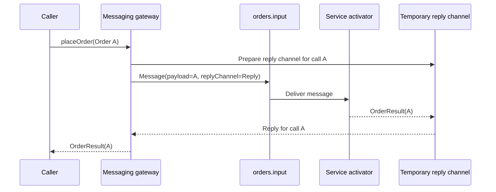
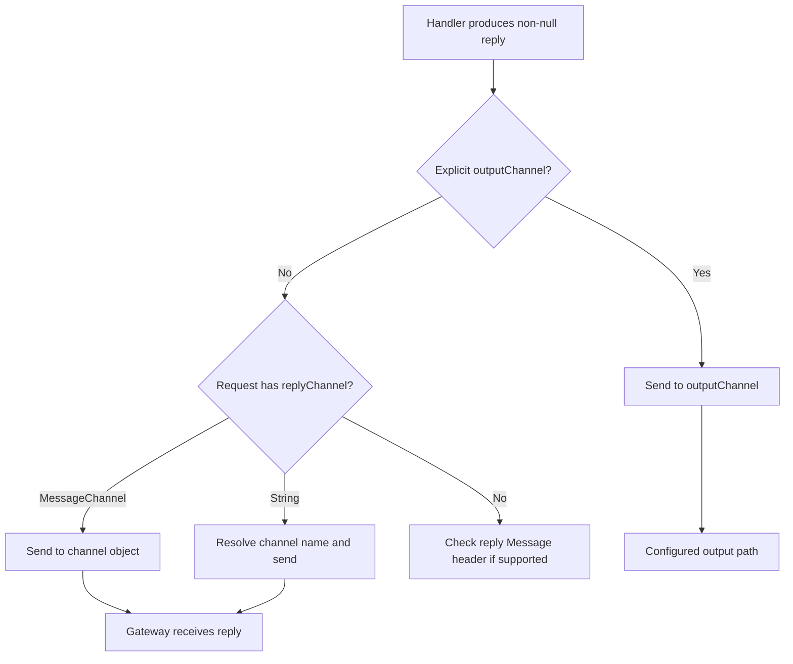
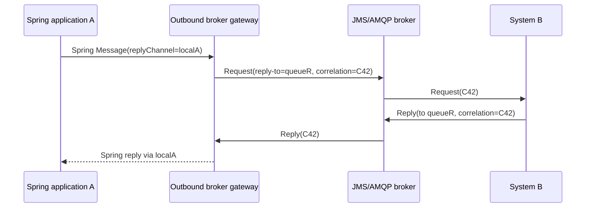
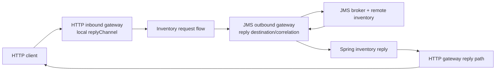

# Reply Channels in Gateways

## 1. What Problem Does a Reply Channel Solve?

In **SPRING_INTEGRATION_ADAPTERS**, an application connects to HTTP, JMS, AMQP, Kafka, files/SFTP, and other systems via inbound/outbound adapters, gateways, pollers, and `MessageChannel`. Some flows are one-way; others must return a result to the exact caller.

For example, a REST client submits an order creation request. An HTTP inbound gateway converts the request into a Spring `Message<?>` and sends it to `orders.input`. Once the service finishes processing, the gateway must find **the path to send the reply back to that same HTTP request**. When multiple requests run concurrently, the result for order `A` must never bleed into order `B`.

Spring Integration solves this with the **return address** pattern: a request message can carry a `replyChannel` header telling downstream components where to send the result.



This diagram shows local request/reply logic. The temporary reply channel does not need to be a bean declared in the application context. For a network-facing gateway, there is also a protocol-level reply correlation step (e.g., JMS correlation ID and `JMSReplyTo`) before the response returns to the Spring flow.

**After this lesson**, you will be able to:

1. Explain the meaning of `replyChannel`, `requestChannel`, and `errorChannel` in `MessageHeaders`.
2. Understand how a messaging gateway creates a temporary reply channel, waits for a result, and isolates concurrent calls.
3. Configure `@MessagingGateway`, Java DSL, and XML with automatic return paths or `default-reply-channel`.
4. Distinguish `requestTimeout`, `replyTimeout`, and actual HTTP/JMS/AMQP/Kafka timeouts.
5. Diagnose lost headers, silent handlers, late replies, misrouted replies, and broker reply mistakes.
6. Test request/reply paths across success, error, timeout, and concurrency scenarios.

## 2. Foundations: Message, MessageChannel, and Return Address

### 2.1. Reply Channel Is a Spring Message Header

Every Spring `Message<?>` has a `payload` and `headers`. System keys involved in request/reply include:

| Component | Meaning | Typical value |
|---|---|---|
| Gateway's `requestChannel` | Channel **receiving requests** sent by the gateway into the flow | `DirectChannel`, `QueueChannel` bean, etc. |
| `MessageHeaders.REPLY_CHANNEL` | Key `replyChannel` telling where to send the **reply** | `MessageChannel` or channel name `String` |
| `MessageHeaders.ERROR_CHANNEL` | Key `errorChannel` specifying the error-handling address | `MessageChannel` or channel name |
| `MessageHeaders.ID` | ID of one specific Spring message | `UUID` |
| Contract `correlationId` | Links messages belonging to one business action or request | `String`, `UUID`, or application-chosen value |

**Key point:** `requestChannel` in gateway configuration is not a mandatory header on every message. Conversely, `replyChannel` is a header serving as the *return address* for reply-producing endpoints.

Example inspecting the header inside a handler:

```java
import org.springframework.messaging.Message;
import org.springframework.messaging.MessageHeaders;
import org.springframework.messaging.MessageChannel;

// request is the Spring Message<?> forwarded by the gateway.
Object target = request.getHeaders().get(MessageHeaders.REPLY_CHANNEL);

if (target instanceof MessageChannel channel) {
    System.out.println("Reply target: " + channel.getClass().getSimpleName());
} else if (target instanceof String channelName) {
    System.out.println("Reply target name: " + channelName);
}
```

This snippet is only for **observation**. A service activator returning a normal Java value typically does not send to the channel manually; the framework handles it.

### 2.2. Return Address Is Not Correlation ID

Both mechanisms often appear together, yet they answer two different questions:

- **`replyChannel`**: *Where should the result be sent inside the current Spring Integration application?*
- **Correlation ID**: *Which request or group of messages does this result belong to?*

A Java gateway can create a dedicated temporary reply channel per invocation without manual correlation ID management. A JMS/AMQP/Kafka gateway may also have to attach a broker-level correlation ID to match remote replies to sent requests.

Never substitute a `String correlationId` for `replyChannel`, never treat Spring's `MessageHeaders.ID` as if it were always the broker request ID, and never assume every gateway shares the same correlation strategy.

### 2.3. Inbound Adapters, Outbound Adapters, and Gateways Have Distinct Roles

| Endpoint | Communication direction | How replies are handled |
|---|---|---|
| Inbound channel adapter | External system → Spring | Typically **one-way**, no request/reply caller waiting |
| Outbound channel adapter | Spring → external system | Typically produces no business reply back to the flow |
| Messaging gateway (`@MessagingGateway`) | Java call → Spring flow → Java result | Typically creates a temporary reply channel and awaits result |
| HTTP inbound gateway | HTTP request → Spring → HTTP response | Awaits Spring reply to build the client's HTTP response |
| HTTP outbound gateway | Spring → HTTP request → Spring reply | Awaits remote HTTP response; forwards reply into internal flow |
| JMS/AMQP outbound gateway | Spring → broker/remote → Spring reply | Uses broker request/reply mechanism then sends reply to Spring channel |
| Kafka request/reply gateway | Spring → Kafka → Spring reply | Requires reply topic/partition/correlation headers or configured reply mechanism |

The hallmark of a gateway is a **request/reply contract**. For one-way flows, use an adapter instead of declaring a gateway with a non-void return type whose downstream never replies.

## 3. Automatic Reply Path of a Messaging Gateway

### 3.1. Temporary Reply Channel

When a gateway method returns a value, `GatewayProxyFactoryBean` generally performs these steps:

1. Intercepts the Java call and maps parameters into a request `Message<?>`.
2. Creates or prepares an **invocation-scoped temporary reply channel**, defaulting to an anonymous point-to-point destination.
3. Attaches that reply address to the message's `replyChannel` header.
4. Sends the request to the configured `requestChannel`.
5. Receives the result from the reply channel and converts payload/headers to match the Java method's return contract.
6. Returns the result to the caller, or applies timeout/error handling if no reply arrives.

```text
OrderGateway.placeOrder(A)
    |
    | requestChannel = orders.input
    | replyChannel   = temporaryReplyA
    v
  handler(A) ------------------------> temporaryReplyA --> OrderResult(A)

OrderGateway.placeOrder(B)
    |
    | requestChannel = orders.input
    | replyChannel   = temporaryReplyB
    v
  handler(B) ------------------------> temporaryReplyB --> OrderResult(B)
```

Each invocation gets its own reply address. If processing B finishes before A, B's reply still returns strictly to gateway invocation B; completion order never decides which caller receives which reply.

**You do not need to declare a bean named `replyChannel` just because messages have a `replyChannel` header.** Temporary reply channels are managed by the gateway per invocation.

### 3.2. How Does a Service Activator Find Where to Send Replies?

A reply-producing endpoint, such as a service activator, generally selects a destination in this order:

1. If the endpoint has an explicit **`outputChannel`**, send the result to that channel.
2. If there is no output channel, inspect **`replyChannel` on the request message**:
   - If it is a `MessageChannel`: send directly.
   - If it is a channel name `String`: resolve the corresponding bean/channel and send.
3. If the request lacks `replyChannel` and the reply object is a `Message<?>` carrying a return address, some endpoints may inspect the reply's own headers for a destination.
4. If no suitable destination is found or no reply is produced, behavior depends on the endpoint and config (often resulting in no reply or an error).

This explains why a simple service activator **without a declared output channel** still returns results to the gateway.



**Note:** Declaring `outputChannel = "otherChannel"` can send replies to `otherChannel` instead of the temporary reply channel; the gateway will not receive the result unless the downstream flow routes it back to the proper return address.

### 3.3. Never Send Replies Twice

A handler can be implemented in one of two ways:

- **Standard way:** return `OrderResult` or `Message<OrderResult>` from the method; Spring Integration creates and sends the reply.
- **Manual way:** send a message directly to the target channel; appropriate for some custom `MessageHandler` implementations, provided the handler takes full responsibility for sending/errors and does not also return a value that causes the endpoint to send a second time.

Never combine `replyChannel.send(reply)` with `return reply` in a reply-producing handler without an explicit design reason—doing so can emit **two replies** for a single request.

## 4. Complete Java Example: Gateway → DirectChannel → Service Activator

Suppose we build an order service. The caller wants to invoke a Java method and receive `OrderResult`, while the underlying flow still runs over `MessageChannel`.

### 4.1. Data Model

Using Java 17 records:

```java
// OrderRequest.java
public record OrderRequest(String orderId, int quantity) {}

// OrderResult.java
public record OrderResult(String orderId, String status) {}
```

### 4.2. Gateway Interface

```java
// OrderGateway.java
import org.springframework.integration.annotation.MessagingGateway;

@MessagingGateway(
        defaultRequestChannel = "orders.input",
        defaultReplyTimeout = "5000")
public interface OrderGateway {

    OrderResult placeOrder(OrderRequest request);
}
```

- `defaultRequestChannel` selects the channel where the gateway proxy sends requests.
- `defaultReplyTimeout` sets the gateway's reply wait duration in **milliseconds**.
- Return type `OrderResult` tells the framework the caller expects a reply; the gateway manages request/reply.
- `defaultReplyChannel` is omitted: the framework creates a temporary reply channel per call.

### 4.3. Channel and Flow Configuration

```java
// OrderIntegrationConfig.java
import org.springframework.context.annotation.Bean;
import org.springframework.context.annotation.Configuration;
import org.springframework.integration.annotation.IntegrationComponentScan;
import org.springframework.integration.config.EnableIntegration;
import org.springframework.integration.channel.DirectChannel;
import org.springframework.integration.dsl.IntegrationFlow;
import org.springframework.messaging.MessageChannel;

@Configuration
@EnableIntegration
@IntegrationComponentScan
public class OrderIntegrationConfig {

    @Bean(name = "orders.input")
    public MessageChannel ordersInput() {
        return new DirectChannel();
    }

    @Bean
    public IntegrationFlow orderProcessingFlow() {
        return IntegrationFlow.from("orders.input")
                .handle((payload, headers) -> {
                    OrderRequest request = (OrderRequest) payload;
                    if (request.quantity() <= 0) {
                        throw new IllegalArgumentException(
                                "quantity must be positive");
                    }
                    return new OrderResult(
                            request.orderId(), "ACCEPTED");
                })
                .get();
    }
}
```

In `.handle(...)`, the handler returns `OrderResult`. No separate output channel is declared at the end of the flow, so the reply-producing endpoint uses the `replyChannel` header attached by the gateway to return the result.

`@IntegrationComponentScan` is required to discover `@MessagingGateway` interfaces in scanned packages; plain `@ComponentScan` alone may not register gateway interfaces.

### 4.4. Caller and Execution Flow

```java
// Assume Spring has initialized OrderIntegrationConfig and OrderGateway.
OrderResult result = orderGateway.placeOrder(
        new OrderRequest("O-42", 2));

System.out.println(result.orderId()); // O-42
System.out.println(result.status());  // ACCEPTED
```

On a `DirectChannel`, the handler normally runs on the **caller's gateway thread**. After processing, the reply goes to the temporary address, and the gateway method returns `OrderResult` to the caller.

This keeps the automatic reply path clear. When switching part of a flow to an `ExecutorChannel` or a polled `QueueChannel`, replies can happen on a different thread; carefully evaluate timeouts, transactions, and error handling.

## 5. XML Configuration and default-reply-channel

### 5.1. XML Gateway Without Declaring a Separate Reply Channel

Equivalent configuration using XML namespaces (assuming `int` namespace and service bean are declared):

```xml
<int:channel id="ordersInput"/>

<int:gateway id="orderGateway"
             service-interface="com.example.OrderGateway"
             default-request-channel="ordersInput"
             default-reply-timeout="5000"/>

<int:service-activator
        input-channel="ordersInput"
        ref="orderService"
        method="placeOrder"
        requires-reply="true"/>
```

In this example:

- `ordersInput` is the request channel.
- The service activator returns a Java value from `placeOrder`.
- Because no `output-channel` is set on the service activator, the framework uses the `replyChannel` attached by the gateway.
- `requires-reply="true"` fails fast if the handler returns `null` when the contract requires a result.

If the interface already carries `@MessagingGateway`, choose a single registration strategy to avoid duplicate bean/name conflicts. The Java and XML examples here are **two alternatives**, not meant to be activated simultaneously.

### 5.2. When Is default-reply-channel Needed?

By default, temporary reply channels are anonymous and point-to-point—ideal for replying to the exact caller, but awkward when attaching multiple subscribers for monitoring or auditing.

Sometimes you want a **named channel** to:

- Attach an interceptor/wiretap to observe replies.
- Let another branch read a copy of the result without "stealing" the reply from the gateway.
- Integrate a group of endpoints routed through a shared reply channel by design.

Spring Integration supports `default-reply-channel` on messaging gateways. When an explicit channel is configured, the framework inserts a **bridge from the configured channel to the temporary reply channel** the gateway is actually awaiting. That is why a `PublishSubscribeChannel` can serve a reply path with multiple consumers.

XML example:

```xml
<int:channel id="ordersInput"/>

<int:publish-subscribe-channel id="ordersReplies"/>

<int:gateway id="orderGateway"
             service-interface="com.example.OrderGateway"
             default-request-channel="ordersInput"
             default-reply-channel="ordersReplies"
             default-reply-timeout="5000"/>

<int:service-activator
        input-channel="ordersInput"
        ref="orderService"
        method="placeOrder"/>

<!-- Subscriber used for auditing; does not return another reply. -->
<int:service-activator
        input-channel="ordersReplies"
        ref="replyAudit"
        method="observe"/>
```

Here `ordersReplies` is a publish-subscribe channel, and the gateway bridges from it to receive replies. The `replyAudit` subscriber should strictly observe, avoiding blocking or throwing unhandled exceptions on the reply path. When pure observation is the goal, a **wiretap/interceptor** alters topology less than adding a new business branch.

**Do not equate `default-reply-channel` with the `replyChannel` header**: even with a named channel configured, the gateway still manages temporary reply channels to isolate concurrent invocations.

### 5.3. An Output Channel Can Divert Replies

Suppose the service activator is changed to:

```xml
<int:service-activator
        input-channel="ordersInput"
        output-channel="ordersCompleted"
        ref="orderService"
        method="placeOrder"/>
```

The reply is now sent to `ordersCompleted`. If no endpoint downstream of `ordersCompleted` routes the result back to the return address, the gateway method will not receive the reply and will time out.

In complex flows, clearly assign **who is responsible for returning replies to the caller**. Adding an output channel merely for tracing can unintentionally break reply delivery.

## 6. Reply Channels Across Other Gateway Types

### 6.1. Java Gateway: In-Application Caller

`@MessagingGateway` generates a proxy so business code invokes it like a regular Java interface:

```java
OrderResult result = orderGateway.placeOrder(request);
```

Path:

```text
Java caller
    |
@MessagingGateway
    |
request Spring Message (temporary replyChannel)
    |
IntegrationFlow
    |
Spring reply
    |
Java method return
```

The gateway is a boundary between **method invocation** and **message flow**, not necessarily HTTP or a broker.

### 6.2. HTTP Inbound Gateway: Spring Reply Becomes HTTP Response

For an HTTP inbound gateway:

```text
HTTP POST /orders
    |
HTTP inbound gateway
    |
Message(request payload, replyChannel = return address)
    |
business flow
    |
Message(reply payload + response metadata)
    |
HTTP gateway
    |
HTTP 200/201/4xx/... response
```

Illustrative XML configuration:

```xml
<int-http:inbound-gateway
        path="/orders"
        supported-methods="POST"
        request-channel="ordersInput"
        reply-timeout="5000"/>
```

`reply-timeout` here sets how long the gateway waits for a Spring reply to build the HTTP response, per the HTTP endpoint's semantics. If downstream async processing takes too long, the HTTP request may time out before business work finishes; consider a `202 Accepted` contract with a tracking ID instead of holding HTTP connections open indefinitely.

Distinguish **HTTP client/proxy timeouts** from **Spring Integration gateway timeouts**; configuring one side does not guarantee the other keeps the connection alive.

### 6.3. HTTP Outbound Gateway: Remote Response Becomes Spring Reply

An HTTP outbound gateway accepts a Spring request and sends an HTTP call to another service; when the HTTP response returns, the adapter creates a Spring reply and sends it to an explicit output channel or the request's `replyChannel`.

```text
Spring flow → HTTP outbound gateway → remote HTTP server
     ^                                   |
     |           HTTP response           |
     +--------- Spring reply ------------+
```

Here `replyChannel` determines the destination **after the HTTP response arrives back in the application**. HTTP client connect/read timeouts are separate from timeouts when sending the reply onto a Spring channel (endpoints sometimes give timeout attributes similar names with different scopes).

### 6.4. JMS/AMQP: Internal replyChannel Differs From Broker replyTo

Request/reply over a broker involves two levels:

1. **Spring level**: the request entering the gateway carries an internal `replyChannel` (object or bean name).
2. **Broker/remote level**: the outgoing message carries protocol attributes such as `JMSReplyTo` and `JMSCorrelationID`, or AMQP `reply-to`/`correlation-id`; the remote consumer must send its response to that destination with matching correlation.



Broker `JMSReplyTo`/`reply-to` is a **protocol address**, whereas Spring's `replyChannel` header can hold a Java `MessageChannel`. Never copy or serialize that channel object into JMS properties, AMQP headers, Kafka records, or HTTP headers. Dedicated adapters/gateways handle the proper mapping and correlation.

**JMS note:** the `correlation-key` attribute on a JMS outbound gateway governs how replies are matched. Under certain configs, the gateway expects the remote side to echo the message ID or a specific correlation property. Read your gateway's exact contract rather than assuming `JMSCorrelationID` is always app-supplied and untouched.

### 6.5. Kafka: Reply Topics and Correlation Differ From Temporary Channels

Kafka records have topic, partition, offset, key/value, and headers. Request/reply over Kafka (when used) typically requires a **reply topic** and **correlation ID**, plus a listener/converter matching reply records back to pending requests in the application.

Kafka has no native Java `MessageChannel`. Sending via a plain **outbound channel adapter** to a topic provides no automatic reply path like a messaging gateway. When replies are needed, use an appropriate request-reply gateway abstraction or design dedicated reply topics, correlation, timeouts, and idempotency.

### 6.6. File/SFTP, Polling, and Databases

File inbound adapters, SFTP inbound adapters, and database pollers usually **inject events into a one-way flow**. There is no synchronous caller holding an open call waiting for a response like an HTTP gateway.

To respond to a partner:

- Write a result file to an agreed SFTP directory.
- Emit a status event to a response topic/queue.
- Update a status table and expose a query API.
- Issue a separate HTTP callback if supported by the external system.

This is a **cross-system business contract**, not keeping a JVM-local temporary `replyChannel` alive for hours or days.

## 7. Timeouts: Distinguishing Request Send vs. Reply Wait

### 7.1. requestTimeout and replyTimeout Are Two Different Limits

| Attribute | When does it apply? | Example affected case |
|---|---|---|
| Messaging gateway `requestTimeout` | When **sending the request to a channel** that may block | A bounded `QueueChannel` is full |
| Messaging gateway `replyTimeout` | When **awaiting a reply** after sending/handoff | An async flow has not finished yet |
| HTTP client connect/read timeout | When calling an external HTTP server | TCP connect or socket response read |
| JMS receive timeout | When the gateway awaits a **broker reply** | No reply arrives on the temporary queue |
| AMQP/Kafka request-reply timeout | When awaiting a correlated **remote response** | Remote worker fails to respond |
| Outbound endpoint reply send timeout | When sending a Spring reply to a channel that may block | Target channel is bounded/full |

Attributes containing `replyTimeout` do not mean identical things across every endpoint type. Consult the Java/XML DSL docs for the exact endpoint you are configuring.

### 7.2. Why Doesn't replyTimeout Bound DirectChannel Total Time?

This is a major trap:

```text
Gateway.placeOrder()
    |
    v
DirectChannel.send(...)
    |
    v
handler runs 20 seconds on the caller's own thread
    |
    v
handler returns reply
    |
    v
Gateway receives reply almost immediately
```

Even with `replyTimeout=5000`, the Java method may still take ~20 seconds. In a synchronous flow, the calling thread itself **executes the handler during the request send**; the reply timer does not interrupt synchronous handler execution. It only matters once control returns to the gateway and it must wait for a reply that has not arrived yet.

### 7.3. ExecutorChannel, QueueChannel, and Late Replies

```text
Gateway thread                    Worker thread
    |                                  |
    | send to ExecutorChannel          |
    +--------------------------------->| processes for 8s
    |                                  |
    | wait reply up to 5s              |
    | timeout at second 5              |
    | (return null or throw)           |
    |                                  | sends reply at second 8
    |                                  | gateway caller is already gone
```

At an asynchronous boundary, `replyTimeout` bounds how long the gateway thread waits; it **does not cancel** work on the worker, does not roll back broker transactions, and does not guarantee anyone is still listening when a late reply arrives.

Some Spring Integration versions return `null` on timeout; since **6.2**, `@MessagingGateway`/Java DSL supports `errorOnTimeout` to throw `MessageTimeoutException` instead of returning `null`. Defaults vary across versions (older releases could wait indefinitely, while newer ones typically default to 30 seconds); always configure timeouts **explicitly per business SLA**.

### 7.4. Designing Timeouts Together With Processing Contracts

An effective timeout requires explicit answers:

- What error code or message does the caller receive on timeout?
- Will a request already accepted by a broker be retried if the caller timed out?
- On retry, how do you prevent creating duplicate orders or double charges? (idempotency key)
- Will late replies be logged, discarded, persisted as state, or sent to a dead-letter/error flow?
- When downstream processing can exceed caller timeouts, should you return a **job ID** for status polling instead of blocking synchronously?

Never set `replyTimeout` equal to the handler's average duration while ignoring tail latency, pool/thread contention, broker lag, and the API caller's own timeout.

## 8. What Happens When a Handler Returns No Reply?

### 8.1. Handler Returns null or void

A normal service activator is not forced to reply. If a handler returns `null` or has return type `void`, it typically emits no reply message.

```java
// For one-way flows; unsuitable for OrderGateway returning OrderResult.
public void process(OrderRequest request) {
    saveOrder(request);
    // No return -> no business reply.
}
```

If invoked by a gateway expecting `OrderResult`, the call can stall until timeout.

For endpoints wrapping reply-producing handlers, enable `requiresReply=true` so a `null` result throws `ReplyRequiredException` immediately rather than leaving the gateway waiting silently.

```xml
<int:service-activator
        input-channel="ordersInput"
        ref="orderService"
        method="placeOrder"
        requires-reply="true"/>
```

If the operation is genuinely one-way, the gateway method can return `void`. Since Spring Integration 5.4, the framework can assign `nullChannel` as the reply address for `void` methods when no specific address is set, discarding unintended replies. Never declare a `void` method and then depend on an uncontracted business reply.

### 8.2. Transformers, Filters, or Routers Dropping the Return Path

A flow can replace the request message with a new `Message<?>`. If custom code constructs a new message without preserving system headers, the return address can be lost:

```java
// RISK in a custom component building a new message and routing manually:
Message<OrderResult> rebuilt = MessageBuilder
        .withPayload(result)
        .build();
// Lacks the original request's replyChannel/errorChannel.
```

When writing a custom transformer/handler that replaces the payload, build the new message while intentionally copying headers from the request:

```java
Message<OrderResult> rebuilt = MessageBuilder
        .withPayload(result)
        .copyHeaders(requestMessage.getHeaders())
        .build();
```

This keeps essential headers (including `replyChannel` and `errorChannel`) so downstream components retain the return address. When keeping only specific headers, you can call `setReplyChannel(...)` and `setErrorChannel(...)` with validated values. **Building a new message does not automatically make standard service activators lose headers**: many built-in Spring Integration endpoints propagate or merge request headers onto replies. Always verify the behavior of the exact endpoint type in use, especially for custom `MessageHandler`, transformer, or adapter implementations.

If internal metadata must be stripped before hitting a broker, strip it at the **outbound boundary** using a header mapper/filter—never strip `replyChannel` prematurely and still expect the gateway to receive a reply.

### 8.3. Filters or Routers Without an Outbound Path

Common reasons a request receives no reply:

- A filter rejects the message without throwing an error.
- A router finds no matching destination or routes to `nullChannel`.
- A splitter creates multiple messages without an aggregator combining them into **one result** for the gateway.
- A poller/worker is stopped or has no subscriber.
- A handler returns `null` while `requiresReply` is disabled.
- Manual code sends the reply to a channel other than the return address.
- The reply arrives after timeout, once the caller has already exited.

On routers, configure `resolutionRequired` appropriately to catch unresolved channels. On filters, enable `throwExceptionOnRejection` if rejections must surface as observable errors. With splitters/aggregators, design proper correlation/sequence headers and a single final output preserving the return address.

### 8.4. errorChannel Differs From replyChannel

`replyChannel` receives **business results**. `errorChannel` receives **processing failure information** wrapped as `ErrorMessage` or handled by an error flow.

```text
request Message
  |-- headers.replyChannel --> where to return OrderResult
  |-- headers.errorChannel --> where to handle MessagingException/ErrorMessage
```

In a synchronous `DirectChannel` flow, handler exceptions normally propagate back to the gateway caller. In asynchronous flows, exceptions can route to an error flow (via the `errorChannel` header or default error channel). If the caller expects a structured business error response, design the error flow to transform the failure into a **valid reply** and send it to the appropriate gateway/adapter address; never assume sending `ErrorMessage` to an arbitrary channel automatically turns into `OrderResult`.

On an HTTP inbound gateway, errors can map to HTTP status codes/bodies. On JMS/AMQP, errors may trigger requeues, DLQs, or error responses. They do not behave identically merely because both use `errorChannel`.

## 9. Preserving Reply Paths Across Multi-Protocol Systems

### 9.1. Flow: HTTP → JMS → HTTP Response

Suppose an inventory check over JMS is needed before returning an HTTP response:



Mapping table:

| Hop | Return address | Managed by |
|---|---|---|
| HTTP inbound → Spring | HTTP gateway's temporary `replyChannel` | Spring Integration |
| Spring → JMS | `JMSReplyTo` and correlation key/message ID | JMS outbound gateway + broker |
| JMS remote → Spring | JMS reply destination and correlation ID | JMS gateway |
| Spring → HTTP caller | Reply sent to HTTP gateway's return address | Spring Integration + HTTP transport |

**Key point:** Across a broker, you must use JMS's **native return address**. A Java `MessageChannel` lives only inside one Spring context, never across separate JVMs. To maintain correlation across boundaries, use serializable IDs and an explicit echo/matching contract.

### 9.2. Never Share One Reply Destination Like an Uncorrelated QueueChannel

An application may have hundreds of concurrent requests waiting. If all replies land in a single internal queue read by independent consumers without correlation, request A's consumer could pick up reply B.

Temporary gateway channels solve this **per invocation**; broker gateways use broker correlation. If building custom request/reply, implement a correlation-ID dispatcher, timeouts, pending-request cleanup, and handling for duplicate/late replies. Never assign the same `"replies"` channel name to every message and assume FIFO completion matches request order.

### 9.3. When Durability Matters, Decouple Synchronous Replies From Job State

An SFTP file job can take hours, a Kafka consumer can retry after restarts, and a database batch may require reprocessing. Never persist a temporary reply channel as durable state.

A better design:

```text
Submit request --> generate jobId/correlationId --> return ACK immediately
                  |
                  v
             Broker / DB
                  |
                  v
             Worker processes
                  |
                  v
        update state / emit event
                  |
                  v
           Client polls status / receives callback
```

Carry `jobId` or a business ID through message headers/bodies and persistent stores; reserve synchronous gateways for short, well-bounded SLAs.

## 10. Debugging: When a Gateway Hangs or Returns the Wrong Reply

### 10.1. Observe the Right Data

At each observation point, distinguish:

- Request/reply `payload` and its Java type.
- The channel to which the gateway sends requests.
- Whether `replyChannel` is present on the request, and whether it is a channel object or channel name.
- Whether the final endpoint declares an explicit `outputChannel`.
- Whether the handler returns `null`/`void`, throws an exception, or returns a reply.
- Whether a thread handoff occurs via `ExecutorChannel`/poller, and when the timeout clock starts.
- Across brokers, what the **native reply destination/correlation ID** is.
- Whether the reply arrived before or after the gateway returned to the caller.

Attach wiretaps, interceptors, or logging handlers at these points; never print sensitive tokens, payment payloads, or PII into logs. For tracing IDs, use a protocol-safe business correlation ID rather than trying to serialize `replyChannel` objects.

### 10.2. Common Failure Table

| Symptom | Possible cause | How to verify and fix |
|---|---|---|
| Gateway method returns `null` after timeout | No reply produced or late reply | Check handler return value, `replyChannel`, async handoff, and timeout |
| Gateway waits long despite small `replyTimeout` | Synchronous handler on `DirectChannel` runs long before control returns to gateway | Measure time inside `send` vs. reply wait; use async/cancellation where appropriate |
| Handler ran, but caller got no result | `outputChannel` diverted reply to another branch | Inspect output channel precedence vs. return address |
| Only some concurrent requests get swapped data | Custom reply queue/dispatcher lacks correlation | Isolate per-request reply paths or correlate strictly by ID |
| Reply visible in debug logs, yet gateway timed out | Reply emitted after wait window expired | Define a late-reply policy and idempotency |
| Downstream returned `null` | Handler/filter produced no reply | Enable `requiresReply` or an explicit error branch |
| Message lost return address after custom transformer | Dropped `replyChannel` header | Use `MessageBuilder.fromMessage` where appropriate |
| JMS remote replied, but app never received it | Mismatched `JMSReplyTo`/`JMSCorrelationID` or selector | Inspect native broker metadata and `correlation-key` |
| HTTP inbound returned no body | Missing Spring reply or client timeout | Check gateway reply timeout and HTTP endpoint response mapping |
| Reply queue piles up unread messages | Wrong consumer/poller on `QueueChannel` reply or callers timed out | Review topology, subscribers, timeouts, and cleanup |
| Caller sees no exception | Error occurred on worker thread or swallowed by error flow | Inspect `errorChannel`, logs, and error translation |
| Reply sent twice | Handler both manually sent and returned a value | Keep only one reply mechanism |

### 10.3. Designing Purposeful Observability

You can carry the same `traceId` and `businessRequestId` from HTTP inbound across JMS/AMQP/Kafka (after validation), while each gateway still manages its **local** return address. For monitoring, measure at least end-to-end latency, downstream handler latency, timeout counts, late-reply counts, correlation errors, and queue lag. Log the same ID on both requests and replies so concurrent pairs can be traced cleanly.

## 11. Testing Reply Paths

### 11.1. Simple Flow Unit/Integration Test

For the Java configuration in Section 4, a Spring test context test:

```java
import static org.junit.jupiter.api.Assertions.assertEquals;
import static org.junit.jupiter.api.Assertions.assertNotNull;
import static org.junit.jupiter.api.Assertions.assertThrows;

import org.junit.jupiter.api.Test;
import org.springframework.beans.factory.annotation.Autowired;
import org.springframework.test.context.junit.jupiter.SpringJUnitConfig;

@SpringJUnitConfig(OrderIntegrationConfig.class)
class OrderGatewayTest {

    @Autowired
    private OrderGateway orderGateway;

    @Test
    void gatewayReturnsReplyFromHandler() {
        OrderResult result = orderGateway.placeOrder(
                new OrderRequest("O-42", 2));

        assertNotNull(result);
        assertEquals("O-42", result.orderId());
        assertEquals("ACCEPTED", result.status());
    }

    @Test
    void gatewayPropagatesSynchronousHandlerFailure() {
        assertThrows(IllegalArgumentException.class,
                () -> orderGateway.placeOrder(
                        new OrderRequest("O-43", 0)));
    }
}
```

This test must sit in the right package so `@IntegrationComponentScan` discovers `OrderGateway`. The exception in the second test illustrates a synchronous handler; in some setups the messaging layer wraps exceptions, so assert the cause chain matching your application setup.

### 11.2. Testing Concurrent Requests

To verify return path isolation, invoke the gateway from multiple threads:

```java
import java.util.ArrayList;
import java.util.List;
import java.util.concurrent.CompletableFuture;
import java.util.concurrent.ExecutorService;
import java.util.concurrent.Executors;

@Test
void concurrentRequestsReceiveTheirOwnReplies() {
    ExecutorService executor = Executors.newFixedThreadPool(8);
    try {
        List<CompletableFuture<OrderResult>> pending = new ArrayList<>();

        for (int i = 0; i < 20; i++) {
            String id = "O-" + i;
            pending.add(CompletableFuture.supplyAsync(
                    () -> orderGateway.placeOrder(
                            new OrderRequest(id, 1)),
                    executor));
        }

        for (int i = 0; i < pending.size(); i++) {
            OrderResult result = pending.get(i).join();
            assertEquals("O-" + i, result.orderId());
        }
    } finally {
        executor.shutdown();
    }
}
```

This test uses Java 17+. Even though `DirectChannel` executes synchronously on each calling thread, invocations are independent and the test verifies results return to the right caller. To test **out-of-order reply completion**, introduce an asynchronous worker pool with controlled varying delays.

### 11.3. Behavior Test Matrix

| Test case | Setup | Expectation |
|---|---|---|
| Normal reply | Gateway + service activator returning value | Caller receives matching payload |
| No `outputChannel` declared | Flow's terminal handler returns object | Reply goes to temporary reply channel |
| Explicit `outputChannel` | Handler sends to another channel | Verify new path; prevent unintended gateway timeout |
| Handler returns `null` | Non-void gateway return type | `requiresReply` error or timeout per config |
| Slow work on `DirectChannel` | Handler sleeps longer than `replyTimeout` | Proves timeout does not interrupt synchronous handler |
| Slow work on `ExecutorChannel` | Worker finishes after `replyTimeout` | Caller times out per contract; late reply handled cleanly |
| 20–100 parallel requests | Distinct IDs, varying delays | No cross-talk between invocation replies |
| Error channel | Handler throws sync/async error | Failure reaches caller or error flow properly |
| JMS/AMQP gateway | Broker reply carries correlation ID | Right reply matched; wrong correlation detected |
| HTTP inbound | Request expecting response | HTTP response has proper body, status, and timeout |
| Lost `replyChannel` in custom component | Built new message without copying headers | Test catches broken return path |
| One-way | Gateway method returns `void` or adapter | No business reply awaited |

## 12. Hands-On Exercise: Fixing a Broken Reply Flow

**Context:** A REST endpoint accepts inventory lookup requests. Spring Integration uses an HTTP inbound gateway sending to `inventory.request` and processing via a service activator. In the first test run, HTTP clients intermittently time out even though logs show the worker finished.

**Step 1 — Build a simple flow.** Use `@MessagingGateway` and a service activator similar to Section 4. Send a request with `sku`, return `InventoryResult`, and wire a `DirectChannel` flow returning the result.

**Step 2 — Observe headers.** Log the presence/absence of `replyChannel` at the start and end of the flow and measure processing latency. Explain why results still reach the gateway without configuring an output channel on the handler.

**Step 3 — Intentionally break it.** Insert a custom transformer that builds a fresh `Message<?>` without preserving the return address, or configure an output channel not wired back to the gateway. Observe the timeout or missing reply, then fix it by preserving headers or wiring properly.

**Step 4 — Switch to async.** Move part of the processing onto an `ExecutorChannel` or pollable channel. Set an explicit `replyTimeout`; test processing times shorter and longer than the timeout.

**Step 5 — Verify concurrency.** Dispatch 50 requests with distinct IDs and randomized delays. Verify every reply matches its originating request without relying on FIFO completion order.

**Step 6 — Add a broker boundary.** If JMS/AMQP is available, call a test worker through an outbound gateway. Observe native `JMSReplyTo`/`JMSCorrelationID` or `reply-to`/`correlation-id`, and contrast them with the JVM-local `replyChannel` header.

**Step 7 — Test error cases.** Test requests missing SKU, handlers returning `null`, and workers emitting late replies. Define responses, timeouts, retries, and idempotency matching business semantics.

**Completion criteria:** the flow returns the right result per invocation; you can pinpoint where the reply channel originates; you understand timeout causes; tests catch lost return addresses; and no Spring `MessageChannel` object is ever pushed across a broker or network.

## 13. Key Takeaways

- `replyChannel` is the **return address inside a Spring Integration message**. Its value may be a `MessageChannel` or a channel name.
- Standard messaging gateways create an **isolated temporary reply channel per invocation**; service activators automatically reply there when no explicit `outputChannel` is set.
- `default-reply-channel` lets you use a named channel for observation or sharing replies; the gateway still bridges to its temporary reply channel. Use publish-subscribe when multiple independent subscribers are needed.
- `requestTimeout` governs blocking request sends; `replyTimeout` governs waiting for replies. In a synchronous `DirectChannel` chain, reply timeout **does not interrupt** a currently executing handler.
- Returning `null` or `void`, filter drops, misrouted routers, lost headers, and late replies can all prevent a gateway from receiving results. Use `requiresReply`, explicit error policies, and tests.
- Internal `replyChannel` **differs from** HTTP/JMS/AMQP/Kafka reply destinations and correlation metadata. Each adapter/gateway bridges the two layers per contract.
- For long-running work requiring durable responses, retries, or cross-system tracking, prefer correlation/business IDs and job-state models over holding a temporary channel open indefinitely.

## References

1. [Spring Integration Reference — Messaging Gateways](https://docs.spring.io/spring-integration/reference/gateway.html): temporary reply channels, `default-reply-channel`, timeouts, gateway declarations.
2. [Spring Integration Reference — Service Activator](https://docs.spring.io/spring-integration/reference/service-activator.html): precedence between `outputChannel` and `replyChannel`, `requiresReply`, header copying.
3. [Spring Integration Reference — HTTP Timeout Handling](https://docs.spring.io/spring-integration/reference/http/timeout.html): timeouts on inbound/outbound HTTP gateways.
4. [Spring Integration Reference — JMS Support](https://docs.spring.io/spring-integration/reference/jms.html): `JMSReplyTo`, correlation key, receive timeout.
5. [Spring Integration Reference — AMQP Support](https://docs.spring.io/spring-integration/reference/amqp.html): inbound/outbound gateways and correlation.
6. [Spring Integration Reference — Kafka Support](https://docs.spring.io/spring-integration/reference/kafka.html): Kafka outbound gateways and headers.

*Default annotations/properties, exception wrapping, and exact timeout defaults vary by Spring Integration version and adapter. In particular, older guides may state that gateways wait indefinitely while newer branches default to 30 seconds; examples therefore set timeouts explicitly. This lesson focuses on request/reply contracts and reply channel mechanics; technical review, build verification, and deduplication checks happen in the subsequent QA phase.*
