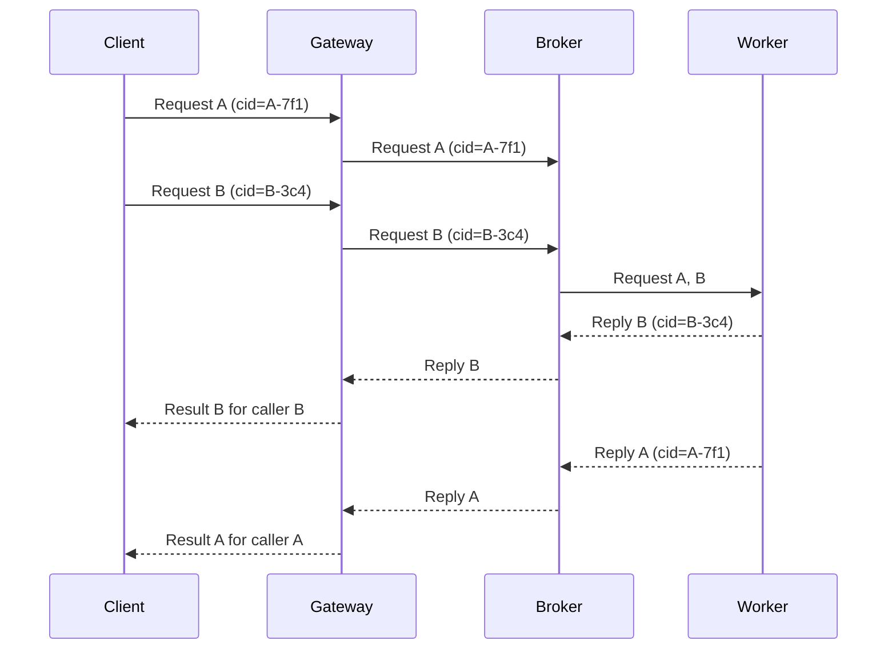
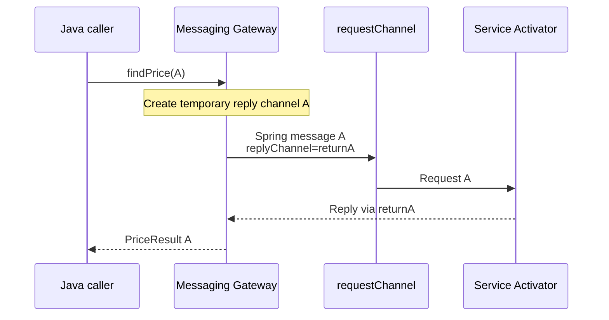
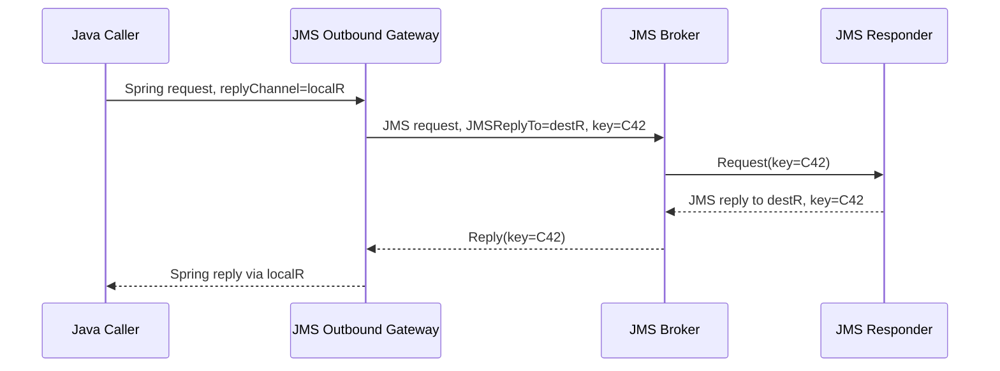
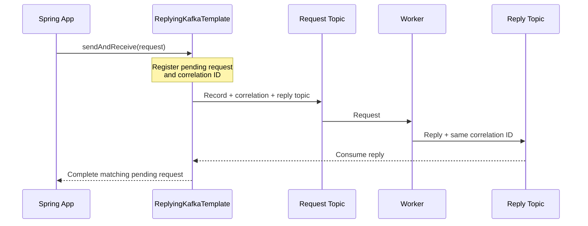
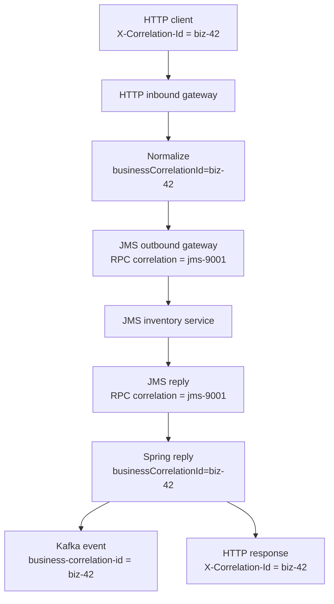

# Correlation ID Between Request and Reply

## 1. The Problem: How to Match the Right Reply to Its Request

In systems built with **Spring Integration Adapters**, a request may pass through `MessageChannel`, gateways, HTTP, JMS, AMQP, Kafka, or multiple services before the result returns. When handling hundreds of concurrent requests, replies often **do not complete in send order**.

For example, a quoting service receives three requests:

| Send time | Request | Correlation ID | Reply time |
|---|---|---|---|
| 10:00:00.000 | Quote A | `quote-A-7f1` | 10:00:02.500 |
| 10:00:00.100 | Quote B | `quote-B-3c4` | 10:00:00.450 |
| 10:00:00.200 | Quote C | `quote-C-9a0` | 10:00:01.100 |

If you simply hand the first reply to the first request, A will mistakenly receive B's result. To prevent this, request/reply systems use a **correlation ID**: a value identifying which original request a reply corresponds to.



This diagram shows two calls executing concurrently. Crucially, the gateway or reply-receiving layer must enforce an **explicit matching rule**. Having a string named `correlationId` in the reply is not enough if sender and receiver disagree on its value, where it lives, and how it is used.

### Learning Objectives

After this lesson, you will be able to:

1. Distinguish correlation ID, message ID, business ID, trace ID, idempotency key, and `replyChannel` address.
2. Understand how Spring Integration manages local request/reply and how gateways combine return addresses and correlation.
3. Design correlation contracts across HTTP, JMS, AMQP, and Kafka without confusing Spring headers with protocol metadata.
4. Handle late replies, duplicates, wrong correlation IDs, timeouts, and restarts.
5. Build request/reply flows in Java/Spring Integration and test concurrent invocations.

## 2. What Correlation ID Is—and What It Is Not

### 2.1. Correlation ID Is a Linking Key

A **correlation ID** is an identifier allowing two parties to link messages within an interaction. Its scope may be:

- **One request/reply pair**: the same ID appears on request and reply, or the reply references the request per protocol rules.
- **A group of messages**: parts emitted by a splitter share a correlation ID so an aggregator can reassemble them.
- **A distributed business flow**: multiple events or tasks carry an ID to reconcile an order, job, or transaction at the application level.

Define the **scope** up front. The ID of one gateway request/reply pair is not necessarily the ID for the entire workflow. A single order may trigger separate inventory, shipping, and payment calls—each with its own request/reply correlation ID while sharing `orderId`.

### 2.2. Commonly Confused IDs

| Value | Answers the question | Managed by | Used for reply matching? |
|---|---|---|---|
| Spring `MessageHeaders.ID` (`id`) | Which Spring message is this? | Spring Messaging | Not automatically on every gateway; may serve as a correlation source per contract |
| Spring `correlationId` | Which group/interaction does this message belong to? | Spring Integration flow/component | Only when the flow/gateway/aggregator is configured to read it |
| `MessageHeaders.REPLY_CHANNEL` | Where to send the reply **inside the Spring app**? | Gateway/endpoint | Destination address only, not an ID |
| JMS `JMSMessageID` | Which JMS message did the broker identify? | JMS provider | Can serve as source for reply correlation, depending on gateway |
| JMS `JMSCorrelationID` | Which prior request does this JMS message relate to? | Producer/gateway/responder | Yes, when both sides follow the same contract |
| AMQP `correlation-id` | Which interaction does this message relate to? | Publisher/gateway | Yes, when the reply echoes the exact value |
| Kafka correlation header | Which request does this reply record match? | Replying Kafka component or application | Yes, with a reply topic and matching correlator |
| HTTP `X-Correlation-Id` / `X-Request-Id` | Which ID is associated with this HTTP request? | Client/API gateway/service | Used for observability or custom contracts; HTTP responses match via connection/call |
| W3C `traceparent` / trace ID | Which distributed trace do these spans belong to? | Tracing system | Primarily for tracing; does not replace pending-request maps |
| Idempotency key | Was this business request already processed? | API/application and state store | Prevents duplicate execution; stays stable across retries, unlike RPC correlation |

**A message is not automatically a valid reply simply because it shares `orderId`.** One order can spawn many distinct requests. Conversely, an RPC correlation ID may change on retry, whereas an idempotency key should stay constant to prevent repeating business side effects.

### 2.3. Choosing an ID That Is Stable and Unique Within Scope

A useful correlation ID should be:

- **Unique across all active pending requests** tracked by the correlator.
- **Consistently represented** on the wire: `String`, UTF-8 bytes, or an agreed format.
- **Free of secrets or PII**: never use emails, phone numbers, or access tokens as IDs.
- **Bounded in length and allowed characters**, especially across HTTP headers, JMS properties, and broker headers.
- **Governed by lifecycle rules**: when it is created, whether intermediate gateways may change it, and when it is evicted from pending maps.
- **Logged alongside request/reply state**, yet never treated as authentication proof.

A random UUID is a common choice:

```java
import java.util.UUID;

String correlationId = UUID.randomUUID().toString();
// Example: 50b12f80-9835-4b6a-8b5a-e8f96853005b
```

If an organization already has a high-uniqueness, standardized ID, you do not have to mint a fresh UUID at every hop. More important than format is **who creates it, who echoes it, and who matches on it**.

## 3. Correlation ID in Spring Integration MessageHeaders

### 3.1. Business Headers vs. Splitter/Aggregator Headers

Spring Integration uses familiar header names like `correlationId`, `sequenceNumber`, and `sequenceSize` for grouping messages or split/aggregate steps. `IntegrationMessageHeaderAccessor` defines these standard constants; for example:

```java
import org.springframework.integration.IntegrationMessageHeaderAccessor;
import org.springframework.messaging.Message;
import org.springframework.messaging.support.MessageBuilder;

Message<String> message = MessageBuilder.withPayload("quote-request")
        .setHeader(
                IntegrationMessageHeaderAccessor.CORRELATION_ID,
                "quote-2026-001")
        .build();

Object id = message.getHeaders().get(
        IntegrationMessageHeaderAccessor.CORRELATION_ID);
System.out.println(id); // quote-2026-001
```

The standard name maps to `"correlationId"`. However, **not every gateway uses this header as its reply-matching key**, because each adapter has its own mechanism.

Specifically with **splitters/aggregators**, `correlationId` represents the **group of parts** to reassemble alongside `sequenceNumber` and `sequenceSize`. If you also need a cross-service ID, use a separate header like `businessCorrelationId` or `orderId` to avoid corrupting aggregator group keys.

### 3.2. How Reply Channel and Correlation ID Collaborate

`MessageHeaders.REPLY_CHANNEL` holds the address where an endpoint can send its result:

```java
import org.springframework.messaging.Message;
import org.springframework.messaging.MessageHeaders;

Object replyAddress = message.getHeaders()
        .get(MessageHeaders.REPLY_CHANNEL);
Object correlation = message.getHeaders()
        .get("correlationId");
```

Meaning:

- `replyAddress`: the **return address** such as an internal `MessageChannel` or channel name.
- `correlation`: an ID used to **identify an interaction/message group** when flow policies require it.

A `@MessagingGateway` calling a `DirectChannel` normally manages an invocation-scoped temporary reply channel. In that case, the gateway **does not require you to manually generate a correlation ID to reply to the right caller**: each invocation already has its own return address.

When crossing JMS/AMQP/Kafka or sharing one reply topic/queue across many requests, additional native correlation rules are needed. Never try to serialize the Java `MessageChannel` object from `replyChannel` across the network.

### 3.3. Building New Messages Without Losing Context

A custom transformer can drop IDs or return addresses when rebuilding a message:

```java
// Example likely to lose metadata in a custom component:
// the new message carries only payload and drops request headers.
Message<String> careless = MessageBuilder
        .withPayload("processed")
        .build();
```

When changing payloads while keeping context inside an internal flow, you can do:

```java
import org.springframework.messaging.Message;
import org.springframework.messaging.support.MessageBuilder;

Message<String> transformed = MessageBuilder
        .withPayload("processed")
        .copyHeaders(requestMessage.getHeaders())
        .build();
```

`copyHeaders(...)` preserves appropriate request headers. When crossing out to another protocol, **do not copy all headers onto the native message**: outbound header mappers must filter out internal-only entries like `replyChannel`, `errorChannel`, or non-serializable objects.

Many built-in Spring Integration endpoints automatically forward or merge request headers onto replies. The highest risk sits in custom components, DTO mappings, broker bridges, and manually constructed messages; inspect **actual** messages at every boundary.

## 4. Local Gateways: Request/Reply Does Not Always Need a Correlation Header

### 4.1. Java Calls Route via Temporary Reply Channels

A messaging gateway bridges a Java method to a `MessageChannel`:



Because the reply channel is per-invocation, one gateway distinguishes concurrent calls on the same `requestChannel`. This is **in-JVM request/reply**, unlike broker systems sharing common reply destinations.

### 4.2. Complete Java DSL Example

Suppose a service receives a quote request and returns a result. A `correlationId` is included per business contract for logging/reconciliation even though the messaging gateway already isolates replies.

```java
// QuoteRequest.java
public record QuoteRequest(String quoteId, int quantity) {}

// QuoteReply.java
public record QuoteReply(
        String quoteId, String correlationId, long totalCents) {}
```

Gateway interface:

```java
import org.springframework.integration.annotation.MessagingGateway;
import org.springframework.messaging.handler.annotation.Header;

@MessagingGateway(
        defaultRequestChannel = "quotes.requests",
        defaultReplyTimeout = "5000")
public interface QuoteGateway {

    QuoteReply calculate(
            QuoteRequest request,
            @Header("correlationId") String correlationId);
}
```

Flow:

```java
import org.springframework.context.annotation.Bean;
import org.springframework.context.annotation.Configuration;
import org.springframework.integration.annotation.IntegrationComponentScan;
import org.springframework.integration.config.EnableIntegration;
import org.springframework.integration.channel.DirectChannel;
import org.springframework.integration.dsl.IntegrationFlow;
import org.springframework.messaging.MessageChannel;

@Configuration
@EnableIntegration
@IntegrationComponentScan
public class QuoteFlowConfig {

    @Bean(name = "quotes.requests")
    public MessageChannel quotesRequests() {
        return new DirectChannel();
    }

    @Bean
    public IntegrationFlow quoteFlow() {
        return IntegrationFlow.from("quotes.requests")
                .handle((payload, headers) -> {
                    QuoteRequest request = (QuoteRequest) payload;
                    String correlationId =
                            (String) headers.get("correlationId");

                    if (correlationId == null || correlationId.isBlank()) {
                        throw new IllegalArgumentException(
                                "correlationId is required");
                    }
                    if (request.quantity() <= 0) {
                        throw new IllegalArgumentException(
                                "quantity must be positive");
                    }

                    return new QuoteReply(
                            request.quoteId(),
                            correlationId,
                            request.quantity() * 1_500L);
                })
                .get();
    }
}
```

Caller:

```java
import java.util.UUID;

String cid = UUID.randomUUID().toString();
QuoteReply reply = quoteGateway.calculate(
        new QuoteRequest("Q-42", 3), cid);

System.out.println(reply.quoteId());      // Q-42
System.out.println(reply.correlationId()); // matches the request's cid
System.out.println(reply.totalCents());    // 4500
```

In this example, `@Header("correlationId")` places the ID on the request message; the handler reads the header and echoes it inside the DTO. **Reply routing** is still handled by the gateway/`replyChannel`. Including correlation in the response DTO demonstrates business linking, not a requirement of `@MessagingGateway` for local reply matching.

### 4.3. When Do You Need to Manage a Pending Requests Table Yourself?

Manage correlation explicitly when the flow cannot rely on per-invocation return addresses, such as:

- Many requests go to a broker and share a single reply queue/topic.
- An app sends via a one-way outbound adapter and registers its own reply consumer.
- External systems in different languages/frameworks send async replies to a shared endpoint.
- Transactions must persist and recover across restarts, when in-JVM temporary reply channels no longer exist.

Conceptual design:

```text
send(request, correlationId):
    pending[correlationId] = promise + deadline
    publish(request with correlationId)

onReply(reply):
    id = readProtocolCorrelation(reply)
    pendingRequest = pending.remove(id)
    if pendingRequest != null:
        complete(pendingRequest.promise, reply)
    else:
        handleUnknownOrLateReply(reply)

onTimeout(id):
    pendingRequest = pending.remove(id)
    if pendingRequest != null:
        completeTimeout(pendingRequest.promise)
```

This is pseudocode, not production code. Real implementations must handle **races** between replies and timeouts, map cleanup, duplicate replies, restarts, backpressure, memory limits, and locking/atomicity. Built-in gateways already implement most of this machinery.

## 5. HTTP: Receiving, Propagating, and Returning Correlation IDs

### 5.1. HTTP Responses Are Already Bound to Requests

In synchronous HTTP calls, client and server pair responses with requests at the request/connection/protocol layer; **an HTTP client does not need `X-Correlation-Id` to know which call a response belongs to**. Still, correlation headers are invaluable to:

- Trace the same request across reverse proxies, API gateways, and microservices.
- Surface an ID on error responses for support troubleshooting.
- Link HTTP logs with downstream JMS/AMQP/Kafka requests triggered by that HTTP call.
- Track multi-step business processing even after HTTP returns `202 Accepted`.

`X-Correlation-Id` and `X-Request-Id` are **application conventions**, not mandatory HTTP headers. Standardize spelling, generation rules, and response echoing.

### 5.2. Contract at the HTTP Inbound Gateway

Example HTTP request:

```http
POST /quotes HTTP/1.1
Content-Type: application/json
X-Correlation-Id: 50b12f80-9835-4b6a-8b5a-e8f96853005b

{"quoteId":"Q-42","quantity":3}
```

A sound ingress policy:

1. If the client sends an ID and external IDs are permitted, validate length, characters, and format; never treat it as authentication.
2. If missing, mint a new ID at ingress and attach it to the request context.
3. Normalize into an internal Spring header (e.g., `businessCorrelationId`), rather than assuming a mapper automatically renames `X-Correlation-Id` to `correlationId`.
4. Echo the ID in response metadata per API contract:

```http
HTTP/1.1 200 OK
Content-Type: application/json
X-Correlation-Id: 50b12f80-9835-4b6a-8b5a-e8f96853005b

{"quoteId":"Q-42","totalCents":4500}
```

`DefaultHttpHeaderMapper` and `mapped-request-headers`/`mapped-response-headers` select which HTTP header names cross the gateway. However, **header mapping** and **header renaming** are separate tasks: to populate a Spring key `businessCorrelationId`, use a transformer, header enricher, or custom mapper.

### 5.3. HTTP Outbound Gateway and Remote Echoing

When a flow calls an external HTTP service:

```text
Spring request
   headers.businessCorrelationId = "Q-42-abc"
          |
          v
normalize to HTTP X-Correlation-Id
          |
          v
HTTP outbound gateway ----> Remote service
                                  |
                                  v
                       HTTP response X-Correlation-Id
                                  |
                                  v
                     Reply Spring message
```

Never assume every remote service echoes headers cleanly. If verification is needed, compare against the expected request ID; if the remote has no echo contract, do not fail the flow solely because optional metadata is absent.

Distinguish HTTP client/gateway timeouts from broker timeouts. Correlation IDs in HTTP logs remain valuable even after a client closes its connection.

## 6. JMS: JMSMessageID, JMSCorrelationID, and JMSReplyTo

### 6.1. Three JMS Fields With Distinct Roles

JMS provides native headers:

| Field | Managed by | Role |
|---|---|---|
| `JMSMessageID` | Typically assigned by the JMS provider on send | Identifies the published JMS message |
| `JMSCorrelationID` | Set by application/gateway/responder | Links a message to a prior request |
| `JMSReplyTo` | Set by producer/gateway | JMS destination where replies must be sent |

`JMSReplyTo` is the **return address**, and `JMSCorrelationID` is the **linking key**. Both differ from Spring's `MessageHeaders.REPLY_CHANNEL`.

JMS supports multiple request/reply correlation strategies. Two example contracts:

**Strategy using the request Message ID**:

```text
Native request:
    JMSMessageID     = ID:broker-9081
    JMSReplyTo       = temporaryReplyQueue

Native reply:
    JMSCorrelationID = ID:broker-9081
    Destination      = temporaryReplyQueue
```

**Strategy using an application/gateway-supplied Correlation ID**:

```text
Native request:
    JMSCorrelationID = req-7f1
    JMSReplyTo       = replies.queue

Native reply:
    JMSCorrelationID = req-7f1
    Destination      = replies.queue
```

**These two diagrams represent two distinct contracts.** The responder must echo whichever value the gateway correlates on; never arbitrarily swap between request `JMSMessageID` and `JMSCorrelationID`.

### 6.2. Inside Spring Integration JMS Gateways

Spring Integration JMS inbound/outbound gateways bridge Spring messages and JMS requests/replies. They can correlate via `JMSCorrelationID` or message ID depending on settings like `correlation-key`. Always verify your version and gateway configuration before deciding which value responders should echo.

Sequence diagram:



In this diagram, `key=C42` denotes the **correlation value agreed upon by gateway and responder**; in concrete deployments it may derive from JMS message ID or `JMSCorrelationID`.

### 6.3. Mapping JMS Headers to Spring Headers

Spring Integration's `DefaultJmsHeaderMapper` uses `jms_*` headers for JMS metadata, such as `jms_correlationId`, `jms_messageId`, and `jms_replyTo`. Depending on mapper settings, application properties map to dedicated Spring headers.

Do not confuse them:

```text
headers["correlationId"]       // Spring Integration / workflow
headers["jms_correlationId"]   // represents JMSCorrelationID
headers["jms_messageId"]       // represents JMSMessageID
headers["replyChannel"]        // Spring internal MessageChannel
headers["jms_replyTo"]         // JMS Destination
```

If your system needs a cross-broker business correlation ID, carry it in a separate header/property (such as `businessCorrelationId`) and let the JMS gateway manage local request/reply IDs.

### 6.4. Typical JMS Pitfalls

- Request sets a new correlation ID, yet responder echoes **JMSMessageID** instead of the `JMSCorrelationID` the gateway awaits.
- Responder echoes the right correlation ID, but sends to the wrong `JMSReplyTo` destination.
- Multiple gateways share one reply queue with incompatible selectors/consumers or non-unique IDs.
- Request TTL/time-to-live is shorter than processing time, causing requests to expire before workers process them.
- Caller times out while the JMS reply arrives later; late replies must be handled or discarded cleanly.
- Setting JMS properties with unsupported types. JMS properties support primitives/Strings per spec; never serialize `MessageChannel` or arbitrary objects directly.

## 7. AMQP/RabbitMQ: correlation-id and reply-to

### 7.1. Native Request/Reply Metadata

AMQP 0-9-1 defines properties including `correlation_id` and `reply_to`. Spring AMQP maps them to Java fields `MessageProperties.correlationId` and `MessageProperties.replyTo`. Wire and Java names differ slightly, while core semantics match:

```text
AMQP request
    properties.correlationId = "req-42"
    properties.replyTo       = "amq.rabbitmq.reply-to" (when using direct reply-to)
    body                     = JSON bytes

AMQP reply
    properties.correlationId = "req-42"
    routing destination      = reply-to from request
    body                     = JSON reply bytes
```

This illustrates a direct reply-to flow; exact destination names and gateway correlation generation depend on `RabbitTemplate`/Spring Integration endpoint config. Avoid hard-coding `amq.rabbitmq.reply-to` across every application.

### 7.2. Spring Integration and Spring AMQP

AMQP outbound gateways typically rely on Spring AMQP's request/reply abstractions; the framework handles sending requests, receiving replies, and matching correlations. A Spring message can simultaneously carry:

- `replyChannel`: return address inside the current integration flow.
- `amqp_correlationId`: native broker metadata if permitted by the mapper.
- `businessCorrelationId`: dedicated business ID for multi-hop tracing.

**Keep purposes separate:** an AMQP gateway may set or overwrite correlation IDs to manage pending requests, so never bet that a user header `correlationId` will remain untouched across all versions and configs. When a business ID must remain immutable, pass it in an independent application header with explicit mapping rules.

### 7.3. Direct Reply-To, Temporary Queues, and Fixed Reply Queues

RabbitMQ offers several reply patterns:

| Type | Characteristics | Watch out for |
|---|---|---|
| Direct reply-to | Optimized RPC mechanism for direct replies | Replies are transient; client must be actively waiting |
| Temporary/exclusive reply queue | Dedicated reply destination per client/gateway | Queue and consumer lifecycle |
| Fixed reply queue | Multiple requests share one destination | Correlation, consumers, selectors/dispatch, and cleanup |

None of these replace correlation IDs when multiple requests wait on a shared reply path. A reply queue name only says **where to send**—not **which request it belongs to**.

If responses can arrive minutes or hours later, favor an event/callback/status model over synchronous gateway RPC.

## 8. Kafka: Reply Topics, Correlation Headers, and Record Keys

### 8.1. Kafka Has No Native RPC Like HTTP

A Kafka broker stores records in topics/partitions; it does not inherently know which record is a request or a reply. Request/reply requires parties to agree on:

1. **Request topic** that producers write to.
2. **Reply topic** (and partition if needed) where workers publish results.
3. **Correlation header** carrying the ID linking reply to request.
4. **Timeout** awaiting replies, plus handling for late/duplicate replies.
5. Serializers/deserializers and payload schemas.

Spring Kafka provides `ReplyingKafkaTemplate` and header constants such as `KafkaHeaders.REPLY_TOPIC` and `KafkaHeaders.CORRELATION_ID`; Spring Integration Kafka provides outbound gateways integrating request/reply over these mechanisms.

### 8.2. Record Key Is Not a Correlation Header

| Kafka field | Example | Role |
|---|---|---|
| Record `key` | `customer-18` | Controls partitioning, affinity, and per-key ordering |
| Record `value` | JSON/Avro/Protobuf bytes | Business payload |
| Native correlation header | Bytes representing request ID | Matches reply to request |
| Native reply-topic header | Bytes representing target topic per library/protocol | Tells responder where to send replies |
| Record offset | 3981 | Position inside partition; not a request ID |

The same key `customer-18` can appear across **many** records in one partition. Relying solely on the Kafka key for reply matching causes collisions whenever multiple requests for the same customer run concurrently.

### 8.3. Flow With ReplyingKafkaTemplate



Native Kafka correlation headers are byte arrays. If implementing a responder in another language, you must **echo the exact bytes the gateway correlates on**, not just log a similar-looking string. If standardizing on UTF-8 strings, both sides must enforce that encoding in the contract.

Inspecting native bytes with the Kafka API:

```java
import java.nio.charset.StandardCharsets;
import org.apache.kafka.common.header.internals.RecordHeaders;

byte[] correlationBytes =
        "req-2026-42".getBytes(StandardCharsets.UTF_8);

RecordHeaders headers = new RecordHeaders()
        .add("business-correlation-id", correlationBytes);

// This is an application header agreed upon by both sides.
// ReplyingKafkaTemplate manages its own library correlation header.
```

This snippet intentionally uses `business-correlation-id` to separate **business** metadata from the library's correlation header, avoiding accidental overwrites of `ReplyingKafkaTemplate`-managed metadata. When configuring a gateway, verify exact header names and byte conversions for your version.

### 8.4. Sharing a Reply Topic

When multiple service instances share a reply topic, ensure every pending request has **one clear instance owning the matching reply consumer** or an explicit routing strategy. If instance B's consumer reads instance A's reply without holding A's pending correlation, instance A will time out.

Designs typically assign per-instance reply partitions/routing, manage consumer partition assignment, and avoid sending requests before reply listeners are assigned partitions. Never assume uniqueness of correlation ID alone guarantees delivery to the right instance.

## 9. Mapping IDs Across Multiple Protocols

### 9.1. A Clear Cross-System Contract

Suppose a flow receives an HTTP order, queries inventory over JMS, and publishes a Kafka event. Agree on a **`businessCorrelationId`** at ingress while letting each gateway manage its own RPC correlation ID.



| Boundary | Business ID | Layer-local request/reply ID | Responsibility |
|---|---|---|---|
| HTTP inbound | `X-Correlation-Id` → `businessCorrelationId` | HTTP request lifecycle | Validate and mint ID when needed |
| Spring flow | `businessCorrelationId` in message headers | Temporary `replyChannel` | Preserve context; reply to right invocation |
| JMS outbound | Dedicated application property if needed | `JMSMessageID`/`JMSCorrelationID` per gateway | Gateway + responder match |
| JMS inbound reply | Recover business ID per contract | Native JMS correlation | Gateway maps reply back |
| Kafka event | `business-correlation-id` bytes header | No RPC when publishing one-way event | Producer/consumer follow shared schema/headers |
| HTTP response | `X-Correlation-Id` per echo contract | Current request's HTTP response | Return to client |

This table illustrates a **sample design**. Spring Integration does not automatically rename `X-Correlation-Id` to `businessCorrelationId`, generate `jms-9001` in this format, or emit Kafka headers unless mappers are configured.

### 9.2. Normalize IDs at the Boundary, Keep Them Stable Downstream

Example custom handler accepting a validated correlation ID header:

```java
import java.util.UUID;
import org.springframework.messaging.Message;
import org.springframework.messaging.support.MessageBuilder;

// inbound: Message<?> from an adapter; rawId has been extracted and validated.
String id = rawId == null || rawId.isBlank()
        ? UUID.randomUUID().toString()
        : rawId;

Message<?> normalized = MessageBuilder
        .fromMessage(inbound)
        .setHeader("businessCorrelationId", id)
        .build();
```

This assumes `rawId` already passed format/length checks or came from a trusted source. If a client supplies an invalid ID, many systems reject the request rather than silently accepting it. When building the response, attach the exact ID per contract.

### 9.3. Never Copy All Headers Across the Network

Spring headers may hold `replyChannel`, `errorChannel`, `id`, `timestamp`, `sequenceNumber`, or internal objects. These have meaning inside a flow, not on a broker.

Configure an allowlist at each adapter:

```text
Exported to partner:
    businessCorrelationId
    traceparent (if standard tracing applies)
    schemaVersion
    contentType (if supported by protocol/mapper)

Never forwarded raw from Spring runtime:
    replyChannel
    errorChannel
    arbitrary MessageChannel/Throwable/Java objects
    retry/broker received-only metadata
```

In JMS, AMQP, or Kafka, use protocol-specific header mappers/converters and inspect metadata **on the wire**. Because a gateway's correlation ID may be generated and managed by the gateway itself, never accidentally overwrite it with an application header.

## 10. Timeouts, Late Replies, Duplicate Replies, and Retries

### 10.1. Correlation ID Does Not Guarantee a Reply Will Arrive

A gateway awaits a reply within a deadline, yet things can go wrong:

- The worker takes longer than `replyTimeout`.
- The broker disconnects or routes the message to a DLQ.
- The responder forgets to echo the correlation ID.
- The reply goes to the wrong topic/queue or another consumer.
- A gateway instance restarts, wiping its in-memory pending table.
- A request succeeds once, yet its reply arrives twice.

When a reply arrives late, the pending entry may already be evicted. The gateway can no longer return data to a caller that has timed out. Depending on the component, the system may log, drop the reply, route to an error/late-reply flow, or update business state.

### 10.2. Distinguishing Retries and Idempotency

Suppose an HTTP caller retries after missing a response:

```text
Business orderId = O-42
Idempotency key  = create-order:O-42

Attempt 1:
    RPC correlation = req-abc
    timeout (caller did not receive result)

Attempt 2:
    RPC correlation = req-def
    may complete quickly

If both attempts actually create an order:
    two business side effects occurred!
```

**Correlation IDs only match replies; they do not prevent duplicate business execution.** You need an idempotency key stable across retries, DB/service deduplication, and clear semantics for repeated requests.

Some systems keep one correlation ID across retries for tracing; others mint a fresh RPC ID per attempt to avoid matching stale replies. Both are valid once **both ID scopes** are separated:

- **Business operation ID**: stable across related retry attempts.
- **Per-attempt request/reply ID**: unique in the active pending map at that moment.

### 10.3. Races Between Timeout and Reply

In a custom dispatcher, this race can happen:

```text
t=4.999s  Reply handler finds pending[id]
t=5.000s  Timeout handler also finds pending[id]
t=5.001s  Both threads attempt to complete the promise
```

A clean policy: use an atomic `remove(id)` or complete-at-most-once synchronization so **only one** side claims the final outcome. The losing thread treats it as a late or already-handled reply. An unsynchronized `HashMap` with separate check-then-remove invites race conditions.

With standard gateways, prefer the library's built-in correlation/timeout machinery rather than writing a custom pending map just to save configuration.

### 10.4. Gateway Timeouts vs. Business Lifetimes

Keep these separate:

| Duration | What does it bound? |
|---|---|
| Messaging gateway `requestTimeout` | Sending the request into a potentially blocking channel |
| Messaging gateway `replyTimeout` | Waiting for the reply after request handoff |
| Network read/connect timeout | Connecting/reading replies from HTTP/broker |
| Broker message TTL | How long a message may live inside the broker |
| Business SLA | How long the actual business work is allowed to take |

When a flow uses `DirectChannel` and the handler runs slowly on the calling thread, `replyTimeout` is not a preemptive timer that aborts the synchronous handler. For very long tasks, return a **job ID** and report progress via events, callbacks, or polling.

## 11. Correlation ID, Tracing, and Operational Observability

### 11.1. Distributed Tracing Does Not Replace Request/Reply Matching

W3C Trace Context uses `traceparent` carrying a trace ID, parent span ID, and flags. A single trace can span multiple parallel downstream calls, retries, and pub/sub hops. Therefore a trace ID is usually **not unique per pending request/reply** and is unsuitable as the sole correlation key on gateways.

An observability layout:

```text
traceId             = entire distributed trace
spanId              = current operation
businessCorrelation = order/workflow
rpcCorrelation      = request/reply at a specific gateway
messageId           = individual message/record ID
```

Log these as distinct fields so you never have to parse them out of one overloaded string. Never dump raw partner headers if they contain sensitive values.

### 11.2. Useful Metrics

- Count of active pending requests (`pendingCount`).
- Rates of timely replies, timeouts, late replies, and unknown correlation IDs.
- Latency p50/p95/p99 by request type.
- Missing/invalid correlation ID error counts.
- Duplicate reply counts and pending requests aborted by restarts.
- Kafka reply consumer lag or JMS/AMQP reply queue backlog.
- Retry rates and business-layer idempotency conflict counts.

Steadily rising `pendingCount` can indicate slow workers, misrouted replies, unassigned consumer partitions, or leaked cleanup. Correlate application logs with broker metrics to isolate root causes.

### 11.3. Security Rules

- IDs are **observability metadata**, never proof of caller authorization.
- Bound length, charset, and allowed characters; never interpolate untrusted IDs directly into queries or unsafe log formats.
- Never use emails, tokens, session IDs, or PII directly as correlation IDs.
- If clients may pass an ID, validate before propagating; generate server-controlled IDs where high trust is required.
- External partners should only see IDs and headers required by the contract under least privilege.

## 12. Testing Correlation Between Request and Reply

Thorough tests inspect **IDs on both sides**, reply matching logic, and failure paths. Asserting a log contains a `correlationId` string does not prove the dispatcher returns replies to the right caller.

### 12.1. Testing a Gateway With One Request

Using `QuoteFlowConfig`, `QuoteGateway`, and the models from Section 4.2 in one Spring context:

```java
import static org.junit.jupiter.api.Assertions.assertEquals;

import org.junit.jupiter.api.Test;
import org.springframework.beans.factory.annotation.Autowired;
import org.springframework.test.context.junit.jupiter.SpringJUnitConfig;

@SpringJUnitConfig(QuoteFlowConfig.class)
class QuoteGatewayTest {

    @Autowired
    QuoteGateway gateway;

    @Test
    void replyCarriesCorrelationFromItsRequest() {
        QuoteReply reply = gateway.calculate(
                new QuoteRequest("Q-42", 3),
                "cid-Q-42");

        assertEquals("Q-42", reply.quoteId());
        assertEquals("cid-Q-42", reply.correlationId());
        assertEquals(4500L, reply.totalCents());
    }
}
```

This verifies the **business value** is echoed. For native broker request/reply, also test `JMSCorrelationID`, AMQP `correlation-id`, or Kafka native correlation headers.

### 12.2. Testing Concurrent Requests

A valuable test sends many distinct request IDs without assuming completion order:

```java
import static org.junit.jupiter.api.Assertions.assertEquals;

import java.util.ArrayList;
import java.util.List;
import java.util.concurrent.CompletableFuture;
import java.util.concurrent.ExecutorService;
import java.util.concurrent.Executors;
import org.junit.jupiter.api.Test;

@Test
void concurrentRepliesMatchRequestIds() {
    ExecutorService pool = Executors.newFixedThreadPool(8);
    try {
        List<CompletableFuture<QuoteReply>> tasks = new ArrayList<>();

        for (int i = 0; i < 32; i++) {
            final int index = i;
            tasks.add(CompletableFuture.supplyAsync(() -> {
                String quoteId = "Q-" + index;
                String cid = "cid-" + index;
                return gateway.calculate(
                        new QuoteRequest(quoteId, 2), cid);
            }, pool));
        }

        for (int i = 0; i < tasks.size(); i++) {
            QuoteReply result = tasks.get(i).join();
            assertEquals("Q-" + i, result.quoteId());
            assertEquals("cid-" + i, result.correlationId());
        }
    } finally {
        pool.shutdown();
    }
}
```

With `DirectChannel`, each request still executes synchronously on its calling thread. To expose order-dependent reply-matching bugs, add an **asynchronous** test variant using `ExecutorChannel`, controlled variable delays, a shared reply queue/topic, and native correlation—intentionally forcing calls to complete **out of send order**.

### 12.3. Integration Test Matrix

| Scenario | Setup | Expectation |
|---|---|---|
| Normal reply | Request A, reply carries ID A | Caller A gets matching result |
| Out-of-order replies | Requests A, B; reply B returns before A | No cross-talk between replies |
| Two requests sharing business ID | Two distinct RPC calls for the same order | RPC correlation still distinguishes both |
| Missing ID | Reply lacks required correlation | Rejected/logged, never assigned to wrong request |
| Unknown ID | Reply carries ID absent from pending map | Does not complete any other pending request |
| Duplicate reply | Reply A delivered twice | Completes once, duplicate recorded |
| Late reply | Reply A arrives after timeout | Caller gets timeout; late reply follows policy |
| Gateway restart | Pending map lost | Never assume temporary reply paths survive |
| JMS request-ID strategy | Responder echoes request `JMSMessageID` | Gateway correlates properly per config |
| JMS correlation strategy | Responder echoes `JMSCorrelationID` | Gateway correlates properly per config |
| AMQP RPC | Matching `reply-to` and correlation | No timeout; no mismatch |
| Shared Kafka reply topic | Multiple instances, many pending requests | Replies reach the owning instance/consumer |
| HTTP propagation | Request carries `X-Correlation-Id` | Response and downstream follow contract |
| Error handler | Worker throws exception, retry/DLQ | Traceable ID; failures never masquerade as success replies |
| Invalid/oversized ID | Client sends malformed string | Blocked/normalized per policy |

For brokers, run integration tests against JMS/AMQP containers or Kafka test brokers to observe **native properties/headers**. Verify all assumptions about Spring header prefixes and gateway ID selection against your actual dependency versions.

## 13. Diagnosing Reply-Matching Failures

| Symptom | Common cause | Fix |
|---|---|---|
| Gateway times out though worker replied | Wrong reply destination/topic or mismatched correlation | Log native `reply-to` and correlation on both request and reply |
| Reply delivered to wrong caller | Custom FIFO dispatcher or non-unique key | Use a pending map keyed by unique per-request ID |
| Reply arrives with no pending request | Timeout/restart or mutated ID | Handle late/unknown replies; inspect ID lifecycle |
| JMS gateway receives no reply | Responder echoed wrong `JMSMessageID` vs. `JMSCorrelationID` | Check `correlation-key` config and responder rules |
| AMQP RPC fails to match | Reply fails to echo gateway's expected correlation ID | Inspect native `MessageProperties` on request and reply |
| Kafka reply consumed by another instance | Misconfigured reply topic/partition or consumer assignment | Configure per-instance reply partitions/routing and readiness |
| Spring `correlationId` changes at splitter | Grouping header overloaded for business tracking | Separate `businessCorrelationId` from aggregation correlation |
| ID missing on HTTP response | Mapper only passes request headers | Configure response mapping / explicit response header |
| Reply delivered multiple times | Retries or worker emits duplicates | Enforce at-most-once completion and business idempotency |
| Same trace ID logged yet gateway times out | Trace ID is not the RPC correlation key | Measure the exact ID the gateway matches on |
| Lost `replyChannel` in custom transformer | Built new message without copying headers | Preserve return address inside internal flows |
| Type error sending ID to broker | Tried to serialize object or unsupported value | Normalize to `String`/`byte[]` with protocol-matching mapper |

## 14. Hands-On Exercise

**Context:** Write a service accepting quote requests via HTTP, processing simply in Spring Integration, with an extended variant calling a worker over JMS or AMQP. Multiple clients call concurrently, and every result must return to the exact originating request. Timed-out requests may be retried.

**Tasks:**

1. Design two IDs: a multi-hop `businessCorrelationId` and a gateway-level RPC ID (when using a broker). Write a spec table covering generator, storage location, format, lifecycle, and missing-value behavior.
2. Build `@MessagingGateway` and `IntegrationFlow` as in Section 4.2. Add `@Header("correlationId")` so the handler reads the ID and echoes it in `QuoteReply`.
3. Send at least 32 concurrent requests with distinct IDs. Assert request/reply IDs match per invocation regardless of reply completion order.
4. Introduce an `ExecutorChannel` or async worker. Inject delays so request B finishes before A; set `replyTimeout` and test replies arriving both before and after the deadline.
5. Add HTTP `X-Correlation-Id` mapping inbound and outbound. Ensure requests missing an ID follow your documented mint/reject policy.
6. If a broker is available, inspect native `JMSCorrelationID/JMSReplyTo` or AMQP `correlationId/replyTo`. Configure the responder to echo the exact **ID the gateway matches on**.
7. Simulate missing IDs, duplicate IDs, wrong destinations, late replies, and duplicate replies. Verify the gateway never delivers a reply to the wrong caller.
8. Retry an order creation with the same idempotency key and a fresh RPC correlation ID, proving the business side effect executes only once.

**Completion criteria:** business IDs and per-request correlations remain separate; parallel replies never cross-talk; native reply metadata honors the contract; timeouts, duplicates, and late replies follow explicit policies; and internal `replyChannel` is never serialized across a broker.

## 15. Key Takeaways

- **Correlation ID identifies which request a reply belongs to; the return address (`replyChannel`, `JMSReplyTo`, `reply_to`, reply topic) says where to send the reply.**
- In local flows, messaging gateways automatically manage invocation-scoped temporary reply channels. You do not have to set `correlationId` manually just to reply to the right Java caller.
- `MessageHeaders.ID`, `IntegrationMessageHeaderAccessor.CORRELATION_ID`, JMS `JMSMessageID/JMSCorrelationID`, AMQP `correlation-id`, Kafka correlation headers, and tracing IDs have **different scopes and owners**.
- Choose and test an explicit native contract for each protocol; never expect the framework to automatically rename or echo IDs across HTTP, JMS, AMQP, and Kafka without configuration.
- Shared async reply queues/topics require **uniqueness, timeouts, cleanup, and late/duplicate reply handling**.
- Correlation IDs do not guarantee delivery, manage retries, or **replace idempotency**.
- Tests must verify native metadata and reply matching under concurrency, delays, and errors—beyond merely inspecting headers inside `Message<?>`.

## References

- [Spring Integration Reference — Messaging Gateways](https://docs.spring.io/spring-integration/reference/gateway.html): temporary reply channels, reply timeouts, bridging Java methods to message flows.
- [Spring Integration Reference — Aggregator](https://docs.spring.io/spring-integration/reference/aggregator.html): correlation strategy, release strategy, sequence headers.
- [Spring Integration Reference — JMS Support](https://docs.spring.io/spring-integration/reference/jms.html): outbound/inbound gateways, correlation keys, reply destinations.
- [Spring Integration Reference — AMQP Support](https://docs.spring.io/spring-integration/reference/amqp.html): AMQP request/reply gateways and header mapping.
- [Spring Integration Reference — Kafka Support](https://docs.spring.io/spring-integration/reference/kafka.html): Kafka outbound gateways.
- [Spring Kafka Reference — ReplyingKafkaTemplate](https://docs.spring.io/spring-kafka/reference/kafka/sending-messages.html#replying-template): reply topics, correlation headers, reply listeners.
- [Spring Framework Reference — Integration Messaging](https://docs.spring.io/spring-framework/reference/integration.html): messaging foundations and message headers.
- [W3C Trace Context](https://www.w3.org/TR/trace-context/): `traceparent` and trace/span IDs.

*This lesson describes common contracts and mechanisms. Exact behavior of JMS/AMQP/Kafka gateways, native header names, and correlation defaults depend on your Spring Integration, Spring AMQP, Spring Kafka versions and endpoint config. When deploying, verify against your exact API/version and run protocol-level integration tests before production.*
