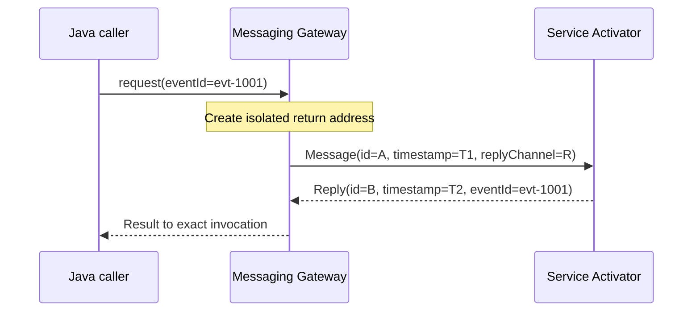
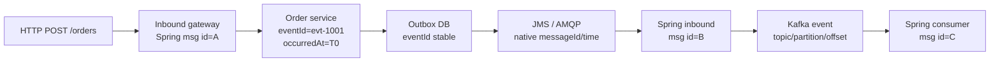

# Message ID and Timestamp

## 1. When a Message Crosses Multiple Systems, Which "ID" and "Time" Are Right?

In **Spring Integration Adapters** (`SPRING_INTEGRATION_ADAPTERS`), an application connects to HTTP, JMS, AMQP, Kafka, files/SFTP, and databases via inbound/outbound adapters, gateways, pollers, and `MessageChannel`. Data is typically wrapped into a Spring `Message<?>` consisting of a `payload` and `headers`.

Every message can carry **multiple IDs** and **multiple timestamps**:

- Spring assigns an ID to `Message<?>` to identify the message inside Spring Messaging.
- A JMS broker can assign `JMSMessageID` when a message is sent.
- A Kafka record has `topic`, `partition`, `offset`, and a record timestamp.
- An AMQP publisher can set `messageId` and `timestamp` in message properties.
- A file has a name, path, and modification time; a database row has a primary key and timestamp columns.
- The business domain has `orderId`/`eventId`, the time the event actually occurred, and a correlation ID linking multiple steps.

These values **are not automatically equal**. For example, the same "order O-42 created" event might be re-read from Kafka and turned into two distinct Spring messages. If you only check the Spring message ID, the system might mistake them for two independent business events; if you treat the Kafka timestamp as when the order was placed, reports can skew whenever a producer publishes late.

### Learning Objectives

After this lesson, you will be able to:

1. Read and explain `MessageHeaders.ID` and `MessageHeaders.TIMESTAMP` in Spring Integration.
2. Distinguish message ID, correlation ID, business/event ID, trace ID, and idempotency key.
3. Distinguish Spring message creation time, business event occurrence time, broker send/receive times, and processing time.
4. Explain equivalent metadata in HTTP, JMS, AMQP, Kafka, File/SFTP, and databases.
5. Choose how to propagate IDs and timestamps across adapters/gateways for logging, retries, deduplication, and tracing.
6. Write tests comparing Spring metadata against real native protocol data.

## 2. MessageHeaders.ID and MessageHeaders.TIMESTAMP in Spring

### 2.1. Two Fundamental System Headers

`MessageHeaders` is the collection of headers attached to a Spring `Message<?>`. Two familiar keys declared in `org.springframework.messaging.MessageHeaders` are:

| Constant | Map key | Typical Java type | Meaning |
|---|---|---|---|
| `MessageHeaders.ID` | `id` | `java.util.UUID` | Message identifier managed by Spring's message-building mechanism |
| `MessageHeaders.TIMESTAMP` | `timestamp` | `java.lang.Long` | Epoch milliseconds when the message was created |
| `MessageHeaders.REPLY_CHANNEL` | `replyChannel` | `MessageChannel` or channel name | Reply destination inside Spring Integration |
| `MessageHeaders.ERROR_CHANNEL` | `errorChannel` | `MessageChannel` or channel name | Error-handling destination where applicable |

Under standard configuration, Spring auto-generates `id` and `timestamp` when building a message. Certain message creation paths or custom settings can intentionally disable or customize this metadata, so shared code should never blindly assume they are always non-null.

```java
import org.springframework.messaging.Message;
import org.springframework.messaging.MessageHeaders;
import org.springframework.messaging.support.MessageBuilder;

Message<String> message = MessageBuilder.withPayload("order-created")
        .build();

System.out.println(message.getHeaders().getId());
System.out.println(message.getHeaders().getTimestamp());

Object rawId = message.getHeaders().get(MessageHeaders.ID);
Object rawTimestamp = message.getHeaders().get(
        MessageHeaders.TIMESTAMP);
```

`getId()` returns a `UUID` or `null` if absent; `getTimestamp()` returns a `Long` or `null`. The timestamp represents **milliseconds since the Unix epoch (UTC)** and carries no host timezone.

### 2.2. Spring ID Is Message Identity, Not Business Identity

Suppose:

```text
Business event:
    eventId = evt-9001
    orderId = O-42

Spring message when HTTP inbound handles it:
    headers.id = 7f... (UUID A)

Spring message when JMS inbound receives the corresponding event:
    headers.id = 4b... (UUID B)

Kafka record replaying the same event:
    headers.id = 9d... (UUID C)
```

Three different Spring IDs can still represent **the exact same business event**. For deduplication, rely on a stable `eventId` guaranteed by the event producer or a meaningful business unique key; `MessageHeaders.ID` is not a cross-system deduplication mechanism.

Conversely, when a Spring message is forwarded untouched across channels, it can remain the same message instance with the same ID. Do not assume **every channel hop** always mints a new ID.

### 2.3. Timestamp Is Message Creation Time, Not Event Time

`headers.timestamp` tells you when that Spring message object was created at runtime. By default, it is **not**:

- When the user placed the order.
- When a database row committed.
- When a broker appended the record to its log.
- When a worker started processing.
- When a file was modified on an SFTP server.
- When a response reached the client.

If an inbound adapter picks up a file created yesterday, `MessageHeaders.TIMESTAMP` will be **today**, while the data's occurrence time was **yesterday**. The two values answer different questions; never overwrite original event timestamps with message creation timestamps.

## 3. Distinguishing Different Kinds of IDs

| ID | Purpose | Scope / lifecycle | Stable across retry/replay? |
|---|---|---|---|
| Spring message ID | Identifies a specific `Message<?>` | One message in Spring runtime | Not guaranteed across message reconstruction |
| Broker message ID | Identifies a broker send/receive unit | Per broker and protocol | Typically changes when republished as a new message |
| Kafka topic–partition–offset | Locates a record in a Kafka log | Within a topic/partition | Stable for an existing record; changes if republished |
| Correlation ID | Links request and reply or a message group | Per interaction/group | Depends on contract and gateway mechanism |
| Business ID such as `orderId` | Identifies a business entity | Per domain | Generally stable |
| Event ID | Identifies a logical event that occurred | Per event contract | Should stay stable when replaying the same event |
| Idempotency key | Prevents re-applying the same business effect | Per operation and retention window | Must stay constant across retries of the same operation |
| Trace ID | Links spans in a distributed trace | Per trace | May be shared across multiple RPCs and events |

For example, a client sends two quote requests for the same `orderId`. Both can share a business ID and trace ID, yet the **correlation IDs of the two pending calls must be distinguishable**. When a client retries order creation after a timeout, the idempotency key stays fixed while the RPC correlation ID may be regenerated for the retry.

In Spring Integration, `correlationId` may also be used by splitters/aggregators to group parts together with `sequenceNumber` and `sequenceSize`. Use a dedicated name such as `businessCorrelationId` if the ID must remain independent of aggregation grouping.

## 4. ID Generation and Lifecycle When Building Messages

### 4.1. Messages Should Not Be Mutated in Place

`MessageHeaders` exposes an immutable map view; do not attempt to mutate `id` or `timestamp` directly:

```java
// Do not do this:
// message.getHeaders().put(MessageHeaders.ID, customId);
// MessageHeaders is read-only on its public map API.
```

`MessageBuilder` builds a new message or derived message:

```java
import org.springframework.messaging.Message;
import org.springframework.messaging.support.MessageBuilder;

Message<String> original = MessageBuilder
        .withPayload("new-order")
        .setHeader("eventId", "evt-1001")
        .build();

Message<String> enriched = MessageBuilder
        .fromMessage(original)
        .setHeader("sourceSystem", "web-checkout")
        .build();

System.out.println(original.getHeaders().getId());
System.out.println(enriched.getHeaders().getId());
```

**Do not hardcode assumptions** that `enriched` must receive a new ID or must preserve the old ID simply because `fromMessage(...)` was called. Exact behavior depends on the builder/accessor, header copying, and message factory settings. If your goal is tracking **one business event** across transformations, use a dedicated `eventId` and test its stability.

Certain system headers are read-only and framework-managed. Do not use `setHeader(MessageHeaders.ID, ...)` or `setHeader(MessageHeaders.TIMESTAMP, ...)` as a standard way to force business-chosen IDs/timestamps; use separate application keys, or a supported message `IdGenerator` only when customization is truly required.

### 4.2. Preserving Business IDs When Transforming Payloads

Suppose a handler parses a JSON request into a new DTO. Build a new message while keeping essential business headers:

```java
import org.springframework.messaging.Message;
import org.springframework.messaging.support.MessageBuilder;

// requestMessage: Message<?> from an inbound adapter.
// parsedOrder: OrderDto created by the JSON converter.
Message<OrderDto> normalized = MessageBuilder
        .withPayload(parsedOrder)
        .copyHeaders(requestMessage.getHeaders())
        .setHeader("eventId", validatedEventId)
        .build();
```

This illustrates a custom component. `validatedEventId` is validated beforehand and `OrderDto` is a domain class. When copying headers **inside** a flow, know which headers must survive—especially gateway `replyChannel` and `errorChannel`. When crossing **out to external protocols**, adapters apply header mappers/allowlists so internal Java objects or non-contract metadata never leak.

If you want a distinct ID **per processing attempt**, add `processingAttemptId` when the worker starts; never change `eventId` just because of a retry.

### 4.3. IdGenerator Exists, But Know Its Scope

Spring supports `IdGenerator` to customize message ID generation at framework-supported extension points. This governs Spring message IDs only—it does not turn that ID into a JMS `JMSMessageID` or a Kafka record ID.

Customizing the ID generator is rarely the right solution for cross-system deduplication: when messages are replayed, components outside that generator may assign different IDs. A stable `eventId`/operation ID in the payload or application header, persisted at the processing store, is far clearer.

## 5. Types of Timestamps in Integration

### 5.1. Event Time, Ingestion Time, and Processing Time

| Timestamp | Question answered | Example |
|---|---|---|
| **Event time** (`occurredAt`) | When did the business event actually happen? | When the order was placed |
| Source updated time (`updatedAt`) | When did the source record state change? | Database updated `updated_at` |
| Producer send time (`sentAt`) | When did the producer send the message? | Publisher sent event to broker |
| Broker append time | When did the broker append the record to its log? | Kafka `LogAppendTime` if enabled |
| Ingestion/receive time | When did the consumer/adapter receive the message? | SFTP poller picked up file or Kafka listener consumed record |
| Spring message timestamp | When was the Spring `Message<?>` created? | Inbound adapter built the Spring message |
| Processing start/end time | When did the handler start/finish work? | Measuring latency, SLA |
| Completion time | When did the business action finish and commit? | Order confirmed |

Suppose an order is created at 09:00:00, the outbox event publishes at 09:00:03, Kafka appends the record at 09:00:04, and a paused consumer only processes it at 09:02:10. Those are all distinct timestamps, and all of them can be valid.

```mermaid
timeline
    title Lifecycle of an OrderCreated event
    09:00:00 : Business event occurredAt
    09:00:03 : Producer publish
    09:00:04 : Kafka record append
    09:02:10 : Consumer creates Spring Message
    09:02:11 : Handler completes
```

For business reporting by occurrence time, use the validated event time. For pipeline monitoring, track ingestion delay and processing latency separately. Never replace `occurredAt` with `MessageHeaders.TIMESTAMP` after a retry or replay.

### 5.2. Time Zone, Precision, and Formatting

**Recommended cross-system contract:**

- Record event times in UTC using ISO 8601, e.g., `2026-11-23T02:00:00Z`.
- Or use integer `long` epoch milliseconds when all parties agree on the unit.
- Specify precision explicitly: seconds, milliseconds, microseconds, or nanoseconds.
- Use `Instant` in Java for absolute points in time; convert to a user's timezone only for display.
- If the domain must retain a "scheduled local wall time," also store the time zone / zone ID and DST rules rather than an arbitrary numeric offset alone.

```java
import java.time.Instant;
import java.time.ZoneId;
import java.time.ZonedDateTime;

long epochMillis = 1795399200000L;
Instant instant = Instant.ofEpochMilli(epochMillis);

String utc = instant.toString();
ZonedDateTime localView = instant.atZone(
        ZoneId.of("Asia/Ho_Chi_Minh"));

System.out.println(utc);
System.out.println(localView);
```

This snippet converts **the same instant** for viewing in another timezone. The epoch value is sample data; never use current system wall time to guess historical business times.

### 5.3. Wall Clock vs. Monotonic Clock

`System.currentTimeMillis()` and `Instant.now()` record wall-clock instants, but can jump when the system clock is adjusted (NTP, clock skew) and differ across hosts.

To measure **elapsed processing duration inside the same JVM**, use a monotonic clock:

```java
long startNanos = System.nanoTime();

try {
    processOrder(order);
} finally {
    long elapsedNanos = System.nanoTime() - startNanos;
    long elapsedMillis = java.util.concurrent.TimeUnit
            .NANOSECONDS.toMillis(elapsedNanos);
    System.out.println("processMillis=" + elapsedMillis);
}
```

`System.nanoTime()` measures elapsed intervals—**never** convert it directly into a Unix timestamp. When computing `reply.timestamp - request.timestamp` across multiple machines for latency, results are affected by clock skew; understand the accuracy bounds of that measurement.

## 6. Java: Creating, Reading, and Preserving Metadata Intentionally

### 6.1. Message With Business ID and Event Time

Example event using a Java record:

```java
import java.time.Instant;

public record OrderCreated(
        String eventId,
        String orderId,
        Instant occurredAt) {}
```

Building the message:

```java
import java.time.Instant;
import org.springframework.messaging.Message;
import org.springframework.messaging.MessageHeaders;
import org.springframework.messaging.support.MessageBuilder;

Instant occurredAt = Instant.parse("2026-11-23T02:00:00Z");

OrderCreated event = new OrderCreated(
        "evt-1001", "O-42", occurredAt);

Message<OrderCreated> message = MessageBuilder
        .withPayload(event)
        .setHeader("eventId", event.eventId())
        .setHeader("occurredAt", event.occurredAt().toString())
        .setHeader("businessCorrelationId", "workflow-O-42")
        .build();

System.out.println("springMessageId=" + message.getHeaders().getId());
System.out.println("springCreatedAt=" + message.getHeaders().getTimestamp());
System.out.println("businessEventId=" + message.getHeaders().get("eventId"));
System.out.println("eventOccurredAt=" + message.getPayload().occurredAt());
```

Here `eventId` and `occurredAt` form the **business contract** set by the event originator. `headers.id` and `headers.timestamp` are managed by Spring for message construction. If the same event is deserialized and rebuilt as a new message in another process, `eventId` should stay unchanged even though the Spring ID changes.

### 6.2. Parsing Timestamp From Spring Headers

`MessageHeaders.getTimestamp()` returns `Long`, so check for `null` before converting:

```java
import java.time.Instant;
import java.util.Optional;
import org.springframework.messaging.Message;

static Optional<Instant> springCreatedAt(Message<?> message) {
    Long millis = message.getHeaders().getTimestamp();
    return millis == null
            ? Optional.empty()
            : Optional.of(Instant.ofEpochMilli(millis));
}
```

Using `Optional` makes the missing-timestamp contract explicit. Never mistake `getTimestamp()` for returning an `Instant` directly, and never silently substitute `Instant.now()` pretending it is the original message creation time.

### 6.3. Data Can Pass Through Converters Multiple Times

An HTTP request receives JSON, transforms into Java `OrderCreated`, and serializes via Kafka into JSON bytes. The Java payload type changes, yet one **business event** does not suddenly gain three different occurrence times.

```text
HTTP inbound:
    payload: JSON bytes
    Spring id: A, timestamp: T1
    eventId: evt-1001, occurredAt: T0

Java transformer:
    payload: OrderCreated
    Spring id: may change or stay the same depending on how the message is built
    eventId: evt-1001, occurredAt: T0

Kafka outbound:
    native payload: serialized bytes
    Kafka record timestamp: TK
    eventId: evt-1001, occurredAt: T0
```

**Rule:** when representation changes, converters handle the payload; when crossing protocols, header mappers handle metadata; the `eventId`/`occurredAt` contract must be preserved or intentionally mapped.

## 7. Message ID and Timestamp in Gateways and Request/Reply

### 7.1. A Reply Can Be a Different Message From the Request

A `@MessagingGateway` invokes a service activator, which receives a request `Message<?>` and produces a reply. The reply can be constructed as a brand-new message, so never require:

```text
reply.headers.id == request.headers.id
reply.headers.timestamp == request.headers.timestamp
```

as an invariant. Instead, routing replies back to the exact caller relies on the **temporary `replyChannel`** or the gateway's dedicated correlation mechanism.



`id=A` and `id=B` simply illustrate two distinct messages; whether IDs differ depends on how the endpoint builds replies. Even if IDs happen to match, **never rely on Spring message ID equality as a reply-matching mechanism**.

### 7.2. Correlation ID Differs From Message ID

| Question | Metadata to inspect |
|---|---|
| Which Spring message is this? | `MessageHeaders.ID` |
| Where in the JVM does this reply go? | `MessageHeaders.REPLY_CHANNEL` |
| Which request does this broker reply belong to? | JMS/AMQP/Kafka correlation per gateway |
| Do two messages belong to the same business workflow? | `businessCorrelationId` |
| Has this business action already been processed? | `eventId`/`idempotencyKey`, checked against storage |
| How long did the handler take to process? | Instrumentation / monotonic elapsed time |

Across brokers, the `MessageChannel` object in `replyChannel` is a local address and must never be serialized on the wire. Broker gateways use native attributes such as JMS `JMSReplyTo`, AMQP `reply-to`, or Kafka reply topic/correlation headers.

### 7.3. Timeouts, Retries, and Late Replies

A request may time out and be retried. The new attempt may generate a different message ID and RPC correlation ID, yet still target **the exact same business operation**.

```text
Operation: create O-42
idempotencyKey = create:O-42

Attempt 1:
    SpringMessageId = A
    RpcCorrelation = r1
    request timeout
    Worker may still be processing

Attempt 2:
    SpringMessageId = B
    RpcCorrelation = r2
    reply succeeds

Same business operation:
    idempotencyKey unchanged
    contract eventId/orderId unchanged
```

If you only check the new Spring ID for duplicates, the application can create two orders. Use a stable idempotency key backed by a transaction/unique constraint. Message ID and timestamp are valuable for logs and tracing, but **do not provide business exactly-once guarantees on their own**.

## 8. JMS: JMSMessageID and JMSTimestamp

JMS has its own native fields. `JMSMessageID` is typically assigned by the provider when a producer sends a message, in a provider-specific format. `JMSTimestamp` records the time determined by the provider/producer at send time, in milliseconds since the epoch in the JMS API.

| JMS native field | Meaning | Corresponding Spring header |
|---|---|---|
| `JMSMessageID` | ID of the sent JMS message | Mapper can map to `jms_messageId` header |
| `JMSTimestamp` | Timestamp of the JMS message | Mapper can map to `jms_timestamp` header |
| `JMSCorrelationID` | Links to a prior request | Mapper can map to `jms_correlationId` |
| `JMSReplyTo` | Reply destination | Mapper can map to `jms_replyTo` |
| Application property `eventId` | Business ID per contract | Can be mapped to an application header |

**Key notes:**

1. `JMSMessageID` is **not** `MessageHeaders.ID`. Once a JMS inbound adapter builds a Spring message, both typically exist if permitted by the mapper.
2. `JMSTimestamp` is **not** `MessageHeaders.TIMESTAMP`. A message sitting in a queue for a long time will have an older JMS timestamp and a newer Spring timestamp.
3. A JMS provider may be configured to disable message IDs or timestamps per provider API/settings. Never assume they are always populated.
4. `JMSCorrelationID` serves the JMS gateway's request/reply contract; it does not have to equal the JMS message ID or Spring ID.
5. A JMS message resent by a producer can receive a new `JMSMessageID` even though its logical `eventId` stays the same.

Concrete distinction:

```text
JMS inbound receives:
    JMSMessageID     = ID:provider-897
    JMSTimestamp     = 1795399200000
    JMSCorrelationID = rpc-13
    property eventId = evt-1001

Spring Message produced by adapter:
    id              = UUID generated/managed by Spring
    timestamp       = time Spring Message was created
    jms_messageId   = ID:provider-897 (if mapped in)
    jms_timestamp   = 1795399200000 (if mapped in)
    jms_correlationId = rpc-13
    eventId         = evt-1001
```

This illustrates mapping semantics; exact representations and which fields `DefaultJmsHeaderMapper` transfers depend on version and configuration.

## 9. AMQP/RabbitMQ: messageId and timestamp Are Publisher Properties

AMQP messages carry **basic properties** like `messageId`, `timestamp`, and `correlationId`, alongside application headers. In Spring AMQP, you access them via `MessageProperties`.

Unlike JMS, AMQP `messageId` and `timestamp` are typically **publisher-supplied properties when desired**; never assume a RabbitMQ broker auto-generates an application ID for every message.

| AMQP property | Role |
|---|---|
| `messageId` | Publisher/application-declared ID for the message |
| `timestamp` | Timestamp placed into basic properties by the publisher |
| `correlationId` | Request/reply matching or message-linking ID |
| `replyTo` | Reply destination for RPC |
| `receivedExchange` / `receivedRoutingKey` | Receive-side broker/consumer metadata, not original event creation attributes |
| `x-death` and related metadata | Dead-letter trail added by RabbitMQ when applicable |

Spring AMQP example (no broker connection needed in this snippet):

```java
import java.util.Date;
import org.springframework.amqp.core.MessageProperties;

MessageProperties properties = new MessageProperties();
properties.setMessageId("evt-1001");
properties.setTimestamp(new Date());
properties.setCorrelationId("rpc-13");

System.out.println(properties.getMessageId());
System.out.println(properties.getTimestamp());
System.out.println(properties.getCorrelationId());
```

In real systems, note: publisher-set `messageId` can equal the logical event ID if your contract defines it that way, but **that is not a framework default**. On DLQ/republish, decide explicitly whether the new message is **a new attempt** or **the same logical event** and assign business IDs accordingly.

### 9.1. Two "Timestamp" Fields With Different Meanings

`AMQP MessageProperties.timestamp` reflects metadata sent with the AMQP message. `Spring MessageHeaders.TIMESTAMP` reflects the new Spring message at the inbound/outbound boundary. An AMQP message sitting in a queue for 20 minutes will arrive in a Spring message bearing the current timestamp; never use that current timestamp as the event occurrence time.

## 10. Kafka: Record Timestamp, Offset, and Message ID

### 10.1. Kafka Has No Mandatory Native UUID Message ID

A Kafka record is addressed by **topic + partition + offset**, for example:

```text
topic     = orders.events
partition = 2
offset    = 1097
key       = order-O-42
value     = JSON bytes
timestamp = 1795399200000 (epoch millis)
```

The tuple `(topic, partition, offset)` identifies **one record in a specific Kafka log**. It does not replace `eventId`, because a producer can republish the same business event as a new record with a new offset. Furthermore, offsets are **not** globally ordered across partitions; offset order holds only within a single partition.

### 10.2. CreateTime and LogAppendTime

A Kafka record timestamp reflects one of two semantics depending on topic/broker configuration:

- `CreateTime`: timestamp supplied by the producer or defaulted when the record was created/produced.
- `LogAppendTime`: timestamp assigned by the broker when appending the record to the log.

Hence, the record timestamp is **not automatically** the business event time. Even `CreateTime` can diverge from when the event occurred if a producer replays old events or flushes delayed batches.

In Spring Kafka / Spring Integration Kafka, headers such as `KafkaHeaders.RECEIVED_TIMESTAMP`, `KafkaHeaders.TIMESTAMP`, `KafkaHeaders.RECEIVED_TOPIC`, `KafkaHeaders.RECEIVED_PARTITION`, and `KafkaHeaders.OFFSET` represent consumer/producer metadata depending on converter and version. Verify which headers are actually populated; never treat **received** metadata as outbound publish directives.

### 10.3. Attaching Separate eventId and occurredAt for Kafka

Example publisher creating a Kafka record with a JSON payload and application headers:

```java
import java.nio.charset.StandardCharsets;
import org.apache.kafka.clients.producer.ProducerRecord;
import org.apache.kafka.common.header.Headers;
import org.apache.kafka.common.header.internals.RecordHeaders;

String payload = "{\"eventId\":\"evt-1001\",\"orderId\":\"O-42\","
        + "\"occurredAt\":\"2026-11-23T02:00:00Z\"}";

Headers headers = new RecordHeaders()
        .add("event-id", "evt-1001".getBytes(StandardCharsets.UTF_8))
        .add("content-type",
                "application/json".getBytes(StandardCharsets.UTF_8));

ProducerRecord<String, String> record = new ProducerRecord<>(
        "orders.events",
        null,
        "O-42",
        payload,
        headers);
```

This uses the **native Kafka Java API**; producer serializers must accept `String` keys/values, such as `StringSerializer`. Even with an `event-id` header, downstream consumers must still parse/validate the payload and enforce state-store idempotency to prevent double processing.

### 10.4. Replay and Offset

Suppose a consumer processes record `orders.events-2@1097` and crashes before committing its offset. When re-read, the record has:

- The same native topic, partition, offset, and record timestamp.
- **A different Spring `MessageHeaders.ID`** when the converter builds a new message.
- The same `eventId = evt-1001` inside the payload.

If you deduplicate by Spring message ID, the replay will be processed as a brand-new event. If you deduplicate using a stable event ID backed by transactional/dedup storage, the prior execution is detected.

Watch out: a separate Kafka consumer in a different consumer group can read **the same record** legitimately, which is not necessarily an unwanted business duplicate. Define deduplication scope per service, operation, or consumer group.

## 11. HTTP, File/SFTP, and Databases

### 11.1. HTTP: Date, Last-Modified, and X-Request-Id Are Not Spring Timestamps

Standard HTTP includes time-related headers such as `Date`, `Last-Modified`, and `Age`, each with HTTP-specific semantics:

| HTTP metadata | Meaning |
|---|---|
| `Date` | When the HTTP message was originated per HTTP semantics |
| `Last-Modified` | When the resource was last considered modified |
| `Age` | How long a response sat in a cache, when applicable |
| `ETag` | Representation validator/version, not a message ID |
| `X-Request-Id` / `X-Correlation-Id` | System-agreed headers for request tracing |

When an HTTP inbound gateway constructs a Spring `Message<?>`, `headers.timestamp` is governed by the Spring lifecycle—it is **not** automatically HTTP `Date`. To transmit business event time, carry it inside the payload or an explicit contract-validated application header.

Never use `Last-Modified` or `ETag` for request/reply correlation: they govern resource caching, not individual API invocations.

### 11.2. File/SFTP: File Modification Time Differs From File Ingestion Time

File/SFTP inbound adapters typically create a Spring message when a poller detects an eligible file. Available metadata may include path, filename, remote directory, mtime, or remote file attributes depending on the adapter.

```text
Remote file:
    /incoming/orders-20261123.csv
    lastModified = 08:00 UTC

SFTP poller receives:
    09:15 UTC

Spring Message created:
    headers.timestamp = 09:15 UTC (approx.)
```

Notes:

- File timestamps can be copied, altered, or unreliable across filesystems and SFTP servers.
- A file may be uploaded partially, renamed, and only then published; mtime does not prove when the business event completed.
- Filename/path can contribute to identification, but cannot prevent duplicate content after renames or re-uploads.
- When idempotency is required, combine checksums/hashes, manifest event IDs, or business keys with persistent storage and valid policies.

If the producer can emit a **manifest**:

```json
{
  "eventId": "evt-file-1001",
  "fileName": "orders-20261123.csv",
  "occurredAt": "2026-11-23T08:00:00Z",
  "schemaVersion": 2
}
```

Consumers can cleanly separate event occurrence time from polling time. A manifest is an application-level contract, not a built-in SFTP feature.

### 11.3. Databases: Primary Keys, Commit Times, and CDC Metadata

Database adapters read rows carrying primary keys, versions, and `created_at`/`updated_at`. When polling picks up a row, the adapter builds a new Spring message. Spring message IDs do not replace row primary keys, and Spring timestamps do not replace transaction commit times.

With change data capture (e.g., Debezium), a CDC event may carry source position, transaction/log sequence, source commit time, and connector processing time. These timestamps depend on the specific connector and configuration. Never grab a field named `ts_ms` and assume it means "business occurrence time" without checking its exact semantics for your connector/version.

One way to structure a domain event read from a database:

```text
orderId       = business primary key
eventId       = unique key of the event/outbox row
occurredAt    = defined business timestamp
updatedAt     = row update time per DB schema
sourcePosition= CDC/log position if present
receivedAt    = time consumer received it
messageId     = fresh Spring ID at an adapter
```

The transactional outbox pattern keeps `eventId` and event payload inside the same transaction as the business state change; downstream consumers still need deduplication because relay publishing can repeat.

## 12. Designing a Cross-Protocol Contract

Suppose a system accepts orders over HTTP, persists to a database, emits via JMS/AMQP, and publishes to Kafka:



### 12.1. Assigning Responsibility to Each Field

| Field | Creator | Must survive across protocols? | Purpose |
|---|---|---|---|
| `eventId` | Business event producer | Yes, for the same logical event | Deduplication, auditing |
| `orderId` | Domain/order service | Yes | Entity lookup and linking |
| `occurredAt` | Domain at event time | Yes | Event-time reporting |
| `businessCorrelationId` | Ingress or orchestrator | When tracing workflows | Multi-hop log correlation |
| `rpcCorrelationId` | Gateway per RPC call | Within that request/reply scope | Matching replies to callers |
| Spring `id` | Spring message factory | Not required across systems | Local message diagnostics |
| Spring `timestamp` | Spring message factory | Never use as cross-system event time | Observing message creation time |
| Native broker message ID/time | Broker or producer | Protocol-dependent | Diagnosing publish/consume |
| Retry attempt ID | Worker/consumer per attempt | Within attempt lifecycle | Tracing retries |

### 12.2. Normalize Inbound, Map Outbound

Example storing business fields into Spring message headers using consistent names:

```java
import org.springframework.messaging.Message;
import org.springframework.messaging.support.MessageBuilder;

// inbound: Message<?> already created by an adapter.
// eventId, occurredAt: extracted from payload/manifest/properties and validated.
Message<?> normalized = MessageBuilder.fromMessage(inbound)
        .setHeader("eventId", eventId)
        .setHeader("occurredAt", occurredAt.toString())
        .setHeader("businessCorrelationId", correlationId)
        .build();
```

Next, outbound adapters map only contract-permitted fields. For example:

```text
HTTP outbound:
    X-Correlation-Id <- businessCorrelationId
    Body eventId, occurredAt (JSON)

JMS outbound:
    property eventId = evt-1001
    property occurredAt = ISO-8601 String
    JMSMessageID/JMSTimestamp managed by JMS/provider

AMQP outbound:
    application header eventId = evt-1001
    application header occurredAt = ISO-8601 String
    basic messageId/timestamp per publisher policy

Kafka outbound:
    header event-id = UTF-8 bytes
    payload occurredAt = ISO-8601 String
    Kafka record timestamp per producer/broker policy
```

This is an **illustrative policy**, not a mapping performed automatically by the framework. HTTP header mappers, JMS header mappers, AMQP message properties, and Kafka header converters each have their own configuration and value types. Inspect native output on every side.

### 12.3. Never Put Internal Java Headers on the Wire

Values like `replyChannel`, `errorChannel`, or complex Java objects are Spring runtime metadata. Exporting all headers via `*` to a broker can leak internal metadata, break type conversion, or transmit IDs/timestamps meaningless to external receivers.

Separate **public/event contracts** from **runtime metadata** using allowlists and explicit naming. If a partner needs an event ID, send `eventId` as a `String` or in the payload schema—never expect them to interpret Spring's UUID `id`.

## 13. Deduplication, Ordering, and Reliability

### 13.1. Event ID Must Outlive a Single Delivery

Suppose a consumer sees the same logical event twice:

```text
Delivery #1:
    Spring id = UUID A
    Kafka offset = 1097
    eventId = evt-1001

Delivery #2 (replay or republish):
    Spring id = UUID B
    Kafka offset = 1097 or new offset
    eventId = evt-1001
```

If business logic must apply at most once, bind deduplication to a stable `eventId` (or sufficiently strong business key) inside the **same transaction** as the business state change whenever possible. Storing IDs only in memory and treating uncommitted work as done risks race conditions and duplicates across restarts.

SQL sketch:

```sql
-- Standalone schema example, illustrating the mechanism only.
CREATE TABLE processed_events (
    consumer_name VARCHAR(100) NOT NULL,
    event_id VARCHAR(100) NOT NULL,
    processed_at TIMESTAMP NOT NULL,
    PRIMARY KEY (consumer_name, event_id)
);
```

Inside the processing transaction, insert the dedup marker before or alongside the business change, handling unique key conflicts per policy. Account for the gap between DB transactions and broker ACKs/offset commits: two separate systems do not form one atomic distributed transaction automatically.

### 13.2. Timestamps Do Not Guarantee Global Ordering

- Two events can share identical timestamps at millisecond precision.
- Clocks across two services can drift apart.
- An earlier event may reach a broker later due to batching or retries.
- Kafka guarantees offset ordering only **within a single partition**, not globally across partitions.
- Concurrent consumers can finish processing out of arrival order.

If business logic needs the latest version of an order, use source-managed sequence/version numbers or optimistic locking—never just compare Spring `timestamp` and pick the larger value.

### 13.3. SLAs and Latency

Three measurements commonly needed:

```text
Queue lag (time-based estimate):
    receivedAt - sentAt
End-to-end time:
    completedAt - occurredAt
Handler processing time:
    monotonicEnd - monotonicStart
```

Cross-machine timestamp subtractions are only as accurate as host clock synchronization and source semantics. Use `System.nanoTime()` for intra-JVM durations, and supplement with broker metrics and trace spans for network or queue wait times.

## 14. Security, Logging, and Observability

### 14.1. Structured Logging

A structured log entry should keep fields distinct:

```json
{
  "operation": "handle-order-event",
  "eventId": "evt-1001",
  "orderId": "O-42",
  "businessCorrelationId": "workflow-O-42",
  "springMessageId": "46b8c06e-87c0-4fb3-9b74-905e41c14df6",
  "source": "kafka",
  "topic": "orders.events",
  "partition": 2,
  "offset": 1097,
  "occurredAt": "2026-11-23T02:00:00Z",
  "receivedAt": "2026-11-23T02:02:10Z"
}
```

Use `eventId` to trace business history, Spring ID to inspect one `Message<?>` inside a flow segment, and native topic/partition/offset to pinpoint a specific Kafka record.

### 14.2. Never Confuse IDs With Authorization

- An ID supplied by an HTTP client does not prove the client is authorized to view that order.
- Hard-to-guess UUIDs still do not replace authorization checks.
- Never use emails, tokens, session IDs, or PII directly as message/event IDs.
- Validate incoming ID values; constrain length and character sets to prevent log injection, header/broker errors, or bloated messages.
- Log only necessary metadata; mask/redact sensitive data, especially in payment or customer payloads.
- When measuring time across hosts, use clock synchronization and trace instrumentation to detect skew rather than silently mutating event timestamps.

## 15. Testing IDs and Timestamps

### 15.1. Unit Testing Spring MessageHeaders

JUnit 5 example using Spring Messaging:

```java
import static org.junit.jupiter.api.Assertions.*;

import java.time.Instant;
import java.util.UUID;

import org.junit.jupiter.api.Test;
import org.springframework.messaging.Message;
import org.springframework.messaging.support.MessageBuilder;

class MessageMetadataTest {

    @Test
    void newMessageHasSpringIdentityAndTimestamp() {
        long before = System.currentTimeMillis();

        Message<String> message = MessageBuilder
                .withPayload("hello")
                .build();

        long after = System.currentTimeMillis();

        UUID id = message.getHeaders().getId();
        Long timestamp = message.getHeaders().getTimestamp();

        assertNotNull(id);
        assertNotNull(timestamp);
        assertTrue(timestamp >= before && timestamp <= after);
    }

    @Test
    void businessIdentityAndEventTimeAreIndependent() {
        String eventId = "evt-1001";
        Instant occurredAt = Instant.parse(
                "2026-11-23T02:00:00Z");

        Message<String> message = MessageBuilder
                .withPayload("{\"orderId\":\"O-42\"}")
                .setHeader("eventId", eventId)
                .setHeader("occurredAt", occurredAt.toString())
                .build();

        assertEquals(eventId, message.getHeaders().get("eventId"));
        assertEquals(occurredAt,
                Instant.parse((String) message.getHeaders()
                        .get("occurredAt")));
        assertNotNull(message.getHeaders().getId());
        assertNotNull(message.getHeaders().getTimestamp());
    }
}
```

`newMessageHasSpringIdentityAndTimestamp` tests default message-builder behavior. If a project customizes `IdGenerator` or disables timestamps, adjust expectations per contract. The `before/after` check can be sensitive to wall-clock adjustments occurring mid-test; in well-controlled environments, it still catches wrong timestamp units.

### 15.2. Testing Transforms Preserve Business Metadata

```java
import static org.junit.jupiter.api.Assertions.assertEquals;

import org.junit.jupiter.api.Test;
import org.springframework.messaging.Message;
import org.springframework.messaging.support.MessageBuilder;

@Test
void transformKeepsEventIdAndOccurredAt() {
    Message<String> original = MessageBuilder
            .withPayload("{\"orderId\":\"O-42\"}")
            .setHeader("eventId", "evt-1001")
            .setHeader("occurredAt", "2026-11-23T02:00:00Z")
            .build();

    Message<String> transformed = MessageBuilder
            .withPayload("normalized-order")
            .copyHeaders(original.getHeaders())
            .build();

    assertEquals("evt-1001",
            transformed.getHeaders().get("eventId"));
    assertEquals("2026-11-23T02:00:00Z",
            transformed.getHeaders().get("occurredAt"));

    // Do not assert whether Spring IDs must match or differ:
    // what matters here is preserving business identity.
}
```

### 15.3. Boundary Integration Test Matrix

| Scenario | Input | What to verify |
|---|---|---|
| HTTP inbound | JSON with `eventId`/`occurredAt` | Spring ID/timestamp present; business fields untouched |
| HTTP missing event ID | API contract requires ID | Explicit fallback or rejection enforced |
| JMS inbound | Native `JMSMessageID` and `JMSTimestamp` | Never conflated with Spring `id`/`timestamp` |
| JMS resend | Same business event sent as new message | `eventId` stays intact; provider ID may change |
| AMQP inbound | Publisher-set `messageId`/`timestamp` | Read properly and handled cleanly when absent |
| Kafka consume | Topic/partition/offset/record timestamp | Native metadata read accurately |
| Kafka replay | Re-consume the same record | `eventId` stays stable even when Spring message is rebuilt |
| Kafka republish | Same event produced as new record | Native offset changes; dedup relies on `eventId` |
| SFTP poll | File with older mtime | Poll receive time is not mistaken for event time |
| Database polling | Row with `updated_at` | Not overwritten with Spring timestamp |
| Request/reply | Reply has new Spring ID | Matched via return address/correlation properly |
| Time zones | ISO-8601 UTC and local display | Same underlying instant, no hour drift |
| Clock skew | Two hosts with skewed wall clocks | Alerts/monitoring recognize end-to-end measurement limits |
| Duplicate events | Two deliveries with identical event ID | Business effect applied once per idempotency policy |

For JMS/AMQP/Kafka, favor integration tests inspecting **native broker headers/properties** and actual consumer-received data rather than checking only in-JVM Spring `MessageHeaders`.

## 16. Common Design Mistakes

| Symptom | Cause | Fix |
|---|---|---|
| Replay processes the same event twice | Used Spring `id` as dedup key | Use stable `eventId` + unique constraint/transaction |
| Event time reports are off by minutes | Used adapter ingestion time | Preserve `occurredAt` from source |
| Logs across two services show different IDs | Each service mints its own Spring ID | Correlate via external business ID / correlation ID |
| HTTP/JMS/Kafka `id` header is missing | Spring ID does not auto-map onto native protocols | Define a dedicated application header if needed |
| JMS timestamp differs from Spring timestamp | Message waited in broker before consumption | Log both with clear, distinct field names |
| AMQP message lacks `messageId` | Publisher did not set the property | Treat as optional or configure publisher explicitly |
| Kafka record has unexpected timestamp | Topic uses `LogAppendTime` or producer replayed old event | Check timestamp type and event time inside payload |
| Events sorted into wrong chronological order | Clock skew, coarse precision, or multiple partitions | Use source version/sequence and proper ordering semantics |
| Gateway returns wrong reply | Used message ID instead of gateway correlation | Check return address, `reply-to`, and RPC correlation |
| SFTP re-ingested file causes duplicate work | Filename/mtime alone is insufficient | Use manifest/hash/business event ID + dedup store |
| `System.nanoTime()` treated as epoch time | Confused duration clock with wall clock | Use `Instant.now()` for timestamps |
| Epoch values off by 1000x | One side used seconds, the other milliseconds | Declare units explicitly and validate ranges |
| IDs leak sensitive information | Used PII/tokens as correlation IDs | Use opaque IDs and sanitize logs |
| Copied all headers onto broker | Leaked `replyChannel`, `errorChannel`, Java objects | Enforce per-adapter allowlists |

## 17. Hands-On Exercise: Tracing an Event Across Multiple Adapters

**Context:** An API accepts orders, writes to a database, emits events through a broker, and feeds a Kafka consumer for analytics. The system retries on errors, and data may be reprocessed after restarts.

**Tasks:**

1. Define `OrderCreated(eventId, orderId, occurredAt)`. Explain when each field is generated and why `eventId` must remain stable when replaying the same event.
2. Construct a Spring `Message<OrderCreated>` and print `headers.id`, `headers.timestamp`, `eventId`, and `occurredAt`. Convert the Spring timestamp to `Instant` and compare with event time.
3. Add a transformer converting the payload to JSON. Preserve business metadata and verify MIME `Content-Type` matches JSON without assuming headers serialize bodies automatically.
4. For JMS or AMQP, send a test event, inspect native message ID/timestamp, and compare against Spring ID/timestamp. Resend the same `eventId` and observe how native IDs can change.
5. Publish the event to Kafka and log `topic`, `partition`, `offset`, record timestamp, and `eventId`. Have a consumer re-read the record and observe new Spring IDs/messages being constructed.
6. Simulate duplicate events: persist `eventId` in a table with a per-consumer/operation unique constraint; prove business side effects execute once.
7. Simulate a late event where `occurredAt` is 10 minutes older than consumer receive time. Compute event delay and processing latency metrics separately without modifying `occurredAt`.
8. If extending to SFTP, pair files with a manifest carrying `eventId`/`occurredAt` rather than relying solely on `file.lastModified` as event time.

**Completion criteria:** all IDs and timestamps have clear names; native metadata is never confused with Spring metadata; event ID and time survive serialization, replay, and retries; tests cover duplicates and late arrivals; and latency calculations account for clock precision and skew.

## 18. Key Takeaways

- `MessageHeaders.ID` (`id`, typically `UUID`) and `MessageHeaders.TIMESTAMP` (`timestamp`, epoch milliseconds) describe the Spring message itself—not every broker's ID/time or every business event.
- **Message ID** identifies one message unit; **correlation ID** links requests/replies or groups; **business/event ID** preserves domain identity; **idempotency key** prevents duplicate side effects on retry.
- **Event time** is when the event happened, **ingestion time** is when the system received it, **processing time** is when a worker processed it, and native broker timestamps follow protocol-specific semantics.
- JMS provides `JMSMessageID`/`JMSTimestamp`, AMQP provides optional publisher-set `messageId`/`timestamp`, and Kafka identifies records by topic–partition–offset and record timestamp.
- HTTP, File/SFTP, and databases carry their own temporal metadata; never blindly map them into Spring `timestamp` or assume they represent event time.
- When changing payloads or crossing protocols, preserve `eventId`/`occurredAt` via explicit contracts and allowlists; never blindly forward runtime headers.
- To prevent duplicate processing, pair stable event IDs/operation keys with proper storage/transactions. To measure intra-JVM elapsed time, use a monotonic clock.

## References

- [Spring Framework Javadoc — MessageHeaders](https://docs.spring.io/spring-framework/docs/current/javadoc-api/org/springframework/messaging/MessageHeaders.html): `ID`, `TIMESTAMP`, `getId()`, `getTimestamp()`.
- [Spring Framework Javadoc — MessageBuilder](https://docs.spring.io/spring-framework/docs/current/javadoc-api/org/springframework/messaging/support/MessageBuilder.html): building messages and headers.
- [Spring Integration Reference — Messaging Channels](https://docs.spring.io/spring-integration/reference/channel.html): `MessageChannel` lifecycle and message passing.
- [Spring Integration Reference — Messaging Gateways](https://docs.spring.io/spring-integration/reference/gateway.html): request/reply, return addresses, and timeouts.
- [Spring Integration Reference — JMS Support](https://docs.spring.io/spring-integration/reference/jms.html): JMS headers, adapters, and gateways.
- [Spring Integration Reference — AMQP Support](https://docs.spring.io/spring-integration/reference/amqp.html): AMQP properties and adapters.
- [Spring Integration Reference — Kafka Support](https://docs.spring.io/spring-integration/reference/kafka.html): native Kafka record metadata across inbound/outbound adapters.
- [Apache Kafka Documentation — Record Timestamp](https://kafka.apache.org/documentation/): `CreateTime`, `LogAppendTime`, and record metadata.
- [Jakarta Messaging Specification](https://jakarta.ee/specifications/messaging/): `JMSMessageID` and `JMSTimestamp`.

*Native header names, mapper policies, timestamp types, and ID generation defaults vary across Spring Framework, Spring Integration, and broker library versions. This lesson guides contract design and verification; consult your exact dependency APIs and run protocol-boundary integration tests before deploying to production.*
