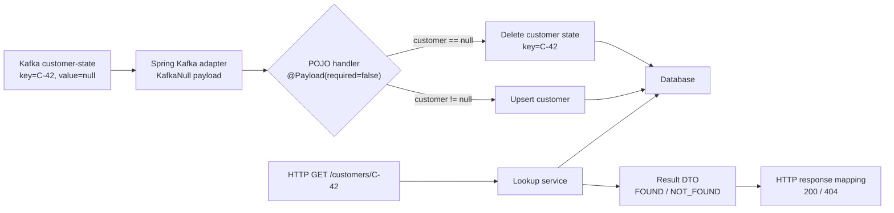

# Mapping Null Payloads

## 1. The Problem: "No Data" Has Many Different Meanings

In the **SPRING_INTEGRATION_ADAPTERS** module, external systems connect to Spring Integration via inbound/outbound adapters, gateways, pollers, and `MessageChannel`. When data arrives from HTTP, JMS, AMQP, Kafka, files/SFTP, or databases, not every input carries a meaningful business object.

Real-world scenarios:

- An HTTP request has no body; an HTTP response returns `204 No Content`.
- A JSON body contains the literal `null`, or a JSON object has `"address": null`.
- A database query returns zero rows, or returns a row where one column is SQL `NULL`.
- An SFTP poller finds no new files yet, or finds a `0`-byte file.
- A service activator executes a command successfully and **needs no reply**.
- A compacted Kafka topic receives a **tombstone record**: the key is set, while the Kafka value is `null` to indicate deleting state for that key.

These cases do not share the same semantics. Turning all of them into Java `null` and pushing them into a `MessageChannel` can cause exceptions, lost delete signals, missing HTTP responses, or silent hangs until timeout.

**Core principle:** Spring Messaging requires `Message<?>` to have a **non-null payload**. To express "no result," you must decide whether it means *emit no message*, *a message representing absent data*, *a bodyless response*, or *a protocol-specific sentinel*.

### Learning Objectives

After this lesson, you will be able to:

1. Distinguish Java `null`, `Optional.empty()`, empty payloads, JSON `null`, and "no message."
2. Understand how `MessageBuilder`, service activators, transformers, filters, gateways, and pollers behave on `null`.
3. Choose mapping policies for HTTP, JMS, AMQP, Kafka, File/SFTP, and databases without losing business signals.
4. Use `KafkaNull` and `@Payload(required = false)` properly in tombstone scenarios.
5. Design explicit result contracts, error handling, and tests for present data, absent data, timeouts, and empty payloads.

## 2. Classifying "Null" Before Writing a Mapper

| Scenario | Meaning | Proper representation |
|---|---|---|
| No new message at poller | No event to emit yet | `MessageSource.receive()` returns `null`; poller emits nothing |
| Java `null` payload | No payload object | **Never construct `Message<?>` with it** |
| `Optional.empty()` | Computation yielded no value | Java layer only; decide whether to map to a business result |
| Empty string `""` | String exists with length 0 | Valid `Message<String>` |
| Empty `new byte[0]` | Byte payload exists with length 0 | Valid `Message<byte[]>` |
| JSON `null` | Valid JSON representation of null | Payload may be string `"null"`, bytes `[0x6e,0x75,0x6c,0x6c]`, or Jackson `NullNode` |
| Missing JSON field | Key absent from object | Distinguish from key present with JSON `null` |
| SQL `NULL` in a column | One column value is unknown/absent | The row object/map itself is still a non-null payload |
| HTTP `204 No Content` | Request processed; response has no body | Empty body and 204 status at HTTP layer |
| Kafka tombstone | Kafka value is null; key marks deleted record | Native Kafka record `value=null`; in Spring use `KafkaNull` |

**Rule:** before mapping, ask: "Is the absence of data a business event itself?" If *yes* (e.g., deleting a customer), you must **preserve the signal** using an appropriate payload or metadata. If *no* (e.g., poller found no files), do not emit a dummy message.

## 3. Why Doesn't Spring Message Allow a Null Payload?

### 3.1. The Spring Messaging Contract

`Message<T>` is an envelope containing a payload and `MessageHeaders`. Standard implementations like `GenericMessage` and `MessageBuilder` require a **non-null** payload.

```java
import org.springframework.messaging.Message;
import org.springframework.messaging.support.MessageBuilder;

// Valid: an empty string is still a String object.
Message<String> emptyText = MessageBuilder
        .withPayload("")
        .build();

// Valid: a 0-length byte array is still an object.
Message<byte[]> emptyBytes = MessageBuilder
        .withPayload(new byte[0])
        .build();

// Invalid: a Spring Message does not accept a Java null payload.
// Runtime throws IllegalArgumentException on build.
Message<String> invalid = MessageBuilder
        .withPayload((String) null)
        .build();
```

Never use workarounds like `new GenericMessage<>(null)` or raw generic casts to bypass this rule. Downstream endpoints and converters expect a real payload object to process.

### 3.2. Null Headers Also Have Special Semantics

When calling `MessageBuilder.setHeader(name, null)`, Spring **removes that header** (if present); it does not attach a header carrying a meaningful null value:

```java
import org.springframework.messaging.Message;
import org.springframework.messaging.support.MessageBuilder;

Message<String> message = MessageBuilder.withPayload("ok")
        .setHeader("sourceId", "abc")
        .setHeader("sourceId", null)
        .build();

System.out.println(message.getHeaders().containsKey("sourceId"));
// false
```

If "field present with unknown value" differs from "field absent," define an explicit contract such as a status flag, a JSON null field, or a DTO with `present`/`status` properties. Never assume Java `null` survives across every header mapper.

### 3.3. "No Message" Differs From "Message With Empty Payload"

`MessageChannel.send(message)` sends an existing `Message<?>`; it does not express "no message" by calling `send(null)`. In polled sources, `MessageSource.receive()` returning `null` signals **there is currently no data to build a message**. The poller then emits nothing into the flow.

```text
Poller
  |
  +-- receive() returns null ------> emit no message on this poll
  |
  +-- receive() returns Message --> channel.send(message)
                                  |
                                  +-- payload=""         valid
                                  +-- payload=byte[0]    valid
                                  +-- payload=OrderEvent valid
```

Do not replace `null` in `receive()` with `""` to mean "no data": doing so creates **an event carrying an empty-string payload**, which can cause downstream consumers to misprocess it.

## 4. Null Across Endpoints: Transformers, Service Activators, Filters, and Gateways

### 4.1. Transformer: Returning Null Is an Error

A transformer's purpose is converting one input message into another valid message/result. In Spring Integration, transformers are not filters: if a transform method returns `null`, the framework throws `MessageTransformationException`.

```java
// Example illustrating WRONG behavior in a transformer.
public String transform(String input) {
    if (input.isBlank()) {
        return null; // Framework treats this as a transformation failure.
    }
    return input.trim();
}
```

To drop invalid inputs, place a **filter before the transformer**. If an input must produce a result, throw a meaningful exception and route to an error flow.

### 4.2. Service Activator: Null Usually Means No Reply

A service activator can handle one-way work. If the method returns `null` or `void`, the endpoint normally finishes **without producing a reply**:

```java
import org.springframework.integration.annotation.ServiceActivator;

public class AuditHandler {

    @ServiceActivator(inputChannel = "audit.in")
    public void recordAudit(AuditEvent event) {
        writeAudit(event);
        // Returns no reply, yet the request was processed.
    }
}
```

If a method returns `null` and the endpoint has `requiresReply=false` (the default on standard service activators), no reply is emitted either. For a **gateway method expecting a return value**, missing replies cause the caller to wait until timeout.

To enforce a *reply-required* contract, enable `requires-reply` on the endpoint. XML example:

```xml
<int:service-activator
        input-channel="orders.requests"
        ref="orderService"
        method="lookup"
        requires-reply="true"/>
```

When `lookup(...)` returns `null`, the endpoint throws `ReplyRequiredException` instead of silently staying quiet. This is a contract-violation signal, not a "null reply value."

### 4.3. Filter: Rejecting Messages by Explicit Predicate

Filters accept or reject **existing messages**:

```java
import org.springframework.integration.annotation.Filter;

public class OrderFilter {

    @Filter(
            inputChannel = "orders.in",
            outputChannel = "orders.valid",
            discardChannel = "orders.rejected")
    public boolean accept(OrderCommand order) {
        return order.orderId() != null
                && !order.orderId().isBlank();
    }
}
```

Filters do not receive null payloads in standard `Message<?>` flows; here `order` is non-null while **fields inside the object** may be null. When the predicate returns `false`, the message goes to `orders.rejected`. Without a discard channel configured, the message may be dropped; newer versions log a warning to curb silent data loss.

To reject with an exception instead, configure `throwExceptionOnRejection`. A filter dropping a gateway's pending request can cause timeouts; for request/reply, it is usually better to return a **business rejection reply** or route to an explicit error branch.

### 4.4. nullChannel: A Message Sink, Not a Null Payload

Spring Integration provides the special `nullChannel` to **discard messages sent to it**. It does not make Java null payloads valid:

```text
Message(payload = "processed")
             |
             v
         nullChannel
             |
             +--> message is discarded
```

Applications route to `nullChannel` when intentionally terminating a branch. Sending a result to `nullChannel` inside a request/reply flow without answering the caller leads to gateway timeouts.

### 4.5. Gateway: Null Does Not Mean a Successful Reply With a Null Body

Example:

```text
Gateway.lookup("C-42")
   |
   v
service activator.lookup(...) -> null
   |
   +--> emits no Spring reply
   |
Gateway waits for reply -> timeout / configured fallback
```

If business logic needs to report "customer not found," return **a non-null result object**:

```java
public record LookupReply(
        String customerId,
        LookupStatus status,
        String displayName) {

    public enum LookupStatus { FOUND, NOT_FOUND }
}

public LookupReply lookup(String customerId) {
    Customer customer = repository.find(customerId);

    if (customer == null) {
        return new LookupReply(
                customerId, LookupReply.LookupStatus.NOT_FOUND, null);
    }

    return new LookupReply(
            customerId,
            LookupReply.LookupStatus.FOUND,
            customer.displayName());
}
```

`LookupReply` is always a non-null object; the `displayName` field can be null per contract. The gateway returns this result cleanly to the caller without needing a "null-payload reply."

**Alternative:** use a sum type such as a `sealed interface`, e.g., `Found(Customer)` and `NotFound(customerId)`, expressing state in the type rather than a nullable field. Either way, ensure compatible serialization if the reply crosses HTTP/JMS/AMQP/Kafka.

## 5. Distinguishing Optional.empty, Empty Bodies, JSON Null, and Null Fields

### 5.1. Optional.empty Belongs to the Java Layer

`Optional.empty()` is a **non-null Java object**. It works well as a repository/service return type, but placing `Optional` directly into a message payload or sending it across adapters **does not guarantee** converters handle it uniformly.

Example mapping `Optional` into an explicit result DTO:

```java
import java.util.Optional;

Optional<Customer> result = repository.findById(customerId);

LookupReply reply = result
        .map(customer -> new LookupReply(
                customerId,
                LookupReply.LookupStatus.FOUND,
                customer.displayName()))
        .orElseGet(() -> new LookupReply(
                customerId,
                LookupReply.LookupStatus.NOT_FOUND,
                null));
```

This avoids depending on how a given converter serializes `Optional.empty()`. If a gateway method returns `Optional<LookupReply>`, verify how your specific gateway and converter versions handle `Optional`; do not treat it as a universal wire protocol.

### 5.2. JSON Null Is Actual Data

These two bodies differ:

```http
POST /customer HTTP/1.1
Content-Type: application/json
Content-Length: 4

null
```

versus an HTTP request with **no body**. The first contains the four ASCII/UTF-8 bytes of `null`, which is a valid JSON literal. The second carries no wire payload at all.

At the Spring message level, keeping raw JSON:

```java
import java.nio.charset.StandardCharsets;
import org.springframework.messaging.Message;
import org.springframework.messaging.MessageHeaders;
import org.springframework.messaging.support.MessageBuilder;
import org.springframework.util.MimeTypeUtils;

Message<byte[]> jsonNull = MessageBuilder
        .withPayload("null".getBytes(StandardCharsets.UTF_8))
        .setHeader(MessageHeaders.CONTENT_TYPE,
                MimeTypeUtils.APPLICATION_JSON)
        .build();

// jsonNull.getPayload() is byte[4], not Java null.
```

If Jackson parses JSON `null` into an arbitrary Java object type, the result can be Java `null`, which cannot be passed straight to `MessageBuilder.withPayload(...)`. One option to preserve the literal's JSON semantics is Jackson's `NullNode`, which is a non-null object:

```java
import com.fasterxml.jackson.databind.JsonNode;
import com.fasterxml.jackson.databind.ObjectMapper;

ObjectMapper mapper = new ObjectMapper();
JsonNode node = mapper.readTree("null");

System.out.println(node != null); // true
System.out.println(node.isNull()); // true
```

However, never automatically treat every `NullNode` as a "delete record" signal: it only represents **JSON null**, whereas deletion semantics must come from the API/schema contract.

### 5.3. Missing Field vs. Explicit Null Field

Compare three JSON objects:

```json
{"customerId":"C-42"}
```

```json
{"customerId":"C-42","phone":null}
```

```json
{"customerId":"C-42","phone":""}
```

In a PATCH API, these three bodies can have three distinct meanings:

- **Missing `phone`**: keep the existing phone number.
- **`phone: null`**: clear the phone number per contract.
- **`phone: ""`**: update to an empty string or reject on validation.

Using a Jackson tree:

```java
JsonNode request = mapper.readTree(
        "{\"customerId\":\"C-42\",\"phone\":null}");

JsonNode phone = request.path("phone");
System.out.println(phone.isNull());    // true
System.out.println(phone.isMissingNode()); // false

JsonNode missing = request.path("unknownField");
System.out.println(missing.isMissingNode()); // true
```

Deserializing into a plain Java DTO with only `String phone` can **erase the distinction** between missing and explicit null depending on binding. When PATCH requires three-state semantics, use a JSON tree, a `present + value` structure, or an agreed nullable-field wrapper.

### 5.4. Empty Strings and Empty Byte Arrays Are Valid Payloads

```java
Message<String> text = MessageBuilder
        .withPayload("")
        .build();

Message<byte[]> binary = MessageBuilder
        .withPayload(new byte[0])
        .build();

System.out.println(text.getPayload().length());    // 0
System.out.println(binary.getPayload().length);    // 0
```

Although both are valid, their **meaning** depends on the protocol. Empty UTF-8 text, a 0-byte file, a bodyless request, and JSON `null` must never be collapsed into one state if business logic distinguishes them.

## 6. Mapping Null at the HTTP Boundary

### 6.1. Missing Request Bodies and JSON Null

HTTP requests can arrive with an empty body or a body containing JSON `null`. Check:

- Does `Content-Type` match expectations?
- Are any body bytes actually present?
- Is an empty body valid for this endpoint?
- If the JSON literal `null` arrives, does the API permit it or reject it?
- If the body is an object with nullable fields, which fields may be null?

Example contract:

| HTTP input | Contract meaning | Suggested handling |
|---|---|---|
| `POST /orders` with no body | No order provided to create | Return `400` or validation error |
| `POST /orders` with body `null` | JSON literal null, no Order object | Return validation error per API |
| `PATCH /customers/C-42` with `{"phone":null}` | Explicit request to clear phone | Emit `ClearPhone` command |
| `PATCH` missing `phone` | Do not update that field | Keep existing value |
| `GET /health` with no body | Valid request | Execute action needing no business payload |

An HTTP inbound gateway uses its request payload type, message converters, and `request-payload-type` config to read the body. When the body is absent or a converter yields Java `null`, **do not assume every endpoint still emits a Spring message with a null payload**. Missing-body behavior depends on the adapter, `HttpMessageConverter`, and endpoint contract. For bodyless actions, design a **non-null command object** or a dedicated endpoint.

### 6.2. HTTP 204 No Content Is Not a Null Spring Message

`204 No Content` is a **successful HTTP response with no body**. It does not require constructing a `Message<?>` with a null payload. An HTTP endpoint can emit status 204 via gateway/HTTP framework configuration, or receive a result object and map it to an HTTP status/body at the boundary.

```text
Internal command: DeleteCustomer(customerId="C-42")
    |
    v
Service returns DeleteResult(status=DELETED)
    |
    v
HTTP response mapper
    |
    +--> HTTP 204 No Content (no body)
```

**Building the HTTP response** is the job of the HTTP gateway/controller/handler and status mapping. If a service activator simply returns `null`, the gateway may receive no Spring reply before timing out—this does **not automatically** produce HTTP 204.

### 6.3. Distinguishing From "Not Found" Outcomes

`404 Not Found`, `204 No Content`, and `200 OK` with `{"status":"NOT_FOUND"}` can each make sense in different APIs, with distinct semantics. Lock down the API contract before mapping Spring flow results.

Especially on inbound gateways expecting replies, ensure the flow emits a **non-null reply** even when data is absent so the HTTP layer has enough context to choose the status code.

## 7. Kafka: Tombstone Records Are a Critical Special Case

### 7.1. A Tombstone Is a Record With a Key and a Null Value

In Kafka, a record with `value=null` acts as a **tombstone** on topics configured with log compaction. A tombstone marks that state for that key should be deleted during log compaction. It is not the same as a non-existent record.

```text
topic: customer-state
key:   C-42
value: {"name":"An"}  --> write/update state

topic: customer-state
key:   C-42
value: null          --> tombstone for key C-42
```

Important requirements:

- **The key must be meaningful and stable** to identify the deleted entity.
- The topic needs compaction enabled for removing older versions from the compacted log to apply.
- Kafka deserializers might return `null` for other reasons; confirm the producer contract before treating every null as "delete."
- Tombstones do not automatically update business databases; consumers must implement deletion and idempotency logic.

### 7.2. KafkaNull Is Spring Kafka's Sentinel

Spring Messaging forbids Java null payloads. To represent a tombstone inside a `Message<?>`, Spring Kafka provides `org.springframework.kafka.support.KafkaNull`; a payload of `KafkaNull.INSTANCE` is translated into a **native Kafka record value of `null`** when using compatible converters.

Sending a tombstone directly with `KafkaTemplate`:

```java
import org.springframework.kafka.core.KafkaTemplate;

// Assuming a bean with injected KafkaTemplate<String, String> kafkaTemplate
// and producer key/value serializers configured appropriately.
String customerId = "C-42";

// Null value on the Kafka wire: tombstone for key C-42.
kafkaTemplate.send("customer-state", customerId, null);
```

With the `Message<?>` API:

```java
import org.springframework.kafka.support.KafkaHeaders;
import org.springframework.kafka.support.KafkaNull;
import org.springframework.messaging.Message;
import org.springframework.messaging.support.MessageBuilder;

Message<KafkaNull> delete = MessageBuilder
        .withPayload(KafkaNull.INSTANCE)
        .setHeader(KafkaHeaders.TOPIC, "customer-state")
        .setHeader(KafkaHeaders.KEY, "C-42")
        .build();

// Send via KafkaTemplate.send(Message<?>) or a compatible endpoint.
// The converter recognizes KafkaNull and emits native Kafka value=null.
```

**Never call `MessageBuilder.withPayload(null)` to create a tombstone.** `KafkaNull` is a **Spring Kafka–specific sentinel**, not a universal convention for HTTP/JMS/AMQP.

### 7.3. Receiving Tombstones in Spring Integration

When a Kafka inbound adapter delivers a tombstone into Spring Integration, the message-layer payload can be `KafkaNull`. Spring Integration supports passing a **Java null argument** to a POJO handler when annotated with `@Payload(required = false)`.

Supported by Spring Integration Kafka:

```java
import org.springframework.integration.annotation.ServiceActivator;
import org.springframework.kafka.support.KafkaHeaders;
import org.springframework.messaging.handler.annotation.Header;
import org.springframework.messaging.handler.annotation.Payload;

public class CustomerStateHandler {

    @ServiceActivator(inputChannel = "fromKafka")
    public void handle(
            @Header(KafkaHeaders.RECEIVED_KEY) String key,
            @Payload(required = false) Customer customer) {

        if (customer == null) {
            deleteCustomerState(key);
            return;
        }
        upsertCustomerState(key, customer);
    }
}
```

Notice the distinction: the Spring `Message<?>` **still holds a non-null payload** (`KafkaNull`), while the handler's argument resolver passes **Java `null`** into the `customer` parameter. If configuring a custom `MessageHandlerMethodFactory` or converter, verify support for `KafkaNullAwarePayloadArgumentResolver`/the matching adapter.

Read the Kafka key from `KafkaHeaders.RECEIVED_KEY` to identify which record to delete. Never look inside the value for an ID, because on a tombstone **there is no value**.

### 7.4. Never "Lose the Tombstone" During Transformation

A common bug:

```text
Kafka record (key=C-42, value=null)
  |
  v
Spring inbound (payload=KafkaNull)
  |
  v
Transformer turns KafkaNull into null   <-- WRONG: transformer error
  |
  v
No message left for worker to delete state
```

To normalize toward another protocol, build an **explicit deletion event**:

```java
public record CustomerDeleted(
        String customerId,
        String eventId) {}

// A non-null Java object with clear business meaning.
CustomerDeleted deleted = new CustomerDeleted("C-42", "evt-delete-42");
```

When sending over HTTP, JMS, AMQP, or a file manifest, serialize `CustomerDeleted` per your agreed schema. Never forward `KafkaNull.INSTANCE` through other adapters assuming every system understands it as "delete."

## 8. JMS and AMQP: Never Automatically Turn Null Into Native Messages

### 8.1. JMS

JMS supports message body types like `TextMessage`, `BytesMessage`, and `ObjectMessage`, plus metadata/properties. JMS providers and converters may define rules for empty bodies, nullable text, or missing bodies. Those belong to the **JMS contract** and do not alter Spring `Message<?>` payload rules.

Example:

```text
JMS request:
  JMSCorrelationID = "request-42"
  body: empty text/bytes per converter

Spring service:
  customer not found

Two explicit options:
  1. Reply = CustomerLookupResult(found=false)
  2. No reply if the contract is genuinely one-way
```

When using a **JMS outbound gateway** requiring request/reply, the first option is usually right. A responder returning `null` hoping for a "null reply body" may produce **no reply**, causing the gateway to time out. If a remote contract truly requires an empty body on a reply message, configure the JMS message/converter and reply metadata per provider API; prefer explicit result DTOs whenever possible.

### 8.2. AMQP/RabbitMQ

A Spring AMQP `Message` at the broker layer typically holds a `byte[]` body and `MessageProperties`; a 0-length body is still data, distinct from a Spring Messaging Java null payload.

Example RPC contract:

```text
AMQP request:
  correlationId = req-42
  replyTo = reply-queue
  body = {"customerId":"C-42"}

AMQP reply:
  correlationId = req-42
  contentType = application/json
  body = {"found":false}
```

The response `{"found":false}` states **the request was received and processed, and no customer was found**. If the handler returns `null`, the calling gateway receives no reply and times out. Never equate "entity not found" with "no response received" when business logic must distinguish the two.

### 8.3. Why Not Use KafkaNull on JMS/AMQP?

`KafkaNull` exists so Spring Kafka can map to **native Kafka `value=null`**. Passing `KafkaNull.INSTANCE` through an AMQP/JMS converter without a custom contract can expose an unfamiliar Java class, fail serialization, or confuse receivers.

For JMS/AMQP, use an explicit command/event DTO such as `DeleteCustomer`, or a wire schema with `operation=DELETE` and `customerId`. Mappers translate headers and payloads per protocol; there is no universal cross-broker "null sentinel."

## 9. File/SFTP and Databases: "No Item" Differs From Null Data

### 9.1. File/SFTP Polling

A File/SFTP inbound adapter typically emits a message only when an eligible file appears. If a poll finds no new files, the source emits nothing. If an empty file appears:

```text
Poll #1:
  no new file
  -> no Spring message

Poll #2:
  /incoming/orders-001.csv exists, size=0
  -> a valid file exists on the filesystem
  -> Spring message may carry a non-null File/byte[0]/Resource
```

A 0-byte file can be a **validation error**, a **completion marker**, or **valid empty data**, depending on the producer/consumer contract. Never treat 0 bytes as "no file," and never make the adapter invent a "null" event.

For CSV files:

```csv
customerId,phone
C-42,
```

An empty `phone` cell requires an explicit rule (empty string, SQL NULL, or "do not update"); there is no universal rule turning a trailing comma into Java `null`.

### 9.2. Database Polling and SQL NULL

Example:

```sql
SELECT id, note
FROM orders
WHERE status = 'READY';
```

If no row matches, there is **no item to emit**. If row `(id=42, note=NULL)` exists, a record exists; only the `note` column is SQL `NULL`. Mapped to a Java DTO, `note` can be `null`, while the **payload DTO** itself is non-null.

```java
public record OrderRow(long id, String note) {}

// SQL row with id=42, note=NULL:
OrderRow row = new OrderRow(42L, null);

// Spring Message payload = row (non-null).
Message<OrderRow> message = MessageBuilder
        .withPayload(row)
        .build();
```

If the query returns zero rows, never fabricate a dummy `OrderRow(0,null)` that downstream logic might mistake for a valid order. Define a "not found" outcome at the query service or let the poller finish the cycle without emitting a message.

### 9.3. JDBC NULL on Update Differs From Omitting a Field

This statement:

```sql
UPDATE customers SET phone = NULL WHERE id = ?;
```

means **explicitly clearing the value**. That differs from skipping the update or omitting `phone` in a PATCH request. When mapping HTTP JSON to a database, preserve all three states—**missing**, **explicit null**, and **actual value**—whenever partial updates are supported.

## 10. Choosing a Clear Contract for Nullable Data

### 10.1. Decision Matrix

| Need | Proper representation | Mistake to avoid |
|---|---|---|
| Nothing to poll | Emit no message during that poll | Building a null-payload message |
| Drop invalid message | Filter, discard channel, or explicit error | Returning null from a transformer to filter |
| Not found in RPC | `NOT_FOUND` result DTO or error reply per contract | Service activator returning null and timing out caller |
| One-way command | `void` handler, no reply needed | Using a return-typed gateway that never replies |
| HTTP success without body | HTTP 204 via response mapping | Equating a null service return with HTTP 204 |
| JSON literal null | JSON bytes/String/`NullNode` per schema | Using Java null as the payload |
| PATCH null field | Field presence + explicit null | Collapsing missing and null together |
| Kafka tombstone | Native Kafka value null / Spring `KafkaNull` | Sending a Spring message with null payload |
| Delete entity over JMS/AMQP | Explicit `DeleteEntity` command/event | Sending a Spring Kafka–only sentinel |
| SQL NULL in one column | DTO/map with nullable field inside non-null payload | Dropping the entire row |
| Empty file or empty body | Valid empty String/`byte[0]`/resource | Treating "0 bytes" as "no message" |

### 10.2. Creating a Clear Result Envelope

Example convention for customer lookup:

```java
public enum LookupState {
    FOUND,
    NOT_FOUND,
    ERROR
}

public record CustomerLookupResult(
        String requestId,
        LookupState state,
        Customer data,
        String errorCode) {

    public static CustomerLookupResult notFound(String requestId) {
        return new CustomerLookupResult(
                requestId, LookupState.NOT_FOUND, null, null);
    }
}
```

This is a **non-null payload object** even though `data` may be null. In JSON, this can serialize as `data:null` or omit the field depending on serializer settings; if wire formats must distinguish them, specify field presence explicitly and test the serialized output.

An RPC contract should distinguish:

- `NOT_FOUND`: the system responded, and the entity does not exist.
- `ERROR`: the system failed, with an `errorCode` or appropriate error channel/exception.
- `TIMEOUT`: no response arrived within the deadline.
- `CANCELLED`: work was intentionally cancelled.
- `SUCCESS_WITH_EMPTY_RESULT`: operation succeeded with an empty list or empty bytes.

None of these states can be safely collapsed into a single Java `null`.

### 10.3. Sentinel Option: Use Only With Explicit Conversion Rules

You can design a `NoValue` or `Deleted` sentinel to travel across a `MessageChannel`. It is then a **non-null** Java object, and every endpoint must know how to convert it into its native representation.

```java
public enum NoValue {
    INSTANCE
}

// Valid object as payload inside an agreed internal flow.
Message<NoValue> noValue = MessageBuilder
        .withPayload(NoValue.INSTANCE)
        .build();
```

This illustrates the concept—it is **not a built-in Spring Integration sentinel**. Never send `NoValue.INSTANCE` across JSON/JMS/AMQP/Kafka without explicit converters and contracts; for Kafka tombstones, prefer the Spring Kafka–supported `KafkaNull` sentinel.

## 11. Cross-Protocol Example: Updating/Deleting Customer State

A customer-state service consumes a compacted Kafka topic, updates a database, and serves HTTP lookups.



Here there are **two distinct kinds of absent data**:

- A null Kafka value for key `C-42` is a **delete event**. The consumer must process the deletion; never drop the message.
- An HTTP lookup after deletion returns `NOT_FOUND`. The HTTP caller expects a contract response; the handler must never return null and stall the HTTP gateway.

### 11.1. A Wrong Example

```java
// Wrong example: trying to use null to delete and send through IntegrationFlow.
Customer customer = null;
Message<Customer> wrong = MessageBuilder
        .withPayload(customer)
        .build(); // IllegalArgumentException
```

Change it to:

```java
// When targeting a compacted Kafka topic:
Message<KafkaNull> tombstone = MessageBuilder
        .withPayload(KafkaNull.INSTANCE)
        .setHeader(KafkaHeaders.TOPIC, "customer-state")
        .setHeader(KafkaHeaders.KEY, "C-42")
        .build();

// When targeting JMS/AMQP or an HTTP domain API:
DeleteCustomer command = new DeleteCustomer("C-42");
Message<DeleteCustomer> deletion = MessageBuilder
        .withPayload(command)
        .build();
```

`DeleteCustomer` is an application-defined domain record:

```java
public record DeleteCustomer(String customerId) {}
```

Both messages carry **protocol-appropriate payloads**, yet express the exact same business intent. Gateways, header mappers, and converters deliver each to its native endpoint.

### 11.2. Preserving Correlation ID and Errors When Result Is Absent

If an HTTP client triggers deletion via a JMS gateway, a properly correlated reply is still required once business work completes:

```text
HTTP DELETE request id=req-42
    |
Spring command DeleteCustomer("C-42")
    |
JMS outbound gateway (JMSCorrelationID/JMSReplyTo)
    |
Remote worker deletes customer
    |
JMS reply: DeleteResult(status=DELETED, requestId=req-42)
    |
Spring reply -> HTTP 204 No Content
```

Both `DeleteCustomer` and `DeleteResult` are non-null Spring payload objects. HTTP 204 is **how the HTTP boundary represents the result**, without needing a "null Spring reply" mid-flow.

## 12. Error Handling and Retries for Null Mapping

### 12.1. Distinguishing Data Errors From Valid Empty Outcomes

| Scenario | Recommended handling |
|---|---|
| Malformed JSON syntax | Deserialization/validation error; never treat as valid null |
| JSON literal `null` on an object-required API | Reject per contract, e.g., `400` |
| Kafka tombstone with valid key | Execute idempotent deletion |
| Kafka tombstone missing business key | Reject/route to error flow; never delete blindly |
| Transformer returns null due to bug | `MessageTransformationException`; code bug to fix |
| Service activator returns null in reply-required RPC | `ReplyRequiredException` when `requires-reply` is set |
| Poller finds no data | Emit nothing; not an error |
| Empty file when schema requires records | Validation error; quarantine/retry per policy |
| SQL NULL in optional column | Map to nullable DTO field |
| SQL NULL in required column | Data/schema error; never fabricate fake events |

### 12.2. Retries Cannot Fix Permanently Invalid Data

If a parser rejects a JSON literal null or a buggy transformer returns null, retrying the exact same input will keep failing. Separate **permanent failures** (schema violations) from **transient failures** (DB outages, temporary broker errors).

For Kafka tombstones, retries require **idempotent deletes**: deleting the same key twice must not cause an unrecoverable error simply because the first attempt already removed the record. For JMS/AMQP and gateways, if a handler fails to reply, caller timeouts can trigger retries even though the worker succeeded; use idempotency keys and monitoring to prevent duplicate side effects.

### 12.3. Never Let Null Erase Observability

Log explicit state:

```text
eventType=CustomerDeleted
customerId=C-42
kafkaValueIsNull=true
messagePayloadType=KafkaNull
action=DELETE
result=SUCCESS
```

Never log just `payload=null`, since the same log line might appear when a converter crashes or a response is missing. For sensitive data, never dump full payloads into logs; rely on normalized IDs, states, and error codes.

## 13. Testing Null, Empty, and Tombstone Cases

### 13.1. Unit Testing MessageBuilder and Null Headers

JUnit 5 example:

```java
import static org.junit.jupiter.api.Assertions.*;

import org.junit.jupiter.api.Test;
import org.springframework.messaging.Message;
import org.springframework.messaging.support.MessageBuilder;

class NullPayloadMappingTest {

    @Test
    void springMessageRejectsJavaNullPayload() {
        assertThrows(IllegalArgumentException.class,
                () -> MessageBuilder
                        .withPayload((String) null)
                        .build());
    }

    @Test
    void emptyStringAndEmptyByteArrayAreValidPayloads() {
        Message<String> text = MessageBuilder
                .withPayload("")
                .build();
        Message<byte[]> bytes = MessageBuilder
                .withPayload(new byte[0])
                .build();

        assertEquals("", text.getPayload());
        assertEquals(0, bytes.getPayload().length);
    }

    @Test
    void settingNullHeaderRemovesIt() {
        Message<String> message = MessageBuilder.withPayload("ok")
                .setHeader("reference", "old")
                .setHeader("reference", null)
                .build();

        assertFalse(message.getHeaders().containsKey("reference"));
    }
}
```

### 13.2. Unit Testing JSON Null vs. Missing Fields

```java
import static org.junit.jupiter.api.Assertions.*;

import com.fasterxml.jackson.databind.JsonNode;
import com.fasterxml.jackson.databind.ObjectMapper;
import org.junit.jupiter.api.Test;

class JsonNullTest {

    private final ObjectMapper mapper = new ObjectMapper();

    @Test
    void literalNullIsAJsonNode() throws Exception {
        JsonNode literal = mapper.readTree("null");

        assertNotNull(literal);
        assertTrue(literal.isNull());
    }

    @Test
    void missingAndExplicitNullFieldsDiffer() throws Exception {
        JsonNode body = mapper.readTree("{\"phone\":null}");

        assertTrue(body.path("phone").isNull());
        assertTrue(body.path("other").isMissingNode());
        assertFalse(body.path("other").isNull());
    }
}
```

### 13.3. Unit Testing KafkaNull as a Non-Null Payload

```java
import static org.junit.jupiter.api.Assertions.*;

import org.junit.jupiter.api.Test;
import org.springframework.kafka.support.KafkaNull;
import org.springframework.messaging.Message;
import org.springframework.messaging.support.MessageBuilder;

class KafkaTombstoneMessageTest {

    @Test
    void kafkaNullSentinelCanBeSpringPayload() {
        Message<KafkaNull> message = MessageBuilder
                .withPayload(KafkaNull.INSTANCE)
                .build();

        assertNotNull(message.getPayload());
        assertSame(KafkaNull.INSTANCE, message.getPayload());
    }
}
```

**Scope of this test:** it only proves `KafkaNull` is a non-null object. To verify the broker receives `value=null`, write an actual integration test with `KafkaTemplate`/outbound Kafka adapter and its converter/serializer.

### 13.4. Adapter Boundary Integration Test Matrix

| Test case | Input | Expectation |
|---|---|---|
| Null Spring message | `MessageBuilder.withPayload(null)` | Explicit exception |
| Empty Spring message | `""`, `byte[0]` | Valid message |
| Set null header | `setHeader("x", null)` | Header removed |
| Null transformer | Transformer returns `null` | `MessageTransformationException` |
| One-way service activator | `void`/null handler | No reply emitted |
| Reply-required service activator | Handler returns `null` | `ReplyRequiredException` |
| Filter rejection | Predicate returns `false` | Drops/discards/throws per config |
| Gateway request/reply | Non-null `NOT_FOUND` result object | Caller receives business outcome without timing out |
| Empty HTTP body | Missing body on JSON-required API | Validation/error response |
| HTTP JSON null | Body `null` | Explicit API policy; not silently treated as empty |
| HTTP 204 | Successful delete | Bodyless response with status 204 |
| JMS/AMQP no match | Row not found | `NOT_FOUND` reply DTO, correlation preserved |
| Kafka outbound tombstone | Key `C-42`, `KafkaNull` | Native Kafka value is null |
| Kafka inbound tombstone | Native record value is null | Handler gets null via `@Payload(required=false)` or sentinel and deletes |
| Normal Kafka event | Non-null value | Handler upserts |
| SFTP no file | Poll finds no new files | No message emitted |
| SFTP empty file | 0-byte file present | Concrete item validated per schema |
| DB no rows | Query returns 0 rows | No fake business record invented |
| DB nullable column | Row has SQL NULL column | Valid DTO payload with nullable field |
| Retried/duplicate tombstone | Same key deleted multiple times | Idempotent delete |

Test HTTP with mock servers or HTTP test clients; test Kafka with embedded brokers/Testcontainers to inspect **native record keys/values**; test JMS/AMQP with real test brokers to verify converters, routing, correlation, and error flows. Unit tests alone do not prove every adapter understands the same sentinel.

## 14. Hands-On Exercise: Standardizing "No Data" Across Three Boundaries

**Context:** A system consumes customer events from a compacted Kafka topic, persists state to a database, and serves HTTP lookups. Beyond normal updates, it must handle tombstones and not-found results.

**Tasks:**

1. Create a contract table covering: Kafka event with value, Kafka tombstone, DB missing row, DB nullable column, HTTP lookup not found, and HTTP successful delete.
2. Build three Spring messages: `String ""`, `byte[0]`, and `KafkaNull.INSTANCE`. Prove all three are valid, and confirm `withPayload(null)` throws.
3. Implement a Kafka producer sending both a normal customer state and a tombstone for the same key. Verify the native Kafka value on a real consumer.
4. In Spring Integration, write a `@ServiceActivator` accepting `@Header(KafkaHeaders.RECEIVED_KEY)` and `@Payload(required = false)`; upsert when value is present and perform an idempotent delete when null.
5. Implement an HTTP lookup returning a non-null `CustomerLookupResult`. Map `FOUND` to a success response and `NOT_FOUND` to `404` (or your chosen API contract) without returning null from a service activator to signify 404.
6. Add a transformer that intentionally returns null and verify `MessageTransformationException`. Fix it using a filter or a result object.
7. Test a JSON PATCH with missing `phone`, `phone:null`, and `phone:""`; confirm the app distinguishes all three states.
8. Replay the same tombstone or retry a delete request, verifying repeated deletes preserve consistency.

**Completion criteria:** no Spring message is ever built with a null payload; Kafka tombstones are never dropped; missing/null/empty are distinguished; gateways reply per contract; and tests verify both native Kafka null values and bodyless HTTP responses where needed.

## 15. Key Takeaways

- Spring `Message<?>` **forbids Java null payloads**; empty strings, empty byte arrays, `NullNode`, and non-null sentinels are valid payloads.
- **No message emitted**, **no reply**, **JSON null**, **HTTP 204**, **SQL NULL**, **empty files**, and **Kafka tombstones** all carry distinct semantics.
- A transformer returning `null` is an error; filters drop messages; service activators can return `null`/`void` when no reply is needed. `requiresReply` catches missing replies in request/reply contracts.
- `nullChannel` is a **sink** that consumes and discards messages—not a payload replacement for Java null.
- On compacted Kafka topics, tombstones have native `value=null`; use `KafkaNull.INSTANCE` to send via Spring `Message<?>` and `@Payload(required = false)` to receive null in POJO handlers where supported.
- `KafkaNull` is not a universal convention for JMS/AMQP/HTTP. When crossing to other protocols, use an explicit schema-bound event or command such as `DeleteCustomer`.
- When an API must report "not found," return a result DTO or meaningful business error—never leave a gateway hanging without a reply.
- Tests must verify **wire representations** and end-to-end behavior, not just `MessageHeaders` contents.

## References

1. [Spring Framework — MessageBuilder Javadoc](https://docs.spring.io/spring-framework/docs/current/javadoc-api/org/springframework/messaging/support/MessageBuilder.html): building messages and `setHeader(name, null)` semantics.
2. [Spring Integration — Transformer](https://docs.spring.io/spring-integration/reference/transformer.html): transformers must not return null.
3. [Spring Integration — Service Activator](https://docs.spring.io/spring-integration/reference/service-activator.html): null/void behavior and `requiresReply`.
4. [Spring Integration — Filter](https://docs.spring.io/spring-integration/reference/filter.html): discard, rejection, and error policies.
5. [Spring Integration — Special Channels](https://docs.spring.io/spring-integration/reference/channel.html): `nullChannel` and channel types.
6. [Spring Integration — Apache Kafka Support](https://docs.spring.io/spring-integration/reference/kafka.html): representing tombstones via `KafkaNull` and `@Payload(required=false)`.
7. [Spring Kafka — Null Payloads and Log Compaction](https://docs.spring.io/spring-kafka/reference/kafka/tombstones.html): Kafka tombstones, `KafkaNull`, and `KafkaTemplate`.
8. [Spring Integration — HTTP Support](https://docs.spring.io/spring-integration/reference/http.html): gateways, converters, status codes, and request/reply.
9. [Spring Integration — JMS Support](https://docs.spring.io/spring-integration/reference/jms.html): JMS adapters/gateways and reply semantics.
10. [Spring Integration — AMQP Support](https://docs.spring.io/spring-integration/reference/amqp.html): AMQP adapters/gateways and converters.

*Endpoint settings, converters, and nullable parameter support can vary by Spring Integration and Spring Kafka version. When applying to a project, check your exact dependencies and test against your actual adapters and brokers. This lesson focuses on content design and practicing null-payload mapping; deep technical QA review occurs after completing the related materials.*
