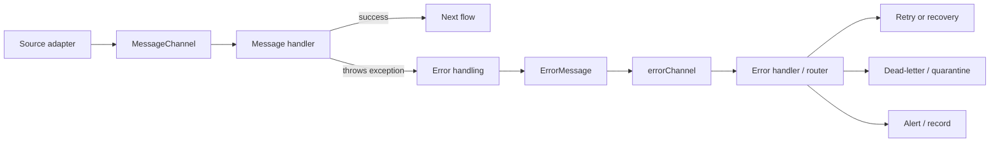

# Mapping Errors to ErrorMessage

## Objectives

In a Spring Integration flow, errors can arise when receiving data from external systems, transforming payloads, calling business services, or sending messages to the next endpoint. For consistent error handling, Spring Messaging represents errors as an `ErrorMessage`: a message whose payload is a `Throwable`, accompanied by information identifying the failed message and processing step.

This lesson explains the structure of `ErrorMessage`, how errors reach an error channel, how to inspect the exception and original message, how to manually wrap errors into `ErrorMessage`, and how to classify failures for retry, quarantine, or alerting. This is part of building adapters and gateways connecting external systems to Spring Integration: alongside a success message contract, every flow needs an explicit error contract.

## Why Map Errors Into Messages?

In synchronous processing, exceptions can be thrown straight back to the caller. However, in asynchronous flows such as an `ExecutorChannel`, poller, or background task, the original caller may have finished long before the error occurs. There is no longer an active call stack to propagate the exception to. An error channel brings errors back into the messaging model so another endpoint can log, classify, alert, store failed messages, or coordinate retries.

`ErrorMessage` does not turn a failed operation into a success, nor does it retry automatically. It standardizes how errors are represented so flows can handle failures using the same channels, endpoints, and routers used for normal messages.



## Structure of ErrorMessage

`ErrorMessage` belongs to Spring Messaging (`org.springframework.messaging.support.ErrorMessage`) and is a subtype of `Message<Throwable>`. Its payload is the exception or mapped error. Depending on how it was constructed, the message can also carry the original message that caused the failure.

| Component | Meaning |
|---|---|
| `getPayload()` | `Throwable` describing the failure; may be a business exception or a framework-wrapped exception |
| `getOriginalMessage()` | The original message associated with the failure if supplied when building the `ErrorMessage` |
| Message headers | Metadata for routing, correlation, and observability; do not assume every original header is copied automatically |

Failures inside Spring Integration endpoints are typically wrapped in subclasses of `MessagingException`. For instance, `MessageHandlingException` indicates a failure while handling a message; `MessageDeliveryException` relates to sending or delivering a message; `MessageTimeoutException` indicates a timeout on certain paths. `MessagingException` can expose `getFailedMessage()` to retrieve the message the framework attached to the failure.

Because exceptions can be wrapped across multiple layers, distinguish the outer payload exception from the root cause deeper in the `cause` chain. Never inspect only one top-level class while ignoring `cause`, `failedMessage`, or `originalMessage`.

## When Does Spring Integration Create an ErrorMessage?

Whether an error reaches an error channel depends on how the endpoint executes and how error handling is configured.

- On synchronous paths such as `DirectChannel`, exceptions normally propagate back through the send call. If the caller is a gateway, the gateway can rethrow the exception to the caller or map it to an error result per gateway config.
- On asynchronous paths such as `ExecutorChannel`, errors occurring after the message has been handed off to an executor cannot unwind onto the original sender thread. The executor's error handler can wrap the failure into an `ErrorMessage` and publish it to the error channel.
- With pollers and background tasks, errors are handled in the task/polling context. The error handler can publish an `ErrorMessage` to a configured error channel or the default error channel.
- In a custom adapter or code calling an external library, if an exception is caught and swallowed completely inside user code, Spring Integration cannot know to emit an `ErrorMessage`. The adapter must either rethrow to the infrastructure or publish the error explicitly.

A Spring Integration application typically has a default error channel named `errorChannel`. You can register subscribers for shared error handling. In larger systems, consider dedicated per-flow or per-workload error channels so a single error handler does not become a shared bottleneck.

## Reading ErrorMessage From errorChannel

The following example registers a service activator consuming errors from the error channel. The handler extracts the exception type and event ID for investigation; in real systems, recording should use a structured logger or observability backend rather than console output.

```java
import org.springframework.integration.annotation.ServiceActivator;
import org.springframework.messaging.Message;
import org.springframework.messaging.MessagingException;
import org.springframework.messaging.support.ErrorMessage;
import org.springframework.stereotype.Component;

@Component
class IntegrationErrorHandler {

    @ServiceActivator(inputChannel = "errorChannel")
    public void handle(ErrorMessage errorMessage) {
        Throwable failure = errorMessage.getPayload();
        Message<?> original = errorMessage.getOriginalMessage();

        String eventId = "unknown";
        if (original != null) {
            Object value = original.getHeaders().get("eventId");
            if (value != null) {
                eventId = value.toString();
            }
        }

        if (failure instanceof MessagingException messagingException) {
            Message<?> failed = messagingException.getFailedMessage();
            // Can use failed to supplement metadata when original is absent.
        }

        // Record failure and eventId using application logger/monitoring.
    }
}
```

This snippet illustrates reading both sources of context. `getOriginalMessage()` may return `null`, and `getFailedMessage()` is not guaranteed to be populated either. Handlers must tolerate missing original messages, missing headers, and payload exceptions that are not `MessagingException`.

Never cast every message received from a channel to `ErrorMessage` if that channel also carries regular messages. On a dedicated error channel, the input contract can specify `ErrorMessage`; on a shared channel, check both message type and payload type before accessing them.

## Manually Converting Exceptions Into ErrorMessage

In a custom adapter, you can catch errors at the external-system boundary and construct an `ErrorMessage` with the failed message. The example below illustrates an adapter receiving a message, calling an external client, and publishing failures to a dedicated channel.

```java
import org.springframework.context.annotation.Bean;
import org.springframework.context.annotation.Configuration;
import org.springframework.messaging.Message;
import org.springframework.messaging.MessageChannel;
import org.springframework.messaging.support.ErrorMessage;

@Configuration
class ExternalAdapterConfiguration {

    @Bean
    MessageChannel externalErrors() {
        return new org.springframework.integration.channel.DirectChannel();
    }

    void invokeExternalSystem(
            Message<?> request,
            MessageChannel externalErrors,
            ExternalClient client) {
        try {
            client.send(request.getPayload());
        }
        catch (Exception ex) {
            ErrorMessage error = new ErrorMessage(ex, request);
            externalErrors.send(error);
        }
    }
}
```

`new ErrorMessage(Throwable, Message<?>)` keeps a reference to the original message so the error handler can retrieve the correlation ID, event ID, or routing metadata. This example only illustrates the conversion boundary; a production adapter must decide which errors are published, which are rethrown, and whether a failure to send the `ErrorMessage` itself needs fallback handling.

If an exception is caught only to publish an error and execution then continues as if it succeeded, message status can be misinterpreted. Clearly choose one outcome: handled locally, routed to an error flow, or rethrown to the caller/gateway. Never trigger multiple competing recovery paths for the same failure without deduplication controls.

## Mapping Exceptions and Classifying Failures

An error handler should classify failures by root cause and recoverability, not just by endpoint name. For example:

| Error category | Examples | Typical handling |
|---|---|---|
| Invalid data | Malformed JSON, missing required field, unsupported schema version | Quarantine or DLQ; never retry infinitely |
| Business error | Order already closed, invalid state transition | Record business outcome or route to manual intervention |
| Transient failure | HTTP 503, service timeout, temporary Redis/DB disconnect | Bounded retry with backoff and jitter |
| Config/permission error | Wrong credentials, missing permissions, bad endpoint | Alert ops and fix configuration; repeated retries rarely help |
| Programming bug | Unexpected null, violated invariant | Capture full stack trace, alert, and investigate root cause |

Simple classification handler example:

```java
import java.net.SocketTimeoutException;
import org.springframework.messaging.MessagingException;
import org.springframework.messaging.support.ErrorMessage;

class FailureClassifier {

    FailureAction classify(ErrorMessage errorMessage) {
        Throwable failure = errorMessage.getPayload();
        Throwable cause = failure;

        while (cause.getCause() != null && cause.getCause() != cause) {
            cause = cause.getCause();
        }

        if (cause instanceof SocketTimeoutException) {
            return FailureAction.RETRY;
        }
        if (failure instanceof MessagingException) {
            return FailureAction.INSPECT_MESSAGE_FAILURE;
        }
        return FailureAction.QUARANTINE_OR_ALERT;
    }
}

enum FailureAction {
    RETRY,
    INSPECT_MESSAGE_FAILURE,
    QUARANTINE_OR_ALERT
}
```

This illustrates the classification principle, not an exhaustive policy for every exception type. Real applications must inspect exceptions from their specific HTTP clients, database drivers, broker clients, and domain services. Also guard depth when walking `cause` chains in case a library constructs unusual exception graphs.

In complex topologies, use a dedicated `ErrorMessage` router such as `ErrorMessageExceptionTypeRouter` to map exception classes to separate handling channels. Configure the router by exception class names with explicit subscribed target channels. Whether using a router or a service activator, retry, DLQ, and alerting decisions must still follow business policy.

## Retries, Recovery, and Dead-Lettering

`ErrorMessage` is input data for a recovery flow; it does not put a message back onto a queue by itself. To retry, configure an explicit retry mechanism such as endpoint retry advice, an appropriate retry template, or a flow forwarding messages to a retry queue. Policies must specify max attempts, wait intervals, backoff, jitter, and retryable exception types.

Once retries are exhausted, route the message to a dead-letter queue (DLQ) or quarantine store. A useful error record retains event ID, correlation ID, error timestamp, exception type, attempt count, and payload protected per data policy. Define a replay procedure after fixing the root cause, paired with idempotency so replays do not apply duplicate business effects.

For queue-based inbound adapters, inspect the adapter's receive semantics. Some queue setups remove a message upon receipt; if processing fails afterward, the error flow must durably persist or replay it. Never assume publishing an `ErrorMessage` means the original message is still safely sitting in the queue.

## Preserving Context and Protecting Data

Error flows need enough metadata to link failures back to original messages and requests across multiple adapters. Use stable fields such as `eventId`, `correlationId`, `sourceSystem`, `messageType`, and `schemaVersion`. Whenever the framework provides `originalMessage` or `failedMessage`, use them instead of duplicating payloads unnecessarily.

Never log full payloads by default. Messages may contain PII, access tokens, payment details, or integration secrets. Log correlation IDs, exception types, endpoints, and processing status; store payloads only inside a quarantine store governed by access controls, retention limits, and encryption.

Avoid error loops: if an error handler throws an exception back onto the exact error channel it consumes from, the application can spin up an endless chain of `ErrorMessage`s. Provide an independent terminal fallback—such as minimal logging/monitoring—and monitor failures inside error handlers themselves.

## Testing Error Mapping

Tests must verify both `ErrorMessage` contents and flow behavior:

1. Send a valid message and verify the flow succeeds without emitting an error message.
2. Intentionally throw an exception from a handler and verify the error channel receives an `ErrorMessage`.
3. Verify the payload is the expected exception or the framework exception wrapping it.
4. Verify `originalMessage` or `failedMessage` can retrieve the failed message and correlation ID where supported by the topology.
5. Inject both data errors and transient errors to verify they route to DLQ or retry branches respectively.
6. Force the error handler to fail and verify secondary failures are observed without creating an infinite loop.
7. Test synchronous and asynchronous paths separately because exception propagation differs.

For asynchronous flows, wait with bounded timeouts until the error handler receives the message; avoid long fixed sleeps that make tests slow and flaky. Use latches, bounded polling, or appropriate Spring Integration test utilities.

## Design Checklist

- [ ] Define which errors propagate to the caller and which are published to an error channel.
- [ ] Error handlers tolerate missing `originalMessage` or `failedMessage`.
- [ ] Preserve event ID and correlation ID to trace failed messages.
- [ ] Classify data, business, transient, configuration, and programming failures.
- [ ] Bound retries and apply them only to recoverable failures.
- [ ] Provide a DLQ or quarantine store for unprocessable messages.
- [ ] Protect payloads and credentials in logs, monitoring, and DLQs.
- [ ] Provide a secondary fallback if the error handler itself fails.
- [ ] Test synchronous paths, asynchronous paths, and recovery behavior separately.

## Conclusion

Mapping exceptions into `ErrorMessage` brings failures into Spring Integration's messaging model. The payload carries the exception, while `originalMessage` and `failedMessage` help identify the failing message. Error channels allow dedicated flows to classify, record, retry, or quarantine failures—especially critical in asynchronous processing. To keep error handling reliable, separate synchronous and asynchronous paths, define clear recovery policies, preserve correlation metadata, and test error-handler failure cases as well.
