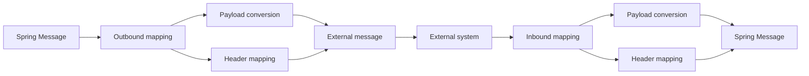
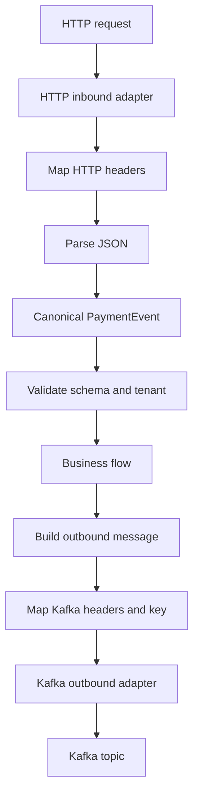

# Preserving Message Semantics Across Adapters

In the `SPRING_INTEGRATION_ADAPTERS` module, adapters connect Spring Integration's internal messages with the formats and rules of external systems. As a message crosses HTTP, JMS, AMQP, Kafka, files, SFTP, or other systems, the payload may be serialized, converted across types, or re-wrapped; internal headers may be mapped into protocol metadata, dropped, or renamed.

Preserving message semantics means safeguarding business meaning and required control information across that boundary. A JSON message can still parse cleanly yet lose its meaning if the correlation ID disappears, currency units shift, timezones break, `tenantId` is dropped, or a message key is confused with an ordinary header. Mapping must therefore be designed as an intentional data contract between two systems.

## Objectives

After this lesson, you will be able to:

- Distinguish payload, internal headers, and external protocol metadata.
- Explain inbound and outbound directions of message mapping.
- Choose which information to transform, keep, rename, or drop.
- Design mapping rules for content type, encoding, correlation ID, tenant, trace context, and routing keys.
- Avoid losing data types, temporal meaning, security context, and control metadata.
- Use `MessageBuilder`, transformers, and header mappers in their proper roles in Spring Integration.
- Test mapping contracts and handle cases that cannot map one-to-one.

## 1. Internal Messages vs. External Messages

Spring Messaging models a message with two primary parts:

- **Payload:** the data processed by the flow, such as an `Order` object, a JSON string, or a byte array.
- **Headers:** metadata accompanying the payload, such as correlation ID, content type, source system, receive timestamp, or routing hints.

An internal message can be visualized as:

```text
Message
├── payload: Order
│   ├── orderId
│   ├── amount
│   └── status
└── headers
    ├── correlationId
    ├── tenantId
    ├── contentType
    ├── sourceSystem
    └── receivedAt
```

When crossing an adapter, the message must be represented in structures the external system understands. For instance, an HTTP request has a body and HTTP headers; a Kafka record has key, value, headers, topic, and partition; a JMS message has a body and properties; a file has content along with a filename and filesystem attributes.

These structures are not identical to a Spring Message. Not every internal header has a corresponding field in an external protocol. Conversely, protocol metadata such as HTTP method, Kafka key, AMQP routing key, or JMS delivery mode should not be blindly stuffed into the business payload.

Mapping therefore operates in two directions:

- **Outbound mapping:** converts a Spring Message into a request, record, broker message, or file to send externally.
- **Inbound mapping:** reads external data and constructs a Spring Message for the flow to process.



Good mapping preserves essential business semantics while accurately honoring the target protocol's constraints.

## 2. Payloads and Headers Have Different Responsibilities

The payload typically holds business data. Headers carry context for routing, correlation, observability, or processing control. This boundary is not absolute: a protocol may force certain business fields into headers or dedicated metadata. Even so, design the payload as the primary data contract while headers describe how the message is transported or handled.

For example, a payment event might have this payload:

```json
{
  "eventType": "OrderPaid",
  "schemaVersion": 2,
  "orderId": "ORD-1001",
  "amount": {
    "value": "1250000.00",
    "currency": "VND"
  },
  "paidAt": "2026-11-23T07:30:00Z"
}
```

Internal headers might contain:

| Header | Meaning |
|---|---|
| `correlationId` | Links the message to a broader workflow or request |
| `tenantId` | Identifies the tenant owning the data |
| `sourceSystem` | System that originated the message |
| `contentType` | Payload format, e.g., JSON |
| `schemaVersion` | Payload contract version if not embedded in body |
| `traceparent` | Distributed tracing context when propagation is permitted |
| `receivedAt` | Time the application received the message |

Some fields can live in either the payload or headers depending on contract. What matters is that all parties agree on one authoritative location. If `schemaVersion` appears in both body and header, define precedence rules and how mismatches are handled.

Do not dump all internal headers into the JSON payload merely to avoid losing metadata. Doing so mixes business data with transport details, forcing downstream consumers to understand Spring Integration's internal structure.

## 3. Define the Mapping Contract Before Configuring Adapters

For every data field or header, answer four questions:

1. Does this information need to cross the system boundary?
2. Does the receiver expect it in the payload, a header, or protocol-specific metadata?
3. What are the data type, field name, and conversion rules?
4. What should happen if it cannot be mapped or its value is invalid?

A mapping table serves as a concise shared contract across teams:

| Meaning | Spring Message | HTTP | Kafka | Rule |
|---|---|---|---|---|
| Business content | `payload` | Request body | Record value | Serialize per agreed schema |
| Content format | `contentType` | `Content-Type` | Optional header per convention | Never guess format from body bytes |
| Correlation | `correlationId` | `X-Correlation-Id` header | Record header | Keep value consistent across the flow |
| Tenant | `tenantId` | Header or body field | Header or value field | Verify access permissions on receive |
| Partitioning key | Internal header/metadata | No default equivalent | Record key | Map explicitly; governs partitioning |
| Trace context | `traceparent` | Trace header | Record header per config | Propagate strictly per tracing policy |
| Receive time | `receivedAt` | Generated at inbound if needed | Generated at consumer if needed | Never confuse with event occurrence time |

This table is only an example. Actual HTTP header names, Kafka header names, and field locations must be agreed upon by both systems. Never assume an internal header appears automatically on every protocol.

## 4. Key Rules When Converting Payloads

### Data Types and Precision

JSON does not represent every Java type verbatim. For instance, `BigDecimal` may be parsed as floating-point numbers by some clients, causing monetary rounding drift. Represent monetary amounts as decimal strings paired with currency, or specify exact precision and parsing rules on both sides.

Similarly:

- Enums should agree on wire names rather than relying on enum declaration ordinality.
- UUIDs should agree on formatting and casing if systems compare them as strings.
- Binary data must specify raw bytes vs. Base64.
- Null, missing fields, and empty strings must carry distinct meanings if the domain differentiates them.
- Collections must specify ordering guarantees whenever element order matters.

### Time and Time Zones

Prefer timestamps with an explicit offset or UTC, such as ISO-8601 `2026-11-23T07:30:00Z`. Distinguish clearly between:

- Event occurrence time (`occurredAt`).
- System ingestion time (`receivedAt`).
- Broker publish time (`publishedAt`).

Never write a zoneless timestamp and assume every system interprets it identically. When converting to epoch milliseconds, standardize units and rounding.

### Charset and Content Type

A byte array does not declare by itself whether it holds JSON, XML, or plain text in a particular charset. Contracts must specify `Content-Type`, charset, and schema version. Whenever an adapter converts bytes into a `String`, specify the charset explicitly—never rely on the host's default charset for data exchange.

### Schema Versioning

When payloads evolve, define compatibility rules:

- Adding optional fields is usually backward-compatible if consumers ignore unknown fields.
- Changing a field's type or meaning risks breaking the contract.
- Removing fields can break existing consumers.
- Changing units of measure requires a schema change or a clearly renamed field.

Include `schemaVersion` in the payload or agreed metadata. Consumers should reject or route unsupported versions to an error flow instead of silently parsing under outdated assumptions.

## 5. Header Mapping and Protocol Constraints

Header mapping translates metadata between `MessageHeaders` and protocol headers/properties. Spring Integration supplies header mappers for many adapters. A header mapper handles bidirectional metadata mapping, while adapters or message converters handle other conversion steps.

Never assume every protocol has identical header capabilities:

| Protocol | Metadata characteristics |
|---|---|
| HTTP | Headers are text values with naming rules and potential multi-value entries; header names are case-insensitive |
| JMS | Properties restrict names and value types; some names/attributes are provider-managed |
| AMQP | Typed message properties and headers; brokers also carry exchange, routing key, and delivery mode |
| Kafka | Records have key, value, and headers; headers allow duplicate names and values are typically bytes |
| File/SFTP | Filename, path, timestamp, and file attributes are separate metadata; not all travel inside file content |

For example, a Spring `correlationId` header may map to HTTP `X-Correlation-Id`, a JMS correlation ID, or a Kafka header per contract. However, adapters do not automatically map every header name identically. Check header mapper configuration, allowlists, and type conversion rules.

Some headers are meaningful only inside the application. For instance, `replyChannel`, `errorChannel`, or internal callback objects cannot be meaningfully serialized into network headers. Such internal control headers must stay inside the flow or be stripped at transport boundaries.

Fields such as Kafka record key, AMQP routing key, HTTP method, or HTTP status are not ordinary headers. They have dedicated roles in their protocols and must be configured through the adapter's or endpoint's corresponding properties.

## 6. Using MessageBuilder to Construct Contract-Compliant Messages

In Spring Messaging, `MessageBuilder` builds a new message with a payload and chosen headers:

```java
import java.math.BigDecimal;
import java.time.Instant;
import org.springframework.messaging.Message;
import org.springframework.messaging.MessageHeaders;
import org.springframework.messaging.support.MessageBuilder;
import org.springframework.util.MimeTypeUtils;

record PaymentEvent(
    String orderId,
    BigDecimal amount,
    String currency,
    Instant occurredAt
) {}

PaymentEvent event = new PaymentEvent(
    "ORD-1001",
    new BigDecimal("1250000.00"),
    "VND",
    Instant.parse("2026-11-23T07:30:00Z")
);

Message<PaymentEvent> message = MessageBuilder
    .withPayload(event)
    .setHeader(MessageHeaders.CONTENT_TYPE, MimeTypeUtils.APPLICATION_JSON)
    .setHeader("correlationId", "checkout-8f2a")
    .setHeader("tenantId", "tenant-01")
    .setHeader("sourceSystem", "checkout-service")
    .build();
```

This creates an internal message. When sending over HTTP, AMQP, or Kafka, the adapter must translate the payload and selected headers into the external representation. Setting a header on a message does not automatically guarantee the adapter will transmit it.

`MessageHeaders.ID` and `MessageHeaders.TIMESTAMP` are Spring-managed metadata. Creating a new message can regenerate the ID. To recognize the same event across multiple systems, use a stable business header such as `eventId` or `correlationId` rather than Spring's internal message ID as a cross-system identifier.

When replacing a payload while keeping certain headers, use `MessageBuilder.fromMessage(existingMessage)` and update payload or headers. However, keep only headers whose semantics remain valid after transformation. For instance, after producing a new business event, do not retain a stale header describing the format or source of the previous payload if it no longer applies.

## 7. Transformers and Header Mappers Have Separate Roles

Transformers alter the payload or message structure. Header mappers translate metadata between Spring Messages and protocols. Both collaborate, yet neither replaces the other.

Conceptual flow:


A transformer can:

- Parse JSON into a domain object.
- Rename fields to match a canonical model.
- Normalize timestamps and currencies.
- Wrap payloads in a schema-versioned event envelope.
- Strip source-system-specific fields.

A header mapper can:

- Map correlation IDs into protocol metadata.
- Map content types.
- Propagate trace context per policy.
- Allowlist headers permitted to leave outbound.
- Convert header value types if required by the protocol.

In Spring Integration, transformer and header-enricher endpoints normalize messages before handing off to an adapter. For adapters supporting header mappers, configuring the mapper at the protocol boundary centralizes metadata policy. Specific builder names and properties depend on the adapter and library version.

### Payload Transformation Example

Suppose the source system sends:

```json
{
  "order_id": "ORD-1001",
  "paid_amount": "1250000.00",
  "paid_currency": "VND",
  "paid_at": "2026-11-23T07:30:00Z"
}
```

The application's canonical model might use:

```json
{
  "orderId": "ORD-1001",
  "amount": {
    "value": "1250000.00",
    "currency": "VND"
  },
  "occurredAt": "2026-11-23T07:30:00Z"
}
```

The transformer renames fields and reshapes structure. The header mapper preserves or maps `correlationId`, `tenantId`, and trace context. Never mix business structure mapping and header filtering together in one boundaryless block of code, as it becomes hard to test and diagnose mapping bugs.

## 8. Adapter-by-Adapter Metadata Mapping

### HTTP

HTTP requests/responses carry bodies, headers, methods, URIs, status codes, and optional query parameters. Keep request metadata distinct from business data.

Example:

| Internal info | HTTP |
|---|---|
| Payload | Request body |
| `contentType` | `Content-Type` |
| `correlationId` | Contract header, e.g., `X-Correlation-Id` |
| `tenantId` | Header or body field per policy |
| Target destination | URI/path/query and endpoint config |
| Outcome | Response body and HTTP status |

Do not turn every Spring header into an HTTP header. Some names are invalid, some may be altered by proxies or servers, and some hold sensitive data. Manage authentication headers via dedicated credential mechanisms. Treat headers arriving from external clients as untrusted until authenticated and authorized.

HTTP headers can hold multiple values. Never concatenate values arbitrarily if the header's semantics require preserving a list. On inbound responses, distinguish transport-level HTTP success status from business outcomes inside the body.

### JMS

JMS messages carry a body and properties. Correlation IDs can live in JMS's correlation ID field; reply-to and message IDs follow provider/API rules. Properties support only restricted value types, and property names obey JMS constraints. Never send arbitrary Java objects or invalid header names assuming the provider preserves them as-is.

In request/reply, distinguish the correlation ID used to match responses to requests from provider-assigned message IDs. When applications supply correlation IDs, both sides must agree on who generates them, who echoes them onto replies, and what happens when they are missing.

### AMQP

AMQP carries message properties, headers, and routing metadata like exchanges and routing keys. `contentType`, `contentEncoding`, `correlationId`, `replyTo`, and delivery mode have dedicated semantics. The adapter's header mapper decides which Spring headers map to AMQP headers or properties.

Never confuse routing keys with correlation IDs: routing keys control broker message routing, while correlation IDs link messages to a workflow. Also verify whether messages are persistent and whether broker publisher confirms are enabled. Successful header mapping does not mean the broker durably persisted the message.

### Kafka

A Kafka record contains topic, key, value, headers, partition, and offset. The key affects partitioning and per-partition ordering—it is not merely an optional header. Offsets are broker-assigned positions within a partition, not producer-supplied event IDs.

An example contract might specify:

- Key is `orderId` so events for the same order land in the same partition.
- Value is the event JSON matching the schema version.
- Header `correlationId` traces the workflow.
- Header `eventType` describes the event kind.
- Offset and partition are retained as receive-side metadata for operations.

Kafka headers permit duplicate names and byte-array values. Collapsing them into a single-valued Map can drop duplicate values. Define an explicit policy if the contract permits repeated headers. On retries or resends, never treat an old offset as the identity of a new record.

### File and SFTP

With file adapters, payloads are usually file contents or file handles; filename, directory, timestamp, and file attributes can appear in headers. SFTP also adds remote path and remote server metadata.

Filenames may carry business meaning, such as batch codes or export dates. If renamed while moving through the flow, retain the original filename in separate metadata. Never rely solely on filenames as unique identifiers if files can be resent or collide across folders; checksums or batch IDs are stronger deduplication keys.

File paths and remote paths must be validated. Never concatenate externally supplied values directly into local paths without normalization and directory-traversal checks. File metadata mapping never replaces content validation, signatures, or access checks.

## 9. Preserving Correlation, Tracing, and Security Context

### Correlation ID vs. Event ID

Correlation ID answers: *which workflow does this message belong to?* Event ID answers: *which specific event is this?* Both values can differ and serve distinct purposes.

For example, one checkout workflow has correlation ID `checkout-8f2a`, yet emits multiple events with their own event IDs. As an event moves from HTTP into Kafka, correlation ID traces the whole checkout while event ID detects duplicate deliveries of that individual event.

Never use an adapter's or broker's internal message ID as a cross-system event ID, because IDs may be regenerated at every boundary.

### Trace Context

Distributed tracing propagates trace context across systems to link spans. Forward only trace fields compliant with your chosen standard and policy. When trace context arrives from an untrusted source, never treat it as authentication or authorization proof.

### Tenant and Sensitive Data

`tenantId` can govern which data scope a handler is permitted to access. Never trust a producer-supplied `tenantId` header blindly. Consumers must authenticate the source and verify that the caller is authorized to emit messages for that tenant.

Never forward all headers to external systems. Internal headers may hold tokens, cookies, internal routing details, queue names, or personal data. Use an allowlist of exportable headers and strip credentials and unnecessary metadata. If a header is invalid or unsupported, enforce an explicit policy: drop with a log, route to an error flow, or reject the message. Avoid silent conversions that alter meaning.

## 10. Handling Non-Reversible Mappings

Not every mapping can round-trip losslessly. For example:

- HTTP headers carry text values, whereas Spring headers can hold complex Java objects.
- Kafka headers allow repeated keys, whereas a simple Map cannot retain multiple values per key.
- An offset timestamp converted to epoch milliseconds loses sub-millisecond or offset detail.
- Normalized filenames may no longer preserve the original filename.
- Internal headers like `replyChannel` have no external equivalent.

The goal is therefore not necessarily to convert out and back into a bit-identical object, but to preserve all contractually committed semantics. For unrepresentable data, choose one explicit option:

1. Carry it inside the payload or schema envelope.
2. Map it to another agreed metadata field.
3. Store it in internal context if it does not need to cross the boundary.
4. Drop it intentionally and document that in the mapping spec.
5. Reject the message if losing that field breaks business correctness.

Never silently drop a mandatory header. When an inbound message lacks a required field, route it to an error channel or dead-letter flow with failure details so operators can investigate.

## 11. Testing Message Mapping Contracts

Mapping tests should focus on contracts and boundary edge cases, not just verifying that one happy-path JSON sample parses.

A comprehensive test suite covers:

| Case | What to verify |
|---|---|
| Valid payload | Field names, data types, and structure convert accurately |
| Required headers | Correlation ID, tenant, or event type are preserved |
| Disallowed headers | Credentials and internal headers are stripped |
| Unsupported headers | Explicit ignore, warn, or reject policy runs |
| Content type/charset | Bytes decode with the right encoding |
| Null and missing fields | Properly distinguished per schema |
| Decimals and timestamps | No precision, unit, or timezone loss |
| Repeated headers | No value loss where protocol permits duplicates |
| Old/new payload versions | Documented compatibility rules apply |
| Schema-invalid messages | Routed to error flow or DLQ per policy |
| Redelivered messages | Event ID and idempotency key stay stable and meaningful |

Test outbound and inbound separately. For reversible mappings, add round-trip tests proving committed fields survive intact. For non-reversible mappings, assert critical business properties rather than full object equality.

Maintain contract tests between producers and consumers using versioned payload fixtures. Whenever changing header names, types, or schemas, test impact on active consumers before deploying.

## 12. End-to-End Example: Receive HTTP, Process, and Publish to Kafka

Suppose a payment system invokes an HTTP endpoint on your app. The request carries an event JSON body and an `X-Correlation-Id` header. The app turns the request into a Spring Message, normalizes the payload, and publishes a record to Kafka.



The mapping contract might specify:

- HTTP body is JSON conforming to `PaymentEvent` schema version 2.
- `X-Correlation-Id` maps to internal header `correlationId`.
- `tenantId` is derived from authenticated identity and authorization checks, not blindly trusted from raw request headers.
- Payload parses into a canonical model with normalized decimals and timestamps.
- Kafka record key is `orderId`; value is JSON matching the target schema.
- `correlationId`, `eventType`, and trace context map onto Kafka headers via an allowlist.

If JSON parsing fails, the app must never fabricate a default `PaymentEvent` and continue. Route the message to an error flow with source metadata, correlation ID if present, and parse failure reason. If Kafka publishing fails, apply retries and define clearly whether resending can create duplicate records. Downstream consumers still need idempotency by `eventId` because producer retries can cause multiple deliveries.

## 13. Common Mapping Mistakes

| Symptom | Cause | Fix |
|---|---|---|
| Consumer cannot find correlation ID | Header unmapped or mismatched names | Define wire header name and configure bidirectional mapper |
| Payload parses but monetary amount is wrong | Decimal converted to floating point or wrong unit | Specify decimal representation, currency, and conversion rules |
| Timestamps shifted by hours | Missing timezone or local time confused with UTC | Use offset-aware formats and separate `occurredAt`/`receivedAt` |
| Consumer fails on new payload | Incompatible schema change | Manage schema versions and run contract tests |
| Internal headers leak externally | Mapped all headers without filtering | Enforce allowlists and strip credentials |
| Kafka record lands in wrong partition | Record key not mapped properly | Treat key as dedicated metadata and define partitioning |
| Repeated headers lost | Collapsed header list into single-value Map | Preserve multi-value structures or define merge policy |
| Reply fails to match request | Confused message ID with correlation ID | Use stable correlation ID per request/reply contract |
| File processed twice | Used filename as unique ID or lacked state tracking | Use batch ID/checksum and idempotency storage |
| Schema-invalid message keeps flowing | Mapping errors swallowed or filled with defaults | Validate early; use error channels and dead-letter policies |

## 14. Pre-Production Design Checklist

- [ ] Documented internal message payload and headers.
- [ ] Created inbound and outbound mapping tables for every adapter.
- [ ] Specified data types, charsets, content types, and schema versions.
- [ ] Separated event ID, correlation ID, message ID, and broker offsets.
- [ ] Defined timezone, decimal precision, null, and missing-field rules.
- [ ] Identified protocol-specific metadata like Kafka key, AMQP routing key, and HTTP status.
- [ ] Enforced allowlists for headers crossing boundaries.
- [ ] Stripped `replyChannel`, `errorChannel`, and non-serializable internal objects outbound.
- [ ] Authenticated tenant and source before using metadata for routing or authorization.
- [ ] Defined policies for unsupported headers and non-reversible mappings.
- [ ] Tested valid payloads, bad schemas, missing headers, repeated headers, and redeliveries.
- [ ] Verified retries, acknowledgments, and idempotency at adapter boundaries.

## Conclusion

Preserving message semantics across adapters requires explicit contracts covering payloads, headers, and protocol-specific metadata. Transformers normalize business data; header mappers transfer metadata via allowlists; adapters handle communication with external systems. When event IDs, correlation IDs, keys, offsets, and internal control headers are kept cleanly separated, Spring Integration flows retain context reliably, stay easy to test, and remain resilient across retries and schema changes.
