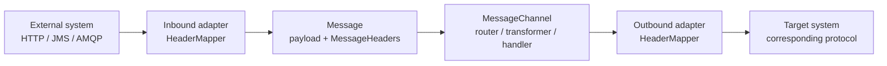

# StandardHeaders and Protocol Headers in Spring Integration

## Learning Objectives

In Spring Integration, a `Message<?>` consists of a **payload** (business data) and **headers** (metadata supporting processing, routing, correlation, and communicating with external systems). When building inbound/outbound adapters, gateways, pollers, and `MessageChannel`s for HTTP, JMS, AMQP, Kafka, files, or SFTP, developers need to know which headers belong to the processing flow and which belong to the transport protocol.

After this lesson, you will be able to:

- Distinguish **standard headers**, **Spring Integration headers**, **protocol-specific headers**, and custom application headers.
- Read, create, and modify headers properly using `MessageHeaders`, `MessageBuilder`, and `IntegrationMessageHeaderAccessor`.
- Explain how headers are mapped via `HeaderMapper` when data passes through an adapter/gateway.
- Avoid common mistakes: using the wrong header names, copying internal metadata onto the network, assuming headers automatically travel across protocols, or losing correlation info when creating new messages.

## 1. What Are StandardHeaders?

**Standard headers** is the umbrella term for standardized headers defined by the framework that message-processing components commonly understand. In the context of Spring Integration, `StandardHeaders` should be understood as a **conceptual group**; the actual APIs used to obtain constants are `org.springframework.messaging.MessageHeaders` and `org.springframework.integration.IntegrationMessageHeaderAccessor` — do not assume there is a single `StandardHeaders` class holding every header.

For example, an order request sent onto a `MessageChannel` might carry:

```text
Payload: {"orderId":"O-1042","amount":125000}
Headers:
  id: <framework-generated UUID>
  timestamp: <message creation time>
  contentType: application/json
  correlationId: batch-2026-11-23
  tenantId: shop-a
```

These fields are not at the same layer:

| Layer | Examples | Who Interprets It? | Function |
|---|---|---|---|
| Standard Spring Messaging | `id`, `timestamp`, `replyChannel`, `errorChannel`, `contentType` | Messaging framework | Identification, replies, errors, content type |
| Spring Integration | `correlationId`, `sequenceNumber`, `sequenceSize`, `priority` | Splitter, aggregator, resequencer, priority channel, and related endpoints | Integration flow orchestration |
| Protocol-specific | HTTP `Content-Type`, JMS `JMSCorrelationID`, AMQP routing key, Kafka topic/key | Adapters and protocol libraries | Interacting with external protocols/brokers |
| Custom business-defined | `tenantId`, `sourceSystem`, `businessTraceId` | Application code per agreed contract | Routing per custom requirements |

**Core rule:** a header's presence in `MessageHeaders` does not mean it will be sent as an HTTP header, JMS property, Kafka record header, or file metadata. **The adapter/gateway together with its mapper/converter configuration** determines that conversion.

## 2. Standard Headers You Must Know

### 2.1. Spring Messaging Headers

The following constants live in `org.springframework.messaging.MessageHeaders`:

| Constant | Header Name | Common Data Type | Meaning and Notes |
|---|---|---|---|
| `MessageHeaders.ID` | `id` | `UUID` | Identifies a single **message instance**. Auto-generated by the framework; never use as an order ID or cross-system transaction ID. |
| `MessageHeaders.TIMESTAMP` | `timestamp` | `Long` | Message creation time in milliseconds since Unix epoch. Not the business event occurrence time. |
| `MessageHeaders.REPLY_CHANNEL` | `replyChannel` | `MessageChannel` or channel name as `String` | Reply destination in request–reply flows when an endpoint needs to respond. |
| `MessageHeaders.ERROR_CHANNEL` | `errorChannel` | `MessageChannel` or channel name as `String` | Destination for `ErrorMessage` when errors are handled asynchronously via the matching mechanism. |
| `MessageHeaders.CONTENT_TYPE` | `contentType` | Usually `MimeType` or a value supported by converters/mappers | Payload format hint for conversion steps; does not guarantee an HTTP header was created. |

The `id` and `timestamp` headers are framework-managed and read-only by default. When creating a new message with a builder, the framework assigns fresh metadata to the new message; do not try `setHeader("id", ...)` or `setHeader("timestamp", ...)` to force keeping old values. If you need an ID that persists across multiple messages or systems, create a dedicated business header such as `businessTraceId`.

`replyChannel` and `errorChannel` may hold references to Java objects inside the same application. They are **internal routing addresses**, not an HTTP `Reply-To` or JMS `JMSReplyTo`. Accidentally dropping or mutating them can break request–reply/error flows; sending a raw `MessageChannel` object to a broker is also invalid.

### 2.2. Spring Integration-Specific Headers

The constants below live in `org.springframework.integration.IntegrationMessageHeaderAccessor`:

| Constant | Purpose | Scenario |
|---|---|---|
| `CORRELATION_ID` | Groups related messages into one processing group | Splitter → aggregator; collecting parts of the same order |
| `SEQUENCE_NUMBER` | Position of a message within a group | Processing data parts in order |
| `SEQUENCE_SIZE` | Total messages in a group when known upfront | Aggregator waiting for all parts |
| `PRIORITY` | Message priority | `PriorityChannel` |
| `EXPIRATION_DATE` | Expiration timestamp metadata for components that inspect it | Filtering by expiration policy; the header itself does not auto-destroy messages |
| `DUPLICATE_MESSAGE` | Marks a message detected as a duplicate | Idempotent receiver interceptor |
| `ACKNOWLEDGMENT_CALLBACK` | Callback to ack/reject/requeue when supported by the source | Certain message sources and adapters |

Some headers like `SEQUENCE_DETAILS` and `ROUTING_SLIP` serve complex internal mechanisms. Do not manually alter their structure without understanding the corresponding component's contract.

**Distinguish three frequently confused identifiers:**

- `MessageHeaders.ID` identifies **one message instance** inside the application.
- `IntegrationMessageHeaderAccessor.CORRELATION_ID` groups **related messages** in integration logic.
- `JMSCorrelationID` or `KafkaHeaders.CORRELATION_ID` belongs to a **specific protocol/library contract**; it does not automatically become a Spring Integration correlation ID.

For flows using an `Aggregator`, designing the correlation key and release condition is the responsibility of the application or specialized components like splitters/aggregators.

## 3. Protocol Headers: Metadata by Connected System

Protocol headers are metadata tied to **how external systems send, receive, or store data**. Each protocol has different names, data types, directions, and constraints. Adapters typically attach received metadata to `MessageHeaders` on inbound and select/transform metadata on outbound.

| Adapter/Gateway | Common APIs or Constants | Example Metadata | Practical Notes |
|---|---|---|---|
| HTTP | `org.springframework.http.HttpHeaders`; `DefaultHttpHeaderMapper` | `Content-Type`, `Accept`, `Authorization`, `X-Correlation-Id` | HTTP headers have specific rules and are often strings/multi-valued; internal `contentType` differs from wire `Content-Type`. |
| JMS | `org.springframework.integration.jms.JmsHeaders`; `DefaultJmsHeaderMapper` | `JMSCorrelationID`, `JMSReplyTo`, `JMSMessageID` | Some JMS properties are assigned by the broker/provider; JMS properties have naming and type limits. |
| AMQP/RabbitMQ | `org.springframework.amqp.support.AmqpHeaders`; `DefaultAmqpHeaderMapper` | `amqp_correlationId`, `amqp_receivedRoutingKey`, `amqp_deliveryTag` | Received broker headers differ from outbound headers; routing keys/acks have specific contexts. |
| Kafka | `org.springframework.kafka.support.KafkaHeaders` | `TOPIC`, `KEY`, `RECEIVED_TOPIC`, `RECEIVED_PARTITION`, `OFFSET` | Topic/key/partition/offset are record properties or consumer metadata; not every value is an app-sent Kafka record header. |
| File | `org.springframework.integration.file.FileHeaders` | `FILENAME`, `ORIGINAL_FILE` | Used for naming or knowing file origin; normal file contents do not contain “HTTP/JMS headers”. |
| SFTP/FTP | Adapter-provided file/remote metadata headers | Filename, remote path/directory per adapter | App-side metadata can determine target names or track origin; not every header is written to the remote file. |

### 3.1. HTTP: Internal Header Names vs. Wire Names

For example, an outbound HTTP gateway receives a message carrying the application header `X-Correlation-Id`. For the receiver to actually see that HTTP header, header mapping configuration must allow it. With Spring Integration's XML namespace:

```xml
<int-http:outbound-gateway
    id="ordersHttpGateway"
    channel="httpOutbound"
    url="https://api.example.org/orders"
    mapped-request-headers="HTTP_REQUEST_HEADERS,X-Correlation-Id"
    mapped-response-headers="HTTP_RESPONSE_HEADERS,X-Trace-Id" />
```

This snippet **illustrates mapping attributes** in a project that has already configured the `int-http` namespace. `HTTP_REQUEST_HEADERS` and `HTTP_RESPONSE_HEADERS` are special patterns to preserve standard HTTP header groups when adding custom headers. If you overwrite the mapping list with only `X-Correlation-Id`, you might omit standard HTTP headers you still need.

`DefaultHttpHeaderMapper` supports header lists and wildcards. Do not infer that every internal header will automatically appear on an HTTP request. The HTTP `Authorization` header carries sensitive data and must be set and forwarded according to per-destination policies rather than copied unchecked.

### 3.2. JMS, AMQP: Correlation and Broker Metadata

In JMS, `JMSCorrelationID` is a field on the JMS message. In Spring Integration, `JmsHeaders` defines the keys used when the mapper transfers it into/out of `MessageHeaders`. `DefaultJmsHeaderMapper` handles JMS API fields via appropriate setters/getters and can also map user properties. Certain values, such as the JMS message ID and redelivery flag, come from the broker/provider and are not attributes the application freely picks when sending.

In AMQP, `AmqpHeaders.RECEIVED_ROUTING_KEY` is **received** information; it helps branch inbound processing, yet does not automatically control the routing key of a subsequent outbound send. Only headers/configs supported by the outbound AMQP adapter control publishing. Similarly, delivery tags and acknowledgments belong to a specific consumer/channel: never use them as long-lived business identifiers.

**Common takeaway:** `CORRELATION_ID` in `IntegrationMessageHeaderAccessor` and the correlation IDs of JMS/AMQP/Kafka are **different keys that may share a similar goal**. To maintain the same business trace across protocols, define explicit conversion rules at system boundaries.

### 3.3. Kafka: Distinguishing Outbound and Inbound Headers

`KafkaHeaders.TOPIC` and `KafkaHeaders.KEY` are used when building an outgoing record (depending on adapter/producer config). On incoming messages, `KafkaHeaders.RECEIVED_TOPIC`, `KafkaHeaders.RECEIVED_PARTITION`, and `KafkaHeaders.OFFSET` describe the consumed record.

Never use `RECEIVED_TOPIC` instead of `TOPIC` to specify a new send target. A Kafka received offset is not a general sequence number like `IntegrationMessageHeaderAccessor.SEQUENCE_NUMBER`; the two values have different semantics and scopes. Kafka header APIs can change across Spring Kafka versions, so use constants from your exact runtime dependency.

### 3.4. File and SFTP: Operational Support Headers

With a file outbound adapter, `FileHeaders.FILENAME` can be used by `FileNameGenerator` to pick the output filename. Inbound file adapters usually add info about the original filename. For example, a message with a CSV payload and `FileHeaders.FILENAME = "orders-2026-11-23.csv"` can be written under that name if the handler uses the default generator and has no higher-priority configuration.

For SFTP/FTP, file/remote-path headers are metadata of the **adapter and processing flow**. After fetching a file from a server and forwarding it over HTTP, the application must explicitly decide whether to keep the filename, map it to a request field, or use it only for logging.

## 4. At Which Boundary Does HeaderMapper Operate?

`MessageHeaders` is Spring Messaging's metadata map, whereas an HTTP request, JMS message, AMQP message, or Kafka record has its own metadata model. `HeaderMapper` bridges the two worlds:



**Inbound:** source protocol → mapper/converter → `MessageHeaders`. For example, HTTP header `X-Correlation-Id` is captured as a key in the map if configured in the mapping.

**In-flow processing:** routers, service activators, transformers, or header enrichers read headers and may build new messages. The framework usually propagates headers when an endpoint creates a new message, though behavior depends on the component and whether you return a payload or a `Message`. If a transformer returns a complete `Message<?>`, the author must ensure required headers are in the result; if it returns a payload, the framework usually keeps inbound headers.

**Outbound:** `MessageHeaders` → mapper/converter → target protocol metadata. The mapper can drop headers, rename them, convert types, or reject invalid values. By default `id`/`timestamp` are not mapped as transport data; internal Java objects like `MessageChannel` are not wire headers either.

Some mappers support `STANDARD_REQUEST_HEADERS`, `STANDARD_REPLY_HEADERS`, and `NON_STANDARD_HEADERS` patterns. These are **mapper group pattern names**, not header names that will appear inside messages. For HTTP, the specific patterns are `HTTP_REQUEST_HEADERS` and `HTTP_RESPONSE_HEADERS`. Use the patterns matching the mapper/protocol rather than mixing them.

## 5. Java Example: Reading Standard Headers and Creating a New Message

The example below requires only the Spring Messaging and Spring Integration Core modules matching your project version:

```java
import org.springframework.integration.IntegrationMessageHeaderAccessor;
import org.springframework.messaging.Message;
import org.springframework.messaging.MessageHeaders;
import org.springframework.messaging.support.MessageBuilder;
import org.springframework.util.MimeTypeUtils;

public final class HeaderBasics {

    public static void main(String[] args) {
        Message<String> input = MessageBuilder
                .withPayload("{\"orderId\":\"O-1042\"}")
                .setHeader(MessageHeaders.CONTENT_TYPE, MimeTypeUtils.APPLICATION_JSON)
                .setHeader(IntegrationMessageHeaderAccessor.CORRELATION_ID, "batch-42")
                .setHeader("tenantId", "shop-a")
                .build();

        // Standard headers generated by the framework.
        System.out.println("Message ID: " + input.getHeaders().getId());
        System.out.println("Created at: " + input.getHeaders().getTimestamp());

        // Read by key, optionally checking expected data type.
        String tenant = input.getHeaders().get("tenantId", String.class);
        Object correlationId =
                new IntegrationMessageHeaderAccessor(input).getCorrelationId();
        System.out.println(tenant + " / " + correlationId);

        // MessageHeaders is read-only; builder creates a replacement message.
        Message<String> next = MessageBuilder.fromMessage(input)
                .removeHeader("tenantId")
                .setHeader("processingStage", "validated")
                .build();

        System.out.println("New ID: " + next.getHeaders().getId());
        System.out.println("Correlation kept: " +
                next.getHeaders().get(IntegrationMessageHeaderAccessor.CORRELATION_ID));
    }
}
```

Key observations:

1. The `tenantId` header is application metadata; the framework assigns no built-in meaning to it.
2. `correlationId` keeps its business meaning across the processing chain even though the message instance changed.
3. `input.getHeaders().put(...)` cannot be used to edit headers because `MessageHeaders` is read-only. Calling `MessageBuilder.fromMessage(input)` creates a new message and copies allowed headers, while `id`/`timestamp` are managed by the framework.
4. `contentType` hints at how to interpret the JSON payload; the JSON converter, HTTP mapper, and endpoint config still control how it is encoded and emitted over the protocol.

## 6. Example: Attaching Adapter-Specific Headers

### 6.1. Outbound Kafka Routing

When a project has the corresponding Spring Kafka dependency, a message sent to a Kafka outbound adapter can carry:

```java
import org.springframework.kafka.support.KafkaHeaders;
import org.springframework.messaging.Message;
import org.springframework.messaging.support.MessageBuilder;

Message<String> event = MessageBuilder.withPayload("{\"orderId\":\"O-1042\"}")
        .setHeader(KafkaHeaders.TOPIC, "orders.events")
        .setHeader(KafkaHeaders.KEY, "O-1042")
        .setHeader("businessTraceId", "trace-42")
        .build();
```

With an adapter configured to read topic/key from the message, `TOPIC` and `KEY` supply metadata for the **outbound** record. If the adapter is configured with a fixed topic or uses a higher-priority expression, the header value may not determine the target. `businessTraceId` becomes a Kafka native header only if the converter/header mapper permits it and the value type is supported.

### 6.2. Naming an Output File

```java
import org.springframework.integration.file.FileHeaders;
import org.springframework.messaging.Message;
import org.springframework.messaging.support.MessageBuilder;

Message<String> csv = MessageBuilder
        .withPayload("orderId,status\nO-1042,PAID\n")
        .setHeader(FileHeaders.FILENAME, "orders-2026-11-23.csv")
        .build();
```

`FileHeaders.FILENAME` helps the file outbound handler choose the filename per its configuration. Filenames originating from untrusted sources must be validated before constructing paths on disk or on an SFTP server.

### 6.3. Mapping a Correlation ID from HTTP into the Internal Flow

Suppose an HTTP inbound gateway is configured to put `X-Correlation-Id` into `MessageHeaders`. A service in the flow can translate the source protocol key into the flow's correlation ID:

```java
import org.springframework.integration.IntegrationMessageHeaderAccessor;
import org.springframework.messaging.Message;
import org.springframework.messaging.support.MessageBuilder;

public static Message<?> attachCorrelation(Message<?> inbound) {
    Object raw = inbound.getHeaders().get("X-Correlation-Id");
    if (!(raw instanceof String externalId) || externalId.isBlank()) {
        return inbound; // Or apply a policy to auto-generate an ID / reject the request.
    }

    String acceptedId = externalId.trim();
    if (acceptedId.length() > 128) {
        throw new IllegalArgumentException("Correlation ID too long");
    }

    return MessageBuilder.fromMessage(inbound)
            .setHeader(IntegrationMessageHeaderAccessor.CORRELATION_ID, acceptedId)
            .setHeader("businessTraceId", acceptedId)
            .build();
}
```

Both keys are set **intentionally** because the application needs both internal orchestration and business tracing. To make an outbound HTTP call, you must still configure mapping for `X-Correlation-Id` on the sending side or set that header when leaving. Do not assume `correlationId` will automatically rename itself to `X-Correlation-Id`.

## 7. Header Contract Design Rules

For stable cross-protocol integration, define an explicit contract for each header:

| Question | Decision to Document | Example |
|---|---|---|
| Where does the header come from? | Framework-generated, inbound protocol, or application? | `RECEIVED_TOPIC` comes from the consumed Kafka record |
| Who owns it and who can modify it? | Read-only, framework-internal, or business? | Never modify `MessageHeaders.ID` |
| What is the value's type? | `String`, `UUID`, `Integer`, `MimeType`, Java object...? | `sequenceNumber` requires an integer type |
| Which direction uses it? | Inbound, outbound, or intra-flow only? | `KafkaHeaders.TOPIC` controls sending |
| Does it cross system boundaries? | Allow mapping, renaming, dropping, or re-encoding? | HTTP `X-Correlation-Id` ↔ `businessTraceId` |
| How long must it live? | Single message instance, one request, or entire business transaction? | Order ID outlives `MessageHeaders.ID` |
| Can it be logged/forwarded? | Only approved headers with valid values | Avoid logging `Authorization` or secrets |

Directly applicable principles:

- **Use official constants** instead of hand-typing standard header names: `MessageHeaders.CONTENT_TYPE`, `IntegrationMessageHeaderAccessor.CORRELATION_ID`, `KafkaHeaders.RECEIVED_TOPIC`, `FileHeaders.FILENAME`.
- **Do not treat all metadata as network-transmittable data.** Some headers exist only to manage retries, acknowledgments, channels, or in-process sessions.
- **Separate transport correlation from business correlation.** If you want to keep the same ID across `HTTP → JMS → Kafka`, define a business header and corresponding mapping rules per adapter.
- **Limit headers mapped externally.** Review inbound/outbound directions, standard patterns, custom headers, and internal headers that must be stripped.
- **Validate types and values.** Kafka native headers often need proper encoding; JMS properties are type-restricted; HTTP values cannot arbitrarily carry Java objects.
- **Inspect headers at each hop.** Log safe fields after the inbound mapper, after transformers, and before the outbound mapper to pinpoint where metadata is lost or altered.

## 8. Typical Bugs and How to Verify

| Symptom | Possible Cause | How to Check/Fix |
|---|---|---|
| HTTP receiver does not see `X-Correlation-Id` | Outbound mapper does not include the custom header in requests | Check `mapped-request-headers`; keep `HTTP_REQUEST_HEADERS` if standard headers are still needed |
| Aggregator fails to assemble parts | Missing/wrong `correlationId`, `sequenceNumber`, or `sequenceSize` | Inspect splitter output headers and aggregator release strategy |
| Kafka sends to an unexpected topic | Used `RECEIVED_TOPIC` instead of `TOPIC`, or adapter prioritizes a fixed topic | Check outbound metadata and topic/topic-expression config |
| Creating a new message loses reply/error context | Handler returned a full `Message<?>` without copying needed headers | Review `MessageBuilder.fromMessage(...)` logic and output contract |
| JMS message lacks a custom property | Invalid property name/type or skipped by mapper | Check JMS property limits and mapper config |
| File written with a different name than header | Handler uses another file-name expression/generator or header is absent | Check `FileHeaders.FILENAME` and `FileNameGenerator` precedence |
| Correlation ID changes across protocols | No mapping rule between header groups | Use a business trace key and explicit boundary mapping |
| Logs accidentally expose tokens or sensitive data | Printed entire `MessageHeaders` while debugging | Log only an allowlist of approved headers |

### Suggested Practice Exercise

Design an **HTTP inbound → order processing → Kafka outbound** flow with these requirements:

1. Accept `X-Correlation-Id` over HTTP; if valid, convert it to `businessTraceId`. If missing, generate a new trace ID per application policy.
2. Build an order event payload and send it to topic `orders.events` with `KafkaHeaders.KEY` set to `orderId`.
3. Log `orderId`, `businessTraceId`, target topic name, and `MessageHeaders.ID` at each stage; explain why the message ID can change.
4. Send only approved business headers over Kafka; keep `replyChannel`, `errorChannel`, and callback/consumer metadata within proper scope.
5. When re-consuming the event, read `KafkaHeaders.RECEIVED_TOPIC` and `KafkaHeaders.OFFSET` for diagnostics, **not** using the offset as a business correlation ID.

Minimum tests should cover cases with/without the HTTP correlation ID, headers excluded by the mapper, payload-returning vs. `Message<?>`-returning transformers, and a Kafka adapter with a fixed topic vs. a header-driven topic.

## References

- [Spring Integration – Message, Message Headers, MessageBuilder, and Header Propagation](https://docs.spring.io/spring-integration/reference/message.html)
- [Spring Integration – HTTP Header Mappings](https://docs.spring.io/spring-integration/reference/http/header-mapping.html)
- [Spring Integration – AMQP Message Headers](https://docs.spring.io/spring-integration/reference/amqp/message-headers.html)
- [Spring Integration – Kafka Support](https://docs.spring.io/spring-integration/reference/kafka.html)
- [Spring Integration – Writing files](https://docs.spring.io/spring-integration/reference/file/writing.html)
- [Spring Kafka – Sending Messages](https://docs.spring.io/spring-kafka/reference/kafka/sending-messages.html)
