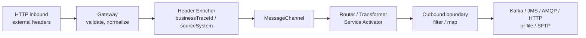
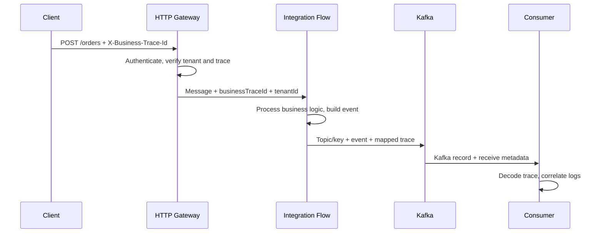

# User-Defined Headers in Spring Integration

## Learning Objectives

In the **SPRING_INTEGRATION_ADAPTERS** module, we build flows connecting external systems via inbound/outbound adapters, gateways, pollers, and `MessageChannel`; data can pass through files, SFTP, HTTP, JMS, AMQP, Kafka, or databases. The payload tells us **what is being processed**; message headers provide the **context for processing and forwarding the payload**. Beyond Spring's standard headers, many flows need additional custom metadata defined by the application contract.

**User-defined headers** (application-defined headers) let you carry information such as `businessTraceId`, `tenantId`, `sourceSystem`, `schemaVersion`, or `retryCategory` across integration steps without altering the business payload structure. However, they are meaningful only when all parties agree on their names, types, scopes, and protocol-boundary conversions.

After completing this lesson, you will be able to:

1. Decide what belongs in the payload, standard headers, or user-defined headers.
2. Create, read, add, update, or remove custom headers via `MessageBuilder` and header enrichers.
3. Determine when headers propagate, get altered, or cannot be exported through an adapter.
4. Design contracts and safety checks when moving from HTTP → internal processing → JMS/AMQP/Kafka/file/SFTP.
5. Diagnose missing headers, type mismatches, overwritten metadata, and misplaced trust in external headers.

## 1. What Is a User-Defined Header?

Spring Messaging models a message as a payload and `MessageHeaders`:

```text
Message
├── payload
│   └── {"orderId":"O-1042","total":125000}
└── headers
    ├── id                  → framework-managed UUID
    ├── timestamp           → message creation time
    ├── contentType         → standard format metadata
    ├── businessTraceId     → user-defined: business tracking
    ├── tenantId            → user-defined: verified tenant context
    └── sourceSystem        → user-defined: source system
```

A user-defined header is **a key–value pair placed into `MessageHeaders` by the application**, outside the set of headers the framework is required to understand. For example:

- `businessTraceId = "trace-8f3c"`: correlates steps of the same business transaction.
- `sourceSystem = "crm"`: tells a router or logger where the event came from.
- `tenantId = "tenant-a"`: carries a **system-verified** tenant context.
- `schemaVersion = 2`: helps downstream components pick the right versioned converter.
- `processingMode = "async"`: denotes application-defined processing behavior.

Spring Integration does not automatically know what `tenantId` means, nor does it automatically transmit `businessTraceId` as a matching HTTP/Kafka/JMS header. Routers, transformers, filters, handlers, gateways, or mappers must be coded/configured to read and use them.

### 1.1. Distinguishing Header Groups

| Group | Examples | Owner of Meaning | Proper Usage |
|---|---|---|---|
| **Standard Spring Messaging** | `id`, `timestamp`, `contentType`, `replyChannel`, `errorChannel` | Framework | Message identification, content conversion, replies, and error handling |
| **Spring Integration** | `correlationId`, `sequenceNumber`, `sequenceSize` | Integration components | Grouping messages, part numbering, aggregation |
| **Protocol-specific** | HTTP `Content-Type`; JMS `JMSCorrelationID`; Kafka topic/key; AMQP routing key | Protocol and adapter | Carrying metadata to/from external systems |
| **User-defined** | `businessTraceId`, `tenantId`, `sourceSystem` | Application and integration partners | Expressing business/operational metadata per custom contract |

**Note:** do not create a custom key sharing a name with a framework or protocol header and expect it to carry a different meaning. When you need a correlation value independent of `IntegrationMessageHeaderAccessor.CORRELATION_ID` or a JMS correlation ID, use a name like `businessTraceId` and map it intentionally where needed.

### 1.2. When to Use Headers vs. Payload

| Information | Where to Put It? | Reason |
|---|---|---|
| `orderId`, product list, amount, order status | **Payload** | Business content that must be consumed, persisted, and replayed as part of the event |
| `businessTraceId`, `sourceSystem`, `processingMode` | **Header** | Serves flow routing, tracing, operations, or policy |
| `contentType`, `replyChannel` | **Standard Header** | Framework already provides official contracts and constants |
| `JMSCorrelationID` or `KafkaHeaders.KEY` | **Protocol Metadata** | Understood by adapters/mappers per protocol rules |

Do not rely solely on a transient header to store data that downstream **must have to interpret a persisted or replayed event**. For instance, `orderId` can double as the Kafka record key, yet still belong inside the order event payload when it is part of the data contract.

## 2. Designing a User-Defined Header Contract

Before introducing a header, specify the following:

| Contract Property | Question to Answer | Example for `businessTraceId` |
|---|---|---|
| Name and convention | Are characters and casing standardized? | `businessTraceId` in `MessageHeaders` |
| Data type | Which Java type does the receiver expect? | `String` |
| Creation source | Does it come from inbound requests or is it issued at the gateway? | Gateway generates an ID if the request lacks a valid one |
| Required/optional | If missing, default, reject, or generate? | Generate a UUID when absent |
| Who may modify it? | Which component owns the value? | Only the entry gateway issues or normalizes it |
| Propagation direction | Intra-flow only, or across HTTP/JMS/Kafka? | Forwarded over HTTP and Kafka via mapping |
| Lifetime | One message, one request, or full transaction? | One business transaction |
| Safety | Safe to log or forward to partners? | Safe to log validated ID with bounded length |

**Recommended naming conventions:**

- Choose clear, consistent names across the application: `businessTraceId`, `sourceSystem`, `schemaVersion`. `MessageHeaders` is a string-keyed map; treat names as **case-sensitive**.
- Define keys in a shared location to avoid typos. If a module has multiple adapters, share naming conventions across endpoints.
- Avoid `id`, `timestamp`, `replyChannel`, `errorChannel`, `contentType`, and keys reserved by Spring Integration or protocol adapters.
- When integrating over HTTP, distinguish the internal name `businessTraceId` from the wire HTTP name like `X-Business-Trace-Id`. Renaming is the responsibility of the adapter/mapping or boundary translation step.
- Never place large blobs, arbitrary binaries, DB connections, Spring beans, `MessageChannel`s, or non-serializable Java objects into custom headers intended for brokers.

### 2.1. Centralizing Key Names in Code

```java
public final class ApplicationHeaders {

    private ApplicationHeaders() {}

    public static final String BUSINESS_TRACE_ID = "businessTraceId";
    public static final String TENANT_ID = "tenantId";
    public static final String SOURCE_SYSTEM = "sourceSystem";
    public static final String SCHEMA_VERSION = "schemaVersion";
}
```

These are **application-defined constants**, separate from the framework's `MessageHeaders`, `IntegrationMessageHeaderAccessor`, or `KafkaHeaders`. You can pair them with a class defining validation policies/types instead of scattering checks across adapters.

## 3. Creating and Reading Custom Headers with MessageBuilder

`MessageHeaders` exposes metadata as a read-only map. To change headers, build a **new message** with `MessageBuilder` rather than trying to mutate `input.getHeaders()`.

### 3.1. Creating a Message with User-Defined Headers

```java
import java.util.UUID;
import org.springframework.messaging.Message;
import org.springframework.messaging.support.MessageBuilder;

public final class CustomHeadersExample {

    public static Message<String> createOrderMessage() {
        String traceId = UUID.randomUUID().toString();

        return MessageBuilder.withPayload(
                    "{\"orderId\":\"O-1042\",\"total\":125000}")
                .setHeader(ApplicationHeaders.BUSINESS_TRACE_ID, traceId)
                .setHeader(ApplicationHeaders.SOURCE_SYSTEM, "orders-api")
                .setHeader(ApplicationHeaders.SCHEMA_VERSION, 2)
                .build();
    }

    public static String getTraceId(Message<?> message) {
        return message.getHeaders().get(
                ApplicationHeaders.BUSINESS_TRACE_ID, String.class);
    }
}
```

`setHeader(name, value)` sets or replaces the header value on the builder. `get(name, String.class)` reads with the expected type; the application should handle absence or type mismatches per contract.

### 3.2. Copying Headers, Adding If Absent, and Removing Headers

```java
import org.springframework.messaging.Message;
import org.springframework.messaging.support.MessageBuilder;

public static Message<String> prepareForProcessing(Message<String> incoming) {
    return MessageBuilder.fromMessage(incoming)
            .setHeaderIfAbsent(ApplicationHeaders.SOURCE_SYSTEM, "unknown")
            .setHeader("processingStage", "validated")
            .removeHeader("internalDebug")
            .build();
}
```

Meaning:

- `fromMessage(incoming)` initializes the builder with the existing payload and headers to produce the resulting message.
- `setHeaderIfAbsent(...)` sets the value only if the key is not already present, fitting a default-value policy.
- `setHeader(...)` can overwrite. Before overwriting metadata received from another system, know which values are trusted and which component owns the header.
- `removeHeader(...)` deletes one key; `removeHeaders(...)` supports removing multiple names/patterns per the builder API.

Building a new message can affect framework-managed metadata, especially `id` and `timestamp`; **do not use them as durable business identifiers**. Headers used by request–reply or error flows must also be retained if downstream endpoints depend on them.

### 3.3. Handling Missing or Invalid Headers

```java
import java.util.UUID;
import org.springframework.messaging.Message;
import org.springframework.messaging.support.MessageBuilder;

public static Message<?> ensureTraceId(Message<?> input) {
    Object supplied = input.getHeaders().get(
            ApplicationHeaders.BUSINESS_TRACE_ID);

    String traceId;
    if (supplied instanceof String text
            && text.matches("[A-Za-z0-9._:-]{1,128}")) {
        traceId = text;
    } else {
        traceId = UUID.randomUUID().toString();
    }

    return MessageBuilder.fromMessage(input)
            .setHeader(ApplicationHeaders.BUSINESS_TRACE_ID, traceId)
            .build();
}
```

The snippet illustrates a policy to **issue a new trace ID if missing/invalid**. In systems requiring partners to supply an ID, you may instead reject the message. Document this policy clearly in the contract, especially when correlating logs across systems.

## 4. Header Enricher and Header Filter in Spring Integration

In a Spring Integration flow, metadata enrichment should usually happen at a **boundary or dedicated step** rather than being repeated in every service activator.

### 4.1. Header Enricher: Adding or Computing Headers

Spring Integration provides `HeaderEnricher`, configurable via Java DSL or XML. Java DSL example:

```java
import java.time.Instant;
import org.springframework.context.annotation.Bean;
import org.springframework.integration.dsl.IntegrationFlow;

@Bean
IntegrationFlow addOrderHeaders() {
    return IntegrationFlow.from("ordersInbound")
            .enrichHeaders(headers -> headers
                    .header("sourceSystem", "orders-api")
                    .headerFunction("processingStartedAt",
                            message -> Instant.now().toString()))
            .channel("ordersWithHeaders")
            .get();
}
```

In this example, every message passing through enrichment receives the source system name and processing start time. `processingStartedAt` is an ISO-8601 `String`; if downstream expects `Instant`, both sides must agree on the in-JVM type and serialization format when crossing protocols.

Other enrichment forms can compute values from SpEL expressions, methods, or functions; the choice depends on the metadata source and your Spring Integration version's API.

Equivalent XML configuration for a static header:

```xml
<int:header-enricher input-channel="ordersInbound"
                     output-channel="ordersWithHeaders">
    <int:header name="sourceSystem" value="orders-api"/>
</int:header-enricher>
```

The XML example assumes the project declares the `int` namespace and matching channels. When configuring multiple enrichers, decide whether to **preserve existing values or allow overwrites** to prevent unexpectedly changing verified data.

### 4.2. Header Filter: Stripping Metadata That Should Not Continue

When moving to an outbound branch, strip debug-only or sensitive headers:

```xml
<int:header-filter input-channel="ordersProcessed"
                   output-channel="ordersReadyForOutbound"
                   header-names="internalDebug,rawAuthorization"/>
```

In the example above, the filter removes two custom headers as the message passes through. This is an **internal context cleanup** step, not a substitute for controlling which headers a mapper puts onto the network. For safe HTTP/JMS/Kafka exports, you still need adapter-level mapping control.

Never blindly filter `replyChannel`, `errorChannel`, or correlation/sequence headers if a downstream endpoint still relies on them.

### 4.3. Why Enrichment Differs from Transformation

- **Header enrichment:** adds/adjusts metadata, usually leaving the payload untouched.
- **Payload transformation:** transforms business data; components normally support propagating headers, though exact behavior depends on transformer type and return value.
- **Header filtering:** removes specified keys from the message.
- **Routing:** uses payload/headers to pick a processing branch; a custom header has effect only if the router is configured to read it.

For example, `tenantId` can drive routing to data stores, while `schemaVersion` helps select the right transformer. Tenant authorization rules must rely on verified identity, **not** on a header arbitrarily declared by the client.

## 5. How Do Headers Flow Through IntegrationFlow?



Key points:

1. **Within the same process:** custom headers can travel with `Message<?>` across channels and endpoints. However, an endpoint may build an entirely new message, drop headers, or alter values. Do not assume every handler preserves all headers.
2. **Across queues/brokers or process boundaries:** metadata must be supported by the mapper/converter and have transport-compatible types. Arbitrary Java objects in headers may fail to travel over the network or fail to reconstruct on receipt.
3. **Across splitter/aggregator:** the framework may read or modify orchestration headers like correlation/sequence. Custom trace or source headers remain useful, though how headers merge when aggregating multiple messages depends on the component and configured strategy.
4. **Across an HTTP gateway:** the reply message is a separate message, so do not assume all request headers automatically appear in the response. Define header contracts for both directions.
5. **Across error flows:** `ErrorMessage` contains the error and may hold the failed message in the exception context; to log a trace ID safely, read from the right message rather than assuming every error message carries the same custom headers.

To pinpoint the exact step losing a header, inspect `MessageHeaders` (logging only an allowlist of safe keys) at three checkpoints: **right after inbound**, **after transformers/aggregators**, and **before outbound mapping**.

## 6. Mapping Custom Headers to Protocol Headers

There is no global automatic rule saying `headers["businessTraceId"]` will appear under the same name in every protocol. Adapters together with their mappers/converters decide direction and supported types.

| Connection | External Metadata Model | Example Custom Header Mapping | Common Pitfalls |
|---|---|---|---|
| HTTP | HTTP request/response headers | `businessTraceId` → `X-Business-Trace-Id` | Internal key differs from HTTP name; mapping omits custom header |
| JMS | JMS headers and user properties | `sourceSystem` → `String` property | Invalid property name/type; confusing user property with `JMSCorrelationID` |
| AMQP | Message properties and application headers | `businessTraceId` → application header if permitted by mapper | Forwarding broker-received headers or internal ack metadata |
| Kafka | Record topic/key/partition and byte-array record headers | `businessTraceId` → native Kafka header via converter/mapper | Confusing record key with native header; missing or mismatched codec |
| File | Filename, path, file contents | `outputFilename` → `FileHeaders.FILENAME` if used by handler | Custom header name is not automatically understood by file handler |
| SFTP | Remote filename/path and adapter metadata | Translate `outputFilename` into remote handler filename config | Custom header does not automatically become remote metadata or file content |
| JDBC/DB | SQL columns, query parameters, transaction context | Read verified `tenantId` to choose query/path | No automatic saving of all headers as DB columns |

### 6.1. HTTP: Renaming and Allowlisting Headers

Suppose the internal message has `businessTraceId = "trace-8f3c"`, and the HTTP partner expects `X-Business-Trace-Id`:

```java
import org.springframework.messaging.Message;
import org.springframework.messaging.support.MessageBuilder;

public static Message<?> adaptForHttp(Message<?> input) {
    String traceId = input.getHeaders().get(
            ApplicationHeaders.BUSINESS_TRACE_ID, String.class);

    if (traceId == null || !traceId.matches("[A-Za-z0-9._:-]{1,128}")) {
        throw new IllegalArgumentException("Invalid business trace ID");
    }

    return MessageBuilder.fromMessage(input)
            .removeHeader("rawAuthorization")
            .setHeader("X-Business-Trace-Id", traceId)
            .build();
}
```

This snippet only prepares the **header inside the Spring message**. The outbound HTTP adapter must still configure `HeaderMapper` or mapped request headers to actually emit `X-Business-Trace-Id` over HTTP. Example using XML `int-http` namespace on a properly configured gateway:

```xml
<int-http:outbound-gateway
    id="partnerHttpGateway"
    request-channel="partnerRequests"
    url="https://partner.example.org/orders"
    mapped-request-headers="HTTP_REQUEST_HEADERS,X-Business-Trace-Id"/>
```

`HTTP_REQUEST_HEADERS` is the mapping pattern for standard HTTP request headers. Adding a custom header requires checking both the **renaming step** and the **mapped headers allowlist**. HTTP headers are case-insensitive at the protocol level, whereas keys in `MessageHeaders` must be used consistently in application code.

### 6.2. JMS: User Properties vs. JMS Standard Headers

In JMS, a business header can be mapped into a **message property** if permitted by the mapper. Property values must belong to JMS-supported types such as `String`, `boolean`, `int`, `long`, or certain numeric types; property names must follow JMS rules, typically identifier syntax without arbitrary hyphens.

For example, `businessTraceId` works well as a property, whereas `X-Business-Trace-Id` is an HTTP-style name unsuitable as-is for a JMS property. `JMSCorrelationID` is a standard JMS field; to set a correlation ID per the JMS contract, use the matching API/mapper rather than expecting a custom header to rename itself automatically.

### 6.3. Kafka: Distinguishing Record Metadata from Record Headers

A Kafka record has **topic**, **partition**, **key**, **value**, **timestamp**, and **record headers**. These fields are not interchangeable:

```java
import org.springframework.kafka.support.KafkaHeaders;
import org.springframework.messaging.Message;
import org.springframework.messaging.support.MessageBuilder;

public static Message<String> kafkaEvent(
        String payload, String orderId, String traceId) {
    return MessageBuilder.withPayload(payload)
            .setHeader(KafkaHeaders.TOPIC, "orders.events")
            .setHeader(KafkaHeaders.KEY, orderId)
            .setHeader(ApplicationHeaders.BUSINESS_TRACE_ID, traceId)
            .build();
}
```

`KafkaHeaders.TOPIC` and `KafkaHeaders.KEY` target Kafka outbound components that read them (depending on adapter/producer configuration). `businessTraceId` is an internal custom header and becomes a **Kafka native record header** only when the converter/header mapper is configured appropriately. Kafka native headers carry byte-array values, so representing `String`s or Java objects requires consistent encoding and decoding rules.

Do not confuse consumer-side `KafkaHeaders.RECEIVED_TOPIC` or `KafkaHeaders.OFFSET` with outbound target headers or business trace IDs. Nor assume every header received from Kafka can be exported straight back out over another protocol.

### 6.4. AMQP and File/SFTP: Different Metadata Models

AMQP has properties and application headers, with constants like `AmqpHeaders.RECEIVED_ROUTING_KEY` describing **received** messages. Custom headers exported to AMQP depend on the header mapper/converter; publish routing keys and delivery/acknowledgment metadata need adapter mechanisms rather than inferring from arbitrary keys.

For files and SFTP, a custom header `outputFilename` may hold a business decision, but the file handler is under no obligation to understand it. Translate it to `FileHeaders.FILENAME` or use a `FileNameGenerator`/expression per adapter contract:

```java
import org.springframework.integration.file.FileHeaders;
import org.springframework.messaging.Message;
import org.springframework.messaging.support.MessageBuilder;

public static Message<?> prepareFileName(Message<?> input) {
    String requestedName =
            input.getHeaders().get("outputFilename", String.class);
    String safeName = validateFileName(requestedName);

    return MessageBuilder.fromMessage(input)
            .setHeader(FileHeaders.FILENAME, safeName)
            .build();
}

// validateFileName(String): application-implemented function; accepts only
// policy-compliant filenames, disallowing traversal like "../".
```

This example illustrates the mapping step. Actual filename selection depends on file/SFTP handler configuration. Never accept raw filenames supplied by external users without validation.

## 7. Trust Boundaries and Security

Headers from external clients or brokers are **untrusted inputs**, not proof of authorization. This is especially critical for multi-tenancy, gateways, and multi-system flows.

### 7.1. Never Use Client-Supplied tenantId for Authorization

Suppose an HTTP inbound endpoint receives:

```http
POST /orders HTTP/1.1
Content-Type: application/json
X-Tenant-Id: tenant-admin
X-Business-Trace-Id: trace-8f3c
```

If a router reads `X-Tenant-Id` directly to pick a database or tenant without verifying the principal/token and permissions, a client can attempt to access another tenant's data. Safe approach:

1. Gateway authenticates identity and checks request permissions.
2. Gateway resolves the **authorized tenant** from a trusted source or validates the header against actual permissions.
3. Only then sets/overwrites the internal custom header `tenantId` with the verified value.
4. Downstream uses the internal `tenantId` per contract and never treats the external header as independent proof for authorization.

Similarly, client-sent `sourceSystem` and `processingMode` must never escalate privileges or bypass validation.

### 7.2. Forward Only Necessary Headers

- **Outbound allowlist:** specify exactly which keys travel to partners. Never map all `MessageHeaders` onto the network without justification.
- **Size and type limits:** oversized headers can cause requests/broker records to be rejected. Prefer short strings, numbers, booleans, or byte arrays with clear schemas.
- **Do not place secrets in general headers:** access tokens, cookies, passwords, API keys, and PII must not propagate or get logged merely because they sit in `MessageHeaders`.
- **Prevent control-character injection:** values used as HTTP headers or filenames must be checked for newlines, illegal characters, length, and syntax.
- **Use standard tracing when appropriate:** if the system already uses W3C Trace Context/observability, avoid inventing rules that conflict with `traceparent`/`tracestate`. `businessTraceId` can add a business lens, but does not replace standard distributed tracing.
- **Review policies on retry/replay:** retried or replayed messages may carry old metadata. Decide which headers stay for transaction correlation and which must be regenerated for a new processing attempt.

## 8. Real-World Scenario: HTTP → Order Processing → Kafka

Business requirement: an HTTP inbound gateway receives orders; a service validates the order, attaches a trace ID, publishes a Kafka event, and logs with the trace ID.

**Recommended contract:**

| Step | Meaningful Headers | Rule |
|---|---|---|
| HTTP inbound | `X-Business-Trace-Id`, auth info, HTTP context | Mapper brings trace header into flow; authenticate/validate inputs |
| Normalization step | `businessTraceId`, `tenantId`, `sourceSystem` | Generate trace ID if missing; derive tenant from verified context; set source at gateway |
| Business processing | `businessTraceId`, `schemaVersion` | Preserve trace ID; assign `schemaVersion` matching the event |
| Kafka outbound | `KafkaHeaders.TOPIC`, `KafkaHeaders.KEY`, allowed custom trace header | Topic/key from config; custom trace encoded/sent by converter/mapper if required |
| Kafka inbound at consumer | Decoded custom trace; `RECEIVED_*` metadata | Log with trace ID; use offset/partition for diagnostics, not business identity |



If the message passes through JMS or AMQP before reaching Kafka, add the matching translation step: value types, property/header names, size limits, send permissions, and decoding on the receiving side.

## 9. Testing and Debugging User-Defined Headers

### 9.1. Common Errors

| Symptom | Possible Cause | How to Check |
|---|---|---|
| `tenantId` disappears after transformer | Handler returned a full `Message` without carrying required headers | Inspect actual transformer output and copy/propagation policy |
| Header does not reach HTTP server | Forgot to rename internally or outbound mapper disallows the header | Inspect message before gateway and actual HTTP request |
| JMS rejects custom property | Name or type violates JMS rules | Check property name, value class, and mapping |
| Kafka consumer cannot read trace ID | Mapper/converter did not export header or codecs differ | Inspect byte-array record headers and deserialization config |
| Router uses wrong tenant | Read unauthenticated client header directly | Cross-check tenant against principal/permissions in gateway |
| Sensitive data appears in logs | Logged entire `MessageHeaders` | Switch to log allowlist; mask or strip secrets |
| File/SFTP uses wrong name | Adapter does not read `outputFilename` or name is invalid | Map to `FileHeaders.FILENAME`/generator, validate path |
| Trace changes on retry | Retry step regenerates `businessTraceId` | Separate transaction ID from attempt ID; keep header per contract |

### 9.2. Testing Example with JUnit 5

The following test verifies only internal normalization policy; it does not simulate successful HTTP/Kafka/JMS header mapping.

```java
import static org.junit.jupiter.api.Assertions.*;

import org.junit.jupiter.api.Test;
import org.springframework.messaging.Message;
import org.springframework.messaging.support.MessageBuilder;

class CustomHeaderPolicyTest {

    @Test
    void keepsValidBusinessTraceIdWhenPreparingMessage() {
        Message<String> incoming = MessageBuilder
                .withPayload("{\"orderId\":\"O-1042\"}")
                .setHeader(ApplicationHeaders.BUSINESS_TRACE_ID, "trace-8f3c")
                .build();

        Message<?> normalized = ensureTraceId(incoming);

        assertEquals("trace-8f3c", normalized.getHeaders().get(
                ApplicationHeaders.BUSINESS_TRACE_ID));
    }

    @Test
    void generatesBusinessTraceIdWhenAbsent() {
        Message<String> incoming =
                MessageBuilder.withPayload("order-created").build();

        Message<?> normalized = ensureTraceId(incoming);

        String trace = normalized.getHeaders().get(
                ApplicationHeaders.BUSINESS_TRACE_ID, String.class);
        assertNotNull(trace);
        assertFalse(trace.isBlank());
    }
}
```

To run this example, `ensureTraceId` is the method from Section 3.3 (placed in a utility class/properly imported), and `ApplicationHeaders` is the constants class from Section 2.1. For end-to-end testing, add checks on actual HTTP request headers, JMS/AMQP message properties, or Kafka record headers after the converter, because `MessageBuilder` unit tests do not prove boundary mapping is right.

### 9.3. Checklist for Reviewing a New Custom Header

1. Clear purpose: flow orchestration, operations, observability, or protocol metadata?
2. Agreed name, type, creation source, missing-value/overwrite policy, and scope?
3. Any collision with standard Spring Messaging, Spring Integration, or adapter headers?
4. Are headers received from external systems validated and verified sufficiently for their use?
5. Do transformers, splitters, aggregators, and retry/error flows preserve required values?
6. Does every outbound mapper allowlist and convert names/types per protocol?
7. Are both internal messages **and** real external endpoint metadata tested?

## 10. Practice Exercise

Build an **HTTP inbound → service activator → Kafka outbound** order-processing flow with these requirements:

1. Accept `X-Business-Trace-Id` (optional); if missing or invalid, generate a UUID and store it in `businessTraceId`.
2. Resolve `tenantId` from a trusted identity source; never use a client-declared tenant value directly.
3. Use a header enricher to add `sourceSystem = "orders-api"` and `schemaVersion = 2`.
4. Inside the service activator, preserve `businessTraceId` when building the new event message; place `orderId` and business data in the payload.
5. Publish to Kafka topic `orders.events` with record key `orderId`. Configure the header mapper/converter to transmit `businessTraceId` when required by the consumer contract.
6. Prevent `rawAuthorization`, `internalDebug`, or internal message objects from being sent to Kafka.
7. Write tests covering missing trace, tampered trace, custom header dropped after transformer, and a Kafka record header excluded by the mapper.

**Self-assessment question:** Why isn't calling `.setHeader("businessTraceId", "trace-8f3c")` enough to guarantee a Kafka consumer can read the trace? Your answer should cover all three layers: internal `MessageHeaders`, converter/mapper configuration, and record header representation on the Kafka consumer side.

## References

- [Spring Integration Reference – Messaging](https://docs.spring.io/spring-integration/reference/message.html)
- [Spring Integration Reference – Header Enricher](https://docs.spring.io/spring-integration/reference/content-enrichment.html)
- [Spring Integration Reference – HTTP Header Mapping](https://docs.spring.io/spring-integration/reference/http/header-mapping.html)
- [Spring Integration Reference – Kafka Support](https://docs.spring.io/spring-integration/reference/kafka.html)
- [Spring Integration Reference – File Writing](https://docs.spring.io/spring-integration/reference/file/writing.html)
- [Spring Framework – MessageHeaders API](https://docs.spring.io/spring-framework/docs/current/javadoc-api/org/springframework/messaging/MessageHeaders.html)
