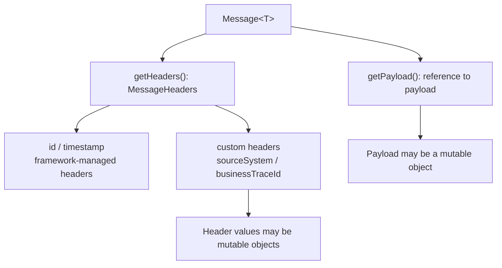
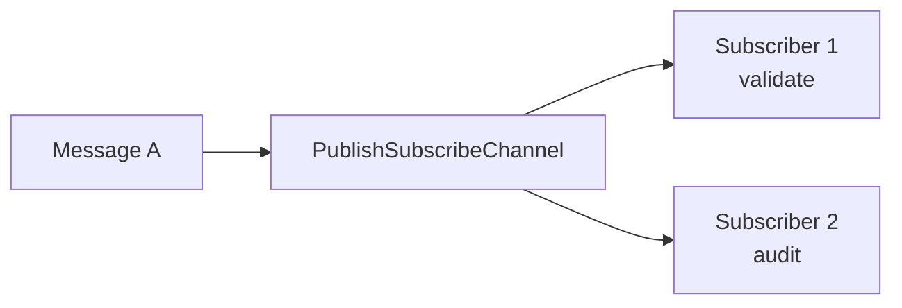
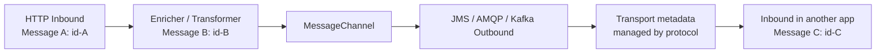

# MessageHeaders.ID and Immutability in Spring Integration

## Learning Objectives

In Spring Integration, data can flow from an HTTP gateway through `MessageChannel`, transformers, and service activators, and then out to Kafka, JMS, AMQP, files, or SFTP. Each step receives and sends a `Message<?>` consisting of a **payload** and **headers**. Two properties that are very easy to misunderstand are `MessageHeaders.ID` and message *immutability*.

After this lesson, you will be able to:

- Explain what `MessageHeaders.ID` identifies, who generates it, and why the ID can change when a message is transformed.
- Read standard ID/timestamp values via `MessageHeaders`, distinguishing them from `correlationId`, broker message IDs, and business keys.
- State accurately which parts of `Message<?>` / `MessageHeaders` are immutable, and which parts can still be mutated via references to mutable objects.
- Safely create new messages with `MessageBuilder` and propagate required headers across adapters/gateways.
- Design tracing and deduplication without wrongly relying on the message instance ID.

## 1. What Is `MessageHeaders.ID`?

`org.springframework.messaging.MessageHeaders` defines the constant:

```java
public static final String ID = "id";
```

The value lives at key `id` in `MessageHeaders` and normally has type `java.util.UUID`. The framework provides convenient read APIs:

```java
UUID id = message.getHeaders().getId();
// Semantically equivalent to:
UUID sameId = message.getHeaders().get(MessageHeaders.ID, UUID.class);
```

**This ID identifies a single message instance in Spring's messaging model.** It is useful for observing flows, distinguishing intermediate messages, and diagnosing issues inside the application. It is **not by default** an order ID, a message group's correlation ID, a partner's HTTP request ID, a Kafka record key, or a JMS message ID.

For example, the same order can pass through three messages:

```text
HTTP inbound gateway                Service activator / transformer             Kafka outbound
       │                                            │                                  │
       ▼                                            ▼                                  ▼
Message A (id = UUID-A)  ──── processing ────>  Message B (id = UUID-B)  ──>  ProducerRecord
    payload: order O-1042                      payload: order event                topic: orders.events
    businessTraceId: trace-42                  businessTraceId: trace-42           key: O-1042
```

`UUID-A` and `UUID-B` represent two message instances. `trace-42` can be **deliberately preserved** by the application to track a longer-lived business operation. A Kafka producer record has its own identity and metadata mechanism; there is no default rule that the Kafka record key equals `MessageHeaders.ID`.

### 1.1. Related Standard Headers

| Constant | Actual Key | Common Type | Meaning |
|---|---|---|---|
| `MessageHeaders.ID` | `id` | `UUID` | Identifies a Spring message instance |
| `MessageHeaders.TIMESTAMP` | `timestamp` | `Long` | Message creation time in milliseconds since Unix epoch |
| `MessageHeaders.CONTENT_TYPE` | `contentType` | Usually `MimeType` | Hint for interpreting/converting payload |
| `MessageHeaders.REPLY_CHANNEL` | `replyChannel` | `MessageChannel` or channel name | Reply address in a request–reply flow |
| `MessageHeaders.ERROR_CHANNEL` | `errorChannel` | `MessageChannel` or channel name | Destination for `ErrorMessage` when supported by the endpoint |

`id` and `timestamp` are **read-only headers** under Spring Integration's default policy. Do not include them in lists of application headers to be arbitrarily modified by enrichers/filters. `timestamp` is the message creation time, **not** the time the event occurred in the source system; when that is needed, use a payload field or a business header such as `sourceEventTime`.

### 1.2. When Is an ID Generated?

When Spring builds a new message through standard mechanisms (e.g., `MessageBuilder.withPayload(...).build()`), an ID is issued by `IdGenerator`. Spring Integration defaults to an optimized UUID generation strategy; do not assume every ID is necessarily generated by calling `UUID.randomUUID()` directly.

When an endpoint **transforms** a message into a new message, Spring Integration normally assigns a **new ID** to that message. Therefore:

- A message passing through a bridge or router **without being replaced** may continue carrying the same ID.
- A transformer or header enricher building a **new message** after changing payload/headers will typically produce a different ID.
- Calling `MessageBuilder.fromMessage(message).build()` with no changes may retain the original message depending on builder behavior; do not rely on it to force generating a different ID.
- Manually constructing a `Message<?>` with the same `MessageHeaders` object can also leave multiple message references sharing the same metadata; such advanced APIs are not a way to create “a fresh ID per send”.

**Key takeaway:** rely on the contract of the message under processing and actual message construction, rather than counting channel hops to infer a new ID.

## 2. Immutability of `Message<?>` and `MessageHeaders`

Spring Integration favors representing messages in a way that avoids concurrent property mutation as a message moves across components.



### 2.1. Structural Immutability of a Message

`org.springframework.messaging.support.GenericMessage<T>` is the fundamental `Message<T>` implementation. The `Message` API provides only readers for payload and headers; there is no setter to replace the payload on an already created message.

`MessageHeaders` implements `Map<String, Object>` yet is exposed as a **read-only map**: map-mutating operations such as `put`, `remove`, `putAll`, and `clear` are disallowed when working with normal `MessageHeaders`.

```java
import org.springframework.messaging.Message;
import org.springframework.messaging.support.MessageBuilder;

Message<String> input = MessageBuilder.withPayload("order-created")
        .setHeader("sourceSystem", "web")
        .build();

// Readable:
String source = input.getHeaders().get("sourceSystem", String.class);

// Invalid: map mutation throws UnsupportedOperationException.
input.getHeaders().put("sourceSystem", "batch");
```

To change a header or payload, the standard approach is **constructing a resulting message** via `MessageBuilder` and letting the framework manage its reserved headers.

### 2.2. Why Is Immutability Useful in IntegrationFlow?

Suppose the same message is sent to a `PublishSubscribeChannel` with two subscribers:



If the first subscriber could directly mutate the header map or reassign the payload on the same message instance, the second subscriber could observe timing-dependent state, causing hard-to-reproduce bugs. Creating a new message makes changes explicit per branch and reduces bugs caused by shared structures.

However, **structural immutability does not mean all data inside is immutable**. That is a critical limitation under concurrent processing.

### 2.3. Limitation: Payload Objects or Header Values Can Still Be Mutable

Consider this example:

```java
import java.util.ArrayList;
import java.util.List;
import org.springframework.messaging.Message;
import org.springframework.messaging.support.MessageBuilder;

List<String> tags = new ArrayList<>();
tags.add("created");

Message<String> message = MessageBuilder.withPayload("O-1042")
        .setHeader("tags", tags)
        .build();

// The headers map disallows put/remove...
// Yet tags is a mutable object created by the application.
tags.add("validated");

System.out.println(message.getHeaders().get("tags"));
// May print [created, validated].
```

Reason: a header holds a **reference to an object**; Spring does not automatically deep-copy arbitrary objects. Likewise, if the payload is an `ArrayList`, `HashMap`, or a DTO with setters, internal state inside the payload can still be mutated even though you cannot call `message.setPayload(...)`.

Recommendations:

- Use immutable values for headers whenever possible: `String`, `UUID`, primitive wrappers, enums, immutable records.
- For collections, create immutable copies: `List.copyOf(...)`, `Map.copyOf(...)` after confirming they hold no unexpected mutable elements.
- Avoid placing stateful beans, transactions/sessions, DB connections, or large Java objects into headers passed across channels.
- If a flow runs concurrently or branches out, choose immutable payload/metadata structures or deep-copy mutable data at appropriate boundaries.

**Advanced exception:** `MessageHeaderAccessor` supports an initialization lifecycle with `setLeaveMutable(true)` to keep headers temporarily mutable through the accessor; afterward `setImmutable()` can be called. This mechanism serves specific initialization scenarios, typically single-threaded. It does not change the rule of treating `MessageHeaders` as a read-only map in business code.

## 3. Working Correctly with IDs and Headers Using MessageBuilder

### 3.1. Reading Message Metadata

```java
import java.time.Instant;
import java.util.UUID;
import org.springframework.messaging.Message;
import org.springframework.messaging.MessageHeaders;
import org.springframework.messaging.support.MessageBuilder;

public final class MessageIdExample {

    public static void main(String[] args) {
        Message<String> first = MessageBuilder.withPayload(
                    "{\"orderId\":\"O-1042\"}")
                .setHeader("businessTraceId", "trace-42")
                .setHeader("sourceSystem", "orders-api")
                .build();

        UUID firstId = first.getHeaders().getId();
        Long createdAt = first.getHeaders().getTimestamp();

        System.out.println("id = " + firstId);
        System.out.println("same id = "
                + first.getHeaders().get(MessageHeaders.ID, UUID.class));
        if (createdAt != null) {
            System.out.println("createdAt = " + Instant.ofEpochMilli(createdAt));
        }

        Message<String> validated = MessageBuilder.fromMessage(first)
                .setHeader("processingStage", "validated")
                .build();

        System.out.println("before = " + first.getHeaders().getId());
        System.out.println("after  = " + validated.getHeaders().getId());
        System.out.println("trace  = "
                + validated.getHeaders().get("businessTraceId"));
    }
}
```

In standard configuration, when headers change and a new message is built, `validated` receives a different ID from `first`, while `businessTraceId` is copied per builder rules. If a flow uses a custom message builder or specialized config, observe the actual output to verify the ID policy.

### 3.2. Do Not Overwrite `id` or `timestamp`

The following lines reflect an **invalid intent** in Spring Integration when using default builders/enrichers:

```java
// DO NOT do this:
Message<String> wrong = MessageBuilder.withPayload("payload")
        .setHeader(MessageHeaders.ID, java.util.UUID.randomUUID())
        .setHeader(MessageHeaders.TIMESTAMP, 1L)
        .build();
```

Spring Integration treats `id` and `timestamp` as **read-only headers**, disallowing them from being used like custom overridable headers. Within the framework's message-creation mechanism, these keys are governed by read-only policy; some components configured with `id`/`timestamp` in a header enricher, gateway, or header filter may reject the configuration at startup. Therefore, **never rely on the `wrong` snippet to control message ID/timestamp**.

If the application needs a partner-supplied ID, store it under its own key:

```java
Message<String> correct = MessageBuilder.withPayload("payload")
        .setHeader("externalRequestId", "partner-req-812")
        .setHeader("businessTraceId", "trace-42")
        .build();
```

`externalRequestId` and `businessTraceId` are owned by the application and do not collide with `MessageHeaders.ID`.

### 3.3. Does Changing the Payload Keep the Old ID?

A typical payload transformation produces a new message:

```java
Message<String> source = MessageBuilder.withPayload("raw")
        .setHeader("businessTraceId", "trace-42")
        .build();

Message<String> transformed = MessageBuilder.withPayload("normalized")
        .copyHeaders(source.getHeaders())
        .build();
```

Here the payload differs and the builder constructs a new message. Under Spring Integration's normal message-creation rules, `MessageHeaders.ID` and `MessageHeaders.TIMESTAMP` are not copied like regular headers; the new message receives fresh framework metadata. `businessTraceId` is business metadata and is preserved unless excluded by a custom read-only/suppression policy.

Never try to “force-copy the old ID” to disguise two messages as one. If you want to trace which message a new message came from, design explicit **lineage**:

```java
Message<String> derived = MessageBuilder.withPayload("normalized")
        .copyHeaders(source.getHeaders())
        .setHeader("parentMessageId",
                source.getHeaders().getId().toString())
        .build();
```

`parentMessageId` is an **application-defined header** meaningful only for internal tracing. If a flow creates many message levels or crosses multiple systems, consider whether persistent lineage is needed or whether distributed tracing suffices.

### 3.4. A Note on Advanced APIs

`MessageBuilder.createMessage(payload, messageHeaders)` may reuse the provided `MessageHeaders` object directly without copying it. Therefore, **never assume merely calling a constructor/factory guarantees a new ID**. When you need an independent message with fresh metadata, use the appropriate creation path and verify the output ID. When simply forwarding an unchanged message through a channel, keeping the same message instance and ID is beneficial behavior.

## 4. Distinguishing Message ID, Correlation ID, and Adapter IDs

### 4.1. Identifiers Serving Different Purposes

| Identifier | Scope | Created/Managed By | Should It Serve as a Long-Term Business Key? |
|---|---|---|---|
| Spring `MessageHeaders.ID` | One message instance | Spring Messaging | **No** |
| Spring Integration `correlationId` | A group of messages in a flow | Splitter/aggregator or application | Only when designed as an explicit correlation contract |
| HTTP request ID / `X-Request-Id` | One HTTP request per contract | Gateway/proxy/client | Do not automatically equate with order ID |
| JMS `JMSMessageID` | One JMS message assigned by provider/broker | JMS provider | No; transport-specific |
| JMS `JMSCorrelationID` | JMS request–reply correlation | Application/JMS | Not automatically equal to Spring `correlationId` |
| AMQP delivery tag | One delivery within channel/consumer context | Broker and client | No; used for acknowledgment |
| Kafka topic/partition/offset | Record position in topic-partition log | Kafka broker | No; used to locate records |
| `businessTraceId` / `orderId` | Business transaction or entity | Application | Yes, per custom contract |

Example of an order `O-1042` moving through `HTTP → JMS → Kafka`:

```text
Business: orderId = O-1042
Observability: businessTraceId = trace-42

Spring Message A: id = UUID-A
        │
        ▼ transformer
Spring Message B: id = UUID-B
        │
        ▼ JMS outbound
JMSMessageID: assigned by JMS provider
        │
        ▼ JMS inbound creates Spring message
Spring Message C: id = UUID-C
        │
        ▼ Kafka outbound
Record: topic = orders.events, key = O-1042
       offset: assigned by Kafka when appending to partition
```

Never write conditions like `outboundMessage.getHeaders().getId().equals(inboundMessage.getHeaders().getId())` to decide whether two messages represent the same business operation.

### 4.2. Correlation Headers in Splitter/Aggregator

`org.springframework.integration.IntegrationMessageHeaderAccessor` defines `CORRELATION_ID` (common key `correlationId`), along with `SEQUENCE_NUMBER` and `SEQUENCE_SIZE`. Splitter/aggregator components use them to link parts of a group.

**A single group correlation ID can link multiple messages with different IDs.** When a payload splits into parts, each part should have its own message instance/ID, while correlation and sequence metadata tell the aggregator how to group them and when the group is complete.

When tracing a transaction across adapters and brokers, use `businessTraceId` or an agreed tracing standard; at protocol boundaries, explicitly translate to JMS correlation ID, AMQP correlation ID, HTTP trace headers, or Kafka native headers as needed.

## 5. Header Propagation and ID Lifecycle in IntegrationFlow

### 5.1. From Inbound Adapter to Outbound Adapter



When an inbound adapter creates a Spring message from a request/record/file, the message gets metadata per Spring's rules. If an endpoint creates a new message after transforming data, the ID may be reissued. Outbound adapters/gateways transfer metadata through mappers/converters/handlers, and the target system has its own identity model.

**Important:** a Spring ID is not a value adapters automatically carry intact across the network. Even if a mapper sends selected custom headers, that does not make `JMSMessageID`, Kafka offset, or HTTP request ID identical to `MessageHeaders.ID`.

### 5.2. When Are Other Headers Preserved?

In standard message-producing endpoints, Spring Integration supports **header propagation** from input message to output message. Exceptions apply:

- If a transformer returns **only a payload**, the framework usually propagates inbound headers per endpoint rules.
- If a transformer returns a complete **`Message<?>`**, application code is responsible for supplying needed headers; the framework does not force it to carry all original headers.
- Some endpoints support `notPropagatedHeaders` or global read-only header settings to omit headers when creating new messages.
- Headers on outbound transport are sent only if the mapper/converter supports them and policy permits.

Therefore, to preserve a trace ID across HTTP, JMS, Kafka, and SFTP, the application must verify the **custom business trace** at each hop rather than “checking that Spring message ID stays unchanged”.

### 5.3. When Does `id` Change and When Does It Not?

| Operation | What to Expect |
|---|---|
| Reading from `DirectChannel`, bridge/route without building a new message | May continue using the same instance and ID |
| Header enricher adds metadata, transformer creates new message | New message usually gets a new ID |
| Transformer returns an object payload | Framework builds output message per endpoint mechanism; ID may change |
| Transformer returns a self-built `Message<?>` | ID depends on how code builds the output; inspect contract and metadata |
| Message sent via HTTP/JMS/AMQP/Kafka, then received again | Treat as an inter-system identity boundary; never assume Spring ID is preserved |
| Retry resending the same `Message<?>` object | May keep the same ID during that attempt; do not use ID as an attempt counter |
| Retry building a new message from payload/headers | May get a new ID while still representing the same business transaction |

## 6. Immutability and Deduplication: Do Not Misuse `MessageHeaders.ID`

A common design flaw is using `MessageHeaders.ID` as a business *idempotency key* for deduplication.

**Problem:** the same order event can be redelivered by a broker, reconstructed as a new Spring message by a consumer, or rebuilt as a new message by the app on retry. The message instances have different IDs despite representing the same business event. Using Spring's `id` as the idempotency key can cause the order to be processed twice.

Example:

```text
Attempt 1: orderId=O-1042, eventId=evt-381, Spring id=UUID-A
Attempt 2 (redelivery): orderId=O-1042, eventId=evt-381, Spring id=UUID-B

Business deduplication: use eventId=evt-381 per contract.
Internal diagnostics: log Spring id (UUID-A / UUID-B).
```

Depending on the domain model, an appropriate idempotency key might be a producer-generated `eventId`, `paymentRequestId`, `commandId`, or composite domain key. For versioned state transitions, database-level version/transaction checks may also be needed. `orderId` alone is not always sufficient, since one order can legitimately emit multiple distinct events.

### 6.1. Pattern for Preserving eventId in Messages

```java
import org.springframework.messaging.Message;
import org.springframework.messaging.support.MessageBuilder;

public static Message<String> toPaymentEvent(
        Message<String> request, String paymentPayload) {
    String eventId = request.getHeaders().get("eventId", String.class);
    if (eventId == null || eventId.isBlank()) {
        throw new IllegalArgumentException("eventId is required");
    }

    return MessageBuilder.withPayload(paymentPayload)
            .setHeader("eventId", eventId)
            .setHeader("businessTraceId",
                    request.getHeaders().get("businessTraceId"))
            .build();
}
```

`eventId` is an application-owned contract. When pushing the event over Kafka or JMS, persist it in the payload or mapper-supported metadata so consumers can still read it on replay.

### 6.2. Which Fields Should an Observability Log Record?

When observing messages (while avoiding sensitive data in logs), a record might include:

```text
component=orderTransformer
springMessageId=8dc7...       // MessageHeaders.ID
businessTraceId=trace-42       // application-defined
eventId=evt-381               // business idempotency key
orderId=O-1042
stage=validated
```

During failure investigation, `springMessageId` identifies a message at a single step; `businessTraceId` links steps together; `eventId` checks for duplicate processing. You can add trace/span IDs from OpenTelemetry/W3C Trace Context; never replace them with the Spring message ID.

## 7. Meaningful Tests for ID and Immutability

### 7.1. Testing That a Message Has an ID and a Non-Modifiable Header Map

```java
import static org.junit.jupiter.api.Assertions.*;

import java.util.UUID;
import org.junit.jupiter.api.Test;
import org.springframework.messaging.Message;
import org.springframework.messaging.support.MessageBuilder;

class MessageIdImmutabilityTest {

    @Test
    void ordinaryMessageHasIdAndReadOnlyHeaderMap() {
        Message<String> message = MessageBuilder.withPayload("created")
                .setHeader("businessTraceId", "trace-42")
                .build();

        UUID id = message.getHeaders().getId();
        assertNotNull(id);
        assertEquals(id, message.getHeaders().get("id", UUID.class));

        assertThrows(UnsupportedOperationException.class,
                () -> message.getHeaders().put("sourceSystem", "web"));
    }

    @Test
    void changingAHeaderCreatesMessageWithNewId() {
        Message<String> first = MessageBuilder.withPayload("created")
                .setHeader("businessTraceId", "trace-42")
                .build();

        Message<String> second = MessageBuilder.fromMessage(first)
                .setHeader("processingStage", "validated")
                .build();

        assertNotEquals(first.getHeaders().getId(), second.getHeaders().getId());
        assertEquals("trace-42",
                second.getHeaders().get("businessTraceId"));
        assertNull(first.getHeaders().get("processingStage"));
    }
}
```

This test describes **Spring's standard message construction**. It does not prove the system configured mapping/serialization properly across brokers or HTTP. In applications using a custom `MessageBuilderFactory` or custom ID generator, test that configuration's behavior explicitly.

### 7.2. Testing Immutability of Nested Objects

```java
import static org.junit.jupiter.api.Assertions.*;

import java.util.ArrayList;
import java.util.List;
import org.junit.jupiter.api.Test;
import org.springframework.messaging.Message;
import org.springframework.messaging.support.MessageBuilder;

class HeaderValueReferenceTest {

    @Test
    void immutableCollectionSnapshotAvoidsAccidentalMutation() {
        List<String> source = new ArrayList<>(List.of("created"));
        Message<String> message = MessageBuilder.withPayload("O-1042")
                .setHeader("tags", List.copyOf(source))
                .build();

        source.add("validated");

        @SuppressWarnings("unchecked")
        List<String> stored = (List<String>) message.getHeaders().get("tags");
        assertEquals(List.of("created"), stored);
        assertThrows(UnsupportedOperationException.class,
                () -> stored.add("unexpected"));
    }
}
```

`List.copyOf(...)` creates an immutable collection snapshot at the list level; if elements inside are mutable DTOs, add a copy strategy or use immutable value objects. Apply the same principle to DTO payloads.

### 7.3. Integration Testing

Builder unit tests should be complemented by tests against real endpoints:

1. Messages from HTTP inbound receive a Spring-generated `id`; any HTTP request ID header is kept under its own key.
2. Transformers creating new output messages retain `businessTraceId` or `eventId` per contract.
3. Outbound JMS/AMQP/Kafka endpoints are not forced to use `MessageHeaders.ID` as transport IDs.
4. When the consumer receives the same event again (e.g., redelivery), idempotency based on `eventId` still detects duplicates despite a different Spring ID.
5. Publish–subscribe or concurrent flows do not unintentionally share mutable collections/DTOs.

## 8. Common Errors and How to Handle Them

| Symptom | Cause | Resolution |
|---|---|---|
| Calling `put` on `message.getHeaders()` throws `UnsupportedOperationException` | Headers map is read-only | Build a new message with `MessageBuilder` |
| Attempting to set `id` in header enricher fails startup | `id` is a read-only header; component rejects config | Use custom header `externalRequestId` or `businessTraceId` |
| Message ID changes after transformer; logs “lose trace” | Used Spring ID to track long transactions | Separate `businessTraceId` and propagate per contract |
| Used `id` for deduplication yet still reprocesses same event | Redelivery/retry builds a new message | Use durable `eventId`/`commandId` and idempotency store |
| Two subscribers observe header data changing unexpectedly | Header value is a shared mutable object | Use immutable values or defensive copies |
| `JMSMessageID` or Kafka offset differs from Spring ID | Different protocols own distinct metadata | Maintain explicit business mapping/correlation |
| HTTP/Kafka does not receive `businessTraceId` | Mapper/converter does not export custom headers | Check mapping direction, type, and allowlist |
| Lost `replyChannel` after manually building a message | Output message lacks required orchestration headers | Selectively copy and retain headers needed for request–reply |
| Timestamp “does not match event time” | `MessageHeaders.TIMESTAMP` is message creation time | Use `sourceEventTime` or the source event timestamp |

## 9. Practice Exercise: HTTP → Processing → Kafka with Two IDs

Build a flow simulating receiving orders from an HTTP gateway, processing them into events, and publishing to Kafka:

1. HTTP inbound receives `X-Request-Id` (if present). Store it as `externalRequestId` after validating format and length; the framework assigns `MessageHeaders.ID` to the inbound message.
2. The gateway creates or accepts a valid `businessTraceId`; ensure this value appears on intermediate messages.
3. A service activator transforms the payload from an order command to an `OrderCreated` event with a separate, stable `eventId` for deduplication.
4. Log `springMessageId` and `businessTraceId` before/after the transformer. Explain why the instance ID may differ while the trace ID must remain intact per contract.
5. Kafka outbound builds the record key from `orderId`. The header mapper/converter transfers only required custom headers such as `businessTraceId` or `eventId` if required by the consumer contract.
6. Write a test for two deliveries sharing the same `eventId` with different Spring `MessageHeaders.ID`s and verify business logic executes only once.
7. Create a custom header holding an `ArrayList`, observe mutation via shared reference, and then fix it with `List.copyOf(...)` or an immutable DTO.

**Self-assessment questions:**

- Why can the Spring ID change while still helping debug individual integration steps?
- Why doesn't read-only `MessageHeaders` mean payloads and all header values are deep-immutable?
- Why can't `JMSMessageID`, Kafka offset, and `MessageHeaders.ID` substitute for one another as idempotency keys?
- When a transformer returns a complete message, who is responsible for preserving `businessTraceId`?

## References

- [Spring Integration Reference – Message (Message Headers, Message ID Generation, Read-only Headers, Header Propagation)](https://docs.spring.io/spring-integration/reference/message.html)
- [Spring Framework – MessageHeaders API](https://docs.spring.io/spring-framework/docs/current/javadoc-api/org/springframework/messaging/MessageHeaders.html)
- [Spring Framework – MessageBuilder API](https://docs.spring.io/spring-framework/docs/current/javadoc-api/org/springframework/messaging/support/MessageBuilder.html)
- [Spring Framework – MessageHeaderAccessor API](https://docs.spring.io/spring-framework/docs/current/javadoc-api/org/springframework/messaging/support/MessageHeaderAccessor.html)
- [Spring Integration Reference – HTTP Header Mapping](https://docs.spring.io/spring-integration/reference/http/header-mapping.html)
- [Spring Integration Reference – Kafka Support](https://docs.spring.io/spring-integration/reference/kafka.html)
