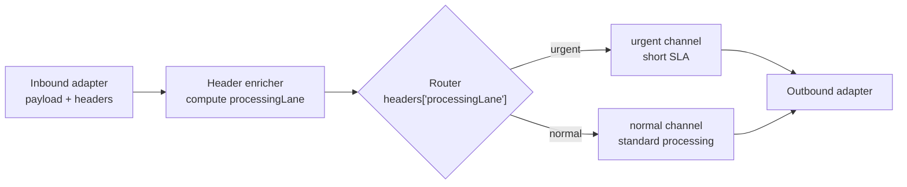
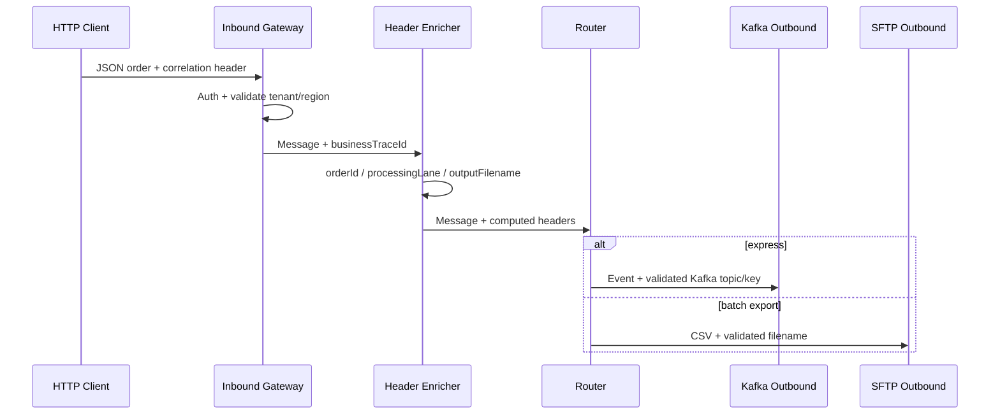

# Header Expressions in Spring Integration

## Learning Objectives

In the **SPRING_INTEGRATION_ADAPTERS** module, a `Message<?>` can travel from an inbound adapter or gateway, through `MessageChannel`, routers, transformers, and service activators, and out to HTTP, JMS, AMQP, Kafka, files, SFTP, or databases. To compute metadata per message rather than assigning a static value, Spring Integration supports **header expressions**: expressions evaluated against the message content and processing context.

After this lesson, you will be able to:

- Distinguish **header names**, **static header values**, and **header value expressions**.
- Write SpEL expressions that read `payload` and `headers`, handle missing data, and preserve value types.
- Use header expressions with `header-enricher` via XML or Java DSL.
- Combine dynamic metadata with routers, adapters/gateways, filenames, Kafka topics/keys, and HTTP request headers.
- Understand expression evaluation lifecycle, protocol-mapping boundaries, common pitfalls, and security requirements.

## 1. What Is a Header Expression?

A **header expression** is typically a **Spring Expression Language (SpEL)** expression configured to compute a header's value while a message is processed. For example, instead of always setting `priority = 5`, we can compute `priority` from the order type or set `outputFilename` from the order ID.

```text
Incoming Message
  payload: { "orderId": "O-1042", "type": "express" }
  headers:
    sourceSystem: "orders-api"
    tenantId: "tenant-a"

Header Enricher:
  header "orderId"       <- expression: payload['orderId']
  header "processingLane"<- expression:
       payload['type'] == 'express' ? 'urgent' : 'normal'

Outgoing Message
  payload: unchanged
  headers:
    sourceSystem: "orders-api"
    tenantId: "tenant-a"
    orderId: "O-1042"
    processingLane: "urgent"
```

In this example, the expression is evaluated against the **current message**. The `processingLane` value can differ between messages even though they pass through the same enricher configuration.

### 1.1. Three Easily Confused Concepts

| Configuration | Result | Meaning |
|---|---|---|
| `header("sourceSystem", "orders-api")` | String `orders-api` | Static value |
| `headerExpression("orderId", "payload['orderId']")` | Value of `orderId` inside each message's payload | SpEL expression |
| `setHeader("orderId", "payload['orderId']")` in `MessageBuilder` | Literal string `"payload['orderId']"` | `MessageBuilder.setHeader` does not execute SpEL |

**Practical takeaway:** a header name is a key, whereas an expression is a formula for extracting data. Placing a SpEL-like string into `MessageHeaders` does **not** make Spring evaluate that formula.

### 1.2. Choosing an Expression vs. Writing Java

- Use SpEL when the value can be computed from metadata/payload via a short, clear formula: `headers['tenantId']`, `payload['orderId']`, or a conditional expression.
- Use `headerFunction(...)` or a Java method when you need multi-step checks, complex format parsing, access-control logic, fallback policies, or detailed unit tests.
- Use a dedicated transformer/service when processing alters primary business data, performs I/O, or requires transactions. Header enrichment fits **metadata**, and should not turn into a service holding all business logic.

## 2. SpEL Evaluation Context

In Spring Integration components supporting message-based SpEL, the **root object** is typically a `Message<?>`. Therefore, common property lookups are:

| Expression | Expected Value Type | Interpretation |
|---|---|---|
| `payload` | Actual payload type | Entire business payload |
| `payload['orderId']` | Depends on payload | Reads `orderId` when payload is a `Map` |
| `payload.orderId` | Depends on bean/record and SpEL accessor | Reads `orderId` property on a matching object |
| `headers` | `MessageHeaders` | Message header map |
| `headers['tenantId']` | Depends on header value | Reads custom header `tenantId` |
| `headers['contentType']` | Usually `MimeType` or matching type | Reads content type metadata |
| `headers['X-Correlation-Id']` | Usually `String` if brought in by HTTP mapper | Reads headers with special characters using `['...']` |
| `headers['retryCount'] ?: 0` | `Integer` or numeric type depending on value | Uses default when left side is empty/null per SpEL |
| `payload['type'] == 'express' ? 'urgent' : 'normal'` | `String` | Conditional value selection |

When the payload is `Map<String, Object>`, `payload['orderId']` is clearer than `payload.orderId`. For Java DTOs, `payload.orderId` relies on JavaBean properties/getters or Spring-provided accessors. Different access syntax can behave differently when the payload type changes.

### 2.1. Example of Direct SpEL Evaluation

This is a simple Java example to observe the expression mechanism. It invokes SpEL APIs directly in the same JVM; when using `header-enricher`, Spring Integration manages creating the parser and evaluation context for the endpoint.

```java
import java.util.Map;
import org.springframework.expression.Expression;
import org.springframework.expression.spel.standard.SpelExpressionParser;
import org.springframework.messaging.Message;
import org.springframework.messaging.support.MessageBuilder;

public class HeaderExpressionBasics {
    public static void main(String[] args) {
        Message<Map<String, Object>> message = MessageBuilder
                .withPayload(Map.of("orderId", "O-1042", "type", "express"))
                .setHeader("tenantId", "tenant-a")
                .build();

        SpelExpressionParser parser = new SpelExpressionParser();

        Expression orderIdExpr =
                parser.parseExpression("payload['orderId']");
        Expression laneExpr = parser.parseExpression(
                "payload['type'] == 'express' ? 'urgent' : 'normal'");
        Expression tenantExpr =
                parser.parseExpression("headers['tenantId']");

        System.out.println(orderIdExpr.getValue(message, String.class)); // O-1042
        System.out.println(laneExpr.getValue(message, String.class));    // urgent
        System.out.println(tenantExpr.getValue(message, String.class));  // tenant-a
    }
}
```

Reading `headers['tenantId']` does not authenticate that header. If the header came from an untrusted request or broker, it remains **external data** until a gateway/service verifies its validity and authorization.

### 2.2. Useful Syntax

```spel
headers['sourceSystem']
headers['tenantId'] ?: 'unknown'
payload['orderId']
payload['type'] == 'express' ? 'urgent' : 'normal'
payload?.customer?.email
'order-' + payload['orderId'] + '.json'
```

These examples show illustrative syntax; `payload?.customer?.email` fits when the payload exposes `customer` and `email` properties. If the payload is a `Map`, index by key and add null checks matching the actual data. The `?.` operator avoids certain `null` dereference errors, yet does not replace type checking or data validation.

Expressions passed into endpoint configurations are normally parsed at startup. **Expression values are recomputed per message** handled by that endpoint. Never view an expression string as something evaluated only once for the whole application, unless a specific API/config states otherwise.

## 3. Header Enricher: Creating Headers from Expressions

`Header Enricher` receives a message, evaluates configured header value processors, and produces an output message with added or updated metadata per the enricher's policy. The payload usually stays unchanged.

### 3.1. Java DSL

Example using `IntegrationFlow`. The payload is expected to be a `Map` containing `orderId` and `type`:

```java
import org.springframework.context.annotation.Bean;
import org.springframework.integration.dsl.IntegrationFlow;

@Bean
IntegrationFlow prepareOrderHeaders() {
    return IntegrationFlow.from("ordersInbound")
            .enrichHeaders(h -> h
                    .header("sourceSystem", "orders-api")
                    .headerExpression(
                            "orderId", "payload['orderId']")
                    .headerExpression(
                            "processingLane",
                            "payload['type'] == 'express' ? 'urgent' : 'normal'"))
            .channel("ordersPrepared")
            .get();
}
```

Expected results for two messages:

| Incoming Payload | `orderId` | `processingLane` |
|---|---|---|
| `{"orderId":"O-1042","type":"express"}` | `O-1042` | `urgent` |
| `{"orderId":"O-1043","type":"standard"}` | `O-1043` | `normal` |

In the same config:

- `header("sourceSystem", "orders-api")` sets a **static** value.
- `headerExpression("orderId", "payload['orderId']")` computes the value from the **current message**'s payload.
- `headerExpression("processingLane", "...")` uses SpEL's ternary operator for branching.

Note on overwriting: if an incoming message already has `processingLane`, the final value depends on the `HeaderEnricher`'s **overwrite** configuration. To guarantee policy compliance, explicitly configure keep/overwrite rules or normalize headers at the entry boundary; never let default behavior decide critical authorization or routing matters.

### 3.2. XML Configuration

For a Spring Integration app using the `int` XML namespace:

```xml
<int:header-enricher
        input-channel="ordersInbound"
        output-channel="ordersPrepared">
    <int:header name="sourceSystem" value="orders-api"/>
    <int:header name="orderId" expression="payload['orderId']"/>
    <int:header
            name="processingLane"
            expression="payload['type'] == 'express' ? 'urgent' : 'normal'"/>
</int:header-enricher>
```

This is an **alternative configuration** to the Java DSL snippet; do not configure two identical enrichers on the same channel in your practice setup. Ensure the corresponding channel beans exist or are managed by the namespace/Java DSL as configured in your project.

### 3.3. When Logic Is Longer Than One Expression

Instead of writing multi-line SpEL strings with nested conditions, use `headerFunction` to declare testable, strongly typed Java logic:

```java
import java.util.Map;
import org.springframework.context.annotation.Bean;
import org.springframework.integration.dsl.IntegrationFlow;
import org.springframework.messaging.Message;

@Bean
IntegrationFlow enrichOrderLane() {
    return IntegrationFlow.from("ordersInput")
            .enrichHeaders(h -> h.headerFunction(
                    "processingLane", this::determineLane))
            .channel("ordersWithLane")
            .get();
}

private String determineLane(Message<?> message) {
    if (!(message.getPayload() instanceof Map<?, ?> body)) {
        throw new IllegalArgumentException("Expected order Map payload");
    }
    Object type = body.get("type");
    return "express".equals(type) ? "urgent" : "normal";
}
```

In practice, prefer DTOs/records over `Map<?, ?>` once the payload has a defined schema. Java functions fit better when checking tenancy, calling a specialized service, or handling multiple error branches. Avoid slow I/O inside header calculations when a dedicated service activator handles it more cleanly.

## 4. Header Expressions and Routers/Transformers

Header expressions often work alongside other components. **The enricher produces the header value**; routers, filters, transformers, gateways, or adapters **consume** it.



Example XML router reading a header computed upstream by an enricher:

```xml
<int:router input-channel="ordersPrepared"
            expression="headers['processingLane']">
    <int:mapping value="urgent" channel="ordersUrgent"/>
    <int:mapping value="normal" channel="ordersNormal"/>
</int:router>
```

Notes:

1. The expression `headers['processingLane']` **reads** metadata; it does not create the header.
2. If the header is missing, the router may find no matching channel; define a fallback/default output channel or reject the message per contract.
3. If the header came from outside, never use it to bypass permission checks, SLA tiers, or resource access without verification.
4. If a transformer builds a new `Message<?>` and forgets to copy `processingLane`, downstream routers will lack routing data.

### 4.1. Do Not Confuse Header Expressions with Payload Expressions

`transform("payload['orderId']")` on a transformer computes the **resulting payload** from the expression; `headerExpression("orderId", "payload['orderId']")` creates a **header**. Despite identical SpEL syntax, where the result lives and the downstream contract differ.

For core business data like `orderId`, keep it inside the payload whenever event consumers need to read it; copying it to a header serves only routing, log correlation, or protocol adapters.

## 5. Using Expressions Across Adapters/Gateways

A header expression can compute metadata for an adapter, yet the result becomes real target-system metadata **only when the adapter recognizes the header name or has matching mapping configuration**.

| Integration Boundary | Header/Value to Compute | Next Mechanism |
|---|---|---|
| HTTP outbound | `X-Business-Trace-Id` from `businessTraceId` | HTTP outbound gateway + header mapper allowing custom HTTP header |
| Kafka outbound | `KafkaHeaders.TOPIC` / `KafkaHeaders.KEY` from validated data | Kafka producer adapter reads supported headers, depending on topic/key config |
| JMS outbound | Custom header `businessTraceId` | JMS header mapper converts to valid user property if permitted |
| AMQP outbound | Custom application header | AMQP header mapper/converter and message properties |
| File outbound | `FileHeaders.FILENAME` from `orderId` | `FileNameGenerator` or file handler uses configured name |
| SFTP outbound | Validated remote filename/path | Remote filename generator/expression supported by adapter |
| JDBC/database | Parameters from payload/headers | Matching handler/query/expression; headers do not automatically become DB columns |

### 5.1. Kafka: Computing Topic/Key per Message

Suppose orders already have `region` and `orderId` in the payload. The application permits only `vn` and `sg`; after validating data at the gateway/service, an enricher can compute Kafka outbound metadata:

```java
import org.springframework.context.annotation.Bean;
import org.springframework.integration.dsl.IntegrationFlow;
import org.springframework.kafka.support.KafkaHeaders;

@Bean
IntegrationFlow prepareKafkaMetadata() {
    return IntegrationFlow.from("validatedOrderEvents")
            .enrichHeaders(h -> h
                    .headerExpression(
                            KafkaHeaders.TOPIC,
                            "payload['region'] == 'vn' ? 'orders.vn' : 'orders.sg'")
                    .headerExpression(
                            KafkaHeaders.KEY, "payload['orderId']"))
            .channel("kafkaOutbound")
            .get();
}
```

This illustrative snippet assumes an earlier step verified `region` is either `vn` or `sg`. Without that check, any value other than `vn` routes to `orders.sg`, breaking the contract. Therefore, **validate the value set before using an expression to select a target resource**.

`KafkaHeaders.TOPIC` and `KafkaHeaders.KEY` are meaningful header names to Spring Kafka. The Kafka outbound adapter must be configured to read topic/key from that metadata; if the adapter has a fixed topic or another topic expression, check precedence rules in your actual configuration. Also note that consumer-side `KafkaHeaders.RECEIVED_TOPIC` and `KafkaHeaders.OFFSET` describe consumed records; they do not replace `TOPIC`/`KEY` on send.

### 5.2. File/SFTP: Computing Safe Filenames

`FileHeaders.FILENAME` is a header a file outbound handler can use to determine the target filename, depending on `FileNameGenerator` configuration:

```java
import org.springframework.context.annotation.Bean;
import org.springframework.integration.dsl.IntegrationFlow;
import org.springframework.integration.file.FileHeaders;

@Bean
IntegrationFlow prepareFileMetadata() {
    return IntegrationFlow.from("validatedCsvExports")
            .enrichHeaders(h -> h.headerExpression(
                    FileHeaders.FILENAME,
                    "'orders-' + payload['batchId'] + '.csv'"))
            .channel("fileOutbound")
            .get();
}
```

This string concatenation expression is safe only after `batchId` is validated against an allowed character set and length. If `batchId` comes from HTTP or untrusted DB data, **never** concatenate it directly into a path. Check for path traversal (`../`), path separators, reserved names, and file-collision policies.

For SFTP, remote filenames and directories also depend on the remote file template, filename generator/expression, and specific adapter configuration. A custom header like `outputFilename` will not automatically control the filename if the handler ignores it; translate it to the header/expression actually supported by the adapter.

### 5.3. HTTP: Setting Internal Headers and Mapping to Wire

Suppose the inbound message already has a valid `businessTraceId` normalized by the gateway. We can build the target HTTP header:

```java
.enrichHeaders(h -> h.headerExpression(
        "X-Business-Trace-Id",
        "headers['businessTraceId']"))
```

This is a **Java DSL flow fragment**, not a complete Java program. The outbound HTTP gateway must map this header onto the HTTP request; matching XML example:

```xml
<int-http:outbound-gateway
        id="partnerGateway"
        request-channel="partnerRequests"
        url="https://partner.example.org/orders"
        mapped-request-headers="HTTP_REQUEST_HEADERS,X-Business-Trace-Id"/>
```

`HTTP_REQUEST_HEADERS` is the mapping pattern for standard HTTP request headers. Custom headers must be allowlisted or handled by the matching `HeaderMapper`. Spring's `headers['businessTraceId']` does **not automatically emit** HTTP `X-Business-Trace-Id` without renaming/mapping.

### 5.4. JMS, AMQP, and JDBC

In JMS and AMQP, the result of a header expression in `MessageHeaders` is still an **internal Java value**. JMS properties support only a restricted set of names/types; AMQP has application headers and properties with their own mapping contracts. If an expression returns a DTO, large collection, or non-protocol-representable object, the mapper may skip it or fail. Keep types simple and apply converters when needed.

For outbound JDBC/databases, expressions can select parameters from payload/headers in handlers supporting expressions, yet there is **no general rule** that custom headers automatically become SQL columns. Queries and table names must be fixed/allowlisted; never interpolate client-sent header values into SQL syntax.

## 6. Data Types, Nulls, and Evaluation Errors

### 6.1. SpEL Returns Typed Values

`headerExpression("priority", "10")` produces a numeric value per SpEL literal semantics, whereas `header("priority", "10")` produces a **String**. If downstream uses a `PriorityChannel` or an API expecting a number, this difference can change behavior.

```java
// Internal header value may have type Integer:
.headerExpression("retryCount", "0")

// Value is the String "0":
.header("retryCount", "0")
```

Across HTTP/JMS/AMQP/Kafka, values are transformed by mappers/converters per protocol rules; Kafka native headers, for instance, store byte arrays. Avoid assuming an internal `Integer` automatically arrives at the receiver as an `Integer`.

### 6.2. Missing Headers or Null Values

`headers['tenantId']` evaluates to `null` when the key is missing (under standard map lookup). Depending on the processor and message-builder policy, a `null` result may leave the header unset or be handled differently. **Do not rely on `null` as a portable way to delete headers across all endpoints.**

Establish explicit rules:

- If missing header is allowed: use an explicit fallback, such as `headers['sourceSystem'] ?: 'unknown'`.
- If a required header is missing: detect and reject the message during validation rather than substituting a default that masks contract bugs.
- If a header must be removed: use `HeaderFilter` or `MessageBuilder.removeHeader(...)`, rather than assuming an expression returning `null` always deletes it.
- If the payload is nested: null-check every level or use a validated DTO before enriching.

**Business example:** `tenantId` must never default to `public` when missing if it selects the tenant database. The gateway must resolve the tenant from authenticated identity and permissions and supply a trusted value.

### 6.3. SpEL Errors in Integration Flows

An expression can fail when:

1. Syntax is invalid at context startup, such as missing parentheses or quotes.
2. Runtime payload/header has an unexpected type, causing property-access or type-conversion errors.
3. Calling a method on `null` without a guard.
4. Referencing a bean/property absent from the current evaluation context.
5. Returning a value whose type is rejected by a downstream mapper/adapter.

Errors thrown during message processing follow the error-handling mechanism of the active endpoint/channel. On a synchronous `DirectChannel`, exceptions may propagate to the caller. With asynchronous/poller endpoints and matching error-flow config, errors may be routed to `errorChannel`. **Do not assume every expression error automatically goes to an error channel.**

## 7. Security, Performance, and Maintainability

### 7.1. Expressions Are Application-Controlled Configuration

SpEL can access properties, invoke methods, and in some evaluation contexts even resolve beans or Java types. Therefore:

- **Never take an expression string from an HTTP header, Kafka payload, database, or external user and pass it straight into a SpEL parser.** Untrusted expressions can access resources outside intended boundaries.
- Keep expressions in code/configuration controlled by the engineering team, reviewed and deployed through normal release workflows.
- If users genuinely need custom rules, use a constrained DSL or an allowlisted set of operations with a restricted evaluation context, avoiding arbitrary SpEL.
- Even when the expression is fixed, data read from `payload`/`headers` must be validated whenever it chooses routes, permissions, filenames, topics, SQL, or HTTP URLs.

### 7.2. Never Let Metadata Arbitrarily Control Target Systems

An expression like `headers['targetUrl']` or `headers['targetTopic']` turns input data into an outbound routing decision. If clients can set that header arbitrarily, the app may dispatch requests to invalid targets or route into another tenant.

Instead of trusting a client-supplied target name:

1. Read business attributes from the payload/headers.
2. Verify against access permissions and system allowlists.
3. Compute a target from a finite approved set.
4. Pass the normalized value to the adapter configuration.

### 7.3. Performance and Expression Management

Short, pure message-level expressions suit high throughput. Heavy expressions doing bean lookups or complex method calls can add significant per-message cost; on high-frequency pollers or Kafka consumers, that cost scales with message volume.

Recommendations:

- Keep expressions short; extract a well-named Java function once conditions grow beyond a couple of branches.
- Avoid network/DB calls or blocking operations inside header enrichment.
- Cache/share expensive computations in an appropriate service when repeated.
- Validate payload/header types and handle missing values before routing or protocol export.
- Log validated headers using an allowlist; never print full `MessageHeaders` if they may contain tokens or PII.

## 8. Complete Scenario: HTTP → Enrichment → Routing → Kafka/SFTP

An order arrives via an HTTP gateway with payload:

```json
{
  "orderId": "O-1042",
  "region": "vn",
  "type": "express",
  "batchId": "B-20261123"
}
```

The gateway authenticates the request, checks `region` is supported, verifies tenant permissions, and sets `businessTraceId`. The flow continues:



| Step | Header Expression | Contract |
|---|---|---|
| Enrich | `payload['orderId']` → `orderId` | Non-empty, matches order schema |
| Enrich | `payload['type'] == 'express' ? 'urgent' : 'normal'` → `processingLane` | Value set is `urgent`, `normal` |
| Enrich | `'orders-' + payload['batchId'] + '.csv'` → `outputFilename` | `batchId` validated to prevent path traversal |
| Router | `headers['processingLane']` | Channel mappings exist for both values |
| Kafka outbound | `payload['orderId']` → `KafkaHeaders.KEY` | Kafka record key is the order ID |
| File/SFTP outbound | `headers['outputFilename']` → handler-supported filename | Valid filenames only, no free-form client paths |

**Key implementation checks:**

- An `express` message must never fall into the batch branch merely because `processingLane` was lost after a transformer.
- `orderId` must remain inside the payload if the Kafka consumer contract requires it there.
- `businessTraceId` must be copied or encoded through the outbound mapper per the trace contract; SpEL only computes internal values.
- When Spring builds a new message, `MessageHeaders.ID` can change. That does not break the business trace if metadata is propagated properly.
- Every route/topic/file path decision must originate from normalized, permission-checked data.

## 9. Testing Header Expressions

### 9.1. Unit Testing Expression Evaluation

The test below illustrates checking an expression against a `Message<Map<String, Object>>`. It does not replace integration tests for `HeaderEnricher` or adapters.

```java
import static org.junit.jupiter.api.Assertions.assertEquals;

import java.util.Map;
import org.junit.jupiter.api.Test;
import org.springframework.expression.spel.standard.SpelExpressionParser;
import org.springframework.messaging.Message;
import org.springframework.messaging.support.MessageBuilder;

class HeaderExpressionTest {

    @Test
    void derivesLaneFromPayload() {
        Message<Map<String, Object>> input = MessageBuilder
                .withPayload(Map.of(
                        "orderId", "O-1042",
                        "type", "express"))
                .build();

        var expr = new SpelExpressionParser().parseExpression(
                "payload['type'] == 'express' ? 'urgent' : 'normal'");

        assertEquals("urgent", expr.getValue(input, String.class));
    }

    @Test
    void readsHeaderWithoutChangingMessage() {
        Message<String> input = MessageBuilder.withPayload("event")
                .setHeader("sourceSystem", "orders-api")
                .build();

        var expr = new SpelExpressionParser()
                .parseExpression("headers['sourceSystem']");

        assertEquals("orders-api", expr.getValue(input, String.class));
    }
}
```

### 9.2. What Should Integration Tests Observe?

| Test Case | Expected Result |
|---|---|
| `type=express` and `type=standard` | `processingLane` is `urgent` and `normal` respectively |
| Missing required `orderId` | Validation step fails per contract; no empty Kafka record key sent |
| Unexpected `payload` type | Explicit error handling instead of misrouting |
| Spoofed `tenantId` in request | Blocked by principal/tenant verification |
| `batchId` containing `../` or path separators | Rejected before filename generation |
| Missing `processingLane` after transformer | Detected as lost header/unroutable and propagation fixed |
| Kafka/JMS/AMQP/HTTP outbound | Dynamic headers appear externally only when supported by mapper/converter |
| Sync and async endpoint error flows | Expression failures reach the configured channel/component |

## 10. Common Errors and Resolutions

| Symptom | Possible Cause | Resolution |
|---|---|---|
| Header literally contains `"payload['orderId']"` | Used `setHeader` or static header with an expression-like string | Use `headerExpression` API / enricher's `expression` attribute |
| Expression evaluates to `null` | Missing header or payload field | Validate inputs, add valid fallback, or reject per contract |
| `SpelEvaluationException` at runtime | Wrong payload/property type, `null`, or invalid method call | Check actual payload type, use proper key/map accessor |
| Router finds no channel | Expression returned a value outside the mapping set | Define explicit value set and error/default route |
| HTTP server does not receive custom header | Created internal header only without HTTP mapping | Check HTTP outbound header mapper/`mapped-request-headers` |
| Kafka sends to wrong topic | Expression picked topic from unvalidated data or adapter overrides it | Validate region, check topic policy and producer config |
| JMS property ignored or fails | Expression result has unsupported name or type | Convert to valid property, use converter/mapper |
| SFTP writes file with wrong name | `outputFilename` is a custom key ignored by handler | Map to `FileHeaders.FILENAME`/suitable filename generator |
| Header unexpectedly overwritten | Enricher overwrite policy was not specified | Configure explicitly; normalize metadata at boundary |
| Expression routes by client-sent tenant | Untrusted data used for privileged decisions | Authenticate and authorize before enrichment/routing |

## 11. Practice Exercise

Build an **HTTP inbound → Header Enricher → Router → Kafka/SFTP** order-processing flow with these requirements:

1. Payload contains `orderId`, `region`, `type`, `batchId`. Validate required fields and validity at the gateway/service before enriching.
2. Write a Java DSL `HeaderEnricher` using at least three expressions: `orderId`, `processingLane`, and `outputFilename`.
3. Add a static header `sourceSystem = "orders-api"`. Explain the difference between `header(...)` and `headerExpression(...)`.
4. Write a router reading `headers['processingLane']`. Send `express` messages to Kafka and the rest to the CSV/SFTP export branch.
5. Map the Kafka record key from `orderId`; restrict topics to the `orders.vn`/`orders.sg` allowlist. For file/SFTP, use a validated filename and an appropriate filename generator.
6. Test missing `orderId`, out-of-allowlist `region`, `batchId` with path traversal, and custom HTTP headers excluded by the outbound mapper.
7. Log using the verified `businessTraceId` to observe messages across every stage; distinguish it from `MessageHeaders.ID`.

**Self-assessment question:** Why doesn't a `headerExpression` returning `"orders.vn"` guarantee the Kafka producer sends the record to that topic? Check which header names the adapter supports, topic/topic-expression settings, and adapter precedence rules; the expression only computes a value within the configured context.

## References

- [Spring Integration Reference — Content Enrichment](https://docs.spring.io/spring-integration/reference/content-enrichment.html)
- [Spring Integration Reference — Message Routing](https://docs.spring.io/spring-integration/reference/router.html)
- [Spring Integration Reference — Messaging](https://docs.spring.io/spring-integration/reference/message.html)
- [Spring Integration Reference — HTTP Header Mapping](https://docs.spring.io/spring-integration/reference/http/header-mapping.html)
- [Spring Integration Reference — Kafka Support](https://docs.spring.io/spring-integration/reference/kafka.html)
- [Spring Framework Reference — Spring Expression Language (SpEL)](https://docs.spring.io/spring-framework/reference/core/expressions.html)
