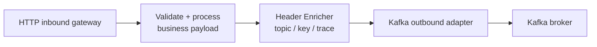
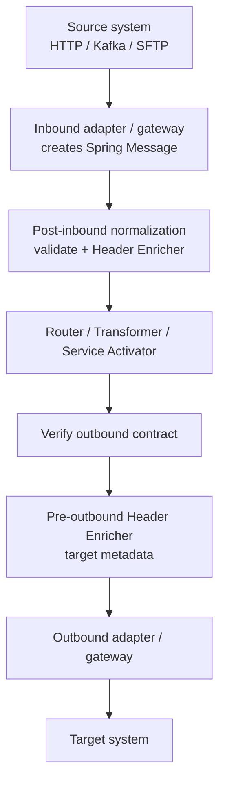
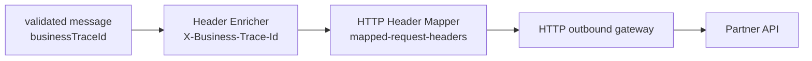
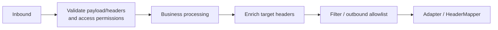

# Header Enricher Before Adapters in Spring Integration

## Learning Objectives

In the **SPRING_INTEGRATION_ADAPTERS** module, data is exchanged via inbound/outbound adapters, gateways, pollers, and `MessageChannel`s with systems such as HTTP, JMS, AMQP, Kafka, files, SFTP, and databases. A common problem is: **the payload is right, yet the adapter is missing required metadata**, such as the output filename to write, Kafka record key, HTTP correlation header, or error classification info.

**Header enricher** is the Spring Integration component that adds or recomputes headers **before a message reaches another endpoint**. Placed right before an outbound adapter, it creates an explicit metadata preparation step at the egress boundary. For inbound adapters, because the Spring message does not yet exist before the adapter receives data, header normalization is normally placed **right after the inbound adapter**.

After this lesson, you will be able to:

1. Place `HeaderEnricher` at the right position in a flow, especially before outbound adapters/gateways.
2. Use static headers, SpEL expressions, and Java functions to prepare metadata per message.
3. Distinguish **creating internal headers** from **mapping metadata onto the actual protocol**.
4. Design header pipelines for HTTP, JMS, AMQP, Kafka, files/SFTP, and databases.
5. Handle value conflicts, missing headers, untrusted inputs, retries, and error flows.
6. Inspect the right processing stage when an adapter does not receive expected headers.

## 1. Why Place a Header Enricher Before an Adapter?

Suppose an application receives orders from an HTTP gateway and publishes events to Kafka. A business service produces the payload:

```json
{
  "eventId": "evt-1042",
  "orderId": "O-1042",
  "region": "vn",
  "status": "PAID"
}
```

The Kafka outbound adapter needs to know the **topic** and **record key**. At the same time, observability needs a `businessTraceId` accompanying the data. If every service sets headers differently, the flow may work in business logic yet fail when sending to the broker. A `HeaderEnricher` right before outbound creates a **single metadata preparation checkpoint**:



Similar scenarios:

- **HTTP outbound:** build `X-Business-Trace-Id` or required headers in the partner contract.
- **File/SFTP outbound:** set output filename, batch group, verified tenant ID.
- **JMS/AMQP outbound:** prepare custom headers for the mapper to turn into properties or application headers.
- **Database outbound:** prepare business keys, query metadata, or parameters configured for the handler to read.

**Limitation:** `HeaderEnricher` operates solely on **Spring `Message<?>`** metadata. Adapters, converters, and `HeaderMapper`s decide which metadata actually travels over HTTP/JMS/AMQP/Kafka or controls file writes; there is no generic mechanism that automatically exports every header externally.

### 1.1. Placement for Inbound vs. Outbound



| Stage | Can You Place a Header Enricher Here? | Purpose |
|---|---|---|
| Before inbound adapter | No incoming Spring `Message<?>` yet to enrich in the usual way | To influence receiving data, configure the inbound adapter/poller/request converter itself |
| **Right after inbound adapter** | After the adapter builds the message | Normalize source headers, validate, or attach internal trace |
| Before router/aggregator | After validation, before header-driven processing | Compute routing key, correlation, or required group metadata |
| **Right before outbound adapter** | After transformation and business validation | Translate neutral metadata into headers/properties understood by target adapter |
| After outbound gateway with reply | On the reply branch when the gateway produces a reply message | Normalize response metadata per internal contract |

With an **inbound polling adapter**, the poller decides *when* to read data, the inbound adapter constructs the message, and only then does `HeaderEnricher` run. `HeaderEnricher` does not replace `PollerMetadata`, polling schedules, or message source configuration. With an **outbound gateway**, replies can return via `replyChannel` or a request–reply flow; preserving reply/error headers is essential when designing the flow.

## 2. How Does Header Enricher Work?

Spring Integration provides `HeaderEnricher`, a message processor that enriches headers using a configured set of header value processors. The payload normally remains unchanged; the result passes to the next message. There are three typical ways to supply values:

| Approach | Example | When to Use |
|---|---|---|
| Static value | `sourceSystem = "orders-service"` | Attach service identifier, static contract version |
| SpEL expression | `payload['orderId']` | Extract dynamic values from payload or headers |
| Java function/bean method | `safeFilename(message)` | Type checking, formatting, authorization, or complex fallbacks |

Illustrative input and output:

```text
Message before enricher:
  payload = {"orderId":"O-1042","region":"vn"}
  headers = {businessTraceId="trace-42"}

Enricher before Kafka:
  sourceSystem     <- "orders-service" (static)
  kafka_topic      <- "orders.vn" (expression from region)
  kafka_messageKey <- "O-1042" (expression from orderId)

Message after enricher:
  payload = unchanged
  headers = {businessTraceId="trace-42",
             sourceSystem="orders-service",
             ... newly computed Kafka headers}
```

Protocol key names here are shown conceptually; in Java, always use `KafkaHeaders.TOPIC` and `KafkaHeaders.KEY` from your actual Spring Kafka dependency rather than hand-typing keys.

### 2.1. Custom Headers Differ from Framework-Reserved Headers

| Group | Examples | Should an Enricher Set Them? |
|---|---|---|
| Custom headers | `businessTraceId`, `sourceSystem`, `schemaVersion` | Yes, when the flow needs that metadata |
| Spring Messaging headers | `MessageHeaders.CONTENT_TYPE` | Possibly, if the converter contract needs it with matching type |
| Read-only headers | `MessageHeaders.ID`, `MessageHeaders.TIMESTAMP` | No; managed by the framework |
| Internal orchestration headers | `replyChannel`, `errorChannel`, `correlationId`, sequence | Modify only when you understand the request–reply/aggregator contract |
| Outbound protocol headers | `KafkaHeaders.TOPIC`, `KafkaHeaders.KEY`, `FileHeaders.FILENAME` | Yes, if the target adapter is configured to read them |
| Consumer-side metadata | Kafka `RECEIVED_TOPIC`, `OFFSET`; AMQP delivery tag | Never use as control metadata for a new outbound send |

Normally, a new message produced by an enricher receives framework-managed instance metadata; do not rely on `MessageHeaders.ID` to track business flows across multiple adapters. Use `businessTraceId` or `eventId` with an explicit contract.

## 3. Configuring Header Enricher with Java DSL

The configuration below assumes channels `validatedOrders` and `ordersPreparedForKafka` exist. The input payload is a `Map<String, Object>` containing `orderId` and `region`, already validated prior to enrichment:

```java
import org.springframework.context.annotation.Bean;
import org.springframework.integration.dsl.IntegrationFlow;
import org.springframework.kafka.support.KafkaHeaders;

@Bean
IntegrationFlow prepareKafkaHeaders() {
    return IntegrationFlow.from("validatedOrders")
            .enrichHeaders(h -> h
                    .header("sourceSystem", "orders-service")
                    .headerExpression(KafkaHeaders.KEY,
                            "payload['orderId']")
                    .headerExpression(KafkaHeaders.TOPIC,
                            "payload['region'] == 'vn' ? 'orders.vn' : 'orders.sg'"))
            .channel("ordersPreparedForKafka")
            .get();
}
```

Meaning:

1. `IntegrationFlow.from("validatedOrders")` receives messages that already hold a payload and internal headers.
2. `header("sourceSystem", "orders-service")` attaches a static value.
3. `headerExpression(KafkaHeaders.KEY, "payload['orderId']")` extracts the key from **each message**'s payload.
4. `headerExpression(KafkaHeaders.TOPIC, ...)` derives the topic from `region`.
5. `channel("ordersPreparedForKafka")` sends the enriched message to the channel consumed by the Kafka outbound adapter.

**Required assumption:** `region` has already been constrained to `vn` and `sg`. Without prior validation, the ternary expression treats any value other than `vn` as `sg`, routing to the wrong topic. In production, validate `region` in a validator/service before the enricher, or use a Java function to reject out-of-allowlist values.

**Note on Kafka sending:** `KafkaHeaders.TOPIC`/`KEY` are meaningful to the Spring Kafka producer, yet the adapter itself may configure its own topic/key expression or fixed topic. Check handler configuration to see which source takes precedence. Having the header on the message only proves the **metadata preparation step**, not that the record reached the intended topic/partition.

### 3.1. Header Expressions vs. Static Strings

```java
// Sets the literal string "payload['orderId']".
.header("orderId", "payload['orderId']")

// Evaluates the expression and extracts the value from the message.
.headerExpression("orderId", "payload['orderId']")
```

With SpEL inside a header enricher, the root context is `Message<?>`, giving access to `payload` and `headers`. Examples:

```spel
headers['businessTraceId']
payload['region']
payload['status'] == 'PAID' ? 'ready' : 'hold'
headers['businessTraceId'] ?: 'unknown'
```

The fallback operator helps handle optional data. For mandatory headers such as a verified tenant, **never** arbitrarily default to another tenant; fail explicitly during validation.

### 3.2. Java Functions When Validation Is Needed Before Assigning a Header

When the goal is safe filename generation, a Java function is much clearer than concatenating untrusted data in an expression:

```java
import org.springframework.integration.file.FileHeaders;
import org.springframework.messaging.Message;

// Inside the same @Configuration class containing IntegrationFlow:
private String safeCsvFilename(Message<?> message) {
    Object raw = message.getHeaders().get("validatedBatchId");
    if (!(raw instanceof String batchId)
            || !batchId.matches("[A-Za-z0-9_-]{1,48}")) {
        throw new IllegalArgumentException("Invalid batch id");
    }
    return "orders-" + batchId + ".csv";
}

@Bean
IntegrationFlow prepareFileHeaders() {
    return IntegrationFlow.from("validatedCsvExports")
            .enrichHeaders(h -> h
                    .headerFunction(FileHeaders.FILENAME,
                            this::safeCsvFilename))
            .channel("fileOutbound")
            .get();
}
```

The example above requires importing `org.springframework.context.annotation.Bean` and `org.springframework.integration.dsl.IntegrationFlow` as before. `validatedBatchId` must come from an input validation step. The regex allows only alphanumeric characters, hyphens, and underscores; it rejects `/`, `\`, and `..` from free-form paths. For applications supporting Unicode filenames or subdirectories, design an appropriate validation policy rather than copying this illustrative regex verbatim.

### 3.3. Overwriting Existing Headers

An inbound message may already carry `sourceSystem` or `businessTraceId`. Before an enricher changes a value, decide **who owns the source of truth**:

- `sourceSystem` from a trusted gateway: normally set once the origin is accurately determined, never accepted blindly from clients.
- Valid `businessTraceId`: preserve across relevant processing stages; generate a new one only if missing or invalid per contract.
- `tenantId`: must come from an authenticated context or be verified against access permissions before writing to the message.
- `KafkaHeaders.TOPIC`: if the adapter is allowed to pick the topic, check any existing topic and overwrite according to verified routing policy.

In XML, `<int:header>` inside `header-enricher` supports the `overwrite` attribute. Specify it explicitly wherever conflicts can occur instead of assuming all configs or Spring versions share the same default. When writing Java DSL, check the overloads/config of your dependency version to select the matching overwrite policy.

## 4. Equivalent XML Configuration

When a project uses the Spring Integration `int` namespace:

```xml
<int:header-enricher input-channel="validatedOrders"
                     output-channel="ordersPreparedForKafka">
    <int:header name="sourceSystem" value="orders-service"/>
    <int:header name="businessTraceId"
                expression="headers['businessTraceId']"/>
</int:header-enricher>
```

This illustrates **custom headers**. To set Kafka topic/key headers in XML, use the properly configured constant key names or Java DSL when direct `KafkaHeaders` access is desired. Never guess key names from the words “topic” or “key” and assume the adapter will recognize them.

A configuration handling conflicts explicitly:

```xml
<int:header-enricher input-channel="normalizedInbound"
                     output-channel="readyForOutbound">
    <int:header name="sourceSystem"
                value="orders-service"
                overwrite="true"/>
    <int:header name="schemaVersion"
                value="2"
                type="java.lang.Integer"
                overwrite="true"/>
</int:header-enricher>
```

`schemaVersion` is typed as `Integer` so downstream does not mistake the string `"2"` for the number `2`. The `type` and `overwrite` attributes declare per-header policy. Even though helper elements exist for certain framework headers, never arbitrarily override `id`, `timestamp`, or consumer/acknowledgment metadata.

**Header Enricher vs. Payload Enricher:** `<int:header-enricher>` focuses on metadata; `<int:enricher>` (payload enricher) adds properties to the payload and has its own request–reply lifecycle. When your goal is preparing headers before an adapter, pick the right one to avoid mutating business data unnecessarily.

## 5. Before an HTTP Outbound Gateway: Preparing Headers for Partners

Suppose after validation and business processing, the message carries `businessTraceId = "trace-42"`. The HTTP partner requires header `X-Business-Trace-Id`:



Java DSL prepares only the header names:

```java
@Bean
IntegrationFlow preparePartnerHttpRequest() {
    return IntegrationFlow.from("partnerValidatedRequests")
            .enrichHeaders(h -> h
                    .headerExpression("X-Business-Trace-Id",
                            "headers['businessTraceId']")
                    .header("X-Source-System", "orders-service"))
            .channel("partnerHttpRequests")
            .get();
}
```

One way to configure the HTTP outbound gateway in XML, given the required namespaces:

```xml
<int-http:outbound-gateway id="partnerGateway"
        channel="partnerHttpRequests"
        url="https://partner.example.org/orders"
        mapped-request-headers="HTTP_REQUEST_HEADERS,X-Business-Trace-Id,X-Source-System"/>
```

There are **two distinct steps** here:

1. `HeaderEnricher` creates `X-Business-Trace-Id` and `X-Source-System` in `MessageHeaders`.
2. HTTP `DefaultHttpHeaderMapper`/gateway configuration turns permitted keys into HTTP request headers on the wire.

Per the Spring Integration docs, specifying `mapped-request-headers` **replaces the default mapping set**; the `HTTP_REQUEST_HEADERS` pattern keeps standard HTTP request headers included when needed. `Authorization`, cookies, or tokens need their own policies rather than being copied uncontrolled across requests to partners.

Response headers belong to a separate contract, and an outbound **gateway** can return a reply message; an outbound **channel adapter** is normally one-way. Choose the endpoint matching your reply, timeout, retry, and error-handling needs.

## 6. Before a Kafka Outbound Adapter: Preparing Topic, Key, and Trace

A Kafka message has topic, partition, key, value, timestamp, and native record headers. In Spring Kafka, these fields are not synonymous with arbitrary keys in `MessageHeaders`.

| Pre-Adapter Metadata | Meaning | What to Verify on Outbound |
|---|---|---|
| `KafkaHeaders.TOPIC` | Target topic of the record | Does the adapter use the header or another fixed topic/expression? |
| `KafkaHeaders.KEY` | Record key | Do converter/producer use the right key type and serializer? |
| `businessTraceId` | Custom business trace | Does the mapper export it as a Kafka native header? |
| `eventId` | Event identifier for idempotency | Present in payload or header transmitted/decoded on replay? |
| `KafkaHeaders.RECEIVED_TOPIC` / `OFFSET` | Metadata **received** from Kafka | Never use as outbound topic selection |

For example, an `OrderPaid` event might flow through:

```text
Validated event payload + businessTraceId
    ↓
HeaderEnricher:
    KafkaHeaders.TOPIC = orders.vn
    KafkaHeaders.KEY   = O-1042
    sourceSystem       = orders-service
    ↓
Kafka outbound adapter:
    ProducerRecord(topic, key, value, headers...)
    ↓
Kafka broker
```

For record headers, values stored on Kafka are byte arrays at the wire level; the converter/header mapper decides how custom values are encoded. Putting `businessTraceId` on the Spring message **is not enough** to prove the Kafka consumer receives a record header with the same name and expected type. Integration tests must verify the actual record at producer/consumer.

If the same message is retried, keep `eventId` stable to support deduplication. `MessageHeaders.ID` can vary with each created message instance and must not serve as a default Kafka record key or idempotency key.

## 7. Before File and SFTP Outbound: Preparing the Filename

For **file outbound**, `FileWritingMessageHandler` uses a `FileNameGenerator` to determine the filename. `DefaultFileNameGenerator` usually reads `FileHeaders.FILENAME`; if no valid name is present, it falls back based on payload and message ID. Setting the header before the adapter makes filenames predictable and controllable.

Example:

```text
CSV Payload:
  orderId,status
  O-1042,PAID

Validated header:
  validatedBatchId = B20261123

Header Enricher:
  FileHeaders.FILENAME = orders-B20261123.csv

File outbound handler:
  Writes file per configured FileNameGenerator
```

You can use an expression with a verified payload/header:

```java
@Bean
IntegrationFlow beforeFileOutbound() {
    return IntegrationFlow.from("validatedFileMessages")
            .enrichHeaders(h -> h.headerExpression(
                    FileHeaders.FILENAME,
                    "'orders-' + headers['validatedBatchId'] + '.csv'"))
            .channel("fileOutbound")
            .get();
}
```

Ensure `validatedBatchId` was validated prior to this step. If the handler uses a custom `FileNameGenerator` or `filename-generator-expression`, that configuration may determine the final name; never assume `FileHeaders.FILENAME` always takes top priority.

With **SFTP/FTP**, the outbound handler can use filenames, remote directories, or dedicated expressions. Filenames and remote directories must comply with server path policies; never feed arbitrary client-supplied path strings into remote directory names. Especially with adapters supporting subdirectories, check against path traversal and restrict the output directory scope.

## 8. Before JMS, AMQP, and Database Adapters

### 8.1. JMS: Internal Headers and JMS Properties

Suppose the application has custom headers `businessTraceId` and `sourceSystem`:

```text
Spring MessageHeaders
  businessTraceId = "trace-42"
  sourceSystem = "orders-service"
             ↓
JMS DefaultJmsHeaderMapper (configured)
             ↓
JMS user properties or supported JMS standard fields
```

JMS user properties restrict valid names and data types, such as strings, booleans, and basic numeric types. A custom header holding a `MessageChannel`, complex Java DTO, or invalid property name may be skipped or fail. `JMSMessageID` is assigned by the JMS provider, not copied from `MessageHeaders.ID`. If `JMSCorrelationID` is needed, use the official JMS mapping mechanism per the request–reply contract.

### 8.2. AMQP: Application Headers Differ from Routing Keys

AMQP/RabbitMQ has message properties, application headers, and consumer metadata such as delivery tags. `HeaderEnricher` can prepare `businessTraceId` or business classifications, whereas the routing key is governed by the outbound adapter/template and supported expressions/headers. Do not confuse `AmqpHeaders.RECEIVED_ROUTING_KEY` (the routing key of a received message) with the routing key for a subsequent publish.

Any header value arriving from HTTP/JMS/AMQP/Kafka inbound is untrusted input until verified. For example, `tenantId` must never alter access permissions merely because an enricher copies it onto an outgoing message.

### 8.3. Database/JDBC: Preparing Parameters and Context

With JDBC outbound gateways/adapters or pollers, custom headers can carry a verified `tenantId`, `batchId`, or processing timestamp; however, **the JDBC handler does not automatically turn every header into a SQL column**. To use headers in queries, configure a parameter source, expression, or suitable handler mapping.

Never construct table names, SQL statements, or connection strings dynamically from untrusted headers. If logic is tenant-dependent, the gateway must verify the tenant and select a datasource/query from an approved set. Transactions and DB connections belong to the processing lifecycle — never put connection objects into custom headers to pass across channels.

## 9. Header Contracts, Processing Order, and Common Pitfalls

### 9.1. Three-Layer Metadata Design

A resilient flow clearly separates three layers:

1. **Inbound metadata:** values from HTTP requests, Kafka records, JMS properties, AMQP headers, filenames, or SFTP remote paths. They vary in names/types and are untrusted by default.
2. **Normalized internal metadata:** `businessTraceId`, `sourceSystem`, `validatedTenantId`, `eventId`. Created and verified near the inbound boundary; used consistently across the flow per contract.
3. **Outbound metadata:** `KafkaHeaders.TOPIC`/`KEY`, `FileHeaders.FILENAME`, HTTP `X-Business-Trace-Id`, or properties allowed by JMS/AMQP mappers. A `HeaderEnricher` before the adapter translates layer 2 into target-specific requirements.

Design example:

| Information | Inbound | Normalized Internal | Outbound Kafka / HTTP / File |
|---|---|---|---|
| Business trace | HTTP `X-Business-Trace-Id` | `businessTraceId` | Kafka record header / HTTP `X-Business-Trace-Id` if allowed by mapper |
| Tenant | Authenticated HTTP identity/context | `validatedTenantId` | Export only when target contract permits |
| Event identity | Created by producer when emitting event | `eventId` | In payload or durable metadata |
| Kafka target | Validated region | `validatedRegion` | `KafkaHeaders.TOPIC` |
| Filename | Validated batch ID | `validatedBatchId` | `FileHeaders.FILENAME` or `FileNameGenerator` |

### 9.2. Ordering Between Validation, Enrichment, and Adapters

Placing `HeaderEnricher` in the wrong spot can let unvalidated metadata steer an adapter:



Also verify:

- **Validation before enrichment:** avoid using unverified `tenantId`, topics, URLs, file paths, or routing keys.
- **Enrichment before outbound adapter:** header names, value types, and overwrite policies are settled.
- **Header filtering/allowlisting:** avoid sending tokens, cookies, debug metadata, `replyChannel`/`errorChannel`, or consumer ack callbacks outside the system.
- **Actual mapping:** which adapter reads which header; whether custom headers are mapped.
- **Request–reply and error flows:** retain orchestration metadata needed by gateways and error channels; synchronous errors may propagate to callers, while asynchronous errors can route to `errorChannel` per config.

### 9.3. Errors to Watch For

| Symptom | Possible Cause | Fix |
|---|---|---|
| HTTP receiver does not see `X-Business-Trace-Id` | Enriched internally, but mapper excludes custom header | Check `mapped-request-headers` and actual HTTP request |
| Kafka sends to wrong topic | Unvalidated region or adapter prioritizes another topic expression | Validate region; check topic/key settings and producer record |
| SFTP/file writes default filename | File handler ignores header or custom generator overrides it | Check `FileHeaders.FILENAME` and `FileNameGenerator` |
| JMS property missing | Mapper skips header or property name/type is invalid | Convert to JMS-supported type and configure mapper |
| Message routes to wrong tenant | Client-supplied header fed straight into enricher | Verify identity/authorization; issue internal `validatedTenantId` |
| Header holds literal `"payload['orderId']"` | Used static header instead of expression | Use `headerExpression(...)` or a Java function |
| Enricher fails to update existing header | `overwrite` policy mismatched | Set explicit overwrite policy for target header |
| Header disappears after transformer | Transformer returns new message without copying headers | Check output and header propagation contract |
| Runtime SpEL exception | Missing payload/header or unexpected type | Validate inputs; prefer Java functions for complex logic |
| Logs accidentally expose secrets | Printed full `MessageHeaders` | Log using an allowlist of safe keys |
| Failure handling reply/error | Lost required `replyChannel` or `errorChannel` | Retain orchestration headers per gateway/endpoint contract |

## 10. Testing Before Connecting Real Adapters

### 10.1. Unit Testing Header Normalization

Put the policy into a Java function so it can be tested independently. This example focuses on **a message's header result**, without mocking a Kafka producer:

```java
import java.util.Set;
import org.springframework.kafka.support.KafkaHeaders;
import org.springframework.messaging.Message;
import org.springframework.messaging.support.MessageBuilder;

public final class OutboundHeaderPolicy {

    public static Message<String> prepare(
            Message<String> inbound, String orderId, String region) {
        if (orderId == null || !orderId.matches("[A-Za-z0-9_-]{1,64}")) {
            throw new IllegalArgumentException("Invalid orderId");
        }
        if (!Set.of("vn", "sg").contains(region)) {
            throw new IllegalArgumentException("Unsupported region");
        }
        return MessageBuilder.fromMessage(inbound)
                .setHeader(KafkaHeaders.TOPIC, "orders." + region)
                .setHeader(KafkaHeaders.KEY, orderId)
                .removeHeader("rawAuthorization")
                .build();
    }
}
```

JUnit 5 test:

```java
import static org.junit.jupiter.api.Assertions.*;

import org.junit.jupiter.api.Test;
import org.springframework.kafka.support.KafkaHeaders;
import org.springframework.messaging.Message;
import org.springframework.messaging.support.MessageBuilder;

class OutboundHeaderPolicyTest {

    @Test
    void buildsHeadersForValidatedOrder() {
        Message<String> input = MessageBuilder.withPayload("order-event")
                .setHeader("businessTraceId", "trace-42")
                .setHeader("rawAuthorization", "do-not-export")
                .build();

        Message<String> output =
                OutboundHeaderPolicy.prepare(input, "O-1042", "vn");

        assertEquals("orders.vn", output.getHeaders().get(KafkaHeaders.TOPIC));
        assertEquals("O-1042", output.getHeaders().get(KafkaHeaders.KEY));
        assertEquals("trace-42", output.getHeaders().get("businessTraceId"));
        assertNull(output.getHeaders().get("rawAuthorization"));
    }

    @Test
    void rejectsUnexpectedRegion() {
        Message<String> input = MessageBuilder.withPayload("event").build();
        assertThrows(IllegalArgumentException.class,
                () -> OutboundHeaderPolicy.prepare(input, "O-1042", "unknown"));
    }
}
```

The example above uses `MessageBuilder` to test Java policy logic. If the real flow uses `HeaderEnricher`, add an **integration test running the flow** to verify expressions and `overwrite` options are wired properly, rather than inferring it solely from helper unit tests.

### 10.2. End-to-End Test Matrix

| Input / Scenario | Verify After Enricher | Verify at Adapter / Target |
|---|---|---|
| Valid `vn` / `sg` region | Matching `orders.vn` / `orders.sg` topic | Actual producer record lands in expected topic |
| Invalid region | Validation rejects before reaching adapter | No record is published |
| Valid HTTP business trace | Internal header normalized, outgoing HTTP header set | Partner server actually receives `X-Business-Trace-Id` |
| Secret header in inbound | Header stripped at right boundary | No secret exported to protocol/logs |
| Valid batch ID | `FileHeaders.FILENAME` is validated name | File/SFTP written with right name and directory |
| JMS custom property | Value has valid name/type | JMS receiver reads the property |
| Transformer creates new message | `businessTraceId` remains present | Trace continues mapping per contract |
| Retry/redelivery | `eventId` stays stable | Idempotent consumer does not reprocess business logic |
| Adapter timeout/error | Error carries proper context | Retry, error channel, and observability behave as configured |

**Three checkpoints to observe when debugging:** (1) right after validation, (2) right after `HeaderEnricher`, and (3) on the actual HTTP/JMS/AMQP/Kafka/file output. The third checkpoint is especially critical because printing `MessageHeaders` after the enricher **does not prove** outbound mapping worked.

## 11. Comprehensive Practice Exercise

Design an **HTTP inbound → order processing → Header Enricher → Kafka outbound** flow with a branch exporting reports to files or SFTP:

1. HTTP gateway receives a payload containing `orderId`, `region`, `batchId`, `status`, and an optional trace header. Authenticate the request, validate fields, and resolve the authorized tenant.
2. Create internal custom headers `businessTraceId`, `validatedTenantId`, `validatedRegion`, and `validatedBatchId`. Never allow clients to pick tenant or topic directly.
3. Write a `HeaderEnricher` before the Kafka adapter: `KafkaHeaders.TOPIC` from the validated region, `KafkaHeaders.KEY` from `orderId`, and `sourceSystem` as a static value.
4. Write a separate `HeaderEnricher` before the file/SFTP adapter to build `FileHeaders.FILENAME` from the validated batch ID; configure the matching `FileNameGenerator`.
5. For the outbound HTTP branch to partners, set `X-Business-Trace-Id` and configure mapped request headers so it actually travels over HTTP.
6. Test missing trace ID, out-of-allowlist region, `batchId` with path traversal, conflicting header values, expression failures, and trace ID lost after a transformer.
7. Inspect the message right after the enricher and the **actual record/request/file**; document the root cause of any discrepancy.

**Self-assessment question:** Why isn't `headerExpression(KafkaHeaders.TOPIC, "...")` evaluating to `"orders.vn"` enough to confirm the message was sent to that topic? Explain all three layers: enrichment output, adapter/producer configuration, and observing records on Kafka.

## References

- [Spring Integration Reference — Content Enricher / Header Enricher](https://docs.spring.io/spring-integration/reference/content-enrichment.html)
- [Spring Integration Reference — HTTP Header Mapping](https://docs.spring.io/spring-integration/reference/http/header-mapping.html)
- [Spring Integration Reference — Writing Files / FileNameGenerator](https://docs.spring.io/spring-integration/reference/file/writing.html)
- [Spring Integration Reference — Kafka Support](https://docs.spring.io/spring-integration/reference/kafka.html)
- [Spring Integration Reference — AMQP Support](https://docs.spring.io/spring-integration/reference/amqp.html)
- [Spring Integration Reference — JMS Support](https://docs.spring.io/spring-integration/reference/jms.html)
- [Spring Integration Reference — SFTP Support](https://docs.spring.io/spring-integration/reference/sftp.html)
