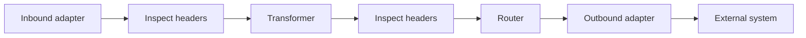

# Inspecting Headers When Debugging a Flow

When a message passes through multiple Spring Integration endpoints, the payload may still be right while the flow still misroutes, loses correlation, picks the wrong reply channel, or sends incomplete metadata to the target system. Those control and descriptive details live in **headers**. Knowing how to read, trace, and log headers helps identify where a message went, which endpoint altered metadata, and why a particular processing branch was chosen.

In the Spring Integration Adapters module, messages can enter from files, SFTP, HTTP, JMS, AMQP, Kafka, or databases, then flow through `MessageChannel`, transformers, routers, and outbound adapters. Each adapter can map external protocol metadata into message headers or vice versa. Therefore, debugging requires checking the header contract both at adapter boundaries and at internal flow steps, while avoiding leaking sensitive data into logs.

## 1. Where Do Headers Live in a Message?

Spring Integration uses the `Message<T>` model consisting of a payload and a set of headers:

```text
Message<T>
  ├── payload: T
  └── headers: MessageHeaders
        ├── id
        ├── timestamp
        ├── contentType
        ├── replyChannel / errorChannel
        ├── correlationId / sequenceNumber / sequenceSize
        └── application-specific headers
```

The payload holds the primary data to process. Headers hold routing, correlation, timing, format, and business metadata. `MessageHeaders` is an immutable structure: once a message is created, never mutate the header map directly. To change headers, build a new message with `MessageBuilder` or use an endpoint such as a header enricher.

Some common headers:

| Header | Meaning When Debugging |
| --- | --- |
| `MessageHeaders.ID` | Identifier of the current message; useful for distinguishing each message creation |
| `MessageHeaders.TIMESTAMP` | Message creation time in epoch milliseconds |
| `MessageHeaders.CONTENT_TYPE` | Hint for the payload's content type, if set |
| `replyChannel` | Where replies are sent in request/reply flows |
| `errorChannel` | Where error info is sent under Integration's error-handling mechanism |
| `correlationId` | Links messages belonging to the same group or request |
| `sequenceNumber`, `sequenceSize` | Position and group size when using splitter/aggregator |
| Custom headers | Metadata such as `tenantId`, `eventType`, `traceId`, `sourceSystem` |

Not every message carries all of the headers above. A header may be absent, `null`, or hold an object rather than a string. When debugging, inspect presence, data type, and actual value.

## 2. Reading Headers at a Point in the Flow

In a handler, accept `Message<?>` to inspect both payload and headers simultaneously:

```java
@Component
class OrderMessageInspector {

    private static final Logger log =
            LoggerFactory.getLogger(OrderMessageInspector.class);

    @ServiceActivator(inputChannel = "orders.inspect")
    public void inspect(Message<?> message) {
        MessageHeaders headers = message.getHeaders();

        log.debug(
                "order message id={}, timestamp={}, correlationId={}, tenantId={}",
                headers.getId(),
                headers.getTimestamp(),
                headers.get("correlationId"),
                headers.get("tenantId"));
    }
}
```

This is an observation point in the flow. You can place similar handlers after the inbound adapter, after transformers, before routers, and before outbound adapters to compare headers at each boundary. When you only need to inspect one header, read it directly via `message.getHeaders().get("headerName")`; if you need a specific type, use the `Class<T>` overload or controlled conversion.

For code accessing Spring Integration-specific headers, `IntegrationMessageHeaderAccessor` provides header names and typed accessors for metadata like correlation and sequence. Using framework constants/accessors avoids typos in header names. Custom headers should follow consistent naming and avoid colliding with standard or adapter-managed headers.

Never log the entire `message` or `headers` by default in production. Headers may contain tokens, authorization info, cookies, PII, channel objects, or internal data. Choose an allowlist of loggable fields, mask sensitive values, and enable detailed logging only during active investigation.

## 3. Tracing a Message Across Multiple Endpoints

An effective way to find where headers change is observing the same message at multiple points:



For example, `tenantId` is present right after the HTTP inbound adapter, yet disappears after a transformer. That narrows the investigation down to the transformer or new-message construction at that step. If the header is still intact before the outbound adapter yet missing in the target system, inspect the adapter's header mapper configuration and target protocol limits.

To enable framework logging during development, configure Spring Boot:

```yaml
logging:
  level:
    org.springframework.integration: DEBUG
```

If logs are too noisy, scope loggers to a specific package or component and enable them briefly. `TRACE` level can generate huge log volume, especially with high message rates or active pollers. Filter logs by message ID, correlation ID, and flow name; avoid raising log levels system-wide when only one adapter is misbehaving.

For flows needing observation without altering business logic, use a channel interceptor or `WireTap` to copy messages to a diagnostic channel. The diagnostic channel should have an independent consumer, bounded capacity, and its own error-handling policy. Never let a slow log consumer block the main flow. If using a `QueueChannel` for diagnostics, monitor queue depth and define what happens when it fills up.

## 4. Using MessageHistory to See the Path

`MessageHistory` records the components a message has visited. This feature is helpful when a flow has many channels, transformers, routers, or subflows and you need to know which endpoints a message traversed.

Enable message history via an annotation in Java configuration:

```java
@Configuration
@EnableIntegration
@EnableMessageHistory
class IntegrationConfiguration {
    // Application channels, adapters, and IntegrationFlows
}
```

When history is enabled, history entries are attached to message headers and can be read at an inspection point:

```java
MessageHistory history = MessageHistory.read(message);

if (history != null) {
    history.forEach(entry -> log.debug(
            "message visited component={}, timestamp={}",
            entry.getName(),
            entry.getTimestamp()));
}
```

History answers which components a message passed through and when each step was recorded. It does not replace business logs, distributed tracing, or metrics. For high-volume flows, history increases per-message metadata; enable it only when needed and weigh memory cost, message size, and header propagation to external adapters.

If not using message history, attach a correlation or trace ID header at the start of the flow and log that ID at observation points. This approach usually fits better when tying logs across multiple services or protocols. Trace IDs must be generated or accepted under clear rules; never use a single message ID as the trace ID for an entire multi-message business workflow.

## 5. Checking Headers in Routing and Request/Reply

A wrong header can send a flow down an unintended branch. For header-based routers, check the header's name, type, and value before concluding the router is broken:

```java
@Bean
IntegrationFlow routeOrders() {
    return IntegrationFlow.from("orders.route")
            .<Message<?>>route(
                    message -> message.getHeaders().get("eventType"),
                    mapping -> mapping
                            .channelMapping("ORDER_CREATED", "orders.created")
                            .channelMapping("ORDER_CANCELLED", "orders.cancelled"))
            .get();
}
```

During debugging, log the normalized `eventType` before the router and confirm it matches the mapping exactly. Also check missing headers, wrong casing, wrong types, or out-of-list values. Production flows should define a default branch or explicit handling for unroutable messages instead of letting messages vanish silently.

In request/reply flows, `replyChannel` can travel in headers to indicate where to send the result. Never log or convert channel objects inside headers arbitrarily. When messages cross process or protocol boundaries, an internal channel reference cannot automatically work in another system. Check gateway config, timeouts, reply timeouts, and channel registration matching the flow type.

`errorChannel` is also control metadata. When a handler fails, identify which error channel receives the failure, whether an `ErrorMessage` is produced, and whether the error channel's consumer is active. Never assume exceptions are placed into a regular header on the original message; Spring Integration uses a dedicated error-message mechanism.

## 6. Headers Across Adapter and Protocol Boundaries

Headers in `Message<?>` do not automatically map one-to-one to every external protocol's headers. Adapters and header mappers decide which fields are converted, retained, renamed, or dropped.

| Boundary | What to Check |
| --- | --- |
| HTTP | HTTP header names, case-insensitivity rules, string-typed values, headers stripped by proxies or servers |
| JMS | Only properties valid under JMS rules are mapped; check data types and property names |
| AMQP | Broker headers can carry varied types; check mappings, content type, and broker-added headers |
| Kafka | Record headers are usually byte arrays; verify serializers/deserializers and string encoding rules |
| File/SFTP | File metadata and filenames may be represented as headers; check paths, filenames, timestamps, and remote directory info |
| Database | Record metadata must be explicitly mapped to headers or payloads; do not assume columns auto-appear as headers |

For example, `traceId` may be a `String` in message headers yet become a byte array in Kafka record headers. When reading at the consumer, decode with the matching charset. In HTTP, header names are case-insensitive by protocol standard, whereas Java code accessing a header map may require the exact normalized name used by the app. Inspecting values on both sides of an adapter isolates whether an issue lies in mapping or in the target system.

Map only truly needed headers. Use an allowlist for outgoing headers, enforce size limits, and validate values before sending. Never forward `replyChannel`, `errorChannel`, internal framework info, or credentials verbatim to brokers or HTTP services.

## 7. Modifying Headers Properly When Debugging and Fixing Flows

Because headers are immutable, build a new message whenever adding or modifying metadata:

```java
Message<?> enriched = MessageBuilder.fromMessage(message)
        .setHeader("diagnosticStage", "after-validation")
        .setHeader("traceId", traceId)
        .build();
```

`fromMessage` preserves the payload and existing headers, then the builder creates a new message with updated headers. Use this in transformers or header enrichers when adding metadata is part of the flow contract. Never mutate internal maps or reuse the same header name for different meanings.

During debugging, avoid adding permanent debug headers to messages just for logging. A diagnostic header could accidentally be exported to external systems if an adapter maps all headers. If you must add one, give it a distinct name, limit its scope, and strip it before outbound adapters. For temporary logging, observer handlers or wire taps are usually easier to control.

## 8. Symptom-Based Debugging Workflow

| Symptom | Header/Point to Check | Resolution |
| --- | --- | --- |
| Router fails to pick a branch | Condition header like `eventType`, its type, and actual value | Normalize header, add default branch, and log allowlisted values |
| Aggregator emits no result | `correlationId`, `sequenceNumber`, `sequenceSize`, and release strategy | Verify messages in the group share a correlation ID and complete sequence |
| Reply never returns to caller | `replyChannel`, timeout, and gateway configuration | Check reply channel resolution and confirm reply arrives before timeout |
| Error flow receives no error | `errorChannel`, endpoint config, and `ErrorMessage` | Verify error dispatch mechanism and error channel consumer |
| Header vanishes after transformer | Message before/after transformer | Check whether transformer builds a new message and retains needed headers |
| Target system lacks metadata | Headers before outbound adapter and header mapper | Check allowlist, data types, serializers, and protocol limits |
| Logs cannot link across services | `traceId`/correlation ID | Generate or propagate trace ID per cross-service contract |

A practical workflow can follow these steps:

1. Record message ID, trace ID, timestamp, and flow name when a message enters the system.
2. Place an inspection point right after the inbound adapter to confirm initial payload and headers.
3. Compare headers before/after any suspected transformer, enricher, splitter, or aggregator.
4. Inspect header values right before the router or outbound adapter where routing and protocol mapping happen.
5. Correlate logs in the target system using the same trace ID or business ID.
6. After identifying the root cause, remove temporary logging, wire taps, or `TRACE` configs while keeping necessary safe metrics/logs.

## 9. Testing to Keep the Header Contract Stable

Debugging finds active bugs; testing prevents header regressions. For critical flows, include checks such as:

- Required custom headers are present with expected types after the inbound adapter.
- Transformers preserve needed business headers or explicitly replace them per contract.
- Routers handle valid, missing, and unsupported header values properly.
- Splitters/aggregators produce and consume the right correlation/sequence metadata.
- Outbound header mappers transmit only allowed fields and encode types properly per protocol.
- Logs and error flows correlate via trace ID without containing credentials or sensitive payloads.
- Message history, wire taps, and loggers do not alter processing outcomes or bottleneck flows.

When testing a specific message, focus assertions on the business headers committed to by the application. Avoid coupling tests to auto-generated headers like ID or timestamp unless the test specifically targets them; those values change across runs.

## 10. Safety Checklist When Enabling Header Logging

Before turning on detailed logging in a live environment, define which fields may be logged, who can access logs, and log retention. Mask or exclude access tokens, authorization headers, cookies, passwords, personal data, and sensitive payloads. Restore normal log levels after investigating, and check log volume and performance impact.

Headers are both part of the message contract and an observability tool for processing flows. By inspecting headers at the right boundaries, using consistent correlation/trace IDs, understanding each adapter's mapping, and restricting logged data, you can pinpoint exactly where metadata changes while keeping Spring Integration flows secure and operable.
