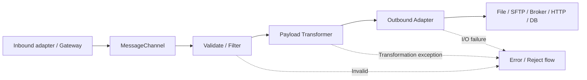
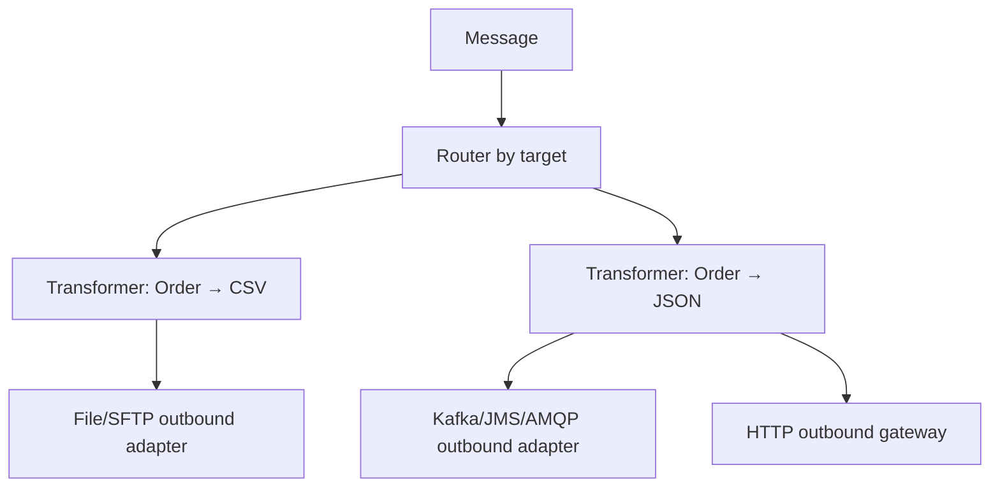
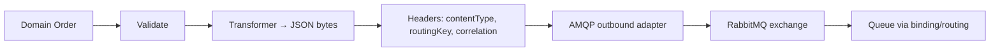
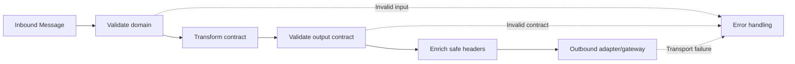

# Payload transformer before outbound adapter

## 1. Problem statement: Why transform the payload before sending to an external system?

A Spring Boot application receives orders from a REST API as a Java `Order` object. The order needs to be:

- written as a CSV file in an export directory;
- uploaded to an SFTP server as UTF-8;
- sent as JSON to an HTTP service;
- published to a JMS/AMQP queue or Kafka topic;
- persisted into a database according to defined columns.

If we pass the raw Java `Order` object to every outbound adapter, we run into differences:

- The File adapter needs writable content and file naming rules.
- An HTTP endpoint has its own JSON/XML contract, media type, and schema.
- JMS/AMQP requires choosing how to map the payload into a message that the consumer understands.
- A Kafka producer needs a payload compatible with its serializer and may need a message key.
- A JDBC outbound adapter needs parameter values matching the SQL statement, not an arbitrary object.
- External systems may require date/time formats, monetary amounts, field names, and encodings different from the domain model.

A **payload transformer before an outbound adapter** is the step that **converts data from its internal representation into the contract required by the target system**, placed in the Spring Integration flow **before the component performing I/O**.

This lesson belongs to the **Data Transformation** chapter of the `SPRING_INTEGRATION_ADAPTERS` module, focusing on connecting external systems using **inbound/outbound adapters, gateways, pollers, and MessageChannel**; the examples span file, SFTP, HTTP, JMS, AMQP, Kafka, and databases, along with managing message contracts, errors, and connection lifecycles.

> **Key takeaway:** The transformer is responsible for **data format and semantics**, while the outbound adapter/gateway is responsible for **communicating with the target system**. Separating these two concerns makes testing easier, allows swapping protocols, and enables intentional error handling.

## 2. What does a Spring Integration Message contain?

Spring Integration is built on a **message-driven** model: a message has a **payload** and **headers**.

```text
Message<T>
├── payload: T
└── headers: MessageHeaders
    ├── id
    ├── timestamp
    ├── contentType
    ├── correlationId
    ├── fileName / targetTopic / routingKey ... (depending on integration)
    └── additional metadata
```

- **Payload** is the business data: a DTO, JSON string, `byte[]`, `File`, `Map`, or any type supported by the endpoint.
- **Headers** contain control metadata: correlation ID, content type, source identifier, file name, topic, key, etc.
- **MessageChannel** connects endpoints. A channel can transfer messages synchronously or via an asynchronous/queue mechanism.
- **Endpoint** is a component that consumes or produces messages, such as a transformer, filter, router, service activator, adapter, or gateway.

### Are payload and headers always preserved?

No. A transformer can return a **new payload** or a **new Message**. When returning only a payload in a standard flow, Spring Integration's transformation mechanism typically builds the resulting message and inherits appropriate headers; however, custom code creating a new `Message`, components, or protocol mapping mechanisms can alter metadata.

Therefore, you must not assume that **every internal header will automatically pass through every adapter**. You need to determine which headers must be preserved, renamed, sanitized, or converted into protocol metadata at the system boundary.

### Example of two messages with different contracts

**Internal message:**

```json
{
  "orderId": "ORD-1001",
  "customerCode": "C-17",
  "totalCents": 125000,
  "currency": "VND"
}
```

**Target CSV file:**

```csv
order_id,customer_code,total_cents,currency
ORD-1001,C-17,125000,VND
```

In this example, the transformer decides **column order, escaping rules, line endings, and representation**. The File outbound adapter receives the content to write to a file without needing to know what fields the domain object `Order` has.

## 3. Where does the transformer sit in the flow?

A simple flow:



It can be expressed as:

```text
Source → Message<Order> → Transformer → Message<String | byte[] | DTO | Map>
                                               ↓
                                        Outbound adapter
                                               ↓
                                         Target system
```

### Why not transform directly inside the outbound adapter?

Putting business/formatting logic inside the adapter often creates these problems:

1. **Hard to test:** testing formatting also requires setting up a connection to a file server or broker.
2. **Hard to reuse:** when switching from File to SFTP, you have to rewrite the DTO-to-CSV conversion logic.
3. **Hard to diagnose errors:** data errors and network errors get lumped together as "send failed".
4. **Hard to evolve contracts:** logic for generating JSON, schema versions, charsets, and file names gets mixed with transport.
5. **Hard to swap targets:** the same data may need to be sent to multiple adapters with different formats.

**A clean boundary:** a transformer should be a transformation with clear inputs and outputs and minimal side effects; the adapter/gateway owns connections, sending, and transport rules.

## 4. How do transformer, converter, enricher, filter, and router differ?

| Component | Primary role | Example |
| --- | --- | --- |
| **Transformer** | Changes payload or message structure | `Order` → CSV `String` |
| **MessageConverter** | Converts representation when integrating with framework/protocol | Converts object to JMS TextMessage/AMQP body per configured converter |
| **Header Enricher** | Adds/modifies header metadata | Attaches file name, correlation ID, or partition key |
| **Filter** | Lets a message pass or discards it by condition | Skips orders ineligible for export |
| **Router** | Selects target channel/branch | Splits data needing CSV from data needing JSON |
| **Service Activator** | Executes business function/logic on receiving a message | Calls a domain service to confirm order status |
| **Splitter** | Splits a collection-bearing message into multiple messages | List of 100 orders → 100 individual orders |
| **Aggregator** | Combines messages by group/release condition | Merges multiple rows into one batch file |
| **Outbound adapter** | Sends a one-way message to an external system | Writes file, publishes event, updates via handler |
| **Outbound gateway** | Sends a request to an external system and awaits/receives a reply | HTTP request–response or query returning results |

**A transformer is not the ideal place for network calls or database commits.** If a transformation both calls an external API and writes data, controlling retries and idempotency becomes much harder.

### "Before the adapter" does not mean "same format for every protocol"

For example, one domain model can go to two branches:



If downstream systems need different contracts, split out corresponding transformers instead of forcing all adapters to use a single representation.

## 5. Concepts of inbound adapter, outbound adapter, and gateway

### Inbound adapter

An **inbound adapter** brings external events/data into a `MessageChannel`, such as reading files in a directory, receiving JMS messages, or polling a database. An inbound adapter can be a **polling consumer** (triggered by a poller) or a **message-driven producer**.

### Outbound adapter

An **outbound adapter** receives a message from a channel and performs a **one-way** send/write action to another system. For example, FileWritingMessageHandler writes the payload to a file; an adapter publishes an event to a broker.

### Gateway

A **gateway** fits **request–reply** exchanges: sending a request and receiving a response that needs processing. For example, an **HTTP outbound gateway** sends an HTTP request and turns the response into the next message. Operations that expect a reply should not be treated like a one-way outbound adapter.

### Poller

A **poller** periodically triggers a polling source or endpoint such as a file inbound adapter/database polling and coordinates fetching messages. A poller is **not a transformer**: it controls the cadence of fetching data, whereas a transformer determines the payload shape after a message exists.

| Component | Input | Output/effect |
| --- | --- | --- |
| File inbound adapter | File outside in directory | Message with file payload or data per configuration |
| Poller | Schedule, message limit, and policy | Triggers the polled source |
| Transformer | Java Message/payload | Transformed Payload/Message |
| File outbound adapter | Message containing compatible data | File on filesystem |
| HTTP outbound gateway | HTTP request message | HTTP response as a reply message |
| JMS/AMQP/Kafka outbound adapter | Message with converter/serializer-compatible payload | Message sent to broker |

## 6. Designing the payload contract: Start from the target system

A **message contract** must describe the content the consumer actually accepts, not just an internal Java class.

A minimal contract should answer:

1. **Data type:** JSON, XML, CSV, text, `byte[]`, Avro/Protobuf, or SQL parameters?
2. **Schema:** required fields, field names, column order, numeric types, date format, and version.
3. **Encoding:** UTF-8 or a specific charset? Are BOM or delimiters required?
4. **Null rules:** omit field, write `null`, use empty string, or reject message?
5. **Header/protocol metadata:** `contentType`, file name, topic/key/routing key, correlation ID.
6. **Size:** maximum size of body, file, batch, or record.
7. **Idempotency:** by what key does the target system detect duplicate messages?
8. **Data security:** which fields are sensitive data that must be omitted, masked, or encrypted?
9. **Compatibility:** does the consumer accept old/new versions? How are schema changes rolled out?
10. **Error feedback:** is invalid data discarded, routed to an error flow, or retried?

### Payload matrix by adapter

| Target | Common post-transform payload | Notable metadata/controls |
| --- | --- | --- |
| **File** | `String`, `byte[]`, or `File` depending on handler | File name, encoding, overwrite/append mode, directory |
| **SFTP** | `File`, `byte[]`, or `String` depending on handler/adapter | Remote path, filename, temporary name/rename, charset |
| **HTTP** | Serialized DTO, JSON string, or bytes per converter config | Media type, HTTP method, headers, status, response |
| **JMS** | Data matching the JMS message converter | Destination, correlation, delivery mode, duplicate handling |
| **AMQP/RabbitMQ** | `byte[]`, text, or converter-supported object | Exchange, routing key, content type, confirms/returns |
| **Kafka** | Key/value matching the producer serializer | Topic, key, partition, schema version, producer acknowledgment |
| **Database/JDBC** | Parameter map or object with properties matching SQL | SQL data types, transaction, constraints, unique key |

These are **common** forms; it does not mean every adapter accepts only one fixed type. You must verify the adapter's contract, converter/serializer configuration, and specific library version.

## 7. Hands-on example: Order → CSV → File outbound adapter

Goal: the application receives an `Order`, turns it into a standard CSV line, and writes a separate file for each order.

### 7.1. DTO and contract

Suppose the Java payload is:

```java
public record Order(
    String orderId,
    String customerCode,
    long totalCents
) {}
```

The target system requires:

```csv
"ORD-1001","C-17",125000
```

Assumptions in this example:

- Each message contains one `Order`.
- `orderId` is a verified unique identifier.
- Order data is encoded as CSV in a fixed format.
- The file name has the form `order-<orderId>.csv`.
- The runtime environment has write permissions to the export directory; operational directory protection is handled separately.

### 7.2. Extracting transformation into a pure function

```java
public final class OrderCsvFormatter {

    private OrderCsvFormatter() {
    }

    public static String format(Order order) {
        if (order == null || order.orderId() == null
                || order.customerCode() == null
                || order.totalCents() < 0) {
            throw new IllegalArgumentException("Invalid order for CSV export");
        }

        return csvField(order.orderId()) + ","
                + csvField(order.customerCode()) + ","
                + order.totalCents() + "\n";
    }

    private static String csvField(String raw) {
        // Escape double quotes according to CSV rules.
        // If the CSV is opened with a spreadsheet, add a policy
        // against CSV formula injection appropriate for the consumer.
        return "\"" + raw.replace("\"", "\"\"") + "\"";
    }
}
```

Because the function does not touch the network or filesystem, testing mapping/escaping is simpler. In production, clarify policies for nulls, line breaks, delimiters, field lengths, locale, and whether the data might be opened in a spreadsheet.

### 7.3. Creating the IntegrationFlow

Example using Spring Integration Java DSL; specific APIs and imports should be checked against the Spring Integration version used in the project:

```java
import java.io.File;

import org.springframework.context.annotation.Bean;
import org.springframework.context.annotation.Configuration;
import org.springframework.integration.channel.DirectChannel;
import org.springframework.integration.dsl.IntegrationFlow;
import org.springframework.integration.file.dsl.Files;
import org.springframework.messaging.MessageChannel;

@Configuration
public class OrderFileIntegrationConfig {

    @Bean
    MessageChannel orderExportRequests() {
        return new DirectChannel();
    }

    @Bean
    IntegrationFlow orderExportFlow(MessageChannel orderExportRequests) {
        return IntegrationFlow.from(orderExportRequests)
            // Header is computed while payload is still an Order.
            .enrichHeaders(headers -> headers.headerFunction(
                "outputFileName",
                message -> {
                    Order order = (Order) message.getPayload();
                    String id = order.orderId();
                    if (id == null || !id.matches("[A-Za-z0-9_-]{1,64}")) {
                        throw new IllegalArgumentException("Unsafe orderId");
                    }
                    return "order-" + id + ".csv";
                }
            ))
            // Convert Order -> String; send String to the file writer.
            .transform(Order.class, OrderCsvFormatter::format)
            .handle(Files.outboundAdapter(new File("./data/outbox"))
                .autoCreateDirectory(true)
                .fileNameGenerator(message ->
                    (String) message.getHeaders().get("outputFileName")))
            .get();
    }
}
```

**Step-by-step explanation:**

1. `orderExportRequests` is the channel receiving domain data.
2. `enrichHeaders` computes the file name from the payload before converting to `String`.
3. `transform(Order.class, ...)` returns the CSV payload.
4. `Files.outboundAdapter(...)` writes the content to the filesystem.
5. The file name generator reads the precomputed header, avoiding having to parse the CSV back to extract the order ID.

This pattern assumes headers are properly preserved across the transformer in the flow; with a custom transformer returning a new `Message`, verify how headers are retained. Before going to production, add policies for existing files, duplicate write prevention, atomic/temporary file writes if the consumer requires them, size limits, and charset verification.

### 7.4. What happens when a message enters?

Input:

```text
payload: Order(
  orderId="ORD-1001",
  customerCode="C-17",
  totalCents=125000
)
```

After the header enricher:

```text
payload: Order(...)
headers["outputFileName"]: "order-ORD-1001.csv"
```

After the transformer:

```text
payload type: java.lang.String
payload: "\"ORD-1001\",\"C-17\",125000\n"
headers["outputFileName"]: "order-ORD-1001.csv"
```

Expected output: file `./data/outbox/order-ORD-1001.csv` with the transformed CSV content.

**Security note:** file paths/names must never be concatenated directly from untrusted values like `../../other-dir/secret.txt`. The example validates `orderId` against a character allowlist before using it as a filename.

## 8. Implementation variants: Java transformer, bean, or DSL

Spring Integration lets you organize transformation logic in several ways.

### 8.1. Pure Java function

Suitable for simple type conversions with no framework dependencies:

```java
public String transform(Order order) {
    return OrderCsvFormatter.format(order);
}
```

Advantages: fast unit tests, no broker/file server needed, reusable in other services.

### 8.2. Transformer as a bean

When a transformation has many rules, extract it into a bean with a clear input–output contract:

```java
@Component
public class OrderExportTransformer {

    public byte[] transform(Order order) {
        String csv = OrderCsvFormatter.format(order);
        return csv.getBytes(StandardCharsets.UTF_8);
    }
}
```

Choosing `byte[]` fixes the encoding before sending. Add size controls if payloads can be large; this is not necessarily suitable when streaming gigabytes of data.

### 8.3. Transformer in Java DSL

Suitable when the mapping is concise and readable:

```java
@Bean
IntegrationFlow jsonFlow() {
    return IntegrationFlow.from("jsonRequests")
        .transform(Order.class, order -> Map.of(
            "order_id", order.orderId(),
            "total_cents", order.totalCents()
        ))
        // Downstream outbound handler must be configured according to the target.
        .channel("jsonReadyChannel")
        .get();
}
```

The illustrative flow above produces a `Map`; it **does not automatically serialize the Map into JSON bytes**. If HTTP/Kafka/JMS requires JSON, a step converting to JSON with a suitable message converter/serializer or transformer is needed before the I/O boundary.

### 8.4. Transforming with Message

A transformer that needs header control can process the whole message rather than just the payload. However, avoid constructing a new message that drops `correlationId`, routing metadata, or tracing information.

Good practices:

- Only modify headers that truly need changes.
- Do not trust headers self-reported by untrusted sources.
- Avoid putting credentials or PII into headers.
- Test that headers survive across each endpoint and adapter.
- Do not manually alter framework-managed headers like `id`/`timestamp` in ways that break semantics.

## 9. Transforming to JSON before an HTTP outbound gateway

HTTP typically follows a request–response flow, so an **HTTP outbound gateway** is commonly used when the application needs to receive a response. If emitting one-way only, choose a pattern aligned with your requirements and the endpoint's capabilities.

### Sample contract

Internal payload:

```text
Order(orderId="ORD-1001", customerCode="C-17", totalCents=125000)
```

HTTP endpoint expects:

```json
{
  "order_id": "ORD-1001",
  "customer_code": "C-17",
  "total_cents": 125000
}
```

### Example separating target DTO and serialization

```java
public record OrderHttpRequest(
    String order_id,
    String customer_code,
    long total_cents
) {}

public static OrderHttpRequest toRequest(Order order) {
    return new OrderHttpRequest(
        order.orderId(),
        order.customerCode(),
        order.totalCents()
    );
}
```

A flow can convert `Order` → `OrderHttpRequest` before passing it into the HTTP outbound gateway. Serializing the DTO to JSON can be handled by the appropriate **HTTP message converter**; if the endpoint receives a raw JSON string/bytes, specify the content type and representation explicitly.

**Do not serialize twice:** if the transformer returns a JSON string but the HTTP converter also treats it as an object to JSON-encode, the target side may receive a quoted JSON string instead of a JSON object.

### Error scenarios to distinguish

| Error | Which layer? | Handling approach |
| --- | --- | --- |
| Missing `orderId` | Validation/transformation | Reject, error flow, or quarantine |
| DTO does not map to schema properly | Transformer/serializer | Fix contract, version, and contract test |
| HTTP 400/422 | Target rejects content | Usually requires fixing data, do not retry infinitely |
| HTTP 401/403 | AuthN/AuthZ or integration credentials | Check configuration and connection permissions |
| HTTP 429/503 | Rate limit/transient error | Backoff, bounded retry, and idempotency |
| HTTP timeout after server already processed | Uncertain delivery state | Idempotency key, status check, and duplicate handling |

HTTP status codes can carry API-specific business interpretations; rely on the endpoint's contract rather than lumping all errors into one type.

## 10. File and SFTP: Payload, file name, and atomic delivery

File and SFTP are the clearest examples for seeing the boundary between **data formatting** and **data transport**.

### 10.1. File outbound

The transformer handles:

- Object → CSV/XML/text/binary.
- Charset and line ending rules.
- Data fields, schema, and escaping.
- Metadata used as file name if needed.

The File outbound adapter handles:

- Target directory and directory creation.
- File writing and existing-file mode.
- File name and filesystem permissions.
- Complete or temporary-file writing behavior per configuration/architecture.

### 10.2. SFTP outbound

The SFTP outbound adapter transfers files/data over an SSH connection to a server. Beyond the payload, you need to design:

- Remote directory and file name.
- Session/connection management, host verification/host key, and credentials.
- Write permissions, timeouts, retries, and reconnects.
- Renaming a temporary file upon completion if needed so consumers avoid reading incomplete files.
- Coordinating pickup timing and cleanup to prevent duplicate sends.


**Warning:** never take an unverified remote path directly from a source message. This risks path traversal or writing to unauthorized locations. Use a configured target directory and an allowlisted filename.

### 10.3. When one file contains multiple records

A transformer for **one Order → one CSV line** cannot produce a complete batch on its own. When you need one daily file containing multiple orders:

- A poller or inbound adapter fetches the records.
- A **splitter** can be used to create per-order messages.
- Use an **aggregator** or batching mechanism to group data by correlation and completion condition.
- Transform the list → a single CSV file with header and multiple lines.
- The outbound adapter writes only after the batch is confirmed complete.

Do not use an aggregator indefinitely without a release condition/timeout; this risks holding messages in memory/message store for too long.

## 11. JMS: Transforming payload before sending to the broker

JMS distinguishes the message representation (such as `TextMessage`, `BytesMessage`, and other types) from business Java objects.

Example flow:

```text
Message<Order>
   -> validate / transform to JSON text
   -> JMS outbound adapter + MessageConverter
   -> JMS TextMessage
   -> Consumer receives JSON per contract
```

### What needs to be designed

1. **Data type:** does the consumer accept JSON text, binary, or an object serialized per contract?
2. **Converter:** properly configure the rule converting a Spring `Message<?>` to a JMS message.
3. **Headers/properties:** which headers become JMS properties? Which headers are internal-only?
4. **Correlation:** `JMSCorrelationID`/message ID for tracing or request–reply per design.
5. **Delivery:** how are acknowledgment, transactions, redelivery, and dead-lettering handled?
6. **Version:** can older consumers read the new schema?

**Avoid arbitrary Java object serialization between services.** It can create classpath coupling, version issues, and security risks when deserializing untrusted data. Text/binary contracts with explicit schemas are usually easier to control.

A good practice is for the transformer to return a standardized DTO/JSON, and then an explicitly configured converter converts it into the desired JMS message type. Do not leave serialization as an "accidental" outcome of default configuration.

## 12. AMQP/RabbitMQ: Body, content type, and routing

With AMQP, the outbound adapter sends messages to an exchange with a routing key and a body converted by a converter.

### Illustrative flow



Points to keep in mind:

- **Content type:** if the body is JSON, attach corresponding metadata, such as `application/json` per protocol and converter.
- **Routing key:** must come from trusted policy/metadata; unverified data can route to the wrong queue.
- **Converter:** if JSON `byte[]` is already produced, do not let the converter misinterpret it as an arbitrary Java object.
- **Publisher confirms/returns:** broker delivery confirmation/return differs from **the consumer having succeeded in business processing**.
- **Dead-letter and retry:** distinguish contract-invalid data from transient broker errors.
- **Header mapping:** verify which headers map to AMQP properties and supported formats/limits.

For example: an event with `eventType=order.created` can be turned into JSON bytes, while the routing key is explicitly set to `orders.created`. Do not use the same field for both content and routing control without a clear convention.

## 13. Kafka: Serializer, message key, and schema version

A Kafka producer uses **key and value serializers**. The transformer must ensure the post-transformation payload type matches the configured serializer.

### Common choices

| Transformer returns | Configured value serializer match | Risk |
| --- | --- | --- |
| JSON `String` | String serializer | Encoding/JSON conversion differs from consumer expectation |
| `byte[]` | Byte array serializer | Missing content/schema metadata |
| Java DTO | Appropriate JSON/Avro/Protobuf serializer | Schema/class and version compatibility |
| `Map<String,Object>` | Serializer accepting Map per contract | Unstable type mapping, numbers/dates, and field names |

### What does the message key mean?

The key typically determines how records are partitioned and signals the consumer's ordering strategy within a partition. For instance, using the same `orderId` as the Kafka key routes events for one order into the same partition per the partitioner configuration.

**This does not mean Kafka guarantees global ordering across all partitions.** Ordering depends on the key, partitioning, producer, and how consumers process records.

### Sample event contract

```json
{
  "eventId": "evt-84a7",
  "schemaVersion": 2,
  "eventType": "order.created",
  "occurredAt": "2026-11-23T08:00:00Z",
  "order": {
    "orderId": "ORD-1001",
    "totalCents": 125000,
    "currency": "VND"
  }
}
```

Should be specified separately:

- **Key:** `ORD-1001` (per design).
- **Topic:** governed name, e.g., `orders.events`.
- **Value:** JSON bytes or DTO per serializer.
- **Schema version:** for producer–consumer compatibility.
- **eventId/idempotency key:** handles duplicates during retry/redelivery.
- **Trace metadata:** correlation ID propagated via headers per configuration.

A producer acknowledgment **does not mean the downstream consumer has processed it**; observability across the relevant layers is needed.

## 14. Database outbound: DTO → SQL parameters, not building raw SQL

For a JDBC/database outbound adapter, the problem is not serializing to a file or message broker. The transformer can produce a **parameter set or object with properties** matching the SQL.

### Example contract

```sql
INSERT INTO exported_orders (
    order_id,
    customer_code,
    total_cents
) VALUES (
    :orderId,
    :customerCode,
    :totalCents
);
```

Payload after the mapping step:

```json
{
  "orderId": "ORD-1001",
  "customerCode": "C-17",
  "totalCents": 125000
}
```

Check data types and binding rules for the JDBC adapter in use. The transformer can return a parameter `Map`, DTO, or another structure supported by the handler.

### Things to avoid

- **Do not concatenate SQL strings from user payloads.** Use prepared statements or named parameters supported by the driver/framework to reduce SQL injection risk.
- Do not trust date/time, decimal, or enum values from external sources without validating them first.
- Do not assume the payload was written to the DB just because the transformer finished running.
- Writing to the DB and publishing to a broker are **two separate transactions**; they are not atomic across database and broker by default.
- When high reliability is required, consider transactional outbox, idempotent upsert, or a workflow aligned with your architecture.

### Another case: Poll DB → transform → Kafka

```text
Database inbound polling adapter
   -> Row/Map
   -> Validate + map to OrderCreatedEvent
   -> Serialize JSON/Avro
   -> Kafka outbound adapter
```

The poller controls the fetch cadence; the transformer converts the schema; the Kafka adapter handles publishing. If the polling query does not manage checkpoints/processed state, records can be re-read and cause duplicates even when the transformer is correct.

## 15. Header contract: File name, Content-Type, key, and correlation

A transformation that gets the payload right but **loses required metadata** can still cause delivery failures.

| Header/metadata | Common target | Rule |
| --- | --- | --- |
| `contentType` | HTTP, AMQP, some converters | Set to match actual bytes |
| `fileName` / filename header | File, SFTP | Follow naming contract strictly and sanitize |
| `topic`, `messageKey` | Kafka | Follow adapter/version configuration, do not guess header names |
| `routingKey` | AMQP | Match exchange/binding per policy |
| `correlationId` | Tracing, request–reply, batch | Preserve across steps when needed |
| `replyChannel` | Internal gateway/request–reply | Do not arbitrarily expose as outbound data |
| `errorChannel` | Asynchronous/configured error flow | Understand how the channel handles exceptions per topology |
| `eventId` / `schemaVersion` | Consumer and dedup/version | Have an explicit contract, validate before sending |
| `traceId` | Observability | Do not put sensitive info into traces |

### Content type and content must match

For example:

- `String` payload containing JSON → content type can be `application/json` if target and converter are configured accordingly.
- `byte[]` payload containing UTF-8 CSV → use a CSV/text media type per contract, do not attach `application/json`.
- An `Order` DTO can be serialized to JSON by the HTTP converter; do not both manually serialize it and let the converter serialize it a second time.

### Is the header trusted?

External clients must not be allowed to dictate remote paths, internal Kafka topics, governed routing keys, or database tables via unverified headers. Separate **business metadata sent by the source** from **routing metadata controlled by the application**.

## 16. Encoding, null, timestamps, and numeric precision

A transformer often causes bugs not because code crashes, but because **data is interpreted differently** at the consumer.

### 16.1. Charset

- Specify explicitly when converting `String` ↔ `byte[]`, usually `StandardCharsets.UTF_8` if allowed by the contract.
- For CSV/text over File or SFTP, define BOM and line endings (`\n` vs `\r\n`).
- Ensure the receiving system decodes with the same charset; do not rely on the host machine's default encoding.

### 16.2. Time

- Lock down timezone and format; prefer timestamps with offset or UTC when transferring across systems.
- `LocalDateTime` without a timezone can be interpreted differently by producer and consumer.
- Business date and event timestamp do not always carry the same meaning.

Example:

```json
{
  "eventTime": "2026-11-23T08:00:00Z",
  "businessDate": "2026-11-23",
  "sourceTimeZone": "Asia/Ho_Chi_Minh"
}
```

### 16.3. Money and numbers

- `double` can introduce rounding errors for monetary data. Consider `BigDecimal` or smallest units such as `long totalCents` per domain.
- Decimal and grouping separators must not depend on server locale.
- Consumers must know the unit meaning, e.g., whether `125000` is in minor units or currency units.

### 16.4. Null and required fields

- Define how a missing field differs from `null` or an empty string.
- Validate values before serializing to avoid producing syntactically valid but semantically wrong messages.
- With Java `Map.of(...)`, null elements are disallowed; handle nulls explicitly.

### 16.5. CSV and untrusted data

CSV escaping (commas, double quotes, newlines) is **one problem**, and CSV/spreadsheet formula injection is **another problem**. If data comes from users and recipients open it in a spreadsheet, there must be a policy handling strings that could be interpreted as formulas; CSV quoting alone does not guarantee eliminating this risk in all software.

## 17. Where should validation and transformation be placed?

There are three different kinds of checks:

1. **Input validation:** does the source provide qualifying data? E.g., non-empty `orderId`, non-negative amount.
2. **Contract validation:** does the post-transform representation match the JSON schema, CSV field count, encoding, version?
3. **Transport/result validation:** did the target system receive or write successfully to the right resource, and can the outcome be verified?

A reasonable pipeline:



In the file example above, the file name was computed **before** the transform because the header needed to read from `Order`. Whether to enrich headers before or after transformation should be chosen based on data availability and the contract. The core requirement is that **output reaching the adapter is right in both payload and metadata**.

### Should you use an exception or a filter?

- Malformed data or missing required fields → usually an **error** to log/quarantine.
- Valid message outside processing scope → a **filter** can be used, recording skipped counts as required.
- Invalid destination or valid data that cannot be routed → use explicit error handling or a fallback route.
- Never use a silent filter to hide invalid data; consumers will not know messages were lost.

## 18. Error handling: Transformation error vs. transport error

When the application fails, you need to know whether it happened before or after the adapter.

### 18.1. Transformation errors

Examples:

- `ClassCastException` because payload from the inbound adapter is a `File` instead of `Order`.
- Schema-invalid JSON/CSV.
- Invalid data, exceeded limits, missing charset, date/time mapping error.
- Oversized payload causing memory pressure.

These errors are usually **not fixed by infinite retries**. You need corrected data, contract fixes, quarantine, alerts, or routing to an appropriate dead-letter destination.

### 18.2. Transport errors

Examples:

- SFTP timeout, permission denied, changed host key.
- HTTP 503 or 429.
- Transient broker disconnection, producer timeout.
- Database deadlock, connection unavailable, or constraint violation.

Some transient errors can be retried; some are permanent errors or security risks requiring a stop and configuration fix.

### 18.3. Responsibility of ErrorChannel and exception propagation

In synchronous flows over `DirectChannel`, exceptions can **propagate back to the caller**, usually wrapped in a messaging exception. In asynchronous flows or polled endpoints, errors can be sent to a configured **error channel** rather than returning directly to the original sender.

Do not assume adding an `errorChannel` header will handle every exception across all topologies; inspect the configured endpoints, executors, pollers, and advice.

### 18.4. Recommended handling policy

| Error | Retry? | Appropriate handling |
| --- | --- | --- |
| Missing required field | Usually no if data is unchanged | Reject/quarantine, alert data owner |
| Incompatible schema version | Do not retry blindly | Fix contract/rollout |
| File name contains path traversal | No | Reject, log security event safely |
| HTTP 429/503 | Possibly | Backoff, bounded attempts, idempotency key |
| SFTP timeout | Possibly | Verify partially/completely written file before retry |
| Broker send timeout with unknown status | Conditionally | Dedup key, verification, or at-least-once strategy |
| DB unique constraint | Depends on business logic | Idempotent upsert or classify duplicate |
| Authentication/authorization failure | Do not retry infinitely | Check credentials, permissions, and connection config |

**Avoid logging sensitive payloads verbatim.** When reporting transformation errors, log message ID, data type, schema version, and error code instead of dumping full user data or secrets.

## 19. Retry, idempotency, and delivery semantics

When an outbound adapter sends data externally, a situation can occur where **the target processed it but the sender never received confirmation**. Retrying at this point can create duplicate data.

### Example with files

- The adapter writes the file successfully, but the application crashes before marking progress.
- On restart, the same message is sent again.
- If overwrite/append behavior is not designed, data may be lost or duplicated.

You need a stable file name/ID, an existing-file policy, and depending on the case, a temp-write-and-rename mechanism or idempotency marker.

### Example with Kafka/JMS/AMQP

- The producer may see a timeout after the broker received the message.
- Redelivery may cause the consumer to process duplicates.
- The transformer should derive a stable **eventId** or business ID from a trusted source; do not generate a new ID on each retry if the consumer uses that ID for deduplication.

### Example with databases

- Write succeeds but caller times out; retrying the same INSERT causes duplicates.
- Unique keys, conditional upserts, transactions, and outbox patterns can help control this per requirements.

| Concept | Interpretation |
| --- | --- |
| **At-most-once** | May lose messages, avoids duplicate sends within the mechanism's scope |
| **At-least-once** | Tries not to lose messages via retries, so duplicates can happen |
| **Exactly-once** | Meaningful only within the scope and conditions of a specific mechanism; does not extend automatically across all systems |
| **Idempotency** | Re-processing the same request does not duplicate the business outcome |
| **Deduplication** | Detecting and discarding/throttling duplicate messages by a defined key |

No single transformer can guarantee exactly-once across files, SFTP, brokers, and databases. This is a **system-wide design** concern.

## 20. Poller, channel, and performance considerations

A transformer operates inside a flow with a specific execution cadence.

### DirectChannel

- Typically executes synchronously on the sender's thread.
- If file/SFTP/HTTP outbound is slow, the caller can be blocked.
- Exceptions usually return to the caller, making them easy to observe, though timeouts must be managed.

### QueueChannel or executor-based channel

- Decouples producer and consumer, supporting buffering/asynchrony per configuration.
- Requires managing queue capacity, thread pools, retries, and backpressure.
- Messages in a queue do not guarantee persistence if an in-memory queue is used.

### Poller

- Controls frequency, number of messages per poll, and can combine with transactions/advice.
- If the transformer is CPU-heavy or the adapter is slow, backlog can grow.
- `maxMessagesPerPoll`, polling schedule, and concurrent consumers must be balanced against target capacity.

### Practical optimization tips

1. Do not load huge files into memory just to alter a few fields; consider streaming/chunking/batching per adapter.
2. For large JSON, avoid repeated serialize/deserialize cycles unless necessary.
3. Measure transformation time **separately** from adapter I/O time.
4. Enforce limits on message size, queue capacity, and retry backlog.
5. If order sequence must be preserved, choose appropriate keys/partitions or channels; do not assume async preserves strict order.
6. Specify commit/ack policies when the source is a poller or broker; completing transformation does not equate to outbound success.

## 21. Testing transformers and pre-outbound flows

Split testing into multiple layers to pinpoint bugs accurately.

### 21.1. Unit tests for transform functions

```java
import static org.junit.jupiter.api.Assertions.assertEquals;
import org.junit.jupiter.api.Test;

class OrderCsvFormatterTest {

    @Test
    void mapsOrderToCsv() {
        Order order = new Order("ORD-1001", "C-17", 125000);
        assertEquals(
            "\"ORD-1001\",\"C-17\",125000\n",
            OrderCsvFormatter.format(order)
        );
    }

    @Test
    void escapesQuotes() {
        Order order = new Order("ORD-1002", "C\"17", 99);
        assertEquals(
            "\"ORD-1002\",\"C\"\"17\",99\n",
            OrderCsvFormatter.format(order)
        );
    }
}
```

For invalid inputs, add tests asserting exceptions and handling codes/reasons. These tests **do not need external connections**.

### 21.2. Contract tests

Verify that transformed data matches:

- JSON schema or CSV column count/order.
- Content type/charset.
- Date/time formats, monetary amounts, null/optional fields.
- Protocol headers and version.
- Backward/forward compatibility per consumer policy.

### 21.3. Integration tests

Create appropriate test environments:

- File: temporary directory; test file name, bytes, existing files, and path traversal.
- SFTP: test SFTP server/ephemeral container; check remote path, temp file, reconnect.
- HTTP: mock server; check request body/content type/headers, 400/429/503 errors.
- JMS/AMQP: test broker, converter, and routing.
- Kafka: test broker or suitable test harness; verify serializer/key/topic and duplicates.
- Database: test database, transactions, constraints, and idempotency.

### 21.4. Required negative tests

| Case | Expected outcome |
| --- | --- |
| Wrong payload type | Flow reports clear error, does not send bad data to adapter |
| Missing required field | Reject/quarantine per policy |
| CSV containing commas, quotes, newlines | Properly escaped format |
| Input uses file name `../../bad` | Blocked, does not write outside directory |
| Unknown JSON schema version | Rejected or routed per supported versions |
| Mismatched content type header | Detected before sending |
| Adapter timeout | Bounded retry/alert, no unintended duplicates |
| Resending same event ID | Idempotency/dedup per contract |
| Consumer or target unavailable | Backpressure and error handling per design |
| Sensitive data in payload | Not exposed verbatim in logs |

### 21.5. Inspecting messages at the transformer–adapter boundary

An effective debugging technique is temporarily replacing the outbound handler with a test channel or mock endpoint to inspect:

```text
input Message<Order>
   -> transform
   -> output Message<String/byte[]>
   -> test channel / mock handler
```

Only then verify the real adapter layer. This isolates mapping errors from connection errors.

## 22. Operational observability: What to measure?

| Metric | Meaning |
| --- | --- |
| **Transformation success/failure count** | Count of messages mapped successfully and rejected due to data issues |
| **Transformation latency** | Format/schema processing latency, separated from network I/O |
| **Outbound send/commit latency** | Latency of writing/sending to file/SFTP/HTTP/broker/DB |
| **Payload size distribution** | Detects oversized messages/files that raise memory risk |
| **Retry attempts and age** | Number of retries and age of unresolved errors |
| **Dead-letter/quarantine volume** | Unprocessable messages, categorized by error code |
| **Queue depth / poll lag** | Backlog when source outpaces target system |
| **Duplicate/idempotency collisions** | Duplicate events or key collisions needing attention |
| **Schema version failures** | Producer/consumer incompatibilities |
| **Adapter connection health** | Whether SFTP/broker/HTTP/DB are healthy and properly authorized |

When logging, prefer `messageId`, `eventId`, `correlationId`, adapter name, schema version, duration, and error type. Avoid logging entire payloads containing personal data, payment info, or credentials.

A sample trace:

```text
received:       eventId=evt-84a7 payloadType=Order
validated:      eventId=evt-84a7 result=OK
transformed:    eventId=evt-84a7 outputType=byte[] schema=orders-v2
outboundSent:   eventId=evt-84a7 adapter=kafka latencyMs=18
acknowledged:   eventId=evt-84a7 brokerAck=true
```

**Broker acknowledgment does not confirm successful consumer processing.** If the business requires end-to-end confirmation, there must be tracking down to the consumer or a corresponding business response.

## 23. Common anti-patterns

| Anti-pattern | Consequence | Appropriate approach |
| --- | --- | --- |
| Sending internal DTOs straight to every adapter | Wrong converter/schema when changing protocols | Define distinct output contracts per target |
| Writing CSV/JSON inside the outbound handler | Mixes formatting and I/O, hard to test | Pure transformer before the handler |
| Converting every object via `toString()` | Payload violates contract, unstable format | Schema-backed serializer/formatter |
| Not standardizing charset | Vietnamese characters corrupted, bytes differ across environments | Lock UTF-8 or contract-defined charset |
| Using double for money | Precision errors, ambiguous units | `BigDecimal`/minor units and formatting rules |
| Using input headers as file paths | Path traversal, sending to wrong destination | Allowlists and application-controlled metadata |
| Double-serializing JSON | Consumer gets a JSON string instead of an object | Define clear boundary between transformer and converter |
| Losing correlation ID after transform | Hard to debug, hard to correlate replies/errors | Only build new messages when header retention is handled |
| Retrying every exception infinitely | Poison messages cause stalls and duplicates | Separate data errors from transient errors |
| Testing only transformation | Misses converter/adapter bugs | Unit + contract + integration tests |
| Generating a new event ID on each retry | Consumer cannot deduplicate | Stable event ID from source/contract |
| Broker send success = business completion | Unknown whether consumer actually processed it | Track delivery and business processing separately |
| No payload size limits | OOM and stalled channels/pollers | Size limits, streaming/batching, and backpressure |
| Transforming data directly inside the poller | Blurs polling and formatting responsibilities | Poller fetches messages; transformer converts data |
| Putting secrets into logs/error payloads | Credential leaks | Sanitized logging and controlled error handling |

## 24. Design exercises and self-check questions

### Exercise A: File inbound → CSV outbound

A JSON file containing a list of 1,000 orders is fetched by a file inbound adapter via a poller. The target system requires **a single CSV file with a header**.

**Question:** Should each order be transformed individually and sent straight to the file outbound adapter?

**Solution direction:** Design an appropriate split/aggregate flow: read/parse JSON, validate, convert the list into one CSV payload or split–aggregate with a release condition, and then have the file outbound adapter write a single file. Avoid letting multiple messages overwrite/append to the same file uncontrolled.

### Exercise B: Customer-supplied SFTP path

The input has header `remotePath=../../sensitive`. The consumer wants to use this header to decide where to write the file.

**Solution direction:** Never use a source-supplied path directly. Apply a policy mapping a verified customer code to an allowed directory and generate a safe filename; test path traversal and SFTP permissions.

### Exercise C: HTTP receives double-encoded JSON

The transformer produces string `"{\"id\":\"ORD-1\"}"`, yet the HTTP endpoint receives a quoted JSON string instead of a JSON object.

**Solution direction:** Identify which converter is serializing. Choose either passing a DTO for the HTTP converter to serialize, or passing raw JSON bytes/string with matching configuration; verify actual request body and Content-Type via a mock server.

### Exercise D: Kafka timeout, order created twice

The producer misses an acknowledgment and retries while emitting a new `eventId`; the consumer processes both.

**Solution direction:** Use a stable `eventId`, business key if appropriate, and idempotent consumer/transactional design within supported bounds. Retries are a delivery concern and must not randomly alter event identity.

### Exercise E: Database poller re-reads records

The poller query runs every minute and returns the same record because there is no processed state. The transformer produces accurate JSON, yet Kafka receives duplicate messages.

**Solution direction:** Design checkpoints, processed-state/record-claiming, or an outbox; add an idempotency key. **A correct transformer is not enough** to prevent polling duplicates.

### Exercise F: Header disappears after custom transform

A developer creates `new GenericMessage<>(json)` inside a custom transformer. The downstream adapter needs `correlationId`, which is now missing.

**Solution direction:** Clarify whether the transformer contract returns a payload or a Message. If intentionally creating a new Message, selectively copy needed headers from the input, avoid leaking internal metadata, and test header propagation.

## 25. Implementation checklist for transformers before outbound adapters

Before deploying a flow to production, verify:

1. Does the **source payload** have a clear type and validation?
2. Does the **target contract** specify schema, version, charset, null rules, and size limits?
3. Is the transformer decoupled from network/file/database side effects?
4. Is the transformer's output the exact **type accepted by the adapter/converter/serializer**?
5. Do you need to distinguish a **one-way outbound adapter** from a **request–reply outbound gateway**?
6. Are headers such as file name, content type, topic/key, routing key, and correlation preserved/updated properly?
7. Are file names, remote paths, topics, and destinations controlled rather than taken from dangerous self-reported values?
8. Are monetary amounts, timestamps, timezones, CSV escaping, and sensitive data handled per contract?
9. Is there any risk of **double serialization** between transformer and converter?
10. Do File/SFTP have policies for **duplicate writes, temporary files, renames, and connections**?
11. Do JMS/AMQP have appropriate converters, routing, acknowledgments, retries, and dead-lettering?
12. Are Kafka serializers, keys, topics, schema versions, and idempotency verified?
13. Does the database handler use **parameter binding**, transactions, and unique-key rules?
14. Do pollers/channels have appropriate rate limits, capacity, concurrency, and backpressure?
15. Are **mapping errors unfixable by retry** distinguished from transient network errors?
16. Does the system preserve stable `eventId/correlationId` across retries and enforce a dedup policy?
17. Are there unit tests for the transformer, contract tests, and adapter integration tests covering both success and error paths?
18. Are metrics/logs emitted at the **transformer → adapter** boundary without exposing sensitive data?

### Remember

**A payload transformer before an outbound adapter is the boundary converting an internal data model into an external system's data contract.** The transformer determines the payload shape, schema, encoding, and required metadata; File/SFTP/HTTP/JMS/AMQP/Kafka/JDBC adapters or gateways handle connections and sending/writing. Good design keeps clear boundaries between transformation, validation, authorization, routing, transport, and confirmation; combining MessageChannel, pollers, converters, retries, idempotency, testing, and operational observability yields a stable, extensible Spring Integration flow with transparent error handling.
