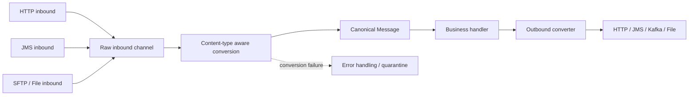
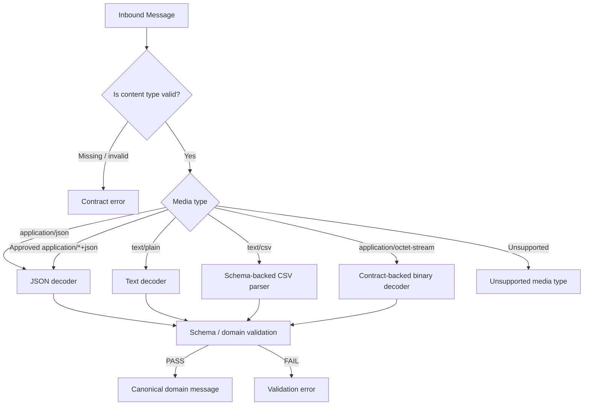

# Content-type-based message converter in Spring Integration

When integrating multiple systems, the same business event may arrive as **JSON over HTTP**, a **UTF-8 string from JMS**, **`byte[]` from Kafka**, a **CSV file via SFTP**, or a partner-specific format. Spring Integration connects systems via **inbound/outbound adapters**, **gateways**, **pollers**, **MessageChannel**, and message-processing endpoints. However, placing bytes onto a channel **does not automatically turn bytes into the right business object**.

A **content-type-based message converter** is the mechanism that selects how to **decode/represent a payload** based on its declared content type, usually as a MIME type such as `application/json`, `text/plain; charset=UTF-8`, or `application/octet-stream`. Instead of guessing the format from the first few characters of the payload, the integration flow uses a **message contract** that specifies transport, headers, content type, encoding, schema, and how unsupported formats are handled.

Within the **Spring Integration Adapters** module, this knowledge connects file, SFTP, HTTP, JMS, AMQP, Kafka, and database adapters to a unified message model. The goal is to decouple **transport protocol** from **business data type**, while preserving necessary headers, handling errors transparently, and operating safely across the connection lifecycle.

> **Core idea:** Content type is a signal of the **data contract**, not proof that the payload is valid, trusted, or schema-checked. Converters must be explicitly configured, choose the proper conversion direction, validate the format, and return observable errors; adapters do not implicitly convert all messages solely from this header.

## 1. Learning objectives

After this lesson, learners will be able to:

1. Distinguish **payload type**, **content type**, **transport encoding**, and **schema version**.
2. Explain the roles of `Message<?>`, `MessageHeaders.CONTENT_TYPE`, and `MessageConverter` in the Spring Messaging/Spring Integration ecosystem.
3. Design flows for **inbound → payload normalization → MessageChannel → business handler** and the reverse outbound flow.
4. Select appropriate converters for JSON, text, binary, or custom media types without relying on guesswork.
5. Understand the differences between **MessageConverter**, **Transformer**, and **per-adapter serializers/deserializers**.
6. Write Java examples using `@Transformer`, `ObjectMapper`, `MimeType`, and `MessageBuilder`.
7. Define policies when headers are missing, malformed, inconsistent with the payload, or carry an unsupported charset.
8. Preserve tracing information and avoid copying transport headers that should not cross trust boundaries.
9. Handle conversion errors in synchronous flows, pollers, and asynchronous consumers according to endpoint semantics.
10. Design contract tests, negative cases, payload limits, versioning, monitoring, and operations.

## 2. Problem statement: Multiple adapters, one business data model

Suppose a system receives `OrderCreated` events from three partners:

| Source | Transport/adapter | Boundary payload | Declared content type |
| --- | --- | --- | --- |
| Partner A | HTTP inbound gateway | JSON bytes or text | `application/json` |
| Partner B | JMS inbound adapter | TextMessage | `text/plain; charset=UTF-8` |
| Partner C | SFTP inbound file adapter | File content | `text/csv; charset=UTF-8` |

If each business handler manually inspects `byte[]` or `String` types and parses them itself, conversion logic gets duplicated, charsets drift easily, and contracts become hard to govern. A good design **normalizes at the integration boundary**:



This diagram is a **logical model**: real adapters may have dedicated channels before the normalization point for security checks and different policies. For instance, an inbound file adapter might produce a `File` payload rather than `byte[]`, and a JMS adapter might choose to convert from `TextMessage` before entering the channel. The inbound layer's job is to normalize them into a unified contract, without assuming every adapter produces `byte[]`.

### 2.1. Canonical event example

```json
{
  "eventId": "evt-1001",
  "orderId": "ord-42",
  "amountCents": 159900
}
```

The same event can be transmitted using different representations. The **canonical payload** inside the application can be a Java `OrderCreated` object, while the wire representation is determined by the sender/receiver and the content type.

## 3. What components make up a Spring Integration Message?

Spring Messaging provides the model:

```java
org.springframework.messaging.Message<T>
```

A message has two main parts:

- **Payload:** the data, which may be `byte[]`, `String`, `File`, a DTO, map, record, or specialized object.
- **Headers:** key/value metadata; including message identifier, timestamp, and business, transport, or content-type headers depending on the adapter.

Example of a message representing raw JSON data:

```java
Message<byte[]> message = MessageBuilder
    .withPayload("""
        {"eventId":"evt-1001","orderId":"ord-42","amountCents":159900}
        """.getBytes(StandardCharsets.UTF_8))
    .setHeader(MessageHeaders.CONTENT_TYPE, MimeTypeUtils.APPLICATION_JSON)
    .setHeader("correlationId", "order-flow-82")
    .setHeader("sourceSystem", "partner-a")
    .build();
```

Here `MessageHeaders.CONTENT_TYPE` is the standard Spring Messaging header name. **Do not confuse** the Spring header with the HTTP `Content-Type` header, a custom JMS property, or a Kafka record header: an adapter/gateway needs a mechanism to **map or set headers** properly.

### 3.1. Three concepts to keep separate

| Concept | Example | Meaning |
| --- | --- | --- |
| **Java payload type** | `byte[]`, `String`, `OrderCreated` | Type of the object moving inside the JVM. |
| **MIME/content type** | `application/json`, `text/plain` | Representation convention of the data, typically supplied by the sender or adapter. |
| **Schema/contract version** | `order-created/v2` | Field structure and business semantics of the data. |

A payload with Java type `String` **does not mean** `text/plain`: it could contain JSON. Conversely, an `application/json` header does not guarantee the payload has been deserialized into a DTO or is even valid JSON.

## 4. What is content type and how is it read?

A content type is typically a **MIME media type**, consisting of a primary type, subtype, and parameters:

```text
application/json
application/vnd.acme.order-created+json
text/plain; charset=UTF-8
text/csv; charset=UTF-8
application/octet-stream
```

Components to understand:

- **Type/subtype:** general format such as JSON, plain text, or binary data.
- **Structured suffix:** `+json` or `+xml` indicating the representation family of a vendor-specific media type.
- **Parameters:** charset and contract-significant parameters; not every parameter affects the converter.
- **Schema version:** usually requires an independent convention, such as a version field, version header, or governed media type name.

In Java/Spring, it can be represented with `org.springframework.util.MimeType` and parsed via `MimeTypeUtils.parseMimeType(...)`.

```java
MimeType type = MimeTypeUtils.parseMimeType(
    "text/plain; charset=UTF-8"
);

String major = type.getType();        // "text"
String minor = type.getSubtype();     // "plain"
Charset charset = type.getCharset();  // UTF-8
```

The `MessageHeaders.CONTENT_TYPE` header may hold a `MimeType` object or a string value depending on the source and adapter configuration. The converter must handle permitted types and parse errors safely, without calling `toString()` on arbitrary data and blindly trusting it.

### 4.1. A missing header does not imply text

If an inbound message lacks a content type, a system can:

1. **Reject** it with a contract error, appropriate for multi-format channels.
2. **Assign an endpoint default** where there is an explicit contract, e.g., a folder that only accepts CSV files.
3. **Use trusted adapter metadata** to infer the content kind per configuration.
4. **Quarantine** unidentified data for inspection through a separate workflow.

Never arbitrarily treat every payload lacking a content type as `text/plain` or `application/json` merely because "it happens to parse".

## 5. How does MessageConverter differ from Transformer?

These two concepts are related but **not identical**.

| Component | Role | When to use |
| --- | --- | --- |
| **MessageConverter** (Spring Messaging) | Converts between `Message<?>` and Java objects via `fromMessage`/`toMessage`. | When an endpoint/adapter or processing flow is configured to use a converter. |
| **Transformer** (Spring Integration) | Endpoint transforming payload or entire message within an integration flow. | Normalizing data post-inbound, sanitizing headers, converting types pre-outbound. |
| **Serializer/Deserializer** (Kafka, JMS/AMQP, or HTTP codec) | Wire representation according to the corresponding transport/framework mechanism. | At the broker/protocol boundary, usually configured independently. |
| **Content-Type Router** | Selects processing branch based on media type. | When multiple formats traverse one channel, each branch having its own converter/transformer. |
| **Object-to-JSON / JSON-to-object transformer** | Converts for a specific format. | When the contract is fixed as JSON and dynamic dispatch is unnecessary. |
| **Schema validator** | Checks structure/rules after parsing. | After decoding or in a validation flow prior to business processing. |

**Important note:** Setting `contentType=application/json` on a message **does not automatically make every Spring Integration channel invoke Jackson**. You must configure an appropriate converter on the endpoint/handler or use a transformer/router that explicitly invokes it.

### 5.1. Two directions of a converter

The `org.springframework.messaging.converter.MessageConverter` interface embodies the idea:

```java
Object fromMessage(Message<?> message, Class<?> targetClass);

Message<?> toMessage(Object payload, MessageHeaders headers);
```

- **Inbound conversion:** bytes/string/message → Java object.
- **Outbound conversion:** Java object → message with corresponding payload representation and headers.

A given converter may return `null` if it does not support the conversion per its API contract; the calling flow must handle that case rather than treating null as a valid business event.

### 5.2. How content-type aware is a converter?

Media type awareness depends on the converter implementation and configuration. For instance, a JSON converter might only support certain MIME types; a composite converter might try multiple delegates in sequence. Do not assume that merely registering two converters guarantees they will always pick the right one by `contentType` in every endpoint.

Your design should define **converter selection rules**, target types, and behavior when no matching converter is found. When using built-in libraries, check which media types are supported and how headers are inspected in your exact Spring version.

## 6. Designing the message contract before writing a converter

An inbound contract should thoroughly specify:

| Component | Content to specify |
| --- | --- |
| **Source** | Which partner/system sends it; trustworthiness level of metadata. |
| **Transport** | HTTP POST, JMS queue, Kafka topic, file/SFTP path, DB polling... |
| **Wire payload** | byte[], text, file/stream, encoding, compression. |
| **Content type** | Accepted media types and charsets. |
| **Schema** | Event type, schema version, required fields, and compatibility rules. |
| **Target Java type** | DTO/record or a governed canonical envelope. |
| **Headers** | Correlation, source, tenant, event ID, format version, and headers to preserve. |
| **Contract errors** | Reject, retry, or quarantine when MIME/JSON/schema is invalid. |
| **Limits** | Max size, JSON depth, timeouts, memory, charset checks. |
| **Security** | Source authentication; never trust tenant/role solely because it appears in the message. |

Example:

```yaml
contract: order-created-inbound
allowedContentTypes:
  - application/json
  - application/vnd.acme.order-created+json
  - text/plain; charset=UTF-8
targetType: OrderCreated
requiredHeaders:
  - sourceSystem
  - correlationId
validation:
  maxBytes: 1048576
  requireEventId: true
  requirePositiveAmount: true
onUnsupportedContentType: REJECT
onMalformedPayload: QUARANTINE
```

This is an **illustrative contract specification**, not a configuration that Spring Integration parses natively. Enforcing it requires corresponding code, endpoints, or transformation configuration.

## 7. Rules for selecting a converter by content type

A simple dispatcher can operate as follows:



### 7.1. Why avoid a "try parsing JSON" fallback?

When multiple formats exist, trying converters sequentially until one succeeds carries risks:

- Text without a content type that resembles JSON may be processed under the wrong contract.
- A higher-priority converter may interpret the payload differently from the sender.
- Malformed data may fall through to a fallback and **be wrongly accepted**.
- Format errors turn into business errors, complicating investigation.
- Malicious payloads could trigger an unintended parser.

Only use fallbacks when designed as a **bounded compatibility policy**, with metrics, never silently widening accepted formats.

### 7.2. Vendor-specific JSON

Media types like `application/vnd.acme.order-created+json` indicate the payload uses the JSON representation family, but **do not guarantee schema compatibility** with the current DTO. When using `+json`, check a **specific media-type allowlist or schema version** rather than blindly accepting any `application/*+json` from arbitrary sources.

## 8. Java example: Transformer selecting format by content type

The following example illustrates an **inbound transformer** receiving `Message<byte[]>` under two approved contracts:

- `application/json` containing a JSON event.
- `text/plain; charset=UTF-8` containing a line formatted as `ORDER|eventId|orderId|amountCents`.

To focus on conversion, the example assumes the preceding adapter already read the data into `byte[]` and attached the `MessageHeaders.CONTENT_TYPE` header. This is the contract of the **raw channel**, not a universal assumption across all adapters.

### 8.1. Canonical DTO

```java
public record OrderCreated(
    String eventId,
    String orderId,
    long amountCents
) {
    public OrderCreated {
        if (eventId == null || eventId.isBlank()
                || orderId == null || orderId.isBlank()
                || amountCents <= 0) {
            throw new IllegalArgumentException("Invalid OrderCreated fields");
        }
    }
}
```

The example uses a Java record and assumes Jackson record support (applicable to modern Jackson versions). In systems with different Jackson settings, test DTO deserialization and handling of unknown/missing fields per schema policy.

### 8.2. Transformer code

```java
import com.fasterxml.jackson.core.JsonProcessingException;
import com.fasterxml.jackson.databind.ObjectMapper;
import java.nio.ByteBuffer;
import java.nio.charset.CharacterCodingException;
import java.nio.charset.StandardCharsets;
import java.nio.charset.CodingErrorAction;
import java.util.Locale;
import org.springframework.integration.annotation.Transformer;
import org.springframework.messaging.Message;
import org.springframework.messaging.MessageHeaders;
import org.springframework.messaging.support.MessageBuilder;
import org.springframework.stereotype.Component;
import org.springframework.util.MimeType;
import org.springframework.util.MimeTypeUtils;

@Component
public class OrderContentTypeTransformer {

    private static final int MAX_WIRE_BYTES = 1_048_576;
    private final ObjectMapper objectMapper;

    public OrderContentTypeTransformer(ObjectMapper objectMapper) {
        this.objectMapper = objectMapper;
    }

    @Transformer(
        inputChannel = "rawOrdersChannel",
        outputChannel = "canonicalOrdersChannel"
    )
    public Message<OrderCreated> convert(Message<byte[]> input) {
        byte[] body = input.getPayload();

        if (body.length == 0 || body.length > MAX_WIRE_BYTES) {
            throw new IllegalArgumentException("Invalid payload length");
        }

        MimeType mediaType = readContentType(input.getHeaders());
        OrderCreated event;

        if (isJson(mediaType)) {
            try {
                event = objectMapper.readValue(body, OrderCreated.class);
            } catch (JsonProcessingException ex) {
                throw new IllegalArgumentException(
                    "Malformed JSON order event", ex
                );
            }
        } else if (isPlainText(mediaType)) {
            event = parsePipeDelimitedText(body, mediaType);
        } else {
            throw new IllegalArgumentException(
                "Unsupported content type: " + mediaType
            );
        }

        // Source headers from external systems must be controlled at the trust boundary.
        // Only retain metadata verified/allowed by preceding adapters.
        return MessageBuilder.withPayload(event)
            .setHeader("wireContentType", mediaType.toString())
            .setHeader(
                "correlationId",
                input.getHeaders().get("correlationId")
            )
            .setHeader(
                "sourceSystem",
                input.getHeaders().get("sourceSystem")
            )
            .build();
    }

    private static MimeType readContentType(MessageHeaders headers) {
        Object raw = headers.get(MessageHeaders.CONTENT_TYPE);
        if (raw instanceof MimeType mimeType) {
            return mimeType;
        }
        if (raw instanceof String text && !text.isBlank()) {
            return MimeTypeUtils.parseMimeType(text);
        }
        throw new IllegalArgumentException(
            "Missing or invalid contentType header"
        );
    }

    private static boolean isJson(MimeType type) {
        return type.getType().equalsIgnoreCase("application")
            && type.getSubtype().equalsIgnoreCase("json");
    }

    private static boolean isPlainText(MimeType type) {
        return type.getType().equalsIgnoreCase("text")
            && type.getSubtype().equalsIgnoreCase("plain");
    }

    private static OrderCreated parsePipeDelimitedText(
        byte[] body, MimeType mediaType
    ) {
        if (mediaType.getCharset() != null
                && !StandardCharsets.UTF_8.equals(mediaType.getCharset())) {
            throw new IllegalArgumentException("Only UTF-8 is supported");
        }

        final String text;
        try {
            text = StandardCharsets.UTF_8.newDecoder()
                .onMalformedInput(CodingErrorAction.REPORT)
                .onUnmappableCharacter(CodingErrorAction.REPORT)
                .decode(ByteBuffer.wrap(body))
                .toString();
        } catch (CharacterCodingException ex) {
            throw new IllegalArgumentException("Malformed UTF-8 text", ex);
        }

        // Simple lesson format, not a general-purpose CSV parser.
        String[] parts = text.strip().split("\\|", -1);
        if (parts.length != 4 || !parts[0].equals("ORDER")) {
            throw new IllegalArgumentException("Invalid text order format");
        }
        try {
            return new OrderCreated(
                parts[1], parts[2], Long.parseLong(parts[3])
            );
        } catch (NumberFormatException ex) {
            throw new IllegalArgumentException("Invalid amount", ex);
        }
    }
}
```

**Limitations of this example:**

- `sourceSystem` and `correlationId` must be validated/normalized at the inbound trust boundary; the code above only illustrates forwarding metadata onto the canonical message. Never accept a client-supplied `sourceSystem` as proof of identity.
- In production implementations, decide which headers are **required**, which should be stripped, and enforce policies on header size/type.
- The example intentionally accepts only the exact `application/json` subtype; vendor-specific `+json` types must be added to an **allowlist with an appropriate schema**.
- This text parser uses a simple delimiter and does not handle quoting or escaping like real CSV; for `text/csv`, use a dedicated CSV parser with a schema.
- `ObjectMapper` configuration, handling of unknown fields, JSON depth limits, and schema compatibility must be defined at the contract layer.
- `@Transformer` must be discovered within a Spring context configured with Spring Integration; channel and endpoint declarations depend on the application.

### 8.3. Why create a new Message?

After parsing, the payload is `OrderCreated` and **no longer JSON bytes**. Copying the original `contentType=application/json` header and letting downstream components assume it describes the **current payload** causes confusion: a Java object is not wire JSON data. This example stores `wireContentType` separately for source tracing and forwards only approved headers.

A system may choose to retain the content type header if downstream endpoints share an explicit convention, but you must clarify **whether it describes the current representation or the original representation**. Never allow one header to have two ambiguous meanings.

## 9. Configuring MessageChannel for the normalization flow

Example Spring Integration channel declarations:

```java
import org.springframework.context.annotation.Bean;
import org.springframework.context.annotation.Configuration;
import org.springframework.integration.channel.DirectChannel;
import org.springframework.messaging.MessageChannel;

@Configuration
public class OrderChannels {

    @Bean
    public MessageChannel rawOrdersChannel() {
        return new DirectChannel();
    }

    @Bean
    public MessageChannel canonicalOrdersChannel() {
        return new DirectChannel();
    }
}
```

`DirectChannel` dispatches handlers synchronously on the caller's thread. This affects **how conversion exceptions propagate**. Do not assume every exception will go to a global error channel: in synchronous flows, exceptions may propagate back to the caller/gateway.

A business handler receiving the normalized event:

```java
import org.springframework.integration.annotation.ServiceActivator;
import org.springframework.messaging.Message;
import org.springframework.stereotype.Component;

@Component
public class OrderBusinessHandler {

    @ServiceActivator(inputChannel = "canonicalOrdersChannel")
    public void handle(Message<OrderCreated> message) {
        OrderCreated event = message.getPayload();

        // Execute business logic with appropriate transaction/idempotency.
        // No need to read JSON or parse MIME here.
    }
}
```

Architectural significance: **the business handler does not need to know whether the event came from HTTP, JMS, or SFTP**. It receives a contract-validated domain type. Necessary metadata can still travel alongside the message via normalized headers.

## 10. Outbound conversion: From Java object to wire format

The outbound direction must select the **target content type** based on the consumer's contract, not merely the source object's type. If partner A requires JSON, the object can be serialized to UTF-8 JSON and carry an `application/json` header at the appropriate boundary.

```java
import com.fasterxml.jackson.core.JsonProcessingException;
import com.fasterxml.jackson.databind.ObjectMapper;
import org.springframework.integration.annotation.Transformer;
import org.springframework.messaging.Message;
import org.springframework.messaging.MessageHeaders;
import org.springframework.messaging.support.MessageBuilder;
import org.springframework.stereotype.Component;
import org.springframework.util.MimeTypeUtils;

@Component
public class OrderJsonOutboundTransformer {

    private final ObjectMapper objectMapper;

    public OrderJsonOutboundTransformer(ObjectMapper objectMapper) {
        this.objectMapper = objectMapper;
    }

    @Transformer(
        inputChannel = "outboundDomainOrdersChannel",
        outputChannel = "outboundWireOrdersChannel"
    )
    public Message<byte[]> encode(Message<OrderCreated> input) {
        try {
            byte[] json = objectMapper.writeValueAsBytes(input.getPayload());

            return MessageBuilder.withPayload(json)
                .setHeader(
                    MessageHeaders.CONTENT_TYPE,
                    MimeTypeUtils.APPLICATION_JSON
                )
                .setHeader(
                    "correlationId",
                    input.getHeaders().get("correlationId")
                )
                .build();
        } catch (JsonProcessingException ex) {
            throw new IllegalArgumentException(
                "Cannot serialize OrderCreated as JSON", ex
            );
        }
    }
}
```

**Notes:**

- Do not arbitrarily copy headers from inbound to outbound; they may contain metadata from the prior transport or information that must not be exposed to partners.
- When outbound is HTTP, the adapter/gateway must **map content type to the HTTP response/request header** per configuration; setting a header on an internal message does not guarantee every transport emits it automatically.
- When outbound is Kafka, the value serializer and Kafka headers must be configured appropriately; setting `contentType` on a Spring Message does not automatically turn the serializer into Jackson.
- When outbound is a file, the result may need converting `byte[]` to a File/Resource or stream and determining the name/path; content type does not replace a file writer.

## 11. Built-in MessageConverters in Spring Messaging

Several converters you may encounter in Spring applications:

| Component | Idea | What to check |
| --- | --- | --- |
| `StringMessageConverter` | Converts between text representations and `String`. | Charset, supported media types, target class. |
| `ByteArrayMessageConverter` | Handles `byte[]` as payload. | Does not mean it parses JSON or CSV automatically. |
| `MappingJackson2MessageConverter` | Uses Jackson for JSON ↔ object. | Supported media types, ObjectMapper, target class, schema. |
| `CompositeMessageConverter` | Combines a list of converters. | Delegate ordering and behavior when a converter does not support the message. |
| Application-specific converter | Handles bespoke formats. | Contract, validation, security, tests. |

The classes and package names above belong to **Spring Messaging**, whereas Spring Integration endpoints/adapters may use protocol-specific converters. Never plug a converter into one layer and expect every layer to use it automatically.

### 11.1. Why target Java type still matters

Knowing `application/json` alone does not tell you whether to map to `OrderCreated`, `CustomerUpdated`, or a list of DTOs. A converter may require a **targetClass** or routing by event type/schema prior to deserialization.

One way to manage this:

```text
Content-Type: application/json
Event-Type: order.created
Schema-Version: 2
Destination: orders.inbound

=> Select target DTO OrderCreatedV2 from allowlist.
=> Deserialize.
=> Validate.
=> Convert to canonical domain model.
```

Never read a class name from an external header and arbitrarily load that class for deserialization, as this creates security vulnerabilities and breaks contracts.

## 12. Handling content type by adapter type

### 12.1. HTTP inbound/outbound gateway

HTTP has the standard `Content-Type` header and optionally `Accept`. Meaning:

- `Content-Type`: representation of the actual **request/response body**.
- `Accept`: response representations the client is willing to receive, not the format of the request body.
- `415 Unsupported Media Type`: typically appropriate when the server does not support the request format.
- `400 Bad Request`: typically used for syntactically invalid or contract-failing payloads.
- `406 Not Acceptable`: can be used when a response matching `Accept` cannot be provided.

In Spring Integration HTTP, gateways/adapters may perform body/header conversion at the HTTP layer itself. Check **which converter is actually configured** and when it runs relative to integration transformers; if the HTTP layer already deserialized JSON into an object, do not force a `byte[]` transformer to parse it a second time.

### 12.2. JMS

JMS has message types such as `TextMessage` and `BytesMessage`, along with JMS properties and headers. Do not assume JMS clients provide a standard content-type like HTTP does.

You can define a dedicated message property such as `contentType=application/json` or configure a JMS message converter per contract. Clarify:

- Which JMS message type is being produced?
- Which property stores content type information?
- Does the JMS-to-Spring-Message mapping preserve that property?
- Could a sender switch from `TextMessage` to `BytesMessage` without updating the converter?
- How do conversion errors affect transactions/acknowledgements and redelivery?

### 12.3. AMQP/RabbitMQ

AMQP message properties can carry content type and content encoding; Spring AMQP also provides its own message converters. Distinguish the **AMQP wire message converter** from the flow's **Spring Messaging MessageConverter**.

If the listener already converted JSON into a POJO, downstream may only need validation and normalization. If the listener retains `byte[]`, Spring Integration can route it. Clearly designate a single owner responsible for decoding.

### 12.4. Kafka

A Kafka record contains key, value, and record-level headers; the **serializer/deserializer** configured on the producer/consumer determines the value type inside the client.

For example:

- `ByteArrayDeserializer` yields `byte[]`; a content-type converter can process it afterward.
- `StringDeserializer` yields `String`; if the payload is JSON, it remains a JSON string until deserialized.
- Dedicated JSON serializers/deserializers can produce objects right at the Kafka layer.
- A custom `contentType` header can help select processing **if** consumer logic reads and validates it.

A `contentType=application/json` header **does not make the Kafka client change its value deserializer**. Additionally, Spring Kafka may use converter-specific type metadata headers; do not treat them as a reliable schema contract across arbitrary producers.

### 12.5. File and SFTP

An inbound file adapter typically involves a `File` payload or file/remote-file metadata. A filename like `orders.csv` is only a **format hint**, not trustworthy MIME proof.

Good design:

1. Specify the folder/remote path and source partner.
2. Define the format in the **partner contract** or route mapping.
3. Read the file in a controlled way into `byte[]`/stream if needed.
4. Enforce size limits and avoid loading huge files into heap.
5. Attach content type per a verified contract rather than trusting the file extension blindly.
6. Convert, validate, and send to the canonical channel.
7. Manage rename/archive/quarantine and avoid re-reading failed files infinitely.

SFTP transfers files; it does not guarantee file contents are JSON, CSV, or XML. MIME dispatch remains the integration layer's responsibility.

### 12.6. JDBC/database adapter

JDBC inbound adapters or polling can produce row maps, lists, or objects mapped by a row mapper. The concept of content type is usually **less direct** than in HTTP because data is already in typed columns.

A MIME-based converter is only needed when a column stores a blob/text with multiple formats, or when transforming a row into a wire message for a target system. In that case, a contract must specify which column carries `payload`, which carries `content_type`, and the schema/version.

## 13. Inbound adapter, outbound adapter, and gateway: Where does the converter go?

| Integration pattern | Data direction | Typically appropriate conversion point |
| --- | --- | --- |
| **Inbound channel adapter** | External → MessageChannel | At the adapter if it supports a converter, or in a transformer right after inbound. |
| **Outbound channel adapter** | MessageChannel → External | A transformer encodes before the adapter, or a converter configured on the outbound adapter. |
| **Inbound gateway** | External request → flow → external response | Must consider both request decoder and response encoder. |
| **Outbound gateway** | Flow → external request/response → flow | Encode request and decode response per each direction's contract. |
| **Poller** | Periodically fetches data from file/DB/queue | Normalize after poll, define retries, and handle failed records. |
| **MessageChannel** | Passes Message between endpoints | Does not natively interpret MIME or parse bodies without a configured processing endpoint. |

### 13.1. Why are gateways more complex than one-way adapters?

Gateways perform **two-way conversion**. For example, an outbound HTTP gateway sends JSON and receives an XML error. If only a JSON decoder is configured for responses, the system may throw a parse error instead of preserving the actual HTTP status and error message. The contract should separately define:

- Request content type and encoder.
- Expected response content types, status handling, and decoder.
- Error body format and size limits.
- Timeout, correlation, retry, and idempotency of the external call.

## 14. Content type and charset

For `text/plain` and `text/csv`, charset is essential. If the sender uses UTF-8 while the receiver uses the JVM or OS default encoding, Vietnamese characters can become corrupted.

Wrong example:

```java
// Do not rely on the default charset.
String text = new String(body);
```

Intentional example:

```java
String text = new String(body, StandardCharsets.UTF_8);
```

The second approach specifies UTF-8, yet constructing a `String` can still replace invalid bytes with replacement characters in some cases. When malformed input must be rejected, use `CharsetDecoder` with `CodingErrorAction.REPORT` as shown in the transformer example.

### 14.1. Charset selection rules

- If the contract mandates fixed UTF-8, reject any other declared charset.
- If the contract supports multiple charsets, use an allowlist and parse parameters properly.
- If charset is absent, use a default **explicitly documented in the contract**, never environment defaults.
- Test BOM, multi-byte characters, line endings, empty content, and invalid byte sequences.
- Do not conflate content type with `Content-Encoding: gzip`: compression is a distinct representation layer that must be handled before/after in the right order.

### 14.2. Binary content

`application/octet-stream` does not mean a payload can be mapped directly to a domain object. You need a known binary schema (e.g., Protobuf/Avro with a schema registry or explicit contract), version, and how to resolve schema IDs. Avoid using untrusted external Java serialization as an arbitrary parsing path.

## 15. Header mapping and trust boundaries

Message headers can carry information useful for processing and tracing, but not every header should traverse the entire flow.

### 15.1. Commonly useful headers

- `correlationId` / `traceId`: links requests and events.
- `sourceSystem`: sending system verified at the adapter.
- `eventType` / `schemaVersion`: selects DTO or validates contract.
- `contentType` / `wireContentType`: wire representation of the message.
- `tenantId`: only if verified by an authoritative source and bound to source permissions.
- `originalFilename`: metadata for file tracing; must be filtered/sanitized.
- `receivedAt`: timestamp when the system received the message.

### 15.2. Untrusted headers

Never implicitly trust self-asserted headers from clients/producers such as:

```text
role=ADMIN
tenantId=TENANT-A
deviceTrusted=true
validated=true
internalSource=true
```

A converter is responsible for **understanding payload format**, not authenticating claims about role/tenant merely because they appear in the message. Verify transport identity, producer credentials, tenancy, and policies at the boundary before using such metadata.

### 15.3. Do not unconditionally copy all headers

A header may only pertain to inbound JMS, HTTP, or Kafka and should not be emitted externally. When forwarding a message to another system, determine:

1. Which headers are needed for downstream processing.
2. Which headers have been validated/normalized.
3. Which headers belong to the old transport or hold sensitive data.
4. Whether there is any conflict between the original `contentType` and the post-transform payload.
5. Which headers must be regenerated by the outbound adapter.

Copying `MessageHeaders` wholesale can cause confusion or leak metadata across trust boundaries.

## 16. Schema version and content type are not the same

Two events that are both JSON can still have different schemas:

```json
{
  "eventId": "evt-1001",
  "orderId": "ord-42",
  "amountCents": 159900
}
```

A new version might introduce:

```json
{
  "eventId": "evt-1001",
  "orderId": "ord-42",
  "amount": {
    "value": "1599.00",
    "currency": "VND"
  }
}
```

Both can carry `Content-Type: application/json`. A JSON converter only addresses **representation syntax**; the application still needs to decide which schema is valid.

### 16.1. Ways to manage versions

- Designated `schemaVersion` or `eventType` headers.
- A `version` field in the message envelope.
- Vendor-specific media types, such as `application/vnd.acme.order.v2+json`, governed by an allowlist.
- Schema registry/ID with supported formats.

Avoid using an unverified version string to dynamically load classes/serializers. The mapping **event type + version → parser/schema** should be explicit, allowlisted, and compatibility-tested.

### 16.2. Forward and backward compatibility

A flow may need to accept v1/v2 payloads during a migration window. Specify:

1. Which producers and consumers use which version.
2. Which fields are required and which have valid defaults.
3. When a version will be retired.
4. Whether unknown fields are ignored or must fail per contract.
5. How to monitor legacy version usage and block unauthorized downgrades.

**Valid content type does not mean valid schema**, and a valid schema does not prove business data is valid.

## 17. Error handling: Classify errors before retrying

Conversion failures have many causes, and not all of them benefit from retries.

| Error | Example | Typical appropriate action |
| --- | --- | --- |
| **Missing content type** | Producer omitted header. | Reject or apply endpoint-approved default. |
| **Unsupported content type** | `application/x-java-serialized-object` outside allowlist. | Reject/quarantine; never attempt arbitrary deserialization. |
| **Malformed MIME** | Syntactically invalid MIME string. | Contract error; alert producer. |
| **Malformed charset** | Bytes invalid under UTF-8. | Reject/quarantine; never silently substitute characters. |
| **Malformed JSON/CSV** | Broken structure, quotes, or delimiters. | Data error; do not retry infinitely. |
| **Schema validation failed** | Missing `eventId` or negative amount. | Report business/schema error. |
| **Temporary downstream error** | DB/HTTP target timeout. | Can retry with backoff and idempotency. |
| **Converter infrastructure error** | Schema registry temporarily unavailable. | Bounded retry and appropriate circuit breaker. |
| **Payload too large** | Data exceeds size limit. | Reject or route to a designed streaming mechanism. |

### 17.1. Where exceptions go depends on flow type

- **DirectChannel / sync gateway:** exceptions from the transformer can propagate back to the caller thread and be turned into error responses by the gateway/controller.
- **Poller / async consumer:** errors can be routed through error handling/error channels when configured or supported by the endpoint.
- **Kafka/JMS/AMQP consumer:** retries, ack/commit, DLQ/DLT, and transactions belong to the respective adapter/listener mechanism; verify actual behavior before considering errors safely handled.

Never assume simply declaring a global `errorChannel` causes every error in every direct call to appear there automatically.

### 17.2. Poison messages and quarantine

A message that can never parse can cause a consumer to receive it repeatedly if retried endlessly. Solutions include:

1. Classifying errors **unrecoverable by retry**.
2. Logging redacted metadata: source, event ID, content type, reason code, correlation.
3. Routing payloads to a safe quarantine/DLQ per retention policy.
4. Providing a workflow to inspect, fix, and approve replays.
5. Preventing duplicate processing during replay.

Never dump full sensitive payloads or secrets into logs just to make diagnosis easier.

## 18. Testing converters against contracts

Test the converter as a unit with clear input/output, then test the real adapter to ensure headers are neither lost nor altered in transit.

### 18.1. Minimum test matrix

| Case | Input | Expected result |
| --- | --- | --- |
| Valid JSON | `application/json`, valid schema | `OrderCreated` with accurate values. |
| Valid text | `text/plain; charset=UTF-8`, valid contract | `OrderCreated` with accurate values. |
| Unsupported vendor JSON | `application/vnd.other+json` | Rejected per policy. |
| Missing MIME | No `contentType` | Contract error or explicit endpoint default. |
| Malformed MIME | Unparseable header | Error with reason code, no infinite retries. |
| Conflicting MIME | Declares JSON but sends plain text | Decode error, no silent fallback. |
| Invalid UTF-8 | Text with invalid bytes | Rejected under strict decoder. |
| Missing field | JSON missing eventId | Validation failure. |
| Invalid value | `amountCents <= 0` | Validation failure. |
| Oversized payload | Exceeds limit | Rejected before parsing. |
| Required headers | Valid correlation/source | Preserved on canonical message. |
| Dangerous headers | Client-asserted `role=ADMIN` | Grants no privileges and is not passed as trusted data. |
| Adapter not returning byte[] | File object/String payload | Normalized before converter. |
| JSON outbound | DTO → byte[] | Parseable payload and matching content type. |

### 18.2. Illustrative unit test

```java
import static org.junit.jupiter.api.Assertions.*;

import com.fasterxml.jackson.databind.ObjectMapper;
import java.nio.charset.StandardCharsets;
import org.junit.jupiter.api.Test;
import org.springframework.messaging.Message;
import org.springframework.messaging.MessageHeaders;
import org.springframework.messaging.support.MessageBuilder;
import org.springframework.util.MimeTypeUtils;

class OrderContentTypeTransformerTest {

    private final OrderContentTypeTransformer transformer =
        new OrderContentTypeTransformer(new ObjectMapper());

    @Test
    void convertsJsonByContentType() {
        byte[] body = """
            {"eventId":"evt-1","orderId":"ord-7","amountCents":1200}
            """.getBytes(StandardCharsets.UTF_8);

        Message<byte[]> message = MessageBuilder.withPayload(body)
            .setHeader(MessageHeaders.CONTENT_TYPE, MimeTypeUtils.APPLICATION_JSON)
            .setHeader("correlationId", "trace-1")
            .setHeader("sourceSystem", "test-producer")
            .build();

        OrderCreated result = transformer.convert(message).getPayload();

        assertEquals("evt-1", result.eventId());
        assertEquals("ord-7", result.orderId());
        assertEquals(1200L, result.amountCents());
    }

    @Test
    void rejectsUnsupportedMediaType() {
        Message<byte[]> message = MessageBuilder
            .withPayload(new byte[] {1, 2, 3})
            .setHeader(
                MessageHeaders.CONTENT_TYPE,
                MimeTypeUtils.APPLICATION_OCTET_STREAM
            )
            .build();

        assertThrows(
            IllegalArgumentException.class,
            () -> transformer.convert(message)
        );
    }
}
```

This JUnit 5 example illustrates the converter logic; no build/test run was performed while authoring this lesson. In real applications, add tests for invalid charsets, string content types, JSON with missing fields, size limits, wrong sources, error channels, and integration tests per adapter.

### 18.3. End-to-End testing

An E2E test should exercise the real path:

```text
HTTP/JMS/Kafka/SFTP producer
   -> adapter/gateway
   -> raw channel + headers
   -> converter/transformer
   -> canonical channel
   -> handler
   -> outbound serialization
   -> target
```

Also test rejected messages: ack/commit, retry/DLQ, file state on error, correlation, and whether invalid payloads are accidentally reprocessed.

## 19. Performance, memory, and backpressure

Content-type conversion can become a bottleneck under high throughput or large payloads.

### 19.1. Sources of overhead

- Parsing JSON/XML/CSV consumes CPU, allocations, and object creation.
- Converting `byte[]` → `String` → DTO twice increases copies and GC pressure.
- Loading entire large files onto the heap causes memory spikes.
- A synchronous channel can slow producers down to parsing speed.
- Pollers reading faster than handlers can process grow backlogs.
- External schema lookups can add latency or fail.

### 19.2. Design mitigations

- Enforce **max payload bytes** and parser limits (depth, string length, element count).
- Prefer parsing directly from `byte[]`/`InputStream` when the parser supports it.
- Use streaming for large files under an appropriate contract.
- Tune concurrency, queue capacity, and poller batch size based on downstream capacity.
- Separate heavy flows from low-latency flows; manage ordering where needed.
- Never cache schema/format metadata indefinitely when contracts are versioned.
- Track latency and errors by content type/producer instead of only aggregate totals.

**Note:** Switching to `QueueChannel` or an executor does not solve load spikes on its own; you must design backpressure, retries, and message durability if the system stops.

## 20. Data security during deserialization

Parsers operate on data supplied by external systems, making conversion a **trust boundary for untrusted data**.

### 20.1. Risks to control

- **Insecure deserialization:** loading arbitrary classes from input data or enabling overly broad polymorphic types.
- **XML External Entities (XXE):** insecurely configured XML parsers may read external resources in some environments.
- **Resource exhaustion:** oversized payloads, deeply nested JSON, huge strings, or compressed files expanding massively.
- **Charset confusion:** differing text interpretations causing validation bypasses or data corruption.
- **Header spoofing:** producers sending `sourceSystem=trusted`, `tenant=admin`, or roles.
- **Schema confusion:** identical media types with different field meanings across partners.
- **Logging secrets:** writing sensitive bodies/headers to logs upon parse failures.

### 20.2. Preventive measures

1. Use media-type allowlists and fixed, governed target DTOs.
2. Never enable Jackson default typing arbitrarily on external data.
3. Configure parser and size limits before deserialization.
4. For XML, use parsers configured against external entities and dangerous features.
5. Authenticate producers at the transport layer; separate verified claims from self-asserted metadata.
6. Validate schema and business rules after parsing.
7. Protect quarantine stores, retention limits, and log access.
8. Tailor retries by error type; do not let poison messages starve consumers.

## 21. Observability, auditing, and conversion tracing

Every critical conversion should emit metadata answering:

- Which adapter and producer did the message arrive from?
- What content type was declared and how was it normalized?
- Which target DTO/schema was selected?
- Did conversion succeed, reject due to MIME, or fail schema validation?
- What were the payload size and parse latency?
- What are the correlation ID, event ID, trace ID, and receipt timestamp?
- Was the message retried/quarantined, and who owns handling it?

### 21.1. Safe logging example

```json
{
  "event": "CONTENT_TYPE_CONVERSION",
  "correlationId": "order-flow-82",
  "sourceSystem": "partner-a",
  "adapter": "http-inbound",
  "declaredContentType": "application/json",
  "targetType": "OrderCreated",
  "schemaVersion": "v1",
  "payloadBytes": 74,
  "decision": "REJECTED",
  "reasonCode": "MALFORMED_JSON",
  "durationMs": 3
}
```

Numbers are illustrative only, not measured results. Do not log full payloads, tokens, or unredacted error bodies. Traces and logs should link to external requests/records without leaking sensitive metadata.

### 21.2. Operational metrics

| Metric | Meaning |
| --- | --- |
| `conversion_success_total{contentType,source}` | Count of successfully parsed messages by source and media type. |
| `conversion_failure_total{reason,source}` | Separates unsupported MIME, malformed payload, schema failure, infrastructure error. |
| `conversion_duration_seconds` | Tracks parse latency, percentiles, and spikes. |
| `inbound_payload_bytes` | Observes size distribution and limit breaches. |
| `quarantine_pending_messages` | Number of messages awaiting manual handling or replay. |
| `retry_attempts_total` | Detects retry storms and poison messages. |
| `message_contract_version_usage` | Tracks older versions prior to deprecation. |
| `header_mapping_error_total` | Detects dropped/miswritten headers across adapters. |

Avoid putting unbounded IDs like payload/subject IDs as metric labels, as this explodes cardinality. Use correlation IDs in logs/traces instead of metric labels.

## 22. Changing content types and contract migration

Sometimes a producer moves from CSV to JSON or from JSON v1 to v2. Never swap the parser in production without governing compatibility.

A rollout plan may include:

1. Publish the new media type/version and valid payload examples.
2. Have consumers support old and new formats concurrently during an approved transition window.
3. Test header mapping through real adapters, not just Jackson unit tests.
4. Add validators and business checks for the new format.
5. Monitor usage of the legacy format per producer.
6. Announce the deprecation deadline for the legacy format.
7. Reject the legacy format per policy with actionable error messages.
8. Audit replay/DLQ: older messages may resurface after the old converter is removed.

### 22.1. Versioned content types

Example:

```text
application/vnd.acme.order-created.v1+json
application/vnd.acme.order-created.v2+json
```

If two versions are accepted, map them explicitly:

```text
v1 -> OrderCreatedV1 -> canonical OrderCreated
v2 -> OrderCreatedV2 -> canonical OrderCreated
other -> UNSUPPORTED_MEDIA_TYPE
```

Version differences are **not necessarily just adding fields**. Changing currency units, precision, timezone, or event semantics must be handled as a semantic change rather than relying solely on a JSON parser.

## 23. Common anti-patterns

| Anti-pattern | Consequence | Solution |
| --- | --- | --- |
| Seeing `contentType=application/json` and assuming payload is already a DTO | ClassCastException or double deserialization. | Inspect actual Java payload type and converter placement. |
| Falling back to String on every error | Bad payloads are wrongly accepted and contract violations are hidden. | Reject/quarantine by MIME and schema. |
| Relying on `.json`/`.csv` extensions as sole proof | Files can hold different contents. | Partner contract, payload validation, restricted sources. |
| Reading every SFTP file onto the heap | OutOfMemoryError on large files. | Size limits, streaming, and backpressure. |
| Ignoring charset | Corrupted Vietnamese text and wrong business data. | Specify charset in contract, strict UTF-8/allowlist. |
| Copying all headers from inbound to outbound | Metadata leaks or wrong transport headers. | Allowlists and header remapping at trust boundaries. |
| Trusting `tenantId` or `role` from message | Cross-tenant/privilege escalation. | Authenticate source and authorize independently of converter. |
| Selecting Java class from client-supplied header | Insecure deserialization. | Fixed target type mapping and allowlist. |
| Enabling unrestricted Jackson polymorphic typing | Expands deserialization attack surface. | Safe ObjectMapper config, concrete DTOs. |
| Using `contentType` instead of schema version | Valid JSON with wrong semantics. | Explicit schema/version contract. |
| Infinitely retrying malformed JSON | Poison messages stall consumers. | Classify permanent failures and DLQ. |
| Assuming global errorChannel catches all sync errors | Errors are not handled as expected. | Test per endpoint and transport semantics. |
| Treating Kafka headers as replacing serializers | Consumer receives wrong payload type. | Configure serializer/deserializer independently. |
| Keeping wire MIME after converting payload to an object | Downstream re-parses object or encodes wrongly. | Store `wireContentType` and define current contentType. |
| Skipping tests with real adapters | Unit tests pass while headers vanish over transport. | E2E tests, negative cases, and observability. |

## 24. Practical scenarios

### Scenario A – Kafka JSON has header yet consumer receives byte[]

A producer writes Kafka values as JSON `byte[]` and sets header `contentType=application/json`. The consumer uses `ByteArrayDeserializer`, so the handler receives `byte[]`; a developer expected Kafka to automatically map it to `OrderCreated`.

**Question:** Where is the misconception? What needs to be added?

**Hint:** The Kafka deserializer dictates the value type. Headers are just metadata; use a contract-appropriate deserializer or apply a transformer/converter post-inbound, then validate the schema. Check header mapping from Kafka to Spring Message.

### Scenario B – HTTP content type is ignored

An HTTP gateway receives a JSON body without `Content-Type`. A handler uses `new String(body)`, searches for `{`, and parses JSON. Callers can send arbitrary text, causing the system to attempt the wrong parser.

**Question:** How should this change?

**Hint:** Enforce a MIME/contract allowlist at the gateway; missing headers must be rejected or use an endpoint-defined default. Never sniff arbitrarily; distinguish 415 vs 400 per case.

### Scenario C – Large SFTP file with CSV extension

A 4 GB `orders.csv` file is downloaded from SFTP, and the converter runs `Files.readAllBytes` before parsing.

**Question:** What are the risks and reasonable approaches?

**Hint:** Memory spikes, GC pressure, OOM, and expensive file retries. Enforce size contracts, streaming/batch parsers, file lifecycle management, checkpoints/idempotency, and quarantine on schema errors.

### Scenario D – Lost charset and corrupted Vietnamese text

A JMS producer sends UTF-8 text containing the name `"Đặng"`; the consumer uses the environment's default charset and stores garbled characters.

**Question:** Which layer is at fault? How to verify?

**Hint:** Encoding/charset contract and decoding process. Specify UTF-8 explicitly, choose an appropriate parser, test Unicode and invalid bytes; never depend on the JVM default charset.

### Scenario E – Valid JSON but different schema

A producer sends `application/json` with `amount` in VND units; consumer v1 expects `amountCents`. Jackson partially succeeds in parsing, yet total amounts are wrong.

**Question:** Why is MIME validation insufficient?

**Hint:** Content type only identifies representation. Require schema versioning, DTOs, and validation; never assign risky defaults to missing fields and treat the payload as valid.

### Scenario F – Converter error and infinite retry

A message with `text/csv` missing a column always fails parsing. The JMS consumer rolls back and redelivers continuously, stalling the queue.

**Question:** What should the error handling policy be?

**Hint:** Classify schema/format failures as non-retryable, bound retries, route to a protected DLQ/quarantine, manage ack/transaction per adapter, and support controlled replay.

### Scenario G – Outbound retains wrong header

After parsing a JSON message into `OrderCreated`, a service copies all headers, including `Content-Type: application/json`, onto the Java object message. A downstream handler assumes the payload is still JSON `byte[]` and fails casting.

**Question:** How should the message boundary be designed?

**Hint:** Distinguish the original wire content type from the current payload type. Forward only required headers, optionally retain a separate `wireContentType`, and set the new content type upon outbound encoding.

### Scenario H – Privileges asserted in metadata

A client sends a valid payload alongside headers `role=ADMIN`, `tenantId=TENANT-B`. The converter forwards all headers down to the domain handler, which uses them to select a database.

**Question:** Where is the vulnerability?

**Hint:** Client-asserted headers are untrusted. Authenticate the producer, map tenancy from an authoritative source, enforce authorization independently; converters must never elevate metadata into privileges.

## 25. Checklist for implementing a content-type message converter

- [ ] Clearly identified inbound/outbound adapters, Java payload types, and conversion locations.
- [ ] Defined contracts for media types, charsets, schema/version, target DTOs, headers, and errors.
- [ ] Spring `contentType` header mapped accurately from transport when needed.
- [ ] Not assuming MessageChannel parses JSON automatically or Kafka headers select deserializers.
- [ ] Converter enforces a media-type allowlist; vendor `+json` types are explicitly governed.
- [ ] Missing/invalid MIME handled by policy with no silent fallbacks.
- [ ] Payloads size-limited before parsing; parsers enforce resource bounds.
- [ ] Charsets fixed and tested with Unicode and invalid byte sequences.
- [ ] DTO/schema validated post-parse; business rules also checked.
- [ ] Original content type and current payload type are never conflated.
- [ ] Inbound/outbound never copy transport headers or untrusted metadata unconditionally.
- [ ] Permissions/tenant/context verified at trust boundaries, never trusted from self-asserted headers.
- [ ] Error handling separates permanent from transient failures with proper retry/DLQ.
- [ ] Verified exception behavior across synchronous flows and async consumers/pollers.
- [ ] Correlation IDs, reason codes, metrics, safe logging, and quarantine owners are in place.
- [ ] Unit tests cover JSON/text/unsupported MIME/charset/schema and oversized payloads.
- [ ] Integration tests cover real HTTP, JMS, AMQP, Kafka, SFTP, or DB adapters in scope.
- [ ] Schema migration strategy, backward compatibility, and replay handling for old messages are defined.
- [ ] Deduplication/idempotency mechanisms cover retries and redeliveries.
- [ ] Ownership of converter mapping and connection lifecycle is established.

## 26. Remember

**A content-type-based message converter** enables Spring Integration to select how to transform messages based on their **declared data representation**, rather than coupling to whichever adapter received them. To operate reliably, distinguish **MIME/content type**, **Java payload type**, **schema/version**, and **per-transport serialization**.

In practice, inbound/outbound adapters, gateways, pollers, and `MessageChannel` establish the **message transport path**; converters/transformers establish the **canonical payload contract**; validation and security ensure valid data; and error handling and auditing control malformed or unsupported messages. HTTP, JMS, AMQP, Kafka, file/SFTP, and databases differ in how they map headers and encodings, so always test right at the boundaries.

The single most important design question is: **"Who set this content type, what Java type is the payload currently in, which converter will process it, which schemas are accepted, and when data mismatches, how will the message be rejected, retried, or quarantined?"**
