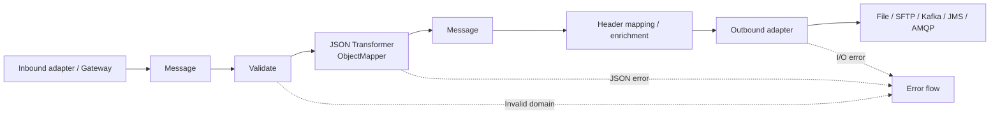
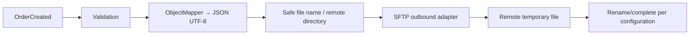
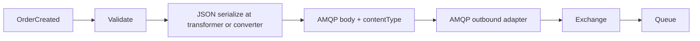

# JSON converter and ObjectMapper

## 1. Problem statement: One Java DTO, many external systems

An order-processing application has a Java `OrderCreated` object. After validation and business checks, the application needs to send data to other systems:

- Export a JSON file for reconciliation to pick up via a local directory or SFTP.
- Call a partner HTTP API with an `application/json` body.
- Publish an event to Kafka, JMS, or RabbitMQ for another service to process.
- Receive JSON from HTTP, a broker, or a file and map it back to a Java object.
- Write normalized information into a database and track delivery status.

If you arbitrarily use `toString()`, manually concatenate strings, or let each adapter guess the conversion, consumers may receive schema-invalid data: changed field names, timestamps without timezones, imprecise monetary amounts, or double-encoded JSON.

In the **Data Transformation** chapter, **JSON converter and ObjectMapper** is the topic that controls the boundary between **Java objects**, **JSON**, and **protocol messages**. This lesson belongs to the `SPRING_INTEGRATION_ADAPTERS` module: connecting external systems with inbound/outbound adapters, gateways, pollers, and `MessageChannel`; working with files, SFTP, HTTP, JMS, AMQP, Kafka, databases, message contracts, error handling, and connection lifecycles.

**Principle:** `ObjectMapper` handles converting between the Java model and JSON; the transformer/codec organizes payload conversion within the Spring Integration flow; and the message converter, serializer, or outbound adapter handles placing the converted data into a specific protocol. These layers are related, but they are **not the same thing**.

## 2. Foundational concepts

| Concept | Responsibility | Example |
| --- | --- | --- |
| **JSON** | Text-based data exchange format structured as object, array, string, number, boolean, null | `{"order_id":"O-1"}` |
| **DTO / domain object** | Internal Java model or application data contract | `OrderCreated`, `OrderRecord` |
| **Jackson ObjectMapper** | Serializes Java → JSON and deserializes JSON → Java | `writeValueAsBytes`, `readValue` |
| **ObjectReader / ObjectWriter** | Immutable configuration for specific JSON read/write operations | Reader dedicated to `OrderCreated.class` |
| **Spring Integration Transformer** | Transforms payload/message inside an integration flow | `Message<OrderCreated>` → `Message<byte[]>` |
| **MessageConverter** | Converts object/message into a protocol/framework-required representation | HTTP converter, JMS converter, AMQP converter |
| **Serializer / Deserializer** | Converts key/value to bytes and back within a specific mechanism | Kafka value serializer |
| **MessageChannel** | Transports messages between endpoints in a flow | `DirectChannel`, `QueueChannel` |
| **Outbound adapter** | One-way send/write to an external system | Write file, publish message |
| **Outbound gateway** | Performs request–reply interaction with an external system | HTTP outbound gateway |
| **Header** | Metadata accompanying the payload: correlation, content type, routing, file name | `contentType`, `eventId` |
| **Schema contract** | How producer and consumer agree on data structure and semantics | Required fields, version, and time format |

**Serialization** is converting an object into an exchangeable/storable representation; **deserialization** is reading that representation back into an object. Serializing to JSON does not mean the message reached the target system, nor does it mean the consumer finished processing it.

### Commonly confused pairs

- **ObjectMapper vs MessageConverter:** ObjectMapper understands Java types and JSON; a converter ties conversion to protocol, metadata, and transport mechanics.
- **Transformer vs outbound adapter:** a transformer produces the right payload; an adapter performs I/O.
- **JSON String vs byte[]:** one is a Java character string, the other is bytes in a charset. Protocols take bytes, though where the charset is chosen can vary.
- **Valid JSON vs valid contract:** `{"amount":"100"}` can be valid JSON yet invalid if the schema requires a number.
- **Successful send response vs successful business processing:** a broker accepting a message does not prove downstream processed it.

## 3. Message and transformation placement in IntegrationFlow

A Spring Integration message has two parts: **payload** and **headers**.

```text
Message<T>
├── payload: T
└── headers:
    ├── id, timestamp
    ├── contentType
    ├── correlationId / trace metadata
    └── protocol-specific metadata (per adapter)
```

Example outbound flow:



Another branch may keep the DTO and let HTTP's message converter serialize it:

```text
Message<OrderCreated> → HTTP outbound gateway + JSON HttpMessageConverter
                                                → HTTP request body
```

Both approaches can be right. **What is dangerous is manually serializing to JSON while also letting the converter serialize the JSON string again as a JSON string.**

### Inbound conversion in the reverse direction

```text
File / HTTP / Broker inbound
    → Message<byte[] | String>
    → JSON parsing (ObjectMapper)
    → Message<OrderCreated>
    → business validation
    → service / router / downstream channel
```

Do not trust a JSON body merely because it parses. Deserialization and **validation** are two separate steps.

## 4. What does Jackson ObjectMapper do?

Jackson is the library commonly used to map Java ↔ JSON in Spring applications. `ObjectMapper` determines JSON structure based on classes, annotations, naming strategies, modules, and read/write settings.

Illustrative APIs (the imports below follow **Jackson 2**, common with Spring Boot 3; when using Jackson 3/newer Spring Boot, verify the packages and APIs for your project's version):

```java
import com.fasterxml.jackson.databind.ObjectMapper;

ObjectMapper mapper = /* ObjectMapper already configured */;

// Java object -> JSON string
String json = mapper.writeValueAsString(order);

// Java object -> UTF-8 JSON bytes
byte[] bytes = mapper.writeValueAsBytes(order);

// JSON string -> Java object
OrderCreated fromString =
    mapper.readValue(json, OrderCreated.class);

// JSON bytes -> Java object
OrderCreated fromBytes =
    mapper.readValue(bytes, OrderCreated.class);
```

In production code, `writeValueAsString`/`writeValueAsBytes` and `readValue` can throw JSON read/write exceptions. Classify, wrap, or route errors to an appropriate error flow; never swallow exceptions and send an empty payload.

### Why not create a new ObjectMapper per message?

`ObjectMapper` can be reused across threads if **configuration completes before concurrent use**. Creating a new one per message wastes resources, can omit shared modules/settings, and causes different adapters to emit inconsistent JSON.

Recommendations:

- Use a shared application-wide configured mapper or dedicated per-contract mappers.
- Configure modules, naming, and security policies **before** sharing.
- Use `ObjectReader` and `ObjectWriter` for specialized read/write configs; these instances are well-suited for reuse.
- Avoid calling methods that mutate `ObjectMapper` configuration on concurrent message-processing paths.
- Never share a mapper handling untrusted input with uncontrolled polymorphic deserialization enabled.

## 5. Define the JSON contract before writing code

Suppose the domain emits an order event:

```json
{
  "event_id": "evt-2401",
  "schema_version": 1,
  "event_type": "order.created",
  "occurred_at": "2026-11-23T08:30:00Z",
  "order": {
    "order_id": "ORD-1001",
    "total_amount": 125000,
    "currency": "VND"
  }
}
```

The contract must describe:

| Element | Illustrative requirement | Reason |
| --- | --- | --- |
| `event_id` | Stable, non-empty string | Deduplication and tracing |
| `schema_version` | Integer with supported version | Rollout and consumer compatibility |
| `event_type` | Explicit value, e.g., `order.created` | Routing/business interpretation |
| `occurred_at` | ISO-8601 instant with offset/UTC | Unambiguous timezone |
| `order.order_id` | Stable business ID | Idempotency and reconciliation |
| `order.total_amount` | Number with defined unit semantics | Avoid currency misinterpretation |
| `order.currency` | Permitted currency code | Data validation |
| Content-Type | `application/json` | Consumer selects parser |
| Charset for text bytes exchange | UTF-8 per contract | Byte consistency |
| Maximum size | Bounded by source and adapter | Prevent stalls, protect memory |

Conventions that are easily overlooked:

- **Field names:** `orderId` or `order_id`? Must be consistent.
- **Missing field vs null vs empty:** carry different meanings.
- **Numbers:** `100` and `100.0` represent the same numeric value, yet downstream may enforce different type/precision checks.
- **Time strings:** `2026-11-23T08:30:00Z` differs from business date `2026-11-23`.
- **Compatibility:** consumers on older versions must handle expected changes.
- **Sensitive data:** do not expose entire domain entities externally if only a few fields are needed.

## 6. Target DTOs and Jackson annotations

Using Java `record` expresses an immutable data contract quite clearly (assuming a JDK/Jackson version supporting records).

```java
import com.fasterxml.jackson.annotation.JsonProperty;
import java.math.BigDecimal;
import java.time.Instant;

public record OrderCreated(
    @JsonProperty("event_id") String eventId,
    @JsonProperty("schema_version") int schemaVersion,
    @JsonProperty("event_type") String eventType,
    @JsonProperty("occurred_at") Instant occurredAt,
    @JsonProperty("order") OrderBody order
) {}

public record OrderBody(
    @JsonProperty("order_id") String orderId,
    @JsonProperty("total_amount") BigDecimal totalAmount,
    @JsonProperty("currency") String currency
) {}
```

### Useful annotations

| Annotation | Purpose |
| --- | --- |
| `@JsonProperty("order_id")` | Maps the JSON field name |
| `@JsonIgnore` | Excludes a property from serialization/deserialization per config |
| `@JsonInclude` | Controls null/default-value handling during serialization |
| `@JsonFormat` | Selects a per-field format (requires consistent governance) |
| `@JsonCreator` | Specifies object construction when needed |
| `@JsonAlias` | Accepts alternate names during deserialization without changing serialization name |
| `@JsonIgnoreProperties` | Controls behavior for unexpected properties per class |

**Do not overuse annotations directly on domain entities if integration schemas evolve independently.** Create separate DTOs for external contracts so internal changes do not break public JSON.

### Be careful with `@JsonIgnoreProperties(ignoreUnknown = true)`

Allowing unknown fields to be ignored can aid compatibility when consumers receive extra optional fields. However, it can also **mask typos by producers on critical field names**. Policy should match the schema's role: untrusted inputs and strict contracts may need to reject unknown fields, while extensible contracts may allow certain unknown fields.

## 7. Consistent ObjectMapper configuration

In a Spring Boot application, you can inject the framework-configured `ObjectMapper` instead of instantiating a new one in every handler. Below is an example of **configuring a dedicated mapper** for a contract using Jackson 2 APIs:

```java
import com.fasterxml.jackson.databind.DeserializationFeature;
import com.fasterxml.jackson.databind.SerializationFeature;
import com.fasterxml.jackson.databind.json.JsonMapper;
import com.fasterxml.jackson.datatype.jsr310.JavaTimeModule;

JsonMapper mapper = JsonMapper.builder()
    .addModule(new JavaTimeModule())
    .disable(SerializationFeature.WRITE_DATES_AS_TIMESTAMPS)
    .enable(DeserializationFeature.FAIL_ON_UNKNOWN_PROPERTIES)
    .build();
```

**Why is JavaTimeModule needed?** Java Time types like `Instant` require a supporting module in many Jackson configurations. Whether Boot registers modules automatically depends on dependencies and versions; verify with tests.

**Why disable timestamps?** The example requires ISO-8601 JSON strings rather than numeric timestamps or arrays under default settings.

**Why enable fail on unknown?** For a closed contract, inputs with unexpected fields should be caught. Not every integration needs this policy: extensible schemas must explicitly define how unknown fields are handled.

### Global configuration vs dedicated configuration

| Scope | When appropriate | Watch out for |
| --- | --- | --- |
| Application-wide shared mapper | Many APIs share the same conventions | Global changes can break other endpoints |
| Dedicated mapper per integration contract | Partner/SaaS has bespoke schema/format | Needs independent testing and version management |
| Specialized ObjectReader/ObjectWriter | Flow has specific target type or view | Reuse configured instances |
| Transport-specific converter | HTTP/JMS/AMQP requires protocol metadata | Ensure no double serialization with transformers |

**Avoid mutating a mapper after sharing it across threads.** If partners follow different conventions, create dedicated mappers at startup or use appropriate writers/readers.

## 8. ObjectReader and ObjectWriter: Fixing the contract per type

A codec can hold per-payload readers/writers to clarify inputs and outputs.

```java
import com.fasterxml.jackson.core.JsonProcessingException;
import com.fasterxml.jackson.databind.ObjectMapper;
import com.fasterxml.jackson.databind.ObjectReader;
import com.fasterxml.jackson.databind.ObjectWriter;
import java.io.IOException;

public final class OrderJsonCodec {

    private final ObjectWriter writer;
    private final ObjectReader reader;

    public OrderJsonCodec(ObjectMapper mapper) {
        this.writer = mapper.writerFor(OrderCreated.class);
        this.reader = mapper.readerFor(OrderCreated.class);
    }

    public byte[] writeBytes(OrderCreated event) {
        if (event == null) {
            throw new IllegalArgumentException("Order event is null");
        }
        try {
            return writer.writeValueAsBytes(event);
        } catch (JsonProcessingException exception) {
            throw new IllegalArgumentException(
                "Cannot serialize OrderCreated", exception);
        }
    }

    public OrderCreated readBytes(byte[] json) {
        if (json == null || json.length == 0) {
            throw new IllegalArgumentException("JSON payload is empty");
        }
        try {
            return reader.readValue(json);
        } catch (IOException exception) {
            throw new IllegalArgumentException(
                "Cannot deserialize OrderCreated", exception);
        }
    }
}
```

**Meaning:**

- `writeBytes` converts the DTO to UTF-8 JSON bytes according to Jackson config.
- `readBytes` reads bytes into the DTO.
- Reader/writer have explicit target types and are reused.
- Conversion errors **are not turned into empty payloads**.
- Business validation is not included yet; add checks for required fields, values, and size limits.

In a Spring project, the codec bean can receive the mapper via constructor injection. Never construct a new `ObjectMapper` on each `transform` invocation.

## 9. Transformer with Java DSL before outbound adapter

A straightforward approach is for the transformer to return `byte[]` and forward it to a channel or adapter that accepts bytes. The following illustrates wiring the transformer into a flow:

```java
import org.springframework.context.annotation.Bean;
import org.springframework.context.annotation.Configuration;
import org.springframework.integration.dsl.IntegrationFlow;

@Configuration
public class OrderJsonFlowConfiguration {

    @Bean
    IntegrationFlow orderJsonFlow(OrderJsonCodec codec) {
        return IntegrationFlow.from("orderEvents")
            .transform(OrderCreated.class, codec::writeBytes)
            .channel("jsonReadyChannel")
            .get();
    }
}
```

Here:

1. A producer sends `Message<OrderCreated>` to `orderEvents`.
2. The transformer invokes `OrderJsonCodec.writeBytes`.
3. The post-transform payload is `byte[]` containing UTF-8 JSON.
4. `jsonReadyChannel` serves as the boundary for the appropriate outbound handler.
5. An adapter still needs to consume `jsonReadyChannel`; the snippet above **does not write to network or disk yet**.

**Version note:** Java DSL API names, extensions, and channel declarations may differ across Spring Integration versions. This snippet illustrates the Java DSL pattern; verify dependencies/versions and compile/test in your project.

### When the transformer should return String

```java
public String writeText(OrderCreated event) {
    try {
        return writer.writeValueAsString(event);
    } catch (JsonProcessingException exception) {
        throw new IllegalArgumentException(
            "Cannot serialize OrderCreated", exception);
    }
}
```

`String` suits some HTTP/file use cases. `byte[]` suits cases where exact bytes at the boundary matter. **Do not pick by habit**: choose based on the target adapter's converter, serializer, and contract.

## 10. Headers and payload: Right conversion with wrong metadata still fails

A post-transformer message can have a valid JSON payload yet be sent to the wrong topic, carry the wrong content type, or lose its correlation ID.

| Header / metadata | Why it matters | How to govern |
| --- | --- | --- |
| `contentType` | Consumer/converter needs to know data is JSON | Set accurately for bytes or String |
| `correlationId` | Correlates requests/replies, traces a transaction | Inherit or selectively map |
| `eventId` | Dedup and audit | Use stable ID, never regenerate on retry |
| `schemaVersion` | Selects parser and compatibility rules | Keep aligned with payload schema |
| `fileName` | File writing and SFTP remote naming | Derive from trusted source, sanitize |
| `topic` / key | Kafka routing/partitioning | Configure or map via adapter-supported headers |
| `routingKey` | AMQP exchange routing | Governed by policy |
| HTTP headers | Content-Type, Accept, idempotency key | Map only permitted headers |
| Error/reply channel | Internal error handling and request–reply | Never accidentally leak internal metadata over network |

### How are headers preserved?

When a Spring Integration transformer returns a **payload**, the endpoint typically constructs the output message carrying forward appropriate headers per framework rules. However, if a custom transformer constructs a new `Message`, filters headers, or uses a protocol converter with different rules, some headers may change or disappear.

Verify with tests:

```java
import org.springframework.messaging.Message;
import org.springframework.messaging.support.MessageBuilder;

Message<byte[]> toJsonMessage(
        Message<OrderCreated> input,
        OrderJsonCodec codec) {

    OrderCreated event = input.getPayload();
    byte[] json = codec.writeBytes(event);

    // Do not copy all headers uncontrolled.
    MessageBuilder<byte[]> builder = MessageBuilder.withPayload(json)
        .setHeader("contentType", "application/json")
        .setHeader("eventId", event.eventId());

    Object correlation = input.getHeaders().get("correlationId");
    if (correlation != null) {
        builder.setHeader("correlationId", correlation);
    }

    return builder.build();
}
```

This is an illustrative Message-building function, **not advice to build a new Message inside every transformer**. With standard transformers, you usually just return the new payload and use `HeaderEnricher`/header mappers for metadata. Selective copying prevents leaking headers containing sensitive info or internal routing.

### Adapter headers are not arbitrary names

File, SFTP, Kafka, and AMQP each have their own constants/header mappers. For instance, `fileName` in the table is a logical name, **not automatically** a framework key every adapter recognizes. Check and test the exact header names, value types, and mapper behavior for your Spring Integration version.

## 11. Outputting JSON to File and SFTP

### File outbound adapter

If you want to write one JSON file per event:

```text
Message<OrderCreated>
    → validate
    → header enrichment: outputFileName
    → ObjectMapper JSON bytes
    → File outbound adapter
    → ./outbox/order-ORD-1001.json
```

Example integration flow (confirm exact APIs against your project's Spring Integration version):

```java
import java.io.File;
import org.springframework.context.annotation.Bean;
import org.springframework.integration.dsl.IntegrationFlow;
import org.springframework.integration.file.dsl.Files;

@Bean
IntegrationFlow orderJsonFileFlow(OrderJsonCodec codec) {
    return IntegrationFlow.from("orderFileRequests")
        .enrichHeaders(h -> h.headerFunction(
            "outputFileName", message -> {
                OrderCreated event = (OrderCreated) message.getPayload();
                String id = event.order().orderId();
                if (!id.matches("[A-Za-z0-9_-]{1,64}")) {
                    throw new IllegalArgumentException("Unsafe orderId");
                }
                return "order-" + id + ".json";
            }))
        .transform(OrderCreated.class, codec::writeBytes)
        .handle(Files.outboundAdapter(new File("./outbox"))
            .autoCreateDirectory(true)
            .fileNameGenerator(message ->
                (String) message.getHeaders().get("outputFileName")))
        .get();
}
```

This is a **structural pattern**. Production operations must define filesystem permissions, file-exists mode, temporary file writing, atomic rename (where supported by the filesystem), outcome state, and size limits.

### SFTP outbound adapter

With SFTP, the payload can be `File`, `String`, or `byte[]` depending on the handler/configuration. Usually it is best to pick JSON bytes with explicit encoding:



Key considerations:

- Never take remote paths directly from untrusted sources; block `../` and out-of-scope absolute paths.
- Keep least-privilege permissions on the SFTP account, verify host keys, and manage credentials/sessions.
- Define behavior when the file already exists or the same event is resent.
- Use temporary filenames followed by rename when consumers must avoid reading half-written files.
- Separate **JSON transformation** errors from SFTP **network/permission/timeout** errors.
- Do not assume successful file write proves the receiving system processed the contents.

## 12. HTTP outbound gateway and the risk of double serialization

HTTP is where people often confuse **calling ObjectMapper directly** with **the framework's HttpMessageConverter**.

### Option A: Let the HTTP converter serialize the DTO

```text
Message<OrderCreated>
    → validate / map to external DTO
    → HTTP outbound gateway
    → JSON HttpMessageConverter
    → HTTP request body: JSON object
```

Advantage: the converter uses a consistent Jackson/HTTP configuration, managing media types and representation.

### Option B: Proactively serialize to JSON

```text
Message<OrderCreated>
    → ObjectMapper.writeValueAsBytes(event)
    → Message<byte[]> with application/json
    → HTTP outbound gateway
    → raw body bytes per configuration
```

Advantage: exact byte control and ability to sign/hash the serialized payload. Disadvantage: must ensure the converter does not encode it again.

### Double serialization bug

Suppose the transformer returns:

```json
{"order_id":"ORD-1001"}
```

But the converter proceeds to serialize it **as a Java String**; the HTTP body can become:

```json
"{\"order_id\":\"ORD-1001\"}"
```

The second body is a JSON string, not a JSON object. Both are syntactically valid JSON, yet they violate the contract.

**How to handle it:**

1. Decide whether serialization happens in the **transformer** or the **HTTP converter**, not both.
2. Inspect the actual request body using a mock HTTP server.
3. Ensure `Content-Type` and `Accept` match.
4. Check response status codes and representations returned by the gateway.
5. Define retry/idempotency policies for timeouts where the server may have already processed the request.

### HTTP adapter or gateway?

If you need to process the business response, use an **outbound gateway** in a request–reply pattern. If sending one-way only, consider an outbound adapter or handler fitting your use case and API. Never treat every HTTP call as fire-and-forget: an HTTP status does not automatically guarantee downstream business commit.

## 13. JMS: JSON and JMS MessageConverter

In JMS, messages are transmitted as JMS message types, such as `TextMessage` or `BytesMessage`. Spring JMS provides **MessageConverter** to map Java objects ↔ JMS messages.

Example pipeline:

```text
OrderCreated DTO
    → validate
    → (a) ObjectMapper JSON String
        or
      (b) DTO + JMS JSON converter
    → JMS outbound adapter
    → JMS TextMessage/BytesMessage per converter
```

**Decisions to lock down before implementation:**

- Does the consumer read `TextMessage` or `BytesMessage`?
- Which converter owns Jackson serialization?
- Where are charset/schema version and error representations managed?
- How are JMS destination, properties, and correlation ID mapped?
- How are delivery mode, acknowledgment, transactions, and redelivery configured?
- Where does a message go if the consumer cannot understand a new version?

If you already produced a JSON String, configure the converter to write the String as text per contract; avoid an arbitrary Java object serialization converter or double-encoding JSON.

**Avoid relying on native Java serialization to share objects across services** whenever explicit JSON/schemas can be used. Native deserialization of untrusted data also brings security risks and classpath coupling.

## 14. AMQP/RabbitMQ: Jackson converter, body, and content type

In AMQP, a message consists of body bytes and properties such as `contentType`; Spring AMQP provides converters, including Jackson-based options depending on version.



### Verification points

| Issue | Risk | Control |
| --- | --- | --- |
| Converter receives DTO | Unclear representation | Lock converter, schema, and test body bytes |
| Converter receives JSON String | JSON encoded a second time | Serialize only once |
| Wrong Content-Type | Consumer picks wrong parser | Set and test media type |
| `routingKey` header | Routed to wrong queue or data leak | Use only trusted routing policies |
| Publisher confirm | Confusing broker receipt with consumer processing | Track broker and business layers separately |
| Retry/redelivery | Duplicate message processing | Stable event ID and idempotent consumer |
| Poison message | Infinite retries of invalid data | Dead-letter/quarantine with an owner |

A message validly converted to JSON but wrongly routed still causes integration failure. Jackson does not govern exchanges/bindings or broker transaction guarantees.

## 15. Kafka: How do ObjectMapper and Kafka JsonSerializer differ?

A Kafka producer uses **serializers** for key and value. Depending on configuration:

- **Approach 1:** Transformer calls `ObjectMapper.writeValueAsBytes` → producer value serializer accepts `byte[]`.
- **Approach 2:** Transformer keeps a contract-defined DTO → Kafka JSON serializer (using Jackson or equivalent) produces bytes.
- **Approach 3:** Use JSON String and String serializer if the consumer contract expects text.

| Producer payload | Matching serializer | What to verify |
| --- | --- | --- |
| `byte[]` already JSON | ByteArraySerializer | No additional serialization |
| JSON `String` | StringSerializer | UTF-8/encoding and valid JSON object |
| Jackson-annotated DTO | Matching JSON serializer | Field names, time format, type metadata headers |
| Avro/Protobuf object | Specialized serializer | Schema compatibility and registry if used |

### Metadata outside ObjectMapper

- **Topic:** publish destination per system routing rules.
- **Key:** typically a business ID such as `orderId` for partitioning and per-partition ordering.
- **Partition:** depends on key, partitioner, producer config, and topic.
- **Headers:** correlation, trace, schema version, or permitted metadata.
- **Acknowledgment:** Kafka-layer ack; does not mean the consumer has finished processing.

### Schema and type metadata pitfalls

A JSON serializer may add Java class type headers. These headers are not always suitable when sending across teams/services with different models; avoid coupling consumers to producers' fully qualified Java class names when the contract needs to be language-agnostic.

Define schemas/versions from a data perspective rather than relying solely on library type metadata. When a consumer encounters an unknown schema, route to an error path rather than attempting arbitrary polymorphic deserialization.

## 16. JDBC/database: Is JSON the payload or stored data?

Databases do not always need JSON. There are two distinct cases:

**Case A – Using JSON to store a data column:**

```sql
INSERT INTO integration_outbox (
    event_id,
    aggregate_id,
    payload_json
) VALUES (
    :eventId,
    :aggregateId,
    :payloadJson
);
```

The transformer converts `OrderCreated` → JSON String/bytes, then a data mapper prepares the `payloadJson` parameter according to SQL dialect/driver and column type.

**Case B – Storing structured data in columns:**

```sql
INSERT INTO orders (
    order_id,
    total_amount,
    currency
) VALUES (
    :orderId,
    :totalAmount,
    :currency
);
```

In Case B, converting a whole DTO to JSON only to parse it back out into columns is redundant work. Use an appropriate DTO or parameter Map.

### Watch out for transactions

- The transformer generating JSON **does not mean** the database transaction committed.
- If writing to a database and publishing to Kafka together, the two operations do not automatically form a single atomic transaction.
- Consider a **transactional outbox** or delivery-state design to reduce risks of message loss or duplication.
- On retry, use unique keys/event IDs or idempotent upserts rather than blind INSERTs.
- Never concatenate SQL strings from unverified JSON fields; use parameter binding to prevent SQL injection.

## 17. Transforming inbound JSON into a DTO: Parsing vs. validation

A good outbound flow usually has a symmetric inbound flow so consumers understand the data.

```text
HTTP/File/SFTP/JMS/AMQP/Kafka inbound
    → Message<String | byte[]>
    → JSON deserializer: OrderCreated
    → schema validation
    → domain validation
    → service/router/processor
```

**Three levels of checking:**

1. **Syntactic validation:** Can the JSON be parsed? Does it exceed depth/size limits?
2. **Schema/contract validation:** Are required fields, types, versions, and null policies respected?
3. **Business validation:** Are `eventId` and `orderId` non-blank, is the amount non-negative, is the currency valid, and does business state permit processing?

### Deserialization does not automatically run Bean Validation

Annotations like `@NotBlank`, `@NotNull`, or `@PositiveOrZero` typically require invoking an appropriate **Validator** at the processing boundary; `ObjectMapper` alone does not enforce every business constraint.

Example:

```java
OrderCreated event = codec.readBytes(jsonBytes);

// Illustrative: invoke the application's Validator after parsing.
Set<ConstraintViolation<OrderCreated>> violations =
    validator.validate(event);

if (!violations.isEmpty()) {
    throw new IllegalArgumentException("Invalid order event");
}
```

Nested fields need cascaded validation if constraints apply to child records. Pay close attention to `@Valid` usage and policies for optional/unknown fields.

### When input has an unknown version

Do not always deserialize every version into the same DTO and silently ignore unfamiliar fields. Options include:

- Per-schema-version Readers/DTOs.
- Upcasters converting older formats to a tested canonical contract.
- Rejecting and quarantining unsupported versions.
- Splitting version-handling channels during a policy-governed migration window.

## 18. Handling JSON collections, generics, and JsonNode

When the payload is a list or generic wrapper, `readValue(json, List.class)` can yield a `List<Map>` instead of strongly typed objects.

### Using TypeReference

```java
import com.fasterxml.jackson.core.type.TypeReference;
import java.util.List;

List<OrderCreated> orders = mapper.readValue(
    json,
    new TypeReference<List<OrderCreated>>() {}
);
```

### Using JavaType

```java
JavaType listType = mapper.getTypeFactory()
    .constructCollectionType(List.class, OrderCreated.class);

List<OrderCreated> orders = mapper.readValue(json, listType);
```

### Using JsonNode for dynamically structured messages

```java
JsonNode root = mapper.readTree(json);

JsonNode versionNode = root.path("schema_version");
if (!versionNode.isInt()) {
    throw new IllegalArgumentException("Missing schema_version");
}
int version = versionNode.intValue();
```

**Choose carefully:**

- Typed DTOs enforce contracts, clarify intent, and reduce refactoring mistakes.
- `JsonNode` is useful for version routing or field extraction when schemas vary.
- `Map<String,Object>` is flexible but easily loses type, numeric, and null constraints.
- For very large datasets, reading an entire array into memory can cause OOM; consider a streaming parser/chunking in the flow.

## 19. Dates, money, null, enums, and encoding

### Instant and points in time

If the contract specifies:

```json
{"occurred_at":"2026-11-23T08:30:00Z"}
```

Test Jackson configuration with `Instant`, timezones, offsets, and precision. Never equate a timezone-less `LocalDateTime` with a global instant.

### BigDecimal and currency units

Use `BigDecimal` or integer minor units when the domain requires exactness. If a producer uses `double` to compute money, rounding errors happen before `ObjectMapper` even serializes; Jackson cannot repair broken business semantics.

### Null, missing, and default

| JSON | Potentially different meaning |
| --- | --- |
| `{"code": null}` | Producer explicitly passed null |
| `{}` | Field absent, possibly due to version/optionality |
| `{"code": ""}` | Empty string, not necessarily valid |
| `{"code": "   "}` | Whitespace characters, may require trim/reject |

Do not collapse three distinct states into one default value if business logic needs to distinguish them.

### Enum

If the consumer demands `"order.created"`, do not assume `enum.name()` outputs the right string. Use DTOs/annotations or explicit mappings and test them.

### Encoding

- `ObjectMapper.writeValueAsBytes` generates JSON bytes in the JSON API's encoding (UTF-8 in common usage).
- `writeValueAsString` returns a Java `String`; the adapter/converter decides how to encode it to bytes.
- When manually converting String → bytes, specify `StandardCharsets.UTF_8`.
- A false `Content-Type: application/json` does not turn invalid bytes into valid JSON.
- Do not add a BOM if consumers do not support it.

## 20. Security: JSON is untrusted data

### 20.1. Deserialization risks

JSON inputs from HTTP, files, SFTP, or brokers can be influenced externally. Allowing unrestricted **polymorphic type metadata** in certain deserialization configurations can introduce security vulnerabilities.

Controls:

- Avoid enabling **broad default typing** for untrusted inputs.
- If polymorphic deserialization is required, use allowlists/type validators and concrete DTO types.
- Never trust `@class` or external type headers to instantiate arbitrary classes.
- Keep libraries and dependencies updated per organizational security policy.
- Avoid deserializing directly into domain entities that trigger unwanted side effects.
- Validate objects after parsing.

### 20.2. Size and depth limits

A huge or deeply nested JSON message can exhaust CPU/memory or crash the parser. Design:

- Limit HTTP body, file, broker message, and payload sizes at inbound boundaries.
- Use **streaming** or chunking when data is genuinely large.
- Configure parser/nesting limits using the capabilities of your Jackson version.
- Limit how many times the same payload is parsed.
- Configure timeouts and backpressure on channels/pollers.

### 20.3. PII and secrets

Never serialize raw objects containing passwords, tokens, API secrets, sensitive identifiers, or unnecessary personal data. Use dedicated outbound DTOs, field allowlists, and selective logging.

**Do not treat `@JsonIgnore` as your entire security strategy**: a different serialization path or another DTO could still expose the data. Enforce controls at the contract level, test actual payloads, and check access/data sources.

### 20.4. Injection and routing metadata

- SQL: use parameter binding; never concatenate queries from JSON.
- File/SFTP: validate filenames and remote paths; block path traversal.
- HTTP: never let clients freely dictate outbound URLs if SSRF is a risk.
- Kafka/AMQP: restrict topics/exchanges/routing keys by policy.
- Logs: escape/sanitize data to prevent log injection and payload leaks.

## 21. Error handling: Parse failure or transport failure?

An integration flow must separate **errors unfixable by retry** from **transient external system errors**.

| Error location | Example | Appropriate handling |
| --- | --- | --- |
| JSON parser | Missing brace in JSON, wrong encoding | Reject/quarantine, log safely |
| JSON mapping | Wrong field type, unparseable Instant | Contract error, do not retry blindly |
| Domain validation | Empty `orderId`, negative `amount` | Reject, notify data owner |
| Schema mismatch | Unknown version or missing required field | Route by version or quarantine |
| HTTP outbound | 429/503, timeout | Bounded retry/backoff, idempotency |
| SFTP outbound | Connection reset, remote permission | Conditional retry, check partially created files |
| JMS/AMQP/Kafka outbound | Broker unavailable, timeout | Retry per broker mechanics, dedup |
| JDBC outbound | Deadlock, constraint violation | Classify transient/duplicate, transaction |
| AuthN/AuthZ | Bad credentials or insufficient permissions | Fix config/permissions, do not retry infinitely |

### Exception propagation in Spring Integration

In synchronous flows over `DirectChannel`, errors can propagate back to the sending thread. With pollers, executor channels, or async adapters, errors can be routed to an **error channel** depending on topology and configuration.

`errorChannel` is not magic: a single header does not guarantee catching every error. Test exactly where JSON is deserialized, payloads are transformed, and outbound sends happen.

### What information should an error message carry?

```json
{
  "eventId": "evt-2401",
  "stage": "json-deserialization",
  "errorCode": "INVALID_SCHEMA_VERSION",
  "schemaVersion": 99,
  "correlationId": "req-861",
  "retryable": false
}
```

This is illustrative data. Avoid logging full sensitive bodies or stack traces containing secrets. Maintain a DLQ/quarantine with an owner, retention policy, retry rules, and a replay workflow once the root cause is fixed.

## 22. Retry and idempotency when serializing JSON

`ObjectMapper` can serialize the same DTO twice into logically identical JSON, yet the system can still process **two events** if the adapter retries after a timeout.

Example:

1. Producer serializes `OrderCreated(eventId="evt-2401")`.
2. Kafka receives the message, but the producer times out waiting for acknowledgment.
3. Producer retries. If the transformer generates a new event ID each time, the consumer cannot detect the duplicate.
4. A downstream service creates two order records.

**Solution:** the event identifier must be stable per business event, assigned prior to or inside controlled event creation—never randomly regenerated on each transform.

```text
Domain event with stable eventId
   → ObjectMapper serialize
   → Send / retry same logical event
   → Consumer dedup by eventId or business key
```

Depending on the protocol, use transactions, outbox, producer idempotence, queue acknowledgments, or unique-key upserts. **Exactly-once only has meaning within a specific mechanism's scope**, not automatically across combined File/SFTP/HTTP/Kafka/DB systems.

### Key takeaways

- Successful JSON serialization **does not prove** the adapter sent successfully.
- Successful adapter send **does not prove** the consumer processed successfully.
- Transport retries can create duplicates even when JSON stays identical.
- If the transformer schema changes between retries, the same event could emit two representations; attach schema versions and control rollouts.

## 23. Poller, MessageChannel, and performance in JSON processing

### DirectChannel

The transformer typically runs synchronously on the sender thread. Serializing large JSON before a slow HTTP/SFTP outbound call can increase request latency from the inbound gateway.

### QueueChannel/executor channel

Decoupling producer and consumer reduces temporal coupling but introduces queues. In-memory queues provide no built-in persistence; evaluate data-loss requirements, capacity, and backpressure.

### Poller

A poller governs schedules for picking up files, database rows, or messages on polling endpoints. When a batch contains many JSON records:

- Do not assume the poller parses JSON automatically.
- A transformer can parse record by record; when reading a JSON array file, a splitter may be needed.
- To combine records into a single outbound JSON array file, use an aggregator or batch pipeline.
- Enforce `maxMessagesPerPoll`, concurrency limits, and backpressure if targets are slow.
- Protect transactions/acks: finishing reading the source does not mean writing to the target succeeded.

### Performance patterns

- Reuse `ObjectMapper`, `ObjectReader`, and `ObjectWriter`.
- Avoid `Object → JSON String → JsonNode → DTO → JSON bytes` unless genuinely necessary.
- Avoid logging huge raw bodies; measure size and processing speed separately.
- For massive JSON arrays, use streaming APIs or chunked processing.
- Separate **serialization latency** metrics from **network/adapter latency**.
- Evaluate schema caching and data volume before scaling thread pools.

## 24. Layer-by-layer testing

### 24.1. Unit tests for the codec

```java
import static org.junit.jupiter.api.Assertions.*;
import com.fasterxml.jackson.databind.ObjectMapper;
import org.junit.jupiter.api.Test;
import java.math.BigDecimal;
import java.time.Instant;

class OrderJsonCodecTest {

    private final OrderJsonCodec codec =
        new OrderJsonCodec(/* mapper registered with JavaTimeModule */ mapper());

    @Test
    void serializesExpectedFields() throws Exception {
        OrderCreated event = new OrderCreated(
            "evt-2401",
            1,
            "order.created",
            Instant.parse("2026-11-23T08:30:00Z"),
            new OrderBody("ORD-1001", new BigDecimal("125000"), "VND")
        );

        String json = new String(
            codec.writeBytes(event),
            java.nio.charset.StandardCharsets.UTF_8
        );

        assertTrue(json.contains("\"event_id\":\"evt-2401\""));
        assertTrue(json.contains("\"order_id\":\"ORD-1001\""));
        assertTrue(json.contains("\"currency\":\"VND\""));
    }

    private static ObjectMapper mapper() {
        return com.fasterxml.jackson.databind.json.JsonMapper.builder()
            .addModule(new com.fasterxml.jackson.datatype.jsr310.JavaTimeModule())
            .disable(com.fasterxml.jackson.databind.SerializationFeature.WRITE_DATES_AS_TIMESTAMPS)
            .build();
    }
}
```

This test demonstrates a **partial assertion** on JSON. For comprehensive contract tests, parse JSON into a tree to compare structure/types or compare against fixture/schema files rather than just substring matching.

### 24.2. Round-trip test

```java
OrderCreated original = /* create valid event */;
byte[] bytes = codec.writeBytes(original);
OrderCreated restored = codec.readBytes(bytes);

assertEquals(original, restored);
```

Round-trip tests catch some mapping bugs, **but do not prove output matches external contracts**: producer and consumer could share the same wrong mapping. Test independently against consumer-accepted schemas/fixtures.

### 24.3. Negative tests

| Case | Expected outcome |
| --- | --- |
| Malformed JSON | Parse error classified, not forwarded |
| Null/empty payload | Rejected with clear error code |
| Unknown field in strict contract | Rejected per configured policy |
| Missing `event_id` | Validation blocks outbound |
| Malformed `occurred_at` | Mapping/validation reports error |
| Wrong type for `total_amount` | Not silently coerced to another value |
| Oversized/deeply nested JSON | Bounded before causing OOM |
| Sensitive data in DTO | Not emitted into JSON outside contract |
| Custom transformer drops correlation | Test fails |
| HTTP converter double-serializes | Mock server detects body is a JSON string |
| Kafka payload/serializer mismatch | Integration test catches before production |
| Retry after timeout | Consumer handles dedup/idempotency or controlled workflow |
| File/SFTP path from malicious data | Sanitized/rejected |

### 24.4. Integration tests with adapters

- **File**: write to temp directory; verify bytes, file name, overwrite, and Unicode.
- **SFTP**: test server, host key, permissions, temp file/rename, reconnect.
- **HTTP**: mock server verifying actual JSON body, Content-Type, status, and timeouts.
- **JMS**: test broker, TextMessage/BytesMessage, converter, and redelivery.
- **AMQP**: test broker, content type, exchange/routing, confirms, and DLQ.
- **Kafka**: key/value serializers, schema version, topic, headers, duplicates.
- **Database**: column types/JSON column, prepared parameters, constraints, and transactions.
- **Inbound**: invalid data does not slip past validators into business logic.

## 25. Operational observability and incident diagnosis

Measure layers separately:

| Metric | Meaning |
| --- | --- |
| `json.serialization.count` / failures | Success/failure counts for JSON creation |
| `json.deserialization.count` / failures | Success/failure counts for JSON parsing |
| `json.mapping.latency` | Mapping latency independent of transport |
| `json.payload.size` | Byte sizes, detects abnormal payloads |
| `schema.version.rejected` | Rate of unsupported versions |
| `outbound.send.latency` | Send/write duration for File/SFTP/HTTP/broker/DB |
| `retry.attempts` / age | Transient error state and backlog |
| `dead.letter.count` | Unprocessable failures requiring an owner |
| `channel.queue.depth` / poll lag | Source outpacing target |
| `duplicate.detected` | Duplicate events handled |
| `conversion.mismatch` | Payload/converter/serializer type mismatch |
| `trace.correlation.coverage` | Share of messages with proper tracing metadata |

A safe log format:

```text
received eventId=evt-2401 payloadType=OrderCreated
validated eventId=evt-2401 schemaVersion=1 result=OK
serialized eventId=evt-2401 contentType=application/json bytes=186
outbound eventId=evt-2401 target=kafka:orders.events ack=true
```

**Never log raw bearer tokens, client secrets, passwords, or sensitive payloads**. If content debugging is needed, use synthetic data or controlled access mechanisms. Broker acknowledgment traces must be kept distinct from final consumer processing outcomes.

## 26. Common anti-patterns

| Anti-pattern | Consequence | Replace with |
| --- | --- | --- |
| Calling `toString()` instead of JSON serializer | Unstable output, violates schema | `ObjectMapper` and DTO contract |
| Creating `new ObjectMapper()` per message | Slow and lacks consistent modules | Reused configured mapper/reader/writer |
| Mutating mapper after sharing | Inconsistent behavior under concurrency | Configure before sharing |
| Serializing JSON in transformer **and** HTTP converter | Double encoding | Single owner for serialization |
| Exposing domain entities directly | Leaks internal fields or sensitive data | Allowlisted outbound DTOs |
| Enabling broad polymorphic default typing | Security risk deserializing untrusted data | Concrete types, type validators |
| Ignoring schema versions | Old consumers break on events | Versioning, compatibility tests |
| Not distinguishing null/missing | Undetected business errors | Explicit contract and validation |
| Using `double` for money | Precision errors | `BigDecimal`/minor units |
| Not managing charset | Unicode corruption over file/SFTP | Lock UTF-8 or contract charset |
| Trusting topic/path from source header | Wrong destination, path traversal/SSRF | Application-controlled metadata |
| Copying all headers outbound | Leaks internal metadata | Selective header mapping |
| Retrying malformed JSON infinitely | Poison messages cause backlog | Quarantine and non-retryable errors |
| Generating new eventId on each retry | Duplicate business events | Stable event ID and dedup |
| Only round-trip testing with same mapper | Both sides wrong yet test passes | Independent contract fixtures/schemas |
| No retry/error policy for adapter | Lost or duplicate messages | Error-classified policies and idempotency |
| Treating broker ACK as processing completion | Lacks end-to-end proof | Track consumer processing separately |

## 27. Scenario exercises

### Scenario A: JSON over HTTP has extra quotes

The producer converts a DTO into a JSON String, the HTTP converter serializes it again, and the target API reports the body lacks field `order_id`.

**Solution direction:** inspect the raw HTTP body, identify which layer is serializing, switch to DTO + HTTP JSON converter or raw JSON bytes with matching Content-Type. Never keep two serialization steps.

### Scenario B: Kafka sends valid JSON but consumer fails to read

The producer uses a `byte[]` payload while the producer value serializer is configured with a JSON serializer expecting a DTO, or the consumer relies on a changed Java type header.

**Solution direction:** align payload types and serializers, inspect raw bytes and schema. Never arbitrarily rely on producer class names as a cross-service contract.

### Scenario C: Unicode JSON file is corrupted

Locally the file reads Vietnamese properly; on the server characters are replaced due to using the default encoding when converting `String` to bytes.

**Solution direction:** specify UTF-8 intentionally, inspect actual bytes, and verify writer and consumer charsets. Prefer `writeValueAsBytes` or `getBytes(StandardCharsets.UTF_8)` per contract.

### Scenario D: Event duplicated after timeout

The HTTP API already processed the request, the client timed out and retried. The transformer generates `eventId=UUID.randomUUID()` on every call.

**Solution direction:** derive a stable event ID from business identity before serialization; send an idempotency key if the API supports it; enforce consumer dedup and verify outcome state.

### Scenario E: Input JSON has an unknown property

A partner adds `discount_code`. The system strictly rejects all unknown fields and stops accepting orders.

**Solution direction:** evaluate compatibility policy: if extension fields are optional, allow unknowns per contract and test; do not turn ignore-all on across every flow if it risks hiding data bugs.

### Scenario F: Account has broker permissions yet data is still wrong

A service account authenticates to RabbitMQ and publishes to the exchange successfully, yet the consumer fails to parse JSON because `occurredAt` is an array rather than an ISO string.

**Solution direction:** AuthN/AuthZ, serialization, and broker delivery are independent layers. Check `JavaTimeModule`/formatting, contract tests, and consumer fixtures; you cannot fix it by granting broader broker permissions.

### Scenario G: Poller processing large JSON file runs out of memory

The application reads a file with millions of elements via `readValue(..., List.class)` and holds everything in memory.

**Solution direction:** consider a streaming parser, splitter/batching, size limits, and backpressure. Separate source checkpointing from transformation to avoid duplicate processing after restarts.

## 28. Checklist before putting a JSON converter into production

1. Does the **contract** define field names, types, null policies, timezones, currencies, and schema versions?
2. Is **ObjectMapper** configured before use with appropriate modules for Java Time/special types?
3. Are dedicated DTOs used for external APIs/events instead of exposing raw domain objects?
4. Have you chosen one serialization boundary: **transformer, message converter, or Kafka serializer**?
5. Is the transformer's output `String`, `byte[]`, or DTO, and does it match the target adapter?
6. Have double serialization and unintended charset conversion been tested?
7. Are `contentType`, `eventId`, `correlationId`, topic/key, routing key, and file name mapped properly?
8. Is metadata from untrusted sources restricted before use as URLs, paths, or destinations?
9. Does deserialization include schema validation, Bean Validation, and proper unknown-field control?
10. Are payload size limits, nesting bounds, and streaming in place for large batches?
11. Is unsafe default typing disabled, avoiding deserializing arbitrary type metadata?
12. Do File/SFTP enforce safe filenames, temp-write/rename, existing-file handling, and reconnects?
13. Does HTTP verify raw request/response bodies, content types, statuses, and timeouts?
14. Do JMS/AMQP/Kafka align converters/serializers, keys/routing, and schema versions?
15. Does JDBC use proper data-type bindings, transactions, and duplicate-prevention mechanisms?
16. Do pollers and `MessageChannel`s have appropriate capacity, concurrency, backpressure, and acknowledgments?
17. Are parse/schema errors separated from transport errors so retries target only appropriate errors?
18. Are event IDs stable across retries, with consumer idempotency/dedup where required?
19. Do unit, contract, integration, and negative tests inspect actual raw bytes?
20. Do logs and metrics surface failures **without exposing sensitive payloads or credentials**?

### Remember

**JSON converter and ObjectMapper** are key components ensuring Java payloads are exchanged as contract-compliant JSON in Spring Integration. `ObjectMapper` maps objects ↔ JSON; the **transformer** places the conversion step inside `IntegrationFlow`; **message converters/serializers** bind data to HTTP, JMS, AMQP, or Kafka; and **outbound adapters/gateways** perform I/O and manage connections. A resilient design governs schemas, charsets, headers, security, errors, retries, idempotency, pollers, and `MessageChannel`; test both **actual JSON content and target-system behavior**, not merely whether serialization succeeded.
