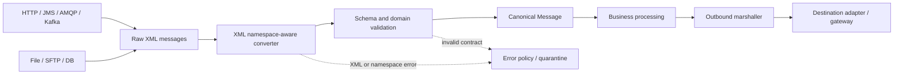
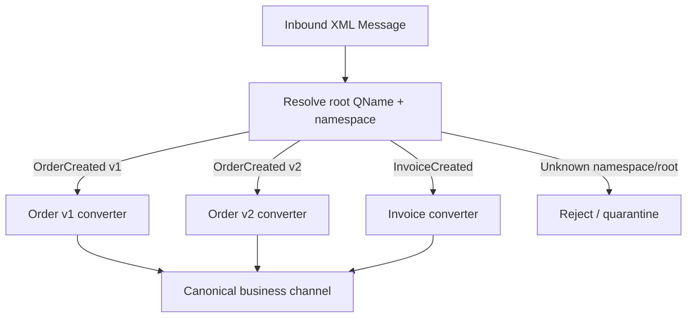
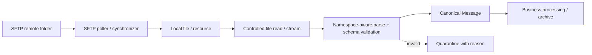

# XML converter and namespace in Spring Integration Adapters

An **XML converter** is the component that transforms an XML representation (bytes, string, `Source`, or safely parsed XML document) into a Java object, and converts the object back into XML when sending to another system. In Spring Integration, this conversion is usually placed at the **inbound/outbound adapter or gateway boundary**, so internal `MessageChannel`s can carry a normalized data model rather than forcing every handler to parse XML itself.

A particularly important part of XML is the **namespace**. Two documents can both contain an `OrderCreated` element yet belong to **two completely different contracts** if their namespace URIs differ. An XML document can change prefix `o` to `ord` without altering element semantics. If the converter, XPath router, JAXB mapping, or XSLT mishandles namespaces, the system may fail to find elements, parse into the wrong DTO, lose data, or inadvertently accept another partner's message.

This lesson belongs to the **Data Transformation** chapter of the **Spring Integration Adapters** module. The content ties XML to **inbound/outbound adapters, gateways, pollers, and MessageChannel**, illustrating file/SFTP, HTTP, JMS, AMQP, Kafka, and database integration flows—covering message contracts, formats, versioning, error handling, and connection lifecycles.

> **Foundational rule:** the converter must rely on an **approved XML contract**, evaluate the **QName (namespace URI + local name)** accurately, validate data, and enforce security limits. Similar-looking tag names or an HTTP `Content-Type: application/xml` header **do not prove** a payload conforms to the right schema, comes from a trusted source, or is authorized to perform a business operation.

## 1. Learning objectives

After this lesson, learners will be able to:

1. Distinguish XML parsing, unmarshalling, marshalling, transformation, validation, and serialization.
2. Explain **namespace URI, prefix, default namespace, QName, and attribute namespaces**, and how they impact conversion results.
3. Configure **Spring OXM `Jaxb2Marshaller`** and use it inside a Spring Integration flow.
4. Separate **XML DTOs** from the **canonical domain model**, keeping format contracts at the boundary.
5. Read XML correctly when prefixes differ but the namespace URI matches, and reject unsupported namespaces.
6. Use XPath and XSLT with **explicit namespace bindings**, avoiding unconditional `local-name()` selection.
7. Combine XSD to detect structural errors and understand the limits of schema validation.
8. Place converters properly in HTTP, SFTP/file, JMS, AMQP, Kafka, and JDBC flows.
9. Prevent XXE, entity expansion, external resource access, oversized payloads, and unapproved Java types.
10. Design error handling, DLQ/quarantine, idempotency, observability, and testing for both happy paths and invalid inputs.

## 2. What problem does an XML converter solve?

Suppose a system receives an XML order notification from a partner:

```xml
<?xml version="1.0" encoding="UTF-8"?>
<OrderCreated xmlns="urn:acme:orders:v1">
    <eventId>evt-1001</eventId>
    <orderId>ORD-42</orderId>
    <amountCents>159900</amountCents>
</OrderCreated>
```

The business handler wants to work with a Java model:

```java
public record OrderCreated(
    String eventId,
    String orderId,
    long amountCents
) {}
```

Handlers should not need to know how to read an `InputStream`, handle namespaces, parse elements, check schemas, and manage XML errors. A clean architecture is:



This is a **logical diagram**. In practice, there may be multiple channels and per-source checkpoints. Adapters do not necessarily always return `byte[]`: a file adapter may produce a `File`, an HTTP gateway may decode the body upfront, and an AMQP/JMS listener may already apply a transport-layer converter.

**Design principle:** decide explicitly **which payload type each boundary uses**, where conversion runs, who owns namespace/schema checks, and what metadata remains after conversion.

## 3. Related yet distinct conversion layers

| Component | Responsibility | Example |
| --- | --- | --- |
| **Transport adapter** | Receives/sends messages via an external system. | HTTP inbound gateway, JMS inbound adapter, SFTP inbound file adapter. |
| **Transport message converter/codec** | Converts transport-specific representations. | AMQP message converter, HTTP body conversion, Kafka deserializer. |
| **XML parser** | Reads XML syntax into XML events/structures. | SAX, StAX, DOM. |
| **XML unmarshaller** | Maps XML representation into Java objects. | Spring OXM `Jaxb2Marshaller.unmarshal(...)`. |
| **XML marshaller** | Represents Java objects as XML. | `Jaxb2Marshaller.marshal(...)`. |
| **Spring Integration Transformer** | Endpoint transforming payload/message in a flow. | `UnmarshallingTransformer` or a custom transformer. |
| **XSD validator** | Validates XML against a governed schema. | XML Schema validation. |
| **XPath selector/router** | Extracts values or selects branches based on XML. | Routing by QName/event type. |
| **XSLT transformer** | Transforms XML structure to another XML or format. | Converting a partner's namespace/schema to canonical XML. |

Some adapters use transport-layer converters; Spring OXM provides `Marshaller` and `Unmarshaller` interfaces; Spring Integration provides XML transformers to wire them into flows. Do not assume setting `contentType=application/xml` causes every `MessageChannel` to parse XML automatically.

## 4. XML namespace: The true identity of an element

A namespaced XML name should be understood as an **expanded name**:

```text
{namespace URI}localName
```

Example:

```text
{urn:acme:orders:v1}OrderCreated
```

The following two forms typically represent the **exact same root element QName**:

```xml
<OrderCreated xmlns="urn:acme:orders:v1">
    <eventId>evt-1001</eventId>
</OrderCreated>
```

```xml
<ord:OrderCreated xmlns:ord="urn:acme:orders:v1">
    <ord:eventId>evt-1001</ord:eventId>
</ord:OrderCreated>
```

In this case, the `ord` prefix is merely a local alias pointing to the URI. Changing the alias to `x` while keeping the URI and local name leaves the QName unchanged.

### 4.1. Three commonly confused parts

- **Namespace URI:** logical identifier of the name set, e.g., `urn:acme:orders:v1`. Does not have to be a downloadable URL.
- **Prefix:** short name declared by the document, e.g., `ord` in `xmlns:ord="..."`; meaningless independently of the URI.
- **Local name:** the name portion after the colon, e.g., `OrderCreated`.

Therefore, a proper converter **must not hardcode prefix strings**. It should match the namespace URI and local name per contract.

### 4.2. Wrong vs. right comparisons

| Check method | Example | Conclusion |
| --- | --- | --- |
| String match `<ord:OrderCreated>` | Partner changes prefix to `p:`. | Fragile even though the XML is equivalent. |
| Match only local name `OrderCreated` | XML from another namespace shares the same name. | Can confuse contracts. |
| Match expanded name | `{urn:acme:orders:v1}OrderCreated`. | Appropriate for format identification. |
| Match namespace but ignore schema version | Two versions share one namespace. | Can still parse the wrong structure. |

## 5. Default namespace and declared prefixes

An element without a prefix **can still belong to a namespace** if a default namespace is in scope:

```xml
<Envelope xmlns="urn:acme:envelope:v1">
    <OrderCreated xmlns="urn:acme:orders:v1">
        <eventId>evt-1001</eventId>
    </OrderCreated>
</Envelope>
```

Here:

- `Envelope` belongs to `urn:acme:envelope:v1`.
- `OrderCreated` and `eventId` belong to `urn:acme:orders:v1`.
- The default namespace is redeclared on the child element.

### 5.1. Undeclaring the default namespace

```xml
<OrderCreated xmlns="urn:acme:orders:v1">
    <metadata xmlns="">
        <source>partner-a</source>
    </metadata>
</OrderCreated>
```

`metadata` and `source` **do not belong** to the orders namespace because `xmlns=""` resets the default namespace to empty within that scope.

A DTO/JAXB mapping expecting `{urn:acme:orders:v1}metadata` will not automatically treat an unnamespaced `metadata` as the same element.

### 5.2. Prefix declared on an ancestor

```xml
<env:Envelope
    xmlns:env="urn:acme:envelope:v1"
    xmlns:o="urn:acme:orders:v1">
    <o:OrderCreated>
        <o:eventId>evt-1001</o:eventId>
    </o:OrderCreated>
</env:Envelope>
```

A namespace-aware XML processor recognizes `o` even though the declaration lives on the parent element. There is no need to repeat `xmlns:o` on every element.

## 6. Attribute namespaces: A crucial rule

**The default namespace does not apply to unprefixed attributes.** This is a common source of bugs when writing XPath or JAXB.

```xml
<OrderCreated xmlns="urn:acme:orders:v1"
              id="ORD-42"
              xmlns:m="urn:acme:metadata:v1"
              m:source="partner-a">
    <eventId>evt-1001</eventId>
</OrderCreated>
```

Analysis:

| Component | Expanded name |
| --- | --- |
| Element `OrderCreated` | `{urn:acme:orders:v1}OrderCreated` |
| Element `eventId` | `{urn:acme:orders:v1}eventId` |
| Attribute `id` | `{}id` — no namespace |
| Attribute `m:source` | `{urn:acme:metadata:v1}source` |

In XPath, attribute `id` is typically referenced as `@id`, whereas attribute `m:source` must use a prefix mapped to the exact URI, e.g., `@m:source`.

## 7. Content type does not determine namespace

HTTP typically uses:

```text
Content-Type: application/xml
Content-Type: text/xml; charset=UTF-8
Content-Type: application/vnd.acme.order+xml
```

These values describe the **XML representation on the wire**. They do not replace checking:

1. Root element and namespace of the document.
2. Schema/contract version.
3. XML structure and data types.
4. Business rules.
5. Source authentication and authorization independent of the payload.

Two partners can both send `application/xml` while one sends `{urn:acme:orders:v1}OrderCreated` and the other sends `{urn:other:inventory:v1}StockChanged`.

A dispatch model can include:

```text
Verified producer + endpoint contract
  -> Allowed media type (application/xml or approved +xml)
  -> Root QName (namespace URI + local name)
  -> Schema/version mapping
  -> Unmarshal to permitted DTO
  -> Validate domain data
  -> Canonical Message<T>
```

Never use an externally supplied XML root name or content type to **dynamically load arbitrary Java classes**.

## 8. Preparing libraries and choosing JAXB for modern Java

In a modern Spring Integration project using Spring Framework 6/Spring Boot 3, many JAXB APIs use the **Jakarta** namespace (`jakarta.xml.bind.*`) rather than `javax.xml.bind.*` from older generations.

Conceptual dependencies typically needed:

- Spring Integration core for channels, endpoints, transformers, and gateways.
- **Spring Integration XML** module if using built-in XML transformers.
- **Spring OXM** for marshalling/unmarshalling interfaces and `Jaxb2Marshaller`.
- JAXB API and compatible runtime if using JAXB on modern JDKs.
- Spring Test/JUnit when testing.

Do not blindly copy dependency versions from legacy projects. Keep versions compatible with the **Spring Boot/Spring Framework version in use** and distinguish `javax.*` from `jakarta.*` packages per generation.

### 8.1. When to use JAXB vs. other XML parsers?

| Tool | Typically fits | Notes |
| --- | --- | --- |
| **JAXB + Spring OXM** | Stable XML schemas/DTOs, bidirectional marshalling. | QNames, annotations, JAXB context, schema validation. |
| **Jackson XML / XmlMapper** | JSON/XML-oriented DTOs, apps already using Jackson. | Must test specific namespace, attribute, and XML structural behavior. |
| **StAX** | Large XML payloads needing streaming reads. | Manual state, namespace, and incremental handling. |
| **SAX** | Event-driven parser, low memory footprint. | Complex handlers if an object model is needed. |
| **DOM** | Small documents needing tree navigation/editing. | Memory-heavy for large docs; parser must be securely configured. |
| **XSLT** | Structural conversion between two XML contracts. | Stylesheets, resource access, and versions must be governed. |

JAXB is one illustrative choice for this lesson; not every XML shape fits direct mapping into a single DTO.

## 9. Sample data: Order XML with namespace v1

Sample inbound contract:

```xml
<?xml version="1.0" encoding="UTF-8"?>
<o:OrderCreated xmlns:o="urn:acme:orders:v1">
    <o:eventId>evt-1001</o:eventId>
    <o:orderId>ORD-42</o:orderId>
    <o:amountCents>159900</o:amountCents>
</o:OrderCreated>
```

Set conventions:

| Item | Value |
| --- | --- |
| Media type | `application/xml` or `application/vnd.acme.order+xml` per allowlist |
| Root QName | `{urn:acme:orders:v1}OrderCreated` |
| Encoding | UTF-8 |
| eventId | Non-empty string, used as idempotency key per design |
| orderId | Non-empty string |
| amountCents | Positive integer |
| Max payload | E.g., 1 MiB for a single order event |
| Target DTO | `OrderCreatedXml` |
| Canonical model | `OrderCreated` |
| Format error | Reject/quarantine per transport and retry policy |

These limits are **examples of an approved contract**, not Spring Integration defaults.

## 10. Defining a JAXB DTO with explicit QNames

Example for Jakarta JAXB:

```java
import jakarta.xml.bind.annotation.XmlAccessType;
import jakarta.xml.bind.annotation.XmlAccessorType;
import jakarta.xml.bind.annotation.XmlElement;
import jakarta.xml.bind.annotation.XmlRootElement;
import jakarta.xml.bind.annotation.XmlType;

@XmlRootElement(
    name = "OrderCreated",
    namespace = "urn:acme:orders:v1"
)
@XmlAccessorType(XmlAccessType.FIELD)
@XmlType(propOrder = {"eventId", "orderId", "amountCents"})
public class OrderCreatedXml {

    @XmlElement(
        name = "eventId",
        namespace = "urn:acme:orders:v1",
        required = true
    )
    private String eventId;

    @XmlElement(
        name = "orderId",
        namespace = "urn:acme:orders:v1",
        required = true
    )
    private String orderId;

    @XmlElement(
        name = "amountCents",
        namespace = "urn:acme:orders:v1",
        required = true
    )
    private long amountCents;

    public OrderCreatedXml() {
        // JAXB requires a no-arg constructor.
    }

    public OrderCreatedXml(
        String eventId, String orderId, long amountCents
    ) {
        this.eventId = eventId;
        this.orderId = orderId;
        this.amountCents = amountCents;
    }

    public String getEventId() {
        return eventId;
    }

    public String getOrderId() {
        return orderId;
    }

    public long getAmountCents() {
        return amountCents;
    }
}
```

**Why declare namespaces explicitly:** the root and child element namespaces are unambiguously defined, avoiding reliance on package defaults. An XML producer can send an equivalent document using a default namespace or another prefix as long as element QNames match.

### 10.1. Variant using package-level `@XmlSchema`

For multiple DTOs sharing a namespace, you can declare it in `package-info.java`:

```java
@jakarta.xml.bind.annotation.XmlSchema(
    namespace = "urn:acme:orders:v1",
    elementFormDefault =
        jakarta.xml.bind.annotation.XmlNsForm.QUALIFIED
)
package com.example.integration.xmlorders;
```

When `elementFormDefault=QUALIFIED`, elements in the package can inherit the corresponding namespace under JAXB rules, reducing repetitive annotations. However, changing a package-level annotation can affect all DTOs in the package. Re-test XML output and XSD compatibility.

### 10.2. DTO validation does not replace XSD

`@XmlElement(required=true)` supplies metadata to JAXB, but **do not assume** all required constraints, occurrence counts, or formats are fully enforced without enabling proper schema validation. A primitive `long` field may also default to 0 when absent, depending on unmarshalling behavior.

Therefore, after unmarshalling, still **validate schema and business data**, e.g., non-blank `eventId`, `amountCents > 0`, and allowed version.

## 11. Configuring Spring OXM Jaxb2Marshaller

Spring OXM provides `org.springframework.oxm.jaxb.Jaxb2Marshaller`, supporting both marshalling and unmarshalling.

```java
import org.springframework.context.annotation.Bean;
import org.springframework.context.annotation.Configuration;
import org.springframework.oxm.jaxb.Jaxb2Marshaller;

@Configuration
public class XmlOrderConfiguration {

    @Bean
    public Jaxb2Marshaller orderXmlMarshaller() {
        Jaxb2Marshaller marshaller = new Jaxb2Marshaller();

        marshaller.setClassesToBeBound(OrderCreatedXml.class);

        // Disallow DTD and XML external entities for
        // untrusted XML data.
        marshaller.setSupportDtd(false);
        marshaller.setProcessExternalEntities(false);

        return marshaller;
    }
}
```

The options in this example illustrate **intentional configuration**. Security guarantees also depend on the `Source` type, parser, and library version. If XML was already converted into a `DOMSource` upstream, configuring `Jaxb2Marshaller` **cannot undo an unsafe DOM parse that already happened**. Secure every parse point in the pipeline.

### 11.1. JAXB context must be controlled

Use `setClassesToBeBound(...)` for approved DTOs, or configure context paths matching your project's data model. Never read class names directly from external XML headers to build contexts or dynamically load arbitrary classes.

### 11.2. Is a custom transformer mandatory?

No. Spring Integration XML includes transformers such as **`UnmarshallingTransformer`** and **`MarshallingTransformer`** that integrate with Spring OXM; they work well for straightforward transformations under a fixed contract. A custom transformer makes more sense when you want to:

- Check QName allowlists, content type, or schema version prior to mapping.
- Normalize multiple DTOs into one canonical model.
- Control which headers are preserved.
- Apply business validation and custom reason codes.
- Enforce payload size limits and per-source error handling.

Supported payload types in built-in transformers can vary by version and how adapters produce `Source`/`String`/`byte[]`; verify with your specific flow rather than assuming every adapter emits the same type.

## 12. Inbound Transformer example: XML bytes to domain event

The following example assumes an inbound adapter normalized the payload into `Message<byte[]>` and verified the XML content type at the boundary. The transformer uses JAXB to unmarshal and then builds the canonical event:

```java
public record OrderCreated(
    String eventId,
    String orderId,
    long amountCents
) {
    public OrderCreated {
        if (eventId == null || eventId.isBlank()) {
            throw new IllegalArgumentException("eventId is required");
        }
        if (orderId == null || orderId.isBlank()) {
            throw new IllegalArgumentException("orderId is required");
        }
        if (amountCents <= 0) {
            throw new IllegalArgumentException("amountCents must be positive");
        }
    }
}
```

```java
import java.io.ByteArrayInputStream;
import org.springframework.integration.annotation.Transformer;
import org.springframework.messaging.Message;
import org.springframework.messaging.support.MessageBuilder;
import org.springframework.oxm.jaxb.Jaxb2Marshaller;
import org.springframework.stereotype.Component;
import javax.xml.transform.stream.StreamSource;

@Component
public class XmlOrderInboundTransformer {

    private static final int MAX_BYTES = 1_048_576;
    private final Jaxb2Marshaller marshaller;

    public XmlOrderInboundTransformer(Jaxb2Marshaller marshaller) {
        this.marshaller = marshaller;
    }

    @Transformer(
        inputChannel = "rawXmlOrdersChannel",
        outputChannel = "canonicalOrdersChannel"
    )
    public Message<OrderCreated> convert(Message<byte[]> input) {
        byte[] bytes = input.getPayload();

        if (bytes.length == 0 || bytes.length > MAX_BYTES) {
            throw new IllegalArgumentException("Invalid XML payload size");
        }

        // Marshaller is configured to disallow DTD/external entities.
        Object parsed = marshaller.unmarshal(
            new StreamSource(new ByteArrayInputStream(bytes))
        );

        if (!(parsed instanceof OrderCreatedXml xml)) {
            throw new IllegalArgumentException("Unexpected XML root/type");
        }

        OrderCreated domain = new OrderCreated(
            xml.getEventId(),
            xml.getOrderId(),
            xml.getAmountCents()
        );

        // Do not copy all headers from external sources.
        return MessageBuilder.withPayload(domain)
            .setHeader(
                "correlationId",
                input.getHeaders().get("correlationId")
            )
            .setHeader("wireFormat", "application/xml")
            .setHeader("schemaId", "order-created-v1")
            .build();
    }
}
```

This is a **learning example focused on the conversion step**. Production deployments must also handle:

- **Verifying content type** and source identity at the inbound boundary.
- Enabling XSD validation when required by the contract; DTO mapping alone does not enforce all XSD constraints.
- Controlling entities, nesting depth, payload size, and parser resource limits.
- Never assuming a client-asserted `correlationId` is a trusted identifier.
- For messages already parsed into DOM/Source upstream, securing that upstream parser.
- Ensuring consistency between `javax` and `jakarta` imports for your Spring generation.
- Protecting logs and never printing raw XML containing sensitive data when exceptions occur.

### 12.1. Why use bytes instead of String?

When receiving XML as `byte[]`, the parser can inspect the **XML declaration and XML encoding rules** per the API. Converting bytes to a `String` using an arbitrary charset before parsing can corrupt data before JAXB is even invoked.

It is not always necessary to keep bytes all the way to the business layer: an HTTP gateway may already decode the body cleanly. The key is that **each decoding step must happen intentionally per contract**, rather than randomly re-encoding across charsets.

## 13. Outbound: Marshalling canonical event to XML

The outbound flow needs to know **which namespace/version the target partner requires**. Never serialize a domain object using another partner's DTO and hope the receiver understands it.

Example transformer from canonical event to XML bytes:

```java
import java.io.ByteArrayOutputStream;
import javax.xml.transform.stream.StreamResult;
import org.springframework.integration.annotation.Transformer;
import org.springframework.messaging.Message;
import org.springframework.messaging.MessageHeaders;
import org.springframework.messaging.support.MessageBuilder;
import org.springframework.oxm.jaxb.Jaxb2Marshaller;
import org.springframework.stereotype.Component;
import org.springframework.util.MimeTypeUtils;

@Component
public class XmlOrderOutboundTransformer {

    private final Jaxb2Marshaller marshaller;

    public XmlOrderOutboundTransformer(Jaxb2Marshaller marshaller) {
        this.marshaller = marshaller;
    }

    @Transformer(
        inputChannel = "outboundDomainOrdersChannel",
        outputChannel = "outboundXmlBytesChannel"
    )
    public Message<byte[]> toXml(Message<OrderCreated> input) {
        OrderCreated order = input.getPayload();

        OrderCreatedXml xml = new OrderCreatedXml(
            order.eventId(),
            order.orderId(),
            order.amountCents()
        );

        ByteArrayOutputStream output = new ByteArrayOutputStream();
        marshaller.marshal(xml, new StreamResult(output));

        return MessageBuilder.withPayload(output.toByteArray())
            .setHeader(MessageHeaders.CONTENT_TYPE,
                       MimeTypeUtils.APPLICATION_XML)
            .setHeader(
                "correlationId",
                input.getHeaders().get("correlationId")
            )
            .build();
    }
}
```

**What to test:** `marshaller.marshal(...)` must produce the contract's root QName, right charset/encoding, and content accepted by the target. Generated XML prefixes may differ from illustrative samples, yet **namespace URI + local name** must match. Do not write tests comparing raw XML strings verbatim when prefix, whitespace, or namespace declaration order differences do not change XML semantics.

### 13.1. Internal headers vs. transport headers

After creating XML bytes, `MessageHeaders.CONTENT_TYPE` describes the wire payload. However, the outbound adapter must **map this metadata** onto the transport:

- HTTP: HTTP `Content-Type` on request/response.
- AMQP: message properties per configuration.
- JMS: property or converter per contract.
- Kafka: independent record headers and serializers.
- File: file extension/storage metadata by convention; there is no default HTTP content type.

Setting a header on a Spring Message **does not automatically guarantee** every outbound adapter emits the right header to the target system.

## 14. Namespaces and XPath: Why do queries often return empty?

XPath 1.0 has an easily overlooked rule: **unprefixed element names in XPath generally match unnamespaced elements**, even when the XML uses a default namespace.

XML:

```xml
<OrderCreated xmlns="urn:acme:orders:v1">
    <orderId>ORD-42</orderId>
</OrderCreated>
```

Wrong XPath for this document:

```xpath
/OrderCreated/orderId/text()
```

Correct XPath after binding `o` → `urn:acme:orders:v1`:

```xpath
/o:OrderCreated/o:orderId/text()
```

The source XML **does not need** to use prefix `o`. The prefix in the XPath expression is simply an alias declared by the XPath context; it still matches elements sharing the same namespace URI in the XML.

### 14.1. NamespaceContext in Java

Example using Java XML XPath:

```java
import java.util.Collections;
import java.util.Iterator;
import javax.xml.XMLConstants;
import javax.xml.namespace.NamespaceContext;
import javax.xml.xpath.XPath;
import javax.xml.xpath.XPathFactory;

XPath xpath = XPathFactory.newInstance().newXPath();

xpath.setNamespaceContext(new NamespaceContext() {
    @Override
    public String getNamespaceURI(String prefix) {
        if ("o".equals(prefix)) {
            return "urn:acme:orders:v1";
        }
        if (XMLConstants.XML_NS_PREFIX.equals(prefix)) {
            return XMLConstants.XML_NS_URI;
        }
        if (XMLConstants.XMLNS_ATTRIBUTE.equals(prefix)) {
            return XMLConstants.XMLNS_ATTRIBUTE_NS_URI;
        }
        return XMLConstants.NULL_NS_URI;
    }

    @Override
    public String getPrefix(String namespaceURI) {
        if ("urn:acme:orders:v1".equals(namespaceURI)) {
            return "o";
        }
        return null;
    }

    @Override
    public Iterator<String> getPrefixes(String namespaceURI) {
        String prefix = getPrefix(namespaceURI);
        return prefix == null
            ? Collections.emptyIterator()
            : Collections.singleton(prefix).iterator();
    }
});

String expression = "/o:OrderCreated/o:orderId/text()";
```

Then XPath can run against a safely parsed `Document` or `Source`. **This example only builds the XPath context** and excludes the XML parsing code; when parsing external data, enable namespace awareness and block DTD/external entities on the parser.

### 14.2. Why not use `local-name()` for everything?

Sometimes authors write:

```xpath
/*[local-name()='OrderCreated']/*[local-name()='orderId']
```

This ignores namespaces, so it can select elements from **a different XML contract** that happens to share the same local name. Only use it if intentionally accepting multiple namespaces while still checking namespace/contract separately. In multi-partner integrations, namespace-bound XPath is safer and more maintainable.

## 15. XPath in Spring Integration: Selector, router, and splitter

Spring Integration XML supports using XPath for **routing, filtering/selecting, splitting**, or header extraction, depending on version and endpoint configuration.

Business examples:

- **Selector:** accept only events where `/o:OrderCreated/o:status = 'CONFIRMED'`.
- **Router:** select processing branch by event type within a supported namespace.
- **Splitter:** split `/o:Orders/o:Order` list into multiple child messages.
- **Header enrichment:** extract `orderId` from XML to attach workflow metadata.

### 15.1. Router diagram



Contracts should be driven by approved QNames and versions, never merely prefix strings or producer-asserted class names.

### 15.2. When splitting large XML documents

An XPath-based splitter can select multiple child nodes. However, **each child node may depend on namespace declarations and context from ancestors**. When serializing into standalone messages, ensure required namespaces remain valid.

Additionally, DOM-based splitting can require loading the entire large document into memory. For multi-GB files, consider StAX streaming or record/chunk-based processing with an explicit contract instead of building a full DOM.

## 16. XSLT and transforming namespaces between two contracts

Sometimes two systems use XML with different namespaces or structures:

- Legacy: `urn:legacy:orders:v1`.
- Target: `urn:acme:orders:v2`.

Never rewrite namespace URIs via raw string replacement in XML, as this can corrupt attributes, text, or identically named elements in other namespaces. Governed **XSLT** can perform namespace-aware structural conversion.

Source XML:

```xml
<l:Order xmlns:l="urn:legacy:orders:v1">
    <l:Id>ORD-42</l:Id>
</l:Order>
```

A minimal XSLT:

```xml
<?xml version="1.0" encoding="UTF-8"?>
<xsl:stylesheet
    version="1.0"
    xmlns:xsl="http://www.w3.org/1999/XSL/Transform"
    xmlns:l="urn:legacy:orders:v1"
    xmlns:o="urn:acme:orders:v2"
    exclude-result-prefixes="l">

    <xsl:output method="xml" encoding="UTF-8" indent="yes"/>

    <xsl:template match="/l:Order">
        <o:OrderCreated>
            <o:orderId>
                <xsl:value-of select="l:Id"/>
            </o:orderId>
        </o:OrderCreated>
    </xsl:template>
</xsl:stylesheet>
```

This is a **minimal structural transformation example**, not a complete `OrderCreated` schema. If downstream also requires `eventId` or `amountCents`, add mappings and validation; never assume XSLT produced valid XML merely because transformation threw no errors.

### 16.1. Where should XSLT run?

Depending on the pipeline:

```text
SFTP file (legacy XML)
    -> safe XML parsing / XSLT transformation
    -> target XML contract
    -> XSD validation / JAXB unmarshal
    -> canonical domain model
```

Spring Integration XML provides **`XsltPayloadTransformer`** for flows needing XSLT. Specify a fixed/approved stylesheet source, a secure transformer factory, and a versioning strategy.

### 16.2. XSLT security

Stylesheets or XML can reference external resources via `document()`, include/import, or entities. For untrusted data, you must:

- Never let users/producers choose arbitrary stylesheet URLs.
- Use controlled, versioned stylesheets.
- Restrict network/file access from the transformer factory where supported.
- Enable secure processing and restrict external access properties wherever possible.
- Enforce timeouts/resource bounds, especially on large inputs.
- Never write raw sensitive XML to logs when transformations fail.

## 17. XSD validation: Namespace and schema must match

XSD describes XML structure, data types, and certain constraints. The `targetNamespace` attribute is a vital part of the contract.

Example XSD:

```xml
<?xml version="1.0" encoding="UTF-8"?>
<xs:schema
    xmlns:xs="http://www.w3.org/2001/XMLSchema"
    targetNamespace="urn:acme:orders:v1"
    xmlns:o="urn:acme:orders:v1"
    elementFormDefault="qualified">

    <xs:element name="OrderCreated">
        <xs:complexType>
            <xs:sequence>
                <xs:element name="eventId" type="xs:string"/>
                <xs:element name="orderId" type="xs:string"/>
                <xs:element name="amountCents" type="xs:positiveInteger"/>
            </xs:sequence>
        </xs:complexType>
    </xs:element>
</xs:schema>
```

If XML uses a different namespace, the validator will not treat the root element as `{urn:acme:orders:v1}OrderCreated` merely because the local name matches.

### 17.1. XSD does not replace business validation

The sample schema can check that `amountCents` is positive, yet it cannot guarantee:

- The event ID has never been processed before.
- The order ID actually exists or belongs to the right tenant.
- The amount aligns with a transaction.
- The sender is authorized to emit the event.
- The business state transition is valid.
- Trusted source signature/authentication.

These conditions must be checked at the appropriate application layers.

### 17.2. `xsi:schemaLocation` is only a document hint

XML example:

```xml
<OrderCreated
    xmlns="urn:acme:orders:v1"
    xmlns:xsi="http://www.w3.org/2001/XMLSchema-instance"
    xsi:schemaLocation="
        urn:acme:orders:v1 https://example.org/orders-v1.xsd">
</OrderCreated>
```

A schema location inside XML **is not a trusted source that must be fetched**. In secure integration environments, use **locally packaged/governed XSDs or a verified schema registry**, never letting arbitrary payloads force the parser to download resources over the network.

### 17.3. XSD include/import

XSDs can use `xs:include` and `xs:import`. When the validator loads secondary schemas, govern resource resolution via an allowlist and access policy. A primary schema on the classpath whose import points to an external URL can still open unwanted network paths if the resolver is unrestricted.

## 18. Enabling schema validation with Spring OXM

`Jaxb2Marshaller` supports configuring schema validation with XSD resources via its API. An illustrative configuration:

```java
import org.springframework.beans.factory.annotation.Value;
import org.springframework.context.annotation.Bean;
import org.springframework.core.io.Resource;
import org.springframework.oxm.jaxb.Jaxb2Marshaller;

@Bean
Jaxb2Marshaller validatedOrderMarshaller(
    @Value("classpath:xsd/order-created-v1.xsd") Resource schema
) {
    Jaxb2Marshaller marshaller = new Jaxb2Marshaller();

    marshaller.setClassesToBeBound(OrderCreatedXml.class);
    marshaller.setSupportDtd(false);
    marshaller.setProcessExternalEntities(false);

    marshaller.setSchemas(schema);
    return marshaller;
}
```

This is an **illustrative snippet inside a configuration class**. Ensure the XSD is present on the classpath, resource imports are controlled, and your library/runtime supports the chosen parser protections.

### 18.1. When should schema validation run?

A sensible pipeline:

```text
Transport authentication + body limits
    -> XML media type / root QName / version allowlist
    -> Secure parse + XSD validation
    -> JAXB unmarshal
    -> Domain validation
    -> Canonical channel
```

Depending on implementation, XSD validation can occur **right inside unmarshalling** when the marshaller is configured with schemas, instead of a separate endpoint. What matters is avoiding **unnecessary multiple parses** and ensuring **no path bypasses validation** in mandatory flows.

### 18.2. Schema versioning

If v1 and v2 exist:

| Element | v1 | v2 |
| --- | --- | --- |
| Namespace | `urn:acme:orders:v1` | `urn:acme:orders:v2` |
| Root | `OrderCreated` | `OrderCreated` |
| Amount field | `amountCents` | Could be `amount` with currency |
| DTO | `OrderCreatedXmlV1` | `OrderCreatedXmlV2` |
| Mapping | V1 → canonical model | V2 → canonical model |

Not every system encodes version in the namespace. If multiple versions share a namespace, require an explicit **version discriminator** and separate schema strategy; never infer version from URI alone.

## 19. XML security: Preventing XXE and entity expansion

XML is a feature-rich format, so an insecure parser can introduce serious risks.

### 19.1. Common risks

| Risk | Scenario | Mitigation |
| --- | --- | --- |
| **XXE** | XML references an external entity pointing to local files or internal network addresses. | Disable external entities/DTD per contract, restrict resolvers. |
| **Entity expansion** | Nested entity declarations amplify parsing resource usage. | Block DTD/entity expansion and bound parser limits. |
| **XInclude / external schema** | Parser fetches external resources automatically. | Disable unneeded features; block external access. |
| **XSLT document()/include** | Stylesheet reads external data. | Trusted stylesheets, secure processing, and allowlists. |
| **Depth / size exhaustion** | Huge or deeply nested XML spikes CPU/RAM. | Body size, depth, streaming, and timeout limits. |
| **Namespace confusion** | Using `local-name()` accepts contract-mismatched XML. | Verify QName and schema. |
| **DTD/schema downgrade** | Differently formatted data parsed via fallback. | Contract allowlists and fail closed. |
| **Sensitive logging** | Exceptions print full XML/PII to logs. | Log reason code, size, correlation; secure quarantine. |

### 19.2. Protect more than just JAXB

Even with `marshaller.setProcessExternalEntities(false)`, an earlier DOM, XPath, or XSLT step can still be vulnerable. Inventory **every place that creates an XML parser or Source**.

For example, if using `DocumentBuilderFactory`:

```java
import javax.xml.XMLConstants;
import javax.xml.parsers.DocumentBuilderFactory;

DocumentBuilderFactory factory =
    DocumentBuilderFactory.newInstance();

factory.setNamespaceAware(true);
factory.setXIncludeAware(false);
factory.setExpandEntityReferences(false);
factory.setFeature(XMLConstants.FEATURE_SECURE_PROCESSING, true);
factory.setFeature(
    "http://apache.org/xml/features/disallow-doctype-decl",
    true
);
factory.setAttribute(XMLConstants.ACCESS_EXTERNAL_DTD, "");
factory.setAttribute(XMLConstants.ACCESS_EXTERNAL_SCHEMA, "");
```

**Note:** support for specific features/properties varies by JAXP provider and runtime. **Test startup and parser behavior**; never swallow configuration failures and keep parsing unprotected. For parsers handling external data, failing to enable mandatory security controls must fail safe and reject input until resolved.

### 19.3. Encoding and XML declaration

If XML bytes start with:

```xml
<?xml version="1.0" encoding="UTF-8"?>
```

then byte-to-character decoding must match accepted encodings. Define clearly how HTTP/JMS content-type charsets interact with the XML declaration, handle BOMs, and reject conflicting cases per contract. Never use `new String(bytes)` relying on the default charset before parsing.

## 20. File and SFTP: From XML file to canonical Message

In batch integrations, partners may upload XML files over SFTP.



### 20.1. Responsibilities at the file/SFTP adapter

1. **File source:** trusted remote directory and SFTP identity.
2. **File readiness:** avoid reading partially uploaded files; contracts can use rename/marker files.
3. **Data type:** XML determined by folder/partner contract and content verification; `.xml` extension is insufficient.
4. **Size:** avoid reading multiple GBs into a single `byte[]` without limits.
5. **Polling:** `maxMessagesPerPoll`, schedule, and concurrency sized to load.
6. **Idempotency:** prevent reprocessing when pollers restart.
7. **Quarantine:** invalid XML files must move to safe storage with a reason code.
8. **Archive:** move files only after reaching the designed processing milestone; successful parsing alone does not mean business commit.
9. **Lifecycle:** SFTP connections, session caches, timeouts, and controlled retries.

### 20.2. Streaming for large XML

For files of hundreds of MB or GBs, full-document DOM/JAXB can strain memory. You can use **StAX streaming**, processing record elements incrementally, while managing namespace context, an appropriate schema/validation strategy, and checkpoints.

Never allow multiple pollers to process the same file concurrently without clear locking/idempotency.

## 21. HTTP gateway: Two-way XML request/response

In an HTTP inbound gateway:

```text
HTTP client
  -> Content-Type: application/xml
  -> HTTP message conversion / raw body mapping
  -> Spring Integration request channel
  -> XML unmarshal / validate / business handler
  -> XML marshal or error mapping
  -> HTTP response
```

### 21.1. Request and response may use different contracts

| Direction | What to define |
| --- | --- |
| **Inbound request** | Allowed Content-Type, max body, namespace, schema, authn/authz. |
| **Business handling** | Canonical DTO, idempotency, transaction. |
| **Outbound success response** | Response QName/namespace, Content-Type, status code. |
| **Outbound error response** | Standard API error, safe content, error namespace or JSON per contract. |

If the gateway/HTTP codec already parsed XML into an object, the downstream transformer **must not force a cast to `byte[]` and parse a second time**. Determine clearly whether conversion happens at the HTTP layer or inside the Spring Integration flow.

### 21.2. Reference HTTP statuses

- `415 Unsupported Media Type`: request Content-Type is not supported.
- `400 Bad Request`: malformed XML or request contract failure per API policy.
- `401/403`: authentication/authorization failures, kept distinct from XML errors.
- `422 Unprocessable Content`: usable for semantic business errors per API contract.
- `5xx`: system/transient errors, never used to mask invalid client payloads.

Do not return raw parser stack traces or sensitive XML content to clients. A `correlationId`/support code suffices for operations lookup.

## 22. JMS, AMQP, and Kafka: Content type does not auto-select JAXB

### 22.1. JMS

JMS has `TextMessage`, `BytesMessage`, and its own properties mechanism; it does not have a built-in HTTP-style `Content-Type` standard. A producer may send an XML string via `TextMessage` or `byte[]` via `BytesMessage`.

Specify:

- Which JMS message payload type is accepted?
- How are charset, XML encoding, and format-indicating properties managed?
- Does conversion occur in the JMS listener/adapter or in a Spring Integration Transformer?
- If unmarshalling fails, how do transactions/acknowledgements and redelivery actually behave?

### 22.2. AMQP

AMQP has message properties such as content type/content encoding depending on broker/client, and Spring AMQP has its own message converters.

If the AMQP layer already converted XML `byte[]` into a Java object, downstream only receives the canonical object and runs required validation. If retaining XML bytes, use an XML transformer in the flow. **Never parse twice** or assume Spring Messaging `contentType` maps automatically from every AMQP property.

### 22.3. Kafka

Kafka producers/consumers use **serializers/deserializers** for keys/values. A `contentType=application/xml` header is merely metadata if set by the producer and forwarded by the adapter; it does not make the Kafka client invoke JAXB automatically.

Example:

```text
Kafka value serializer = ByteArraySerializer
Kafka record value = XML bytes
Kafka header contentType = application/xml

Consumer ByteArrayDeserializer
  -> byte[]
  -> Spring Integration XML transformer
  -> OrderCreated
```

If the consumer uses `StringDeserializer`, the payload may be `String`; if it uses another deserializer, it may be an object. The converter must know the actual input type.

### 22.4. Poison messages and offset/ack

When Kafka/JMS/AMQP receives invalid XML, do not retry forever at the same position and block the entire partition/queue. Policy must distinguish:

- **Permanent contract failure:** XML syntax error, unsupported QName, invalid schema.
- **Transient dependency failure:** schema service, database, or downstream temporarily unavailable.
- **Business rejection:** schema-valid data that is invalid under business rules.

Retries, DLQ/DLT, commit/ack, and transactions must be designed per adapter, with controlled replay and idempotency.

## 23. Database adapters and XML stored in columns

With JDBC polling or database inbound adapters, payloads are usually row maps/lists or objects produced by a row mapper, not necessarily XML bytes.

If the database stores XML in a column:

```text
EVENT_OUTBOX
  event_id
  event_type
  payload_xml
  schema_version
  created_at
  status
```

A flow could be:

```text
DB poller -> row map
          -> extract payload_xml
          -> read metadata event_type/schema_version
          -> XML converter
          -> canonical event
          -> handler
```

Notes:

1. Do not trust `schema_version`/`event_type` simply because they sit in a table if writers are untrusted.
2. If the column is SQL XML/CLOB, check how the JDBC driver returns values and size limits.
3. Define transactions/idempotency to prevent lost or duplicate events when the poller restarts.
4. If XML is invalid, record failure/quarantine state without letting one bad record stall the whole poller.

## 24. Error handling for XML and namespace errors

Parser, schema, namespace, and business errors must be separated.

| Error type | Example | Handling direction |
| --- | --- | --- |
| **Malformed XML** | Mismatched closing tags, illegal characters. | Reject/quarantine, do not retry infinitely. |
| **Unsupported namespace/QName** | `urn:partner-other:orders` outside allowlist. | Contract error, never force into current DTO. |
| **Wrong schema version** | Sending v2 to an endpoint accepting only v1. | Reject or route to v2 if supported. |
| **XSD violation** | Missing field, wrong numeric type. | Validation error, store controlled reason. |
| **XXE/DTD forbidden** | Contains DOCTYPE or external entity. | Block and alert based on risk. |
| **Encoding mismatch** | XML declaration and bytes conflict. | Reject per encoding contract. |
| **Business validation** | Invalid amount, blank orderId. | Domain error, optionally reply to caller. |
| **Infrastructure timeout** | Database/schema registry transient error. | Bounded retry with backoff. |
| **Outbound marshal error** | DTO cannot be represented in target XML. | Do not send bad payload; investigate mapping/contract. |

### 24.1. Synchronous vs. asynchronous flows

- **DirectChannel/sync gateway:** exceptions can propagate to the caller and be converted into error responses by the gateway/HTTP layer.
- **Poller/async executor channel:** errors are typically handled through error handling/error channels when appropriately configured.
- **JMS/AMQP/Kafka:** redelivery/DLQ and ack behavior depend on the adapter, transaction manager, and listener container.

Do not assume every exception in Spring Integration automatically goes to a global error channel. Write integration tests for the **error path of the exact transport in use**.

### 24.2. Controlled quarantine

An unparseable XML message can be stored in quarantine with:

- Verified source system, event ID, or file/record ID.
- Declared content type and root QName if safely parsed.
- Reason code, schema version, correlation ID.
- Receipt timestamp, attempt count, and owner.
- Original payload encrypted/stored per policy, never printed verbatim into application logs.

Provide an authorized replay path, duplicate-processing checks, and retention limits.

## 25. Testing namespaces and XML contracts properly

XML tests **must not rely solely on verbatim string comparisons**. Two XML documents with different prefixes or whitespace can be equivalent in QNames and data.

### 25.1. Test matrix

| Test case | Input | Expectation |
| --- | --- | --- |
| Valid default namespace | `xmlns="urn:acme:orders:v1"` | Parses to `OrderCreatedXml`. |
| Different prefix with valid URI | `xmlns:x="urn:acme:orders:v1"` | Same result as above. |
| Valid root local name, wrong URI | `urn:other:orders:v1` | Reject namespace/contract. |
| Default namespace undeclared on child | `xmlns=""` on `eventId` | Does not wrongly map to namespaced element. |
| Unnamespaced attribute | `id="ORD-42"` | Not confused with another namespaced attribute. |
| Missing namespace | `<OrderCreated>` without `xmlns` | Reject if contract requires URI-qualified QName. |
| XSD missing required field | Omit `orderId` | Schema/domain validation fails. |
| Invalid amount | Negative or non-numeric | Fails. |
| XML with DOCTYPE/external entity | External entity | Rejected prior to resource access. |
| Oversized XML | Exceeds max payload | Rejected prior to parsing. |
| Wrong encoding | Invalid UTF-8 when contract mandates UTF-8 | Fails per policy. |
| Outbound namespace | DTO → XML | Root and child QNames match. |
| XSLT namespace change | Legacy v1 → target v2 | Namespace and field mappings verified. |
| XPath default namespace | Expression with URI-bound alias | Finds element. |
| Kafka/JMS headers | Raw transport → Spring Message | Accurate content type, payload type, and metadata. |
| Error replay | Quarantine → authorized retry | Does not create duplicate business events. |

### 25.2. Unmarshalling unit test

JUnit 5 example illustrating testing **same namespace URI with a different prefix**:

```java
import static org.junit.jupiter.api.Assertions.*;

import java.io.ByteArrayInputStream;
import java.nio.charset.StandardCharsets;
import javax.xml.transform.stream.StreamSource;
import org.junit.jupiter.api.Test;
import org.springframework.oxm.jaxb.Jaxb2Marshaller;

class OrderXmlMappingTest {

    @Test
    void acceptsDifferentPrefixWithSameNamespaceUri() {
        Jaxb2Marshaller marshaller = new Jaxb2Marshaller();
        marshaller.setClassesToBeBound(OrderCreatedXml.class);
        marshaller.setSupportDtd(false);
        marshaller.setProcessExternalEntities(false);
        marshaller.afterPropertiesSet();

        String xml = """
            <x:OrderCreated xmlns:x="urn:acme:orders:v1">
                <x:eventId>evt-1</x:eventId>
                <x:orderId>ORD-7</x:orderId>
                <x:amountCents>1200</x:amountCents>
            </x:OrderCreated>
            """;

        Object result = marshaller.unmarshal(
            new StreamSource(new ByteArrayInputStream(
                xml.getBytes(StandardCharsets.UTF_8)
            ))
        );

        assertInstanceOf(OrderCreatedXml.class, result);
        OrderCreatedXml order = (OrderCreatedXml) result;

        assertEquals("evt-1", order.getEventId());
        assertEquals("ORD-7", order.getOrderId());
        assertEquals(1200L, order.getAmountCents());
    }
}
```

This example demonstrates testing JAXB mapping; no JUnit/build run was executed while writing this lesson. Real applications should add tests for **rejecting wrong namespaces**, schema validation, XXE, malformed XML, and operation across each adapter.

### 25.3. Structural XML comparison

Do not rely on output like:

```text
Expected: <o:OrderCreated ...>
Actual:   <ns2:OrderCreated ...>
```

If both prefixes map to the same namespace URI and the content is equivalent, this is not necessarily a bug. Use namespace-aware DOM assertions, namespace-bound XPath, or structural XML comparison tools with clear whitespace/attribute-ordering rules.

## 26. Performance, memory, and scalability

XML conversion can consume significant CPU/RAM, especially when JAXB allocates many objects or DOM holds an entire document in memory.

| Issue | Symptom | Mitigation |
| --- | --- | --- |
| Very large XML files | Heap/GC spikes, OOM. | StAX streaming or record/chunk splitting per contract. |
| Repeated parsing across layers | High latency, repeated byte/string copies. | Designate a single owner for decode/validation. |
| Deeply nested XML | CPU/stack/memory spikes. | Parser limits, max depth, and payload size bounds. |
| Many versions/schemas | Context/cache growth, wrong marshaller chosen. | Explicit version mapping, lifecycle governance. |
| Poller too fast | Queue/backlog growth. | Tune poll rate, batch size, concurrency, and backpressure. |
| Marshalling large messages individually | Heavy OutputStream/body copying. | Streaming or contract size limits. |
| Overly complex XSLT | High CPU, latency impact. | Optimize templates and enforce resource limits. |

**Avoid optimizing by disabling schema validation or parser protections** in systems accepting external XML. To improve performance, measure bottlenecks first, then adopt streaming or contract-bounded payloads.

## 27. Tracing and operating XML converters

A production system needs visibility into which formats are in use, where failures occur, and which adapters are affected.

### 27.1. Illustrative event log/trace

```json
{
  "eventType": "XML_CONVERSION",
  "correlationId": "sftp-batch-0281",
  "sourceSystem": "partner-a",
  "adapter": "sftp-inbound",
  "contentType": "application/xml",
  "rootNamespace": "urn:acme:orders:v1",
  "rootLocalName": "OrderCreated",
  "schemaVersion": "v1",
  "payloadBytes": 817,
  "result": "REJECTED",
  "reasonCode": "XSD_VALIDATION_FAILED",
  "durationMs": 4
}
```

Values and numbers are illustrative only. **Never log raw XML containing sensitive data or credentials**. Namespace URIs and schema versions are also metadata to classify under organizational policy if they reveal internal details.

### 27.2. Useful metrics

| Metric | Purpose |
| --- | --- |
| `xml_conversion_success_total` | Counts successful conversions by source/format/version. |
| `xml_conversion_failure_total{reason}` | Separates malformed, unsupported namespace, XSD, security failures. |
| `xml_conversion_duration_seconds` | Measures latency and percentiles. |
| `xml_payload_bytes` | Tracks payload size distribution. |
| `xml_contract_version_usage` | Identifies partners still using legacy versions. |
| `quarantine_pending_messages` | Observes unprocessed failed payloads. |
| `consumer_redelivery_total` | Detects poison messages/retry storms. |
| `adapter_connection_errors_total` | Separates SFTP/JMS/Kafka failures from XML converter errors. |

Avoid using `orderId`/`eventId` as metric labels due to high cardinality; keep specific identifiers inside access-controlled logs/traces.

### 27.3. Auditing and connection lifecycle

An XML converter does not own the entire transport lifecycle. Also monitor:

- Are SFTP sessions and file pollers starting/stopping properly?
- Are JMS/AMQP connections/listener containers reconnecting and acking accurately?
- Are Kafka consumer groups/offsets handled properly after schema errors?
- Do HTTP gateways enforce timeouts and proper status mappings?
- Do JDBC pollers preserve transactions/idempotency?
- Do outbound gateways encode requests and decode error responses in the right namespaces?

Incident investigation must distinguish **connection failure**, **transport conversion failure**, **XML/schema failure**, and **business rejection**.

## 28. Migration and evolving namespace contracts

A partner may upgrade from:

```text
urn:acme:orders:v1
          |
          v
urn:acme:orders:v2
```

A transition plan can include:

1. Publish the v2 XML contract and corresponding XSD.
2. Create explicit v2 DTOs/marshallers or mappings.
3. Support v1/v2 concurrently during an approved transition window.
4. Route by QName/version instead of prefix names.
5. Test both directions: v1/v2 → canonical model and canonical model → per-partner XML.
6. Restrict which sources/tenants are permitted to use v2 to avoid accepting unverified formats.
7. Measure the share of producers still emitting v1.
8. Announce the v1 deprecation deadline.
9. Handle replaying old v1 messages from DLQ or archives after the v1 converter is removed.
10. Separate **changing namespaces** from **changing business semantics**; never assume v2 only changes the URI.

### 28.1. Do not alter prefixes via string replacement

Replacing `o:` with `n:` as plain text without updating `xmlns` declarations or QName rules can produce malformed XML or alter unintended elements. If you only want to change the emitted prefix, it is usually **unnecessary** because prefixes do not define XML identity. When genuine namespace/schema conversion is needed, use tested mappings/XSLT.

## 29. Common anti-patterns

| Anti-pattern | Consequence | Remedy |
| --- | --- | --- |
| Matching prefixes instead of namespace URIs | Changing alias breaks converter. | Match QName by URI + local name. |
| Routing solely with `local-name()` | Can accept XML from a wrong contract. | Namespace-aware XPath and contract allowlists. |
| Assuming default namespace applies to attributes | Misreads attributes. | Separate element QNames from attribute QNames. |
| Omitting `namespaceAware` in DOM parsing | XPath/JAXB pick wrong elements. | Enable namespace awareness on appropriate parsers. |
| Treating `Content-Type: application/xml` as schema | Contract-mismatched XML gets accepted. | QName, schema version, and XSD/domain validation. |
| Converting XML bytes to String via default charset | Corrupted characters, breaks encoding contract. | Parse bytes with controlled encoding. |
| Enabling external entities "for fast parsing" | XXE/SSRF or unauthorized file reads. | Block DTD/external entities, govern resolvers. |
| Trusting external `xsi:schemaLocation` | Parser loads schemas from untrusted URLs. | Controlled XSDs, resolver/allowlists. |
| Parsing DOM first and thinking JAXB protection suffices | XXE may already have fired during DOM parsing. | Secure the entire parsing pipeline. |
| Binding all XML to one DTO by root name | Mixes v1/v2 schemas or different partners. | Map QName + version + source to approved DTOs. |
| Unmarshalling multi-GB files via JAXB into one object | Memory spikes/OOM. | StAX streaming, chunking, and size bounds. |
| Retrying every exception infinitely | Poison messages block consumers/queues. | Separate permanent vs. transient and quarantine. |
| Copying all transport headers outbound | Metadata leaks or wrong content types. | Header allowlists and adapter-level mapping. |
| Comparing XML output as verbatim strings | Tests fail merely over prefix/whitespace diffs. | Compare structure/QNames/schema. |
| Skipping tests against real adapters | Headers/encodings drop over HTTP/JMS/Kafka/SFTP. | Transport-level end-to-end tests. |
| Not versioning XSLT/XSD/namespaces | Hard to reproduce bugs or roll back contracts. | Version mappings, schemas, and artifacts. |

## 30. Practical scenarios

### Scenario A – Prefix change breaks parser

A partner previously sent `<o:OrderCreated>` with `xmlns:o="urn:acme:orders:v1"` and now sends `<x:OrderCreated>` with `xmlns:x` pointing to the same URI. A router checks whether the tag string starts with `o:` and throws an error.

**Question:** Where is the router wrong?

**Hint:** A prefix is an alias, not the element's identity. Check the expanded QName or use XPath with URI namespace bindings; do not require partners to freeze prefixes unless the contract explicitly mandates it.

### Scenario B – XPath finds no elements

XML uses default namespace `xmlns="urn:acme:orders:v1"`, while XPath is written `/OrderCreated/orderId`. The result is empty.

**Question:** How should it be fixed?

**Hint:** Bind an arbitrary prefix to the URI and write `/o:OrderCreated/o:orderId`. The XPath prefix does not need to match the prefix declared in the XML.

### Scenario C – Attribute does not belong to default namespace

XML:

```xml
<o:OrderCreated xmlns:o="urn:acme:orders:v1"
                xmlns="urn:acme:orders:v1"
                id="ORD-42"/>
```

A mapper searches for `{urn:acme:orders:v1}id` and finds nothing.

**Question:** Why?

**Hint:** Unprefixed attributes do not inherit the default namespace. `id` is in no namespace. Only prefixed attributes or explicit declarations belong to a namespace.

### Scenario D – XXE from an SFTP file

An XML file from SFTP contains a DOCTYPE pointing to an internal URI. A DOM step parses it before JAXB is invoked.

**Question:** Is setting `setProcessExternalEntities(false)` on the JAXB marshaller alone safe enough?

**Hint:** No. DOM may already have processed the external entity. Secure the first parser, block DTD/entities and external resource access, and test attack payloads at the actual boundary.

### Scenario E – XSD mismatches v2

A partner switches to `urn:acme:orders:v2` while the consumer still uses v1 JAXB DTO/XSD; a developer plans to rewrite the namespace URI in XML back to v1 via string replacement.

**Question:** What are the risks and right approach?

**Hint:** Rewriting the URI does not resolve schema/semantic differences. Require contract versioning, governed DTO/mapping/XSLT, validation, testing, and parallel support during transition when appropriate.

### Scenario F – Invalid JMS XML redelivered forever

A consumer receives an invalid XML `TextMessage`, rolls back the transaction, and the broker redelivers continuously, blocking the queue.

**Question:** How should the error policy change?

**Hint:** Separate permanent XML errors from transient dependency failures; bound retries, route to a secure DLQ/quarantine, preserve metadata for fixing/replay, and test actual listener ack/transaction behavior.

### Scenario G – 2 GB XML file causes OOM

An SFTP poller reads an entire 2 GB XML file into `byte[]` and JAXB unmarshals it into a huge list. The JVM runs out of memory.

**Question:** How to optimize without dropping validation?

**Hint:** Enforce size/chunk contracts, StAX streaming, structurally appropriate validation, backpressure, idempotency, and archive only upon business success. Do not merely keep increasing heap size.

### Scenario H – Kafka header says XML yet payload is already a String

A producer sends a Kafka message with XML content type; the consumer's `StringDeserializer` yields a `String`, but the transformer declares `Message<byte[]>` and fails with a type error.

**Question:** Who is responsible for type alignment?

**Hint:** The Kafka deserializer and adapter determine the Java payload type before Spring Integration sees it; normalize to `Source`/bytes per contract or have the transformer accept `String`, avoiding assumed casts.

### Scenario I – Outbound response changes prefix

JAXB outbound emits `<ns2:OrderCreated>` instead of `<o:OrderCreated>`, both sharing the same namespace URI and local name. A string-equality test fails.

**Question:** Is this a contract bug?

**Hint:** Usually no, provided the target follows XML Namespaces and the contract does not mandate specific serialization prefixes. Validate QNames/schemas and data structurally; consider custom namespace prefix mappers only if a partner genuinely has a non-compliant parser.

## 31. Checklist for implementing XML converters and namespaces

- [ ] Identified adapters/gateways, inbound Java payload types, and converter placement.
- [ ] Enforced allowlists for media types, root QNames, namespace URIs, and schemas/versions.
- [ ] Avoided hardcoding prefixes or omitting namespaces in XPath/routers/selectors.
- [ ] Accounted for default namespaces and unprefixed attribute rules.
- [ ] Declared appropriate namespaces on JAXB DTOs or equivalent mappings.
- [ ] If using package-level `@XmlSchema`, verified impact across all DTOs.
- [ ] Enabled appropriate XSD validation and post-unmarshal business validation.
- [ ] Loaded XSDs/imports from governed sources rather than blindly trusting `xsi:schemaLocation`.
- [ ] Protected every XML parse step, including DOM/XPath/XSLT before JAXB.
- [ ] Blocked DTD/external entities per contract; enforced size/depth limits.
- [ ] Kept XML encoding and transport charsets consistent.
- [ ] Prevented inbound/outbound from forwarding malicious headers or sensitive metadata arbitrarily.
- [ ] Maintained explicit QName/version → DTO/schema/mapping tables without loading Java classes from external input.
- [ ] Handled `String`, `byte[]`, `File`, or `Source` accurately per design.
- [ ] Added dedicated code/tests for HTTP requests/responses and error mappings.
- [ ] Verified JMS/AMQP/Kafka serializers/converters and ack/retry on real transports.
- [ ] Equipped SFTP/file pollers with readiness, archive/quarantine, size limits, and idempotency.
- [ ] Ensured database/XML columns have matching data contracts and transactions.
- [ ] Classified namespace/XSD/malformed XML errors as permanent failures.
- [ ] Bounded retries, DLQ, and replay with traceability and duplicate prevention.
- [ ] Added unit tests for equivalent prefixes, default namespaces, attributes, and wrong namespaces.
- [ ] Added negative tests for XXE, oversized payloads, invalid encodings, and invalid schemas.
- [ ] Verified outbound tests compare structure/QNames rather than serialized prefixes.
- [ ] Emitted logs/metrics by source, schema version, reason code, and latency.
- [ ] Versioned XSD/XSLT/DTOs/mappings and governed connection/contract lifecycles.

## 32. Remember

**XML converters and namespaces** are inseparable when bringing external XML into Spring Integration. The converter transforms **XML representations into Java types and back**; namespaces define **element/attribute identity** so converters, XPath, XSLT, and XSD interpret contracts accurately.

In a sound design, inbound adapters/gateways/pollers merely introduce messages into the flow; a controlled conversion layer **reads QNames, schemas, and encodings accurately**, validates XML safely, creates canonical messages, and retains needed metadata. Outbound converters produce XML with the exact namespace partners expect, while HTTP, JMS, AMQP, Kafka, file/SFTP, and databases each handle headers/payloads and errors differently.

**Four questions to verify before going to production:**

1. Which **namespace URI + local name + schema version** does this XML belong to, and is the sender authorized for that contract?
2. Is the payload currently `byte[]`, `String`, `File`, or `Source`; which converter actually runs, and at which boundary?
3. Are all parsers/XPath/XSLT/JAXB steps hardened against **XXE, DTD, external access, and resource exhaustion**?
4. When namespace or schema validation fails, how will the flow **reject, retry, or quarantine** it, with what audit trail and idempotency?

A reliable XML integration system is not judged by successfully parsing one sample file; it must **accurately accept valid contract-compliant XML, reject invalid or untrusted XML, and handle errors safely across the entire connection lifecycle**.
