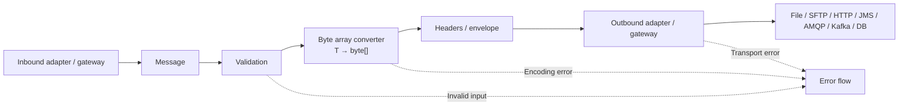
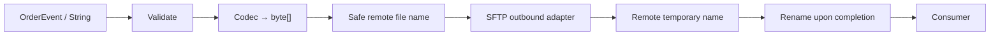
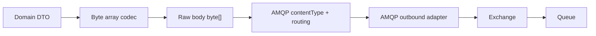
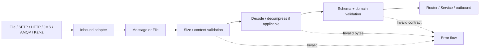

# Byte array converter

## 1. Problem statement: Why does an integration flow need `byte[]`?

A Spring Boot service receives a delivery notification as a Java DTO. This notification must travel across several systems:

- **File outbound adapter** writes a text or binary file into an exchange directory.
- **SFTP outbound adapter** uploads data to a partner's server.
- **HTTP outbound gateway** sends a request body with an explicit `Content-Type`.
- **JMS/AMQP/Kafka outbound adapter** pushes messages to a broker using a compatible converter or serializer.
- **JDBC/database adapter** stores binary data in a BLOB column or maps certain fields to SQL parameters.

Whether it is JSON text, an image, PDF, ZIP, or a custom binary format, data must ultimately be represented as **a sequence of bytes** for transmission or storage. In Java, the common representation is `byte[]`. However, merely "turning data into bytes" is not enough to build a reliable integration:

1. Consumers need to know **what format the bytes represent**.
2. Text requires a **charset**, schema, field structure, and line-ending conventions.
3. The receiving system needs to know how to **decode, inspect, and validate**.
4. Adapters need to understand which **payload and headers** belong to the protocol.
5. Retries, conversions, file writes, and connections can create **duplicates or truncated data** without proper controls.

In Spring Integration, a **byte array converter** is a component or conversion step **between Java/text payloads and `byte[]`**, or from `byte[]` back into the data type the pipeline needs. Depending on its position in the flow, this conversion can be performed by a transformer, a specialized codec, a message converter, or an adapter serializer.

This lesson belongs to the **Data Transformation** chapter of the `SPRING_INTEGRATION_ADAPTERS` module. Its goal is understanding how to integrate inbound/outbound adapters, gateways, pollers, and `MessageChannel` with File, SFTP, HTTP, JMS, AMQP, Kafka, and databases—while managing **message contracts, errors, performance, and connection lifecycles**.

> **Principle:** `byte[]` is only an **in-memory representation**. It does not self-describe whether it is JSON, UTF-8 text, compressed data, Protobuf, or a binary file; nor does it prove a send or write succeeded.

## 2. What is and isn't a byte array?

In Java, `byte[]` is an array containing signed `byte` elements (`-128` to `127`). These values represent **8-bit units**, not characters, business decimals, or a specific format.

```java
byte[] payload = new byte[] {72, 101, 108, 108, 111};

// The same bytes can be interpreted as UTF-8 text:
String text = new String(payload, java.nio.charset.StandardCharsets.UTF_8);
// text = "Hello"
```

Distinguish carefully:

| Object | Meaning | Common mistake |
| --- | --- | --- |
| `String` | Sequence of Unicode characters in Java | Using default charset when converting to bytes |
| `byte[]` | Sequence of bytes in memory | Assuming bytes are always text |
| `ByteBuffer` | Buffer with position/limit for working with bytes | Forgetting `position` and `limit` when reading data |
| `InputStream` | Stream reading data incrementally | Loading a multi-GB file just to turn it into `byte[]` |
| `Resource` | Abstraction for accessing content like file/classpath/stream | Assuming every resource is already in memory |
| `Base64 String` | Text representation convertible back to bytes | Confusing Base64 with security encryption |
| `JSON byte[]` | Bytes holding a serialized JSON document | Confusing with a `byte[]` **field** serialized by Jackson |
| `Message<byte[]>` | Spring message with byte payload and headers | Ignoring content type, routing, and correlation |

A byte array can contain:

- UTF-8 JSON: bytes of `{"id":"O-1"}`.
- UTF-8 CSV: bytes of a CSV line or file.
- PNG/JPEG images, PDFs, ZIPs, or encrypted files.
- Protobuf/Avro/CBOR/MessagePack data following a schema.
- A binary frame with an internal header, length, and checksum.
- Compressed bytes from GZIP or another algorithm.

You cannot safely determine the format merely by a Java type cast: there must be a **contract, trusted metadata, or controlled identification mechanism**.

## 3. Spring Message: Payload differs from headers

A message in Spring Integration has a **payload** and **headers**:

```text
Message<T>
  payload: T
  headers:
    id, timestamp
    contentType
    correlationId / eventId (per application contract)
    fileName / topic / routingKey (per adapter)
    other internal metadata
```

Example message moving through a flow:

```text
Message<String>
    payload = "Xin chào"
    headers:
      eventId = "evt-2401"
      contentType = "text/plain;charset=UTF-8"

  ↓ String -> UTF-8 byte[]

Message<byte[]>
    payload = [0x58, 0x69, 0x6E, ...]
    headers:
      eventId = "evt-2401"
      contentType = "text/plain;charset=UTF-8"
```

If an adapter sees a `byte[]` payload with header `application/json`, the bytes must genuinely be valid JSON. **Changing a header does not convert the content.** Conversely, converting a String to bytes while dropping the charset can make the consumer decode it wrongly.

### Architectural boundary



The **transformer/codec** owns data representation. The **adapter/gateway** owns I/O, connections, timeouts, and protocol specifics. A **message converter/serializer** can sit right at the protocol boundary to perform the final byte conversion step.

## 4. Transformer, message converter, serializer, and adapter: Dividing roles

| Component | Question answered | Example |
| --- | --- | --- |
| **Transformer** | How must the internal payload change shape? | `OrderEvent` → JSON `byte[]` |
| **Codec / formatter** | What are the encode/decode rules? | UTF-8 codec, Jackson, Protobuf |
| **MessageConverter** | How is the object/message mapped to the protocol's message? | Converter to JMS BytesMessage or AMQP message body |
| **Kafka Serializer** | How are key/value turned into Kafka bytes? | `ByteArraySerializer`, JSON serializer |
| **Header Enricher / Mapper** | Which metadata needs attaching or mapping to the protocol? | Content type, filename, key, correlation |
| **Outbound adapter** | Which external system receives one-way sends/writes? | File, SFTP, JMS, Kafka |
| **Outbound gateway** | How are requests sent and responses received? | HTTP request–reply |
| **Inbound adapter** | How does external data become a Spring Message? | Poll file, receive broker message |
| **Poller** | At what times/intervals are messages fetched? | Periodically fetch files or database rows |
| **MessageChannel** | How are messages passed between endpoints? | `DirectChannel` or `QueueChannel` |

Not every adapter needs a separate transformer. For example, a Kafka JSON serializer can serialize a DTO directly; an HTTP converter can convert an object into a JSON body. However, when you want to inspect or control exact bytes before hashing, signing payloads, storing raw files, or dispatching to multiple protocols, an explicit **byte array transformer** is usually easier to test.

**Avoid double serialization.** If `ObjectMapper` already produced JSON bytes, do not configure the target serializer to treat that byte array as an object to JSON-encode again.

## 5. Designing the byte contract before writing code

A contract for `Message<byte[]>` needs more than saying "the payload is bytes".

| Contract element | Example | Risk if omitted |
| --- | --- | --- |
| **Media type / format** | `application/json`, `text/csv`, `application/octet-stream` | Consumer picks wrong parser |
| **Schema/version** | `order-created.v2` | Producer–consumer incompatibility |
| **Charset** | UTF-8 for text content | Corrupted Vietnamese accents, decoding failures |
| **Byte order** | Big-endian/little-endian for binary numbers | Misread lengths/numbers |
| **Framing** | Length-prefix or one message = one document | Unknown record boundaries |
| **Compression** | GZIP with matching metadata | Consumer reads compressed bytes as text |
| **Integrity** | Checksum/hash/signature when required | Undetected payload corruption/tampering |
| **Size limit** | Limits on bytes and nesting/decompressed size | OOM, stalled queues, zip bombs |
| **Null/empty** | Is an empty body allowed or not? | Confusing empty payloads with invalid messages |
| **Idempotency key** | Stable `eventId` | Retries cause duplicate processing |
| **Destination** | Topic, remote directory, URL, SQL column | Valid bytes sent to the wrong place |
| **Security** | Sensitive data, channel encryption, log policy | Leaks of secrets or personal data |

### Bytes do not self-describe their structure

```text
0x00 0x00 0x00 0x2A
```

These bytes can represent the integer 42 in **32-bit big-endian**, or a length header, part of an image, or other application data. An explicit schema/framing spec is required before decoding.

### Content-Type and Content-Encoding differ

- `Content-Type: application/json` describes the **content format**.
- `Content-Encoding: gzip` (where the protocol uses it) describes **how the compressed content is encoded**.
- Charset applies to text media types or where defined by protocol; **it does not make invalid JSON bytes valid**.
- In File/SFTP/Kafka/JMS, equivalent metadata may live in headers, properties, manifests, or external contracts; not every adapter has HTTP-style headers.

## 6. Byte conversion matrix by destination

| Target system | Common payload or input | What to verify |
| --- | --- | --- |
| **File outbound** | `byte[]`, `String`, `File` per handler | Filename, written bytes, file-exists mode |
| **SFTP outbound** | `byte[]`, `File`, `String` per configuration | Remote path, temp file, session, permissions |
| **HTTP outbound gateway** | Raw `byte[]` body or DTO/String via converter | HTTP method, Content-Type, response/timeout |
| **JMS outbound** | `byte[]` mapped by converter to `BytesMessage` | JMS message type, properties, acknowledgment |
| **AMQP outbound** | Message body bytes or converter-handled object | Body, contentType, routing, publisher confirms |
| **Kafka outbound** | Key/value with matching serializers | `ByteArraySerializer`, key/partition, topic |
| **JDBC/database outbound** | `byte[]` bound to BLOB/VARBINARY or parameter DTO/map | SQL type, transaction, parameters, size |
| **File/SFTP inbound** | Bytes or `File` after reading step | File limits, charset, duplicate handling |
| **HTTP/JMS/AMQP/Kafka inbound** | Body/bytes per protocol converter | Decoded type, schema, headers, validation |

This table describes **common patterns**, not a guarantee that every adapter supports the same input types across all versions. Select the right handler, converter, serializer, and configuration available, and test the actual raw bytes.

## 7. Converting `String` to `byte[]` using UTF-8

For text, specifying the charset explicitly is fundamental:

```java
import java.nio.charset.StandardCharsets;

String text = "Order created: ORD-1001";
byte[] bytes = text.getBytes(StandardCharsets.UTF_8);

String restored = new String(bytes, StandardCharsets.UTF_8);
```

**Avoid:**

```java
// Depends on the default charset or runtime configuration.
byte[] bytes = text.getBytes();
String restored = new String(bytes);
```

The default charset can differ across JDKs, runtimes, environments, or configurations. When signing/hashing payloads or exchanging data across systems, even a single-byte difference invalidates signatures or checksums.

### Example of difference between characters and bytes

```java
String value = "Aé";
int charUnits = value.length();
int bytesUtf8 = value.getBytes(StandardCharsets.UTF_8).length;

// charUnits = 2 (two UTF-16 code units in this example)
// bytesUtf8 = 3 (A = 1 byte, é = 2 bytes in UTF-8)
```

`String.length()` does not tell you the byte size sent to a broker. For supplementary characters, a single Unicode code point can even take two UTF-16 code units in Java.

### UTF-8 BOM and line endings

If a partner requires text without a BOM, ensure output files/bytes do not prepend `EF BB BF`. If the consumer requires CRLF, emit `\r\n` explicitly. Never alter line endings after computing checksums or signatures.

## 8. Converting `byte[]` to `String`: Strict decoding when needed

Simple approach:

```java
String text = new String(bytes, StandardCharsets.UTF_8);
```

However, this constructor can **replace invalid byte sequences with replacement characters** rather than throwing an error. When the contract requires strictly valid UTF-8, use a decoder in `REPORT` mode:

```java
import java.nio.ByteBuffer;
import java.nio.charset.CharacterCodingException;
import java.nio.charset.CodingErrorAction;
import java.nio.charset.StandardCharsets;

public final class Utf8Codec {
    private Utf8Codec() {}

    public static byte[] encode(String value) {
        if (value == null) {
            throw new IllegalArgumentException("Text must not be null");
        }
        return value.getBytes(StandardCharsets.UTF_8);
    }

    public static String decodeStrict(byte[] bytes)
            throws CharacterCodingException {
        if (bytes == null) {
            throw new IllegalArgumentException("Bytes must not be null");
        }
        return StandardCharsets.UTF_8.newDecoder()
            .onMalformedInput(CodingErrorAction.REPORT)
            .onUnmappableCharacter(CodingErrorAction.REPORT)
            .decode(ByteBuffer.wrap(bytes))
            .toString();
    }
}
```

**Notes:**

- A strict decoder catches invalid byte sequences, but does not check JSON schemas or business rules.
- Byte Order Mark (BOM) is a separate concern: set an explicit contract policy to accept, strip, or reject BOMs; the decoder does not turn all BOM issues into errors on its own.
- If the payload is an image, ZIP, or Protobuf, **never** decode it as UTF-8 just to inspect it. Converting binary bytes to text and back can corrupt the data.
- Never share a single `CharsetDecoder` instance concurrently across threads; create one per invocation as shown or manage thread safety.

## 9. Converting DTO/JSON to bytes with Jackson

When data is a Java event, never call `toString()` to send externally. Map to a contract-defined DTO and serialize it.

### Example DTO

```java
import com.fasterxml.jackson.annotation.JsonProperty;
import java.time.Instant;

public record OrderEvent(
    @JsonProperty("event_id") String eventId,
    @JsonProperty("order_id") String orderId,
    @JsonProperty("amount_minor") long amountMinor,
    @JsonProperty("occurred_at") Instant occurredAt
) {}
```

Desired payload:

```json
{
  "event_id": "evt-2401",
  "order_id": "ORD-1001",
  "amount_minor": 125000,
  "occurred_at": "2026-11-23T08:00:00Z"
}
```

### Dedicated codec for JSON bytes

Example using **Jackson 2** packages; if your project uses Jackson 3 or a newer stack, check the imports/APIs of your actual version.

```java
import com.fasterxml.jackson.core.JsonProcessingException;
import com.fasterxml.jackson.databind.ObjectMapper;
import com.fasterxml.jackson.databind.ObjectReader;
import com.fasterxml.jackson.databind.ObjectWriter;
import java.io.IOException;

public final class OrderEventJsonBytes {
    private final ObjectWriter writer;
    private final ObjectReader reader;

    public OrderEventJsonBytes(ObjectMapper mapper) {
        this.writer = mapper.writerFor(OrderEvent.class);
        this.reader = mapper.readerFor(OrderEvent.class);
    }

    public byte[] encode(OrderEvent event) {
        if (event == null) {
            throw new IllegalArgumentException("OrderEvent is null");
        }
        try {
            return writer.writeValueAsBytes(event);
        } catch (JsonProcessingException ex) {
            throw new IllegalArgumentException("Cannot write order JSON", ex);
        }
    }

    public OrderEvent decode(byte[] bytes) {
        if (bytes == null || bytes.length == 0) {
            throw new IllegalArgumentException("Empty order JSON");
        }
        try {
            return reader.readValue(bytes);
        } catch (IOException ex) {
            throw new IllegalArgumentException("Invalid order JSON", ex);
        }
    }
}
```

`writeValueAsBytes` produces the JSON representation as bytes; `readValue` performs the reverse. For `Instant` to use contract-compliant ISO-8601 formatting, configure the mapper with the appropriate module/settings (such as `JavaTimeModule` and disabling numeric timestamps in Jackson 2).

**Reuse mapper/reader/writer** configured before concurrent execution. Never create `new ObjectMapper()` per message or mutate mapper settings while multiple endpoints share it.

### Serialization is not validation

For an object:

```java
new OrderEvent(null, "", -10, null)
```

Jackson can still serialize many fields depending on configuration, yet the event is **business-invalid**. Validating required fields, amounts, timestamps, and schemas must be a distinct step before sending.

## 10. Two different meanings of `byte[]` in JSON

This is a common trap when working with `ObjectMapper`.

### Case A: The entire payload is the bytes of a JSON document

```java
byte[] jsonBytes = mapper.writeValueAsBytes(
    java.util.Map.of("message", "Hello")
);
```

The bytes contain the UTF-8 representation of a JSON object:

```json
{"message":"Hello"}
```

### Case B: The object to serialize **contains a `byte[]` field**

```java
public record AttachmentDto(
    String name,
    byte[] content
) {}
```

When Jackson serializes a `byte[]` field inside JSON, its representation is typically a **Base64 string**, for example:

```json
{
  "name": "hello.txt",
  "content": "SGVsbG8="
}
```

The string `"SGVsbG8="` is not raw file bytes embedded directly into JSON text; it is binary data Base64-encoded into text characters.

**Never confuse:**

- `writeValueAsBytes(attachmentDto)` → bytes **of the JSON document** containing the Base64 string.
- `attachmentDto.content()` → raw bytes of the file.
- `writeValueAsBytes(attachmentDto.content())` → bytes of a **JSON value** representing Base64 data, not the raw input bytes intact.

### Base64 is not security encryption

```java
import java.util.Base64;
import java.nio.charset.StandardCharsets;

byte[] raw = "Hello".getBytes(StandardCharsets.UTF_8);
String encoded = Base64.getEncoder().encodeToString(raw);
byte[] decoded = Base64.getDecoder().decode(encoded);
// encoded = "SGVsbG8="
```

Base64 **can be reversed without any secret**; it provides neither confidentiality nor authenticity. When transmitting JSON containing sensitive binary content, still protect transport, access controls, and storage.

## 11. Non-text binary payloads: Framing and byte order

Not all data should be converted to JSON or UTF-8. For custom binary formats, define how each field is read.

Example of a simple frame: the first four bytes hold the data length in **big-endian**, followed by the body:

```text
0x00 0x00 0x00 0x05  0x48 0x65 0x6C 0x6C 0x6F
|--- length = 5 --|  |------ "Hello" -------|
```

Java example:

```java
import java.nio.ByteBuffer;
import java.nio.ByteOrder;
import java.nio.charset.StandardCharsets;

byte[] body = "Hello".getBytes(StandardCharsets.UTF_8);

ByteBuffer framed = ByteBuffer.allocate(4 + body.length)
    .order(ByteOrder.BIG_ENDIAN);
framed.putInt(body.length);
framed.put(body);

byte[] frame = framed.array();
```

To decode, check upfront:

1. Are there at least four bytes for the length field?
2. Is the length non-negative and below the permitted limit?
3. Does the body contain at least the declared byte count?
4. Are there trailing bytes in the frame, and does the contract allow them?
5. Are byte order and charset accurate?

A handler receiving `byte[]` without knowing framing can under-read or misread multiple records.

### When to use a specialized binary codec?

If you need Protobuf, Avro, CBOR, MessagePack, or a proprietary enterprise format, use a schema-backed codec/serializer and run compatibility tests. Never turn objects into native Java serialization and expect non-Java systems to read them.

**Avoid native Java object serialization on untrusted data**: it couples tightly to classes/versions and introduces deserialization security risks.

## 12. Java DSL: String → bytes transformer

Minimal example showing `byte[]` produced as a step in an `IntegrationFlow`.

```java
import java.nio.charset.StandardCharsets;
import org.springframework.context.annotation.Bean;
import org.springframework.integration.dsl.IntegrationFlow;

@Bean
IntegrationFlow textToBytesFlow() {
    return IntegrationFlow.from("textInputChannel")
        .transform(String.class, text ->
            text.getBytes(StandardCharsets.UTF_8))
        .channel("binaryReadyChannel")
        .get();
}
```

This flow:

- Reads a `String` payload from the input channel.
- Returns a UTF-8 `byte[]` payload.
- Passes it to the next channel.
- **Performs no I/O yet**; attach an outbound handler to write/send.

Java DSL and module names depend on your Spring Integration version. Verify sources/dependencies and compile when integrating into your project; this example highlights the transformation boundary clearly.

### Reverse direction

```java
@Bean
IntegrationFlow bytesToTextFlow() {
    return IntegrationFlow.from("binaryInputChannel")
        .transform(byte[].class, bytes -> {
            try {
                return Utf8Codec.decodeStrict(bytes);
            } catch (java.nio.charset.CharacterCodingException ex) {
                throw new IllegalArgumentException("Invalid UTF-8", ex);
            }
        })
        .channel("textReadyChannel")
        .get();
}
```

If the source emits `File` or `InputStream` instead of `byte[]`, do not cast blindly. Verify which payload type the inbound endpoint produces, then use a matching transformer/codec.

## 13. Java DSL: DTO → JSON bytes → outbound channel

Starting from an `OrderEvent` DTO, you can use the Jackson codec in a dedicated flow:

```java
import org.springframework.context.annotation.Bean;
import org.springframework.integration.dsl.IntegrationFlow;

@Bean
IntegrationFlow orderEventToJsonFlow(OrderEventJsonBytes codec) {
    return IntegrationFlow.from("orderEventChannel")
        .transform(OrderEvent.class, codec::encode)
        .channel("orderJsonBytesChannel")
        .get();
}
```

At this point, `orderJsonBytesChannel` can connect to:

- File outbound: write JSON bytes.
- SFTP outbound: upload JSON bytes.
- JMS/AMQP: send binary body if converter/contract allows.
- Kafka: use `ByteArraySerializer` for the value.
- HTTP outbound gateway: pass raw JSON bytes with Content-Type properly mapped.

**You do not necessarily use a single channel to send to multiple destinations**: if a message must fan out, design a publish-subscribe channel/router/bridge or separate flows. Having multiple consumers on a `DirectChannel` does not deliver every message to all consumers.

### Setting appropriate headers

Metadata can be added **after** transforming the payload:

```java
@Bean
IntegrationFlow jsonBytesWithTypeFlow(OrderEventJsonBytes codec) {
    return IntegrationFlow.from("typedOrderEvents")
        .transform(OrderEvent.class, codec::encode)
        .enrichHeaders(headers -> headers
            .header("contentType", "application/json"))
        .channel("jsonTypedBytesChannel")
        .get();
}
```

The header name serves internal purposes in the example; protocols have their own header-mapping mechanisms, and some converters expect a `MimeType`/`MediaType` object rather than a String. Always verify **header names and value types** against your adapter/framework version.

## 14. End-to-end flow example: Text → bytes → File outbound adapter

Suppose a system receives `Message<String>` and needs to write verbatim UTF-8 into a file named for `eventId`.

```java
import java.io.File;
import java.nio.charset.StandardCharsets;
import org.springframework.context.annotation.Bean;
import org.springframework.integration.dsl.IntegrationFlow;
import org.springframework.integration.file.dsl.Files;

@Bean
IntegrationFlow exportTextFileFlow() {
    return IntegrationFlow.from("textExportRequests")
        .transform(String.class, text ->
            text.getBytes(StandardCharsets.UTF_8))
        .handle(Files.outboundAdapter(new File("./data/outbox"))
            .autoCreateDirectory(true)
            .fileNameGenerator(message -> {
                Object raw = message.getHeaders().get("eventId");
                if (!(raw instanceof String id)
                        || !id.matches("[A-Za-z0-9_-]{1,64}")) {
                    throw new IllegalArgumentException("Invalid eventId");
                }
                return "event-" + id + ".txt";
            }))
        .get();
}
```

**Explanation:**

1. `textExportRequests` supplies a content-validated String.
2. The transformer creates UTF-8 bytes; the File handler does not have to guess a charset to convert a String.
3. The `eventId` header is taken from validated metadata and checked against an allowlist.
4. `fileNameGenerator` constructs a filename inside the configured directory, never using an arbitrary client-supplied path.
5. The adapter writes the file; **sending to the channel** does not equate to write completion across all topologies.

This example assumes a Java version supporting pattern-matching `instanceof` and the matching DSL API. Verify builder signatures and actual dependencies when compiling.

### Critical decision for existing files

If the same `eventId` is sent twice, the filename is identical. Define a file-exists mode (fail, replace, append, or another handler-supported policy), atomic write behavior if needed, and processed state. Uncontrolled overwrites or appending duplicate records can lose or double data.

### Writing large files

If a single payload can be hundreds of MB or GBs, creating a full `byte[]` in memory may be unsuitable. Consider streaming/chunking, `Resource`/`File`, and stream-capable handlers, along with size limits and explicit file-completion mechanics.

## 15. SFTP outbound: Bytes, filename, and connection

An SFTP outbound adapter transfers files or content to an external system over SSH. A `Message<byte[]>` works well if the handler supports that representation.



**The transformer does not manage SFTP sessions.** Configure on the adapter/session factory:

- Host, port, username, private key/credentials, and host key verification policy.
- Session lifecycle, reconnects, timeouts, and connection limits.
- Remote directory, write permissions, and naming contract.
- Temporary filename/rename if consumers must avoid reading incomplete files.
- Overwrite policy, retries, and already-uploaded file detection.
- Closing connections or revoking credentials when no longer needed.

If the remote path comes directly from source data, you risk path traversal or writing to unauthorized locations. Use a fixed/policy-mapped remote directory and a sanitized filename.

**Common mistake:** the transformer generates bytes cleanly, yet SFTP returns permission denied. This is a **transport/authorization error**—do not retry JSON serialization thousands of times trying to "fix" it.

## 16. HTTP outbound: Raw bytes and HTTP converters

An HTTP request body is always transmitted as bytes. When using Spring, an application can:

1. Pass a **DTO** to an HTTP message converter for JSON serialization.
2. Pass a **String** to a String-based converter.
3. Pass **`byte[]`** to a converter/handler that sends **raw body bytes**.

### Option A: Keep the DTO

```text
Message<OrderEvent>
  → HTTP outbound gateway
  → JSON-capable HttpMessageConverter
  → request body: JSON bytes
```

### Option B: Proactive byte array converter

```text
Message<OrderEvent>
  → Jackson writeValueAsBytes
  → Message<byte[]> + contentType=application/json
  → HTTP outbound gateway / byte-array handling
  → request body: raw JSON bytes
```

In Option B, the HTTP sender must be configured **not to serialize `byte[]` a second time**.

### Double encoding error

```java
byte[] originalJson = "{\"id\":\"O-1\"}"
    .getBytes(StandardCharsets.UTF_8);
```

If a JSON serializer treats `originalJson` as a **`byte[]`-typed property value**, it can emit a Base64 JSON string instead of sending raw bytes.

Difference:

- **Correct raw body:** bytes of `{"id":"O-1"}`.
- **Wrong if consumer expects a JSON object:** bytes of a JSON string containing Base64 or an escaped JSON string.

### Headers and responses

- Content-Type must match the body. For arbitrary binary data, usually `application/octet-stream` or a specific media type.
- Content-Length/transfer coding are normally managed by the HTTP client; do not assemble them unchecked.
- Application headers like idempotency keys must be checked and mapped accurately.
- An outbound **gateway** receives a response; handle status, body, timeouts, and HTTP errors per contract.
- A timeout does not prove the request never reached the server. Retries must consider idempotency.

A mock HTTP server test should verify **raw request bytes**, content type, and call count—not just test a controller receiving a DTO internally.

## 17. JMS: Byte arrays and BytesMessage

In JMS, `BytesMessage` is a message type designed to carry binary data. Spring JMS `MessageConverter` can map Java `byte[]` to an appropriate JMS representation depending on converter configuration.

```text
Message<byte[]>  → JMS outbound adapter + converter
                 → JMS BytesMessage
                 → JMS broker
                 → JMS consumer receives bytes
                 → codec/schema decode
```

**Verify:**

- Does the consumer expect `BytesMessage` or `TextMessage`?
- Does the converter treat payload bytes as raw bytes or serialize them into another representation?
- Do JMS properties include required content type/schema version?
- Are correlation ID and message ID mapped properly?
- How are transactions/acknowledgments, redelivery, TTL, and dead-lettering configured?
- When a message is reprocessed, is the consumer idempotent?

### Why not use native Java serialization instead of a byte codec?

An `ObjectMessage` depends on the classpath and Java deserialization, causing friction when services run different versions. On untrusted inputs, native deserialization also introduces security risks. Using JSON, Protobuf, or a schema-backed binary codec is generally better for cross-service contracts.

**`BytesMessage` does not guarantee the consumer understands the bytes.** A format/version convention outside the JMS container is still required.

## 18. AMQP/RabbitMQ: Raw body and converters

An AMQP message carries body bytes and properties such as content type, routing key, and correlation per supported mechanisms.



Implementation approaches:

- Send `byte[]` as the raw body when the converter supports it.
- Send String/DTO and let Spring AMQP's converter generate body bytes.
- Use a dedicated schema-backed codec for binary payloads and matching content types.

**Do not let a JSON converter serialize a `byte[]` as a Base64 value if your intent is sending a raw body.** Inspect actual message bodies in broker tests.

### Related configuration outside the transformer

- Exchange, routing key, and bindings.
- Publisher confirms/returns; broker receipt differs from consumer processing.
- Retry/backoff, dead-letter queues, and poison message handling.
- Connection factory, credentials, TLS, and connection lifecycle.
- Header mapping, message TTL, and size limits.

Avoid taking exchange/routing key names from user-supplied headers without governing policies.

## 19. Kafka: `ByteArraySerializer` and key/value

A Kafka record contains **key**, **value**, topic/partition, timestamp, and headers. The producer serializes key/value according to its configuration.

### Three common configurations

| Pre-producer payload | Value serializer | Expected result |
| --- | --- | --- |
| Raw JSON/binary `byte[]` | `ByteArraySerializer` | Preserves bytes intact |
| JSON `String` | `StringSerializer` | Encodes String per serializer |
| Java DTO | Matching JSON/Avro/Protobuf serializer | Generates bytes per contract |

If the producer receives `byte[]` yet uses a DTO-oriented JSON serializer, the output may no longer be the required raw bytes, or sending may fail from payload type incompatibility.

### What is the key for?

Example:

```text
topic       = orders.events
key         = ORD-1001
value       = byte[] JSON of OrderEvent
schema      = order-created.v1
correlation = req-891
```

Using `orderId` as the key typically routes events sharing that key into the same partition per partitioner configuration, supporting **per-partition** ordering. Kafka does not automatically guarantee ordering across all partitions or exact business ordering across multiple producers, retries, and asynchronous processing.

### Headers and schema metadata

Some JSON serializers add Java type headers. If consumers use other languages, avoid turning **fully qualified Java class names** into a mandatory wire schema. Use governed schemas/versions and compatibility tests.

**Producer acknowledgment** only reflects a configured level of Kafka confirmation; it does not prove the consumer processed the event or updated a database.

## 20. Database/JDBC: Byte arrays and BLOB data

If you need to store exact received bytes in a database, bind `byte[]` to a prepared statement parameter for a BLOB/VARBINARY or database-equivalent column.

Example:

```sql
INSERT INTO exported_payloads (
    event_id,
    content_type,
    payload_bytes
) VALUES (
    :eventId,
    :contentType,
    :payloadBytes
);
```

The payload for the JDBC handler can be a DTO/Map containing:

```text
eventId      = "evt-2401"
contentType  = "application/json"
payloadBytes = byte[] ...
```

### Distinguish two requirements

**Requirement A:** store the raw body for audit or forwarding. Here `byte[]` is the binary column value, requiring data protection policies, retention, and size limits.

**Requirement B:** store business fields `orderId`, `amountMinor`, `occurredAt` in typed columns. Here converting the whole DTO to bytes only to parse it back out for SQL binding is unnecessary; map directly to parameters.

### What to avoid

- Concatenating byte arrays or JSON into SQL strings; use parameter binding.
- Assuming a transformer succeeding means the database transaction committed.
- Believing one INSERT and one Kafka publish are automatically an atomic transaction.
- Omitting unique event IDs/idempotent upserts on retries.
- Choosing BLOBs for data queried frequently by field without considering schema design.

When reliable DB writes paired with event publishing are required, consider a **transactional outbox** and idempotent consumers per architectural needs.

## 21. Inbound byte arrays: Reading right before transforming

The inbound path mirrors the outbound path in reverse:



**Do not unconditionally force every inbound payload into bytes.** A file inbound adapter may emit `File`; HTTP/JMS/AMQP/Kafka inbound may have already run a converter and returned a DTO/String. Inspect the actual payload type before placing a transformer.

### Inbound verification procedure

1. Verify source identity, protocol metadata, and access permissions at the boundary.
2. Check size limits **before** loading full payloads.
3. Determine format from trusted contracts/metadata.
4. If compressed, decompress with an output size limit.
5. Decode using the appropriate charset or binary codec.
6. Validate schema/version and business rules.
7. Only then forward to services or subsequent adapters.

### Is an empty payload valid?

Depends on the contract. For a heartbeat signal, an empty body may be valid; for an order event, an empty body is usually an error. Never automatically turn `byte[0]` into a DTO with null fields unless explicitly specified.

## 22. Compression, hashing, checksums, and encryption

A byte array converter can combine with other technical steps, yet keeping **distinct responsibilities** makes testing easier.

### 22.1. Compression

GZIP compression example:

```java
import java.io.ByteArrayOutputStream;
import java.io.IOException;
import java.util.zip.GZIPOutputStream;

public static byte[] gzip(byte[] input) throws IOException {
    if (input == null) {
        throw new IllegalArgumentException("input is null");
    }
    ByteArrayOutputStream output = new ByteArrayOutputStream();
    try (GZIPOutputStream gzip = new GZIPOutputStream(output)) {
        gzip.write(input);
    }
    return output.toByteArray();
}
```

Logical flow:

```text
DTO → JSON UTF-8 bytes → GZIP bytes → outbound adapter
                                 |
                                 └─ metadata: compression = gzip
```

When decompressing, cap the **decompressed size**, not only the compressed byte size, to prevent abnormal compression ratios from exhausting memory.

**Compression is not encryption**. Compressed data can still be read without additional security controls.

### 22.2. Checksums and hashes

```java
import java.security.MessageDigest;

byte[] digest = MessageDigest.getInstance("SHA-256")
    .digest(payloadBytes);
```

Hashes aid integrity/duplicate checks within an appropriate scope, but **a hash does not prove the sender is trusted**. If source authenticity and tamper protection against adversaries are required, use MACs/signatures with proper key management and protocols.

### 22.3. Encryption

Payload encryption requires selecting proper algorithms/modes and secure key management (such as supported authenticated encryption). Never invent custom crypto merely because you have `byte[]`. For network integrations, still require appropriate TLS/SSH and data protection policies at the destination.

### Operation order must be fixed

If the contract dictates **serialize → compress → encrypt**, the consumer must know and perform the exact reverse sequence. Changing order renders output unreadable, breaks checksums, or breaks compatibility. Untrusted headers must never arbitrarily dictate sensitive decryption algorithms.

## 23. Payload size, streaming, and memory management

`byte[]` resides in memory and is a **mutable** array. For large payloads, convenience must be weighed against cost.

### 23.1. Multiple byte copies

A flow can inadvertently hold simultaneously:

```text
Domain object
  -> JSON String
  -> UTF-8 byte[] (copy #1)
  -> GZIP byte[]  (copy #2)
  -> HTTP buffer  (copy #3, depending on client)
```

This increases peak memory and GC pressure. For multi-MB/large files, consider streaming, output streams, chunking, batching, or stream-capable handlers.

### 23.2. A byte array can be mutated after sending

```java
byte[] bytes = codec.encode(event);
Message<byte[]> message = MessageBuilder.withPayload(bytes).build();

// Do not keep mutating bytes after handing them off to
// an asynchronous flow/queue.
```

If code retains a reference and modifies `bytes[0]`, downstream may observe different contents than what was sent. In async environments, ensure ownership, contractual immutability, or defensive copies at boundaries where needed.

### 23.3. Do not equate `ByteBuffer` with raw `byte[]`

A `ByteBuffer` has `position`, `limit`, `remaining`, and may be a direct buffer without a backing array. Calling `buffer.array()` is not always valid and may not return only the slice meant to be sent.

If you must copy a `ByteBuffer` into an array:

```java
ByteBuffer view = buffer.asReadOnlyBuffer();
byte[] remaining = new byte[view.remaining()];
view.get(remaining);
```

Consider what data the buffer holds, whether it is shared, and whether extra copies should be avoided.

### 23.4. Sizes and protocol limits

Limits can stem from:

- HTTP request/response sizes.
- JMS/broker maximum message sizes.
- Kafka record/batch limits.
- SFTP/filesystem quotas.
- Database column/driver limits.
- Channel buffer/queue capacities.
- Heap/process limits and data-safety policies.

A converter that works fine on 1 KB payloads does not guarantee working safely on 200 MB payloads.

## 24. Pollers, channels, backpressure, and processing order

### DirectChannel

`DirectChannel` typically executes handlers synchronously on the sender thread. Slow transformers or outbound I/O can block callers; exceptions typically propagate back down the call stack.

### QueueChannel and executor channels

Allow temporal decoupling between producers and consumers, but require managing:

- Capacity and memory.
- Message store durability.
- Worker count/concurrency.
- Backpressure when consumers lag.
- Message ordering and delivery guarantees.

An in-memory `QueueChannel` does not automatically preserve messages across restarts.

### Poller

A poller periodically fetches data from files/databases or polling endpoints. When a source holds many binary files:

- Limit messages per poll and concurrency levels.
- Avoid reading thousands of huge files onto the heap at once.
- Never equate poll success with outbound send success.
- Define when files/rows are marked processed so restarts neither drop nor lose data.
- For batches, distinguish a single message carrying multiple records from multiple independent messages.

### Measure latency per layer

```text
Total duration ≈ Channel wait
               + Encode/decode
               + Validation
               + Outbound I/O
               + Contract confirmation
```

This sum suggests how to observe stages, not an exact formula for flows with concurrency or parallel pipelines.

## 25. Converter errors differ from protocol errors

In operations, classify root causes before deciding whether to retry.

| Stage | Error example | Retry? |
| --- | --- | --- |
| **Input validation** | Null payload on required event | Usually no if data is unchanged |
| **Decode** | Corrupted UTF-8, truncated binary frame | Do not retry blindly; quarantine |
| **JSON/schema** | Wrong field type, unsupported version | Fix contract/data |
| **Compression** | Corrupt GZIP header or decompressed size breach | Reject/quarantine |
| **Encoding** | Wrong charset relative to contract | Fix config, do not retry raw bad bytes |
| **File I/O** | Disk full, path permissions, file exists | Depends on error type and policy |
| **SFTP** | Timeout, disconnect, host key mismatch | Timeouts can retry; host key anomalies require investigation |
| **HTTP** | 429/503, timeout | Retry with backoff and idempotency |
| **JMS/AMQP/Kafka** | Broker unavailable, timeout | Per delivery configuration and dedup |
| **Database** | Connection lost, deadlock, duplicate key | Classify transient/duplicate before retrying |
| **AuthN/AuthZ** | Expired credentials or missing permissions | Fix permissions/credentials, do not retry infinitely |

### `errorChannel` and synchronous/asynchronous flows

With `DirectChannel`, exceptions typically return to the caller via synchronous dispatch. With pollers, executor channels, or async adapters, errors can route through a configured **error channel**.

Do not assume simply setting an `errorChannel` header routes every exception there. Test endpoints, error handlers, pollers, and advice chains for your exact topology.

### A controlled error record

```json
{
  "eventId": "evt-2401",
  "stage": "byte-decode",
  "errorCode": "INVALID_UTF8",
  "contentType": "text/plain",
  "retryable": false,
  "correlationId": "req-903"
}
```

Never dump raw bytes containing secrets or sensitive data into logs for debugging. If storing failed payloads in quarantine/DLQ, enforce access controls and retention limits.

## 26. Retry, idempotency, and duplicate control

**The transformer producing identical bytes twice does not guarantee the target system processes them only once.** For example:

1. `OrderEvent(eventId="evt-2401")` is encoded as JSON bytes.
2. HTTP or Kafka receives the request, yet the sender times out awaiting confirmation.
3. The producer retries the same message.
4. The target system may process it twice without idempotency.

### Idempotency keys

- Generate a stable `eventId` **before the conversion step**; never generate a new UUID on retry.
- Kafka keys can use order IDs; consumers deduplicate using event IDs or business keys.
- HTTP endpoints may support idempotency keys per contract; never assume support without checking.
- File/SFTP can rely on filenames, checksums, and completion mechanics to guard against duplicate writes.
- JDBC can use unique constraints/upserts or transactions per design.

### Delivery guarantee levels

| Term | General meaning |
| --- | --- |
| **At-most-once** | Messages may be lost; limits duplicate processing within mechanism scope |
| **At-least-once** | Strives not to lose messages via retries, so duplicates can happen |
| **Exactly-once** | Valid only within specific system scopes and conditions |
| **Idempotent consumer** | Reprocessing the same event does not duplicate business effects |
| **Transactional outbox** | Ties events to DB transactions to support reliable publishing |
| **Dead-letter / quarantine** | Stores unprocessable failed messages with a remediation workflow |

**End-to-end exactly-once cannot be achieved merely by picking `byte[]` or enabling adapter retries.**

## 27. Security of binary payloads

### 27.1. Bytes are not safe by default

A byte blob can contain:

- Personal data, payment info, or medical records.
- Accidentally serialized secrets/tokens/credentials.
- Files spoofing their content type.
- Compressed payloads expanding into huge data.
- Binary formats targeting vulnerable parsers.
- Malicious contents aimed at downstream file viewers.

### 27.2. Boundary controls

1. Enforce size, content type, and schema limits per source.
2. Never rely solely on file extensions or client-asserted Content-Type.
3. When parsing untrusted files, use updated libraries and resource bounds.
4. Guard against decompression bombs and bound depth/record counts.
5. Never deserialize arbitrary Java objects from untrusted bytes.
6. Use TLS/SSH, verify certificates/host keys, and protect adapter credentials.
7. Never let source headers dictate arbitrary HTTP URLs, SFTP remote paths, Kafka topics, or AMQP routing keys.
8. Do not log sensitive raw bytes in default logs/traces.
9. Enforce retention and encryption at rest as required.
10. Verify application permissions and connector accounts; accurate encoding does not replace AuthN/AuthZ.

### 27.3. Integrity differs from authentication

SHA-256 detects altered bytes when compared against a trusted digest, yet does not stop an attacker from replacing both payload and digest. When proving origin and integrity against adversaries, use MACs/signatures with proper key management.

### 27.4. Limit hex dump logging

A `0x...` log dump of an entire payload can leak sensitive data just like logging a String. For debugging, use synthetic test data, metadata, lengths, schema/versions, or hashes where policy allows.

## 28. Unit, contract, and integration testing

### 28.1. UTF-8 converter unit tests

```java
import static org.junit.jupiter.api.Assertions.*;
import java.nio.charset.CharacterCodingException;
import java.nio.charset.StandardCharsets;
import org.junit.jupiter.api.Test;

class Utf8CodecTest {

    @Test
    void roundTripsVietnameseText() throws Exception {
        String original = "Đơn hàng đã tạo";
        byte[] bytes = Utf8Codec.encode(original);
        assertArrayEquals(
            original.getBytes(StandardCharsets.UTF_8),
            bytes
        );
        assertEquals(original, Utf8Codec.decodeStrict(bytes));
    }

    @Test
    void rejectsMalformedUtf8() {
        byte[] invalid = {(byte) 0xC3, (byte) 0x28};
        assertThrows(
            CharacterCodingException.class,
            () -> Utf8Codec.decodeStrict(invalid)
        );
    }
}
```

### 28.2. Unit/contract tests for JSON bytes

```java
OrderEvent event = new OrderEvent(
    "evt-2401",
    "ORD-1001",
    125000,
    java.time.Instant.parse("2026-11-23T08:00:00Z")
);

byte[] bytes = orderEventCodec.encode(event);
OrderEvent restored = orderEventCodec.decode(bytes);

assertEquals(event, restored);
```

Round-trip tests **are not enough** if producer and consumer share the same broken mapping. Compare JSON structure and field types against independent fixtures/schemas, especially field names, timestamp formats, and monetary amounts.

### 28.3. Negative tests

| Scenario | Expectation |
| --- | --- |
| `String` with Vietnamese diacritics | Encodes to accurate UTF-8 bytes |
| Invalid UTF-8 | Strict decoder rejects |
| Binary body decoded as text | Not routed to the wrong codec |
| Disallowed null/empty payload | Rejected with clear error logged |
| Unsupported JSON schema version | Quarantined or routed per approved versions |
| JSON containing a `byte[]` field | Verified Base64 JSON differs from raw bytes |
| `ByteBuffer` with non-zero `position` | Sends only remaining bytes if contracted |
| GZIP payload exceeding decompressed limit | Safely rejected |
| Filename containing `../` | Does not write outside target directory |
| HTTP `byte[]` double JSON-encoded | Mock server catches malformed body |
| Kafka serializer incompatible with `byte[]` | Producer test catches type/byte mismatch |
| JMS converter picks wrong message type | Consumer test catches mismatch |
| Broker timeout followed by retry | Event ID unchanged, duplicate prevented |
| DB transaction rollback | Send is not marked complete |
| Sensitive payload | Not dumped into logs |

### 28.4. Protocol-level integration tests

- **File:** use temp directories; compare actual bytes, duplicate writes, and file permissions.
- **SFTP:** use test server; verify session, path, temp file, rename, retry, and reconnect.
- **HTTP:** mock server verifying raw body bytes, Content-Type, timeouts, statuses, and idempotency.
- **JMS:** test `BytesMessage`/`TextMessage`, converters, redelivery, and DLQ.
- **AMQP:** test body/properties, exchanges, routing, confirms, and dead-lettering.
- **Kafka:** test key/value serializers, topics, headers, byte-for-byte equality, and duplicates.
- **Database:** test BLOB/VARBINARY binding, unique constraints, and transactions.
- **Flow:** verify the transformer actually returns `Message<byte[]>` and critical headers survive.

### 28.5. Inspecting data at the transformer–adapter boundary

In tests, temporarily route output to a test channel or mock handler:

```text
Message<Domain DTO>
    → converter
    → Message<byte[]>
    → test handler: check bytes + headers
    → only then run real adapter
```

This layering clarifies whether a failure belongs to the converter or to connection/protocol handling.

## 29. Metrics and logging for byte array conversion

Useful metrics:

| Metric | Meaning |
| --- | --- |
| **Conversion success/failure** | Count of messages encoded/decoded properly or failing |
| **Payload bytes size** | Size distribution, detects data spikes |
| **Encoding/decoding latency** | Converter time separated from network |
| **Invalid charset/schema rate** | Producers sending contract-violating data |
| **Compressed/decompressed size ratio** | Detects anomalous compressed payloads |
| **Queue depth / poll lag** | Backpressure when adapters slow down |
| **Outbound I/O latency** | Duration of adapter writes/sends |
| **Retry count/age** | Lingering transient failures |
| **Dead-letter/quarantine volume** | Bytes/messages awaiting manual intervention |
| **Duplicate detection** | Retries generating duplicate events |
| **Message header coverage** | Share carrying proper eventId, correlation, content type |
| **Connection health** | SFTP/HTTP/broker/database connection errors |

Logs should use identifiers and metadata:

```text
received eventId=evt-2401 payloadType=OrderEvent
converted eventId=evt-2401 payloadType=byte[] bytes=104
outbound eventId=evt-2401 adapter=kafka topic=orders.events
ack eventId=evt-2401 result=broker-ack
```

Never record `broker-ack` as proof the consumer completed business processing. If end-to-end confirmation is required, use a separate business acknowledgment or downstream status.

## 30. Common anti-patterns

| Anti-pattern | Consequence | Remedy |
| --- | --- | --- |
| Using `String.getBytes()` without charset | Bytes differ across environments | Lock UTF-8/contract charset |
| Decoding binary via `new String(bytes)` | Data replaced/corrupted | Use appropriate binary codec |
| Calling `toString()` on `byte[]` | Emits object descriptor instead of contents | Encode/format per schema |
| Treating every `byte[]` as JSON | Parser errors or wrong processing | Content contracts and validation |
| ObjectMapper serializing raw `byte[]` intended verbatim | May emit Base64 JSON | Distinguish raw body vs JSON field |
| Treating Base64 as encryption | Data easily decoded | TLS/encryption and access control |
| Sending identical bytes to unconfigured adapters | Serializer/converter/protocol mismatch | Verify handlers and integration tests |
| Content-Type mismatching body | Consumer picks wrong parser | Attach accurate metadata |
| Creating JSON bytes then serializing again | Double encoding | Single serialization layer |
| Using source headers as filenames/paths/URLs | Path traversal, SSRF, misdelivery | Destination mappings and allowlists |
| Reading huge files into one `byte[]` | OOM or high GC pressure | Streaming/chunking/batching |
| Mutating byte arrays after async send | Message silently corrupted mid-flight | Ownership and defensive copies |
| Retrying data errors infinitely | Poison messages cause stalls | Quarantine, classify retries |
| Generating new eventId on each retry | Un-deduplicatable duplicates | Stable event-derived IDs |
| Equating connector ACK with consumer completion | Misleading business state | Track business outcomes |
| Failing to protect secrets in byte logs | Credential leaks | Mask/avoid logging raw bodies |
| Skipping charset/byte-order/framing checks | Cross-system data corruption | Contract tests and raw-byte checks |
| Ignoring separate SFTP/DB/broker errors | Retries for the wrong root cause | Separate converter vs transport |

## 31. Scenario exercises

### Scenario A: Vietnamese file corrupted after moving servers

Locally, the app produces a `"Đã nhận đơn"` file accurately. On another server, the file displays garbled characters.

**Question:** Is the bug in data or transport?

**Hint:** Compare raw bytes, encoding/writing charsets, and the consumer's charset. Specify UTF-8 in the transformer; if the adapter encodes Strings itself, check the adapter's converter/charset.

### Scenario B: Kafka consumer receives Base64 instead of a JSON object

The producer has a valid JSON `byte[]` payload, yet the value serializer still uses Jackson to serialize the byte array into a JSON value.

**Hint:** Use a serializer meant for raw bytes or keep the DTO and let the JSON serializer run once. Inspect actual broker values; never guess from Java object logs.

### Scenario C: RabbitMQ receives bytes yet client fails to parse

The producer sends raw GZIP bytes while the header says `application/json`, and the consumer tries to parse immediately.

**Hint:** Align format, compression metadata, and decompressing before JSON parsing. Enforce decompressed size limits.

### Scenario D: HTTP timeout creates duplicate orders

The HTTP server committed the order, but the client missed the response and retried. The converter returned identical JSON bytes yet the target still created a duplicate record.

**Hint:** Accurate serialization does not eliminate duplicates. Design stable idempotency keys, unique constraints, and a way to verify uncertain request outcomes.

### Scenario E: SFTP picks up an incomplete file

A partner watches the directory and reads the file as soon as the uploader has written only part of the bytes.

**Hint:** Use temporary filenames followed by rename upon completion (if supported by server/adapter), ready-marker conventions, or safe handoff mechanics. The converter producing valid bytes is not enough for the consumer to know the file is complete.

### Scenario F: Binary frame decodes wrong length

The producer writes a big-endian length prefix while the consumer reads little-endian; a small message gets interpreted as tens of megabytes long.

**Hint:** Specify byte order and framing, validate length against limits, and test against fixed byte fixtures.

### Scenario G: Poller reading a 500 MB ZIP file causes OOM

The inbound file adapter and transformer read the entire ZIP into `byte[]` and decompress it into a huge array.

**Hint:** Enforce input limits, streaming/chunking, decompressed size bounds, and backpressure. Never force every file into a single in-memory array.

### Scenario H: JDBC handler cannot write payload

The transformer returns `byte[]`, while the JDBC outbound handler expects a Map/DTO to bind `eventId`, `contentType`, and `payloadBytes`.

**Hint:** Prepare a schema-defined SQL parameter payload; `byte[]` is only **one field** in the record to insert, not the adapter's entire contract.

## 32. Checklist before deploying a byte array converter

1. Do you know the exact **source payload type** from the inbound adapter/gateway?
2. Is the format locked down: text, JSON, XML, CSV, GZIP, or binary codec?
3. If text, are charset and BOM/newline policies explicit?
4. If binary, are byte order, framing, schema, and length limits defined?
5. Is the output a raw-body `byte[]` or a `byte[]` **inside JSON** (Base64)?
6. Have the transformer and message converter/serializer divided responsibilities to avoid **double serialization**?
7. Do the byte contents match `contentType`/compression metadata?
8. Are event ID, correlation, filename, routing key, and topic headers named/typed accurately and validated?
9. Can untrusted inputs alter remote paths, HTTP URLs, topics, exchanges, or SQL?
10. Do File/SFTP enforce duplicate-file rules, temp-file/rename, sessions, timeouts, and reconnects?
11. Does the HTTP gateway have raw-body tests, status/timeout handling, and an idempotency policy?
12. Do JMS/AMQP have compatible converters for `BytesMessage`/body bytes, properties, retries, and dead-lettering?
13. Does Kafka have `ByteArraySerializer`/`Deserializer` or matching serializers, keys/topics/schemas, and dedup?
14. Does the database handle parameter binding, binary column types, transactions, and duplicate prevention?
15. For inbound bytes, are strict decoding, schema/domain validation, and unknown-version handling in place?
16. Are payloads size-limited, with **decompressed size limits** for compressed data?
17. Does the pipeline avoid keeping excessive byte copies or mutating arrays in async use?
18. Do pollers/channels have appropriate capacity, concurrency, backpressure, and acknowledgment handling?
19. Are **conversion errors** separated from **transport errors** for retry/quarantine decisions?
20. Are eventIds stable across retries, with idempotent consumers when needed?
21. Are there tests with **raw byte fixtures**, plus unit/contract/integration/negative tests?
22. Do logs, metrics, and tracing provide enough visibility without leaking payloads or credentials?

### Remember

**A byte array converter bridges Java data and the byte representations used by external systems.** In Spring Integration, transformers convert payloads to `byte[]` or from bytes back into objects; message converters and serializers dictate how bytes wrap into HTTP, JMS, AMQP, or Kafka; and outbound adapters/gateways execute I/O and manage connections. Sound design clearly separates **raw bytes, JSON bytes, Base64, and text encodings**, while governing schemas, content types, headers, sizes, security, retries, idempotency, and actual target-system state. **Testing both raw bytes and the full send/receive flow** is what proves data transformation works reliably.
