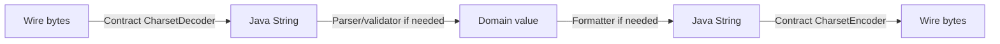
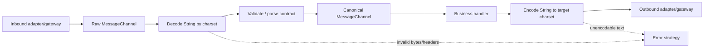
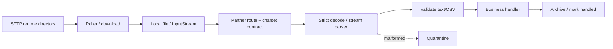

# String and charset converter in Spring Integration Adapters

A **String and charset converter** is the part of an integration flow responsible for converting between **wire byte sequences** and **Java character strings** using an agreed-upon character encoding (*charset*). A message may arrive from file/SFTP, HTTP, JMS, AMQP, Kafka, or a database; however, each adapter represents payloads and metadata differently. Choosing the right charset and placing the converter at the right boundary is essential to avoid corrupting Vietnamese names, special characters, file formats, digital signatures, or business data.

For example, a partner sends a CSV line:

```text
ORDER-42,Đặng Thị Hà,Cà phê,159900
```

If the system receives UTF-8 bytes but decodes them using a different charset, characters such as `Đ`, `ặ`, or `à` can turn into garbled strings. Once data has been misdecoded, re-encoding it afterward does not necessarily recover the original bytes and content. Conversely, when encoding a `String` into bytes using an encoding unable to represent certain characters, some APIs silently **substitute characters**, causing data loss.

In the **SPRING_INTEGRATION_ADAPTERS** module, the converter acts as a **message contract boundary**: inbound adapters/gateways/pollers push data onto a `MessageChannel`; a controlled conversion step decodes it into a Java `String` or domain structure; the business handler executes business logic; and the outbound converter encodes it back into bytes as required by the target system. This lesson connects those steps to **error handling, observability, security, and connection lifecycles**.

> **Core principle:** Never guess a charset from a filename, operating system, or whether text "looks readable." Establish who owns the encoding contract, whether the actual payload is `byte[]` or `String`, which layer already decoded it, and how invalid bytes must be handled.

## 1. Learning objectives

After this lesson, learners will be able to:

1. Explain the differences between **Unicode characters**, **code points**, **Java String**, **bytes**, and **charsets**.
2. Distinguish **decoding (bytes → String)** from **encoding (String → bytes)** and avoid converting twice.
3. Understand the roles of `Message<?>`, `MessageHeaders.CONTENT_TYPE`, `MessageConverter`, `Transformer`, and `MessageChannel`.
4. Design explicit charset contracts for HTTP, file/SFTP, JMS, AMQP, Kafka, and JDBC.
5. Write Java converters using `CharsetDecoder` and `CharsetEncoder` with a **REPORT** policy instead of silent character substitution.
6. Handle `text/plain; charset=UTF-8` headers, unsupported charsets, missing headers, and malformed byte sequences.
7. Explain **BOM, UTF-8, UTF-16, ISO-8859-1, Windows-1252**, and the risks of mixing encodings.
8. Recognize when a String converter suffices and when you also need a CSV/JSON/XML parser, schema validation, or domain transformer.
9. Manage retries, error channels, quarantine, idempotency, and conversion errors across synchronous and asynchronous adapters.
10. Design unit tests, integration tests, metrics, and a safe deployment checklist.

## 2. Fundamental model: Bytes are not characters

A byte is an 8-bit binary data unit. A Java character string is a sequence of **UTF-16 code units**, represented by `String`. A charset defines **how characters and bytes map to one another** when storing or transmitting data.



For example, the character `Đ`:

- In Java, it can be represented via its corresponding Unicode character code.
- When UTF-8 encoded, it becomes **multiple bytes**, not a single ASCII byte.
- When decoding those same bytes with the wrong charset, the result can be entirely different characters.
- `string.length()` counts **UTF-16 code units**, not UTF-8 byte count or user-perceived visual characters.

### 2.1. Three different sizes

For a string with Vietnamese accents or emojis:

| Measure | Meaning | Reference Java API |
| --- | --- | --- |
| Number of UTF-16 code units | Length under the `String` model | `text.length()` |
| Number of Unicode code points | Number of Unicode character codes | `text.codePointCount(0, text.length())` |
| Number of encoded bytes | Wire/storage size in a charset | Encoder output or `getBytes(UTF_8).length` |
| Number of grapheme clusters | Can differ from code points due to combining marks, ZWJ emojis | Appropriate Unicode/grapheme segmentation rules |

**Never use `String.length()` to enforce wire payload size limits.** With UTF-8, byte counts can exceed code-unit counts, so bounds must be checked against the encoded bytes.

### 2.2. Understanding "String is UTF-16"

Java's `String` exposes an API based on UTF-16 code units; this **does not mean** every String is transmitted over the wire as UTF-16. When stored or sent, the final bytes are produced according to the **external contract's charset**, such as UTF-8 or UTF-16LE. Internal JVM storage optimizations should not dictate protocol design.

## 3. Encoding and decoding are two different operations

### 3.1. Decode: bytes → text

```java
byte[] wire = /* bytes supplied by the adapter */;
String text = new String(wire, StandardCharsets.UTF_8);
```

This snippet **specifies UTF-8 explicitly**, which is better than using the default charset. However, `new String(bytes, charset)` can replace invalid byte sequences with replacement characters instead of throwing an error. When the contract requires zero data loss, use **`CharsetDecoder`** with a rejection policy.

### 3.2. Encode: text → bytes

```java
String text = "Đặng Thị Hà";
byte[] wire = text.getBytes(StandardCharsets.UTF_8);
```

This encodes explicitly as UTF-8. Still, when a string contains invalid surrogates, convenience encoding APIs can substitute characters. When an application needs strict encoding error control, use **`CharsetEncoder`** and handle exceptions.

### 3.3. Mistake: Encoding/decoding multiple times

```text
Correct:
UTF-8 bytes -> UTF-8 decode -> Java String

Wrong:
UTF-8 bytes -> decode Latin-1 -> corrupted Java String
            -> encode UTF-8 -> new bytes differ from original
```

"Mojibake"—where characters turn into gibberish sequences—often signals wrong decoding. Do not try to patch it by chaining another arbitrary `getBytes`/`new String` cycle without identifying which layer applied the wrong charset.

## 4. Where does the String converter sit in Spring Integration?

An integration flow has multiple boundaries:



Role of each step:

| Component | Function | What to avoid |
| --- | --- | --- |
| Inbound adapter/gateway | Turns external data into a Spring Message. | Do not assume every adapter outputs `byte[]`. |
| Raw channel | Connects inbound endpoint to raw processing. | Do not assume the channel picks a charset automatically. |
| Decoder/Transformer | Translates bytes to String per contract. | Do not guess charsets or silently replace bad characters. |
| Business handler | Processes normalized business data. | Do not mix transport parsers into business logic. |
| Encoder/Transformer | Encodes String to bytes as target requires. | Do not use source charset if target requires another. |
| Outbound adapter | Pushes data to HTTP, broker, file, or external systems. | Do not assume internal headers map onto the wire automatically. |

**Changing the `contentType` header does not automatically convert bytes into a String across every `MessageChannel`.** Conversion only happens when an endpoint/adapter or an explicit converter/transformer is configured to perform it.

## 5. Distinguishing MessageConverter, Transformer, and adapter codecs

| Concept | Practical role | Example |
| --- | --- | --- |
| **Spring Messaging MessageConverter** | Converts payloads and `Message<?>` between Java types per MIME/target type. | `StringMessageConverter`. |
| **Spring Integration Transformer** | Endpoint transforming payload or message inside a flow. | Custom `@Transformer` bytes → String. |
| **HTTP message converter** | Reads/writes HTTP request/response bodies per HTTP framework contract. | May decode body to String before Integration sees it. |
| **Kafka serializer/deserializer** | Converts key/value between bytes and objects in the Kafka client. | `StringDeserializer`, `ByteArrayDeserializer`. |
| **JMS/AMQP message converter** | Converts broker/client-specific message representations. | Text/bytes/message properties. |
| **File reader/writer or JDBC mapper** | Reads/writes typed files or database data. | `Files.newBufferedReader`, JDBC `getString`. |

Spring Messaging provides converters like `org.springframework.messaging.converter.StringMessageConverter`; conversion behavior and supported MIME types must be checked against **your actual version and configuration**. A Spring Integration flow can use that converter at an appropriate endpoint, but **simply having a converter bean does not make every adapter use it automatically**.

### 5.1. When to use a built-in converter?

Use a built-in converter if:

- You only need `String` and a supported set of MIME types.
- Its charset/default charset and error behavior satisfy the contract.
- The actual endpoint supports configuring the converter.
- You do not need custom BOM handling, strict decoders, or special metadata rules.

Use a custom transformer if:

- You need **fail-closed** rejection on invalid UTF-8.
- You must enforce byte limits before decoding.
- Sources span multiple allowlisted charsets.
- You need audit reason codes, BOM handling, or control-character checks.
- You must normalize headers across multiple adapters.
- You need to separate wire text from business-validated text.

## 6. Content-Type, charset, and Content-Encoding

A MIME header typically looks like:

```text
text/plain; charset=UTF-8
text/csv; charset=UTF-8
application/json
application/xml; charset=UTF-8
```

There are three layers to distinguish:

1. **Media type:** is the data `text/plain`, `text/csv`, JSON, or XML?
2. **Charset:** under which character encoding are bytes decoded into characters?
3. **Content encoding/compression or transfer encoding:** is the data additionally compressed or transport-encoded?

Example:

```text
HTTP Content-Type: text/plain; charset=UTF-8
HTTP Content-Encoding: gzip

HTTP body bytes
  -> decompress gzip per contract and safety limits
  -> obtain UTF-8 bytes
  -> decode to String
```

**Gzip is not a charset.** `UTF-8` is not a media type either. The name `contentEncoding` in some brokers or libraries may be used by convention to denote character encoding; understand the semantics of your **exact transport** instead of blindly projecting HTTP meanings onto JMS/AMQP/Kafka.

### 6.1. Spring Messaging header

Spring Messaging uses the constant:

```java
MessageHeaders.CONTENT_TYPE
```

Its value can be a `MimeType` or a string representation depending on the adapter and mapping. Example:

```java
MimeType type = MimeTypeUtils.parseMimeType(
    "text/plain; charset=UTF-8"
);

Message<byte[]> message = MessageBuilder
    .withPayload(rawBytes)
    .setHeader(MessageHeaders.CONTENT_TYPE, type)
    .build();
```

HTTP has a native `Content-Type` protocol header; Kafka may use a self-managed record header; file/SFTP usually relies on **directory/partner contracts**. Never treat them all as identical.

## 7. Common charsets and how to choose

| Charset | Characteristics | Where encountered |
| --- | --- | --- |
| **UTF-8** | Unicode, standard for modern APIs and text; byte-compatible with ASCII. | HTTP, JSON, Kafka, UTF-8 files, modern integrations. |
| **UTF-16LE/UTF-16BE** | Unicode with 16-bit code units and explicit byte order. | Certain legacy files/systems; requires BOM/endian contract. |
| **UTF-16** | Charset with Java-defined byte-order/BOM rules. | Some older data exchanges. |
| **ISO-8859-1** | Single-byte encoding for a limited character set; cannot cover Vietnamese. | Legacy Western systems. |
| **Windows-1252** | Legacy encoding differing from ISO-8859-1 at several positions. | CSV/flat files emitted by older software. |
| **US-ASCII** | Covers 7-bit ASCII only. | Protocol fields or heavily constrained data. |

**Prefer UTF-8 for new protocols** whenever parties can agree. When forced to support legacy charsets, specify them explicitly by **partner, endpoint, file route, or version**, rather than enabling unbounded auto-detection.

### 7.1. Legacy charsets cannot preserve all characters

If a partner mandates Windows-1252 while content includes `"Đặng"`, many characters **cannot be represented**. Strict encoding must raise an error so parties can fix the contract, or apply an explicitly business-approved *transliteration* rule—never silently replace characters with question marks.

### 7.2. Java `Charset.forName` and allowlists

An API may call `Charset.forName(name)`, yet you should never take an arbitrary client-supplied `charset` string to instantiate encodings unrestrictedly. For partners with fixed contracts, use an allowlist:

```text
partner A -> UTF-8
partner B -> windows-1252 (legacy; sunset plan)
partner C -> UTF-16LE (fixed contract)
other     -> UNSUPPORTED_CHARSET
```

Aliases of the same charset should also be canonicalized so metrics, audits, and validation stay consistent.

## 8. Designing the text contract before writing a converter

A minimal message contract should cover:

| Element | Example decision |
| --- | --- |
| Source system | `partner-a` authenticated at HTTP gateway or SFTP session. |
| Transport | HTTP request, JMS queue, Kafka topic, file/SFTP route. |
| Pre-conversion Java payload | `byte[]`, `String`, `File`, `InputStream`, or row map. |
| Wire media type | `text/plain`, `text/csv`, or JSON/XML where appropriate. |
| Charset | Mandatory UTF-8; legacy routes have dedicated rules. |
| BOM policy | Reject BOM, strip UTF-8 BOM, or use BOM for endianness per contract. |
| Newline policy | LF, CRLF, or both; trailing newline handling. |
| Schema/grammar | Plain lines, RFC-compatible CSV, JSON/XML, or domain format. |
| Normalization | Preserve verbatim or intentionally normalize Unicode/newlines. |
| Size limit | Max bytes and max length after decoding. |
| Error strategy | Permanent reject, quarantine, or transient retry. |
| Traceability | Correlation/event ID, source, adapter, version, reason code. |

Illustrative contract example:

```yaml
contract: partner-a-order-text
transport: kafka
payloadJavaTypeBeforeConversion: byte[]
allowedMediaTypes:
  - text/plain
charset: UTF-8
charsetHeaderRequired: true
bomPolicy: REJECT
maxWireBytes: 1048576
lineFormat: "ORDER|eventId|orderId|amountCents"
onMalformedBytes: QUARANTINE
onUnsupportedCharset: REJECT
```

This is **not configuration natively understood by Spring Integration**. Code, converters, routing, and error handlers must enforce these constraints.

## 9. Inbound example: Strictly converting UTF-8 byte[] to String

Suppose an inbound adapter normalized the payload to `Message<byte[]>` with header `MessageHeaders.CONTENT_TYPE`. We want to accept **strictly** `text/plain; charset=UTF-8`, reject malformed data, and never guess encodings.

### 9.1. Functionally complete Java conversion transformer

```java
import java.nio.ByteBuffer;
import java.nio.charset.CharacterCodingException;
import java.nio.charset.CodingErrorAction;
import java.nio.charset.StandardCharsets;
import org.springframework.integration.annotation.Transformer;
import org.springframework.messaging.Message;
import org.springframework.messaging.MessageHeaders;
import org.springframework.messaging.support.MessageBuilder;
import org.springframework.stereotype.Component;
import org.springframework.util.MimeType;
import org.springframework.util.MimeTypeUtils;

@Component
public class StrictUtf8InboundTransformer {

    private static final int MAX_WIRE_BYTES = 1_048_576;

    @Transformer(
        inputChannel = "rawTextChannel",
        outputChannel = "canonicalTextChannel"
    )
    public Message<String> decode(Message<byte[]> input) {
        byte[] bytes = input.getPayload();

        if (bytes.length == 0 || bytes.length > MAX_WIRE_BYTES) {
            throw new IllegalArgumentException(
                "EMPTY_OR_OVERSIZED_TEXT_PAYLOAD"
            );
        }

        MimeType mime = requiredMimeType(input.getHeaders());
        if (!mime.getType().equalsIgnoreCase("text")
                || !mime.getSubtype().equalsIgnoreCase("plain")
                || !StandardCharsets.UTF_8.equals(mime.getCharset())) {
            throw new IllegalArgumentException(
                "UNSUPPORTED_CONTENT_TYPE_OR_CHARSET"
            );
        }

        // Example policy: reject UTF-8 BOM.
        if (bytes.length >= 3
                && (bytes[0] & 0xff) == 0xef
                && (bytes[1] & 0xff) == 0xbb
                && (bytes[2] & 0xff) == 0xbf) {
            throw new IllegalArgumentException("UTF8_BOM_NOT_ALLOWED");
        }

        final String text;
        try {
            text = StandardCharsets.UTF_8.newDecoder()
                .onMalformedInput(CodingErrorAction.REPORT)
                .onUnmappableCharacter(CodingErrorAction.REPORT)
                .decode(ByteBuffer.wrap(bytes))
                .toString();
        } catch (CharacterCodingException ex) {
            throw new IllegalArgumentException(
                "MALFORMED_UTF8_PAYLOAD", ex
            );
        }

        // Next layer handles grammar/CSV/schema if needed.
        // Do not retain contentType=... on a Java String payload
        // if the flow uses it to describe the current wire representation.
        return MessageBuilder.withPayload(text)
            .setHeader("wireContentType", mime.toString())
            .setHeader(
                "correlationId",
                input.getHeaders().get("correlationId")
            )
            .build();
    }

    private static MimeType requiredMimeType(MessageHeaders headers) {
        Object raw = headers.get(MessageHeaders.CONTENT_TYPE);

        if (raw instanceof MimeType mimeType) {
            return mimeType;
        }

        if (raw instanceof String value && !value.isBlank()) {
            return MimeTypeUtils.parseMimeType(value);
        }

        throw new IllegalArgumentException("CONTENT_TYPE_REQUIRED");
    }
}
```

### 9.2. Key points in the example

1. **Byte limit before decoder:** prevents unbounded memory consumption on huge inputs.
2. **Allowlisted media type and charset:** avoids "let's try decoding as UTF-8 and see".
3. **Strict decoder:** malformed/unmappable bytes raise controlled errors instead of silent character replacement.
4. **Fixed BOM policy:** this lesson rejects UTF-8 BOMs; another system may accept and strip BOMs if specified by contract.
5. **Fresh decoder per invocation:** decoders hold state and must not be shared across threads arbitrarily.
6. **Post-conversion metadata:** retains a reference to the wire content type without making downstream think the `String` is still a byte payload.
7. **No authorization from headers:** `correlationId` is only for tracing; a client-supplied header is never proof of identity or tenancy.

This example illustrates a transformer under a simple contract; it does not cover all adapter responsibilities such as source authentication, decompression, log redaction, timeouts, or transactional redelivery.

### 9.3. What if the charset header is missing?

The code above rejects `text/plain` without `charset`. This is a **contract choice**, not a universal rule for every media type. An endpoint receiving only UTF-8 files can legitimately **assign UTF-8 per a governed route**, even when files lack MIME headers. What matters is that defaults are **explicitly specified and tested**, never inherited silently from the runtime environment.

## 10. Outbound example: Converting String to UTF-8 bytes

In the reverse outbound direction, the business handler has built a grammar-valid `String` that needs encoding for HTTP, a broker, or a file. Strict encoding catches Strings containing invalid Unicode before data is emitted.

```java
import java.nio.ByteBuffer;
import java.nio.CharBuffer;
import java.nio.charset.CharacterCodingException;
import java.nio.charset.CodingErrorAction;
import java.nio.charset.StandardCharsets;
import org.springframework.integration.annotation.Transformer;
import org.springframework.messaging.Message;
import org.springframework.messaging.MessageHeaders;
import org.springframework.messaging.support.MessageBuilder;
import org.springframework.stereotype.Component;
import org.springframework.util.MimeType;
import org.springframework.util.MimeTypeUtils;

@Component
public class StrictUtf8OutboundTransformer {

    private static final int MAX_WIRE_BYTES = 1_048_576;
    private static final MimeType TEXT_UTF8 =
        MimeTypeUtils.parseMimeType("text/plain; charset=UTF-8");

    @Transformer(
        inputChannel = "outboundTextChannel",
        outputChannel = "outboundBytesChannel"
    )
    public Message<byte[]> encode(Message<String> input) {
        String text = input.getPayload();

        final byte[] bytes;
        try {
            ByteBuffer encoded = StandardCharsets.UTF_8.newEncoder()
                .onMalformedInput(CodingErrorAction.REPORT)
                .onUnmappableCharacter(CodingErrorAction.REPORT)
                .encode(CharBuffer.wrap(text));

            bytes = new byte[encoded.remaining()];
            encoded.get(bytes);
        } catch (CharacterCodingException ex) {
            throw new IllegalArgumentException(
                "INVALID_UNICODE_TEXT", ex
            );
        }

        if (bytes.length == 0 || bytes.length > MAX_WIRE_BYTES) {
            throw new IllegalArgumentException(
                "EMPTY_OR_OVERSIZED_OUTBOUND_TEXT"
            );
        }

        return MessageBuilder.withPayload(bytes)
            .setHeader(MessageHeaders.CONTENT_TYPE, TEXT_UTF8)
            .setHeader(
                "correlationId",
                input.getHeaders().get("correlationId")
            )
            .build();
    }
}
```

### 10.1. What to verify on outbound adapters

- HTTP: the HTTP message converter/gateway may re-encode if given a `String`; if `byte[]` is already produced, configure body/header mapping properly.
- JMS: if sending a `TextMessage`, the provider owns text representation; if sending a `BytesMessage`, byte/charset contracts must match.
- Kafka: if value serializer is `ByteArraySerializer`, data is already bytes. If value serializer is `StringSerializer`, do **not** feed `byte[]` without adjusting.
- File/SFTP: writing `byte[]` preserves the chosen encoding; if using a character writer, configure charset on the writer.
- Database: if the column is VARCHAR/CLOB, the driver handles characters; if BLOB, store bytes per contract.

**Never encode twice.** Each outbound path should have a single clear owner for `String → bytes` at the corresponding boundary.

## 11. MessageChannel and wiring transformers into flows

A straightforward channel configuration:

```java
import org.springframework.context.annotation.Bean;
import org.springframework.context.annotation.Configuration;
import org.springframework.integration.channel.DirectChannel;
import org.springframework.messaging.MessageChannel;

@Configuration
public class TextChannels {

    @Bean
    public MessageChannel rawTextChannel() {
        return new DirectChannel();
    }

    @Bean
    public MessageChannel canonicalTextChannel() {
        return new DirectChannel();
    }

    @Bean
    public MessageChannel outboundTextChannel() {
        return new DirectChannel();
    }

    @Bean
    public MessageChannel outboundBytesChannel() {
        return new DirectChannel();
    }
}
```

With the preceding `@Transformer`, a business-processing endpoint can receive text:

```java
import org.springframework.integration.annotation.ServiceActivator;
import org.springframework.messaging.Message;
import org.springframework.stereotype.Component;

@Component
public class TextBusinessHandler {

    @ServiceActivator(inputChannel = "canonicalTextChannel")
    public void handle(Message<String> input) {
        String text = input.getPayload();

        // Handle text grammar here (e.g., valid CSV)
        // or forward to a domain parser.
        // No need to guess charsets anymore.
    }
}
```

`DirectChannel` dispatches synchronously on the caller's thread. When a converter throws an exception, the error can **propagate back to the sender/gateway thread**, unlike consumers running on a poller or dedicated thread. Test error handling explicitly rather than assuming all errors automatically go to a global error channel.

### 11.1. When to separate raw and canonical channels?

Separating them helps:

- Operators see whether payloads are currently **unvalidated bytes** or **decoded Strings**.
- Attach metrics, size limits, and error strategies at the right boundary.
- Prevent handlers from reading raw untrusted bytes.
- Reuse the same handler across multiple transports once normalized.
- Decouple partner charset rules from business logic.

Small applications do not always need many separate channels; endpoints can be combined when simpler, provided **input/output contracts and conversion boundaries** remain clear.

## 12. Spring Messaging `StringMessageConverter`

Spring Messaging provides `StringMessageConverter` to convert text messages/payloads according to supported contracts and target types. When considering this converter, clarify:

1. **Who invokes the converter?** It must be configured on an endpoint/adapter or invoked directly.
2. **What is the current payload?** Bytes, String, or another object?
3. **Which target class is requested?** `String` or another type?
4. **Which content types and charsets are supported?**
5. **Does its malformed-data handling** match the contract's strictness?
6. **How are headers** retained or adjusted?

Conceptual snippet:

```java
import org.springframework.messaging.converter.StringMessageConverter;

StringMessageConverter converter =
    new StringMessageConverter();
```

This snippet only shows **instantiating the converter**, not implying every transport automatically uses this bean. Check the API and integration configuration of your Spring version before invoking `fromMessage`/`toMessage` in an application.

### 12.1. Does a custom transformer replace built-in converters?

Not always. For straightforward UTF-8 contracts, a built-in converter may suffice. The custom transformer in this lesson demonstrates **strict encoding, size limits, explicit rejection codes, and header control** that many external integrations additionally need.

Use framework converters when they fulfill the contract; add custom logic for clear technical or security reasons without needlessly rewriting the entire codec stack.

## 13. File inbound/outbound: Where does encoding happen?

A file adapter can emit a `File`, `Path`, or resource depending on the endpoint. **A `File` object is not a `String`.** There are two design approaches:

### 13.1. Bounded read to bytes then decode

```text
Inbound file adapter -> File
   -> verify path/size/readiness
   -> read bytes within limit
   -> Message<byte[]> + route contract
   -> StrictUtf8InboundTransformer
   -> Message<String>
```

`Files.readAllBytes(path)` works for **small size-checked files**, but must not be used for multi-GB files. In production, checking size and reading can race if a file is still being modified; combine file readiness checks, safe access permissions, and read limits.

### 13.2. Streaming/reader approach

For large files, use `InputStreamReader`/`BufferedReader` with a configured decoder:

```java
import java.io.BufferedReader;
import java.io.InputStreamReader;
import java.nio.charset.CodingErrorAction;
import java.nio.charset.StandardCharsets;
import java.nio.file.Files;
import java.nio.file.Path;

Path file = Path.of("inbox/orders.txt");

try (BufferedReader reader = new BufferedReader(
        new InputStreamReader(
            Files.newInputStream(file),
            StandardCharsets.UTF_8.newDecoder()
                .onMalformedInput(CodingErrorAction.REPORT)
                .onUnmappableCharacter(CodingErrorAction.REPORT)
        ))) {

    String line;
    while ((line = reader.readLine()) != null) {
        // Process each line within contract limits.
        // For CSV with quoted newlines in fields,
        // use a CSV parser rather than treating each line as a record.
    }
}
```

**Note:** `readLine()` strips line terminators; if you need to reconstruct exact bytes, verify digital signatures, or distinguish LF vs CRLF, this strategy does not fit. Stream readers must also bound total file size and line/record lengths to prevent runaway memory usage.

### 13.3. Writing text files

```java
Files.writeString(
    Path.of("outbox/orders.txt"),
    text,
    StandardCharsets.UTF_8
);
```

This is convenient for moderate content, yet integrations requiring idempotency and atomic file delivery also need temp-write-and-rename, filename governance, permissions, flush/close handling, and error recovery.

## 14. SFTP poller: Selecting charset by partner contract

SFTP transfers **file bytes**; it does not normalize a file's charset automatically. `.txt` or `.csv` extensions are only conventional hints, not encoding proof.

Real-world flow:



Concerns to address:

- **File readiness:** avoid reading files mid-upload; agree on rename/marker conventions.
- **Metadata:** route/partner and charset must come from trusted configuration.
- **No duplicate processing:** file filters, idempotency keys, or metadata registries.
- **Retry and quarantine:** malformed file bytes rarely heal themselves on retry.
- **Size:** streaming for large files; record/batch limits.
- **Connection lifecycle:** SFTP session timeouts/reconnects, remote/local cleanup, and archiving.
- **Privacy:** never dump entire customer files into logs when charset errors occur.

### 14.1. Avoid guessing encoding from Byte Order Marks

A BOM can help with certain encodings, but it is not an infallible identifier. If a route mandates UTF-8, accept or reject BOMs per contract; never let a file override approved codec rules solely based on its opening bytes.

## 15. HTTP adapter/gateway: Content type and body conversion

HTTP carries `Content-Type` on requests/responses, e.g.:

```http
POST /api/orders/text HTTP/1.1
Content-Type: text/plain; charset=UTF-8

ORDER-42,Đặng Thị Hà,Cà phê,159900
```

Distinguish:

| HTTP concept | Meaning |
| --- | --- |
| `Content-Type` | Representation of the current body, optionally including charset. |
| `Accept` | Response media types the client can accept. |
| `Content-Encoding` | Content coding step such as gzip; not a charset. |
| `Content-Length` | Wire body size per HTTP semantics, not `String.length()`. |

### 15.1. Conversion may already run at the HTTP layer

An HTTP inbound gateway or HTTP framework may read the body into a `String` using an HTTP message converter. If Spring Integration receives `Message<String>`, **do not cast it to `byte[]` and decode again**.

Two valid models exist:

**Model A – decode at the HTTP boundary:**

```text
HTTP bytes
 -> HTTP converter reads Content-Type/charset
 -> Message<String>
 -> validate/parser
```

**Model B – keep bytes into the integration flow:**

```text
HTTP bytes
 -> Message<byte[]> + mapped/validated content type
 -> StrictUtf8InboundTransformer
 -> Message<String>
```

Pick one model and test against your exact framework version, especially when custom HTTP converters exist.

### 15.2. Classifying HTTP errors

- `415 Unsupported Media Type`: media type/charset is unsupported per API contract.
- `400 Bad Request`: invalid bytes or request structure per API specification.
- `401/403`: authentication/authorization failure, distinct from charset errors.
- `5xx`: system error; never turn every malformed text request into a server error.

Error responses must not print raw credentials, sensitive bodies, or stack traces; returning a reference code for support lookup is appropriate.

## 16. JMS: TextMessage and BytesMessage are not equivalent

JMS defines message types such as `TextMessage` and `BytesMessage`. A listener/adapter can convert them into Java `String` or `byte[]` depending on configured converters.

### 16.1. TextMessage

```text
Producer sends JMS TextMessage
 -> JMS provider / converter
 -> Spring Message<String> per mapping
 -> business validation
```

JMS `TextMessage` represents text content at the API level; the provider handles wire representation. Do not take the received `String`, encode it to bytes with a guessed charset, and decode it again just to "make sure it is UTF-8."

### 16.2. BytesMessage

```text
Producer sends JMS BytesMessage (UTF-8 bytes)
 -> Spring Message<byte[]>
 -> contract charset converter
 -> Spring Message<String>
```

If a JMS integration stores an extra `contentType` or `charset` property, know the **exact property names and header mappings**. Do not assume JMS has standard HTTP headers.

### 16.3. Converter errors and redelivery

When a `BytesMessage` holds invalid UTF-8, specify:

- Does the error occur before or after JMS acknowledgment?
- Is there a transaction rollback/retry?
- After how many attempts does it move to a DLQ/quarantine?
- Does the invalid message block other messages in the queue?
- Does replay after fixing the contract guarantee idempotency?

Never let a poison message redeliver infinitely just because the converter consistently throws an unrecoverable error.

## 17. AMQP: contentEncoding, contentType, and custom converters

AMQP/RabbitMQ typically carries properties describing content type and encoding, and Spring AMQP adds its own message converter layer. **Do not equate property names across different libraries and transports**.

Example AMQP message:

```text
contentType = text/plain
contentEncoding = UTF-8
body = UTF-8 byte[]
```

Depending on the Spring AMQP converter/adapter, the message arriving in Spring Integration may already be a `String` or still be `byte[]`. Verify:

1. How the AMQP producer sets the body and properties.
2. Which converter the listener/adapter uses.
3. Whether headers/properties are copied onto the Spring Message.
4. What default charset and malformed-byte behavior apply.
5. Whether retries/DLQ run in the broker or inside the flow.

Do not assume AMQP `contentEncoding=UTF-8` automatically invokes this lesson's Spring Integration transformer.

## 18. Kafka: StringDeserializer or ByteArrayDeserializer?

Kafka key/value serializers and deserializers operate at the Kafka client layer before the consumer passes values into Spring Integration.

| Consumer configuration | Typically received value type | Where encoding is handled |
| --- | --- | --- |
| `ByteArrayDeserializer` | `byte[]` | Flow converter/transformer, if `String` is needed. |
| `StringDeserializer` | `String` | Kafka deserializer already decoded per its config. |
| Dedicated JSON deserializer | Object or tree | No text decoder needed if already decoded/parsed. |

Example:

```text
Producer UTF-8 text -> ByteArraySerializer
Kafka topic value: UTF-8 bytes
Consumer ByteArrayDeserializer
  -> Spring Message<byte[]>
  -> StrictUtf8InboundTransformer
  -> String parser
```

Or:

```text
Producer StringSerializer (configured UTF-8)
Kafka topic value: bytes
Consumer StringDeserializer (compatible charset)
  -> Spring Message<String>
  -> String parser, do not decode a second time
```

### 18.1. Kafka headers do not switch deserializers automatically

A producer can set Kafka record header `contentType=text/plain;charset=UTF-8`, yet `StringDeserializer`/`ByteArrayDeserializer` are **configured separately**. Headers can support validation or routing, not dynamically drive the Kafka client's deserializer selection.

### 18.2. Errors before entering the flow

If `StringDeserializer` encounters malformed data and throws at the Kafka listener layer, that error **can happen before the Spring Integration transformer**. Integration's global error channel will not always see it. Test error handling in the listener container, offset commits, retries, and dead-letter policies separately.

## 19. JDBC/database: Strings already decoded by the driver

With JDBC, how data appears in Java depends on column types and reading APIs:

- `VARCHAR`, `NVARCHAR`, `CLOB`, or text types: drivers/ORMs usually return a `String` or reader.
- `BLOB`/binary: drivers return bytes/streams; the application contract governs charset.
- JSON/XML inside a text column: after receiving a `String`, structural parsing is still needed; text conversion alone is insufficient.
- A database adapter may return a row map/list instead of a bare `String`.

### 19.1. What not to do?

If you already received a `String` from a properly driver-handled Unicode column, **never call `getBytes` with the default charset and `new String` with another charset**. That adds a redundant conversion pass that risks corrupting data.

### 19.2. Outbox and idempotency

For pollers reading event rows from a database:

```text
DB event row
 -> payload_text (String) + event_id + schema_version
 -> validate/parse
 -> outbound encoding if emitting wire text
 -> target broker/file
```

Clear transactions/checkpoints are required to prevent losing events if handlers fail or duplicating publishes after retries. Error handling for bad data should not stall the whole poller if bad records can be isolated per contract.

## 20. BOM: File preamble marker and handling

A **Byte Order Mark (BOM)** is a special byte sequence that can appear at the start of some Unicode representations. Its meaning varies by encoding:

| Format | Common BOM | Notes |
| --- | --- | --- |
| UTF-8 | `EF BB BF` | Unnecessary for UTF-8; some producers still emit it. |
| UTF-16BE | `FE FF` | Can indicate byte order in UTF-16 contracts. |
| UTF-16LE | `FF FE` | Can indicate little-endian. |
| UTF-32 | Corresponding BOM sequences | Support only when specified by contract/codec. |

### 20.1. Three possible strategies

1. **REJECT:** disallow BOMs; fits strict text-protocol message contracts.
2. **STRIP_IF_PRESENT:** accept a leading UTF-8 BOM and strip the exact three bytes prior to decoding.
3. **DETECT_ALLOWED_BOM:** use only to select endianness/charset within an approved set.

**Never confuse a BOM with business characters elsewhere in the string.** If policy allows stripping a BOM, strip only at the very beginning of the payload and record the action; never delete every U+FEFF occurrence arbitrarily inside content.

### 20.2. BOM after decoding

For a UTF-8 BOM, if the decoder does not consume it as an indicator and turns it into a leading U+FEFF character in the `String`, a CSV parser may read the first column name as `\uFEFForderId` instead of `orderId`. Thus, BOM policy belongs at the **parsing boundary**, not left for every business handler to guess.

## 21. Line endings: LF, CRLF, and multiline data

Two visually identical files can differ in bytes:

```text
LF:   \n
CRLF: \r\n
CR:   \r
```

All represent line breaks in specific environments/protocols. When converting text:

- **Decode** should preserve line-ending characters unless the contract requires normalization.
- **Line-ending normalization** is a content transformation step, not intrinsic to charset conversion.
- **Outbound encoding** must match the format required by the target system.
- Payload **signatures/hashes** can change if line endings are normalized.
- CSV fields can contain quoted newlines; splitting on `String.split("\\n")` is not a valid CSV parser.

### 21.1. Why not call trim/strip unconditionally?

`text.strip()` can strip whitespace or trailing newlines that are meaningful under certain contracts. A charset converter should keep a narrow scope: **bytes ↔ characters**; cleanup/trimming steps need **explicit business rules** to avoid corrupting data.

## 22. Unicode normalization and confusable characters

A single visually identical character can have two distinct Unicode representations. For example, an accented letter can be encoded as a precomposed character or a base letter plus a combining diacritic.

### 22.1. NFC and NFD

Java provides the API:

```java
import java.text.Normalizer;

String normalized = Normalizer.normalize(
    input,
    Normalizer.Form.NFC
);
```

**Do not automatically normalize every message** if partners send signed data, sensitive identifiers, byte-comparison keys, or data that must remain verbatim. Normalization can alter re-encoded bytes even when the text looks identical.

You can separate stages:

```text
Raw bytes (store hash/audit reference if needed)
    -> Strict decode
    -> Unicode validation/normalization (if required by contract)
    -> Domain parsing
    -> Business identifiers and policies
```

### 22.2. Control characters and confusables

A validly UTF-8-decoded `String` can still contain:

- NUL `\u0000` or disallowed control characters.
- Unexpected newlines inside headers, filenames, or CSV fields.
- Unicode confusables/homoglyphs causing confusion in account codes or resource names.
- Bidirectional display control characters making logs misleading.

These are **validation and safe text-handling issues**, not charset errors. Never equate "decoded successfully" with "safe to use in paths, SQL, headers, or account names."

## 23. A String converter does not replace JSON, CSV, or XML parsers

A text converter only turns bytes into a string. If that string is structured, grammar/schema parsing is still required.

| Format | Byte → String | Next step |
| --- | --- | --- |
| Plain text | Per charset | Character, length, and semantic validation. |
| CSV | Per defined encoding | CSV parser handling quotes/escapes/delimiters/headers. |
| JSON | Per JSON encoding/contract | JSON parser + schema/domain validation. |
| XML | Per XML encoding/contract | Namespace-aware XML parser + XSD/domain validation and XXE prevention. |
| Fixed-width records | Per charset, before counting columns | Apply agreed fixed-width rules by **bytes** vs **characters**. |
| Protobuf/Avro | Not necessarily via String | Appropriate binary/schema decoder. |

### 23.1. An easily broken fixed-width example

A record has a name field **20 bytes** wide, not 20 characters. If it contains UTF-8 Vietnamese characters, slicing the `String` at 20 UTF-16 code units may not equal 20 bytes and could even split a Unicode character. Fixed-width contracts must specify the **length unit** and safe padding/truncation rules.

### 23.2. JSON/XML have format-specific encoding rules

For JSON/XML, an HTTP converter or parser may already handle bytes according to format/protocol rules. Adding a String converter beforehand must not conflict with encoding and parser rules. For XML, declarations and BOMs can matter; for binary formats, String decoding is usually wrong.

## 24. Converting across multiple transports: An end-to-end scenario

Suppose a company receives UTF-8 CSV files over SFTP, publishes each transaction line to Kafka, and another service pushes results over HTTP.

### 24.1. Inbound from SFTP

```text
SFTP remote file: orders-2026-11-23.csv
    -> SFTP download / poller
    -> File object (local)
    -> File reader with strict UTF-8
    -> Contract CSV parser
    -> OrderCreated canonical event
```

Here there are two distinct steps: **decoding characters** and **parsing CSV**. If one row fails charset decoding, decide whether to fail the entire file or quarantine only the record per business requirements.

### 24.2. Outbound to Kafka

```text
OrderCreated
    -> format CSV/JSON per Kafka event contract
    -> String
    -> Strict UTF-8 encoding (if producer uses ByteArraySerializer)
    -> byte[] record value
    -> Kafka topic
```

If the producer uses `StringSerializer`, instead of pre-encoding, pass the `String` and let the serializer produce bytes per configuration. **Do not apply both mechanisms together.**

### 24.3. Consumer and HTTP response

```text
Kafka topic
    -> consumer ByteArrayDeserializer
    -> strict UTF-8 decoder
    -> domain parser
    -> business handler
    -> HTTP response body
```

At the HTTP response, you can either delegate encoding to the HTTP framework with configured `Content-Type`/charset or proactively encode to `byte[]` and map the matching header. Both approaches work provided **there is only one final encoding step**.

### 24.4. Idempotency in the file → Kafka flow

A file may be re-polled after a consumer or application restart. With an `eventId` or business key, the system must prevent duplicate processing. Conversion errors must not delete the file before confirming processing state per policy.

## 25. Error handling: Permanent vs. transient failures differ

Charset errors are typically data/contract failures, though some stem from system configuration.

| Error type | Example | Handling direction |
| --- | --- | --- |
| **Malformed bytes** | UTF-8 with invalid continuation byte. | Reject/quarantine; retrying the same bytes rarely helps. |
| **Unsupported charset** | Header declares charset outside allowlist. | Contract rejection; producer fix or migration route needed. |
| **Missing charset** | Endpoint requires explicit UTF-8 yet header lacks it. | Reject or apply approved default route. |
| **Disallowed BOM** | File starts with UTF-8 BOM under NO_BOM contract. | Reject/quarantine, notify producer. |
| **Unencodable characters** | String contains characters outside legacy encoding. | Fail; never silently replace with question marks. |
| **Oversized text** | Body exceeds max bytes. | Reject/stream per architecture. |
| **Transient I/O** | SFTP disconnect, HTTP timeout, broker error. | Bounded retry, backoff, and circuit breaker if appropriate. |
| **Schema/grammar failure** | Decodes fine, yet CSV is missing a column. | Quarantine/business error branch; do not retry infinitely. |
| **Downstream unavailable** | Database or target service temporarily down. | Controlled retry with idempotency. |

### 25.1. Do not assume global errorChannel receives every error

- With `DirectChannel` and synchronous gateways, transformer exceptions can propagate straight back to the sender and map to HTTP responses or caller errors.
- With pollers or asynchronous channels/endpoints, errors can route through an error channel per container/framework configuration.
- With Kafka/JMS/AMQP, errors at the deserializer/converter layer can happen **before** the message enters the Integration flow; retry/ack/commit must be handled at the adapter/listener.

All of these behaviors must be verified with **real transport integration tests**. Do not treat a single error-handler bean as a blanket guarantee across every path.

### 25.2. Quarantine and DLQ

A text message with bad encoding should record metadata:

```json
{
  "eventType": "TEXT_CONVERSION_FAILED",
  "sourceSystem": "partner-a",
  "adapter": "kafka-inbound",
  "correlationId": "order-flow-82",
  "mediaType": "text/plain",
  "charset": "UTF-8",
  "payloadBytes": 104,
  "reasonCode": "MALFORMED_UTF8_PAYLOAD",
  "retryable": false
}
```

If raw payloads must be retained for investigation, store them in a **permission-controlled, protected quarantine store with a retention limit**, never printed in full into application logs. On replay, retain event IDs and deduplication state.

## 26. Data security at the charset converter boundary

A byte-to-String converter is a **trust boundary for untrusted data**. Essential safeguards:

1. **Authenticate sources:** verify HTTP/JMS/Kafka/SFTP identity per policy before trusting metadata.
2. **Never trust role/tenant in headers:** converters understand bytes, not authorization.
3. **Enforce size limits:** on compressed data and post-decompression; prevent decompression bombs.
4. **Strict decoding:** reject malformed sequences when required by contract.
5. **Never execute contents:** a decoded `String` is not inherently safe for SQL, file paths, commands, or HTML.
6. **Safe logging:** strip secrets, tokens, and unnecessary personal data.
7. **Block header injection:** never pass raw newlines/control characters from text into HTTP headers.
8. **Intentional normalization:** Unicode normalization, trimming, and case folding can alter semantics or hashes.
9. **Preserve wire evidence when needed:** if payloads carry digital signatures, verify signatures over the exact agreed byte representation.
10. **Clear error policies:** permanent failures must not stall the entire consumer.

### 26.1. Content-Type header does not authenticate the producer

A client can send `Content-Type: text/plain; charset=UTF-8` even when the body differs or the client lacks permission to call the API. Converters only evaluate **format/encoding**; identity authentication and authorization checks belong in a dedicated security layer using verified identity data.

### 26.2. Digital signatures and canonicalization

If a partner signs over **raw bytes**, decoding and re-encoding before verification can break the signature due to newline, BOM, or Unicode normalization differences. If signatures use canonical text, follow **that protocol's canonicalization rules** rather than inventing your own.

## 27. Testing strict converters

Cover both **valid paths** and **rejection paths**.

### 27.1. Test matrix

| Test case | Input | Expectation |
| --- | --- | --- |
| UTF-8 ASCII | Bytes of `ORDER-42` | Decodes accurately. |
| UTF-8 Vietnamese | `Đặng Thị Hà, Cà phê` | No lost accents. |
| UTF-8 emoji | String with non-BMP characters | Bytes round-trip accurately. |
| Malformed UTF-8 | Leading byte lacking valid continuation | Throws error instead of replacement character. |
| Unsupported charset | `charset=ISO-8859-1` on UTF-8-only endpoint | Rejected. |
| Missing content type | Lacks required header | Rejected. |
| Missing charset | `text/plain` without charset | Rejected per example contract. |
| UTF-8 BOM | `EF BB BF ...` | Rejected per example policy. |
| Empty payload | Empty byte array | Rejected. |
| Oversized payload | Exceeds limit | Rejected prior to decoding. |
| Isolated UTF-16 surrogate | String invalid for UTF-8 encoding | Strict encoder throws error. |
| Non-plain MIME | `application/octet-stream` | Rejected at inbound text converter. |
| Correlation header | Valid adapter correlation ID | Preserves necessary metadata. |
| Unicode normalization | NFC/NFD sent | Preserved if contract does not normalize. |
| Newline differences | LF and CRLF | Preserved until grammar normalization step. |
| Adapter mismatch | Kafka produced String while flow expects `byte[]` | Test catches configuration mismatch. |

### 27.2. Illustrative JUnit 5 unit tests

```java
import static org.junit.jupiter.api.Assertions.*;

import java.nio.charset.StandardCharsets;
import org.junit.jupiter.api.Test;
import org.springframework.messaging.Message;
import org.springframework.messaging.MessageHeaders;
import org.springframework.messaging.support.MessageBuilder;
import org.springframework.util.MimeTypeUtils;

class StrictUtf8TransformerTest {

    private final StrictUtf8InboundTransformer inbound =
        new StrictUtf8InboundTransformer();

    private final StrictUtf8OutboundTransformer outbound =
        new StrictUtf8OutboundTransformer();

    @Test
    void roundTripsVietnameseAndEmoji() {
        String original = "Đặng Thị Hà | Cà phê | 😀";

        Message<String> source =
            MessageBuilder.withPayload(original).build();

        Message<byte[]> encoded = outbound.encode(source);
        Message<String> decoded = inbound.decode(encoded);

        assertEquals(original, decoded.getPayload());
    }

    @Test
    void rejectsMalformedUtf8() {
        byte[] malformed = {
            (byte) 0xC3, (byte) 0x28
        };

        Message<byte[]> source = MessageBuilder
            .withPayload(malformed)
            .setHeader(
                MessageHeaders.CONTENT_TYPE,
                MimeTypeUtils.parseMimeType(
                    "text/plain; charset=UTF-8"
                )
            )
            .build();

        IllegalArgumentException ex = assertThrows(
            IllegalArgumentException.class,
            () -> inbound.decode(source)
        );

        assertEquals("MALFORMED_UTF8_PAYLOAD", ex.getMessage());
    }

    @Test
    void rejectsWrongCharset() {
        Message<byte[]> source = MessageBuilder
            .withPayload("text".getBytes(StandardCharsets.UTF_8))
            .setHeader(
                MessageHeaders.CONTENT_TYPE,
                MimeTypeUtils.parseMimeType(
                    "text/plain; charset=ISO-8859-1"
                )
            )
            .build();

        assertThrows(
            IllegalArgumentException.class,
            () -> inbound.decode(source)
        );
    }

    @Test
    void rejectsUtf8Bom() {
        byte[] bytes = {
            (byte) 0xEF, (byte) 0xBB,
            (byte) 0xBF, (byte) 'A'
        };

        Message<byte[]> source = MessageBuilder
            .withPayload(bytes)
            .setHeader(
                MessageHeaders.CONTENT_TYPE,
                MimeTypeUtils.parseMimeType(
                    "text/plain; charset=UTF-8"
                )
            )
            .build();

        assertThrows(
            IllegalArgumentException.class,
            () -> inbound.decode(source)
        );
    }
}
```

This example only illustrates APIs and test assertions; no build/test run was performed while authoring this content. In real integration work, add tests for string-typed headers, missing charsets, charset aliases, boundary sizes, invalid surrogates, and correlation preservation.

### 27.3. Integration tests across real adapters

Converter unit tests **are not enough** to prove the whole flow works accurately. Verify:

- HTTP gateway receiving text with real `Content-Type` without double decoding.
- JMS `TextMessage` vs `BytesMessage` mapped to expected Java types.
- AMQP `contentEncoding`/`contentType` passing through adapters/converters accurately.
- Kafka `StringDeserializer` vs `ByteArrayDeserializer` and error handlers.
- SFTP files with UTF-8 BOM, CRLF, and large sizes.
- DB BLOB vs VARCHAR and Unicode data through JDBC.
- Retries/redeliveries with malformed bytes not causing infinite loops.
- Header mappings and outbound `Content-Type`/charset actually appearing at the target system.

## 28. Performance, memory, and backpressure

Byte-to-String conversion is rarely complex math, yet at high scale it can become a bottleneck.

### 28.1. Sources of cost

- Large `byte[]` creating Strings and extra allocations.
- Flows converting `byte[]` → `String` → `byte[]` repeatedly, raising GC and latency.
- Repeated decoding of the same payload across retries.
- Pollers reading large files faster than downstream can process.
- Data URIs/base64 or gzip expanding large volumes of data.
- String parsers splitting into numerous substrings/DTOs.

### 28.2. Operational measures

1. Enforce wire size limits **before** decoding.
2. Use streaming and chunking for large files/text.
3. Encode/decode only at necessary boundaries; avoid double conversion.
4. Configure rates, batches, concurrency, queue capacities, and backpressure to match throughput.
5. Enforce idempotency so retries do not duplicate business effects.
6. Set I/O timeouts, bound retries, and quarantine unrecoverable errors.
7. Monitor conversion latency, max payload sizes, and errors by source and charset.
8. Never grow memory limits infinitely to accommodate contract-violating inputs.

### 28.3. Fresh decoder per message

`CharsetDecoder`/`CharsetEncoder` hold internal state and **must not be shared as unsynchronized singletons** across concurrent calls. Instantiate a new decoder/encoder per message or manage state/thread safety via proven APIs and designs.

## 29. Monitoring, metrics, and audit

A converter should record enough metadata to diagnose errors without leaking message bodies.

### 29.1. Illustrative conversion event

```json
{
  "eventType": "TEXT_CONVERSION",
  "correlationId": "order-flow-82",
  "adapter": "sftp-inbound",
  "sourceSystem": "partner-a",
  "inputPayloadType": "byte[]",
  "declaredMediaType": "text/plain",
  "declaredCharset": "UTF-8",
  "targetPayloadType": "String",
  "payloadBytes": 133,
  "outcome": "REJECTED",
  "reasonCode": "MALFORMED_UTF8_PAYLOAD",
  "durationMs": 2
}
```

Values are illustrative only. Never log tokens, passwords, PII contents, or raw malformed payloads in application logs. When storing failed payloads for investigation, use a secure quarantine.

### 29.2. Recommended metrics

| Metric | Purpose |
| --- | --- |
| `text_conversion_success_total{adapter,charset}` | Count of successfully decoded/encoded messages. |
| `text_conversion_failure_total{reason,source}` | Breaks down malformed bytes, unsupported charsets, BOMs, size breaches. |
| `text_conversion_duration_seconds` | Conversion latency and percentiles. |
| `inbound_payload_bytes` | Payload sizes by source. |
| `quarantine_pending_messages` | Backlog of unparseable payloads. |
| `retry_attempts_total` | Detects retry storms. |
| `encoding_contract_version_usage` | Tracks legacy sources prior to migration. |
| `header_mapping_error_total` | Content-type/charset header mapping failures at adapters. |

Avoid using event IDs, order IDs, or arbitrary client-supplied content types as unbounded metric labels, as cardinality can explode. Keep detailed identifiers in access-controlled logs/traces.

### 29.3. Observing connection lifecycles

The converter does not own adapter reconnects/acks/offsets/transactions. On errors, distinguish:

- **Transport connection failure:** SFTP/JMS/AMQP/Kafka/HTTP/JDBC failed to connect.
- **Wire decoding failure:** bytes violate charset.
- **Schema failure:** encoding-valid text violates CSV/JSON/XML.
- **Business rejection:** structurally valid content violates business rules.
- **Outbound encoding failure:** target requires a charset unable to represent characters.

Through clear classification, operators do not try to fix network failures by changing charsets, or fix malformed text with infinite network retries.

## 30. Migrating from legacy charsets to UTF-8

Some legacy systems still use Windows-1252, ISO-8859-1, or proprietary encodings. Moving to UTF-8 requires a plan and verification:

1. **Inventory:** identify active producers, routes, files, message properties, and charsets.
2. **Contract:** approve UTF-8 or a parallel-support window.
3. **Test fixtures:** prepare data with Vietnamese accents, characters outside legacy codepages, BOMs, newlines, and control characters.
4. **Consumer-first:** if parallel support is required, update and test consumers before producers switch.
5. **Intentional routing:** select charsets by producer/contract rather than unbounded sniffing.
6. **Observability:** measure legacy charset share, decode errors, and quarantined payloads.
7. **Cutover:** migrate producers in waves with non-destructive rollback plans.
8. **Sunset:** after the deadline, reject legacy charsets per policy; handle replays from DLQs/archives.
9. **Audit:** record contract changes, versions, and E2E verification results.
10. **Triage already corrupted data:** previously misdecoded data may require dedicated cleanup; changing charset metadata alone does not recover it.

### 30.1. Do not change only the header

If a producer sends Windows-1252 bytes while changing only the header to `charset=UTF-8`, a strict UTF-8 consumer will likely reject it—and that is the **correct behavior**. To genuinely migrate, change **how bytes are encoded**, not merely metadata.

### 30.2. Mixed-encoding storage

A directory holding both UTF-8 and legacy files without distinguishing metadata is error-prone. Separate folders/endpoints by version or use a trusted manifest specifying encoding/schema per file. Never rely solely on a filename like `orders.txt` and brittle heuristics.

## 31. Common anti-patterns

| Anti-pattern | Consequence | Improvement |
| --- | --- | --- |
| Using `new String(bytes)` without charset | Environment/default-charset dependent. | Specify charset per contract. |
| Thinking `byte[]` becomes `String` automatically across `MessageChannel` | Handler gets wrong type or cast error. | Explicit converter/transformer. |
| Assuming `contentType=text/plain` means already decoded | Errors when converter has not run. | Verify Java payload types per endpoint. |
| Encoding/decoding a `String` again to "fix" it | Double conversion loses data. | Locate the layer that decoded it and drop redundant steps. |
| Using `String.length()` to cap byte payload size | Can exceed wire limits under UTF-8. | Check actual byte count. |
| Letting parsers turn bad bytes into `` silently | Corrupted data enters business logic unnoticed. | Strict decoder with `REPORT`. |
| Ignoring BOMs | CSV headers gain hidden characters; XML/JSON misparse. | Contract-defined BOM policy. |
| Stripping all line endings with `strip()` | Data loss or broken signatures. | Normalize only under explicit contract. |
| Picking charset from untrusted headers | Producers force unexpected code paths. | Allowlists and producer/route authentication. |
| Thinking Kafka `contentType` header selects deserializer | Wrong types; converter skipped. | Configure serializers/deserializers explicitly. |
| Re-decoding JMS `TextMessage` as bytes | Unnecessary encode/decode round-trip. | Distinguish `TextMessage` and `BytesMessage`. |
| Reading entire SFTP files onto heap | Memory spikes/OOM. | File readiness, streaming, and size limits. |
| Using a text converter instead of a CSV parser | Breaks on quotes, escapes, or multiline fields. | Decode first, then parse by grammar. |
| Not isolating legacy charsets by route | Partner payloads decoded with wrong charsets. | Per-route contracts/metadata and migration. |
| Retrying malformed text forever | Poison messages stall consumers. | Permanent failure → DLQ/quarantine. |
| Logging raw bodies on errors | Leaks PII, tokens, or partner data. | Log reason codes and minimal metadata. |
| Trusting `role=ADMIN` or `tenantId` in messages | Authorization vulnerability. | Authenticate sources and authorize independently. |

## 32. Hands-on exercises

### Exercise 1 – Vietnamese names with corrupted accents

A partner sends `"Đặng Thị Hà"` as UTF-8 bytes. The consumer calls `new String(bytes, ISO_8859_1)` and stores an unreadable string.

**Question:** Where is the bug? Should we re-encode the corrupted String to UTF-8 and consider it fixed?

**Hint:** The bug is in the decode step. Process source bytes as UTF-8 per contract, and identify any already-stored corrupted rows that need cleanup. Encoding a corrupted String to UTF-8 only yields the bytes of the **already corrupted content**.

### Exercise 2 – Kafka producer sets charset header yet consumer still gets byte[]

The producer sends a Kafka value as UTF-8 `byte[]` with header `charset=UTF-8`. The consumer uses `ByteArrayDeserializer`, so the handler receives `byte[]`.

**Question:** Why didn't the header produce a `String` automatically?

**Hint:** The value deserializer determines the type before entering the flow. Configure an explicit converter or choose `StringDeserializer` as appropriate; never assume record headers control serializers.

### Exercise 3 – JMS TextMessage processed twice

The listener already returns a Java `String` from a JMS `TextMessage`. A transformer proceeds to call `getBytes(ISO_8859_1)` and `new String(..., UTF_8)` to "normalize" it.

**Question:** What is wrong with this design?

**Hint:** The `String` is already at the character layer; this conversion round-trip can lose accents. If Unicode normalization is required, use the appropriate text API **per contract**, never fake charset switching.

### Exercise 4 – CSV file with BOM and CRLF

A UTF-8 file starts with `EF BB BF` and uses CRLF. The parser reports missing column `orderId` because the actual column name starts with U+FEFF.

**Question:** Where should the fix go?

**Hint:** Enforce a BOM policy at the file-reading/decoder step; if stripping BOMs is allowed, strip only at the payload start rather than deleting characters inside fields. Handle CRLF inside the CSV parser instead of arbitrarily trimming content.

### Exercise 5 – Legacy outbound cannot represent Vietnamese

A legacy API mandates Windows-1252. The application submits a name containing `Đ`, and the strict encoder throws an error.

**Question:** Should unsupported characters be turned into question marks so sending succeeds?

**Hint:** Only if business approves an acceptable data-loss rule. Normally, raise a contract error, negotiate UTF-8, or apply a traced transformation with explicit rules.

### Exercise 6 – HTTP gateway receives text while transformer expects byte[]

HTTP message conversion already produced a `String`. The Spring Integration transformer expects `Message<byte[]>` and fails with a payload type error.

**Question:** What are the two ways to fix this?

**Hint:** Either decode at the HTTP boundary and pass `String` straight to validation, or configure the gateway to retain bytes with metadata and decode in the transformer. Pick **one** owner.

### Exercise 7 – File larger than memory limit

An SFTP poller reads a 3 GB text file with `Files.readAllBytes` and the JVM hits OOM.

**Question:** Which strategy should be chosen?

**Hint:** Use streaming/`BufferedReader` with a strict decoder or record-by-record parser, cap bytes and line lengths, apply backpressure/idempotency, and manage file readiness/rename/archiving.

### Exercise 8 – Malformed UTF-8 causes a retry storm

A Kafka record contains invalid UTF-8 bytes. The consumer retries endlessly, stalling the partition.

**Question:** Can this error heal itself on retry?

**Hint:** With identical byte inputs and contracts, the error is usually permanent. Handle per policy: quarantine/DLT, controlled commit/skip, and approved replay after remediation—never block the whole partition indefinitely.

### Exercise 9 – Visually identical strings produce different hashes

Two Strings displaying the same name differ in Unicode NFC vs NFD. The system uses raw UTF-8 bytes to compute a checksum before writing a file.

**Question:** Can we auto-normalize before verifying a signature?

**Hint:** Follow the signature/canonicalization specification strictly. If signed over original bytes, normalization alters bytes and invalidates verification. Separate preserving wire bytes from business-name validation.

### Exercise 10 – Self-asserted tenant header

A client sends HTTP text with `tenantId=TENANT-B`, while the authenticated token belongs to tenant A. The converter forwards the header to the handler, which queries tenant B.

**Question:** Where is the flaw?

**Hint:** Trust boundaries and authorization, not UTF-8 itself. Valid tenancy must be verified from the authenticated principal and trusted sources; converters must never elevate client metadata into access rights.

## 33. Checklist for implementing String and charset converters

- [ ] Every adapter/gateway/poller has a defined pre-conversion Java payload type contract.
- [ ] Designated **one single owner** for decoding and encoding on each data path.
- [ ] Charsets assigned by source/route/contract; no uncontrolled environment defaults.
- [ ] Mapped `MessageHeaders.CONTENT_TYPE` accurately when needed without assuming it transforms payloads automatically.
- [ ] Separated media type, charset, and compression/transfer encoding.
- [ ] Used strict decoders/encoders and exception handling wherever zero data loss is required.
- [ ] Enforced limits on max bytes, text lengths, and parser resources.
- [ ] Defined BOM policy, newline policy, and Unicode normalization rules.
- [ ] Never used `String.length()` as wire byte count.
- [ ] Never sliced fixed-width records by code units when contracts specify bytes.
- [ ] Filtered/normalized external headers; never trusted unverified role/tenant headers.
- [ ] Tested HTTP body conversion and response charsets against real endpoints.
- [ ] Tested JMS `TextMessage`/`BytesMessage` and acknowledgments.
- [ ] Verified AMQP content properties and converters.
- [ ] Aligned Kafka serializers/deserializers and record header mappings with contracts.
- [ ] Equipped File/SFTP with readiness, streaming, idempotency, quarantine, and archive policies.
- [ ] Verified JDBC text/blob mappings without re-encoding/decoding Strings.
- [ ] Placed JSON/CSV/XML parsers after appropriate character decoding.
- [ ] Prevented infinite retries on permanent conversion errors; applied backoff to transient errors.
- [ ] Added E2E tests for Unicode, BOM, CRLF, malformed bytes, invalid charsets, and replays.
- [ ] Emitted logs/metrics without leaking raw payloads, alongside reason codes and correlation references.
- [ ] Planned migration/sunset for legacy charsets and old messages in DLQs/archives.
- [ ] Monitored each adapter's connection lifecycle, ack/offset, and transactions independently of converters.

## 34. Remember

**String and charset converters** in Spring Integration solve a very specific yet critical problem: **converting bytes ↔ Java Strings under an agreed charset at the right boundary**. They do not parse CSV/JSON/XML into domain objects, replace authentication/authorization, or govern transport retries and commits on their own.

On **inbound**, adapters/gateways/pollers bring payloads and metadata onto a `MessageChannel`; decoders check content type, charset, size, and byte validity; and parsers/validators enforce grammar and business rules. On **outbound**, formatters build contract-compliant Strings, encoders apply the target charset or delegate to adapter codecs, and adapters deliver to file/SFTP, HTTP, JMS, AMQP, Kafka, or databases.

Questions to answer before going to production:

1. **Who produced these bytes and which charset was actually used?**
2. **Is the payload currently a `String`, or still `byte[]`/File/stream?**
3. **Which single layer owns decoding/encoding and enforces size limits?**
4. **When bytes or characters are invalid, does the system raise an error instead of silently losing data?**
5. **Where do conversion errors go—and can they cause infinite retries, payload leaks, or duplicate processing?**
6. **Can you verify the same Unicode text passes through real adapters without broken accents, data loss, or contract drift?**

A trustworthy text integration system does more than "render ASCII examples"; it **preserves data per contract, rejects invalid inputs cleanly, and provides operational traceability** even across complex Unicode, legacy charsets, network faults, and replayed events.
