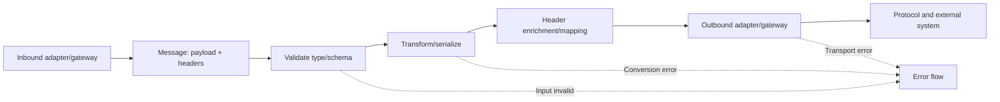
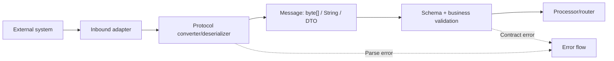
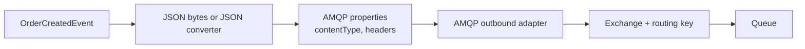
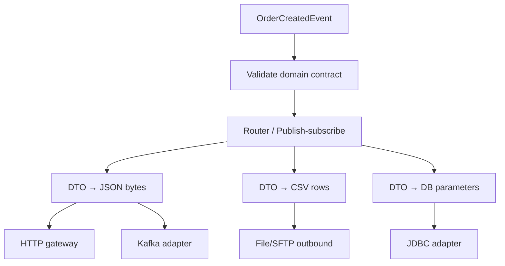
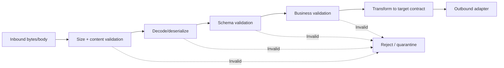

# Data format of protocol adapters

## 1. Why does data format determine the success or failure of an integration flow?

An order management service emits an `OrderCreated` event. This same business data must be exchanged across multiple protocols:

- Write JSON to a file for a batch system to process.
- Upload CSV via SFTP for a partner.
- Call an HTTP API requiring `application/json`.
- Publish the event to JMS, AMQP, or Kafka for other services to consume.
- Persist normalized fields or store JSON/binary in a database.

The input in Java may be identical, yet the **data format on the wire** is not. Passing the raw Java DTO to every adapter gives some targets the wrong type; manually converting to JSON and then letting the target converter convert it again may cause consumers to receive a JSON string or Base64 instead of a JSON object.

A real incident rarely shows up labeled "wrong data format"—instead it looks like:

- A CSV file with the right number of rows but wrong charset, corrupting Vietnamese accents.
- An HTTP API returning `400 Bad Request` because the body is a double-encoded JSON string.
- A JMS consumer expecting a `TextMessage` while the producer sends a `BytesMessage`.
- An AMQP consumer unaware the body is GZIP-compressed because metadata still says `application/json`.
- A Kafka producer using a serializer incompatible with a `byte[]` payload.
- A JDBC handler receiving a JSON String when the SQL statement requires three typed parameters.

The **data format of a protocol adapter** is the set of conventions governing **representation, structure, encoding, metadata, and decoding rules** when messages cross between Spring Integration and external systems in either direction.

This lesson belongs to the **Data Transformation** chapter of the `SPRING_INTEGRATION_ADAPTERS` module, aiming to connect inbound/outbound adapters, gateways, pollers, and `MessageChannel` across file, SFTP, HTTP, JMS, AMQP, Kafka, and databases—while managing message contracts, errors, and connection lifecycles.

**Key takeaway:** Spring Integration moves messages across endpoints, but **cannot automatically infer every consumer's data contract**. Payload types, encoders/serializers, protocol metadata, and validation must be designed together.

## 2. Separating business data, data format, and protocol

| Layer | Question | Example |
| --- | --- | --- |
| **Business meaning** | What does the event or request say? | Order `ORD-1001` created, total 125000 minor units |
| **Data model** | Which fields does the logical object have? | `OrderCreated(eventId, orderId, amountMinor)` |
| **Schema / contract** | Which fields are required, what types, what version? | `event_id` is string, `schema_version` is integer |
| **Serialization / format** | What is the structure represented as? | JSON, CSV, XML, Avro, Protobuf, binary bytes |
| **Encoding / compression** | How do characters and data become bytes? | UTF-8, GZIP, binary framing |
| **Protocol envelope** | How does the protocol carry body and metadata? | HTTP headers/body, Kafka record, JMS message |
| **Transport / I/O** | How is it sent, stored, and acknowledged? | HTTP, SFTP, broker, filesystem, JDBC |
| **Business processing** | Did the consumer complete the business work? | Order written to database, email sent |

For example, **JSON is not an independent transport protocol**. It is a format that can ride inside an HTTP body, a Kafka value, a file, or a JMS TextMessage. Conversely, **HTTP does not mandate JSON**: an endpoint can accept XML, multipart, binary, or text.

### Concepts not to conflate

- **Java DTO ≠ JSON:** classes and annotations drive mapping, not the entire schema.
- **`byte[]` ≠ a format:** bytes could be UTF-8 JSON, PDF, Protobuf, or compressed data.
- **`Content-Type` ≠ encoding:** media type describes representation; charset, compression, and framing are additional conventions.
- **Converter ≠ adapter:** converters alter representation; adapters/gateways perform communication.
- **Serialized ≠ sent successfully:** transformation is an internal step; confirmation belongs to the protocol.
- **Sent successfully ≠ consumer processed successfully:** broker ACKs and HTTP transport statuses do not always prove target business completion.

## 3. Spring Integration Message: Two parts of a contract

Spring Integration passes data using `Message<T>`:

```text
Message<T>
├── payload: T
└── headers: MessageHeaders
    ├── id
    ├── timestamp
    ├── contentType
    ├── correlationId / eventId (per application)
    ├── fileName / topic / routingKey (per adapter)
    └── other metadata
```

An event might start as:

```text
payload type = OrderCreated
payload      = OrderCreated("evt-2401", "ORD-1001", 125000)
headers      = {correlationId: "request-77"}
```

After a JSON transformation step:

```text
payload type = byte[]
payload      = UTF-8 bytes of the JSON object
headers      = {
  correlationId: "request-77",
  contentType: "application/json",
  schemaVersion: 1
}
```

After the outbound adapter, that same payload can become:

- the body of an HTTP request;
- the value of a Kafka record;
- the body of an AMQP message;
- a JMS TextMessage/BytesMessage depending on converter;
- file contents on SFTP;
- a binary/JSON column value in a database when mapped accordingly.

**There is no universal rule that every Spring Message header automatically becomes a protocol header.** Many adapters have their own header mappers, constant names, value types, and supported scopes. Some headers only have **internal flow** meaning, such as `replyChannel` or `errorChannel`, and must not be leaked verbatim to external systems.

### A Spring Message is not the entire wire message

`Message<byte[]>` is an **in-application Spring** structure. HTTP, Kafka, JMS, and AMQP have their own envelopes. Crossing an adapter, converters/serializers translate payloads/headers into specific wire protocol fields.

## 4. Transformation architecture before and after adapters



On the inbound side:



Actual ordering can differ. For instance, an HTTP inbound gateway may already use `HttpMessageConverter` to produce a DTO; JMS inbound may return an object processed by a converter. If you do not know the **post-inbound payload type**, adding a transformer that forces `byte[]` causes errors.

### Three boundaries to choose clearly

1. **Domain → external DTO:** rename fields/types/business semantics.
2. **External DTO → wire body:** JSON/XML/CSV/bytes or protocol-handled serialization.
3. **Wire body → transport envelope:** HTTP headers, Kafka key/topic, AMQP exchange/routing, or filename.

Good design lets you test each boundary independently.

## 5. Data format matrix by adapter

| Adapter/gateway | Common suitable payload | Wire representation | Metadata to lock down |
| --- | --- | --- | --- |
| **File inbound/outbound** | `File`, `String`, `byte[]` per handler | File bytes, no fixed app protocol envelope | Filename, charset, directory, completion/rename |
| **SFTP inbound/outbound** | `File`, `String`, `byte[]` per config | File bytes over SSH/SFTP | Remote path, name, temp suffix, encoding per contract |
| **HTTP inbound/outbound** | DTO, `String`, `byte[]`, `Resource` | HTTP entity body | Method, Content-Type, Accept, Content-Encoding, status |
| **JMS inbound/outbound** | Object/String/bytes per `MessageConverter` | JMS TextMessage/BytesMessage/MapMessage/... | Destination, properties, correlation, delivery mode |
| **AMQP/RabbitMQ** | DTO/String/bytes per converter | AMQP message body bytes + properties | Exchange, routing key, content type, correlation |
| **Kafka** | Key/value matching serializer | Kafka record key/value bytes + headers | Topic, key, partition, schema/version |
| **Database/JDBC** | DTO, parameter Map, scalar, bytes per handler | SQL parameter values / row | Column type, SQL binding, transaction, unique key |

**Exact support depends on Spring Integration version and adapter.** Never assume that because a File adapter accepts `String`, every SFTP handler shares the same headers or encoding.

### Adapters do not replace schema agreements

Kafka accepting value bytes does not prove those bytes are a compatible `OrderCreated` event version. Successful SFTP upload does not prove the partner can read the file. A valid DB insert does not ensure monetary units are interpreted consistently. All of these are **data contract concerns**.

## 6. Designing the data contract before picking a converter

Suppose the organization uses the `order.created` event.

### Sample JSON contract

```json
{
  "event_id": "evt-2401",
  "schema_version": 1,
  "event_type": "order.created",
  "occurred_at": "2026-11-23T09:00:00Z",
  "order": {
    "order_id": "ORD-1001",
    "amount_minor": 125000,
    "currency": "VND"
  }
}
```

Constraints to write down explicitly:

| Property | Illustrative contract | Risk if unspecified |
| --- | --- | --- |
| `event_id` | Non-empty ID, stable across retries | Duplicates cannot be deduplicated |
| `schema_version` | Consumer-supported version | New schema breaks old consumers |
| `event_type` | Value in permitted set | Wrong business routing |
| `occurred_at` | ISO-8601 with offset/UTC | Ambiguous timestamp, timezone drift |
| `order_id` | Stable business ID | Cannot correlate outcomes |
| `amount_minor` | Agreed minor-unit integer | Rounding errors or unit confusion |
| `currency` | Valid currency code | Semantically invalid data |
| Encoding | UTF-8 for JSON/text | Corrupted Vietnamese characters |
| Null/missing | Rules per field | Missing field treated as null or default |
| Size limit | Based on target and safety limits | OOM or broker rejection |
| Idempotency | Based on event ID/business key | Retries create duplicate records |

**Syntactically valid JSON is not necessarily business-valid.** JSON `{"amount_minor":"125000"}` parses cleanly yet fails a schema requiring a number. `{"event_id":null}` also requires contract-governed handling.

### Contracts live beyond the payload too

Beyond content, agree on:

- Does the file use `.json`, `.csv`, or a manifest?
- Which HTTP path/method and media types apply?
- Does JMS send `TextMessage` or `BytesMessage`?
- What are the AMQP exchange, routing key, and content-type?
- Which Kafka topic, key, value serializer, and schema version apply?
- Is the database target a BLOB/JSON column or normalized columns?

## 7. Text, JSON, XML, CSV, and binary formats: Choose by goal

| Format | Fits when | What to control |
| --- | --- | --- |
| **Plain text** | Simple notification/command strings | Charset, newlines, escaping |
| **JSON** | Structured APIs/events, polyglot systems | Field names, nulls, schema, time, numbers |
| **XML** | Partner contracts needing namespaces/attributes, legacy integrations | XML schema, namespaces, XXE, and size |
| **CSV/TSV** | Tabular batch files, SFTP, and import/export | Column order, quoting/escaping, delimiter, formula injection |
| **Avro** | Events/batches with schemas and evolution mechanics | Schema evolution, binary schema resolution |
| **Protobuf** | Compact binary payloads with field IDs and schemas | Field number reuse, version compatibility |
| **CBOR/MessagePack** | Structured binary representation | Converters on both ends and contract |
| **Raw binary** | Images, PDFs, ZIPs, or specialized formats | Content type, framing, checksums, size |
| **JSON Lines / NDJSON** | Streaming/batch one JSON object per line | One record per line, newlines, partial-line handling |

There is no single "best format" for everything. Choose based on consumers, compatibility constraints, query needs, size, debuggability, and security.

### Text formats require different escaping

- JSON escapes `"`, backslashes, and special characters per JSON rules.
- CSV escapes double quotes by doubling them and can wrap fields in quotes.
- XML must escape text/attribute contents per context.
- Never treat `String.valueOf(object)` as contract-compliant serialization.

## 8. Charset and byte representation

In Java, `String` is a character sequence; sending externally requires encoding to bytes.

```java
import java.nio.charset.StandardCharsets;

String value = "Order ORD-1001";
byte[] bytes = value.getBytes(StandardCharsets.UTF_8);

String restored = new String(bytes, StandardCharsets.UTF_8);
```

**Avoid default charsets:** `value.getBytes()` and `new String(bytes)` fail to express the contract explicitly and break when environments or configurations change.

### Not every byte sequence is text

```java
byte[] pdf = loadPdfBytes();
String incorrect = new String(pdf, StandardCharsets.UTF_8);
```

Decoding PDF data as UTF-8 can replace invalid byte sequences or corrupt the representation if re-encoded. For binary files, keep `byte[]`/streams intact and specify the content type.

### Strict UTF-8 decoder when needed

```java
import java.nio.ByteBuffer;
import java.nio.charset.CodingErrorAction;
import java.nio.charset.StandardCharsets;

String decodeStrict(byte[] payload) throws Exception {
    return StandardCharsets.UTF_8.newDecoder()
        .onMalformedInput(CodingErrorAction.REPORT)
        .onUnmappableCharacter(CodingErrorAction.REPORT)
        .decode(ByteBuffer.wrap(payload))
        .toString();
}
```

`new String(bytes, UTF_8)` can substitute invalid byte sequences; a `REPORT` decoder suits contracts that must reject malformed input.

### BOM, newlines, and locale

- CSV/Text: lock down BOM, `\n` vs `\r\n`, and delimiters.
- Timestamps: use timezone/offset formats when representing instants.
- Money: use `BigDecimal` or integer minor units; never depend on locale number formatting.
- Internal files and partner files may require different encodings, requiring an explicit conversion step and byte-level tests.

## 9. JSON serialization with Jackson: DTO vs. raw body

Use dedicated DTOs to avoid accidentally exposing internal fields:

```java
import com.fasterxml.jackson.annotation.JsonProperty;
import java.time.Instant;

public record OrderCreatedEvent(
    @JsonProperty("event_id") String eventId,
    @JsonProperty("schema_version") int schemaVersion,
    @JsonProperty("event_type") String eventType,
    @JsonProperty("occurred_at") Instant occurredAt,
    @JsonProperty("order") OrderPayload order
) {}

public record OrderPayload(
    @JsonProperty("order_id") String orderId,
    @JsonProperty("amount_minor") long amountMinor,
    @JsonProperty("currency") String currency
) {}
```

With Jackson 2:

```java
import com.fasterxml.jackson.databind.ObjectMapper;

// mapper must be configured properly for Java Time and the contract.
byte[] jsonBytes = mapper.writeValueAsBytes(event);
String jsonText = mapper.writeValueAsString(event);

// Parse:
OrderCreatedEvent parsed =
    mapper.readValue(jsonBytes, OrderCreatedEvent.class);
```

Depending on whether the stack uses Jackson 2 or Jackson 3, packages/imports and APIs may differ. Verify Java Time module and timestamp formatting on your actual version rather than assuming every mapper emits identical output.

### JSON String, JSON bytes, and `byte[]` fields

Two very different operations:

```java
byte[] rawJson = mapper.writeValueAsBytes(
    java.util.Map.of("id", "ORD-1001")
);

record FileAttachment(byte[] content) {}
String wrapped = mapper.writeValueAsString(
    new FileAttachment("Hello".getBytes(StandardCharsets.UTF_8))
);
```

- `rawJson` holds the bytes of JSON object `{"id":"ORD-1001"}`.
- `wrapped` is a JSON object with a `byte[]` field, which is typically represented as **Base64** (e.g., `"SGVsbG8="`).
- Base64 **is not security encryption**.
- When needing to send a raw file over HTTP/Kafka, never accidentally serialize a `byte[]` into a JSON Base64 string.

## 10. Message converters and serializers: Who actually encodes?

Many Spring adapters use their own converters:

| Integration boundary | Typical converter | Output |
| --- | --- | --- |
| Spring Integration transformer | Java function, codec, Jackson | New Spring message payload |
| Spring HTTP | Appropriate `HttpMessageConverter` | HTTP request/response body |
| Spring JMS | `MessageConverter` | JMS TextMessage/BytesMessage/... |
| Spring AMQP | AMQP `MessageConverter` | AMQP body and message properties |
| Spring Kafka / Kafka client | Kafka `Serializer`/`Deserializer` | Record key/value bytes |
| JDBC adapter | SQL parameter mapper/expression | Bound SQL/driver values |
| File/SFTP | File handler/remote file handler | File contents and path metadata |

### Pick one serialization boundary

**Option A – Serialize before the adapter:**

```text
Message<OrderCreatedEvent>
    → Jackson JSON byte[]
    → Message<byte[]> + metadata
    → outbound adapter using raw bytes
```

**Option B – Let the adapter's converter serialize:**

```text
Message<OrderCreatedEvent>
    → outbound adapter + JSON converter/serializer
    → protocol receives JSON bytes
```

Either works if the serializer/converter and payload type align.

### Double serialization trap

If a transformer emits a `String`:

```text
{"id":"ORD-1001"}
```

and the converter treats it as a **JSON string value**, the output can become:

```json
"{\"id\":\"ORD-1001\"}"
```

A consumer expecting a JSON object will fail to read field `id`. Similarly, a Jackson converter receiving raw `byte[]` can emit a JSON Base64 string if it serializes the **byte array value** rather than sending raw body bytes.

**Test data on the wire**, not merely object types before the adapter.

## 11. Java DSL example: DTO → JSON bytes → outbound channel

With Java DSL, format conversion can be separated from sending logic:

```java
import com.fasterxml.jackson.databind.ObjectMapper;
import org.springframework.context.annotation.Bean;
import org.springframework.integration.dsl.IntegrationFlow;

@Bean
IntegrationFlow orderToJsonBytesFlow(ObjectMapper mapper) {
    return IntegrationFlow.from("domainOrderEvents")
        .transform(OrderCreatedEvent.class, event -> {
            try {
                return mapper.writeValueAsBytes(event);
            } catch (com.fasterxml.jackson.core.JsonProcessingException ex) {
                throw new IllegalArgumentException(
                    "Cannot serialize OrderCreatedEvent", ex);
            }
        })
        .channel("jsonBytesReady")
        .get();
}
```

This flow:

1. Receives Spring `Message<OrderCreatedEvent>` from channel `domainOrderEvents`.
2. Uses Jackson to generate JSON bytes.
3. Sends the output to channel `jsonBytesReady`.
4. **Does not send externally yet**. Another flow or handler must consume this channel.

Java DSL APIs and packages may vary across Spring Integration versions. This snippet uses an illustrative API structure; compile and integration-test with your project dependencies before deploying.

### Adding headers cleanly

```java
@Bean
IntegrationFlow orderJsonWithHeaders(ObjectMapper mapper) {
    return IntegrationFlow.from("ordersForExport")
        .transform(OrderCreatedEvent.class, event -> {
            try {
                return mapper.writeValueAsBytes(event);
            } catch (com.fasterxml.jackson.core.JsonProcessingException ex) {
                throw new IllegalArgumentException(ex);
            }
        })
        .enrichHeaders(headers -> headers
            .header("contentType", "application/json")
            .header("schemaVersion", 1))
        .channel("validatedJsonOutbound")
        .get();
}
```

`contentType` in the example is a logical Spring message name. In practice, adapters may require constants or `MimeType`/`MediaType` header values, and header mappers might not emit them onto the wire automatically. Verify against your adapter/version.

## 12. File outbound: Format means file content and file conventions

Files lack an HTTP-like protocol envelope. Consumers usually identify format via:

- filename/extension such as `.json`, `.csv`, `.xml`;
- out-of-band charset/schema contracts;
- accompanying manifests or metadata;
- file content and magic bytes (if defined for the format);
- directory conventions, export schedules, and completion markers.

### Example: OrderEvent → JSON File

```java
import java.io.File;
import org.springframework.context.annotation.Bean;
import org.springframework.integration.dsl.IntegrationFlow;
import org.springframework.integration.file.dsl.Files;

@Bean
IntegrationFlow orderJsonFileFlow(ObjectMapper mapper) {
    return IntegrationFlow.from("ordersForFile")
        .enrichHeaders(headers -> headers.headerFunction(
            "outputFileName",
            message -> {
                OrderCreatedEvent event =
                    (OrderCreatedEvent) message.getPayload();
                String eventId = event.eventId();
                if (eventId == null
                        || !eventId.matches("[A-Za-z0-9_-]{1,64}")) {
                    throw new IllegalArgumentException("Invalid eventId");
                }
                return "event-" + eventId + ".json";
            }))
        .transform(OrderCreatedEvent.class, event -> {
            try {
                return mapper.writeValueAsBytes(event);
            } catch (com.fasterxml.jackson.core.JsonProcessingException ex) {
                throw new IllegalArgumentException(ex);
            }
        })
        .handle(Files.outboundAdapter(new File("./data/outbox"))
            .autoCreateDirectory(true)
            .fileNameGenerator(message ->
                (String) message.getHeaders().get("outputFileName")))
        .get();
}
```

This is a Java DSL flow example; verify method signatures and your project's File module when using another version.

### Conventions you cannot skip

1. **Filename:** derive from validated IDs; never concatenate arbitrary paths from requests.
2. **Charset:** if the payload is a String, the adapter must encode per contract; using JSON `byte[]` fixes bytes beforehand.
3. **File exists mode:** overwrite, fail, append, or replace must have an explicit policy.
4. **Atomic completion:** if consumers poll directories continuously, consider temporary files followed by rename/ready markers where supported by the filesystem.
5. **Batching:** a single file holding many records must be aggregated and closed at the right moment; one single message does not constitute a whole batch.
6. **Integrity:** verify sizes/hashes if both parties have a verification scheme.
7. **Security:** filesystem permissions, retention, sensitive data, and path traversal.

**Never confuse file creation with partner consumption.** If the business requires end-to-end confirmation, design a dedicated acknowledgment mechanism.

## 13. SFTP: Same file format, plus a remote contract

**SFTP** transfers files over SSH; the internal file format does not automatically change just because SFTP is used. If the payload is JSON bytes on the filesystem, you can in principle upload those exact bytes unless the target requires another format.


### Details to align on

| Item | SFTP contract example |
| --- | --- |
| Remote directory | `/inbox/orders/` configured on adapter |
| Filename | `orders-20261123-01.csv` |
| Charset | UTF-8, no BOM |
| Newlines | LF or CRLF per partner |
| Delimiter/quotes | Standard CSV commas and quotes |
| Temporary suffix | E.g., `.writing` until upload finishes |
| Completion | Rename or marker, if supported by server and consumer |
| Retry/idempotency | Stable file ID, duplicate filename handling |
| Security | Host key verification, credentials, account permissions |
| Retention | Clean up temp/failed files, archive per retention |

**The SFTP adapter does not manage CSV escaping or JSON schemas for you.** Transformers/formatters own those concerns.

### Why are paths sensitive data?

If a user-supplied `remotePath=../../outside` header is used, the adapter can write to unauthorized locations. Restrict choices to configured or policy-mapped directories; sanitize filenames; never concatenate unverified path strings.

### SFTP connection lifecycle

Session factories, pooling/caching, timeouts, reconnects, and closing sessions belong to adapter operations. Host key or credential errors cannot be fixed by re-transforming payloads; classify them properly to avoid infinite retries.

## 14. HTTP: Media type, body, headers, and content negotiation

HTTP follows a request–response model; an **HTTP outbound gateway** fits when you need the response status/body to continue the flow.

### Sample request

```http
POST /api/orders/events HTTP/1.1
Host: partner.example.org
Content-Type: application/json
Accept: application/json
Idempotency-Key: evt-2401

{"event_id":"evt-2401","schema_version":1,"event_type":"order.created","occurred_at":"2026-11-23T09:00:00Z","order":{"order_id":"ORD-1001","amount_minor":125000,"currency":"VND"}}
```

- **HTTP method/path** identifies the action and target resource.
- **Content-Type** describes the request body representation.
- **Accept** expresses response representations the client accepts.
- **Content-Encoding** can indicate a compressed body, such as gzip when supported by both sides.
- **Idempotency-Key** is a mechanism **effective only if the target API defines and enforces it**.
- **Status** reflects the API's outcome, not always asynchronous completion.

### Two formatting options

**Keep DTO and use JSON `HttpMessageConverter`:**

```text
Message<OrderCreatedEvent>
  → HTTP outbound gateway
  → JSON HttpMessageConverter
  → HTTP application/json body
```

**Pre-serialize to raw bytes:**

```text
Message<OrderCreatedEvent>
  → Jackson writeValueAsBytes
  → Message<byte[]>
  → HTTP outbound gateway sends raw body
```

Do not serialize in both places. With raw bytes, configure the converter/handler not to treat the byte array as a JSON object needing Base64 encoding.

### HTTP statuses and errors

| Error class | Interpretation and handling |
| --- | --- |
| `400` / `422` | Usually invalid payload/contract; inspect response contract |
| `401` / `403` | AuthN/AuthZ issue or integration credentials |
| `404` | Wrong endpoint/resource or nonexistent data |
| `409` | Conflict; may relate to idempotency/versioning per API |
| `429` | Rate limit; typically requires backoff |
| `500` / `503` | Target-side error; can retry per policy |
| Timeout after POST | Uncertain whether server processed; requires idempotency/status check |

Do not lump all HTTP 2xx responses into one business outcome: `202 Accepted` may mean only accepted for async processing. Read the API contract.

## 15. JMS: Data format determines TextMessage vs. BytesMessage

JMS provides distinct message types, among which `TextMessage` and `BytesMessage` are common for JSON/text and binary exchanges.

| Spring payload | JMS converter | JMS-side message |
| --- | --- | --- |
| JSON `String` | String-handling converter | Typically `TextMessage` |
| JSON/binary `byte[]` | Bytes-handling converter | Typically `BytesMessage` |
| DTO | Configured JSON-capable converter | `TextMessage`/`BytesMessage` per design |
| `Map` | Matching converter | May be `MapMessage` or another representation |

**Never assume the JMS message type from the Java payload without checking the configured `MessageConverter`.** A consumer may only accept `TextMessage`; a producer sending a `BytesMessage` with valid JSON is still incompatible.

### What the JMS contract must specify

- Destination/queue/topic and governance mechanism.
- Message type: `TextMessage`, `BytesMessage`, or agreed type.
- Content format: JSON, XML, binary schema.
- Charset/encoding if using text bytes.
- JMS properties to pass: `schemaVersion`, `eventId`, correlation.
- Persistent/non-persistent delivery per policy.
- Acknowledgments/transactions/redelivery.
- DLQ and conditions for dead-lettering failed messages.
- Versioning between producer and consumer.

**Never rely on native Java serialization to share domain objects across services.** It creates class/version coupling and unsafe deserialization risks. Explicit text/binary contracts are easier to maintain.

### JMS correlation ID

`JMSCorrelationID` can be used for request–reply or tracing per design. It does not automatically take on any custom `correlationId` header unless mapping is configured. Inspect actual messages on the consumer side.

## 16. AMQP/RabbitMQ: Body bytes paired with properties and routing

AMQP messages carry **body bytes** alongside properties. Spring AMQP converters can transform DTO/String/bytes into body and metadata.



### Items to lock down

- **Exchange:** message publishing target.
- **Routing key:** combined with bindings to route to queues; do not assume it equals a topic name.
- **Body format:** raw JSON bytes, JSON text, or binary schema.
- **Content type:** declares data format, e.g., `application/json`.
- **Content encoding/compression:** if used, mapped via properties/contract.
- **Headers:** event ID, schema version, correlation ID, trace metadata.
- **Publisher confirms/returns:** broker receipt or unroutable messages per policy.
- **Dead-letter/quarantine:** handling unprocessable or retry-exhausted messages.

### Converter trap

The producer already converted the DTO to raw JSON `byte[]`, yet the AMQP converter still treats `byte[]` as an object to JSON-serialize; consumers then see Base64 or malformed output.

Verify the **raw body** and properties in integration tests rather than checking only the Java class on the producer.

**Publisher confirm does not mean the consumer succeeded in business processing.** If you need to know the order was created at the consumer, use dedicated business acknowledgment/tracing.

## 17. Kafka: Value schema and producer serializer

A Kafka record has **key**, **value**, **topic**, **partition**, timestamp, and headers. Key and value are turned into bytes by serializers.

| Payload at producer | Compatible value serializer | Expected representation |
| --- | --- | --- |
| Raw JSON `byte[]` | `ByteArraySerializer` | Preserves bytes intact |
| JSON `String` | `StringSerializer` | Encoded text |
| Java DTO | Matching JSON serializer | JSON bytes per mapping |
| Avro/Protobuf message | Specialized serializer | Binary schema encoding |

### Kafka event example

```text
topic   = orders.events
key     = ORD-1001
value   = UTF-8 JSON bytes (schemaVersion=1)
headers = {
  eventId: evt-2401,
  contentType: application/json
}
```

The `contentType` header here is an **application convention**, not an implicit Kafka mechanism for inferring value formats.

### Keys and ordering

Choosing `orderId` as the key can route events for the same order into the same partition under the configured partitioner. Kafka guarantees ordering under specific conditions **within a partition**, not across all partitions or all system events. Producer concurrency, retries, repartitioning, and consumer processing still apply.

### Schema Registry and evolution

When using Avro/Protobuf/JSON Schema with a registry, the contract also includes schema IDs, subjects, compatibility policies, serializers/deserializers, and schema lookup. Never equate "JSON with a `schema_version` field" with "having a schema registry."

### Java type headers

Some converters/serializers attach metadata containing Java class names. In polyglot integrations, avoid coupling consumers to producers' fully qualified Java class names when aiming for language-independent contracts. Prefer business-oriented schemas/versions.

### Producer ACK

Kafka producer callbacks/acks only report a configured level of broker acknowledgment; they do not confirm the consumer committed its database or finished processing.

## 18. JDBC/Database: Data format is column types and parameters, not just JSON

Database outbound can accept payloads to populate SQL parameters. Here the **adapter format** can be **column mapping**, rather than a single JSON "wire document".

### Case A: Storing normalized fields

```sql
INSERT INTO orders (
    order_id,
    amount_minor,
    currency,
    occurred_at
) VALUES (
    :orderId,
    :amountMinor,
    :currency,
    :occurredAt
);
```

An appropriate payload can be a DTO or `Map<String,Object>` with the right parameters and types. There is no need to serialize the whole Order to JSON when the target expects separate columns.

### Case B: Storing JSON events in an outbox

```sql
INSERT INTO integration_outbox (
    event_id,
    aggregate_id,
    payload_json,
    schema_version
) VALUES (
    :eventId,
    :aggregateId,
    :payloadJson,
    :schemaVersion
);
```

Here `payloadJson` can be a String/driver-specific JSON representation depending on the database. Map the SQL dialect, column type, and binding properly.

### Case C: Storing raw binary

```sql
INSERT INTO binary_payloads (
    event_id,
    content_type,
    body_bytes
) VALUES (
    :eventId,
    :contentType,
    :bodyBytes
);
```

`bodyBytes` maps to BLOB/VARBINARY or the database's binary type per driver. Passing `Message<byte[]>` straight to a JDBC handler does not make the handler magically know where `eventId` and `contentType` live.

### Mandatory controls

- Prepared statements / named parameters; never concatenate SQL from user payloads.
- Appropriate currency, timestamp, timezone, and precision types.
- Transactions and constraint/duplicate-key handling.
- Batch sizes, row mapping, and checkpoints when polling DBs.
- Idempotent upserts or unique keys per business rules.
- Never assume writing to the DB and publishing to Kafka form an atomic transaction; consider **transactional outbox** or matching architecture.

## 19. Headers across protocol boundaries: Metadata must be mapped, not just kept

A Spring Message header may not exist on the wire protocol unless the adapter maps it.

| Logical metadata | File/SFTP | HTTP | JMS | AMQP | Kafka | Database |
| --- | --- | --- | --- | --- | --- | --- |
| **Content type** | Extension/manifest/contract | `Content-Type` | Property/contract | Message property | App-defined header/schema | Column/contract |
| **Encoding** | File contract/manifest | Media-type/protocol semantics | Property/contract | Property/contract | Serializer + contract | Column/driver |
| **Correlation** | Manifest/file ID | App header | JMS correlation/property | Correlation property | App header | Column |
| **Routing** | Directory/name | URL/method | Destination | Exchange/routing key | Topic/partition/key | SQL/table |
| **Schema version** | Manifest/filename/content | Header/body | Property/body | Header/body | Header/body/registry | Column/payload |
| **Idempotency** | Filename/event ID | API header if supported | Consumer policy | Consumer policy | Consumer policy | Unique key |

Names in this table represent a **logical contract**, not a claim that `contentType` and `schemaVersion` are default framework header names on every adapter.

### Which metadata should stay internal?

- `replyChannel` and `errorChannel` are internal Spring Messaging references.
- Internal authentication/session objects or tokens not meant for the target system.
- Internal exceptions/stack traces.
- Sensitive identities/PII unneeded by the consumer.
- Broker addresses, storage paths, credentials, or security-sensitive topic names outside the contract.

**Allowlist permitted headers** instead of copying all message headers outward.

### Are source headers trustworthy?

If an inbound client sends `topic=admin.events` or `remotePath=../../secret`, it cannot be trusted merely because it arrived in a header. Routing and destinations must come from **policy** or verified mappings.

## 20. Data format and content negotiation in multi-branch flows

One event may need to go to multiple destinations in different formats.



**Caution:** Using a `DirectChannel` with multiple subscribers does not automatically fan out every message to every handler. To broadcast, use a publish-subscribe channel or equivalent design; to pick one target, use a router.

### Why might different consumers need dedicated DTOs?

- HTTP API expects `customer_id` and `amount_minor`.
- SFTP partner expects CSV with fixed column ordering.
- Kafka event requires `eventId`, `occurredAt`, and `schemaVersion`.
- Database only needs `orderId` and `amountMinor`.

Copying the entire domain entity everywhere leaks information, creates coupling, and causes unintended schema changes.

### How do splitter and aggregator relate?

- **Splitter:** one message carrying a record list → multiple messages.
- **Aggregator:** collects multiple messages into one batch/file by correlation and release condition.
- **Transformer:** controls how each record or batch is serialized.
- **Poller:** controls the cadence of fetching data from polling sources.

A CSV file needing 1,000 rows will not be built properly simply by invoking file outbound 1,000 times with the same filename without an append/aggregation strategy and completion condition.

## 21. Evolution: When producers change data formats or schemas

Sustainable integrations must handle contract changes.

### Types of changes

| Change | Potential impact |
| --- | --- |
| Adding optional JSON field | Strict consumers may reject unknown fields |
| Renaming a field | Legacy consumers fail to read |
| Changing number type to string | Contract validation breaks |
| Changing timestamp representation | Consumers misparse or drift timezones |
| Adding an enum value | Legacy consumers lack handling branch |
| Reordering CSV columns | Data lands in wrong columns |
| Changing delimiter/quotes | File parser splits incorrectly |
| Changing JMS message type | Consumer expecting TextMessage gets BytesMessage |
| Changing Kafka serializer | Bytes no longer match old schema |
| Changing content type | System picks a different decoder |
| Changing DB column/schema | JDBC mapping and business logic fail |

### Versioning strategy

1. Define `schemaVersion` and where it travels: body, header, file manifest, or registry.
2. Classify backward/forward compatibility by format and consumer type.
3. Verify legacy consumers before producers emit new schemas.
4. Where needed, use tested mappers/upcasters from old versions to the canonical model.
5. Roll out with error monitoring, alerts, and rollback plans.
6. Never silently change a field's semantics while keeping its name/type unchanged.
7. Maintain real test fixtures for every supported version.

For instance, adding an optional `discount_code` to JSON may be compatible with consumers that ignore unknown fields, yet strict consumers rejecting unknowns will fail. Thus "adding a field is always backward-compatible" is an unsupported assumption.

## 22. Binary formats, framing, compression, and integrity

For binary data, a data format needs more rules than just `byte[]`.

### Framing and byte order

Example frame with a 4-byte big-endian length prefix and payload:

```text
00 00 00 05 48 65 6C 6C 6F
| length=5 | "Hello"
```

The decoder must check length, maximum threshold, remaining bytes, and byte order. If the consumer reads little-endian while the producer writes big-endian, a tiny length can become an enormous number.

### Compression

A flow might be:

```text
Domain DTO
  → JSON UTF-8 bytes
  → GZIP bytes
  → outbound adapter
```

The consumer needs metadata and must decompress **before parsing JSON**. A `Content-Type: application/json` header does not indicate the bytes are GZIP-compressed; HTTP uses `Content-Encoding`, while brokers/files need matching agreements.

**Security:** cap decompressed size, record counts, and nested structures; small compressed payloads can expand into huge data.

### Hashes, checksums, MACs, and signatures

- Hashes/checksums help detect modifications or transmission corruption against a trusted value.
- A bare hash **does not prove** who sent the data.
- MACs/signatures can verify both integrity and origin when keys/trust are properly managed.
- Hash/signature calculation must run on the **final contract bytes**; changing newlines, charsets, or JSON field order after signing breaks verification.

### Binary data should not be decoded into Strings without reason

Images, PDFs, ZIPs, protobufs, or encrypted payloads must not pass through `new String(bytes, UTF_8)` and `getBytes(UTF_8)`; data can be altered or lost.

## 23. Where should validation sit to prevent format bugs?

Separate three checks:

1. **Syntactic validation:** can JSON/XML/CSV/binary be parsed according to format?
2. **Contract validation:** do schema, version, field types, required values, and sizes match?
3. **Business validation:** is the event valid under business rules and permissions?

Illustrative pipeline:



**Deserialization does not automatically enforce business validation.** Jackson can instantiate objects with null fields or negative numbers if no extra checks exist. Bean Validation annotations typically require invoking or integrating a `Validator` at the boundary; do not assume `ObjectMapper` enforces them automatically.

### Content-Type can be spoofed

For untrusted inbound data, `Content-Type` is only a client-supplied hint. Even if the header states `application/json`, parse safely, enforce size limits, and validate schema/authorization. For file uploads, never rely solely on file extensions.

### XML requires secure parser configuration

When taking external XML inputs, disable or restrict dangerous features like external entity resolution per library/parser. JSON and binary formats also need depth, size, and deserialization-type limits—not just XML.

## 24. Conversion errors and transport errors must be classified separately

| Error layer | Example | Handling direction |
| --- | --- | --- |
| **Format/parse** | Malformed JSON, broken UTF-8, missing CSV column | Do not retry identical bytes endlessly; reject/quarantine |
| **Schema** | Unknown version, wrong field type | Classify contract error, upgrade schema or route |
| **Business** | Negative `amountMinor`, missing event ID | Reject, notify data owner |
| **Header mapping** | Wrong Content-Type, missing file name | Fix configuration or message metadata |
| **File/SFTP** | Disk full, permission denied, timeout | Distinguish permanent vs transient errors |
| **HTTP** | `429`, `503`, timeout, `400` | Conditional retry; `400` usually requires fixing request |
| **JMS/AMQP/Kafka** | Broker unreachable, serialization mismatch | Identify serializer vs connection failure |
| **Database** | Deadlock, type mismatch, constraint | Retry transient; handle duplicate/schema |
| **AuthN/AuthZ** | Expired credentials, account lacks permission | Fix security/configuration instead of infinite retries |

### Error flows in Spring Integration

- With `DirectChannel`, exceptions in synchronous flows can propagate back to the caller.
- With pollers, executor-based channels, and async adapters, errors can route through error channels/error handlers depending on topology.
- An `errorChannel` header **does not guarantee** every exception from every endpoint is caught and routed as desired.
- Retry advice and DLQ/quarantine should depend on error type rather than a blanket catch-all.

### An appropriate error record

```json
{
  "eventId": "evt-2401",
  "stage": "serialization",
  "targetAdapter": "kafka-orders",
  "schemaVersion": 1,
  "errorCode": "UNSUPPORTED_FIELD_TYPE",
  "retryable": false,
  "correlationId": "request-77"
}
```

Never log full sensitive payloads, bearer tokens, passwords, or private keys. For failed messages retained for remediation, manage access and retention separately.

## 25. Retry, idempotency, and delivery state

When sending externally, a timeout does not prove the target never processed the request:

1. Producer builds valid JSON bytes.
2. Adapter sends the message.
3. Target system/broker receives it, but the acknowledgment is lost.
4. Producer retries the same message.
5. Without idempotency, the consumer may process it twice.

**Keep event IDs stable across retries**; never generate a fresh UUID in the transformer if it identifies the same logical business event.

| Target | Usable deduplication strategy |
| --- | --- |
| **File/SFTP** | Stable filename/manifest ID, existing-file checks, duplicate-write policy |
| **HTTP** | Idempotency key if API supports it, transaction status query |
| **JMS/AMQP** | Consumer dedup, transactions/acks, DLQ |
| **Kafka** | Producer idempotence within supported scope, consumer dedup, event ID |
| **Database** | Unique keys, upserts, transactions |
| **Multi-target** | Outbox/saga/reconciliation when needed; never assume distributed transactions |

### At-most-once, at-least-once, exactly-once

- **At-most-once:** limits duplicate processing within mechanism bounds, yet messages can be lost.
- **At-least-once:** reduces loss via retries, yet duplicates can occur.
- **Exactly-once:** meaningful only within specific conditions of a single architecture/mechanism; does not extend automatically across HTTP, SFTP, brokers, and DBs.

A converter **cannot** turn at-least-once into end-to-end exactly-once. That responsibility belongs to the entire flow and business contract.

## 26. How do pollers, channels, and backpressure affect data formats?

### Poller

A poller controls the cadence of fetching data from files/databases or polling endpoints and can cap `maxMessagesPerPoll`, intervals, and concurrency. **Pollers do not automatically turn JSON files into DTOs**: that depends on inbound adapters, converters, and transformers.

### DirectChannel

`DirectChannel` typically executes synchronously on the sender thread. A heavy transformer combined with a slow HTTP/SFTP adapter can block the producer.

### QueueChannel and executor channels

Allow decoupling producers and consumers in time; in exchange, you must manage queue capacity, memory, persistence, and error handling across async flows.

### Data formats impact performance

- Large JSON text can consume significant memory during serialization and parsing.
- Multi-line CSV batches need streaming or appropriate aggregation.
- Compact Protobuf/Avro reduces payload size while raising schema governance needs.
- Compression shrinks transmitted bytes at the cost of CPU and decompression risks.
- Large `byte[]` in queues increases heap usage and GC pressure.
- Serializers may copy payloads, requiring memory/latency measurement.
- Payloads must respect size limits of brokers, HTTP servers, DB columns, and filesystems.

### Preserving order

If consumers require ordered events, having the right data format is not enough. Consider Kafka partitions/keys, channel/consumer concurrency, retries, polling checkpoints, and event versions. Do not expect ordering solely because a JSON field contains a timestamp.

## 27. Security of data formats and routing metadata

### Key risks

| Risk | Manifestation | Control |
| --- | --- | --- |
| **Untrusted deserialization** | Deserializing arbitrary classes from type metadata | Use concrete DTO types, allowlists, disable broad default typing |
| **JSON/XML/CSV parsing** | Parser/resource exhaustion or XXE | Input bounds, secure parsers, and validation |
| **Path traversal** | Filenames/remote paths from source data | Directory allowlists/mappings and sanitization |
| **SSRF** | Headers/fields dictating arbitrary HTTP URLs | Endpoint allowlists, separate control plane |
| **Routing abuse** | Headers steering topics/exchanges outside policy | Route solely via trusted config/rules |
| **PII exposure** | DTO serializing full domain entity | Allowlisted external DTOs |
| **Credential leaks** | Tokens in messages/logs/errors | Secret management, never log raw sensitive data |
| **Compression bombs** | Small bytes expanding into huge data | Decompressed size/depth bounds |
| **Format confusion** | Base64 masquerading as raw bytes or wrong Content-Type | Contracts and wire payload tests |
| **Schema downgrade** | Consumer accepts weak/uncontrolled versions | Compatibility policies, version allowlists |
| **Improper authorization** | Valid payload yet unauthorized caller | Boundary AuthN/AuthZ, not just validation |

**Valid formatting does not mean a trusted source.** HTTPS/TLS, SFTP SSH, broker authentication, access controls, and resource authorization are separate layers that must be fully configured.

## 28. Layer-by-layer testing strategy for data formats

### 28.1. Mapper/codec unit tests

Check:

- DTO → JSON bytes has exact field names.
- Timestamp, number, null, and enum formats.
- UTF-8 with Vietnamese, newlines, and escaping.
- CSV quoting/delimiters.
- Binary framing and byte order if applicable.
- Round-trip for valid data.

```java
import static org.junit.jupiter.api.Assertions.assertArrayEquals;
import java.nio.charset.StandardCharsets;
import org.junit.jupiter.api.Test;

class FormatContractTest {

    @Test
    void utf8HasStableBytes() {
        String input = "Đã tạo đơn";
        byte[] encoded = input.getBytes(StandardCharsets.UTF_8);
        assertArrayEquals(
            input.getBytes(StandardCharsets.UTF_8),
            encoded
        );
    }
}
```

The test above illustrates checking encoding, though it is not independent of the implementation; contract tests should compare against **agreed byte fixtures or consumer-verified outputs** to catch real format mismatches.

### 28.2. Contract tests

Compare outputs against fixtures/schemas outside producer code, covering:

- JSON fields/types/versions, optional/null rules.
- CSV column order, headers, quoting, newlines, charset.
- XML namespaces/schemas and parser security.
- Avro/Protobuf compatibility per schema.
- Kafka record value bytes and keys.
- JMS message types/properties.
- HTTP raw bodies and Content-Type.
- SFTP file bytes/filenames/markers.

### 28.3. Integration tests

| Target | Essential checks |
| --- | --- |
| **File** | Temp directory, existing files, bytes and filenames, duplicate writes |
| **SFTP** | Test server, remote path, host key, temp/rename, reconnect |
| **HTTP** | Mock server, raw body, Content-Type/Accept, status, timeout |
| **JMS** | Test broker, TextMessage/BytesMessage, converter, redelivery |
| **AMQP** | Exchange/binding, body/properties, confirms, DLQ |
| **Kafka** | Key/value serializers, topic, headers, partitions, duplicates |
| **Database** | Parameter binding, SQL types, transactions, constraints |
| **Flow** | Header retention, correlation, error channels, routing |

### 28.4. Negative tests

1. Syntactically valid JSON missing business fields.
2. String converted to bytes using the wrong charset.
3. Double-encoded HTTP JSON.
4. JMS consumer receiving the wrong message type.
5. Kafka `byte[]` routed through an unintended JSON serializer.
6. GZIP AMQP body lacking compression metadata.
7. File/SFTP filename containing `../`.
8. CSV with commas, quotes, newlines, and formula-like strings.
9. Oversized or deeply nested JSON/XML.
10. Negative or limit-exceeding binary frame length.
11. Unknown event schema version.
12. Adapter timeout after the target already processed.
13. Retry with the same event ID.
14. Untrusted routing header.
15. Error logs potentially exposing sensitive data.

## 29. Observability: Where to measure to distinguish format vs. protocol errors?

| Metric/trace | Question answered |
| --- | --- |
| `serialization.success/failure` | Did DTO convert to wire format cleanly? |
| `deserialization.errors` | Could consumer/inbound read it? |
| `schema.version.rejected` | Are producer and consumer versions compatible? |
| `message.payload.bytes` | Did size spike or breach limits? |
| `encoding.failure` | Are there charset/invalid-byte errors? |
| `outbound.send.latency` | What is the adapter's I/O latency? |
| `broker.ack.count` | Did the broker confirm per configured mechanics? |
| `http.status.count` | Which statuses did the HTTP target return? |
| `file/sftp.delivery.failures` | Were there write/rename/permission errors? |
| `retry.attempts/age` | How long have failing operations persisted? |
| `deadletter/quarantine.depth` | Is data held awaiting remediation? |
| `channel.queue.depth/poller.lag` | Is there backlog/backpressure? |
| `correlation.coverage` | Can steps be linked end-to-end? |

Illustrative log without sensitive payloads:

```text
received      eventId=evt-2401 payloadType=OrderCreatedEvent
validated     eventId=evt-2401 contract=order-created.v1
serialized    eventId=evt-2401 format=json bytes=174
outbound      eventId=evt-2401 adapter=kafka topic=orders.events
acknowledged  eventId=evt-2401 level=broker
```

If business requires consumer completion, emit a separate event/status such as `businessProcessed` instead of treating `brokerAck` as "order created at receiving system."

**Never log raw bearer tokens, passwords, API keys, sensitive file bytes, or full JSON containing PII.**

## 30. End-to-end scenario: One event, four different formats

Suppose the service receives:

```text
OrderCreatedEvent(
  eventId="evt-2401",
  orderId="ORD-1001",
  amountMinor=125000,
  occurredAt=2026-11-23T09:00:00Z
)
```

Downstream consumers require:

| Consumer | Required format | Metadata |
| --- | --- | --- |
| SFTP partner | CSV one row/order, UTF-8 | Batch filename, completion rules |
| HTTP microservice | JSON body | Content-Type, response status, idempotency key |
| Kafka analytics | Versioned JSON event | Topic, key=orderId, schema metadata |
| Database outbox | JSON string and event ID in columns | Transaction, unique event ID |

### Branch 1 – SFTP CSV

The transformer maps the DTO to a CSV line and collects it into a batch file. CSV requires delimiter escaping, headers, and line endings. The SFTP adapter uploads the file after the batch completes, optionally using temp-rename.

### Branch 2 – HTTP JSON

Use an external DTO and `ObjectMapper`/HTTP converter; test raw bodies to prevent double serialization. HTTP status and response communicate results per API contract.

### Branch 3 – Kafka JSON

Use a stable event ID; key by order ID per partitioning policy; JSON value bytes must match the serializer. Producer ACK does not replace business consumption.

### Branch 4 – JDBC outbox

Within the appropriate transaction, persist the event ID and JSON payload; a publisher processes unsent records. On publish failures, retry with the fixed ID and rely on consumer idempotency.

### What if one branch fails?

If SFTP CSV upload succeeds while HTTP returns 503, "replaying all four branches" can create duplicates on the targets that succeeded. Track **per-target status**, apply selective retries, idempotency, and business recovery workflows.

## 31. Common anti-patterns

| Anti-pattern | Consequence | Replace with |
| --- | --- | --- |
| Calling `toString()` and sending | Representation has no schema | Explicit codec/formatter |
| Treating `byte[]` as a format | Unclear how to decode | Media type + schema + encoding |
| JSON-encoding data twice | Consumer receives JSON string/Base64 instead of object | Pick one serialization point |
| Relying on Content-Type to "fix" body | Body still has wrong representation | Validate and produce accurate raw bytes |
| Sharing one DTO across all partners | Coupling and exposing internal fields | Per-consumer DTOs/contracts |
| Renaming fields without versioning | Old consumers break | Schema versioning/compatibility |
| Using default charsets | Corrupted Unicode | Explicit encoding |
| Using `double` for money | Precision/unit errors | `BigDecimal` or minor units |
| Emitting arbitrary Spring headers onto the wire | Internal metadata leaks | Header allowlist/mapping |
| Trusting file extensions or client Content-Type | Wrong parsing or attacks | Input/schema/size validation |
| Using email/username as eventId | Unstable, collisions | Stable business event ID |
| Sending JMS BytesMessage to TextMessage-only consumer | Incompatible | JMS message type contract |
| Kafka serializer mismatching payload | Wrong bytes or runtime errors | Matching serializer and fixture tests |
| Equating AMQP publish confirm with consumer completion | Misleading business status | Business acknowledgments |
| Building SQL via string concatenation | SQL injection/type mismatches | Parameter binding |
| Reading huge files into `byte[]` | OOM/GC pressure | Streaming/batching/chunking |
| Retrying malformed JSON infinitely | Poison messages, backlog | Quarantine and root-cause remediation |
| Skipping temp-file/rename protocol | Consumers read partial files | Completion protocol |
| Broadcasting via one `DirectChannel` with many subscribers | Fan-out not guaranteed | Publish-subscribe channel |
| Testing only objects before the adapter | Misses wire format errors | Integration tests on raw bytes/properties |

## 32. Thought exercises and self-check

### Scenario A: HTTP receives a JSON string instead of a JSON object

The transformer generates a valid JSON `String`, yet the API receives a body wrapped in double quotes with escaped backslashes.

**Explanation:** the converter serialized the Java `String` as a JSON string. Choose either keeping the DTO for the HTTP JSON converter or sending a raw JSON body via a compatible converter; inspect raw bytes.

### Scenario B: JMS consumer cannot read the payload

The producer sends JSON `byte[]`, so the JMS converter creates a `BytesMessage`, while the consumer only parses `TextMessage`.

**Explanation:** the JMS message type must be agreed upon first. Send a JSON `String` with a matching converter, or upgrade the consumer to read bytes with the right charset/schema.

### Scenario C: Kafka message hits the right topic with wrong data

The producer sends raw JSON bytes, yet the Kafka value serializer is configured as an object JSON serializer.

**Explanation:** inspect the serializer. To preserve raw bytes, use `ByteArraySerializer`; to let the JSON serializer handle it, pass a supported DTO and do not pre-serialize.

### Scenario D: CSV columns shift out of alignment

A customer name field contains commas and newlines; the formatter joins fields directly with commas.

**Explanation:** use a CSV formatter with contract-compliant quoting/escaping; test with commas, double quotes, newlines, and Unicode. Do not try to fix it via SFTP settings.

### Scenario E: SFTP file upload succeeds yet partner fails to ingest

The partner scans the directory and reads the file before the uploader finishes. The complete file arrives later, after the import already failed.

**Explanation:** both sides need a completion protocol: temporary filenames/renames, ready markers, checksums, or an equivalent server-supported mechanism. "SFTP upload" and "consumer processed file" are two distinct events.

### Scenario F: Database receives entire JSON instead of columns

The JDBC outbound handler expects `orderId`, `amountMinor`, and `occurredAt`, while the transformer returns a JSON String.

**Explanation:** prepare a parameter DTO/Map matching the SQL contract, or change the SQL to store JSON in a dedicated column. Never expect the JDBC handler to extract fields from a JSON string automatically.

### Scenario G: Event is processed twice

The Kafka producer times out and retries. The transformer generates a new `eventId` on each serialization.

**Explanation:** event IDs must remain stable per original event, never regenerated during transport retries. Enforce consumer deduplication/idempotent processing and govern delivery within Kafka's scope.

### Scenario H: Consumer misreads GZIP data

The message body is GZIP-compressed while the header only states `application/json`.

**Explanation:** add compression metadata per protocol/contract, decompress prior to JSON parsing, and bound decompressed size. `Content-Type` and `Content-Encoding` do not substitute for one another.

## 33. Checklist for designing protocol adapter data formats

1. Identified the exact **inbound payload type** (`File`, `String`, `byte[]`, DTO...)?
2. Locked down business contracts, schemas, versions, and field semantics?
3. Separated **data format**, **encoding**, **protocol envelope**, and **transport**?
4. Verified `Content-Type`/media types match the actual body?
5. For text, explicitly documented UTF-8/charset, newlines, BOM, locale, and timezone?
6. For JSON, tested null/missing/type/enum and DateTime rules against independent fixtures?
7. For CSV/XML/binary, ensured safe escaping/schemas/framing/byte order?
8. Designated a single final owner for serialization: transformer or adapter converter/serializer?
9. Tested for double-encoded JSON or unintended Base64 encoding of `byte[]`?
10. Mapped correlation/event IDs, schema versions, filenames, topics/keys, and routing keys accurately?
11. Blocked source headers from dictating paths, URLs, topics, or SQL?
12. Configured File/SFTP naming, completion protocols, existing-file policies, sessions/reconnects, and filesystem permissions?
13. Verified HTTP raw bodies, `Content-Type`, `Accept`, statuses, timeouts, and retries/idempotency?
14. Aligned JMS message types, `MessageConverter`s, properties, redelivery, and DLQs?
15. Clarified AMQP bodies/properties, exchanges/routing, confirms, and error handling?
16. Matched Kafka serializers to payload types, partition keys, schema compatibility, and consumer dedup?
17. Configured JDBC column/type mappings, parameter bindings, transactions, and unique keys?
18. Verified router/publish-subscribe/splitter/aggregator semantics when targeting multiple destinations?
19. Validated untrusted inputs for size, schema, nested depth, and authorization?
20. Considered streaming/chunking for large payloads instead of loading everything into memory?
21. Separated format/schema errors from transport errors for targeted retries?
22. Kept event IDs stable across retries and tracked per-target outcomes independently?
23. Verified unit, contract, integration, and negative tests against **wire bytes and metadata**?
24. Ensured logs/metrics trace events without exposing sensitive data?
25. Added separate **consumer business processing** confirmation if end-to-end guarantees are required?

### Remember

**A protocol adapter's data format is the contract between internal data and what external systems actually understand.** Spring Integration `Message` holds payload and headers; transformers/codecs construct the right representation; converters/serializers map that representation onto HTTP, JMS, AMQP, Kafka, or files; and outbound adapters/gateways handle transport and connections. For File/SFTP, file contents and naming conventions matter greatly; for JDBC, SQL parameter mapping may be the format; for brokers/APIs, wire envelopes and acknowledgments must also be understood.

A reliable integration flow governs **schemas, versions, encodings, content types, header mappings, security, errors, and retries**, tests **actual wire contents**, and clearly distinguishes **"sent"** from **"business work completed by consumer."**
