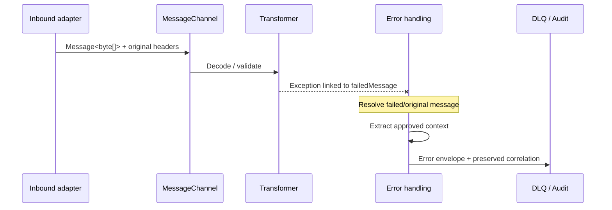
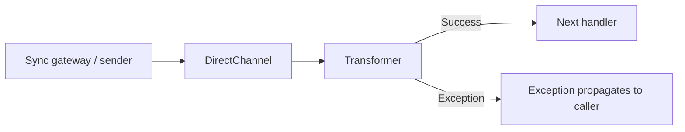
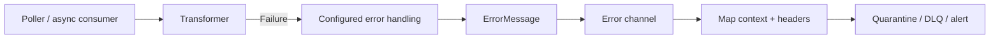
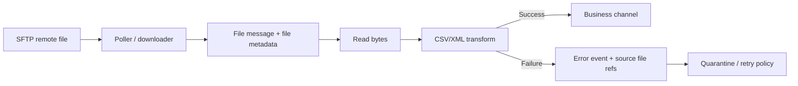
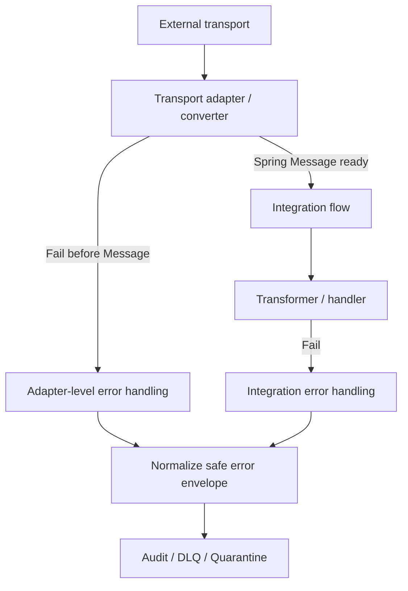

# Error transformation without losing headers in Spring Integration Adapters

In a **Spring Integration** flow, data typically traverses several steps: **inbound adapter or gateway → MessageChannel → transformer → router/handler → outbound adapter or gateway**. Each `Message<?>` has a **payload** and **headers**. The payload holds the data to process; headers carry context such as correlation ID, source system, content type, session tracing, partition details, or routing metadata.

When a transformer decodes JSON/XML, converts charsets, or normalizes a DTO and hits an error, careless handling can **drop essential headers**. For example, the application creates a new error message containing only the string `"Invalid order"`. Without `correlationId`, `sourceSystem`, `eventId`, or a reference to the original message, operations teams cannot easily tell which HTTP request, SFTP file, JMS queue, or Kafka record triggered the failure. The system may also be unable to reply to the gateway, route to a DLQ, or correlate the failure with a business request.

**Error transformation without losing headers** means **preserving appropriate context from the original message across detection, representation, forwarding, storage, and error handling**. This does not mean copying every header unconditionally: internal headers like `replyChannel`, `errorChannel`, or sensitive transport details may not be allowed outward. Sound design balances **traceability** and **trust boundaries**.

In the **SPRING_INTEGRATION_ADAPTERS** module, this lesson focuses on preserving metadata when integrating via **file, SFTP, HTTP, JMS, AMQP, Kafka, and databases**, with **adapters, gateways, pollers, MessageChannel**, message contracts, errors, and connection lifecycles.

> **Core principle:** When an error occurs, **keep a reference to the failed message and forward approved headers**. Do not assume `ErrorMessage` automatically carries all headers from the initial request, and do not assume copying `MessageHeaders` verbatim to external systems is safe.

## 1. Learning objectives

After this lesson, learners will be able to:

1. Explain `Message<?>`, `MessageHeaders`, `ErrorMessage`, `MessagingException`, and `failedMessage` in Spring Messaging/Spring Integration.
2. Distinguish **original message headers**, **error message headers**, and **output headers after error transformation**.
3. Preserve `correlationId`, `eventId`, source, scope, and necessary references whether a transformer succeeds or throws an exception.
4. Understand why certain headers such as `id`, `timestamp`, `replyChannel`, `errorChannel`, and `contentType` require **special handling**.
5. Write Java transformers that throw exceptions **linked to the failed message**, rather than throwing contextless errors.
6. Build an **error envelope** for DLQ/audit without losing investigation metadata.
7. Recognize the difference between errors on synchronous `DirectChannel` vs. pollers, executor channels, or async message-driven adapters.
8. Design header propagation across HTTP, SFTP/file, JMS, AMQP, Kafka, and JDBC.
9. Assess the impact of retries, dead-letter/quarantine, redelivery, serialization, and idempotency on metadata.
10. Test **header preservation** alongside sensitive-data protection and preventing infinite error-routing loops.

## 2. Why preserving headers matters more than the error message text

Consider an HTTP inbound gateway receiving a message:

```text
Payload:
  {"eventId":"evt-1001","orderId":"ORD-42","amountCents":"not-a-number"}

Headers:
  correlationId = req-72e4
  sourceSystem  = partner-a
  eventType     = order.created
  schemaVersion = 1
  contentType   = application/json
  tenantId      = tenant-a  (verified at boundary)
```

The transformer attempts to convert the payload to `OrderCreated`, but the parser reports a numeric type error. If an error message is created like this:

```java
Message<String> badError = MessageBuilder
    .withPayload("Cannot convert OrderCreated")
    .build();
```

This new message does not automatically retain the business headers of the original message. Losing `correlationId` can prevent the gateway from tying results to business logs/traces; losing `sourceSystem` makes it hard for DLQ handlers to categorize producers; losing `schemaVersion` leaves replay unsure which decoder to apply.

Conversely, copying all original headers and sending them to another partner can inadvertently leak internal routing objects or internal metadata. **Proper header preservation** means preserving **the exact information needed for error handling, within the right trust scope**.

### 2.1. Values that usually need to be traceable

| Header or metadata | Purpose | Origin to verify |
| --- | --- | --- |
| `correlationId` | Links steps within a single request/workflow. | Gateway or orchestrator; validate format when entering externally. |
| `eventId` | Identifies the event and aids deduplication. | Producer per contract, validated and uniqueness-managed. |
| `sourceSystem` | Identifies the partner, adapter, or emitting service. | Authenticated transport/connector identity, not just self-asserted headers. |
| `schemaVersion` | Selects parser and validation/replay rules. | Allowlisted producer/endpoint contract. |
| `tenantId` | Binds resources and processing scope. | Verified context; never use arbitrary client headers to grant access. |
| `contentType` | Indicates the wire payload representation at a given point. | Validated transport header or contract-converted representation. |
| `originalMessageId` | Points to the original failed message. | Taken from original message metadata. |
| `fileName`, `topic`, `partition`, `offset` | Helps locate the record at the source. | Normalized adapter metadata; handled per transport. |
| `retryCount` | Distinguishes initial failure from repeated retries. | Authoritative retry mechanism. |

Some fields belong in the **error envelope payload**, some in headers, and some only in the **audit store**. Not everything has to live in headers.

## 3. Message model in Spring Messaging

Spring Integration uses Spring Messaging abstractions:

```java
org.springframework.messaging.Message<T>
org.springframework.messaging.MessageHeaders
org.springframework.messaging.support.MessageBuilder
```

Each message has:

- **Payload:** an object `T`, such as `byte[]`, `String`, a DTO, or an exception.
- **Headers:** key/value entries, generally treated as immutable once the message is built.
- **Framework metadata:** e.g., message ID and timestamp.
- **Application metadata:** e.g., correlation, source, or schema version.
- **Integration/transport metadata:** may include reply/error channels and adapter metadata.

### 3.1. Original message

```java
Message<byte[]> original = MessageBuilder
    .withPayload(jsonBytes)
    .setHeader("correlationId", "req-72e4")
    .setHeader("sourceSystem", "partner-a")
    .setHeader("eventId", "evt-1001")
    .setHeader("schemaVersion", "v1")
    .setHeader(
        MessageHeaders.CONTENT_TYPE,
        MimeTypeUtils.APPLICATION_JSON
    )
    .build();
```

At this point, the headers belong to **the message carrying a byte payload**. Once the payload becomes a DTO or an error message, decide which headers remain accurate and which must be renamed or removed.

### 3.2. Headers are not immutable across every step

A transformer may produce a new message with a new ID. Message builders or adapters can add, drop, or map headers per configuration. Therefore, **never use the Spring message ID alone as the end-to-end tracing key across a flow**; maintain a `correlationId` and an explicit reference to the original ID per contract.

## 4. Three metadata layers not to confuse

When a failure happens, at least three distinct objects exist:

| Object | Payload | Headers | Role |
| --- | --- | --- | --- |
| **Original/failed message** | Data that caused the step to fail. | Source context headers. | Root-cause tracing, source inspection, and replay. |
| **ErrorMessage** | Typically a `Throwable`. | Error message's own headers. | Transports the error event to the error flow. |
| **Normalized error event** | Business/operational error DTO. | Only retained and normalized headers. | Audit, DLQ, quarantine, or external notifications. |

**An easy mistake to make:** inspecting `errorMessage.getHeaders()` and assuming it contains all headers of the failed message. An `ErrorMessage` can carry its own headers set by the error-creation mechanism; original data usually must be retrieved from the **exception holding the failed message** or an **original message reference**, if present.

### 4.1. Error sequence illustration



The exact path depends on the endpoint, transport, and synchronous vs. asynchronous execution; the diagram simply shows the **responsibility for preserving context**.

## 5. When do headers get lost?

Typical scenarios:

1. A transformer returns `MessageBuilder.withPayload(newPayload).build()` without carrying over business metadata.
2. Returning only a DTO/error string while downstream constructs a brand-new message from scratch.
3. Throwing an `IllegalArgumentException` unlinked to the failed message, leaving the error handler without the original object.
4. An error handler reads headers from `ErrorMessage` instead of checking `MessagingException.getFailedMessage()`.
5. An adapter uses a default header mapper that does not forward a custom header to the new transport.
6. JSON/XML conversion changes the payload, and the original `contentType` is dropped without retaining wire format info.
7. A retry handler rebuilds the message and omits `eventId` or `correlationId`.
8. A DLQ only emits `exception.getMessage()` without any source references.
9. A router/filter branch or handler strips headers outside an allowlist.
10. A File/SFTP poller re-reads data without preserving filename, remote path, or a controlled idempotency key.

**Logical check:** a detailed error message string does not prove headers were preserved. Inspect **messages at each boundary** and verify which metadata remains traceable.

## 6. Preserving headers differs from copying all headers

Two needs often conflict:

- **Traceability:** keep correlation, event ID, source, schema, scope.
- **Security:** never emit internal routing objects, tokens, sessions, or sensitive data externally.

### 6.1. Two available policies

| Policy | When appropriate | Risk |
| --- | --- | --- |
| **Copy all headers within trusted zone** | Tightly controlled internal flows where payload changes yet header semantics stay valid. | Retains stale `contentType`, reply/error channels, or unnecessary transport info. |
| **Allowlist/explicit mapping** | Crossing trust boundaries, writing to DLQ, calling external HTTP/JMS/Kafka, or building error events. | Easy to forget a header if the contract is incomplete; requires testing. |

Prefer **allowlists when crossing trust boundaries**. Even when copying internally, review headers that become invalid after changing the payload.

### 6.2. Headers not to copy verbatim outward

- `replyChannel` and `errorChannel`: may be channel names or internal `MessageChannel` objects; not wire metadata safe to emit arbitrarily.
- `MessageHeaders.ID` / `TIMESTAMP`: describe a specific message instance; do not assume a new message's ID equals the original ID.
- Security credentials: Authorization headers, cookies, access tokens, API keys, secrets.
- Sensitive or incompatible transport metadata across JMS/AMQP/Kafka/HTTP.
- A `contentType` that no longer matches the **current payload**.
- Client-asserted unverified metadata such as `isAdmin=true` or `tenantId`.

## 7. Tracking lineage: New messages vs. original messages

A flow may construct multiple new messages. To preserve lineage, separate:

```text
originalMessageId  = ID of the entry message to track
correlationId      = Workflow ID spanning multiple messages/services
eventId            = Business event ID per contract
errorEventId       = Distinct ID of this error record
retryAttempt       = Reprocessing count per retry policy
```

Example:

```text
HTTP inbound message: id=MSG-A, correlation=req-72e4
Transformer attempt:  id=MSG-B, correlation=req-72e4
Error event:          id=ERR-91, originalMessageId=MSG-A
DLQ record:           eventId=evt-1001, correlation=req-72e4
```

The IDs and relationships above are illustrative. In practice, Spring Integration may preserve or generate new message IDs depending on endpoints/builders; what matters is that **lineage is recorded intentionally**, not inferred from whether message IDs happen to match or differ.

### 7.1. Never blindly trust client correlation values

Over HTTP, callers may set `X-Correlation-ID`. Validate format, length, and trust policy; optionally generate a fresh internal correlation ID and store the external request ID separately. Never use a correlation ID to verify identity, determine tenancy, or bypass authorization.

## 8. How success paths can also lose headers

Before discussing errors, distinguish two transformer styles:

1. Transformer returns a **new payload**: with standard Spring Integration transformers/endpoints, the framework typically builds the reply message and propagates headers per endpoint rules.
2. Transformer returns a **new Message**: the code controls the reply message's headers; building from payload alone without copying metadata drops application headers.

Because mechanics vary by endpoint and version, **test actual outcomes** rather than assuming every `@Transformer` method propagates headers identically.

Example creating a new message with selected headers:

```java
Message<OrderCreated> output = MessageBuilder
    .withPayload(event)
    .setHeader("correlationId",
               input.getHeaders().get("correlationId"))
    .setHeader("eventId",
               input.getHeaders().get("eventId"))
    .setHeader("sourceSystem",
               input.getHeaders().get("sourceSystem"))
    .setHeader("originalMessageId",
               input.getHeaders().getId().toString())
    .build();
```

When an entire internal flow is trusted and the contract permits, `copyHeaders(...)` can retain metadata, followed by removing/updating headers that are no longer accurate. Still, **`copyHeaders` does not replace contract design**.

## 9. Throwing exceptions linked to the failed message

If a converter fails and downstream needs access to the original message, throw an exception capable of holding a reference to the failed message.

Spring Messaging provides `MessagingException` and subtypes such as `MessageHandlingException`; these exceptions can carry a `failedMessage` reference.

### 9.1. JSON-decoding transformer example

```java
import com.fasterxml.jackson.core.JsonProcessingException;
import com.fasterxml.jackson.databind.ObjectMapper;
import org.springframework.integration.annotation.Transformer;
import org.springframework.messaging.Message;
import org.springframework.messaging.MessageHandlingException;
import org.springframework.messaging.support.MessageBuilder;
import org.springframework.stereotype.Component;

public record OrderCreated(
    String eventId,
    String orderId,
    long amountCents
) {}

@Component
public class OrderDecodeTransformer {

    private final ObjectMapper mapper;

    public OrderDecodeTransformer(ObjectMapper mapper) {
        this.mapper = mapper;
    }

    @Transformer(
        inputChannel = "rawOrdersChannel",
        outputChannel = "canonicalOrdersChannel"
    )
    public Message<OrderCreated> decode(Message<byte[]> input) {
        try {
            OrderCreated event =
                mapper.readValue(input.getPayload(), OrderCreated.class);

            if (event.eventId() == null
                    || event.eventId().isBlank()
                    || event.orderId() == null
                    || event.orderId().isBlank()
                    || event.amountCents() <= 0) {
                throw new IllegalArgumentException("Invalid order fields");
            }

            return MessageBuilder.withPayload(event)
                .setHeader(
                    "correlationId",
                    input.getHeaders().get("correlationId")
                )
                .setHeader(
                    "eventId",
                    input.getHeaders().get("eventId")
                )
                .setHeader(
                    "sourceSystem",
                    input.getHeaders().get("sourceSystem")
                )
                .setHeader(
                    "schemaVersion",
                    input.getHeaders().get("schemaVersion")
                )
                .setHeader(
                    "originalMessageId",
                    input.getHeaders().getId().toString()
                )
                .build();

        } catch (JsonProcessingException | IllegalArgumentException ex) {
            throw new MessageHandlingException(
                input,
                "ORDER_DECODE_FAILED",
                ex
            );
        }
    }
}
```

**Key point:** the exception is constructed with the `input` reference, giving error handlers a way to retrieve `correlationId`, `eventId`, and headers of the failed message.

### 9.2. Limitations of the example

- The JSON data and DTO are for learning only. A real `ObjectMapper` needs schema/field policies, size limits, and parser constraints.
- Headers read from input must be validated or normalized at the inbound boundary; this example does not authenticate a partner-asserted `sourceSystem`.
- `@Transformer` and `MessageHandlingException` follow Spring Messaging/Integration concepts; additional exception wrapping and `ErrorMessage` construction depend on version and endpoint.
- In asynchronous flows, exceptions can be wrapped multiple levels deep; error handlers must inspect causes and available message references rather than assuming a fixed `getCause()` depth.
- If the failure is a missing database connection, do not label it `ORDER_DECODE_FAILED`; error classification must reflect the real cause.

## 10. What not to do when catching errors

Bad example:

```java
try {
    return convert(input.getPayload());
} catch (Exception ex) {
    throw new RuntimeException("Conversion failed");
}
```

This loses both the original cause and the link to the failed message. An error handler may be unable to locate the input or source metadata if the framework does not supply it another way.

Improved example:

```java
try {
    return convert(input.getPayload());
} catch (IllegalArgumentException ex) {
    throw new MessageHandlingException(
        input,
        "INVALID_INPUT_PAYLOAD",
        ex
    );
}
```

Do not catch `Exception` or `Throwable` overly broadly just to "normalize" every error. Serious infrastructure failures or programming bugs should be classified accurately, and never let a conversion failure emit a fake success payload so business handlers keep running.

### 10.1. When endpoints wrap exceptions automatically

Some Spring Integration endpoints wrap ordinary exceptions into exceptions carrying a failed message. Still, so that a conversion library or handler stays clean across different invocation paths, **do not rely solely on automatic wrapping** when your API can preserve the source reference explicitly.

## 11. What is ErrorMessage?

`org.springframework.messaging.support.ErrorMessage` is a message type whose **payload is a Throwable**. Spring Integration uses `ErrorMessage` across many error-handling mechanisms.

An easy point of confusion:

```text
ErrorMessage
   payload: Throwable / MessagingException
   headers: headers of the error record itself
   originalMessage: may or may not be present, depending on how the error was built
```

When the exception is a `MessagingException`, you can inspect:

```java
Throwable failure = errorMessage.getPayload();

if (failure instanceof MessagingException messagingException) {
    Message<?> failed = messagingException.getFailedMessage();
    // failed.getHeaders() is a usable tracing source.
}
```

Some `ErrorMessage` factories also provide `originalMessage`. However, **never assume that reference always exists**. If the origin is unavailable, record `lineageMissing=true` and report the missing evidence instead of stitching it onto an unrelated message.

### 11.1. Where to pull headers when layers stack

A sound strategy:

1. Prefer the **failed message** from the exception representing the actual failure, if it points to the expected message.
2. Otherwise, check the **original message reference** on `ErrorMessage` if provided.
3. If neither exists, only use error-message headers **when semantics are clear**, and record missing lineage.
4. Never infer user, tenant, or source solely from exception message text.
5. Never let an untrusted header overwrite source info verified at the gateway.

## 12. Building an error envelope without losing required headers

An error envelope is a structured failure representation for auditing, DLQ routing, or quarantine storage. It should contain minimal data yet sufficient traceability.

### 12.1. Defining the DTO

```java
public record IntegrationFailure(
    String errorId,
    String errorCode,
    String correlationId,
    String sourceSystem,
    String eventId,
    String originalMessageId,
    String failedPayloadType,
    String reasonCategory
) {}
```

Avoid placing raw payloads and stack traces into public envelopes. An error ID can look up details inside an access-controlled system.

### 12.2. Mapper converting ErrorMessage to a business error message

```java
import java.util.UUID;
import org.springframework.integration.annotation.ServiceActivator;
import org.springframework.messaging.Message;
import org.springframework.messaging.MessageHandlingException;
import org.springframework.messaging.MessagingException;
import org.springframework.messaging.support.ErrorMessage;
import org.springframework.messaging.support.MessageBuilder;
import org.springframework.stereotype.Component;

@Component
public class OrderFailureMapper {

    @ServiceActivator(
        inputChannel = "orderErrorChannel",
        outputChannel = "normalizedErrorsChannel"
    )
    public Message<IntegrationFailure> map(ErrorMessage error) {
        Throwable cause = error.getPayload();
        Message<?> failed = findFailedMessage(error);

        String correlationId = stringHeader(failed, "correlationId");
        String sourceSystem = stringHeader(failed, "sourceSystem");
        String eventId = stringHeader(failed, "eventId");

        String originalId = failed == null
            ? null
            : String.valueOf(failed.getHeaders().getId());

        IntegrationFailure body = new IntegrationFailure(
            UUID.randomUUID().toString(),
            "ORDER_DECODE_FAILED",
            correlationId,
            sourceSystem,
            eventId,
            originalId,
            failed == null
                ? "UNKNOWN"
                : failed.getPayload().getClass().getSimpleName(),
            "INVALID_MESSAGE_CONTRACT"
        );

        return MessageBuilder.withPayload(body)
            .setHeader("correlationId", correlationId)
            .setHeader("sourceSystem", sourceSystem)
            .setHeader("eventId", eventId)
            .setHeader("originalMessageId", originalId)
            .setHeader("errorCode", body.errorCode())
            .setHeader("lineageMissing", failed == null)
            .build();
    }

    private static Message<?> findFailedMessage(ErrorMessage error) {
        Throwable cause = error.getPayload();

        if (cause instanceof MessagingException messagingException
                && messagingException.getFailedMessage() != null) {
            return messagingException.getFailedMessage();
        }

        return error.getOriginalMessage();
    }

    private static String stringHeader(
        Message<?> message, String name
    ) {
        if (message == null) {
            return null;
        }
        Object value = message.getHeaders().get(name);
        return value instanceof String text ? text : null;
    }
}
```

**Note on Java code:** this illustrates the message structure in Spring versions with matching APIs. When compiling in a real project, match your Spring version and selected modules. In production, enforce length/format constraints on correlation/source, use proper error enums, record timestamps, and avoid hardcoding every exception as `ORDER_DECODE_FAILED`.

### 12.3. Why not put the raw exception into outbound messages?

Exception objects can carry stack traces, nested causes, sensitive data, or fail to serialize reliably. They fit **internal error channels**, not external JMS/AMQP/Kafka/HTTP partner contracts.

Normalizing into `IntegrationFailure` enforces a schema, protects data, and preserves metadata intentionally.

## 13. Testing creating an ErrorMessage with source reference

A pure-message test example:

```java
Message<byte[]> original = MessageBuilder
    .withPayload(new byte[] {1, 2, 3})
    .setHeader("correlationId", "req-72e4")
    .setHeader("eventId", "evt-1001")
    .setHeader("sourceSystem", "partner-a")
    .build();

MessagingException failure = new MessageHandlingException(
    original,
    "Cannot decode payload",
    new IllegalArgumentException("Invalid bytes")
);

ErrorMessage error = new ErrorMessage(
    failure,
    java.util.Map.of("errorOrigin", "test"),
    original
);
```

In this example there are **three places**:

- `original.getHeaders()`: input metadata.
- `failure.getFailedMessage()`: reference from the exception.
- `error.getHeaders()`: metadata belonging to the error event itself, holding only `errorOrigin` aside from framework metadata.

Thus, code that only reads `error.getHeaders().get("correlationId")` can receive null, even though correlation is fully present in `original`.

### 13.1. When there is no failed message

A failure occurring **before a Spring Message is built** (such as a Kafka deserializer failing) may lack a `failedMessage` of this form. Use whatever metadata is available at the adapter/listener and transport error strategy, and honestly record what could not be observed. Never fabricate a fake "original" message just to tidy up metrics.

## 14. ErrorMessage headers vs. failedMessage headers

Quick lookup table:

| Question | Typical appropriate source |
| --- | --- |
| Which message failed? | `MessagingException.getFailedMessage()` or `ErrorMessage.getOriginalMessage()` if present. |
| What kind of processing error? | Exception type, cause, handler reason code. |
| What is the workflow correlation? | Normalized header from the original message. |
| What ID does the error event have? | `ErrorMessage` ID or dedicated error envelope ID. |
| Where did the failing event originate? | Endpoint/adapter metadata; may live in error headers. |
| Which channel receives the reply? | Authoritative gateway/routing configuration, never arbitrary client data. |
| Which DLQ receives it? | Adapter/route policy; never rely on an unverified destination header. |
| Should raw payloads be kept? | Audit/quarantine policy with data protection controls. |

There is no single rigid precedence order for every system. Traceability design must define **which message exists at which stage** and which headers have guaranteed semantics.

## 15. Error channels: Synchronous vs. asynchronous differences

In Spring Integration, errors can:

- **Propagate to the caller** in a synchronous processing chain.
- **Be published as an `ErrorMessage`** to an error channel when an endpoint/poller/container has matching error-handling mechanics.
- **Be handled at the adapter/listener before entering the integration flow**, such as deserializer or transport auth errors.

### 15.1. DirectChannel



With `DirectChannel`, handler calls normally execute synchronously. If a converter throws an exception, the error can propagate straight back to the gateway or caller; **never assume** it always routes to a global `errorChannel`.

To normalize errors on synchronous paths, design error mapping at the gateway or handle exceptions at an appropriate service boundary.

### 15.2. Poller or executor channel



With a poller or task-executor endpoint, the framework can use configured error-publishing mechanics. Verify **how exceptions are wrapped**, **whether the original message is available**, **where ack/transactions occur**, and **which error channel is actually active**.

### 15.3. ErrorMessageStrategy

Some Spring Integration components use an **error message strategy** to construct an `ErrorMessage` carrying relevant context (such as original/failed messages). This is a configuration option worth considering where adapters support it, but never rely on an untested global setting to conclude all transports retain identical headers.

## 16. `replyChannel` and `errorChannel`: Keep or remove?

Spring Integration uses headers tied to request/reply or error orchestration. A request from a gateway may carry `replyChannel` and `errorChannel`, sometimes as internal channel objects rather than serializable strings.

### 16.1. In internal flows

Keeping orchestration headers when the framework needs them helps gateways finish request/reply flows and route errors properly. If a transformer builds a new message while dropping all headers, that context may be lost or require the framework to restore it per endpoint rules.

### 16.2. When emitting error events to brokers/HTTP

Do not emit raw `replyChannel`/`errorChannel` to Kafka, JMS, AMQP, or partner APIs. Instead:

- Convert to safe business metadata if truly needed.
- Keep `correlationId` so external systems know which request the event relates to.
- Define governed destinations on the adapter rather than accepting arbitrary client values.
- Handle request/reply at the gateway/caller per policy, never expecting a DLQ consumer to reply into a serialized internal channel.

### 16.3. Avoiding error-handling loops

If a normalized error message accidentally retains an `errorChannel` pointing back to the same error flow, an error inside the error handler can trigger the same error path repeatedly. Design a **terminal error sink**, retry caps, and error handling for the error pipeline itself.

## 17. Which headers become stale after changing the payload?

Suppose inbound HTTP sends:

```text
payload Java type: byte[]
contentType: application/json
schemaVersion: v1
```

After deserialization:

```text
payload Java type: OrderCreated
wireContentType: application/json
schemaVersion: v1
```

If `contentType=application/json` is kept and downstream treats it as the **current representation of the Java object**, another adapter might try to serialize/deserialize wrongly. Conversely, dropping all trace of the wire format makes it harder for operations to diagnose producer bugs.

The solution is an explicit convention:

| Field | Interpretation |
| --- | --- |
| `contentType` | Current payload representation when needed by endpoints/adapters. |
| `wireContentType` | MIME type received on the wire at verified ingress. |
| `schemaVersion` | Verified business version of the payload. |
| `originalMessageId` | Reference to the original message. |
| `payloadClass` | Current Java type if needed for internal audit or routing. |

**Not every project must use these exact custom header names.** What matters is avoiding a single header carrying two conflicting meanings before and after transformation.

## 18. Safely copying headers when replacing the payload

Within a trusted internal zone, you sometimes want to keep most headers:

```java
Message<OrderCreated> transformed = MessageBuilder
    .withPayload(parsedOrder)
    .copyHeaders(original.getHeaders())
    .removeHeader(MessageHeaders.CONTENT_TYPE)
    .setHeader(
        "wireContentType",
        String.valueOf(original.getHeaders()
            .get(MessageHeaders.CONTENT_TYPE))
    )
    .build();
```

This is an **example of intentional preservation** inside a trusted zone. Watch out for:

1. Copied headers may contain internal routing objects or transport metadata.
2. Spring Message ID/timestamp follow special rules; do not rely on `copyHeaders` to manage old vs. new message IDs.
3. Headers like `replyChannel`/`errorChannel` may need removal when sending externally, though never strip them blindly inside an internal gateway flow.
4. `contentType` headers must match the post-conversion payload.
5. For security metadata, retain only values issued by the authentication layer and permitted to propagate.
6. Verify with unit/integration tests instead of assuming every header passes verbatim through every adapter.

### 18.1. Explicit mapping at the trust boundary

At the outbound boundary, prefer:

```java
Message<IntegrationFailure> outboundError = MessageBuilder
    .withPayload(failure)
    .setHeader("correlationId", verifiedCorrelationId)
    .setHeader("eventId", verifiedEventId)
    .setHeader("sourceSystem", verifiedSourceSystem)
    .setHeader("errorCode", "ORDER_DECODE_FAILED")
    .build();
```

There is no `copyHeaders(original.getHeaders())` here because the error message may leave the system. The `verified...` variables must come from earlier validation/normalization steps.

## 19. Designing the error event contract

For different adapters to handle errors consistently, an error contract should specify:

| Property | Purpose |
| --- | --- |
| `errorId` | Each recorded failure gets an independent ID. |
| `errorCode` | Stable code for classification and dashboards. |
| `occurredAt` | Failure timestamp in an explicit timezone/instant. |
| `sourceSystem` | Verified sending system. |
| `adapterType` | HTTP, FILE, SFTP, JMS, AMQP, KAFKA, or JDBC. |
| `correlationId` | Correlates related workflow activity. |
| `eventId` | Source key for idempotency/replay if defined by contract. |
| `originalMessageId` | Reference to the failed message, if available. |
| `failureStage` | Parse, schema validation, transform, routing, outbound. |
| `retryable` | Per error classification, not inferred solely from exception name. |
| `attempt` | Attempt count when supplied by retry mechanics. |
| `payloadReference` | Reference to quarantined payload, not a secret-leaking raw body. |
| `reasonCategory` | Contract, transient infrastructure, business rejection... |

### 19.1. Example JSON when publishing errors

```json
{
  "errorId": "err-8821",
  "errorCode": "ORDER_DECODE_FAILED",
  "occurredAt": "2026-11-23T09:35:00Z",
  "adapterType": "KAFKA",
  "sourceSystem": "partner-a",
  "correlationId": "req-72e4",
  "eventId": "evt-1001",
  "originalMessageId": "msg-313",
  "failureStage": "TRANSFORM",
  "retryable": false,
  "attempt": 1,
  "reasonCategory": "INVALID_MESSAGE_CONTRACT",
  "payloadReference": "quarantine/err-8821"
}
```

This is an **illustrative schema**, not a mandatory Spring Integration error format. In real systems, distinguish event IDs from broker message IDs, and protect payload references with access controls and retention policies.

## 20. File/SFTP: Preserving source metadata on conversion failure

File/SFTP adapters can attach headers for filename, file path, remote directory, remote file, and poller metadata depending on endpoint/configuration.

A sample flow:



### 20.1. Why not keep only `fileName`?

Two files can share the same name across different remote directories or partners. For traceability, you may need:

- Authenticated adapter/partner.
- Sanitized remote directory and filename.
- File identifier or import idempotency key.
- Receipt timestamp and file size.
- Hash or checksum per policy.
- Converter step name and schema version.
- Correlation ID tied to a batch/record.

**Never use an externally supplied remote path as a local filesystem path for writing/quarantining without normalization and validation.** Traceability metadata must not turn into a path traversal vulnerability.

### 20.2. Do not archive prematurely

When a transformer fails, if the file was already deleted or moved to the success archive without keeping an original copy in quarantine, replay capability can be lost. Define clear milestones for **read**, **parsed**, **business-committed**, and **archived**, keeping matching metadata in error events.

### 20.3. Record-level errors

In a CSV file containing many records, the failure may lie in **one row**. Error envelopes should carry batch/file references plus the record number or record ID identified by the parser. If the file uses CSV with newlines inside quoted fields, **the physical line number is not necessarily the record number**; use a parser capable of reporting exact record indices.

## 21. HTTP gateway: Preserving headers and returning errors to callers

An HTTP inbound gateway places requests into an integration flow. On synchronous paths, exceptions can be converted into HTTP error responses through gateway/application mechanics.

### 21.1. Desired flow

```text
HTTP request
  -> Authenticate producer / create or normalize correlation
  -> HTTP inbound gateway / Message
  -> Converter
  -> Exception linked to failedMessage
  -> Error mapper at boundary
  -> Appropriate HTTP 400/415 or 5xx + safe error body
```

### 21.2. What to keep vs. never return

| Information | In audit/error handler | In HTTP response to client |
| --- | --- | --- |
| Safe correlation ID | Yes | Can return a normalized reference code. |
| Schema/MIME error | Yes, with detailed reason code | Message conforming to API contract. |
| Internal channel objects | No need to emit | No. |
| Authorization token/cookie | Do not log contents | Never echo back. |
| Stack trace and internal paths | Restricted, access-controlled internally | No. |
| Sensitive raw payload | Protected quarantine only if genuinely required | No. |

**Note:** `correlationId` does not replace gateway HTTP request–reply routing. Retaining or losing `replyChannel` in synchronous flows can affect reply mechanics depending on configuration. Test both success and error replies end-to-end.

### 21.3. Suggested status codes

- `400 Bad Request`: syntactically or contract-invalid request payload per API.
- `415 Unsupported Media Type`: unsupported content type.
- `401/403`: authentication/authorization failure, distinct from conversion failure.
- `409 Conflict`: suitable for certain business/idempotency conflicts.
- `5xx`: system/transient errors; never lump fixed schema errors into server errors.

Each API may define its own error contract; internal messages will not map to the right status automatically unless the gateway/controller is configured.

## 22. JMS: Spring headers and JMS properties

JMS has broker headers/properties and message types such as `TextMessage` and `BytesMessage`. Entering Spring Integration, the adapter/converter maps a subset of metadata onto Spring Messages.

### 22.1. Context to preserve on failure

- Business correlation ID or JMS correlation per convention.
- JMS message ID/destination for investigation.
- Event ID/idempotency key.
- Authenticated producer or connector identity.
- Delivery attempt/redelivery metadata (per listener/container support).
- Contract version and payload type.

**Do not treat every JMS header name as equivalent to custom Spring headers**; mapping depends on adapter and configuration.

### 22.2. Retries and transactions

If a transformer throws an error inside a JMS listener:

- The exception may cause rollback/redelivery depending on transaction/ack settings.
- An internal `ErrorMessage` does not mean the JMS message was acknowledged.
- When moving to a DLQ, keep enough metadata to distinguish **permanent data errors** from **transient errors**.
- Never copy unserializable broker/session objects into DLQ records.
- Never allow poison messages to redeliver infinitely and block queues.

**Goal:** logs and DLQs carry usable correlation/source/record IDs, while transaction semantics are verified independently.

## 23. AMQP: Saving metadata when the message converter fails

With AMQP/RabbitMQ, bodies can be bytes and properties carry content type/content encoding and routing metadata. Spring AMQP has its own converters and listener containers.

### 23.1. Failure location makes a difference

| Where failure happens | Available context |
| --- | --- |
| Before creating Spring Message | AMQP-layer body/properties; Integration `failedMessage` may not exist yet. |
| Inside Integration transformer | Spring Message and headers mapped by the adapter. |
| During outbound AMQP serialization | Internal message, converter, destination, and publisher settings. |
| During broker routing/delivery | Broker return/confirm/dead-letter metadata per config. |

If failure occurs in the **AMQP converter before the Integration flow**, do not expect the error handler to rely on `MessagingException.getFailedMessage()` as though that message already existed. Extract metadata from the appropriate listener-layer error strategy.

### 23.2. When sending to DLQ

Forward only required metadata to the DLQ per contract, such as original routing key, correlation ID, event ID, reason code, and source. Note that brokers may attach redelivery/x-death info whose schema and header names differ from Spring messages; test against a real broker.

## 24. Kafka: Partition, offset, and pre-transformer exceptions

A Kafka record has topic, partition, offset, key, value, and headers. Spring Kafka/Integration provide abstractions and mappings depending on adapter type and consumer config.

### 24.1. When the transformer fails

```text
Kafka Consumer
  -> record deserialized to byte[]/String
  -> Spring Integration Message
       correlationId = req-72e4
       eventId = evt-1001
       topic/partition/offset = adapter metadata
  -> Transformer
  -> MessageHandlingException(failedMessage)
  -> Error mapper or listener error strategy
  -> DLT/quarantine per policy
```

If conversion breaks **before** Spring Message creation (e.g., Kafka value deserializer throws), the Integration error flow cannot access `failedMessage`. A Kafka listener/deserializer error-handling layer must preserve whatever metadata can be pulled from the record per container capabilities.

### 24.2. Offset is not an event ID

A Kafka offset is meaningful only **within one partition of one topic**, not as a globally unique system ID. An error envelope should record both topic/partition/offset for diagnostics and a business event ID if supplied by the producer.

### 24.3. Kafka headers can be `byte[]`

Kafka record headers can hold `byte[]`, whereas Spring Message headers may be Strings/typed values after mapping. If an error handler blindly casts:

```java
String correlationId =
    (String) message.getHeaders().get("correlationId");
```

while the adapter supplies `byte[]`, a `ClassCastException` can fire right inside the error path. **Define and test header decoding/normalization rules** at ingress instead of patching it with `toString()` on `byte[]` (which does not yield text contents).

### 24.4. Replay and DLT

When publishing to a dead-letter topic, include enough metadata to replay with the right deserializer/schema version without blindly copying all incoming Kafka headers. Prevent header bloat across repeated retries/dead-letter hops, and avoid leaking sensitive data onto topics with broader read permissions.

## 25. JDBC and database pollers: Preserving the record key

In a database inbound adapter, messages may be built from query results or JDBC row mappers. When transforming a `payload` column fails, the most critical piece of metadata is usually the **source record key**.

Outbox data example:

```text
EVENT_OUTBOX
  event_id
  aggregate_id
  payload_json
  schema_version
  created_at
  processing_status
```

A useful error event links `event_id` and `aggregate_id` (if allowed) so operations can locate the row, inspect the schema, and run controlled replays.

### 25.1. Avoid losing row keys when keeping only the payload

If a JDBC poller emits a Map containing `event_id` and `payload_json`, yet the transformer extracts only the JSON string without keeping the event ID in headers or a canonical envelope, parser failures will leave no trace of which row failed.

A clean design:

```text
DB row
  -> extract event_id / schema_version as trusted metadata
  -> Message<String> + eventId + schemaVersion
  -> JSON transformer
  -> success: canonical event
  -> failure: failedMessage + eventId for quarantine/status update
```

### 25.2. Transactions and checkpoints

Writing an error event does not automatically mean the database row was marked failed or the poller offset advanced. Establish a transaction/outbox strategy:

- Permanent data errors can be marked `INVALID` with audit records so they do not stall the whole batch.
- Transient downstream failures should undergo bounded retries.
- Transition row states and write error records under rules preventing loss or duplication.
- If a transaction rolls back, know where error records and row states actually persist.

## 26. Per-transport message converters can lose headers before Integration

Internal transformers are not the only place metadata gets lost. Failures can happen when:

- An HTTP converter reads the body before the gateway constructs a Spring Message.
- A JMS message converter fails processing a `TextMessage`/`BytesMessage`.
- An AMQP inbound converter encounters an unsupported payload.
- A Kafka deserializer fails to produce a value.
- An SFTP/file reader fails prior to `MessageBuilder`.
- A JDBC driver/row mapper throws before a message is emitted.

In those cases, **an original `Message<?>` is not always available to copy headers from**. Design adapter-level error handling using the metadata available at that exact layer.

### 26.1. Two-tier error model



Do not force a single abstraction by assuming **every failure source carries identical headers**. Error envelopes can have optional/unknown fields and should indicate lineage confidence explicitly.

## 27. Retries: Preserving headers across multiple attempts

A message may be reprocessed due to:

- Transient database/network failures.
- Ack timeouts or consumer restarts.
- A poller re-discovering a file.
- JMS/AMQP redelivery.
- Kafka replay/offset resets.
- Operators replaying DLQ/quarantine after fixing data.

Across every attempt, preserve **event identity** while distinguishing **attempt identity**.

```text
eventId:       evt-1001  (stable for the same event)
correlationId: req-72e4  (stable across workflow where appropriate)
attempt:       1 -> 2 -> 3
errorId:       err-1 -> err-2 -> err-3
```

### 27.1. Do not turn retries into rootless new messages

When rebuilding messages for retry, define explicitly:

- Does `eventId` remain unchanged or get reassigned from the source?
- How is `correlationId` preserved?
- Does `originalMessageId` still point to the initial message or the latest attempt?
- Does `attempt` come from the retry framework or durable tracking?
- Are sensitive credentials accidentally repeated in headers?
- When retrying across another broker, which headers are serializable?

### 27.2. Idempotency relies on more than correlation IDs

One request may produce multiple events, or the same event may arrive in separate requests. Thus, `correlationId` **is not automatically an idempotency key**. Use governed event/business keys combined with source/tenant and processing state to prevent duplicate transactions during retries.

## 28. Preserving headers in DLQ/quarantine and replay

A DLQ/quarantine can be a queue, topic, directory, database table, or controlled store. A good error record includes:

1. **Source references:** adapter, valid source/tenant, `eventId`, `originalMessageId`.
2. **Reason code:** content type, charset, schema, authorization, downstream error...
3. **Replay metadata:** parser/schema version and contract to reapply.
4. **Payload or reference:** retain only necessary data, encrypted and access-controlled.
5. **Retry history:** attempt count, outcomes, timestamps.
6. **Owner and disposition:** who is authorized to fix/replay/discard.
7. **Dedup key:** prevents replaying already-committed business side effects.

Never serialize raw Spring `MessageHeaders` to JSON or Kafka: they can contain non-serializable objects or data unfit for external exposure.

### 28.1. Errors that cannot be replayed directly

An error event recorded after a parser already discarded the raw payload may suffice for auditing, not replay. If replay is required, **decide upfront where to store raw payloads safely**, along with checksums, retention, and data protection.

## 29. Security when preserving headers

Headers can carry sensitive or spoofable values, such as:

- Cookies or Authorization bearer tokens.
- API keys, session IDs, secrets.
- Internal resource names, network paths, addresses, or credential metadata.
- Client-asserted tenant, user, role, or device status.
- Raw exceptions containing input data.
- Oversized headers, wrong types, or control characters.

### 29.1. Controls to enforce

| Risk | Mitigation |
| --- | --- |
| Token leaks via DLQ | Strip credentials before publishing; never log raw headers. |
| Header spoofing | Authenticate producers, derive `sourceSystem`/tenant from trusted context. |
| Oversized headers | Cap header length and count; never move payloads into headers. |
| Header injection | Sanitize newlines/control characters before using in HTTP headers/filenames. |
| Illegal routing | Never treat external destination/`replyChannel` values as trusted routes. |
| PII leaks via metrics | Never use correlation IDs, user IDs, or raw error messages as metric labels. |
| Retaining errors too long | Enforce retention, encryption, and access controls per policy. |
| Error handlers leaking inputs | Use stable error codes; limit exception details exposed externally. |

### 29.2. Two types of provenance to separate

- **Verified provenance:** adapter or security layer established producer, tenant, and scope.
- **Producer-declared metadata:** correlation, fileName, eventId, or schemaVersion can be helpful, yet require format, scope, and permission checks before use.

An error mapper must never elevate a client `role=ADMIN` header into granted privileges merely because it was preserved.

## 30. Observability: Measuring lost headers

Do not just log exceptions; track **metadata coverage** on error events.

### 30.1. Illustrative safe log

```json
{
  "eventType": "INTEGRATION_TRANSFORM_FAILED",
  "errorId": "err-8821",
  "correlationId": "req-72e4",
  "eventId": "evt-1001",
  "sourceSystem": "partner-a",
  "adapter": "http-inbound",
  "failureStage": "JSON_TRANSFORM",
  "reasonCode": "INVALID_ORDER_AMOUNT",
  "originalMessageId": "msg-313",
  "lineageMissing": false,
  "retryable": false,
  "attempt": 1
}
```

This is sample data, not measurements from a live system.

### 30.2. Suggested metrics

| Metric | Meaning |
| --- | --- |
| `integration_transform_error_total{adapter,reason}` | Conversion errors by source and reason category. |
| `error_envelope_missing_correlation_total` | Errors lacking normalized correlation. |
| `error_envelope_missing_original_total` | Errors unable to trace back to original message. |
| `dlq_publish_failure_total` | Failures while storing/emitting error records. |
| `quarantine_pending_messages` | Failures awaiting remediation. |
| `retry_attempts_total{adapter}` | Attempt counts and retry storm risk. |
| `header_mapping_failure_total{transport}` | Failures mapping headers across protocols. |
| `error_handling_duration_seconds` | Error-handling latency. |

Use low-cardinality labels on metrics; keep `correlationId` and `eventId` in logs/traces rather than metric labels.

## 31. Unit testing header preservation

You cannot test only the exception type. Tests must ask:

- Does the exception retain the failed message properly?
- Does the built `ErrorMessage` include the original message when required by policy?
- Does the error mapper extract correlation/`eventId` accurately from the source?
- Does the error message keep needed metadata while **not copying credentials**?
- Are errors before Integration messages honestly flagged as missing lineage?
- Do retries preserve event IDs without unbounded header growth?

### 31.1. JUnit 5: Checking that exceptions retain the original message

```java
import static org.junit.jupiter.api.Assertions.*;

import java.nio.charset.StandardCharsets;
import org.junit.jupiter.api.Test;
import org.springframework.messaging.Message;
import org.springframework.messaging.MessageHandlingException;
import org.springframework.messaging.support.MessageBuilder;
import org.springframework.util.MimeTypeUtils;
import org.springframework.messaging.MessageHeaders;

class OrderTransformerHeaderTest {

    private final OrderDecodeTransformer transformer =
        new OrderDecodeTransformer(new ObjectMapper());

    @Test
    void failureCarriesOriginalHeaders() {
        Message<byte[]> original = MessageBuilder
            .withPayload(
                "{invalid-json".getBytes(StandardCharsets.UTF_8)
            )
            .setHeader("correlationId", "req-72e4")
            .setHeader("eventId", "evt-1001")
            .setHeader("sourceSystem", "partner-a")
            .setHeader(
                MessageHeaders.CONTENT_TYPE,
                MimeTypeUtils.APPLICATION_JSON
            )
            .build();

        MessageHandlingException failure = assertThrows(
            MessageHandlingException.class,
            () -> transformer.decode(original)
        );

        assertSame(original, failure.getFailedMessage());
        assertEquals(
            "req-72e4",
            failure.getFailedMessage()
                .getHeaders().get("correlationId")
        );
        assertEquals(
            "evt-1001",
            failure.getFailedMessage()
                .getHeaders().get("eventId")
        );
    }
}
```

This is an illustrative example. In a real test file, import `ObjectMapper`, configure components per your project, and verify your chosen API version; the STEP 4 lesson only creates content without running a build.

### 31.2. JUnit 5: Checking the error envelope

```java
import static org.junit.jupiter.api.Assertions.*;

import java.util.Map;
import org.junit.jupiter.api.Test;
import org.springframework.messaging.Message;
import org.springframework.messaging.MessageHandlingException;
import org.springframework.messaging.support.ErrorMessage;
import org.springframework.messaging.support.MessageBuilder;

class OrderFailureMapperTest {

    @Test
    void mapsErrorUsingFailedMessageHeaders() {
        Message<byte[]> original = MessageBuilder
            .withPayload(new byte[] {1, 2, 3})
            .setHeader("correlationId", "req-72e4")
            .setHeader("eventId", "evt-1001")
            .setHeader("sourceSystem", "partner-a")
            .setHeader("Authorization", "Bearer-secret-not-for-export")
            .build();

        MessageHandlingException exception =
            new MessageHandlingException(
                original,
                "Cannot decode",
                new IllegalArgumentException("Malformed payload")
            );

        ErrorMessage error = new ErrorMessage(
            exception,
            Map.of("errorOrigin", "test"),
            original
        );

        Message<IntegrationFailure> result =
            new OrderFailureMapper().map(error);

        assertEquals(
            "req-72e4", result.getHeaders().get("correlationId")
        );
        assertEquals(
            "evt-1001", result.getHeaders().get("eventId")
        );
        assertEquals(
            "partner-a", result.getHeaders().get("sourceSystem")
        );
        assertNull(result.getHeaders().get("Authorization"));
        assertNotNull(result.getPayload().errorId());
    }
}
```

This test verifies **both preservation and zero credential leakage**. There is no requirement to keep every header; retain only headers specified in the contract.

## 32. Per-adapter integration testing

To ensure headers are not lost across framework/transport layers, run E2E tests:

| Flow | Scenario | What to verify |
| --- | --- | --- |
| HTTP inbound gateway | Syntax-invalid JSON | Safe error response, right correlation, intact reply routing. |
| HTTP outbound gateway | Target endpoint returns 4xx/5xx | Preserves request correlation, response status, and reason per contract. |
| SFTP file poller | File contains broken CSV row | Error event has file/batch origin, quarantined, not wrongly archived. |
| JMS TextMessage | Business-invalid data | Error record retains event ID, sensible broker redelivery. |
| JMS BytesMessage | Decoder error | Sufficient adapter metadata, no infinite retries. |
| AMQP inbound | JSON converter fails before flow | Adapter-level error strategy captures available source metadata. |
| Kafka ByteArrayDeserializer | Transformer fails | Topic/partition/offset and event ID recorded; DLT replays cleanly. |
| Kafka deserializer | Failure before Message creation | Does not assume `failedMessage`; handled at listener. |
| JDBC poller | One row has invalid `payload_json` | Retains row/event ID and updates processing status appropriately. |
| Async channel | Failure on executor thread | Error channel receives contextual message or honestly flags missing info. |
| Gateway request/reply | Transformer builds new Message | Success/error responses return to right caller without losing correlation. |
| DLQ replay | Reprocessed after schema fix | Event ID unchanged and no duplicate side effects. |

### 32.1. Testing abnormal scenarios

- Missing `correlationId` header: is a local error ID generated and missing source flagged?
- `correlationId` header is `byte[]` instead of `String`: handled properly per adapter mapping?
- Client-spoofed `sourceSystem` header: does authenticated origin take precedence?
- Unserializable `replyChannel` object: prevented from leaking out to brokers?
- Failure inside the error mapper itself: terminal error handling avoids loops?
- Event re-arriving after retry: idempotency key and retry count preserved properly?
- Post-transform `contentType` mismatches payload: outbound avoids wrong converter?
- Trace sampled out while audit is mandatory: evidence retained on unsampled path?

## 33. Runbook for diagnosing lost correlation on error transformation

**Scenario:** A dashboard shows JMS parse errors, yet every message in the DLQ lacks `correlationId`.

A diagnostic runbook can follow:

1. **Identify the source:** JMS queue, listener/adapter, `TextMessage`/`BytesMessage` type, and converter.
2. **Check metadata origin:** which JMS property did the producer use for correlation ID? Did the adapter map it to a Spring header?
3. **Inspect message before transformer:** is `correlationId` present? If not, the bug is in ingress mapping or the producer.
4. **Inspect the exception:** did the converter throw `MessagingException` linked to `failedMessage`?
5. **Inspect `ErrorMessage`:** is the error handler reading `ErrorMessage` headers or failed/original message headers?
6. **Inspect DLQ mapper:** is correlation in the allowlist, and is the header value type serializable?
7. **Check security:** if correlation ID comes from the producer, is it normalized and length-bounded?
8. **Fix at the right layer:** fix ingress mapping, failed message reference, or outbound allowlist; never patch by guessing correlation from exception strings.
9. **Add a regression test:** invalid JMS records must carry correlation through to DLQ/audit and retries.
10. **Track coverage:** missing-correlation metrics drop, counting only messages within observable scope.

**Required conclusion:** pinpoint **which handoff dropped the header**, with before/after evidence and an owner—never stop at adding a single log statement.

## 34. Common anti-patterns

| Anti-pattern | Risk | Improvement |
| --- | --- | --- |
| Building errors with `MessageBuilder.withPayload(errorText).build()` | Loses correlation, event ID, source. | Normalize error envelope and intentionally map headers. |
| Throwing `new RuntimeException("failed")` without cause | Loses stack cause and failed message. | Throw exception carrying `failedMessage` where appropriate. |
| Reading only `ErrorMessage.getHeaders()` | Misses source headers. | Inspect `MessagingException.getFailedMessage()` / original message. |
| Assuming `ErrorMessage` always has `originalMessage` | Nulls or missing evidence. | Explicit fallback, flag `lineageMissing`. |
| Copying all headers to Kafka/JMS/DLQ | Leaks tokens, channel objects, internal metadata. | Allowlist across trust boundaries. |
| Keeping `contentType=application/json` after payload change without clarifying | Downstream decoder misinterprets. | Distinguish current content type vs. original `wireContentType`. |
| Using Spring Message ID as sole correlation | ID can change across transformers/adapters. | Stable correlation/event ID per contract. |
| Trusting client-sent `tenantId`/`role` | Wrong scope or authorization flaw. | Authenticate sources and enforce independent policies. |
| Assuming global `errorChannel` catches all `DirectChannel` errors | Errors propagate to caller without entering error flow. | Test sync/async and gateway error paths. |
| Ignoring failures before Message creation | Kafka/AMQP/HTTP converter errors lack `failedMessage`. | Adapter-level error strategies. |
| DLQ storing only exception string | Lacks record key and replay info. | Error envelope with protected metadata/references. |
| Retries generating a new `eventId` for the same event | Duplicate business processing. | Governed idempotency/source event IDs. |
| Copying broker headers repeatedly across dead-letter hops | Header bloat, raised leak risk. | Bounded/allowlisted header mapping. |
| Not testing failures inside the error pipeline | Secondary error causes loops or dropped alerts. | Terminal sink and negative tests. |
| Logging raw payloads/tokens "for easy debugging" | Leaks secrets and personal data. | Reason codes, correlation, secure quarantine. |

## 35. Practical scenarios

### Scenario A – Transformer loses headers on the success path

A transformer returns a new Message containing only the DTO payload, causing `correlationId` to vanish at downstream handlers. When a business error happens later, the DLQ also lacks correlation.

**Question:** Where does the fix belong?

**Hint:** Inspect where the transformer constructs the new Message and endpoint propagation rules. Carry approved business headers onto the output message or use a filtered internal copy strategy. Test both success and downstream failure paths.

### Scenario B – ErrorMessage has headers, but not the original ones

The error handler prints `error.getHeaders()`, seeing the error event's ID/timestamp but not `eventId` from Kafka.

**Question:** Where can `eventId` be found?

**Hint:** Check the exception payload if it is a `MessagingException` via `getFailedMessage()`; next check `ErrorMessage.getOriginalMessage()` if supplied. If failure happened before the Integration message, retrieve metadata at the Kafka listener/adapter layer.

### Scenario C – Sending `replyChannel` to JMS

An error message copies all headers from an inbound gateway straight to a JMS DLQ. The `replyChannel` header holds a channel object, and the serializer fails.

**Question:** Where was the boundary violated?

**Hint:** Internal framework routing metadata crossed an external serialization boundary. Build an allowlisted error envelope and manage replies at the gateway rather than emitting raw channel objects.

### Scenario D – Kafka deserializer fails before the transformer

A Kafka record cannot be deserialized to `String`, so `OrderDecodeTransformer` is never invoked. The dashboard error mapper reports `lineageMissing=true`.

**Question:** Can transformer exception handling be used to retrieve `failedMessage`?

**Hint:** Not if no Spring Message was ever constructed. Use Kafka listener/deserializer error handling to capture topic/partition/offset, key, or container-available headers, then build the contract error event.

### Scenario E – SFTP file fails schema validation

A batch file contains 500 orders; order 271 is malformed. The error event only contains `"invalid format"`, with no filename, batch, or record ID.

**Question:** What is needed for accurate replay?

**Hint:** Normalized source/remote path, batch/file ID, parser-reported record index/key, schema version, correlation, checksum, and archive/quarantine state. Never infer record index from physical line numbers if CSV allows quoted newlines.

### Scenario F – HTTP request carries tokens in headers

To avoid losing headers, the engineering team copies all incoming HTTP headers into the error event and publishes it to a topic readable by multiple teams.

**Question:** What is the issue?

**Hint:** This can broadcast Authorization/Cookies and sensitive metadata. Filter at the boundary, rely on verified identity info, map correlation/errorCode, and strip secrets.

### Scenario G – Retry creates a new event

A consumer receives `eventId=evt-1001`, fails, and retries by generating `eventId=evt-1002`. After recovery, both versions are processed as two separate orders.

**Question:** What must change to ensure idempotency?

**Hint:** Keep source event identity intact while issuing separate error IDs/attempt IDs; build scoped deduplication around event/business keys. Never treat an error ID as a new event ID.

### Scenario H – Mapper fails a second time

An error mapper expects `correlationId` as a `String` yet receives `byte[]` from a transport header. It throws `ClassCastException` while handling an error.

**Question:** What is a more resilient design?

**Hint:** Normalize headers at the adapter boundary; have the error mapper check types safely, handle missing/unexpected types, include a terminal fallback, and test negative cases. Never turn secondary errors into retry loops.

### Scenario I – Content type no longer matches

Inbound `Message<byte[]>` carries `application/json`; the transformer converts it to `OrderCreated` and keeps the old `contentType`. A downstream outbound adapter picks a different converter based on the header and throws a mismatch.

**Question:** How do you keep context without breaking the contract?

**Hint:** Separate original `wireContentType` from current content type, updating/removing stale headers when changing payloads. Keep source metadata for tracing without steering serializers wrongly.

### Scenario J – Error channel does not receive synchronous errors

A `DirectChannel` transformer throws an exception; operations waits for a message on the global `errorChannel`, yet nothing arrives.

**Question:** Why?

**Hint:** Synchronous paths normally propagate exceptions back to the caller/gateway. Configure error mapping at the proper boundary rather than assuming error publishing behaves identically to pollers/async consumers.

## 36. Checklist for error transformation without losing headers

- [ ] Inbound/outbound contracts specify which headers to retain, their provenance, and semantics.
- [ ] Distinguished original message, failed message, `ErrorMessage`, and normalized error event.
- [ ] Converters/error-handling components link exceptions to the failed message where supported by the framework.
- [ ] When transformers emit new messages, required business headers are retained intentionally.
- [ ] Never used framework message IDs as sole cross-system correlation.
- [ ] Preserved `correlationId`, `eventId`, source, and original message reference where available.
- [ ] Separated verified headers from producer/client-asserted metadata.
- [ ] Never copied tokens, credentials, session cookies, or raw Authorization headers to DLQ/audit.
- [ ] Handled `replyChannel` and `errorChannel` internally without arbitrary external serialization.
- [ ] Kept `contentType` consistent with post-transformation payloads; stored `wireContentType` separately if needed.
- [ ] Error handlers inspect failed messages or original messages properly, rather than treating error headers as copies of the original.
- [ ] Handled exceptions lacking failed/original messages without fabricating fake lineage.
- [ ] Tested `DirectChannel`/gateway and poller/async error behaviors separately.
- [ ] HTTP errors return proper status codes and safe correlation.
- [ ] Verified JMS/AMQP headers and ack/redelivery on real adapters/containers.
- [ ] Handled Kafka topic/partition/offset and pre-deserialization errors properly.
- [ ] Equipped File/SFTP with batch/file metadata, archive/quarantine, and idempotency.
- [ ] Equipped JDBC pollers with row/event keys and verified failure status tracking.
- [ ] Retries preserve event identity while distinguishing attempt/error event IDs, avoiding duplicate side effects.
- [ ] DLQ/quarantine stores contract-compliant replay references, access controls, and retention.
- [ ] Monitored critical header loss via logs/metrics and alerts.
- [ ] Error pipeline has a terminal sink preventing infinite error loops.
- [ ] Unit tests verify both header preservation and zero secret leakage.
- [ ] E2E tests exercise success, conversion failure, and failures inside the error handler.

## 37. Remember

**Error transformation without losing headers** is not blindly copying every attribute from the old message to a new message. It is **preserving verifiable context** so the system knows **which event, which source, which request, where it failed, and how to reprocess it**, while protecting trust boundaries.

In Spring Integration, `Message<?>` carries payload and headers; `MessagingException` can hold `failedMessage`; `ErrorMessage` carries the exception and optionally an original message reference; and error mappers build safe error envelopes. **DirectChannel**, gateways, pollers, and message-driven adapters propagate errors differently; **HTTP, JMS, AMQP, Kafka, file/SFTP, and JDBC** adapters can also fail before a Spring Message is ever created.

When reviewing a design, ask:

1. **If the converter fails right now, will we still know which original message and source sent it?**
2. **Which headers must be kept for tracing, replay, and idempotency?**
3. **Which headers must be stripped to prevent data leaks or dangerous routing?**
4. **Does `ErrorMessage` actually carry the failed/original message, or just a contextless `Throwable`?**
5. **Have synchronous, asynchronous, and adapter-level error paths been tested separately?**
6. **Do DLQ/quarantine and audits hold sufficient metadata, bounded retries, and data protection?**

A trustworthy transformation flow **does more than report that it failed**: it preserves the right trail for remediation without breaking message contracts or leaking sensitive data during recovery.
