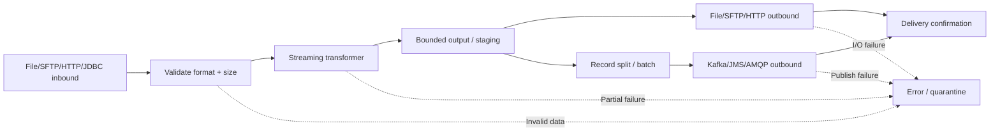
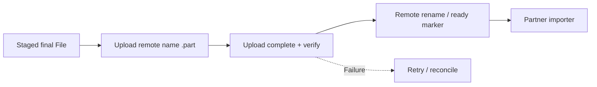
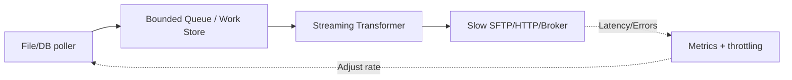

# Streaming payload transformation

## 1. Problem statement: Large data cannot always fit in memory

A Spring Boot application receives multiple NDJSON or CSV files daily, each potentially holding millions of records. The application must read from a directory or SFTP, normalize fields, forward to an HTTP API, write a new export file, or distribute individual events over JMS, AMQP, or Kafka. Meanwhile, a database records progress state and reconciliation outcomes.

A naive approach is:

```java
byte[] allBytes = java.nio.file.Files.readAllBytes(inputPath);
String text = new String(allBytes, java.nio.charset.StandardCharsets.UTF_8);
// Parse and transform all of 'text' into a large collection.
// Only then send to the target system.
```

This pattern may work for 10 KB, yet turns problematic when files grow large:

- Both the original data and transformed copies occupy the heap simultaneously.
- GC spikes, and `OutOfMemoryError` can occur.
- The entire file must be downloaded/parsed before the first output byte can be produced.
- One malformed record near the end of the file can wipe out earlier progress.
- If downstream is slower than upstream, data accumulates unchecked without backpressure.
- On retry, an already-consumed `InputStream` has no remaining data to resend.

**Streaming payload transformation** means processing data **incrementally, sequentially, or in controlled streams**, rather than forcing the entire payload to materialize into a large `String`, `byte[]`, or `List` before transforming.

This lesson belongs to the **Data Transformation** chapter of the `SPRING_INTEGRATION_ADAPTERS` module. Its scope covers connecting external systems using **inbound/outbound adapters, gateways, pollers, and MessageChannel**, across **File, SFTP, HTTP, JMS, AMQP, Kafka, and databases**, along with message contracts, errors, and connection lifecycles.

> **Foundational principle:** Streaming is **resource-bounded reading, transforming, and writing**. Merely having a `Message<?>` hold an `InputStream` or `Flux` does not prove the entire pipeline is streaming, nor does it guarantee the target adapter supports backpressure.

## 2. Three concepts to distinguish upfront

| Concept | Meaning | Example |
| --- | --- | --- |
| **Streaming transformation** | Reads a slice of data, transforms it, and emits that slice | Reading NDJSON line by line, normalizing each record |
| **Streaming transport** | Sends/receives content over the network incrementally rather than buffering the whole body | Streamed HTTP request body, SFTP file upload |
| **Message streaming** | A logical stream represented as a sequence of independent messages | 100,000 Kafka records, one event per record |

These three concepts **can combine, yet are not synonymous**:

- An HTTP client might send an `InputStream` in chunks, yet the preceding transformer already built the entire `byte[]` in memory.
- A file may be processed line by line, yet code collects all transformed lines into a `List<String>` before writing, losing memory savings.
- Kafka sends individual records subject to message size limits; that is **message streaming**, and does not mean a single 2 GB Kafka record automatically splits and streams smoothly.
- SFTP transfers files in packets over SSH; the application can still load the entire file into `byte[]` before calling the adapter.

### A simple verification criterion

Ask at **every step**: is the data **buffered in full** before the next step begins? If yes, that point is a materialization point and requires explicit size limits and memory budgeting.

## 3. Common payload types in Java and Spring Integration

| Type | Characteristics | When appropriate | Risks |
| --- | --- | --- | --- |
| `byte[]` | All bytes sit in a single array | Small messages, bounded broker payloads | Heap usage, copies, mutable array |
| `String` | Materialized character string | Small JSON/text | Extra copies during encode/decode |
| `File` / `Path` | Reference to a file on the filesystem | Large files, disk spooling | File can be deleted/modified between steps |
| `Resource` | Spring resource abstraction | Files, classpath, or supported sources | Not every Resource can reopen a stream |
| `InputStream` | Incremental read, typically single-pass | Network/file streams | Ownership, closing, retries, not thread-safe |
| `OutputStream` | Incremental write | File/network sinks or codecs | Flushing/closing, partial writes on failure |
| `Reader` / `Writer` | Character-by-character handling per charset | CSV/NDJSON/text | Malformed text, buffering |
| `ByteBuffer` | Buffer with position/limit | Byte-level protocols | Never assume a backing array always exists |
| `Flux<T>` / `Publisher<T>` | Reactive stream of multiple elements | Reactive pipelines where endpoints support it | Backpressure does not cross every boundary |
| `Message<T>` | Spring Messaging payload + headers | Connecting endpoints in `IntegrationFlow` | Metadata does not manage stream lifecycle on its own |

**Do not automatically force `File` into `byte[]` just because downstream needs data.** If a handler supports `File`, take advantage of filesystem-based streaming.

### Streams are not immutable values

`byte[]` is an in-memory value (even though mutable). `InputStream` is **a stateful resource**: after reading 1,024 bytes, its position has advanced. Two consumers reading the same stream concurrently steal bytes from each other.

## 4. Payloads and headers in MessageChannel

In Spring Integration, each message has a payload and metadata:

```text
Message<T>
├── payload: File | InputStream | Resource | byte[] | DTO | ...
└── headers:
    ├── id / timestamp
    ├── correlationId / operationId
    ├── contentType / charset / schemaVersion
    ├── fileName / remotePath / destination metadata
    └── errorChannel / replyChannel (internal framework)
```

Example of a message containing an `InputStream`:

```text
payload = InputStream (open source)
headers = {
  sourceRef: "upload-8721",
  contentType: "application/x-ndjson",
  schemaVersion: 1
}
```

**The message contract must state clearly who owns the stream and who closes it.** An `InputStream` inside a message can be closed before an async consumer reads it, or left unclosed, leaking sessions/file descriptors.

### Minimum metadata to lock down

1. Source type, format, charset, and schema/version.
2. Expected size or maximum limit.
3. Is the stream **one-shot**, or can it be reopened from the source?
4. Who closes the resource on success, failure, or cancellation?
5. Is there checkpointing/resumption? If so, by byte offset or record ID?
6. Which operation/event ID remains stable across retries?
7. When handing off to an outbound adapter, which milestone counts as complete?

Never attach raw authentication tokens, passwords, or PII to message headers merely for debugging convenience.

## 5. Overall architecture: Streaming in adapter flows



A tractable architecture is often:

```text
Inbound File
   → validate complete file, size, charset/schema
   → streaming transform (read record, write record)
   → closed staging file, checksum/metadata
   → outbound File or SFTP adapter
   → verify send outcome per contract
   → update state and clean up staging under control
```

The existence of a staging file **does not eliminate streaming**: transformation still reads/writes incrementally, using disk only as a durable boundary rather than keeping the whole payload on the heap.

### Why is a staging file sometimes needed?

- The source is a one-shot stream, yet outbound must retry.
- Full output validation or hashing is needed before publishing.
- Target adapters handle `File` more cleanly than `InputStream`.
- Writing can fail, so half-finished data must not be published.
- The flow must survive restarts with verifiable input/output artifacts.

Staging incurs disk and cleanup costs; measure storage quotas, file age, access permissions, and retention.

## 6. Choosing a strategy by size, format, and SLA

| Scenario | Preferred strategy to consider | Why |
| --- | --- | --- |
| Small JSON object, a few KB | DTO ↔ JSON String/bytes | Simple, easy to test |
| Multi-line NDJSON | Parse line by line → transform → write line by line | Does not retain all records |
| Large CSV with quoted newlines | Compliant streaming CSV parser | `readLine().split(",")` corrupts data |
| Large XML | StAX/SAX or secure streaming parser | Avoids building a full DOM |
| Images/PDF/ZIP | Buffered/stream copy, validate type and size | Avoids misdecoding as text |
| Large HTTP upload | Body streaming if client/server/converter support it | Bounds memory and response time |
| Large SFTP file | File-based or remote streaming adapter | Manages sessions and file completion |
| Kafka/JMS/AMQP | Split into bounded messages or pass references | Brokers still enforce message-size limits |
| Large JDBC BLOB | Stream via JDBC driver/transaction where supported | Avoids materializing BLOBs |
| Reactive flow | Publisher + endpoints truly supporting demand | Provides backpressure if entire pipeline cooperates |

**Size limits are not decided by the transformer alone.** HTTP servers, brokers, JDBC drivers, filesystems, SSH sessions, and consuming apps all impose their own bounds.

## 7. How streaming differs from batching and chunking

- **Streaming:** incrementally processing a source without holding all data in memory.
- **Batching:** grouping multiple records to process/send as one logical unit.
- **Chunking:** splitting data into pieces of bounded size/count.
- **Pagination:** fetching data page by page from an API/DB, typically needing cursors/checkpoints.
- **Reactive streams:** protocol coordinating item demand between publishers and subscribers.

Example:

```text
5 GB NDJSON file
  → streaming reader: one record at a time
  → batch 500 records
  → serialize each 500-record batch
  → publish 1 message/batch
```

The pipeline above **still buffers**, yet is **bounded to at most 500 records** per policy. If a single record can be huge, enforce a separate **byte size** limit, not merely record count.

### Never build an unbounded batch

An `Aggregator` waiting for "all records" when the source lacks a release condition can hold messages indefinitely. Batches require a `batchId`, release conditions, timeouts, size bounds, and handling for incomplete batches.

## 8. Basic example: Copying `InputStream` → `OutputStream` with a fixed buffer

A fundamental streaming operation:

```java
import java.io.IOException;
import java.io.InputStream;
import java.io.OutputStream;

public final class StreamCopy {

    private StreamCopy() {}

    public static long copy(InputStream in, OutputStream out)
            throws IOException {
        byte[] buffer = new byte[64 * 1024];
        long total = 0;
        int read;

        while ((read = in.read(buffer)) != -1) {
            if (read == 0) {
                continue;
            }
            out.write(buffer, 0, read);
            total = Math.addExact(total, read);
        }

        out.flush();
        return total;
    }
}
```

This function only copies bytes and **does not transform content yet**, yet illustrates how pipelines avoid loading all data into one giant array.

### Key characteristics

- Fixed buffer size, independent of source size.
- `read(...)` does not guarantee filling the entire buffer.
- `-1` marks end of stream.
- `flush()` pushes application-level buffers; **it does not mean `fsync` or network ACK**.
- The function **does not close** input/output because the caller owns the resources.
- Add a cap on `total` if data comes from untrusted sources.
- Prefer standard library copy primitives when only copying; write custom loops only when measuring, capping, or transforming.

### Do not log stream contents for debugging

Logging `in.toString()` does not show content, while reading the stream to log can **consume the data** before the adapter sends it.

## 9. Managing `InputStream` lifecycle: Open, read, close, and retry

An `InputStream` can usually be read **only once**:

```text
Created/opened
   → consumed partially
   → consumed fully
   → closed
```

### Rules to agree on

1. Whoever **opens the stream** must define clearly who **closes the stream**.
2. Use `try-with-resources` when the consumer owns the resource.
3. If a stream travels inside a Spring Message, do not close it in an interceptor before downstream reads it.
4. Never pass the same `InputStream` instance to multiple subscribers expecting each to read everything.
5. When failing mid-way, treat the stream as **no longer at its starting position**.
6. Never assume `mark()/reset()` is supported; many network streams do not support it.
7. Never store an `InputStream` object in a persistent `MessageGroupStore` or queue for post-restart replay.
8. If full retries are needed, use a **reopenable source** such as a `Path`, staged `File`, or source with range/resume APIs.

### Remote connection lifecycle

With SFTP/HTTP/databases, an `InputStream` may be tied to a **session, connection, cursor, or transaction**. Closing too late keeps pooled connections pinned; closing too early gives downstream `IOException: Stream closed`.

**Never wait indefinitely on an async `MessageChannel` while holding an open remote `InputStream` without an explicit resource-ownership contract.**

## 10. Core hands-on example: Large NDJSON → normalized NDJSON

Problem:

- Inbound File adapter emits `Message<File>`.
- The file has **one JSON object per line** with `orderId` and `amountMinor`.
- The transformer maps each line to target schema `order_id`, `amount_minor`, `schema_version`.
- Output is written to a **staging file** before the outbound File/SFTP adapter sends it.
- Do not hold the whole file as a `List<Order>` in memory.

### Input data

```jsonl
{"orderId":"ORD-1001","amountMinor":125000}
{"orderId":"ORD-1002","amountMinor":99000}
{"orderId":"ORD-1003","amountMinor":50000}
```

### Post-transformation data

```jsonl
{"order_id":"ORD-1001","amount_minor":125000,"schema_version":2}
{"order_id":"ORD-1002","amount_minor":99000,"schema_version":2}
{"order_id":"ORD-1003","amount_minor":50000,"schema_version":2}
```

**Key takeaway:** NDJSON differs from one huge JSON array. Each line is an independent JSON document; do not apply `readLine()` examples to multi-line quoted CSV fields or JSON containing raw newlines outside NDJSON rules.

## 11. Java streaming transformer: Reading and writing record by record

Java 17+ and Jackson 2 example. This illustrates the core transformation, using `Path`/`File` as input/output and producing a reopenable output file.

```java
import com.fasterxml.jackson.databind.JsonNode;
import com.fasterxml.jackson.databind.ObjectMapper;
import com.fasterxml.jackson.databind.node.ObjectNode;
import java.io.BufferedReader;
import java.io.BufferedWriter;
import java.io.File;
import java.io.IOException;
import java.nio.charset.StandardCharsets;
import java.nio.file.AtomicMoveNotSupportedException;
import java.nio.file.Files;
import java.nio.file.Path;
import java.nio.file.StandardCopyOption;
import java.nio.file.StandardOpenOption;
import java.util.UUID;

public final class NdjsonStreamingTransformer {
    private static final long MAX_FILE_BYTES = 2L * 1024 * 1024 * 1024;
    private static final int MAX_LINE_CHARS = 1_000_000;
    private static final long MAX_RECORDS = 10_000_000;

    private final ObjectMapper mapper;
    private final Path stagingDir;

    public NdjsonStreamingTransformer(ObjectMapper mapper, Path stagingDir) {
        this.mapper = mapper;
        this.stagingDir = stagingDir;
    }

    public File transform(File input) {
        Path temp = null;
        try {
            Path source = input.toPath();

            // File must have finished uploading before entering here.
            if (Files.size(source) > MAX_FILE_BYTES) {
                throw new IllegalArgumentException("Input file too large");
            }

            Files.createDirectories(stagingDir);
            temp = Files.createTempFile(stagingDir, "orders-", ".part");

            try (BufferedReader reader =
                         Files.newBufferedReader(source, StandardCharsets.UTF_8);
                 BufferedWriter writer = Files.newBufferedWriter(
                         temp, StandardCharsets.UTF_8,
                         StandardOpenOption.WRITE,
                         StandardOpenOption.TRUNCATE_EXISTING)) {

                long count = 0;
                String line;
                while ((line = reader.readLine()) != null) {
                    count++;
                    if (count > MAX_RECORDS || line.length() > MAX_LINE_CHARS) {
                        throw new IllegalArgumentException("Input limit exceeded");
                    }
                    if (line.isBlank()) {
                        throw new IllegalArgumentException("Empty NDJSON record");
                    }

                    JsonNode row = mapper.readTree(line);
                    if (row == null || !row.isObject()) {
                        throw new IllegalArgumentException("Expected JSON object");
                    }

                    JsonNode idNode = row.path("orderId");
                    JsonNode amountNode = row.path("amountMinor");
                    if (!idNode.isTextual() || idNode.asText().isBlank()
                            || !amountNode.isIntegralNumber()
                            || !amountNode.canConvertToLong()
                            || amountNode.longValue() < 0) {
                        throw new IllegalArgumentException("Invalid order record");
                    }

                    ObjectNode converted = mapper.createObjectNode();
                    converted.put("order_id", idNode.asText());
                    converted.put("amount_minor", amountNode.longValue());
                    converted.put("schema_version", 2);

                    writer.write(mapper.writeValueAsString(converted));
                    writer.newLine();
                }
            }

            // Staging and final share a directory to allow atomic move.
            Path ready = stagingDir.resolve(
                "orders-" + UUID.randomUUID() + ".ndjson");
            try {
                Files.move(temp, ready, StandardCopyOption.ATOMIC_MOVE);
            } catch (AtomicMoveNotSupportedException ex) {
                // Application must explicitly define fallback/completion protocol.
                throw new IOException("Atomic move unavailable", ex);
            }
            return ready.toFile();

        } catch (IOException | RuntimeException ex) {
            // Do not let corrupt .part files be read by downstream adapters.
            if (temp != null) {
                try {
                    Files.deleteIfExists(temp);
                } catch (IOException cleanupFailure) {
                    ex.addSuppressed(cleanupFailure);
                }
            }
            throw new IllegalStateException("NDJSON transformation failed", ex);
        }
    }
}
```

### What is actually streaming in this example?

- `BufferedReader` reads **line by line**, never loading the entire file.
- Jackson parses only **one JSON object at a time**.
- `BufferedWriter` writes each transformed record immediately.
- The `.part` file is renamed to `.ndjson` only after transformation finishes.
- Downstream receives a closed `File` that can be reopened for retries.

### Limitations of the example

This is an **educational sample**, not a full production component:

- `readLine()` can allocate an entire line **before** `MAX_LINE_CHARS` is checked. For untrusted inputs, use a **bounded line reader/parser** that enforces limits while reading.
- Checking `Files.size(...)` does not protect against a file **still being written**. Use ready markers/temp renames, proper locks, or an input completion protocol.
- `Reader`-level charset decoders may substitute invalid UTF-8 bytes depending on configuration; for strict contracts, use a reporting decoder and reject malformed bytes.
- `UUID.randomUUID()` generates a fresh staging filename on retry; use a **stable operation ID and deduplication** if target delivery can repeat.
- `Files.move(..., ATOMIC_MOVE)` may not be supported by all filesystems; the example chooses to fail explicitly. Production requires a safe fallback or mutually agreed completion marker.
- Checksums and `fsync` for stronger durability guarantees are not shown here.
- Staging files after outbound finishes require **controlled cleanup**—do not delete them the instant the method returns `File`.
- Never write raw JSON containing PII to logs when a record fails.

## 12. Wiring the transformer into Spring Integration Java DSL

Conceptual Java DSL example for **File inbound → streaming File transformer → File outbound**:

```java
import java.io.File;
import java.nio.file.Path;
import java.time.Duration;
import org.springframework.context.annotation.Bean;
import org.springframework.integration.dsl.IntegrationFlow;
import org.springframework.integration.dsl.Pollers;
import org.springframework.integration.file.dsl.Files;

@Bean
IntegrationFlow largeNdjsonFileFlow(
        NdjsonStreamingTransformer transformer) {

    return IntegrationFlow.from(
            Files.inboundAdapter(new File("./data/inbox"))
                .autoCreateDirectory(true),
            endpoint -> endpoint.poller(
                Pollers.fixedDelay(Duration.ofSeconds(5))
                    .maxMessagesPerPoll(1)))
        .transform(File.class, transformer::transform)
        .handle(Files.outboundAdapter(new File("./data/outbox"))
            .autoCreateDirectory(true))
        .get();
}
```

**Flow:**

1. The inbound adapter/poller picks up a `File` in the source directory.
2. The transformer holds only **a buffer and one record at a time**.
3. The transformer returns a newly staged, complete `File`.
4. The File outbound adapter processes the `File` per its handler policy.
5. The system tracks delivery status and cleans up staging only after true completion.

### What the example does not guarantee on its own

- `Files.inboundAdapter` uses a filter/accept-once list; **emitting a `File` message** does not mean downstream steps succeeded. Design post-error retries/completion marking so failed files are neither skipped nor re-read as duplicates.
- The File outbound handler has rules for existing files; configure them to match the destination.
- Passing `File` alone does not carry `contentType`, schema version, or checksums.
- An adapter's file-write completion does not mean the external system finished importing the file.
- Spring Integration versions may differ in DSL/API details. Verify dependencies and compile in your project before production use.

## 13. Why not pass `InputStream` directly through every `MessageChannel`?

A stream tied to a remote connection may be opened on the poller thread:

```text
poller thread:
  open remote InputStream
  send Message<InputStream> to QueueChannel
  close connection/session
                     |
                     v
worker thread:
  receive Message<InputStream>  // stream may already be closed!
```

Another risky pattern: sending the **same instance** of `InputStream` to two subscribers for checksum verification and upload; both consumers read from it and corrupt offsets.

### Choosing by topology

| Topology | Prudent choice |
| --- | --- |
| Direct synchronous, same resource scope | Consumer reads and closes stream per contract |
| `QueueChannel`/async executor | Spool to reopenable `File`/`Resource` or pass source reference |
| Multi-branch fan-out | Each branch opens its **own** stream from `File`/object store; never share instances |
| Long-lived group/aggregator | Store metadata and references, never an open `InputStream` |
| Retry after network failure | Reopen from stable source or staging file |
| Multi-JVM workflow | Pass protected ID/URL and data contract; never serialize stream objects |

When passing resource references, manage authorization and lifetimes so consumers do not receive expired references.

## 14. Streaming inbound from SFTP: Sessions and closeable resources

SFTP supports both **downloading files locally** and **streaming inbound** variants depending on Spring Integration module/version. A streaming adapter may emit an `InputStream` payload paired with metadata or a **closeable resource** tied to the remote session.

**Important:** a remote `InputStream` is not just bytes; it may hold an active **SSH/SFTP session**. Follow the adapter's stream/resource-closing contract (such as closeable resource headers in supporting implementations).

### Illustrative flow

```text
SFTP streaming inbound source
  -> Message<InputStream>
  -> synchronous streaming consumer
  -> write to controlled staging file
  -> close stream + remote resource/session
  -> Message<File>
  -> normalize / validate / outbound
```

Questions to answer:

- Who closes the stream if parsing fails mid-file?
- On timeout, is the remote session returned to the cache/pool?
- If the partner has not finished uploading, could inbound read half a file?
- Are filename/path/timestamp reliable enough for checkpointing?
- Can the partner's file change while streaming?
- If retry is needed, can the exact same remote bytes be re-read?
- Are path traversal blocked and remote directories restricted by policy?

**Never claim every SFTP adapter emits `InputStream`;** verify your actual adapter configuration. Many file inbound adapters return `File` and require opening a stream to transform.

## 15. Streaming outbound to File/SFTP: Partial writes and completion publishing

When sending large files, consumers must not read the file before the uploader finishes if the contract requires complete files.

### Two-phase pattern



**Note:** whether rename is atomic depends on the filesystem, server, adapter, and operation used. Do not pick an arbitrary temp name and assume every receiving system ignores partial files.

### Details to align on

- Safe local/remote directories and filenames.
- Temporary suffix and completion marker conventions.
- Checksums/sizes if the consumer verifies integrity.
- Behavior when target file exists: fail, replace, append, or versioned name.
- Policies for interrupted uploads and reconnects.
- Disk quotas and cleanup of orphaned temp files.
- Credentials, SSH host key validation, and SFTP account permissions.
- Retry intervals and distinguishing **published** vs. **imported**.

**Successful streaming transformation only guarantees the staging output was built per the transformer's logic; it does not guarantee remote upload or business import succeeded.**

## 16. HTTP request/response streaming: Don't confuse with fast-returning gateways

HTTP can support body streaming/chunked transfer depending on client and server. However, when using Spring Integration HTTP inbound/outbound gateways, payload serialization/conversion may **buffer everything** depending on adapter, converter, payload type, and HTTP stack.

### Three options

| Approach | Fits | What to verify |
| --- | --- | --- |
| DTO/String via JSON converter | Small bodies, clear schemas | Does the converter materialize the entire payload? |
| `Resource`/File-backed body | Large uploads/downloads | Does the HTTP client actually stream or buffer first? |
| Reactive publisher | Stacks supporting nonblocking streaming | How far do demand/cancellation/backpressure propagate? |

### `InputStreamResource` and single-use request bodies

A resource wrapping an **already-opened `InputStream`** is typically **non-repeatable**: retries, redirects, or auth challenges may require re-sending the body after the stream is already consumed.

If the API requires safe retries:

1. Back data with a **reopenable** `File`/`Resource` or replay-capable source.
2. Design a stable idempotency key.
3. Know the size, `Content-Type`, and server limits.
4. Verify the HTTP client/converter truly streams and handles chunked transfer.
5. Distinguish `200/201`, `202 Accepted`, timeouts, and "unknown whether server processed" states.

### Response streaming notes

Large HTTP responses may be returned as a stream or `Resource` depending on the client. Do not assume an HTTP outbound gateway leaves an open `InputStream` readable after the request scope closes. Verify **connection ownership, converters, and lifetimes** when designing the adapter.

## 17. Kafka: Each record is still a bounded message unit

Kafka excels at delivering **continuous event streams**, yet a Kafka record remains a **key/value byte unit** subject to size limits at producer, broker, and consumer.

```text
Large NDJSON File
  -> Streaming parser
  -> validate each record
  -> OrderEvent DTO
  -> JSON/Avro/Protobuf serializer
  -> Kafka outbound adapter
  -> many small records
```

### Distinguishing two strategies

**Record streaming:** each source record produces one Kafka message. Usually best when data consists of independent events.

**Fragment/chunk streaming:** one binary document is split across multiple framed Kafka records. Consumers must reassemble; consider object storage + references for large documents.

### Metadata and ordering

- Kafka keys usually derive from business IDs to partition per contract.
- Consumers can see duplicates from at-least-once/redelivery; use stable `eventId`s.
- Ordering applies only within partition and processing bounds.
- Producer ACKs do not prove consumers completed business processing.
- Source records need proper checkpoints/offsets to avoid resending duplicates after crashes.

### Don't try to fix memory by raising max message size indefinitely

Allowing huge Kafka records merely shifts the problem from application heap to brokers, replication, network, and consumers. True streaming usually means **splitting into independent records or managing external object references**, not simply raising every limit.

## 18. JMS and AMQP: Broker messages are not unbounded raw byte streams

JMS has `TextMessage`, `BytesMessage`, and other types; AMQP messages have body bytes and properties. Even where APIs allow **reading/writing content incrementally**, brokers generally manage **logical messages with their own size limits, acknowledgments, and redelivery**.

### Appropriate model

```text
Input file/batch
  -> streaming records
  -> bounded transform
  -> message converter
  -> JMS/AMQP outbound
  -> broker messages
```

### Decisions to lock down

1. Does the consumer require `TextMessage`, `BytesMessage`, or JSON body?
2. Which converter owns encoding? Avoid double serialization.
3. What are the broker's message size and batch/chunk limits?
4. What are destination/exchange/routing key, headers, and `Content-Type`?
5. What guarantees do acknowledgments/transactions/redelivery provide?
6. Are DLQ/dead-lettering, retries, and idempotent consumers needed?
7. Does a single lost chunk make the entire document un-reassemblable?
8. Within queues/brokers, how do message ordering and concurrency interact?

**Never pass an `InputStream` object directly over JMS/AMQP expecting the broker to hold a Java stream resource.** Convert into a bounded, schema-backed serializable representation.

## 19. When you must split one binary payload across multiple messages

When a single large object cannot be sent whole, **application-level chunking** may be required.

### Example chunk contract

```json
{
  "streamId": "upload-8721",
  "chunkId": "upload-8721-0004",
  "index": 4,
  "totalChunks": 12,
  "contentType": "application/octet-stream",
  "payloadEncoding": "base64",
  "payload": "AAECAwQ=",
  "schemaVersion": 1
}
```

This is merely a **JSON envelope example** where chunk bytes are Base64-encoded. On brokers supporting binary values, you can keep raw bytes in the value and put index/streamId in headers instead of Base64.

### Why reassembly is tricky

- Chunks can arrive **out of order**.
- A chunk can be delivered **twice**.
- A chunk might **never arrive**.
- The consumer may crash while holding 11/12 chunks.
- Source-declared `totalChunks` can be huge or inaccurate.
- Reusing an old `streamId` mixes two uploads.
- Individual chunk checksums match while the **whole document** is corrupted.
- Late chunks arriving after timeout inadvertently open a new group.

### Required rules

- Stable `streamId`, unique within namespace/operation.
- Caps on `index`/`totalChunks`, total bytes, and reassembly timeouts.
- Deduplicate by `(streamId, index)` with appropriate hashes/versions.
- Assemble only when all chunks are present and the whole-payload checksum passes.
- Use a durable store with TTL/retention cleanup.
- Verify access permissions, content type, and resource limits before reconstructing.
- Reassembly does not automatically yield **exactly-once business processing**.

An **Aggregator** can collect chunks, provided `CorrelationStrategy`, `ReleaseStrategy`, a `MessageGroupStore`, timeouts, and deduplication are properly implemented; counting messages naively breaks on duplicates.

## 20. JDBC/database: Streaming BLOBs and cursors

Databases involve distinct patterns:

- **Inbound polling:** reading completed rows via cursor/keyset/checkpoint.
- **BLOB/CLOB:** streaming large data where supported by the JDBC driver.
- **Outbox:** writing small events/metadata referencing large files and publishing post-commit.
- **Batch INSERT:** sending many small rows in controlled batch sizes.

### JDBC BLOB streaming (JDBC API example)

```java
import java.io.InputStream;
import java.sql.Connection;
import java.sql.PreparedStatement;
import java.sql.ResultSet;

void consumeBlob(Connection connection, String id) throws Exception {
    String sql =
        "SELECT payload_bytes FROM attachments WHERE attachment_id = ?";

    try (PreparedStatement ps = connection.prepareStatement(sql)) {
        ps.setString(1, id);
        try (ResultSet rs = ps.executeQuery()) {
            if (!rs.next()) {
                return;
            }
            try (InputStream in = rs.getBinaryStream(1)) {
                // Fully consume the stream before the ResultSet closes.
                processWithinTransactionScope(in);
            }
        }
    }
}
```

`processWithinTransactionScope` is an illustrative application function. Never send this `InputStream` onto a `QueueChannel` for a worker to consume after `ResultSet`/`Connection` has closed.

### Notes on JDBC drivers

- Not all drivers perform true network streaming identically; some buffer payloads.
- Cursor/fetch sizes and transaction scopes depend on database, driver, and query.
- Holding transactions open during SFTP/HTTP transfers pins locks/connections too long.
- To send data after transactions finish, spool to protected file/object storage and emit a reference.
- Lock down commit/checkpoint strategies; reading the DB successfully **does not mean** data reached brokers or partners.

## 21. Backpressure: When the destination is slower than the source

Suppose a poller reads 500 files/second while outbound SFTP uploads only 10 files/second. Without bounds, backlogs grow uncontrollably.



### Common mechanisms

| Mechanism | Effect | Notes |
| --- | --- | --- |
| `maxMessagesPerPoll` | Caps messages fetched per poll | Does not replace system-wide limits |
| Fixed delay / trigger | Paces source ingestion | Tune to throughput and SLA |
| Bounded `QueueChannel` | Bounds buffering space | In-memory queues do not survive restarts |
| Bounded executor pool | Caps concurrency | Never spawn unbounded threads |
| Retry backoff | Reduces pressure on transiently failing targets | Include budgets, jitter, and timeouts |
| Durable work store/queue | Preserves progress across restarts | Requires checkpoints, dedup, cleanup |
| Streaming/chunking | Reduces per-payload memory footprint | Does not create broker backpressure on its own |
| Reactive demand | Throttles to subscriber pace | Works only if every boundary respects demand |

### Streaming does not stop queues from swelling if producers run unchecked

A single `Message<File>` is lightweight, yet **millions of file references** in a `QueueChannel` still consume memory and bloat disk backlogs. Budget total resources: heap + temporary files + network connections + message store + wait times.

## 22. Reactive streams and Spring Integration: Don't equate `Flux` with `InputStream`

`InputStream` is a blocking read API. `Flux<T>`/`Publisher<T>` in Reactive Streams provides a different model for demand, errors, and cancellation.

### Comparison

| Aspect | `InputStream` | Reactive `Publisher` |
| --- | --- | --- |
| Fetching data | Calls `read()`, usually blocking | `request(n)` expresses demand |
| Backpressure | Caller controls read cadence | Built into reactive protocols where supported |
| Cancellation | Close stream / cancel I/O per design | Cancel subscription |
| Error | Throws exception from `read` | `onError` |
| Completion | EOF `-1` | `onComplete` |
| Retry | Reopen stream or spool | Re-subscribe **only if publisher is repeatable** |
| Resource lifetime | Close stream | `usingWhen`/framework resource cleanup |

You can use reactive endpoints when your Spring Integration stack and target adapters support them. However:

- Wrapping a blocking `InputStream` in a `Flux` does not turn it into nonblocking I/O.
- Calling `collectList()` in the final handler materializes everything anyway.
- A boundary between Reactor and a blocking adapter can break backpressure.
- `buffer`, `window`, and `flatMap` operators have concurrency/prefetch settings that must be bounded.
- Cancellation must release file/network resources rather than leaving sessions open.

**Do not adopt reactive just because the word "streaming" appears in the requirements.** For large files and traditional SFTP outbound, `File` + streaming I/O is often clearer and more reliable.

## 23. Retries and one-shot streams: Handling mid-stream failures

Suppose HTTP outbound sends 60% of the body and the connection resets. If the payload is an `InputStream` already 60% read, retrying the handler with **the same stream** may send only the remaining 40%.

### Three retry models

1. **Retry from reopenable source:** call `Files.newInputStream(path)` anew on each attempt.
2. **Spool before sending:** write to a stable staging file and retry from that file.
3. **Chunk/range resume:** only when the target protocol defines an offset/part-upload contract with integrity verification.

### Questions you cannot skip

- Is retrying business-safe? An HTTP POST might already have been processed by the server.
- Does the destination support idempotency keys or controlled overwrites?
- Could a partially written remote file be picked up by the consumer?
- Should partial uploads be deleted before retrying?
- Could the source change between two attempts?
- Does the raw byte hash/checksum remain identical?
- When retries exhaust their budget, is there a quarantine for investigation?

**`RetryTemplate` or retry advice does not magically make an `InputStream` repeatable.** Before enabling retries, prove data can be reopened and side effects will not be duplicated.

## 24. Checkpointing and resumption: More than just byte offsets

For NDJSON files, progress can track processed line numbers or event IDs; for HTTP/SFTP downloads, byte ranges/resumption may work if supported.

### Checkpoint metadata example

```json
{
  "operationId": "import-8721",
  "sourceRef": "file-opaque-103",
  "sourceVersion": "sha256:...",
  "lastCompletedRecord": 450000,
  "nextRecord": 450001,
  "schemaVersion": 2,
  "processorVersion": "transform-v4",
  "status": "RUNNING"
}
```

`sourceVersion` illustrates a controlled fingerprint; computing SHA-256 on a huge file also requires reading it and does not replace authorization.

### Why byte offsets alone may fall short

- UTF-8 has multi-byte characters; cutting an offset mid-character breaks decoding.
- CSV records can have quoted newlines; line count does not equal record count.
- HTTP APIs may lack `Range` support or change contents between requests.
- Partners might append to SFTP files after a checkpoint.
- Stateful parsers (JSON/XML streams) cannot resume at arbitrary byte positions.
- Output might be partially written before the checkpoint commits.

### Safe resumption principles

- Sources must be **immutable/versioned**.
- Checkpoints align with recoverable record/frame boundaries.
- Downstream side effects use IDs/unique keys to tolerate retries.
- Persist checkpoints **only after reaching the required confirmation milestone**.
- If safe resumption is impossible, restarting from the beginning with an idempotent downstream may be safer.

## 25. Integrity and publishing outputs

A stream that finished processing in Java may still not be **durable** or confirmed by the destination.

### Distinct completion levels

| Level | Meaning |
| --- | --- |
| `READ_EOF` | Reached end of source stream |
| `TRANSFORMED` | Produced full output per transformer |
| `STAGED_READY` | Output closed and marked complete |
| `SENT_TO_ADAPTER` | Message entered outbound handler/channel |
| `TRANSPORT_CONFIRMED` | Send/write confirmed per protocol |
| `BUSINESS_CONSUMED` | Partner/consumer completed business processing |

Never jump from `READ_EOF` to `BUSINESS_CONSUMED` without evidence.

### Hashes/checksums

You can compute SHA-256 **while writing** so you do not have to re-read the entire output:

```java
import java.io.OutputStream;
import java.security.DigestOutputStream;
import java.security.MessageDigest;

MessageDigest sha256 = MessageDigest.getInstance("SHA-256");
try (OutputStream fileOut = java.nio.file.Files.newOutputStream(target);
     DigestOutputStream hashing = new DigestOutputStream(fileOut, sha256)) {
    // Write transformed output incrementally through 'hashing'.
    writeTransformedContent(hashing);
}
byte[] digest = sha256.digest();
```

Hashes verify integrity against a trusted reference, yet **do not prove sender authenticity**. When authenticity is needed, use MACs/signatures with proper key management.

### Atomic rename and durability

Same-filesystem renames can provide atomic visibility, yet:

- Verify whether your adapter, filesystem, and remote server support it.
- `flush` is not `fsync` or power-loss-safe durable commit.
- Object storage publish/rename semantics differ.
- If the target processes asynchronously, "file appeared" does not mean "file imported."

## 26. Conversion errors, I/O errors, and `errorChannel`

A streaming pipeline faces multiple error classes:

| Layer | Example | Appropriate action |
| --- | --- | --- |
| **Input validation** | File too large, incomplete upload | Reject or wait for completion |
| **Decode** | Malformed UTF-8, corrupt gzip | Quarantine or fix source; do not retry blindly |
| **Schema mapping** | NDJSON missing field, wrong amount type | Stop/skip per policy, record reference |
| **Resource** | Disk full, quota exceeded, OOM risk | Backpressure, alerts, cleanup |
| **Network/transport** | SFTP timeout, HTTP reset, broker unavailable | Bounded retries if repeatable |
| **Authorization** | HTTP 403, SFTP permission denied | Fix credentials/permissions; do not retry infinitely |
| **Database** | SQL deadlock/connection unavailable | Safe transaction retry or quarantine |
| **Business** | Duplicate, stale event, invalid transition | Idempotency/reconcile; never treat as decode error |

### When one record fails mid-file

Three policies exist:

1. **Fail-fast entire file:** do not publish output if any record fails; retain source/quarantine for remediation.
2. **Skip + reject record:** send bad record to quarantine and continue; must align with consumer since output is incomplete.
3. **Partial output:** publish valid subset with manifest/`PARTIAL` status if business permits.

Never silently skip failed records just to "keep the pipeline green" when 100% order completeness is required.

### `errorChannel` and topology

With synchronous `DirectChannel`, exceptions usually propagate to the caller. With polling or async endpoints, errors can become `ErrorMessage`s on a configured error channel. Never declare a bean listening on `errorChannel` and assume every file/SFTP/HTTP error lands there automatically.

**Remember to clean up temporary files on every error branch** and retain source/references for policy-driven recovery.

## 27. Dead-letter, quarantine, and stream reprocessing

When a large stream fails, you should not push **all raw bytes** into a broker's DLQ.

### Compact envelope to use

```json
{
  "failureId": "failure-73a2",
  "operationId": "import-8721",
  "sourceRef": "restricted-file-103",
  "sourceVersion": "etag-or-checksum",
  "recordIndex": 450001,
  "stage": "ndjson-transform",
  "errorCode": "INVALID_AMOUNT_MINOR",
  "retryable": false,
  "schemaVersion": 2,
  "status": "QUARANTINED"
}
```

`sourceRef` is a logical reference to **protected** data, never a public signed URL containing tokens in logs.

### Operational principles

- Store raw bytes or original files in an appropriately access-controlled store.
- Retain source metadata, processor version, and failure position.
- Never log full raw payloads containing PII into `ErrorMessage` logs.
- On replay, verify the source still matches the expected version and current business state.
- Use checkpoints/idempotency to avoid duplicating already-published records.
- Cap replay attempts and assign an owner for failed messages/files.
- If the DLQ/quarantine sink fails, **never claim durable persistence**.

## 28. Observability for streaming: Measure bytes and progress, don't dump payloads

A streaming flow can be diagnosed without logging bodies:

| Metric | Meaning |
| --- | --- |
| `stream.bytes.read` | Total bytes read from source |
| `stream.bytes.written` | Total output bytes |
| `stream.records.converted` | Count of successfully converted records |
| `stream.records.rejected` | Count of schema-invalid records |
| `stream.transform.duration` | Transformation duration |
| `stream.throughput.bytes_per_sec` | Effective throughput |
| `stream.active.resources` | Open streams, file handles, sessions |
| `stream.staging.bytes` | Staging file disk usage |
| `stream.staging.age` | Age of lingering staging files |
| `stream.backlog.count` | Queue/poller backlog |
| `stream.retry.count` | Retry attempts |
| `stream.timeout.count` | Exceeded deadlines |
| `stream.checkpoint.lag` | Confirmed progress vs. source |
| `stream.delivery.confirmed` | Transport-confirmed outputs |
| `stream.quarantine.count` | Unprocessable inputs/records |

### Sample safe log

```text
event=stream.transform.completed
flow=orders-ndjson-export
sourceRef=file_103 operationId=import-8721
recordsRead=120000 recordsConverted=120000
outputBytes=9743201 durationMs=8533
stage=STAGED_READY
```

Do not turn `sourceRef` into an SFTP path containing customer names, and never use emails, customerIds, or arbitrary filenames as metric tags. Tags should have bounded cardinality such as flow/adapter/status.

### Tracing and long-running streams

One multi-minute span is not necessarily better than linked checkpoint events. For async fan-out or polling, use opaque operation IDs and trace links/correlation without putting payloads or credentials into baggage.

## 29. Security of streaming data

Inputs may arrive from external files, HTTP uploads, or brokers. Because streaming processes data continuously, security issues can appear **after partial processing has already happened**.

### Characteristic risks

- **Oversized input:** huge files or messages.
- **Decompression bombs:** tiny compressed payloads expanding massively.
- **Malformed encoding:** broken UTF-8 or abnormal text escapes.
- **Resource exhaustion:** leaked file descriptors/SSH sessions/DB cursors.
- **Path traversal:** filenames/remote paths taken from untrusted data.
- **Content spoofing:** extension/contentType claims one type while bytes are another.
- **Serialization risks:** decoding native Java objects from untrusted sources.
- **PII exposure:** logging raw records when failing mid-stream.
- **SSRF:** letting messages dictate upload/download URLs.
- **Partial overwrites:** overwriting critical data when streaming fails.

### Controls to implement

1. Bound input bytes **while reading**, not just by checking size metadata.
2. Bound decompressed bytes and record counts/depth.
3. Allowlist remote paths, file extensions, and destinations by policy.
4. Use safe charsets and parsers for JSON/XML/CSV; harden XML against external entities per library.
5. Authenticate/authorize before processing external data.
6. Isolate connector accounts, enforce TLS/SSH, and validate hosts/certificates.
7. Never store tokens/secrets or raw PII in logs, traces, metrics, or DLQ metadata.
8. Clean up streams/temp files on cancellation, timeout, or exception.
9. Verify checksums/signatures when required by contract.
10. Test with synthetic malicious inputs; never use production secrets as fixtures.

## 30. Designing streaming for CSV, XML, and JSON: Format traps

### CSV

CSV is record-based, yet **one record can span multiple physical lines** when quoted fields contain newlines. Therefore:

```java
// Wrong for general CSV:
String[] fields = line.split(",");
```

Use a **streaming CSV parser** supporting delimiters, escaping, quoted newlines, headers, charsets, and length limits. If consumers open CSV in spreadsheets, also enforce a policy against **CSV formula injection**, not just syntactic escaping.

### JSON

- A single JSON object/array can be stream-parsed with a token-based parser without building a full tree.
- NDJSON processes one JSON document per line; the earlier example assumes **one record per line**.
- For large `[ {...}, {...} ]` inputs, `mapper.readValue(..., List.class)` still materializes everything. Use a Jackson streaming parser/iterator aligned with the contract.
- Do not attach `schemaVersion` onto every record if consumers expect an outer envelope; align on the contract.

### XML

For large XML, DOM builds an in-memory tree. Use StAX/SAX to read events incrementally, while securing the parser against XXE/external entities, capping expansion/depth, and preserving namespaces/schemas.

### Binary

For binary frames, a received chunk might hold only **part of a header** or **part of a record**. The decoder must maintain state and validate lengths/byte order rather than assuming every `read(buffer)` returns one complete message.

## 31. Layer-by-layer testing of streaming transformers

### 31.1. Unit tests for record mapping

Separate single-record mapping from I/O:

```java
import com.fasterxml.jackson.databind.JsonNode;
import com.fasterxml.jackson.databind.ObjectMapper;
import com.fasterxml.jackson.databind.node.ObjectNode;

ObjectNode mapOrder(ObjectMapper mapper, JsonNode row) {
    JsonNode id = row.path("orderId");
    JsonNode amount = row.path("amountMinor");
    if (!id.isTextual() || id.asText().isBlank()
            || !amount.isIntegralNumber()
            || !amount.canConvertToLong()) {
        throw new IllegalArgumentException("Invalid order");
    }
    ObjectNode result = mapper.createObjectNode();
    result.put("order_id", id.asText());
    result.put("amount_minor", amount.longValue());
    result.put("schema_version", 2);
    return result;
}
```

Test field mapping and errors independently of the filesystem. This concise helper still needs non-negative/limit checks matching the full contract.

### 31.2. Integration tests with temporary files

1. Create a small UTF-8 NDJSON file.
2. Run the transformer; verify output line count and schema.
3. Read output record by record rather than brittle string matching.
4. Verify output is published only after the writer closes.
5. Insert a malformed record in the middle; verify **no ready file** appears or controlled partial policy applies.
6. Verify `.part` files are cleaned up after failure.
7. Reuse the same operation ID to verify retry/idempotency.
8. Clean up test staging after the handler finishes.

### 31.3. Testing resource ownership

- Is the source `InputStream` closed at EOF?
- When parsing fails, are both stream and SFTP session closed?
- When downstream cancels, is the stream released?
- Can a one-shot stream ever be read by two consumers?
- Does an async `MessageChannel` receive a stream after it has closed?
- Are temp files kept long enough for retries yet cleaned up after retention?

### 31.4. Per-adapter integration tests

| Adapter | Test cases |
| --- | --- |
| **File** | Inbound completion, staging, output bytes, file-exists mode |
| **SFTP** | Session lifetime, temp/rename, reconnect, partial upload |
| **HTTP** | Large raw request body, whether converter buffers, timeout/retry |
| **JMS** | Message type/size, converter, redelivery, and DLQ |
| **AMQP** | Body, properties, broker max-size, publisher confirms |
| **Kafka** | Serializer, key/partition, chunk/record semantics, duplicates |
| **JDBC** | BLOB streaming vs. buffering, transaction/cursor lifetime |
| **Channel/poller** | Capacity, concurrency, stop/restart, and backlog |

### 31.5. Key negative tests

- An ultra-long NDJSON line with no newline.
- Invalid UTF-8 or binary accidentally fed to a text decoder.
- File appended to while the transformer is reading it.
- Small input size metadata while stream never terminates.
- Truncated gzip / zip bomb.
- SFTP session dropping mid-transfer.
- HTTP server reset after receiving part of the body.
- Broker delivering chunk 2 before chunk 1 and duplicating chunk 3.
- Crash after successful upload but before checkpointing.
- DLQ message containing sensitive raw payloads.
- Temp files left behind after a process crash.
- Staging disk filling up mid-write.

## 32. Load testing, recovery, and memory characteristics

A test of a few KB does not show whether streaming keeps memory stable as data scales.

### Recommended scenarios

| Scenario | What to measure |
| --- | --- |
| 10 MB NDJSON | Accurate output and throughput |
| 1 GB NDJSON | Peak heap, GC, speed, and disk staging |
| Hundreds of small files concurrently | Queue depth, file descriptors, thread count |
| Single huge JSON record | Bounded parser/reader, rejected before OOM |
| SFTP 10x slower than input | Backpressure, disk quota, retries |
| HTTP timeout at 90% upload | Repeatability, idempotency, cleanup |
| Kill process mid-file | Orphaned temp files, source state, checkpoints |
| Kill process after ACK before state update | Dedup/reconciliation |
| Quarantine sink unavailable | Never falsely mark success |
| Multi-hour soak run | Resource leaks, sessions, staging retention |

### Realistic expectations

Memory can scale with **worker count × buffer per worker + parser state + message backlog**, yet must not scale linearly with total source size if streaming is designed properly. Peak heap still depends on the rest of the application—do not blame every growth on the transformer.

A rough capacity estimate:

```text
bufferMemory ≈ concurrentWorkers × bufferBytesPerWorker
diskBacklog ≈ ingressBytesPerSecond - egressBytesPerSecond
              (accumulates while the target is slow)
```

This is a capacity heuristic, not a complete formula for every pipeline; also account for overhead, retry copies, batch state, and I/O contention.

## 33. Incident runbook when streaming conversion fails

### Step 1: Locate the failure

Did failure happen in **source read, parser, transformer, staging, outbound adapter, ACK, or business consumer**? Check operation ID, source reference, stage, bytes processed, records converted, and sanitized error codes.

### Step 2: Protect source data

Never delete sources or mark them processed without contract-compliant evidence. For remote files, never manually move/delete on partner SFTP servers without authorization.

### Step 3: Inspect resources

Check file descriptors, SSH sessions, HTTP connection pools, JDBC cursors, staging disk, and heap. If the system is congested, reduce poll rate/concurrency instead of piling on new messages.

### Step 4: Classify the error

- Invalid schema/encoding → fix producer/parser/contract, quarantine.
- Disk full/temp leak → resolve quotas and orphan files safely.
- Timeout/network → bounded retries if stream is repeatable.
- Credentials/permissions → fix access/secrets; do not retry infinitely.
- Ambiguous commit → reconcile before resending.

### Step 5: Choose replay strategy

Replay from a verified source version and valid checkpoint, or from a completed staging file. Verify target idempotency, current business state, and already-processed progress.

### Step 6: Confirm outcome

Verify **transform completion, transport confirmation, and business outcome** as required. Only then update checkpoints, clean up staging per retention, and close the incident with evidence.

## 34. Common anti-patterns

| Anti-pattern | Consequence | Better approach |
| --- | --- | --- |
| `Files.readAllBytes` for every file | Heap grows with file size | Reader/stream and staging |
| `InputStream.readAllBytes()` on large uploads | OOM and extra copies | Bounded buffered copy/parse |
| `mapper.readValue(..., List.class)` for massive arrays | Materializes entire set | Streaming parser |
| `lines().collect(toList())` | Still loads whole file into memory | Process item by item |
| Putting `InputStream` on async queue without close governance | Closed stream / leaked connections | Reopenable file/reference |
| Sharing one `InputStream` across fan-out | Branches race to consume bytes | Each branch opens its own stream |
| Retrying the same stream instance | Sends only remaining tail | Reopen/spool/resume contract |
| Checking only `Files.size` | File can grow while reading | Completion protocol + bounded reads |
| Calling `readLine()` before checking length | Huge line already allocated | Bounded line reader/parser |
| `String.split(",")` for general CSV | Breaks quoted newlines/escapes | Streaming CSV parser |
| Changing `Content-Type` instead of converting bytes | Consumer misparses | Explicit body/header contract |
| Sending a 2 GB file as one Kafka record | Exceeds broker limits | Record streaming or references |
| Using reactive `Flux` then `collectList()` | Loses streaming benefits | Bounded windows/processing |
| Unbounded poller | Uncontrolled queue/disk backlog | Rate limits + backpressure |
| Writing final filename before completion | Consumer reads partial file | Staging/temp + completion |
| Treating `flush` as durable commit | Data loss on crash | `fsync`/transactions as needed |
| Silently skipping parse-failing records | Loses valid business data | Reject/quarantine policies |
| Missing checkpoints or stable event IDs | Retries produce duplicates | State + idempotent downstream |
| Logging raw streams when debugging | Consumes stream and leaks PII | Safe metadata/metrics |
| Forgetting `.part` cleanup after crashes | Disk fills over time | Orphan cleanup, TTL, and audit |
| Equating HTTP 202 or Kafka ACK with consumer done | Wrong conclusion | Business completion contract |

## 35. Scenario exercises and self-check questions

### Scenario A: 4 GB file spikes heap usage

An app uses a File inbound adapter, yet the handler calls `Files.readAllBytes` before converting CSV.

**Solution direction:** keep `File`, use a streaming CSV parser, write output record by record, and publish only upon completion. Measure peak heap and file descriptors; bound individual record sizes.

### Scenario B: SFTP stream closes before worker reads it

The poller sends `Message<InputStream>` to a `QueueChannel` and closes the SFTP session. The worker hits `Stream closed`.

**Solution direction:** consume the stream within its open scope or spool to a `File` before crossing async boundaries. Close streams/sessions at the true owner per adapter contract.

### Scenario C: HTTP POST retry sends only remaining 60% of payload

The first upload failed after reading 40% of the `InputStream`; retrying the same instance sends only the rest.

**Solution direction:** use a repeatable `File`/`Resource` or reopen the stream per attempt. Add idempotency/reconciliation since the server may have received the partial/initial request.

### Scenario D: Missing Kafka chunk

A file was split into 20 Kafka messages, yet the consumer received only 19, and the aggregator waits forever.

**Solution direction:** enforce timeouts, distinct chunk indices, checksums, a durable group store, missing-chunk alerts, and replay by stream ID. Never rely on `group.size()==20` if duplicates can arrive.

### Scenario E: JSON Lines contains a single 500 MB line

Code checks `line.length()` after `readLine()` and hits OOM before rejecting.

**Solution direction:** use a reader/token parser bounded during reading, input size limits, record size limits, and reject/quarantine.

### Scenario F: DB cursor used after transaction ends

A JDBC handler returns an `InputStream` reading a BLOB, and the transaction finishes. A downstream gateway consumes the stream afterward.

**Solution direction:** read within connection/`ResultSet` scope or spool safely before closing the transaction. Consider external object references.

### Scenario G: Output uploaded yet checkpoint wasn't saved

The app crashes after SFTP rename succeeds, before marking the job done; the poller re-reads the file.

**Solution direction:** use stable operation/file IDs, inspect remote final files/checksums, enforce idempotent delivery, and checkpoint upon confirmation. Never delete sources merely because an upload attempt started.

### Scenario H: Does NDJSON need 100% completeness?

A file has 10,000 records, 3 of which are invalid. The team wants to skip them and send 9,997.

**Solution direction:** consult business requirements and contracts. If reconciliation requires 100%, fail/quarantine the entire file; if partial output is allowed, emit a manifest of accepted/rejected counts and a remediation path for the 3 failed records.

## 36. Streaming payload implementation checklist

1. Distinguished **streaming transformation**, **streaming transport**, and **message streaming**?
2. Confirmed the **actual payload type** from inbound adapters/gateways (`File`, `Resource`, `InputStream`, bytes, or DTO)?
3. Defined format, schema, charset, compression, framing, and record bounds?
4. Maintained stable checkpoints/operation IDs for retries/recovery?
5. Ensured **reopenable** sources whenever adapters may resend?
6. Designated who owns and closes `InputStream`, SSH sessions, HTTP responses, and JDBC cursors?
7. Prevented sending one-shot streams across `QueueChannel`/executors or fan-out?
8. Avoided building whole-file `List`/`String`/`byte[]` inside transformers?
9. Bounded buffers, parser state, batch sizes, concurrency, and queue capacities?
10. Hardened `readLine`/CSV/XML/JSON parsers against malformed inputs and oversized records?
11. Equipped source files with completion protocols to avoid reading mid-upload files?
12. Configured staging files with temp suffixes, completion/renames, and cleanup rules?
13. Handled existing files, timeouts, reconnects, and upload verification in File/SFTP outbound?
14. Verified whether HTTP clients/converters **truly** stream or buffer entire bodies?
15. Included idempotency and uncertain-outcome handling in HTTP retries?
16. Aligned Kafka/JMS/AMQP serializers/message sizes, keys/routing, and delivery semantics?
17. Included stream IDs, indices, totals, checksums, timeouts, and dedup if chunking?
18. Kept JDBC BLOB streaming within valid connection/transaction scopes?
19. Configured pollers with `maxMessagesPerPoll`, backlog alarms, and backpressure?
20. Separated parse/schema errors from network/auth errors for targeted retries?
21. Protected sources on conversion failures without prematurely marking them processed?
22. Stored only safe references/metadata in DLQ/quarantine for huge payloads?
23. Emitted byte/record/stage logs, metrics, and traces without dumping credentials or PII?
24. Tested mid-stream failures, crash/restarts, late chunks, and orphaned temp files?
25. Measured peak heap, GC, file descriptors, session pools, and staging disk under load?
26. Verified size limits across all destinations, not just the transformer?
27. Distinguished `STAGED_READY`, `TRANSPORT_CONFIRMED`, and `BUSINESS_CONSUMED` outcomes?
28. Planned reconciliation/cleanup when uploads succeed before checkpoints save?
29. Locked down manifests and failed-record workflows when partial outputs are allowed?
30. Adapted and tested code examples against your project's **Spring Integration, Boot, JDK, and adapter versions**?

### Remember

**Streaming payload transformation** lets Spring Integration handle large data by **reading, transforming, and writing incrementally** within bounded resources, rather than materializing everything in memory. Across File/SFTP/HTTP/JMS/AMQP/Kafka/JDBC boundaries, distinguish **internal streams, reopenable files/resources, record messages, and how adapters actually transmit data**. `InputStream` is a stateful lifecycle resource, not an immutable payload; Kafka/JMS/AMQP enforce per-message bounds; and HTTP converters may buffer even when apps call it streaming.

A reliable pipeline combines **schemas/charsets, resource ownership, backpressure, bounded buffering, repeatable retries, checkpoints, idempotency, staging completion, error handling, and safe observability**. Only by testing under heavy load, mid-stream faults, and restarts do you prove a system truly streams and recovers without dropping or duplicating data.
