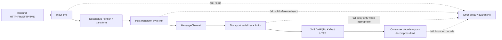
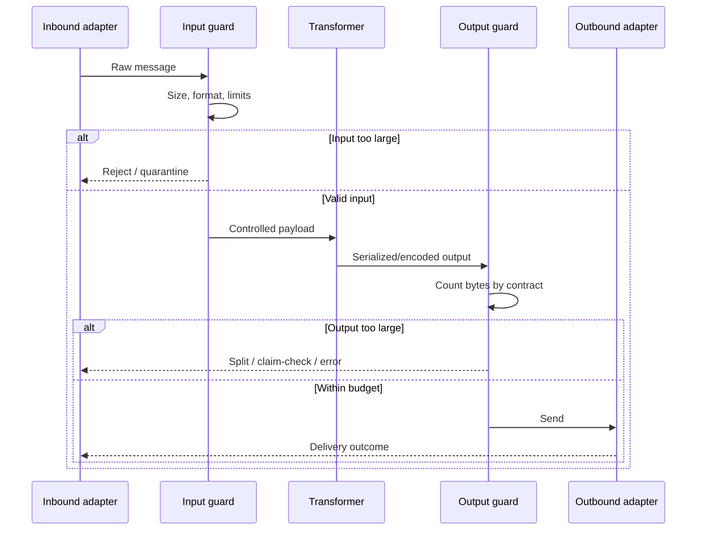
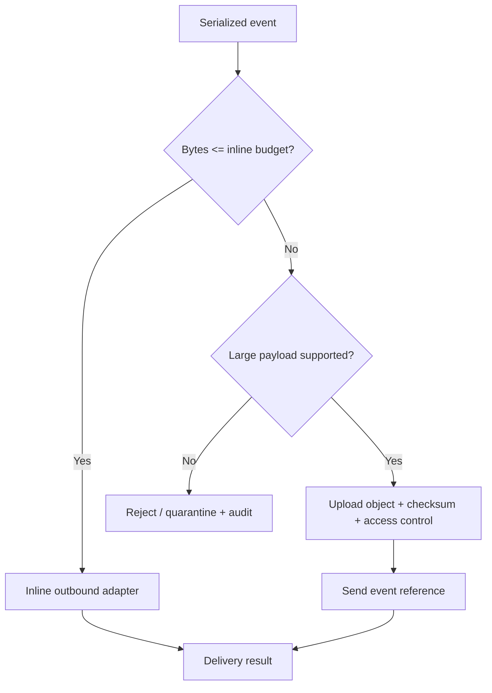
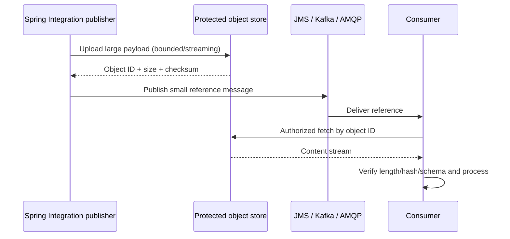
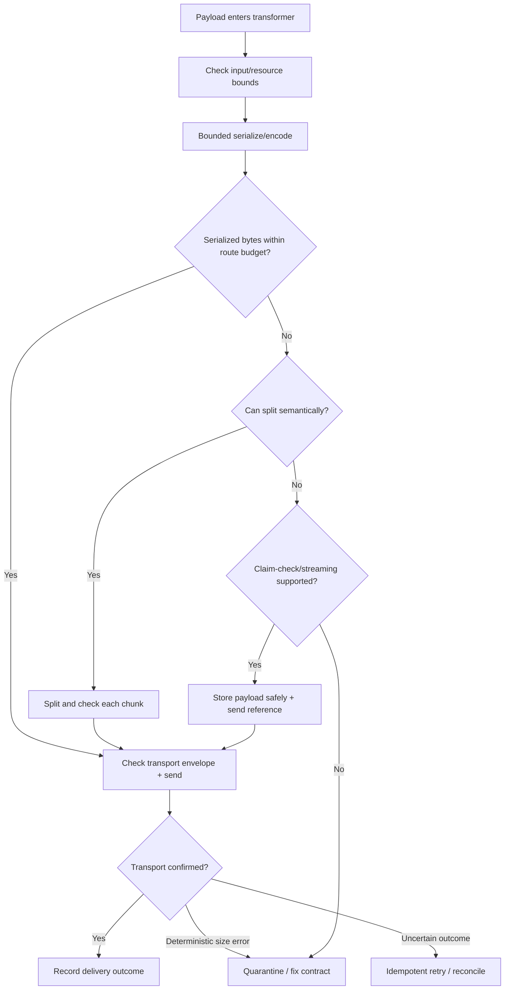

# Controlling post-transformation payload size in Spring Integration Adapters

## 1. Why can a valid inbound payload still be too large on output?

In Spring Integration, a message can pass through several steps before reaching an external system:

1. **Inbound adapter/gateway** reads data from File, SFTP, HTTP, JMS, AMQP, Kafka, or a database.
2. **Transformer** normalizes, enriches, serializes, encrypts, compresses, or converts to the wire format.
3. **MessageChannel** passes the message to another handler.
4. **Outbound adapter/gateway** sends the result to a broker, REST API, file, or target system.

Data size **after a transformer** can differ substantially from the initial input. A short Java string converted to JSON gains quotes and escapes; an object holding a child list can expand dozens of times after enrichment; Base64 enlarges data; and a small compressed file can decompress into massive data. Conversely, compression can shrink bytes over the wire without shrinking the memory needed once decompressed.

For example, inbound HTTP receives a JSON request with `orderId` and a few line items. A handler queries the database, enriches catalog details, and turns the object into UTF-8 `byte[]` before sending to Kafka. The inbound request was only 12 KiB, yet the outbound event can exceed configured producer/broker limits. If size is checked **only on input**, failures surface late at the outbound adapter: sends fail, retries loop, backlogs grow, or processing stalls.

**Controlling post-transformation payload size** means defining byte budgets at contract boundaries, measuring meaningful sizes per target, and enforcing clear policies when messages exceed thresholds: reject, split, store externally and send a reference, or use a streaming path.

This lesson belongs to the **Data Transformation** chapter of the **SPRING_INTEGRATION_ADAPTERS** module, set in the context of inbound/outbound adapters, gateways, pollers, `MessageChannel`, and File/SFTP, HTTP, JMS, AMQP, Kafka, and JDBC flows. The focus is message correctness, operational resilience on failure, and preventing resource exhaustion.

### Learning objectives

After this lesson, you will be able to:

1. Distinguish logical size, serialized size, encoded size, compressed size, and wire size.
2. Build a **size budget** per endpoint, message contract, header set, and encoding.
3. Place guards properly **before** and **after** transformers, especially before outbound boundaries.
4. Write bounded UTF-8, `byte[]`, or serialization byte checks in Java.
5. Choose between rejection, splitter/chunking, streaming, and claim-check/reference payloads based on protocol capabilities.
6. Design retries, quarantine, DLQ, observability, and boundary testing to avoid losing messages or causing OOM.

## 2. There is no single "payload size"

| Size type | Where measured? | Example | Why does it differ? |
|---|---|---|---|
| **Logical size** | In the model/domain | 500 line items, 20 attributes | Counting elements is not counting bytes |
| **String length** | Java `String.length()` | Count of UTF-16 code units | Differs from Unicode code points and UTF-8 bytes |
| **Serialized payload size** | After converting to JSON/XML/Protobuf/Avro/... | JSON UTF-8 `byte[]` | Escaping, metadata, and schemas alter byte counts |
| **Encoded size** | After Base64/envelope/encryption | Payload embedded inside JSON or SFTP wrapper | Includes encoding, IV/tag, and envelope overhead |
| **Compressed size** | After gzip/zstd or producer compression | Compressed byte count | Varies by content and compression level |
| **Protocol message/record size** | Transport producer/broker | Kafka serialized record/batch, AMQP/JMS message | Headers, keys, properties, framing, and batch overhead |
| **Wire size** | On the network connection | TLS records, HTTP framing, network packets | Multi-layer framing; often differs from broker limits |
| **In-memory footprint** | JVM heap/direct buffers | Java object graph, char arrays, buffers | Can be several times larger than serialized data |
| **Decompressed/decoded size** | Consumer after decoding/decompression | 20 KiB ZIP input expanding into GBs | Risk of decompression bombs and OOM |

**Principle:** when stating a "1 MiB limit," specify **which object, at which stage, in which unit**, and for which transport. A generic `MAX_MESSAGE_SIZE` in config without defining what is measured easily causes contradictions.

### 2.1 Byte and character units

- `1 KiB = 1024 bytes`; `1 MiB = 1,048,576 bytes`.
- `1 kB = 1000 bytes`; `1 MB = 1,000,000 bytes`.
- Java `String.length()` returns **UTF-16 code units**, not UTF-8 byte count.
- For `byte[]`, `array.length` gives the bytes currently in the array, which does not necessarily equal the message size after adding headers/transport envelopes.
- For Java `ByteBuffer`, readable bytes remaining are typically `remaining()`; `capacity()` does not reflect useful payload length.

### 2.2 UTF-8 and JSON example

```java
String value = "Hello 🌏";

int utf16Units = value.length();
int utf8Bytes = value.getBytes(StandardCharsets.UTF_8).length;

// The two counts can differ. To measure JSON, you must
// measure the serialized JSON output itself, not just value.
byte[] jsonBytes = objectMapper.writeValueAsBytes(
    Map.of("message", value)
);
int jsonPayloadBytes = jsonBytes.length;
```

Both `getBytes` and `writeValueAsBytes` can **allocate memory for copies** of the data. For unbounded payloads, measuring after serialization may already be too late: the JVM can exhaust heap before having a chance to reject. Combine pre-checks, streaming/bounded serialization, and source limits.

### 2.3 Base64, escaping, encryption, and compression

For `n` input bytes, the **standard padded Base64** length is:

```text
base64Length = 4 * ceil(n / 3)
```

This counts Base64 ASCII characters **before** JSON quotes, field names, MIME line breaks, headers, or extra compression. JSON escaping can lengthen characters like double quotes, backslashes, or control characters. Encryption adds IVs/nonces, authentication tags, and metadata.

Compression shrinks **transmitted** bytes in many cases, yet incompressible data can stay roughly equal or grow slightly due to headers. On the receiving side, consumers must enforce **decompressed size limits**, never relying solely on compressed object size.

## 3. Setting a layered size budget

Give each message at least three budgets:

1. **Input budget:** caps inputs so parsing/allocation stays within capacity.
2. **Internal processing budget:** caps memory, item count, depth, and processing time after enrichment/transformation.
3. **Output contract budget:** caps bytes permitted to the target adapter, leaving headroom for metadata/overhead.

Illustrative example for an event sent to a broker:

| Layer | Illustrative threshold | Measured by what? |
|---|---|---|
| HTTP inbound request body | 2 MiB | Body bytes at controlled ingress |
| Domain item count | 2,000 items | Validation before enrichment |
| UTF-8 JSON event | 700 KiB | Actual bytes from bounded serializer |
| Transport safety headroom | 100 KiB | Headroom for key/properties/framing/batching |
| Configured broker maximum | 1 MiB | Verify **actual** producer, topic/queue/broker configs |

**These numbers are design examples only**, not defaults of Spring Integration, Kafka, JMS, or AMQP. In production, honor the lowest limit across consumer contracts and all intermediaries. A "theoretical" broker limit is insufficient if a load balancer, producer client, or consumer has a smaller cap.

### 3.1 Budget formula

Let:

- `L_destination`: message/record limit per destination contract.
- `H_protocol`: likely overhead from keys, headers, properties, framing/batching.
- `R_safety`: safety margin for schema evolution or unquantified overhead.
- `L_app`: serialized payload cap enforced by the application.

A conservative policy:

```text
L_app <= L_destination - H_protocol - R_safety
```

If exact overhead is unknown, **do not claim** a message is guaranteed accepted by the broker merely because `payload.length <= L_destination`. Pick a safer budget and verify via integration tests with real keys, headers, serializers, and compression.

### 3.2 Smallest limit across the entire path



Check placement must match the **actual responsible layer**. Not every flow has all four steps, yet any transformation capable of inflating payloads should be followed by a guard before outbound.

### 3.3 Pick limits from contracts, not guesswork

Factors:

- What are the broker/topic/queue/producer/consumer maximums?
- Does an external API cap body size, timeouts, or response size?
- Does the payload carry large `headers`, Kafka record keys, tracing metadata, or schema IDs?
- Can the consumer parse and process within its current memory budget?
- Is there batching, compression, encryption, Base64, or a JSON envelope after the guard?
- What queue backlog tolerance and retry/quarantine policies apply?

**Budgets must be defined and monitored per route/destination/message contract**, not necessarily one blanket number across every adapter.

## 4. Transformations that unexpectedly change size

| Transformation | Why does size change? | Appropriate control |
|---|---|---|
| Object → JSON | Field names, quotes, escaping, nulls | Measure actual UTF-8 JSON from Jackson |
| XML ↔ JSON | Metadata/attributes/namespaces, format overhead | Check serialized size, schema |
| `byte[]` → Base64 | Expands ~4/3 before envelope | Estimate ahead and measure after |
| Enriching payload via DB/API | Each item adds extra fields | Cap item count and output bytes |
| Aggregation | Combines N messages into one payload | Max group size, max aggregate bytes, release strategy |
| Splitter | Splits batch into smaller pieces | Max chunk bytes, total count, reassembly metadata |
| Compression | Can shrink wire size | Bound both raw/uncompressed and actual compressed size |
| Decompression | Small input can expand hugely | Cap decoded bytes and ratio/depth |
| Encryption | IV, nonce, tag, padding, envelope | Account in output budget |
| Protocol mapping | Headers, properties, keys, schemas | Integration test with real adapters |
| File/SFTP copy | Not a logical transform, yet involves buffering | Streaming, file spooling, disk quotas |
| Kafka/AMQP batching | Packs multiple records into one send | Batch/request limits and record-level contracts |

### 4.1 Aggregators are riskier than they look

An `Aggregator` can merge small messages into a payload much larger than any single message. If each event is 100 KiB and the aggregator collects 50 events, the aggregate can reach multiple MiB even before headers/serialization. Bound:

- Number of messages in a group.
- Estimated/serialized total bytes.
- Timeouts and release strategies.
- `GroupStore` capacity/retention and cleanup.
- Splitting/chunking before outbound if destinations reject large batches.

Never check only individual inbound messages and assume aggregates stay small.

### 4.2 Enrichers can multiply payload size

A content enricher looks up product info for 1,000 items; each item adds descriptions, Base64 thumbnails, and metadata. A small initial event can breach broker limits. Consider sending only IDs, reference URLs, or fields actually needed by consumers rather than copying entire object graphs.

### 4.3 Headers and metadata

Spring Integration `MessageHeaders` can carry correlation, sequence, tracing, content type, and business metadata. Transport serializers may map some headers onto broker properties. Post-mapping message size can therefore exceed payload bytes.

Never stuff entire JSON payloads into headers to "bypass payload limits." Many transports enforce separate header/property limits, and doing so raises memory and logging overhead.

## 5. Two core rules: Check before and check after

**Pre-transform guards** protect parsers/transformers: cap input bytes, item counts, JSON nesting depth, file sizes, and processing time.

**Post-transform guards** protect outbound contracts: measure bytes **after the final serialize/encode step** the adapter is about to send, check per-route limits, and decide reject/chunk/reference.



If serialization actually lives **inside the outbound adapter** (such as a Kafka `Serializer`), a post-transform guard on the Java object flow will not yet know the final byte count. In that case, **pre-serialize with the exact serializer used**, or add producer-boundary interceptors/validation where supported by the framework. What matters is not measuring one representation and assuming another fits.

## 6. Choosing the exact measurement unit by payload type

### 6.1 `byte[]`

```java
static long sizeOf(byte[] payload) {
    return payload.length;
}
```

If envelopes/headers/record keys are added afterward, this is only **payload byte size**, not wire size.

### 6.2 `String`

```java
static long utf8SizeOf(String payload) {
    return payload.getBytes(StandardCharsets.UTF_8).length;
}
```

This creates a `byte[]` copy and is suitable only when the string was already bounded earlier. `String.length()` cannot substitute for byte measurement. If the outbound serializer uses UTF-16 or adds JSON escaping, measure the final encoded output.

### 6.3 `ByteBuffer`

```java
static long readableBytes(ByteBuffer buffer) {
    return buffer.remaining();
}
```

If the buffer is mutated between check and send, or the serializer reads from a different position, the measurement can be wrong. Avoid `capacity()` and avoid mutating `position()` when merely checking size.

### 6.4 `InputStream`, `Resource`, and files

`InputStream.available()` **is not total stream length**; it typically reflects only bytes readable immediately without blocking. When a file exists, `Files.size(path)` helps as a preflight check, yet the file can change before the handler reads it. For unknown-size streams, use **bounded reads/streaming** and track actual bytes consumed.

### 6.5 Objects/DTOs

A Java object has no natural byte length. `toString().length()`, `estimated heap size`, or field counts do not give JSON/Protobuf byte sizes. Choose an explicit serializer and schema version, and measure bounded serialization. If the producer adds envelopes, keys, or headers, check corresponding transport limits too.

## 7. Bounded serialization: Reject before allocating a huge array

The following check pattern:

```java
byte[] bytes = objectMapper.writeValueAsBytes(hugeObject);
if (bytes.length > maxBytes) {
    throw new IllegalArgumentException("Payload too large");
}
```

has a serious drawback: **the entire array is already allocated** before the check runs. For objects that can balloon unchecked, the container can hit `OutOfMemoryError` or severe GC pressure before the guard triggers.

The solution is multi-layered control:

1. Cap inputs and item/domain record counts before enrichment.
2. Bound serialization **while bytes are being written**.
3. Materialize a `byte[]` only after confirming the output fits the budget.
4. For genuinely huge payloads, switch to streaming, quota-bound temp files, or claim-check rather than forcing them into memory.

### 7.1 Java example: Counting `OutputStream` that rejects upon exceeding the limit

```java
import java.io.FilterOutputStream;
import java.io.IOException;
import java.io.OutputStream;
import java.util.Objects;

final class PayloadLimitExceededException extends IOException {
    PayloadLimitExceededException(long maxBytes) {
        super("Serialized payload exceeds " + maxBytes + " bytes");
    }
}

final class CappedOutputStream extends FilterOutputStream {
    private final long maxBytes;
    private long written;

    CappedOutputStream(OutputStream delegate, long maxBytes) {
        super(Objects.requireNonNull(delegate));
        if (maxBytes < 0) {
            throw new IllegalArgumentException("maxBytes must be >= 0");
        }
        this.maxBytes = maxBytes;
    }

    private void check(long nextWriteBytes) throws IOException {
        // Subtract instead of adding to avoid long overflow.
        if (nextWriteBytes > maxBytes - written) {
            throw new PayloadLimitExceededException(maxBytes);
        }
    }

    @Override
    public void write(int value) throws IOException {
        check(1);
        out.write(value);
        written++;
    }

    @Override
    public void write(byte[] bytes, int offset, int length)
            throws IOException {
        Objects.checkFromIndexSize(offset, length, bytes.length);
        check(length);
        out.write(bytes, offset, length);
        written += length;
    }

    long writtenBytes() {
        return written;
    }
}
```

This guard rejects **before writing bytes beyond the limit** to the delegate. It does not bound memory used to **construct the object prior to serialization**, nor internal buffers a serializer library may allocate. Therefore, still bound upstream data and input objects.

### 7.2 Serializing JSON with Jackson within a byte budget

```java
import com.fasterxml.jackson.databind.ObjectMapper;
import java.io.ByteArrayOutputStream;
import java.io.IOException;

final class BoundedJsonSerializer {
    private final ObjectMapper mapper;

    BoundedJsonSerializer(ObjectMapper mapper) {
        this.mapper = mapper;
    }

    byte[] toJsonBytes(Object value, int maxBytes) throws IOException {
        if (maxBytes < 0) {
            throw new IllegalArgumentException("maxBytes must be >= 0");
        }

        ByteArrayOutputStream buffer =
            new ByteArrayOutputStream(Math.min(maxBytes, 8192));

        try (CappedOutputStream capped =
                new CappedOutputStream(buffer, maxBytes)) {
            mapper.writeValue(capped, value);
        }
        // The result length is <= maxBytes, yet toByteArray still creates a copy.
        return buffer.toByteArray();
    }
}
```

When Jackson writes past the limit, `CappedOutputStream` throws `IOException` and serialization stops. Some layers may wrap that error in another exception: error handlers must **classify the root cause properly** rather than retrying infinitely.

**Limitations of the example:** using `ByteArrayOutputStream` still holds the output on the heap and `toByteArray()` makes another copy. Suitable for small/medium message budgets; for multi-MiB/GiB data, use quota-bound temp files or stream straight to protocol-supported sinks. Do not treat this alone as protection against every payload bomb.

### 7.3 Applying to XML or Protobuf

The idea is identical: write bytes through `CappedOutputStream` rather than building an unbounded string/array. However, each serializer buffers differently; check:

- Does the serializer retain a large object graph before streaming?
- Does it write immediately to `OutputStream` or build a large intermediate buffer?
- Does it support limiting depth, collection sizes, or entity expansion?
- Does an error abort serialization cleanly?

For XML, entity-expansion/XXE protection on the **receiving parser** is a separate layer from output-size guards. For Protobuf/Avro, inspect serialized bytes plus envelope/schema ID overhead actually sent by the transport.

## 8. Guards inside a Spring Integration flow

Guards can be implemented as a **service activator**, filter, or message handler. What matters: the guard must run **before the outbound adapter**, on the right-sized representation, and **never let an over-budget message slip through**.

### 8.1 Guard for a `byte[]` payload

```java
import org.springframework.integration.annotation.ServiceActivator;
import org.springframework.messaging.Message;

@Component
final class SerializedPayloadGuard {
    private static final int MAX_BYTES = 700 * 1024; // Example, not a default.

    @ServiceActivator(
        inputChannel = "serializedOutbound",
        outputChannel = "guardedOutbound"
    )
    public Message<byte[]> validate(Message<byte[]> message) {
        if (message.getPayload().length > MAX_BYTES) {
            throw new OversizedMessageException(
                "Serialized payload exceeds route budget"
            );
        }
        return message; // Preserve payload and headers when valid.
    }
}
```

`OversizedMessageException` is a **project-defined custom RuntimeException**, not a built-in Spring Integration exception. The `serializedOutbound` channel must genuinely receive `byte[]`. If payloads arriving there are still DTOs or Strings, run the right serializer beforehand or fix the type contract.

A flow:

```text
inboundChannel
  -> input / item-count validator
  -> enrich
  -> bounded JSON serializer (byte[])
  -> serializedOutbound
  -> SerializedPayloadGuard
  -> guardedOutbound
  -> Kafka/JMS/AMQP/HTTP outbound adapter
```

In production, avoid hardcoding one `MAX_BYTES` across the whole flow; apply policies per route/destination and contract version. If forwarding asynchronously between serialization and the guard, ensure no other handler can send the payload before it is checked.

### 8.2 When to use `MessageFilter`?

A `MessageFilter` can accept/reject via a predicate such as `byte[].length <= limit`. However, rejecting a message must never silently drop work. Choose:

- `discardChannel` for oversized messages routed to quarantine/claim-check.
- Throwing a typed exception so the error flow classifies it as permanent/oversized.
- Persisting state and honoring inbound ACK/retry contracts.

**Never assume reject = retry.** For an inherently oversized payload, retrying the same message never shrinks it and only triggers a retry storm.

### 8.3 Keeping headers without trusting inbound metadata

If a transformer sets a `payloadSizeBytes` header for monitoring, that header is **supporting metadata**, not security proof. Producers may supply wrong headers, or later transforms may alter the message. Guards at outbound boundaries must re-measure the exact data they are about to send.

When transformers construct new messages, retain valid headers like correlation, routing keys, and trace IDs; avoid copying unvalidated headers wholesale from external sources.

### 8.4 Routing by size

In some contracts, small messages travel inline via the broker while large ones go to object storage with a reference sent instead:



This is the **claim-check** pattern. Uploading objects and publishing references still spans two systems with a failure window between them, requiring cleanup/retry handling as covered in section 14.

## 9. Streaming and bounded reads: Avoiding loading whole files into heap

### 9.1 File/SFTP inbound

When an adapter receives a file, there are two handling styles:

- **Full load:** read the file into `byte[]`/String, transform, send. Simple, yet memory grows with file size.
- **Streaming:** read sequentially via `InputStream`, parse record by record, or forward in chunks. More complex, yet suits large files.

File metadata can give an initial preflight size. However, a file can change after metadata is read; guard against half-written files (producer temp names/atomic renames where supported), checksums, actual read-byte limits, and upload-completion checks.

### 9.2 Bounded stream-reading pattern

```java
static byte[] readBounded(InputStream input, long maxBytes)
        throws IOException {
    if (maxBytes < 0) {
        throw new IllegalArgumentException("Negative limit");
    }

    try (ByteArrayOutputStream buffer = new ByteArrayOutputStream()) {
        byte[] chunk = new byte[8192];
        long readTotal = 0;
        int n;

        while ((n = input.read(chunk)) != -1) {
            if (n == 0) {
                continue; // For abnormal streams, external timeout/cancellation is required.
            }
            if (n > maxBytes - readTotal) {
                throw new PayloadLimitExceededException(maxBytes);
            }
            buffer.write(chunk, 0, n);
            readTotal += n;
        }
        return buffer.toByteArray();
    }
}
```

This illustrates **reading at most `maxBytes` and rejecting**. It still uses heap and copies on `toByteArray()`; use only for small/medium limits. For large files, write to quota-bound spool files, streaming pipelines, or record-by-record handlers, while bounding total time/bytes and closing resources per lifecycle rules.

### 9.3 Do not hold an `InputStream` open across async channels arbitrarily

A transformer returning an `InputStream` to an `ExecutorChannel` and closing the source right after returning leaves consumers with a closed stream. Conversely, keeping streams open indefinitely leaks connections/file descriptors, especially over SFTP. Define:

- Who owns the stream and must close it?
- Can the stream be re-read on retry?
- Does the source file stay immutable until processing finishes?
- If an async consumer fails, how do we replay from durable storage?
- Are checksums/lengths available to verify integrity?

A **path/object-store reference** with explicit permissions and TTL is often safer than passing live streams through queues.

## 10. Limits during decompression and parsing

### 10.1 Decompression bombs

A compressed file of a few KiB can decompress into massive data. Checking only `Content-Length` or compressed `byte[]` before decompressing **does not protect** heap and disk.

Enforce multiple bounds:

1. Max compressed input bytes.
2. Max **actual decompressed bytes**.
3. Max entry count for ZIP/TAR archives.
4. Max nesting/recursion depth for archives or JSON/XML.
5. Max expansion ratio where appropriate, though **never rely on ratio alone** since legitimate data can compress very tightly.
6. Timeouts/cancellation and memory/disk quotas while parsing.

### 10.2 Example of bounded GZIP reading

```java
static byte[] gunzipWithLimit(byte[] compressed, long maxExpandedBytes)
        throws IOException {
    try (GZIPInputStream gzip =
             new GZIPInputStream(new ByteArrayInputStream(compressed))) {
        return readBounded(gzip, maxExpandedBytes);
    }
}
```

This example assumes compressed input was already bounded prior to allocation. `readBounded` halts once decompressed bytes pass the limit, yet does not replace CPU limits, archive entry limits, or nested-compression checks.

### 10.3 JSON parser constraints

Jackson supports parser constraints depending on version—such as depth, string length, or number length—via stream constraints configuration. Those guard against **deeply nested JSON**, ultra-long strings, or resource-heavy structures; they **do not automatically cap total serialized message bytes**.

For example, 100,000 tiny fields can still exceed total byte limits even though no single string is long. Combine parser constraints + body byte limits + output byte limits.

### 10.4 Base64 decoding

When receiving Base64, cap both encoded input characters and decoded output size before passing data into converters. Base64 is not encryption and does not shrink payload size. If decoded data is enriched/re-serialized later, re-measure the final output.

## 11. Adapter-specific outbound limits

You cannot apply a single `maxPayloadBytes` across every transport without checking adapter and target-system parameters.

| Transport / adapter | Limit layers to check | Appropriate measurement point |
|---|---|---|
| **Kafka outbound** | Producer request size, broker/topic record-batch limits, consumer fetch/memory, serializer | Serialized key/value bytes + record/batch overhead; test with real producer |
| **JMS outbound** | Provider message-size limit, message body/properties, session/producer buffers | Final JMS message with body/properties per provider |
| **AMQP/RabbitMQ outbound** | Broker message-size policy, client buffers, exchange/queue policies | Post-mapping payload/properties, broker rejects/confirms |
| **HTTP outbound gateway** | Upstream ingress/proxy limits, server body limits, headers, content encoding | Actual request bytes before HTTP client; validate response bodies too |
| **File outbound** | Disk quotas, filesystem max file size, path and temp space | Actual bytes written + spool quota |
| **SFTP outbound** | Remote disk/quotas, session/connection, upload timeouts | Sent bytes, remote file length/checksum |
| **JDBC adapter** | Column types, DB packet/row limits, query size, fetch/batch memory | Serialized field sizes, row counts, JDBC batch payloads |

### 11.1 Kafka: Record, batch, and request are distinct limits

When Spring Integration sends a Kafka message, the steps typically include:

1. Creating a `ProducerRecord` from the Spring `Message<?>` via mapping.
2. Serializing **key** and **value** with the configured serializers.
3. Adding headers and record metadata.
4. Producer building requests/batches per compression, batching, and broker config.

Settings commonly requiring review:

- Producer `max.request.size`: request/batch threshold enforced by the producer, not simply `payload.length`.
- Broker `message.max.bytes` and/or topic `max.message.bytes`: message/record-batch thresholds per Kafka configuration.
- Consumer `max.partition.fetch.bytes` and `fetch.max.bytes`: affect fetch/memory/throughput; **never assume** a small fetch setting always hard-rejects oversized records, since Kafka has exceptions to let consumers make progress.
- `batch.size`, compression, and producer buffer memory: affect batching/memory, though **not all are per-event limits**.

Exact parameters and semantics depend on Kafka version and serializers. **Guards on Java objects or JSON Strings before the `Serializer` can mismeasure** if the serializer adds schema IDs, headers, or different encodings. Test with real keys, values, headers, and producer settings.

#### Kafka failure scenario

A JSON event has a 900 KiB payload plus Kafka record headers, key, and metadata. The producer is configured with a limit lower than the total serialized request, or the topic has a different limit. Sending can fail after the transformer already built its output.

Handling:

1. Check size with the actual serializer and a safety budget prior to the producer.
2. Classify oversized errors as **non-retryable** if contents cannot change.
3. Route to splitter/claim-check or quarantine per contract.
4. Log event ID, cause, and measured sizes without raw payloads.
5. Do not blindly raise `max.request.size`; review broker, topic, consumer, memory, and other system limits.

### 11.2 JMS: Limits depend on the provider

The JMS API defines message types such as `TextMessage`, `BytesMessage`, `MapMessage`, and properties. However, **actual size thresholds** are typically governed by broker/provider internals, connection factories, persistence, and quotas.

For example:

- A `TextMessage` may be encoded differently from how the app measured a Java String.
- A `BytesMessage` carries body bytes plus JMS headers/properties.
- An oversized message may be rejected by the client, rejected by the broker, or spike memory before throwing.

Measure payloads after the transformer, confirm the JMS outbound adapter's mapping, verify broker limits, and handle failures in producer/session transactions. **JMS consumer acknowledgments do not shrink the size of messages producers send.**

### 11.3 AMQP/RabbitMQ: `frame_max` is not a hard whole-message limit

AMQP transmits bodies across frames; `frame_max` controls frame size and **does not automatically mean** an entire message must fit inside one frame. Brokers/clients also enforce product-specific message-size, memory, queue/policy, and publisher-confirmation limits.

With the Spring Integration AMQP outbound adapter, separate:

- Serializer/converter from DTO to bytes.
- AMQP message properties/headers.
- Broker routing success vs. failure.
- Publisher confirms/returns if configured.
- Whether consumers have sufficient memory to decode payloads.

Never confuse "publisher confirm" with business processing by the consumer. If an oversized event is rejected by the broker per policy, retrying the same payload fixes nothing.

### 11.4 HTTP outbound gateway

A REST API may limit **request body**, total headers, multipart part sizes, or **response body**. Reverse proxies, WAFs, load balancers, web servers, and applications may enforce different limits.

For instance, inbound HTTP returns `413 Content Too Large` when a body exceeds limits. Yet the application should not wait for a remote 413 to check size: by then it may already have serialized and buffered too much in the JVM.

Notes:

- `Content-Length` may be absent (chunked transfer), reflect compressed bodies, or be untrustworthy if client-supplied.
- `Transfer-Encoding: chunked` does not eliminate total byte limits.
- With `Content-Encoding: gzip`, servers must budget both **compressed inbound bytes** and **decompressed bytes**.
- For multipart, per-part and total-request limits can differ.
- Oversized JSON/XML responses also need **bounded receive/decode** to avoid OOM at the outbound gateway.

If an API does not support large payloads, design batch APIs, pagination, multipart uploads, or URL/reference payloads per the target service's contract.

### 11.5 File outbound

A File outbound adapter can write large files that a broker would never accept as a single message. Still, manage:

- Disk quotas, inode/file counts, and filesystem max file sizes.
- Temporary files during writes and post-completion renames where supported.
- Checksums and readback/manifests when needed.
- Policies for cleaning up failed/partial files after process crashes.
- Avoiding loading entire files onto the heap before writing.

For very large output files, **streaming to disk** fits better than pushing `byte[]` through an in-memory `QueueChannel`.

### 11.6 SFTP outbound

Limits typically stem from remote filesystem quotas, permissions, upload duration, network buffer sizes, and connection/session lifecycles; there is no single universal "SFTP payload maximum" replacing capacity planning.

Post-transformation, use:

- Preflight size checks when known ahead of time.
- Streaming uploads via temp filenames and remote final renames per contract.
- Checksums and remote file lengths when integrity is required.
- Partial-file policies on upload errors.
- Idempotent retries via filenames/versions/manifests.

The remote server may already have received the whole file even when the client sees a timeout. Check remote state before blindly re-uploading to avoid creating duplicate business files.

### 11.7 JDBC inbound and database batching

With JDBC inbound adapters, a single poll may return a list of selected rows. Row count does not equal byte count:

- `maxRows` limits records returned by the source per adapter mechanics.
- `maxMessagesPerPoll` caps `receive()` calls per poll cycle, not necessarily row count or post-splitter message count.
- A single row can hold a huge CLOB/BLOB even when batch size is 1.
- Query results and mappers can load everything into heap before downstream guards see it.

Bound row counts, selected columns, BLOB/CLOB sizes, JDBC streaming/fetch strategies, and post-map/enrich output serialization. For large datasets, use cursors/chunks per database driver capabilities; never assume `LIMIT 100` guarantees memory safety.

## 12. Size-aware splitters: Splitting without breaking business contracts

When outputs exceed limits, a **splitter** works if consumers can process pieces independently or reassemble them.

### 12.1 Strategies

| Strategy | When to use | Risks |
|---|---|---|
| Split by **item count** | Items are roughly uniform with tight upper bounds | Uneven item sizes still breach byte limits |
| Split by **estimated bytes** | Need speed with safe per-item bounds | Misestimates from escaping/encoding/headers |
| Split by **actual serialized bytes** | JSON/Avro records needing exact caps | Must serialize/count; compute overhead |
| Split into **byte chunks** | File/blob transfers or reassembly-capable protocols | Individual chunks are not valid standalone JSON |
| **Claim-check** | Single item exceeds budget or large files | Requires object store, authorization, lifecycle |

**Principle:** if **a single item** already exceeds the budget, splitting lists by item cannot solve it. Switch that item to an object reference, drop unneeded fields, or return a contract error.

### 12.2 Never split a JSON document arbitrarily

A JSON object can be sliced mid-UTF-8 multi-byte character or mid-escape sequence. Consumers cannot parse pieces independently if raw bytes are cut at arbitrary offsets. Two options exist:

1. **Semantic split:** each chunk is a complete JSON message carrying a subset of items and reassembly metadata.
2. **Binary chunking:** each chunk is a `byte[]` with `transferId`, `chunkIndex`, `chunkCount`, digest, and a reassembly protocol.

Pick based on consumer contracts; never label an arbitrary byte slice a "JSON message."

### 12.3 Chunk envelope

```json
{
  "transferId": "order-export-1042",
  "chunkIndex": 2,
  "chunkCount": 7,
  "schemaVersion": 1,
  "aggregateId": "order-1042",
  "originalSha256": "sha256-hex-digest-from-source",
  "items": [
    {"sku": "A101", "qty": 2},
    {"sku": "B407", "qty": 1}
  ]
}
```

`originalSha256` in the example is a placeholder; in production compute the digest from original data in a consistent canonical form rather than inventing values. Version schemas, check sizes **including each chunk's envelope**, and guard against duplicate or missing chunks.

### 12.4 Checking each chunk's size after serialization

Illustrative algorithm:

```text
chunks = []
current = []

for item in items:
    candidate = current + [item]
    candidateEnvelope = buildEnvelope(candidate)
    if serializedUtf8Bytes(candidateEnvelope) <= chunkLimit:
        current = candidate
    else:
        if current is not empty:
            chunks.add(current)
        current = [item]
        if serializedUtf8Bytes(buildEnvelope(current)) > chunkLimit:
            reject_or_store_by_reference(item)

if current is not empty:
    chunks.add(current)

set_final_chunkCount_and_revalidate_each_serialized_chunk(chunks)
```

This is pseudocode, not a CPU-optimal algorithm: re-serializing candidates on every item costs $O(n^2)$. Production code should use incremental serialization or conservative estimation paired with a **final confirmation check**. If `chunkCount`/metadata changes length after splitting, revalidate every output.

### 12.5 Consumers must reassemble safely

- Persist chunks in durable storage keyed uniquely by `transferId + chunkIndex`.
- Validate checksums, counts, schemas, tenants, and aggregate IDs.
- Tolerate chunks arriving **out of order** or being redelivered.
- Set TTLs/retention for incomplete transfers; alert on missing chunks.
- Cap total bytes of the **reassembled payload** to prevent DoS.
- Apply business results only once all chunks arrive and integrity verifies; avoid half-applying when atomicity is required.

With Kafka/JMS/AMQP, chunk order can shift across partitions, multiple consumers, and retries. Never assume transport guarantees global ordering.

## 13. Claim-check: Sending a reference instead of stuffing large data into brokers

The **claim-check pattern** separates **large payload data** from the message. The producer writes the payload to controlled object or file storage, then emits a small message carrying `objectKey`, size, checksum, and business metadata. The consumer reads the reference, verifies authorization, fetches data within limits, and processes it.



### 13.1 Reference contract

```json
{
  "eventId": "evt-b92d",
  "eventType": "LargeExportReady",
  "schemaVersion": 1,
  "content": {
    "storageKey": "exports/2026/11/23/exp-1042-v1",
    "contentType": "application/json",
    "sizeBytes": 20531264,
    "sha256": "replace-with-real-hex-digest",
    "expiresAt": "2026-11-30T00:00:00Z"
  }
}
```

Values are illustrative only, not real data or access keys. Never embed permanent credentials or uncontrolled signed URLs inside messages. Reference messages also have their own size budgets and schemas.

### 13.2 Mandatory elements of claim-check

1. **Integrity:** verify hash, content length, schema, and encryption/decryption as needed.
2. **Authorization:** verify the consumer is authorized to read objects for that tenant/resource; never trust `storageKey` solely because it arrived from a broker.
3. **Immutability/versioning:** prevent objects from being overwritten after references are emitted without consumers knowing.
4. **Availability:** object storage must be reachable when consumers process; otherwise retry within deadlines.
5. **Retention:** objects not yet consumed must not be prematurely cleaned up; expired objects need a remediation workflow.
6. **Idempotency:** events carry `eventId` so consumers avoid repeating side effects on broker redelivery.
7. **Observability:** distinguish "reference sent" from "object fetched/processed by consumer."

### 13.3 Uploading objects and publishing references still involves two commits

Object storage and brokers do not share a single transaction automatically. A safe workflow:

1. Stream upload to a **temporary object key**, verifying checksum/size.
2. Finalize the object at an immutable version/key once upload completes.
3. Save a **durable intent** to publish the reference, e.g., in a DB outbox within the matching business transaction.
4. Publisher sends the reference via the outbound adapter.
5. Once handoff meets contract, mark sent; on timeout, retry the reference with the same event ID.
6. Clean up temporary/orphan objects after configured retention.

If the object upload succeeds yet the DB/outbox rolls back, **orphan objects** can remain; cleanup must find them. If the DB records a reference before upload completes, consumers may try fetching nonexistent objects. Define ordering, `STAGED/READY` states, and error handling explicitly.

### 13.4 When does claim-check not fit?

- Consumers require ultra-low latency across the whole payload where object-store round-trips are too slow.
- No object store exists with suitable access controls, retention, or availability.
- Payloads contain sensitive data the target system is barred from accessing via storage references.
- Business rules require global transactions at the target that references cannot satisfy.

In such cases, consider slimming payloads, redesigning event contracts, batch streaming APIs, or integrating at a different domain boundary.

## 14. Error handling for oversized payloads

An oversized payload is **usually a deterministic data/contract failure**, unlike a network timeout. If the object and limits stay unchanged, retrying 1,000 times will breach the threshold every single time.

### 14.1 Decision matrix

| Scenario | Action to consider | Retry original payload? |
|---|---|---|
| Serialized JSON exceeds cap, split supported | Split into semantic chunks, check each chunk | No, switch to chunk path |
| Single large element cannot split | Claim-check or reject with reason | No unless alternate path exists |
| Valid schema yet enrichment added unneeded fields | Trim/drop fields, update schema | No until transform is fixed |
| Broker reports record too large | Inspect serializer/key/headers and policy | Do not retry blindly |
| HTTP returns 413 | Switch to batch/streaming API or reject | Do not retry identical request |
| File/SFTP quota exceeded | Alert/capacity/controlled retry | Possibly retry after capacity recovers |
| Small compressed input exceeds decompressed cap | Reject/quarantine, enforce decode limits | No |
| Broker timeout, unclear if received | Retry per idempotency/ack contract | Yes, since failure may not be size |
| Oversized headers despite small body | Trim/avoid unnecessary metadata | No until mapping is fixed |
| Serializer timeout/heap pressure | Reduce batches, bound sources, inspect resources | Retry only after root cause is resolved |

### 14.2 Error channels and transaction boundaries

In Spring Integration, errors can:

- Be thrown **synchronously** over `DirectChannel` back to inbound listeners/pollers.
- Be converted into `ErrorMessage` on `errorChannel`.
- Occur **asynchronously** in `ExecutorChannel`, Kafka producer callbacks, or HTTP client threads.

Consequences:

- If a JMS inbound container uses transacted sessions, throwing an oversized exception back to the container can cause **infinite rollback and redelivery**.
- If an error handler deals with oversized messages by durably routing to DLQ/quarantine and returning normally, JMS commits per policy and **stops redelivering**.
- If a JDBC poller flow already marked a record `CLAIMED` and fails at outbound, the record must persist an error state or roll back per design.
- If a Kafka producer buffered a message yet its callback later reports an exceeded limit, `MessageChannel.send()` succeeding is not proof the broker accepted it.

**Core policy:** is oversized permanent, or is there an alternate path? Decide once at the route boundary and persist outcomes durably rather than letting exceptions drift across threads.

### 14.3 What should `ErrorMessage` carry?

| Information | Benefit |
|---|---|
| Correlation ID / event ID | Traces from inbound to error flow |
| Route/destination ID | Shows which budget was breached |
| Payload byte count and configured limit | Diagnoses failures, reports KPIs |
| Content type, schema version | Identifies which transform bloated data |
| Stage: pre-transform/post-transform/transport | Pinpoints where to fix |
| Error classification | Deterministic oversized, retryable, unknown outcome |
| Attempt/claim ID if present | Links to queue/source record |
| Reference to protected content | Reprocesses without logging full payloads |

Never stuff entire sensitive payloads or giant object graphs into `ErrorMessage` just for debugging; this can **worsen resource exhaustion**. An exception with stack trace and a few IDs usually suffices to link to protected quarantine storage.

### 14.4 Recoverable quarantine principles

When storing oversized payloads for manual remediation:

1. Write contents to quota-bound, access-controlled storage, or store references only.
2. Record reason code, bytes, route, timestamp, event ID, and trace ID.
3. Ensure persistence succeeds before ACKing/committing the source message if zero data loss is required.
4. Establish retention, owners, alerts, and reprocessing paths after policy or data fixes.
5. Never arbitrarily raise broker limits just to push through an unsafe message.

If quarantine itself fails and risks losing data, source transactions/ACKs must follow the designed fail-safe strategy. Never assume an error handler returning normally means the replayable artifact was saved.

## 15. Transactions, ACKs, retries, and payload size across adapters

### 15.1 JMS inbound → transform → HTTP outbound

Suppose a JMS container uses transacted sessions and a handler transforms JSON then sends HTTP POST. If output exceeds HTTP limits:

- **Do not** throw exceptions causing JMS to roll back/redeliver forever when the message will always be too big.
- Write a durable quarantine record or claim-check intent, then complete the JMS transaction per policy.
- If saving error state fails, preserve redelivery or reprocessing per design.
- HTTP timeouts do not prove oversized; distinguish timeouts from 413.

### 15.2 JDBC poller → aggregator → Kafka outbound

With JDBC, the source may claim multiple rows and an aggregator merges them into one large event:

- Measure total serialized bytes **after the aggregator**.
- If oversized, split the group into smaller events per contract.
- The claiming DB transaction does not automatically roll back Kafka messages already sent.
- Use outbox, stable event IDs, and idempotency when preventing loss/duplicates.

### 15.3 SFTP inbound → XML transform → AMQP

A large XML file is polled from SFTP and converted into multiple AMQP messages:

1. Check remote file size where possible and use streaming/temporary local files.
2. Parse XML with entity-expansion/depth protections.
3. Produce semantic records/chunks with byte budgets.
4. Send via AMQP adapter per publisher-confirm/routing contracts.
5. Mark the file processed only after all required chunks meet handoff criteria.
6. If any chunk fails, record a manifest/progress record for idempotent reprocessing.

Filesystem/SFTP operations do not automatically join AMQP transactions. Moving a file from `incoming` to `done` before all chunks are accepted risks losing work.

### 15.4 HTTP inbound → File outbound

Cap HTTP request bodies right at ingress and stream to disk if workflow permits. Post-transform, check expected file size/total written bytes to stay within quotas. For multipart uploads, verify both total size and per-part sizes; never rely on `Content-Length` as the sole guard.

### 15.5 Retry contracts must be consistent

Define classifications:

- `OVERSIZED_PERMANENT`: never retry identical bytes; alternate route/quarantine.
- `TRANSPORT_TOO_LARGE`: verify actual producer/broker/API limits; do not retry blindly.
- `TRANSIENT_CAPACITY`: bounded retry, backoff, and circuit breaker.
- `DELIVERY_OUTCOME_UNKNOWN`: idempotent retry or reconciliation.
- `DECODING_LIMIT_EXCEEDED`: reject/quarantine; never auto-raise limits.

Tie these to event IDs and source records; never let ad-hoc error flows turn deterministic oversized failures into infinite redelivery.

## 16. Monitoring and SLOs as payloads grow over time

A schema change can grow average payloads from 20 KiB to 200 KiB unnoticed until brokers start rejecting messages. Monitor **size distributions** and threshold breach rates.

### 16.1 Suggested metrics

| Metric / SLI | Purpose | Signal to investigate |
|---|---|---|
| `payload.input.bytes` | Input size by route | Spikes or input abuse |
| `payload.output.bytes` | Post-transformer size | p95/p99 jump after a deploy |
| `payload.size.growth.ratio` | Output/input ratio | Abnormal enrichment or encoding bloat |
| `payload.limit.exceeded.count` | Budget breach count | Schema/contract mismatches |
| `payload.serialization.duration` | CPU/time to serialize | Bloated object graphs, GC pressure |
| `payload.aggregation.group.bytes` | Post-aggregation group size | Unbounded batches/quotas |
| `payload.chunk.count` | Chunks per business event | Too many messages/reassembly overhead |
| `payload.claimcheck.count` / `bytes` | Object-reference usage | Rising storage/egress load |
| `payload.decompression.expanded.bytes` | Bytes after decompression | Decompression bombs/capacity |
| `outbound.send.reject.count` | Broker/API rejections due to size | Missing guards or mismatched limits |
| `quarantine.oversized.count` | Work needing manual remediation | Stuck reprocessing paths |
| `channel.queue.depth` / `oldest.age` | Swelling internal queues | Memory/durable store pressure |
| `jvm.heap.used` / `gc.pause` | Application resources | Transformations creating large copies |

These are **suggested metric names**, not built-in defaults of Spring Integration/Micrometer. Never use message IDs, customer IDs, tenant IDs, or payload contents as high-cardinality metric labels; keep those in access-controlled logs/traces.

### 16.2 Average size is insufficient

A 30 KiB average hides the handful of 20 MiB messages causing outages. Track `p50/p95/p99/max` histograms per route/contract and `outputBytes / inputBytes` ratios whenever `inputBytes > 0`. For empty inputs, ratios are undefined—never divide by zero.

Separately track **largest serialized message**, chunk counts, queue age, and send latency. High load can overwhelm brokers/buffers even when no single message exceeds hard caps.

### 16.3 Alert examples

- `output p99` exceeds 80% of route budget for consecutive minutes.
- Any `TRANSPORT_TOO_LARGE` error at publishers despite application guards passing.
- Deterministic oversized counts spike right after a schema change.
- Actual decompressed bytes approach caps or ratios look abnormal.
- Aggregator group sizes overshoot while release strategies stall.
- Quarantine backlog ages past deadlines.
- JVM heap/GC pressure correlates with rising output sizes.

The 80% threshold is only an illustrative early warning; each service should calibrate to scale, data distributions, and limit precision.

## 17. Capacity and backpressure strategies

### 17.1 Valid messages can still cause OOM under high concurrency

Suppose the per-message budget is 1 MiB, yet 2,000 concurrent handlers hold three copies each: DTO, JSON bytes, and serialized producer buffers. Total memory demand can exhaust JVM heap even though **not a single message exceeded individual limits**.

Therefore sizing must consider:

- Max bytes per message.
- Max in-flight messages.
- Number of intermediate copies.
- Batch sizes and channel queue capacities.
- Kafka/JMS/AMQP producer/consumer buffers.
- GC behavior, direct memory, and native allocations.

### 17.2 Per-route backpressure

- Cap concurrency on pollers/listeners/handlers.
- Use bounded queues or observable capacity policies.
- Split into bounded batches.
- When downstream stalls, slow polling/ingestion or buffer in durable queues/outboxes per design.
- Apply circuit breakers and retry budgets for remote outages.
- When inputs violate contracts and cannot be processed, **quarantine instead of holding infinitely in RAM**.

### 17.3 Relationship between size and throughput

Message limits cannot be chosen independently of throughput goals. 10 KiB payloads at 20,000 msg/s and 1 MiB payloads at 200 msg/s both move large byte/s volumes, yet differ sharply in serialization CPU, header overhead, and heap allocation. Measure:

- Bytes/s by source and target.
- Messages/s.
- Serialization/deserialization CPU.
- Broker request sizes/batching and network bandwidth.
- In-flight duration from inbound to ACK.

When send latency rises, in-flight message counts rise and expand heap usage even with unchanged byte limits.

## 18. Testing post-transformation payload size

### 18.1 Test at the exact boundaries

A unit test calling only a transformer and counting elements does not prove the outbound adapter actually receives messages within limits. Test suites should cover:

1. **Unit tests:** byte counting and rejection policies.
2. **Integration tests:** converter + transformer + guard + message channel.
3. **Adapter tests:** sending through producers/HTTP clients/File/SFTP matching production configs.
4. **Consumer tests:** decoding/decompression, ordering, chunk reassembly, and idempotency.
5. **Load/fault tests:** concurrency, GC pressure, retry/queue backlogs, and resource bounds.

### 18.2 Mandatory test matrix

| Test case | Input | Expectation |
|---|---|---|
| Just under limit | Serialized bytes = `N - 1` | PASS |
| Exactly at limit | Serialized bytes = `N` | PASS if policy uses `<=` |
| One byte over | Serialized bytes = `N + 1` | Explicit reject/chunk/quarantine |
| Multi-byte Unicode strings | Emojis, Vietnamese, combining marks | Measures UTF-8 bytes, not `String.length()` |
| Heavily escaped JSON | Quotes, backslashes, control chars | Counts post-serialization JSON bytes |
| Base64 expansion | Binary lengths divisible and non-divisible by 3 | Verifies formula and envelope bytes |
| Enrichment growth | Item with huge description | Post-transform guard blocks |
| Aggregation | N small messages forming a large group | Group guard/splitter blocks |
| Single oversize item | One item > chunk budget | Claim-check/reject, no loops |
| Header-heavy | Tiny body, massive metadata | Transport mapping/broker limits still checked |
| Compressible data | Repetitive text compressing well | Respects compressed/uncompressed budgets accurately |
| Incompressible data | Random bytes | Never assumes compression always shrinks |
| Decompression bomb | Tiny compressed input, massive expansion | Halts at expanded byte cap |
| Deeply nested JSON/XML | Many nesting levels | Parser constraints reject |
| HTTP chunked | Lacks `Content-Length` | Counts actual bytes |
| Kafka record too large | Serializer/key/headers push over cap | Classified non-retryable |
| JMS/AMQP reject | Broker/provider rejects size | Quarantines/reroutes, no retry storm |
| File upload exceeds quota | Disk fills mid-write | Partial-file policy + cleanup |
| SFTP timeout | Remote may already have received | Remote readback/idempotency |
| Async send callback failure | Channel send succeeded yet broker rejected | Never marks delivered prematurely |
| Splitter redelivery | One chunk resent | Consumer deduplicates |
| Missing chunk | Missing 1 of N chunks | Does not apply incomplete results |
| Stale claim-check reference | Object expired | Retries/escalates properly without dropping message |
| High concurrency | Under per-message limit yet high in-flight count | No OOM; visible backpressure |

### 18.3 Unit test example with inclusive bounds

```java
import static org.junit.jupiter.api.Assertions.*;
import java.io.ByteArrayOutputStream;
import java.io.IOException;
import org.junit.jupiter.api.Test;

class CappedOutputStreamTest {

    @Test
    void allowsExactlyTheLimit() throws IOException {
        ByteArrayOutputStream sink = new ByteArrayOutputStream();
        try (CappedOutputStream output = new CappedOutputStream(sink, 4)) {
            output.write(new byte[] {1, 2, 3, 4});
            assertEquals(4, output.writtenBytes());
        }
        assertEquals(4, sink.size());
    }

    @Test
    void refusesTheNextByte() throws IOException {
        ByteArrayOutputStream sink = new ByteArrayOutputStream();
        try (CappedOutputStream output = new CappedOutputStream(sink, 4)) {
            output.write(new byte[] {1, 2, 3, 4});
            assertThrows(PayloadLimitExceededException.class,
                () -> output.write(5));
        }
        assertEquals(4, sink.size());
    }

    @Test
    void utf8ByteSizeCanDifferFromStringLength() {
        String text = "Việt Nam 🌏";
        assertTrue(text.getBytes(StandardCharsets.UTF_8).length
                   > text.length());
    }
}
```

This uses `CappedOutputStream` from section 7; ensure full imports and your project's JUnit 5 setup. The aim is proving the guard stops **right at the threshold**, without waiting for the outbound adapter. This does not claim the test was executed in this repository.

### 18.4 Integration tests for real transformation and sending

A test procedure:

1. Create an inbound test event with a stable `eventId`.
2. Pass it through the **exact transformer and serializer** used in production.
3. Measure serialized bytes at the guard.
4. For valid payloads, send through the outbound adapter to a test broker/HTTP server.
5. Verify the broker/endpoint **actually accepted** the message, not merely `MessageChannel.send()`.
6. For `N+1` payloads, verify nothing is sent, errors are classified, and retries do not loop endlessly.
7. Inspect DLQ/quarantine or source status when messages are rejected.

For Kafka, test varying key/header sizes and producer compression. For JMS/AMQP, test actual broker limits. For HTTP, test both proxy and application limits. **Never extrapolate results from one transport to another.**

### 18.5 End-to-end testing after schema changes

Suppose a transformer adds a new field `imagePreviewBase64`:

1. Compare `p50/p95/p99/max` output distributions before and after the schema change.
2. Contract-test against both old and new consumers.
3. Test the largest expected payload using the real serializer.
4. If output breaches budget, drop the field, send a URL/reference, or add a contract-compliant splitter.
5. Run load tests to observe heap, GC time, producer buffers, throughput, and error rates.
6. Set up metrics/alerts before wide rollout.

## 19. Runbook when an adapter hits an oversized payload error

### Phase A — Classify the error accurately

1. Gather `routeId`, `eventId`, `contentType`, schema version, and failure stage.
2. Distinguish guard `PAYLOAD_TOO_LARGE`, broker record-size rejections, HTTP 413, parser limits, remote quotas, or timeouts.
3. Inspect input/output size metrics, growth ratios, headers, and aggregator group sizes.
4. Determine whether the error affects a single message or followed a transformer/schema rollout.
5. Separate size-induced transport send failures from network/authorization failures.

### Phase B — Preserve data and limit blast radius

1. For deterministic oversized errors, halt hot retries and route to quarantine/approved alternates.
2. For messages sitting in JMS/Kafka/AMQP, do not blindly ACK/commit without ensuring a policy-compliant replay copy exists.
3. If Java heap/GC is under pressure, reduce concurrency, batch sizes, and in-flight counts; never raise message limits before measuring memory.
4. For mid-write File/SFTP failures, retain temp files or manifests for resumption/cleanup.
5. Never log full payloads; log only metadata and protected references.

### Phase C — Choose remediation

- **Slim fields:** drop redundant data, use smaller projections, avoid embedding Base64 binaries unnecessarily.
- **Split:** divide by items/bytes with full metadata and consumer reassembly.
- **Claim-check:** store payloads in object storage and send small authorized references with checksums.
- **Stream:** change the path so full outputs never sit on the heap.
- **Adjust configuration:** if the contract genuinely requires larger payloads, evaluate end-to-end producer/broker/consumer/HTTP limits and operational impacts before raising thresholds.
- **Fix schema/transform:** if a new field inflated payloads unexpectedly.

Never make "raise max request size" your knee-jerk reaction; confirm consumers have capacity and identify which gateway/queue/file storage remains a bottleneck.

### Phase D — Reprocess and verify

1. Ensure fixes are verified by unit and integration tests at the new boundaries.
2. Replay quarantined messages using **stable event IDs**.
3. Resend only events not yet confirmed per contract; for unknown timeout outcomes, enforce idempotency.
4. For chunks, verify complete chunk counts, digests, schemas, tenants, and zero duplicate business effects.
5. For claim-check, verify objects exist, have not expired, and access controls hold.
6. Reconcile source/outbox/DLQ states against brokers/consumers; never leave events stranded.

### Phase E — Post-incident review

Document:

- Input bytes, post-transform bytes, enforced limits, and real transport limits.
- Root cause: serializer, enrichment, aggregation, schema, headers, broker config, or decompression.
- Affected message counts, retry/backlog duration, resource consumption, and any data at risk.
- Recovery steps and proof of accurate consumer processing.
- Additional guards/tests/alerts added to prevent recurrence.

## 20. Common anti-patterns

**"Checking `String.length()` is enough."** Java Strings use UTF-16; HTTP/Kafka transmit bytes after encoding/serialization.

**"Checking `byte[].length` on input is enough."** Enrichment, Base64, JSON escaping, encryption, and aggregation can enlarge outputs.

**"Serialize everything to measure, then reject."** Can OOM before the guard runs; use bounded serialization/streaming and pre-transform limits.

**"Any message under 1 MiB will definitely reach Kafka."** Keys, headers, batches/requests, topic/broker caps, and serializers alter total size.

**"AMQP `frame_max` is the whole-message limit."** Frames and whole messages have different semantics; check broker message-size policies.

**"Small HTTP `Content-Length` means the body is safe."** Headers may be missing/untrusted or reflect compressed bodies; count actual bytes and bound decompression.

**"`InputStream.available()` is the stream size."** It does not reflect total stream length; use bounded reading.

**"With gzip enabled, payload limits aren't needed."** Incompressible data, compression overhead, and decompression bombs still break things.

**"Use Base64 to bypass binary payload limits."** Base64 **increases byte count**, even before adding JSON envelopes.

**"`maxMessagesPerPoll=1` means one row and a tiny output."** One `receive()` from a JDBC source can return a multi-row list, and even one row can contain a huge BLOB.

**"The aggregator checked every item, so the group is safe."** Group totals can breach budgets; check after aggregating.

**"Splitting by 100 items is always small enough."** Uneven item sizes require measuring serialized bytes per chunk.

**"You can slice JSON bytes arbitrarily into new JSON messages."** Cutting mid-UTF-8 or mid-JSON syntax yields unparseable garbage; use semantic splits or binary chunk contracts.

**"Having a file reference means the consumer can definitely download it."** Claim-check requires availability, ACLs, checksums, expiry, and cleanup.

**"Sending to `ExecutorChannel` succeeded means the broker received it."** Handoff is not delivery confirmation.

**"Just keep retrying oversized messages until they succeed."** Deterministic size violations never vanish; route elsewhere or quarantine.

**"Raising broker limits has no side effects."** Heap, direct buffers, disk, replication, network, consumer fetches, and latency can all suffer.

**"If one message fits, 10,000 concurrent messages are safe too."** In-flight copies and buffers can still exhaust total memory.

## 21. Checklist for payload size control design

### Contract definition

- [ ] Clearly defined byte units and representations for every size limit?
- [ ] Separated input, output, transport, and decompressed budgets where needed?
- [ ] Cross-checked actual producer/broker/topic/consumer/API/file size limits?
- [ ] Included safety headroom for headers, keys, envelopes, schemas, and batching?
- [ ] Defined per-route/message-type policies rather than one vague global limit?

### Transformation

- [ ] Bounded inputs, JSON/XML parsers, item counts, and nesting depth before transforming?
- [ ] Placed guards after enrichment, aggregation, and serialization?
- [ ] Serialized using the exact outbound charset and format?
- [ ] Used streaming/bounded serialization for potentially large payloads?
- [ ] Avoided retaining excessive payload copies on the heap?
- [ ] Accounted for size at the right stage when compressing, encrypting, or Base64-encoding?

### Adapters and channels

- [ ] Tested Kafka keys/values/headers, request/batch, and broker topic limits?
- [ ] Clarified JMS/AMQP provider-specific limits and failure outcomes?
- [ ] Checked HTTP body, compressed/decompressed sizes, multipart, and response-body limits?
- [ ] Configured File/SFTP quotas, temp files, checksums, remote readbacks, and retry policies?
- [ ] Distinguished JDBC batch size, CLOB/BLOB, and `maxMessagesPerPoll`/`maxRows`?
- [ ] Accounted for how `DirectChannel`/`ExecutorChannel`/`QueueChannel` handoffs affect guards and errors?

### Over-budget handling

- [ ] Defined reject/split/claim-check/streaming policies per contract?
- [ ] Enforced post-envelope byte caps, sequence metadata, and reassembly/idempotency on split chunks?
- [ ] Enforced object authorization, immutability, checksums, retention, and cleanup on claim-checks?
- [ ] Prevented infinite retries on deterministic oversized errors?
- [ ] Equipped `ErrorMessage`/DLQ/quarantine with event IDs, reasons, stages, owners, and evidence?
- [ ] Guaranteed sources are not ACKed before required failure state is persisted?

### Operations

- [ ] Tracked p95/p99/max serialized bytes, error counts, backlogs, and GC metrics?
- [ ] Tested Unicode, escaping, Base64, compression, and N/N+1 boundary cases?
- [ ] Tested against realistic producer/consumer/HTTP proxy settings in test environments?
- [ ] Tested large batches, high in-flight concurrency, crash/restart, timeouts, and retries?
- [ ] Prepared runbooks for oversized payloads, orphaned claim-check objects, and missing chunks?

## 22. Scenario exercises and review questions

### Scenario A — Short Java string overflows JSON limits

A developer checks `orderDescription.length() < 100_000`, puts the string into a DTO, and serializes JSON. The data contains many quotes, backslashes, emojis, and control characters. After sending through the adapter, the broker rejects the message as too large.

**Requirements:**

1. Explain why `String.length()` is insufficient.
2. Identify measurements needed before/after JSON serialization.
3. Propose a guard preventing over-budget `byte[]` allocation.
4. Design `N - 1`, `N`, `N + 1` byte and Unicode/escaping tests.

*Hint:* UTF-16, UTF-8, JSON escaping, bounded `OutputStream`, and broker size contracts.

### Scenario B — JDBC poller aggregates 500 rows then sends to Kafka

A JDBC inbound adapter is configured with `maxMessagesPerPoll=1`. Each `receive()` returns a `List<Map<String,Object>>` of 500 rows. A transformer adds product descriptions and sends the whole list as one Kafka event. The producer fails with record too large.

**Requirements:**

1. Distinguish `maxMessagesPerPoll`, `maxRows`, and rows inside one message.
2. Choose placement for a post-transform byte guard.
3. Design a semantic-item splitter that still enforces serialized byte limits.
4. Explain how to manage chunk retries/idempotency if one chunk fails.

*Hint:* Group size, chunk envelopes, event IDs, publisher ACKs, and consumer reassembly.

### Scenario C — Small SFTP gzip file exhausts heap

An app downloads a 100 KiB `archive.gz` from SFTP and decompresses it straight into `byte[]`. It expands to gigabytes. The JVM hits OOM before any error handler runs.

**Requirements:**

1. Propose preflight checks and bounded decoding.
2. Explain why compressed input size is insufficient.
3. Set bounds on expanded bytes, entry counts, depth, and timeouts.
4. Design quarantine without copying the whole payload into `ErrorMessage`.

*Hint:* Streaming decompression, byte counters, temp spooling, anti-bomb policies, and resource lifecycles.

### Scenario D — Huge AMQP headers despite tiny payload

A service enriches numerous business headers, trace baggage, and embeds JSON metadata inside message headers. The body is only 16 KiB, yet the broker/consumer rejects due to oversized message/properties.

**Requirements:**

1. Why does `payload.length` fail to describe the whole message?
2. Design a contract governing which headers propagate over AMQP.
3. Propose tests for converters, properties, broker limits, and publisher outcomes.
4. Explain why raising `frame_max` alone may not solve the problem.

*Hint:* Header mappings, provider policies, messages vs. frames, cardinality, and security.

### Scenario E — HTTP returns 202 yet consumer still cannot fetch the file

A producer uses claim-check: sending a reference message carrying an object-storage URL. The HTTP API accepts the reference with 202. Later, when the consumer reads the URL, the object has already been prematurely cleaned up.

**Requirements:**

1. Define "accepted" vs. "business completed" precisely.
2. Design retention and object lifecycles.
3. Specify checksums, authorization, retries, and stale-reference handling.
4. Explain why `202` does not prove data was processed.

*Hint:* Object immutability, access control, TTLs, durable intent, and target acknowledgments.

### Scenario F — `ExecutorChannel` loses size control

A transformer emits `byte[]` into an `ExecutorChannel`. A service on thread A marks the source record `DONE` as soon as `send()` returns `true`. A worker on thread B checks the byte budget afterward and finds it oversized.

**Requirements:**

1. Point out why the size check happens too late.
2. Why does successful handoff not equal outbound delivery?
3. Where should the guard sit to reject before the source is marked DONE?
4. If durable async processing is required, how should source state/queue/retry contracts be designed?

*Hint:* Synchronous validation, durable handoffs, pending/retry/quarantine states, and transaction boundaries.

### Scenario G — Schema change increases p99 payload 10x

After adding `catalogDetails`, output `p99` jumps from 80 KiB to 800 KiB. The broker currently allows larger messages, yet consumer JVMs start suffering long GC pauses and growing queue lag.

**Requirements:**

1. Why is checking only the broker maximum insufficient?
2. Design route budgets and early alerts.
3. Compare dropping fields, claim-check, splitting, and streaming.
4. List metrics, load tests, and rollback criteria required before rolling out further.

*Hint:* In-memory footprint, in-flight message counts, throughput, p99/max, and downstream capacity.

### Scenario H — Producer gzip fits broker limits yet OOMs consumer

An event with 40 MiB raw JSON compresses down to 300 KiB. The broker accepts the compressed message, yet the consumer decompresses and parses it into a massive DTO and runs out of heap.

**Requirements:**

1. Define separate compressed byte budgets and expanded byte budgets.
2. Propose streaming/bounded parsing on the consumer.
3. Why must `maxInMemorySize` not be raised indefinitely?
4. How would a size-aware split or claim-check design fit better?

*Hint:* Decompression ratios, expanded bytes, parser constraints, safe stream consumption, and consumer memory.

## 23. Summary of solution selection flow

A practical decision flowchart:



When designing a Spring Integration route, answer in sequence:

1. **What representation is the payload in?** Object, JSON String, UTF-8 `byte[]`, compressed bytes, stream, or file?
2. **What limits does the real destination enforce?** Kafka record/batch, JMS/AMQP provider, HTTP body, SFTP/storage quota, or JDBC row?
3. **Who serializes last?** Application transformer, `MessageConverter`, or producer client?
4. **Do guards run before memory pressure and outbound handoff?** Are pre-parse checks and bounded serialization in place?
5. **What happens when budgets are exceeded?** Reject, quarantine, semantic chunks, claim-check, or contract change?
6. **Can ACKs/retries lose or duplicate messages?** Lock down transaction boundaries, event IDs, and durable states.
7. **Does the consumer bound decoded/decompressed/reassembled bytes?** A valid sender does not guarantee a safe receiver.
8. **Has it been measured in a realistic environment?** Byte-size distributions, schema growth, broker rejections, heap, backlogs, and negative tests.

## 24. Key takeaways

**Controlling post-transformation payload size** is part of **message contract correctness and safe operations** in Spring Integration Adapters. Never use `String.length()`, row counts, or input sizes as proxies for post-transformer bytes. Define **units, representations, measurement points, and per-transport limits**, enforce **guards before and after serialization**, use bounded streaming where needed, and protect **inbound consumers after decompression**. When payloads exceed limits, choose **semantic splitters, claim-check, or recoverable quarantine** instead of infinite retries. A successful flow must **deliver/receive contract-compliant data** while **neither exhausting memory, losing messages, nor creating duplicate side effects on failure**.

## Guiding references

- Spring Integration Reference — Message Transformation, Filter, Splitter, Aggregator, Content Enricher, and Message Channels.
- Spring Integration Reference — File, SFTP, HTTP, JMS, AMQP, Kafka, and JDBC adapters/gateways; pollers, error handling, and transactions.
- Spring Framework — Serialization/HTTP message conversion and `Resource`/`InputStream` lifecycles.
- Jackson Databind/Core — Streaming JSON serialization, `ObjectMapper`, and version-specific stream constraints.
- Apache Kafka — Producer configuration, broker/topic record sizes, consumer fetch settings, and compression behavior.
- JMS/Jakarta Messaging, AMQP/RabbitMQ, and HTTP specifications/documentation — message properties, provider/broker limits, acknowledgments, and request-body semantics.

All thresholds and configurations in this lesson are academic examples. Before applying them in production, check your exact environment's **Spring Integration version, serializers, Kafka/JMS/AMQP providers, HTTP gateways, File/SFTP servers, databases, and memory limits**, and verify with integration tests right at the outbound boundaries.
