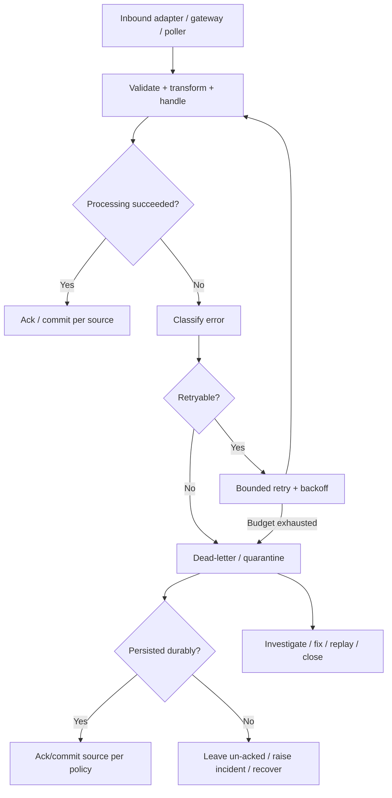
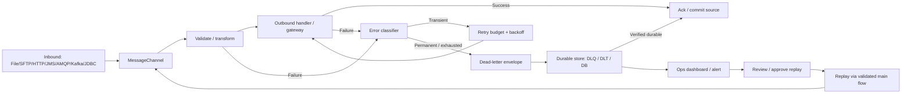
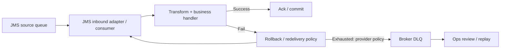
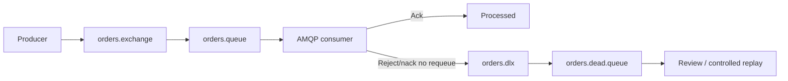
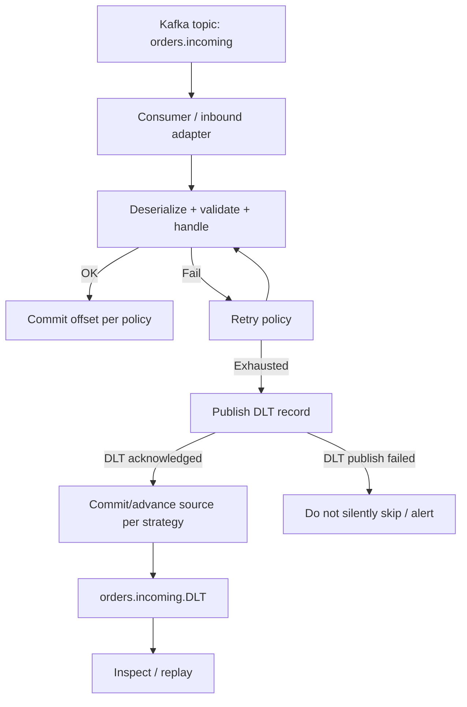
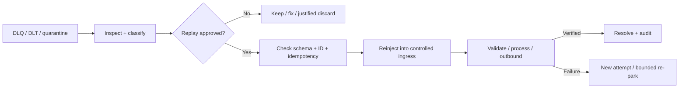

# Dead-Letter Flows for Failed Messages

## 1. Why does an integration flow need a dead-letter flow?

A Spring Integration application receives orders over HTTP, converts them into events, and sends them to Kafka. Over the course of a day, most messages are valid, yet three cases occur:

- One event is missing `orderId` and cannot be converted into JSON matching the schema.
- The Kafka broker is temporarily unreachable; after a few retries, the event sends successfully.
- The consumer keeps receiving events with an unsupported `schemaVersion`, causing every processing attempt to throw an exception.

If the system **ignores failed messages**, orders may be lost. If it **retries forever**, a permanently bad message ties up threads, fills queues, and delays valid messages. If it **marks a message processed before persisting the failure**, a crash can make the message vanish. Conversely, if it **replays without controls**, the consumer may process one order multiple times.

A **dead-letter flow** is the processing path for messages that **cannot complete under normal processing policies**. It records enough information to inspect, remediate, and safely replay, rather than silently dropping messages or looping endlessly in the main pipeline.

The lesson **"Dead-Letter Flows for Failed Messages"** belongs to the **Reliability** chapter of module `SPRING_INTEGRATION_ADAPTERS`. The context is connecting external systems via **inbound/outbound adapters, gateways, pollers, and `MessageChannel`** across **File, SFTP, HTTP, JMS, AMQP, Kafka, and databases**, designing message contracts, error handling, and connection lifecycles.

> **Principle:** A message entering dead-letter **does not mean business processing succeeded**. It has merely moved to an **unprocessed-yet-intentionally-preserved/recorded state** under the guarantee level designed for the system.

## 2. How do dead-letter queues, dead-letter topics, and quarantine differ?

In practice, "DLQ" is often used as an umbrella term, yet each variant carries distinct semantics:

| Concept | Meaning | Example |
| --- | --- | --- |
| **Dead-letter queue (DLQ)** | Queue holding messages that cannot be processed normally | JMS broker DLQ or RabbitMQ queue for dead-lettered messages |
| **Dead-letter exchange (DLX)** | Exchange receiving dead-lettered messages from a RabbitMQ queue and routing them elsewhere | `orders.dlx` |
| **Dead-letter topic (DLT)** | Application topic storing failed records, common with Kafka | `orders.events.DLT` |
| **Quarantine store** | Isolation store for investigating, fixing, and orchestrating replays | Database table holding failed payloads, metadata, and status |
| **Error channel** | `MessageChannel` receiving error notifications in Spring Integration per topology | `errorChannel` or `adapterErrors` |
| **Retry queue/topic** | Channel holding messages to be retried later | `orders.retry.5m` |
| **Parking lot** | Place holding failures awaiting human or separate-process intervention | Queue or table with status `PARKED` |
| **Poison message** | Message that always fails under current conditions | Schema-mismatching payload, unsupported version |

**An error channel is not automatically a durable DLQ.** It may simply be an in-memory channel or endpoint handling `ErrorMessage`. Only when connected to a controlled durable store with verified writes can you retain messages for post-restart investigation.

**Not every protocol ships the same built-in DLQ.** JMS typically relies on broker policies; RabbitMQ has dead-letter exchanges; Kafka usually requires the consumer/framework to actively publish failed records to a DLT; File/SFTP, HTTP, and JDBC have no universal "default DLQ" out of the box.

## 3. Which states does a message pass through?

Example standard processing chain:



This diagram illustrates orchestration thinking; it does not imply every connector shares identical ack mechanics. Some sources only support periodic polling; others support transactions/acks, yet **not every source can form a single atomic transaction with every DLQ**.

### Business states worth distinguishing

| State | Interpretation |
| --- | --- |
| `RECEIVED` | Message received from source, processing not yet complete |
| `PROCESSING` | Validating, transforming, or sending to destination |
| `RETRY_WAIT` | Potentially transient error, awaiting retry |
| `FAILED_FINAL` | Retry budget spent or error should not be retried |
| `QUARANTINED` | Failed message stored in a controlled location |
| `REPLAY_REQUESTED` | Approved replay request issued |
| `REPLAYING` | Reprocessing attempt from quarantine record in progress |
| `RESOLVED` | Evidence of matching business outcome confirmed |
| `DISCARDED_APPROVED` | Decision made not to process further, justified and approved |
| `PARKING_FAILED` | Failed to persist error message; requires high-priority alert |

Never mark `RESOLVED` merely upon sending a message to a broker or submitting a replay request.

## 4. Classifying errors before deciding to dead-letter

Every error must be evaluated for **retryability, impact, and safety upon resending**.

| Error group | Examples in Spring Integration | Auto-retry? | Handling approach |
| --- | --- | --- | --- |
| **Validation / contract** | Missing field, malformed JSON, schema error, missing CSV column | Usually no if payload is unchanged | Quarantine, notify producer/data owner |
| **Serialization** | Jackson mapping failure, wrong charset | Usually no until config/code is fixed | Dead-letter with schema/version and error code |
| **Authorization / credentials** | SFTP permission denied, HTTP 403, expired token | Do not retry blindly | Check credentials, permissions, and config |
| **Rate limit** | HTTP 429, broker throttle | Yes, if contract allows | Backoff, limit concurrency and attempts |
| **Transient network** | Timeout, connection reset, DNS/service temporarily unready | Conditionally | Bounded retry + circuit breaker when needed |
| **Broker unavailable** | Cannot reach Kafka/JMS/AMQP | Conditionally | Retry/backoff, monitor broker and queues |
| **Database transient** | Deadlock, temporary connection drop | Possibly | Retry within safe transaction boundaries |
| **Data constraint** | Unique key conflict, foreign key violation | Depends on business logic | Distinguish valid duplicates from bad data |
| **Timeout with uncertain outcome** | HTTP POST processed by server but caller timed out | Only with duplicate protection | Idempotency key, status lookup |
| **Prolonged outage** | Broker down for hours | Retry within budget, then move/hold | Alert operations, avoid unbounded queuing |

**Do not retry every exception identically.** An `InvalidSchemaVersion` error will not heal itself after 100 retries; conversely, a single network timeout should not necessarily go straight to a DLQ.

### Transient and permanent are not immutable labels

An HTTP 400 usually requires fixing the request, though some APIs assign custom meanings. A JDBC constraint violation may indicate an already-processed duplicate or data violating an invariant. Base decisions on **target contracts, exception types, transaction state, and verifiability**.

## 5. Distinguishing errors across pipeline layers

```text
Source / Inbound
    |
    v
[Deserializer / Converter]    -> parse/schema failure
    |
    v
[Filter / Router]             -> rejected / no route / policy mismatch
    |
    v
[Transformer]                 -> data mapping failure
    |
    v
[Outbound adapter / gateway]  -> connection / protocol / timeout / auth
    |
    v
[External system]             -> broker ack / HTTP response / DB commit
    |
    v
[Business consumer]           -> downstream processing outcome
```

What you must record is **at which stage it failed**, not merely `"send failed"`.

For instance, if JSON is missing a field in the transformer, save the original payload alongside the mapping error. If the Kafka adapter received an ACK yet a downstream consumer reports it cannot parse the schema, that is a **consumer error**, not a "producer failed to send" error. Both require different dead-letter flows and recording points.

## 6. `errorChannel` and `ErrorMessage` in Spring Integration

Spring Integration uses Spring Messaging to carry error events. Typically an `ErrorMessage` has a `Throwable` payload, and when the exception belongs to `MessagingException`, it may carry the failing message via `getFailedMessage()`.

Example logical structure:

```text
ErrorMessage
├── payload: Throwable
│   ├── cause chain
│   ├── error type / stage
│   └── failedMessage? (when exception carries it)
└── headers: error metadata, id, timestamp, ...
```

### Important topology warnings

- With `DirectChannel` and synchronous execution, exceptions typically **propagate back to the caller** rather than automatically becoming a message on `errorChannel`.
- With pollers, executor-backed channels, or asynchronous inbound endpoints, the framework can publish an `ErrorMessage` to an error channel per configuration.
- Global `errorChannel` may be shared across many flows; a shared handler must classify by source/adapter rather than assuming every error is an order.
- Setting an `errorChannel` header does not guarantee every endpoint uses that header identically.
- If the error channel handler **itself fails**, preserve the original message and alert—never let the second failure erase trace of the first.

**A reliable dead-letter flow must clearly identify where errors originate, which channel handles them, where they are persisted, and under what conditions the source is acked.**

### Distinguishing ErrorMessage from failed business messages

An `ErrorMessage` carries a throwable for diagnostics. A DLQ record should have a **stable-schema envelope** containing identifiers, stage, normalized exception category, and the original payload or a secure reference. Never serialize raw Java `Throwable`/stack traces directly into broker messages as a long-term contract.

## 7. Designing a dead-letter flow architecture

A typical design includes:



In production, performing `Ack/commit` also depends on the inbound adapter/broker lifecycle, transaction boundaries, and failure modes. You may not achieve a single atomic transaction between the source and dead-letter store; in that case you need **at-least-once, idempotency, and reconciliation**.

### Functional components

1. **Error classifier:** determines which errors are retryable vs. require isolation.
2. **Retry policy:** attempt counts, delays, backoff, jitter, and total allowed duration.
3. **Recoverer:** behavior once retries run out; publishes or persists the dead-letter.
4. **Dead-letter envelope:** record holding enough data for analysis and replay.
5. **Durable dead-letter sink:** broker queue/topic or database/object storage.
6. **Acknowledger/transaction coordinator:** ensures the source is not marked successful prematurely.
7. **Operational controls:** alerts, dashboards, retention, access control, and replay procedures.
8. **Replay ingress:** routes messages back through a validated flow rather than bypassing checks straight to target systems.

## 8. Sample envelope for failed messages

Never store only `exception.toString()`. A structured record helps classify and resolve thousands of incidents.

```json
{
  "deadLetterId": "dlq-000731",
  "originalMessageId": "evt-2401",
  "correlationId": "request-77",
  "source": {
    "type": "kafka",
    "resource": "orders.incoming",
    "partition": 2,
    "offset": 78129
  },
  "failure": {
    "stage": "json-validation",
    "code": "UNSUPPORTED_SCHEMA_VERSION",
    "exceptionType": "SchemaValidationException",
    "retryable": false,
    "attempts": 1,
    "firstFailedAt": "2026-11-23T08:30:00Z",
    "lastFailedAt": "2026-11-23T08:30:00Z"
  },
  "message": {
    "contentType": "application/json",
    "schemaVersion": 99,
    "payloadRef": "restricted://dead-letter-payloads/dlq-000731"
  },
  "status": "QUARANTINED",
  "owner": "orders-integration",
  "createdAt": "2026-11-23T08:30:01Z"
}
```

This is an **illustrative schema**. `payloadRef` represents a logical reference to protected data, not a publicly accessible URL.

### Field groups to consider

| Group | Needed data | Reason |
| --- | --- | --- |
| **Identity** | Dead-letter ID, original event/message ID, correlation ID | Deduplication and tracing |
| **Source** | Adapter name, queue/topic/file/path, or resource ID | Locate original message and source semantics |
| **Source position** | Kafka partition/offset, JMS message ID, file position if any | Investigation and cross-referencing |
| **Payload** | Protected raw bytes or ref, content type, charset, schema version | Enables replaying exact original data |
| **Error** | Stage, code, exception type, retryability, attempt count | Error classification and remediation decisions |
| **Timestamps** | First/last failure, `receivedAt`, `parkedAt`, `retryAt` | SLAs and message age |
| **Routing** | Logical target resource approved by policy | Prevents replaying to wrong destination |
| **Governance** | Owner, ticket, status, resolution, reviewer | Prevents unowned backlogs |
| **Integrity** | Hash/checksum or signature when needed | Detects unintended data tampering |

**Never copy all headers unconditionally.** Some contain bearer tokens, cookies, internal routing state, `replyChannel`, or `errorChannel` objects that cannot serialize or must not leak. Use a header allowlist and redaction.

## 9. Store the original payload or the transformed payload?

Consider a pipeline:

```text
HTTP JSON input
  -> parse DTO
  -> enrich customer data
  -> map outbound DTO
  -> serialize JSON
  -> Kafka publish
```

There are three choices:

- **Raw input:** useful when input parsers/schemas need fixing.
- **Canonical message:** useful for replaying past validation without re-reading the source.
- **Outbound bytes:** useful when resending exact formatted bytes, especially after a lost transport ACK.

Storing only outbound bytes may lack context to fix mapping bugs. Storing only raw input may regenerate different output after code/policies evolve.

### Practical design

For high-sensitivity messages, store:

1. The original payload or a **reference** to a protected copy.
2. Selective schema/version and source metadata.
3. Stage and error details.
4. Transformer/policy version, if output reproduction is needed.
5. Enough data to decide **from which stage to replay**.

**Never retain personal data or credentials indefinitely** just because dead-letters need debugging. Enforce appropriate retention, encryption, access control, and deletion policies.

## 10. Retrying before dead-lettering: bounded and classified

Do not send every error straight to a DLQ; nor should you retry forever.

An illustrative retry policy:

```yaml
retryPolicy:
  transientErrors:
    maxAttempts: 4
    initialBackoffMillis: 300
    multiplier: 2.0
    maxBackoffMillis: 5000
    jitter: true
  permanentErrors:
    maxAttempts: 1
  exhausted:
    action: "dead-letter"
    requireDurableConfirmation: true
```

This is an **illustrative policy**, not a drop-in Spring Integration or Spring Retry config.

### Questions to ask when designing the budget

- Does `maxAttempts` include the **initial attempt**? Establish an explicit convention.
- Could total retry duration exceed HTTP timeouts, broker poll intervals, or business SLAs?
- Could concurrent consumers retrying simultaneously trigger a **retry storm**?
- Should a circuit breaker engage during prolonged target outages?
- Is the error idempotent, or could side effects already have happened?
- Ultimately, should it dead-letter, return an error to the caller, or stay un-acked?

### Temporary retry does not fix data

Malformed JSON will not become valid JSON through backoff. When a producer fixes and resends data, that is **a new event/version or correction workflow** needing its own ID management and auditing.

## 11. Spring Integration: retry advice and recovery points

**Spring Integration** provides advice mechanisms for message-handling endpoints; in supported versions, `RequestHandlerRetryAdvice` applies to message handlers using a matching retry policy and recovery callback.

Conceptual flow:

```text
Message received
  -> outbound handler
      -> failure
      -> RetryTemplate / retry policy
      -> attempts exhausted
      -> recovery callback
      -> dedicated error/dead-letter channel
      -> durable sink
```

Spring Retry/Spring Integration APIs vary across versions; verify packages, method signatures, and where advice attaches on your active handler.

### Conditional recoverer pseudocode

```java
// Conceptual illustration, NOT for direct copy-paste use.
handleWithRecovery(message):
    try:
        sendToExternalSystem(message)
        markProcessedOnlyAfterRequiredConfirmation(message)
    catch error:
        classification = classify(error)
        if classification.isTransient()
                && withinRetryBudget(message):
            scheduleRetryWithBackoff(message)
        else:
            envelope = buildSanitizedDeadLetter(message, error)
            persistAndVerifyDeadLetter(envelope)
            acknowledgeSourceAccordingToContract(message)
```

This pattern emphasizes **persist first, then ack** when durability is required. Never assume persisting and acking the source are atomic just because they appear in the same method.

### Common misconceptions about recovery callbacks

- A callback returning "recovered" can make upstream treat the handler as finished; ensure it **completes only after durable parking**.
- Sending an error message through a channel **does not equal a broker DLQ confirming receipt**.
- Advice on **one handler** does not cover failures from an earlier deserializer or a downstream consumer.
- When the recoverer itself fails, **propagate the error or leave the source un-acked** per policy—never fake success.

## 12. Java sample: receiving ErrorMessage and creating a dead-letter record

An illustrative handler on a dedicated error channel:

```java
import org.springframework.messaging.Message;
import org.springframework.messaging.MessagingException;
import org.springframework.messaging.support.ErrorMessage;
import org.springframework.integration.annotation.ServiceActivator;
import org.springframework.stereotype.Component;

@Component
public class DeadLetterErrorHandler {

    private final DeadLetterRepository repository;

    public DeadLetterErrorHandler(DeadLetterRepository repository) {
        this.repository = repository;
    }

    @ServiceActivator(inputChannel = "adapterErrorChannel")
    public void onError(ErrorMessage errorMessage) {
        Throwable failure = errorMessage.getPayload();

        Message<?> failed = null;
        if (failure instanceof MessagingException messagingException) {
            failed = messagingException.getFailedMessage();
        }

        // In production: walk the cause chain if needed,
        // retrieve the original message from a trusted/previously persisted store,
        // and do not rely solely on getFailedMessage().

        DeadLetterRecord record = DeadLetterRecord.from(
            failure,
            failed,
            errorMessage.getHeaders()
        );

        // Return success only after durable write is confirmed.
        repository.saveDurably(record);
    }
}
```

`DeadLetterRepository` and `DeadLetterRecord` above are **application abstractions**, not built-in Spring Integration classes. `from` must handle `failed == null`, redaction, identifiers, and storage schema. The code uses modern Java `instanceof` pattern matching.

**Key takeaway:** This handler only receives `ErrorMessage` if the **error producer actually routes errors to `adapterErrorChannel`**. Wire the channel via an endpoint/recoverer fitting your version and topology. Do not create a listener bean and assume it observes all errors automatically.

### Why not store raw Throwables?

A `Throwable` may contain sensitive stack traces, internal class names, and unstable serialization details. Extract **exception type, normalized error code, stage, and sanitized message**, while detailed diagnostics go to access-restricted logs under retention rules.

## 13. Designing a durable quarantine store with a database

When File/SFTP/HTTP lack a built-in broker DLQ, a database table can serve as a **quarantine store**.

### Illustrative schema

```sql
CREATE TABLE integration_dead_letter (
    dead_letter_id       VARCHAR(80) PRIMARY KEY,
    original_event_id    VARCHAR(160),
    correlation_id       VARCHAR(160),
    source_adapter       VARCHAR(100) NOT NULL,
    source_reference     VARCHAR(500),
    failure_stage        VARCHAR(100) NOT NULL,
    failure_code         VARCHAR(120) NOT NULL,
    retryable            BOOLEAN NOT NULL,
    attempt_count        INTEGER NOT NULL,
    payload_content_type VARCHAR(160),
    payload_schema       VARCHAR(100),
    payload_ref          VARCHAR(600),
    payload_sha256       VARCHAR(64),
    status               VARCHAR(40) NOT NULL,
    first_failed_at      TIMESTAMP NOT NULL,
    last_failed_at       TIMESTAMP NOT NULL,
    replay_requested_at  TIMESTAMP,
    resolved_at          TIMESTAMP,
    owner_id             VARCHAR(120)
);
```

This SQL is illustrative; adjust timestamp types, DDL, constraints, and indexes for your actual database.

If storing payloads directly in binary/JSON columns, manage size, encryption, backups, and retention. If storing in object storage, ensure references use proper access controls/TTLs; **never use long-lived public URLs with embedded secrets**.

### Avoiding duplicate dead-letter records

A message can be replayed and dead-lettered multiple times. Do not use `originalEventId` alone as a unique key if one event can fail at multiple destinations or across multiple valid processing cycles.

Consider an idempotency key shaped like:

```text
(sourceId, sourceMessageId, consumerGroupOrTarget, failureStage, processingEpoch)
```

This is a **suggestion**, not a rigid standard. Clearly define `processingEpoch`/attempt cycles to distinguish the same event failing again after replay. Keep remediation history without generating infinite identical rows on broker redeliveries.

## 14. JMS: dead-lettering depends on broker policy

**The JMS API does not define one identical DLQ mechanism for every broker.** Redelivery, backoff, delivery counts, and dead-letter destinations depend on the provider and its implementation.

### Typical flow



### Critical configuration decisions

- Which acknowledgement mode does the consumer use, and do transactions apply?
- When the listener throws an exception, does the broker redeliver automatically or did the adapter already ack?
- How do delivery counts and delays scale under policy?
- Does the broker support max redeliveries and dead-letter policies?
- To what extent does the DLQ preserve JMS headers/properties and payloads?
- Can messages replay to the original queue while preserving business IDs and schemas?
- What happens if the DLQ is full or unwritable?

### Avoiding redelivery loops

If a message fails schema validation, the broker may repeatedly redeliver it to the consumer. A proper **max redeliveries** and DLQ policy avoids stalling consumers, yet you must verify the broker actually enforces it. Never assume from a generic Spring config that messages automatically land in a DLQ.

## 15. RabbitMQ/AMQP: dead-letter exchanges and requeue

RabbitMQ offers **dead-letter exchanges (DLX)** to route messages out of a queue under supported conditions—such as consumer reject/nack with `requeue=false`, TTL expiration, or other queue rules.

### Routing flow



An equivalent logical setup:

```yaml
ordersQueue:
  name: orders.queue
  arguments:
    x-dead-letter-exchange: orders.dlx
    x-dead-letter-routing-key: orders.dead
deadLetterExchange:
  name: orders.dlx
  binding:
    routingKey: orders.dead
    queue: orders.dead.queue
```

This describes **broker properties**, not runnable Spring Boot YAML. Declare queues, exchanges, bindings, and broker policies using your active tooling/framework.

### Key points to master

1. **`requeue=true` can create loops:** poison messages get delivered endlessly. Classify errors before requeuing.
2. DLX routes to the dead queue **only if the exchange/binding exists and the routing key matches**.
3. RabbitMQ tracks dead-letter metadata like `x-death` in applicable flows; do not rely on it alone as the single source of truth for total business attempts.
4. Standard dead-letter routing **does not guarantee at-least-once delivery to the DLQ across all setups**; check queue-type guarantees and broker policies, and monitor failures.
5. Never abuse short TTLs + DLX cycling back to the main queue as an infinite retry system without budgets and alerts.
6. Publisher confirms and consumer ACKs are distinct; monitor DLQs separately.

### When the adapter fails before the broker receives the message

If a Spring Integration **AMQP outbound adapter** fails to publish, RabbitMQ may not even have a copy to dead-letter. This is a **producer/outbound failure**, which must be handled in the Spring Integration error flow, retries, or a durable outbox; a downstream queue's DLX cannot protect it.

## 16. Kafka: DLTs are typically published by the application/framework

Kafka has no broker mechanism that automatically routes every failed record to a DLT the way RabbitMQ queues do. A DLT is usually a **separate topic** that the consumer or framework actively publishes to when processing fails.

### Typical flow



In the Spring ecosystem, **Spring Kafka** provides capabilities such as `DefaultErrorHandler` and `DeadLetterPublishingRecoverer` for listener error handling; when using **Spring Integration Kafka adapters**, check how adapter and container error handling integrate with those components. They are **not turned on automatically** just by creating an `IntegrationFlow`.

### What should a DLT record carry?

- Original topic, partition, offset.
- Original key/value or security-compliant reference.
- Consumer group / processing stage.
- Normalized exception class/error code.
- Timestamp, attempt count, and schema version.
- Stable business `eventId`.
- A controlled **replay marker** when replaying.

Kafka headers are byte arrays, and framework header names can vary by version. Never assume arbitrary Java objects or all Spring headers pass straight through Kafka unchanged.

### Offsets and DLTs are not automatically atomic

If DLT publishing succeeds yet offset commit fails, the original record may be reprocessed. If the offset commits first and DLT publishing fails, the recovery trail can be lost. Designs must weigh supported producer/consumer transactions, deduplication, and post-failure recovery options.

**Never mark an offset resolved without proof the DLT write persisted** when zero data loss is required.

### Keys and ordering

Moving a record to a DLT and replaying later can disrupt business-key ordering. If events for the same `orderId` depend on sequence, preserve the original key/partition/offset and base replay decisions on current state rather than blindly replaying stale events.

## 17. File inbound and SFTP: when there is no broker DLQ

**File** and **SFTP** typically lack message-broker DLQs. Use a **quarantine directory**, object store, or DLQ table to isolate failed files.

### File inbound with a poller

```text
/inbox/order-001.json
   -> File inbound adapter/poller
   -> read + validate
   -> schema error
   -> persist error record + controlled copy/move
   -> /quarantine/order-001.json
```

Considerations:

- Was the file moved/deleted before the pipeline finished?
- Does the file/accept-once filter mark the file processed even though transformation failed?
- Is the quarantine move safe if source and destination span different filesystems?
- Could retries after restart create duplicates?
- Might an in-progress upload get polled and misclassified as malformed?
- Are there filename collisions that risk overwriting older failed files?

### SFTP inbound

SFTP usually requires verifying **complete delivery**: files may upload under temporary names and rename, or use ready markers. If a downloaded file fails processing, preserve trusted evidence linking **remote path, size, mtime, checksum, or business ID**.

**Never automatically move/delete partner-side files on failure without an explicit contract and permission.** One option is copying to local quarantine and tracking records in a monitoring store; any action on the partner's server must follow the agreed transfer protocol.

### File quarantine also needs retention

Failed files can hold PII or payment details. Enforce restricted read permissions, encryption at rest where fitting, retention limits, orphan cleanup, and protection so consumers never accidentally re-ingest the quarantine directory.

## 18. HTTP inbound/outbound: no universal ACK or DLQ for all APIs

### HTTP inbound gateway

When a client sends a request and synchronous processing fails, the HTTP server typically returns an appropriate error (`4xx` or `5xx` per contract). In many systems, **the client owns retrying**, while the server can persist job state in durable storage if returning `202 Accepted` for async processing.

Two distinct options:

1. **Synchronous fail:** return an error; do not claim durable acceptance.
2. **Durable accept:** persist the request/job to a queue/DB first, then return a contracted response for client tracking.

Never return `202 Accepted` merely because a message entered an in-memory `DirectChannel` if the system promises "will process later" without durable storage.

### HTTP outbound gateway

When calling external APIs, possible outcomes:

| Outcome | Interpretation | Dead-letter/retry |
| --- | --- | --- |
| `200/201` | Potentially successful per API; inspect response contract | Record outcome; do not assume the entire system workflow finished |
| `202` | Accepted for further processing | Requires polling/callback/status reconciliation |
| `400/422` | Payload rejected per contract | Usually dead-letter to fix data |
| `401/403` | Invalid credentials/permissions | Do not retry blindly; alert security/config owners |
| `409` | Conflict or duplicate per API | Determine actual business state |
| `429/503` | Rate limit/temporary outage | Retry with backoff per policy |
| Timeout after POST | Unclear if server executed | Idempotency key/status check before retrying |

If an outbound request originates from a Kafka/JMS consumer, the dead-letter must link back to the **original source message** and consumer commit/ack strategy, rather than logging an isolated HTTP exception.

## 19. Database/JDBC: SQL errors and dead-lettering in transactions

A database can be both the **target system** and the **dead-letter store**.

### When JDBC is the outbound target

- **Transient:** database unavailable or deadlocks—conditionally retryable.
- **Permanent:** bad column types, missing foreign keys, or constraint violations unfixable by blind retry.
- **Ambiguous:** timeout between commit and result return; verify state using business keys.

If the source is a broker and the target is a DB, a successful DB transaction does not automatically guarantee the consumer committed its offset/ack. Use unique keys/idempotency to survive redeliveries.

### When using a DB as a quarantine store

Never "swallow exceptions" if the `INSERT` into the DLQ table fails:

```text
Source message fails
  -> retries exhausted
  -> INSERT dead_letter
      -> success / durable commit: proceed with ack policy
      -> failure: DO NOT claim parked
```

A repository call returning before the transaction commits **is not durability yet**. When sharing transactions, understand the commit/rollback order of source and store.

### Transactional outbox / inbox

- **Outbox:** persists outbound events in the same transaction as source data updates.
- **Inbox/dedup:** records processed business events to prevent repeated side effects.
- **Dead-letter table:** stores events that failed normal processing, with owners and diagnostic metadata.

These three table types serve different goals; they can complement one another but are not interchangeable.

## 20. Failures occurring before creating a Spring Message

Not every error happens after a valid `Message<?>` exists. Examples:

- Kafka key/value deserializer fails right in the container.
- JMS converter cannot read a `BytesMessage`.
- HTTP body parser rejects before entering the gateway handler.
- File content converter fails before sending onto a channel.

If no message was created yet, a listener consuming `ErrorMessage` only from business flows may **never see the failure**.

### Controls

1. Identify **pre-channel adapter/container errors**.
2. Use the **specific adapter's** error-handling/recoverer mechanism or capture raw source records pre-parse when needed.
3. Record available source metadata: file path, Kafka partition/offset, JMS message ID, HTTP request ID.
4. Never attempt to deserialize broken data just to build a DLQ entry; store protected raw bytes/refs alongside content type and error code.
5. Test deserialization errors explicitly, not just exceptions thrown from `@ServiceActivator`.

Spring Kafka provides deserialization error handling tailored to each version; configure it deliberately rather than assuming `DefaultErrorHandler` handles every pre-record failure by default.

## 21. Replay: never just pull from DLQ and resend

Replay is a **controlled business process**, because system states and contracts may have changed since the message failed.

### Preconditions allowing replay

- The root cause is fixed or the target has recovered.
- The original payload remains valid under supported schemas/versions.
- Access permissions, tenants, resources, and current policies still allow processing.
- Deduplication and stale-event handling are in place.
- Target services have capacity and appropriate backpressure.
- Authorized human/automation approved the replay per risk tier.
- Outcomes are recorded and DLQ records closed properly.

### Replay flow



**Never replay by bypassing validation/AuthZ** just to "get the message through." If it failed on schema, fix the producer/transformer or run a tested, audited migration transform.

### How many times may a record replay?

Track `replayAttemptCount`, total caps, status, timestamps, and triggering actor/automation. Never let DLT replays feed the main topic only to immediately dead-letter again in an infinite ping-pong loop.

## 22. Safe replay when business state has moved on

For example, an `order.cancelled` message failed yesterday, but today the order already finished delivery. Replaying the raw event could trigger invalid actions.

**Evaluate:**

- Is the event a **state transition** or merely a notification?
- Does the consumer check version/sequence numbers or current state?
- Has a newer event arrived for the same aggregate?
- Does replaying cause side effects like emails, refunds, or ledger entries?
- If the event partially executed before a timeout, how do we detect and prevent repetition?

### Expressing business idempotency

```text
businessKey = (eventType, aggregateId, eventId)

If eventId is already recorded as processed:
    do not execute side effects again
If event version is older than current aggregate version:
    apply explicit stale-event policy
Otherwise:
    validate, process, commit, and record outcome
```

This is pseudocode, not a standalone guarantee mechanism. For financial transactions or multi-target flows, add locks, transactions, idempotency records, and reconciliation.

## 23. Preserving context: payload, headers, version, and correlation

A common mistake is saving only the JSON body in a DLQ, losing the context needed to decode it later.

For example, the same JSON:

```json
{"id":"24","state":"ACTIVE"}
```

Without **event type, `schemaVersion`, tenant, source, and timestamp**, a newer consumer may misinterpret the record.

### Minimum metadata for replay

| Metadata | Role |
| --- | --- |
| `eventId` | Event identification and deduplication |
| `schemaVersion` | Selects decoder/upcaster |
| `contentType`, encoding | Correctly decodes raw bytes |
| `sourceSystem`, source reference | Traceability and investigation |
| `targetSystem` or logical route | Prevents replaying to the wrong target |
| `correlationId` | Links logs/traces across flows |
| `originalOccurredAt` | Evaluates staleness and business ordering |
| `firstFailedAt` / attempts | Governs SLAs and retries |
| `failureStage` / code | Guides remediation |
| `owner` / status | Establishes accountability |
| `payload hash/ref` | Integrity check and payload storage pointer |

### Headers to strip or sanitize

`replyChannel`, `errorChannel`, thread/executor references, sessions/cookies, bearer tokens, secrets, and exception objects **must never be serialized directly**. Translate routing details into stable forms independent of Spring runtime objects.

## 24. ACKs, commits, and preventing message loss

This is the core reliability challenge of dead-lettering.

### Three things to separate

1. **Adapter saw the message.**
2. **Dead-letter sink persisted successfully.**
3. **Source acked/committed and will not redeliver.**

The wrong order loses data:

```text
BAD:
  source ack
  -> DLQ write
  -> DLQ write fails
  -> message lost
```

A more cautious order:

```text
BETTER:
  DLQ durable write/ack confirmed
  -> source ack/commit
  -> on failure, handle duplicates on redelivery
```

However, **BETTER does not mean atomic**: a crash between DLQ save and source ack causes the original record to redeliver. The dead-letter sink must tolerate duplicates using proper identifying keys.

### What if the source is a file?

There is no shared broker ACK. Depending on design, "ack" may be moving the file to `processed`, writing a marker, updating a checkpoint, or deleting the source. Ensure that action never happens before durable DLQ storage or confirmed processing success.

### What if the source is HTTP?

Distinguish synchronous replies from durable acceptance. Sending HTTP `200`/`202` before durably persisting the message tricks the client into believing the server took custody, losing data if the process crashes.

## 25. Retention, security, and privacy of DLQs

A DLQ stores **failed** messages, often containing unpredictable data; never treat it as less sensitive than the main pipeline.

### Risks

- Original payloads contain PII, tokens, payment details, or documents.
- Headers contain sessions, authentication contexts, or URLs with embedded secrets.
- Stack traces expose internal configuration.
- Operations staff have broader DLQ read access than main data source permissions allow.
- Messages linger forever due to missing owners/retention rules.
- Replays exceed business authorization or hit decommissioned endpoints.

### Required controls

1. **Least privilege** for reading, editing, replaying, deleting, and key management.
2. Encryption at rest and in transit as required, with proper key management.
3. **Redaction/allowlisting** for headers and diagnostic text.
4. Scoped payload references with access controls—never long-lived public links.
5. Retention windows matching data classification, legal obligations, and internal policies.
6. Audit logs for inspect/download/replay/discard actions.
7. Message count/size limits and quotas so DLQs cannot exhaust storage.
8. Deletion policies post-resolution, discard approvals, and preservation of required evidence.
9. Never replay stale tokens/secrets captured from original messages.
10. Re-verify permissions and current business state before replaying.

**Never treat Base64 as security.** Base64 is reversible encoding, not data protection.

## 26. Operational runbook: from alert to closure

When dead-letter messages appear, operations need clear next steps rather than watching a queue grow.

### Step 1 – Detect and classify

Record the queue/topic/store, count, backlog age, error category, adapter, consumer group, and blast radius. Determine whether this is an isolated error or a widespread incident.

### Step 2 – Contain

If a broker, HTTP API, or target DB is failing broadly, reduce concurrency, engage backoff/circuit breakers, and prevent retry storms. If messages contain out-of-policy sensitive data, lock down access and handle safely.

### Step 3 – Inspect the original

Read metadata and payloads **within granted permissions**; inspect schema/version, correlation, IDs, and source/target states. Avoid dumping full payloads to logs.

### Step 4 – Identify root cause

Distinguish producer schema bugs, converter charset mismatches, business logic bugs, expired credentials, broker outages, DB constraints, and incompatible consumer versions.

### Step 5 – Choose remediation

- **Controlled retry** once transient issues resolve.
- **Replay** after upgrading parsers/schemas or fixing data per procedure.
- **Compensation** if partial side effects already occurred.
- **Approved discard** if events are obsolete/unneeded and policy permits.
- **Escalate** if lacking permissions, information, or facing high data-loss risk.

### Step 6 – Verify outcome

Verify target or business state—not just DLT publish or HTTP 202 status. Log who acted, why, when, message IDs, and evidence.

### Step 7 – Prevent recurrence

Add contract tests, schema compatibility checks, producer validation, circuit breakers, alerts, and owners. Adjust retry policies for misclassified errors; fix serializers/converters for format failures.

## 27. Measuring dead-letter flows

| Metric | Question answered | Notes |
| --- | --- | --- |
| **Dead-letter count/rate** | How many messages enter DLQ by source/target? | Compare against total traffic and volume shifts |
| **DLQ age** | How old is the oldest failed message? | Often reveals severe backlogs better than raw counts |
| **Retry attempts/rate** | Is there a retry storm or lingering transient outage? | Break down by error type and adapter |
| **Recovery success rate** | How often are failures resolved without message loss? | Separate retry recovery from DLQ parking |
| **Parking failure rate** | How many messages failed to save to the sink? | High-priority alert |
| **Replay success/failure** | Do replays actually succeed end-to-end? | Do not measure merely by clicking replay |
| **Repeated poison rate** | How often do replayed messages immediately re-enter DLQ? | Enforce loop caps |
| **DLQ storage/quota** | Is the DLQ nearing capacity or retention limits? | Prevent the DLQ from becoming a new failure point |
| **Ack-after-park compliance** | Could sources ack before parking confirms? | Verify with failure-injection tests |
| **Schema mismatch rate** | Are producer and consumer contracts drifting? | Break down by schema version |
| **Age by priority** | How long are critical business failures stalled? | Apply tiered SLAs per event criticality |
| **Owner coverage** | Does every dead-letter queue have an owner? | Avoid orphaned queues |

### Illustrative tracing

```text
received    eventId=evt-2401 source=kafka:orders.incoming
failed      eventId=evt-2401 stage=json-validation code=SCHEMA_UNSUPPORTED
classified  eventId=evt-2401 retryable=false
parked      eventId=evt-2401 deadLetterId=dlq-000731 result=durable
committed   eventId=evt-2401 sourceOffset=78129
replay      deadLetterId=dlq-000731 approval=change-104 status=requested
resolved    deadLetterId=dlq-000731 outcome=business-verified
```

Field names are illustrative, not Spring Integration's default event format. Never print full payloads or secrets in observability streams.

## 28. Alerting and on-call mechanics

**Actionable alerts with assigned owners** matter far more than dozens of dashboards.

Signals worth alerting on:

- `PARKING_FAILED` > 0 in systems requiring high durability.
- Rapid DLQ growth following a new deployment or schema version rollout.
- High-risk messages exceeding max age without handling.
- One exception type suddenly dominating dead-letters.
- Consumer redelivery loops failing to advance offsets/acks.
- Consecutive replay failures for the same root cause.
- Broker disk/queue quotas or database dead-letter stores nearing full.
- Outbound connectors losing credentials/permissions.
- DLQs holding data outside expected security classification.

Base exact thresholds on traffic, SLAs, and business impact. A tiny DLQ count on a critical payment flow deserves higher priority than a large queue of low-sensitivity notification events.

### Alerts need sufficient context

Alerts should include adapter/source, failure code, start time, count, oldest age, runbook link, owner, and access-controlled dashboard link. Never attach raw PII-containing payloads to alert emails/chats.

## 29. Testing dead-letter flows: test beyond handler errors

A DLQ flow never tested under **"the DLQ also fails"** has not proven reliability.

### 29.1. Unit tests

- Classifier distinguishes malformed JSON from timeouts.
- Retry budget stops at the exact attempt limit.
- Backoff respects ceiling bounds.
- Envelope preserves `eventId`/source/stage/schema.
- Header sanitizer strips credentials.
- Replay validator blocks unsupported schemas.
- State transitions forbid `RESOLVED` without outcome evidence.

### 29.2. Integration tests per adapter

| Adapter | Failure cases to test | Evidence |
| --- | --- | --- |
| **File** | Bad JSON / duplicate filename / incomplete file | Safe quarantine, original not deleted early |
| **SFTP** | Host key mismatch, timeout, permission denied | Accurate classification; sessions/credentials not leaked |
| **HTTP** | `400`, `429`, `503`, timeout after commit | Retry policy and idempotency contract hold |
| **JMS** | Redeliveries up to broker threshold | Provider DLQ routing works without infinite loops |
| **AMQP** | Nack `requeue=false`, broken DLX binding | DLQ behaves per design; alerts on misrouting |
| **Kafka** | Deserialization failure, DLT publish timeout, offset commit failure | No skipped records; deduplication on redelivery |
| **JDBC** | Constraint/transient/DB DLQ write failure | No ack without required durability |
| **Spring Integration** | `DirectChannel` error vs. async `errorChannel` | Error routing follows actual topology |

### 29.3. Failure injection

Test across crash points:

1. Before writing DLQ.
2. During DLQ write.
3. After DLQ save, before source ack.
4. After source ack.
5. During replay.
6. After business side effects occur, before status update.

### Expected outcomes

- Zero loss of messages accepted under contract.
- When duplicates occur, idempotency/deduplication preserves right business results.
- Logs/metrics/owners exist for every stalled record.
- Replays never skip validation or active policies.
- When the sink is dead, the system never falsely reports "parked."

## 30. Case study: a batch of order events fails during schema upgrade

Suppose a system consumes `OrderCreated` from Kafka; the consumer upgraded to schema version 3, while a legacy producer still emits version 1. The consumer enforces versions 2–3 and repeatedly fails on version 1.

### Hypothetical progression

1. Kafka inbound receives `eventId=evt-2401`, partition 2, offset 78129.
2. Deserializer parses JSON, yet contract validation rejects version 1.
3. Classifier marks `UNSUPPORTED_SCHEMA_VERSION` as permanent under active config.
4. Does not retry the identical payload hundreds of times.
5. Builds an envelope with protected raw bytes, offset, partition, key, version, and failure code.
6. Publishes to DLT or saves to quarantine store per configuration.
7. Confirms durable dead-letter persistence before committing source offset per policy.
8. Ops detects rising schema mismatch rates and contacts producer/consumer teams.
9. Engineering ships a tested version 1 → 3 upcaster or fixes the rollout process.
10. Replays messages in order with idempotency matching current business state.
11. Verifies orders processed, marks `RESOLVED`, and records audit trail.

### Common pitfalls

- **Forwarding only the JSON object** without original Kafka key/offset loses event lineage.
- **Committing offset before DLT ack** risks losing records.
- **Replaying multiple times** can create duplicate orders without business idempotency.
- **Upcasters altering business logic** without approval can corrupt data.
- **Re-reading very old records** without checking current state can revert newer changes.

### Lesson

A DLT provides **recoverability**; it does not fix schema drift or business-state conflicts automatically. Real value comes from preserving evidence, assigning owners, fixing root causes, and replaying under strict controls.

## 31. Dead-letter design anti-patterns

| Anti-pattern | Consequence | Replace with |
| --- | --- | --- |
| Catch exception, log, and return success | Silent message loss without evidence | Ack only after valid processing or durable parking |
| Retrying all errors forever | Poison loops, exhausted threads/queues | Classification and retry budgets |
| Treating `errorChannel` as an automatic DLQ | Errors lost on process restart | Confirmed durable sink |
| Creating a DLQ with no consumer/owner | Messages sit forever | Dashboards, SLAs, runbooks, ownership |
| Storing Java exception objects as primary payloads | Fragile compatibility and data-leak risk | Stable envelope, normalized error codes |
| Dead-lettering without preserving event IDs | Cannot deduplicate or trace | Preserve source IDs and correlation |
| Forwarding all headers to broker | Leaks tokens/cookies and internal metadata | Header allowlist/redaction |
| Committing Kafka offset before DLT persists | Record loss possible | Wait for durable DLT and design recovery |
| Ignoring DLT publish failures | Loses recovery path too | Error-on-error handling, alerts |
| RabbitMQ always `requeue=true` | Poison message hot loops | Nack strategies, DLX, and retry budgets |
| Assuming all JMS brokers share identical DLQ behavior | Misconfiguration, lost diagnosability | Verify provider policies |
| Assuming Kafka moves errors to DLT automatically | No recoverer, repeated records | Explicit DLT publisher and offset policy |
| Replaying straight to outbound handlers | Skips validation/authorization | Replay through controlled ingress |
| Generating new event IDs on every replay | Duplicate side effects | Stable IDs and audited replay attempts |
| Using replay to arbitrarily mutate business state | Applies stale events over newer state | Business-state checks/versioning |
| Retaining raw PII/secrets forever in DLQs | Data exposure risk | Retention, encryption, RBAC |
| Equating broker ACK with consumer completion | Closes failures prematurely | Business outcome verification |
| Testing only the happy path | Unknown behavior when DLQ goes down | Failure injection and negative tests |

## 32. Self-check questions

### Q1: `DirectChannel` and `errorChannel`

A service activator running synchronously over `DirectChannel` throws an exception. Can you assume `@ServiceActivator(inputChannel="errorChannel")` will automatically receive it?

**Answer guidance:** No. In synchronous flows, exceptions propagate back to the caller; you must explicitly configure error routing at the appropriate point and verify the topology.

### Q2: Malformed JSON vs. HTTP 503

Which error should be retried immediately, and why?

**Answer guidance:** HTTP 503 may be transient, subject to contracts and idempotency. Malformed JSON is usually permanent if data stays unchanged; dead-letter/quarantine it and fix the root cause.

### Q3: Kafka DLT publish succeeded, offset not yet committed

What happens if the process crashes?

**Answer guidance:** The source record may be redelivered and parked again. Design idempotency/deduplication across the DLT, offsets, and business processing.

### Q4: RabbitMQ consumer throws exceptions endlessly

What must be checked to stop infinite redelivery?

**Answer guidance:** Requeue/nack semantics, listener retries, DLX bindings, max attempts, and queue/broker policies—not just the converter.

### Q5: SFTP file with schema error

Should the file on the partner server be deleted after logging the error?

**Answer guidance:** Not by default. Follow transfer contracts, durable quarantine state, authorized permissions, and reprocessing rules; logs are not data backups.

### Q6: HTTP POST timeout after server committed

Is retrying safe?

**Answer guidance:** Only with API-supported idempotency or status verification; otherwise it can create duplicate transactions.

### Q7: DLQ contains messages with access tokens

What must be done?

**Answer guidance:** Restrict access, redact, evaluate token revocation, enforce encryption/retention, and improve envelope builders so unnecessary secrets are never stored.

### Q8: Replaying an old `order.cancelled` notification

Why check current business state?

**Answer guidance:** The event may be stale; reapplying it could revert newer state transitions or trigger invalid side effects.

## 33. Checklist for implementing a dead-letter flow

1. Inventory all **inbound adapters/gateways/pollers** and outbound endpoints needing protection.
2. Recognize where errors can occur **before or after** creating a Spring `Message<?>`.
3. Distinguish validation/serialization, AuthN/AuthZ, transient network, and business failures.
4. Configure retries with **max attempts, backoff, jitter, timeout budgets, and classifiers**.
5. Ensure each handler knows **when to emit `ErrorMessage`** and who consumes the error channel.
6. Account for differences between synchronous `DirectChannel` and async/polling endpoints.
7. Confirm recovery callbacks/handlers report completion **only after durable DLQ writes**.
8. If the DLQ sink fails, prevent false source acks and trigger alerts.
9. Include source ID, event ID, schema, format, stage, error code, and correlation in envelopes.
10. Allowlist/redact headers rather than copying them blindly.
11. Store original payloads securely with enough metadata for accurate replays.
12. Verify JMS broker DLQ/redelivery policies against the actual provider.
13. Test RabbitMQ DLX, routing keys, nack/requeue, and dead queues.
14. Test Kafka DLT publishers, deserialization error handling, and offset/commit policies.
15. Give File/SFTP safe quarantine, completion protocols, and policies preventing premature source deletion.
16. Differentiate HTTP 4xx, 5xx, timeouts, durable `202`s, and idempotency.
17. Differentiate JDBC transient SQL errors, constraints, transactions, and dead-letter write failures.
18. Prevent replay loops and duplicate side effects by event/business ID.
19. Route replays through validation/authorization and current business-state checks.
20. Assign DLQs owners, SLAs, runbooks, alerts, dashboards, quotas, and retention rules.
21. Audit inspect, edit, replay, discard, and closure actions.
22. Protect PII/credentials and restrict DLQ permissions as a sensitive store.
23. Test **DLQ sink failures and crashes before/after source acks**, not just handler errors.
24. Measure oldest age, retry storms, parking failures, replay outcomes, and schema mismatches.
25. Base **`RESOLVED`** status on verified business outcomes, never solely on broker ACKs.

### Remember

**A dead-letter flow is a controlled recovery path for unprocessable messages, not a dumping ground for every exception.** In Spring Integration, `errorChannel` and `ErrorMessage` route failures along the topology; retry/backoff handle transient glitches; recoverers and DLQ/DLT/quarantine stores preserve messages when normal processing cannot proceed. Across **JMS, AMQP, and Kafka**, broker/adapter semantics vary; across **File, SFTP, HTTP, and JDBC**, design dedicated failure stores and completion criteria.

A reliable flow must **classify errors, cap retries, confirm dead-letter persistence before acking appropriately, protect sensitive data, monitor backlogs, and replay only after fixing root causes**. The ultimate goal is not an "empty DLQ," but **zero lost valid operations, zero infinite loops, and clear evidence of how every failed message was resolved**.
