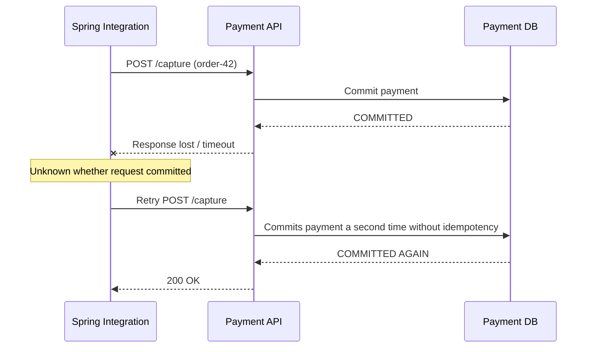
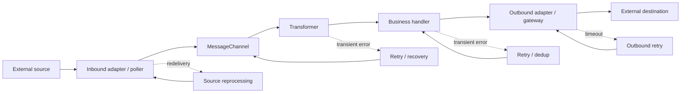
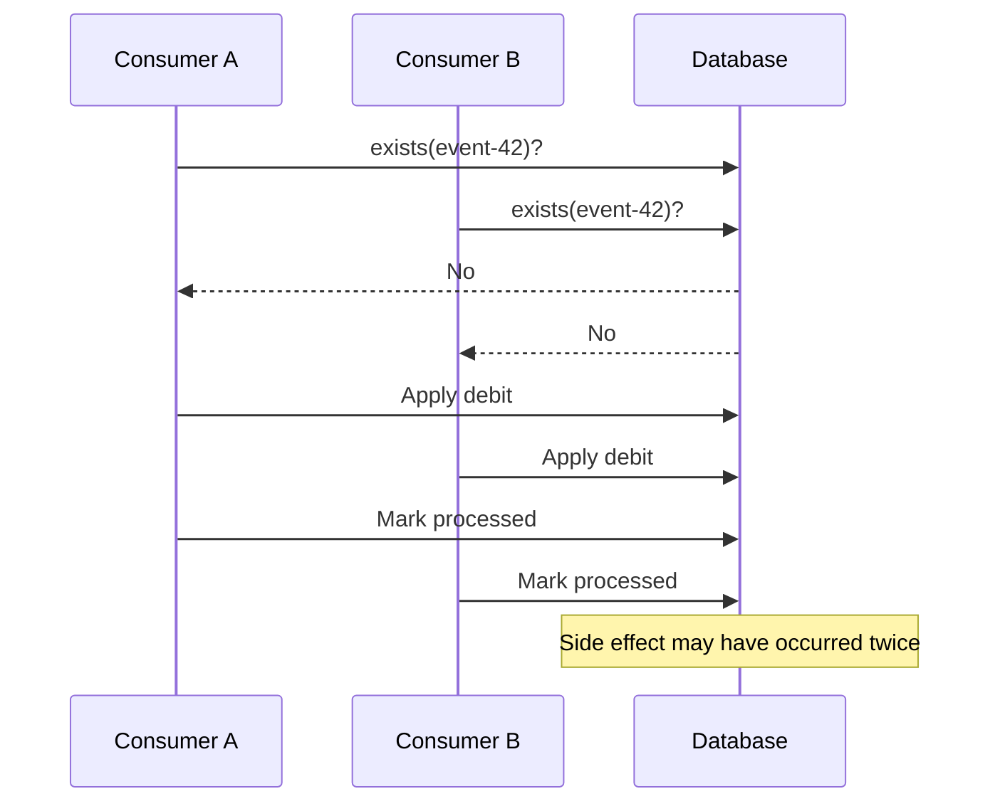
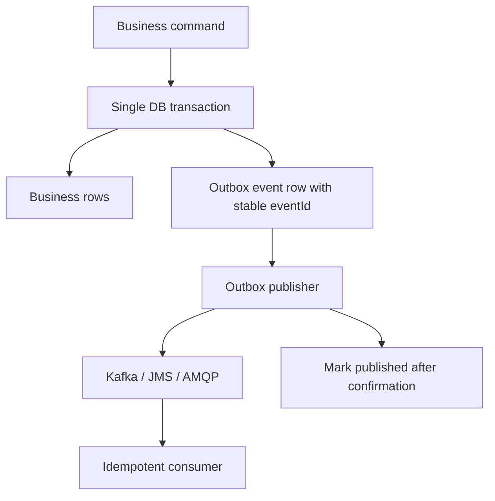

# Distinguishing Safe Retries from Duplicate-Causing Retries in Spring Integration Adapters

In integration systems, **retry** is the mechanism of repeating an operation after a failure or when the expected result has not arrived. Retry helps a system survive transient network glitches, brief broker outages, database deadlocks, or an external service returning `503 Service Unavailable`. However, retry can also **apply a business effect twice**: charging a card twice, sending two emails, creating two orders, adding inventory twice, or exporting the same data batch multiple times.

The lesson **"Distinguishing Safe Retries from Duplicate-Causing Retries"** belongs to the **Reliability** chapter of module **SPRING_INTEGRATION_ADAPTERS**. The scope is connecting external systems via Spring Integration **inbound/outbound adapters, gateways, pollers, and `MessageChannel`**, covering files, SFTP, HTTP, JMS, AMQP, Kafka, and databases. The focus is not merely configuring attempt counts, but **message contracts, business effect boundaries, acknowledgements, transactions, idempotency, error handling, and connection lifecycles**.

> **Most important principle:** An operation can be retried safely only when **repeating it causes no unintended extra effects**, or when the system has a mechanism proving/containing those effects. **A timeout does not prove the prior attempt failed.** Nor does "resending the same payload" automatically mean "no duplicate processing."

## 1. Learning objectives

After this lesson, learners can:

1. Distinguish **safe retry**, **duplicate-causing retry**, **redelivery**, **replay**, **resubmission**, and **compensation**.
2. Explain why a lost response creates an **ambiguous outcome** even when the target already succeeded.
3. Distinguish **at-most-once**, **at-least-once**, and the practical scope of **exactly-once** guarantees.
4. Define a stable **idempotency key**, key scope, retention window, and behavior when payloads differ under the same key.
5. Design deduplication using unique constraints and transactions rather than relying solely on in-memory existence checks.
6. Distinguish retries across **outbound adapters/gateways**, inbound consumers, pollers, brokers, databases, and business layers.
7. Set retry criteria by **error type, impact, deadlines, backoff, jitter, and retry budgets**.
8. Understand how HTTP, JMS, AMQP, Kafka, file/SFTP, and JDBC each give rise to duplicate processing.
9. Apply **transactional inbox/outbox**, processing states, and reconciliation when effects span multiple systems.
10. Test crash windows, redeliveries, concurrent consumers, failures before/after commit, and DLQ/replay flows.

## 2. What does safe retry mean?

An operation is **safe to retry within a defined scope** when repeating the same **business intent** does not alter observable outcomes in impermissible ways compared to a single successful execution.

Examples:

- Reading an order status by ID with no side effects: generally safe to retry on transient network errors.
- Setting order status to `CANCELLED` with a transition check: can be idempotent if business logic applies that transition only once.
- Deducting `100_000` VND from a wallet via "subtract another 100,000": **not inherently idempotent**. Running twice can deduct `200_000`.
- Creating a payment via `POST /payments` with an idempotency key enforced by the provider: safe to retry **within the provider's guaranteed scope and retention window**.

### 2.1. Three questions to ask before enabling retry

1. **What side effects does the operation have?** DB writes, payment API calls, emails, file creation, event publishing, offset updates, or device state changes?
2. **Could the previous attempt have succeeded?** If it only timed out or lost an ACK, assume the effect may already have occurred.
3. **What stops the next attempt from repeating the side effect?** That could be an idempotent operation, stable business key, unique constraint, transaction, confirmed status, idempotency contract, or reconciliation.

If you cannot answer question (3), **never attach unconditional retry to write operations**.

## 3. Why is a timeout a dangerous situation?

Suppose an outbound HTTP gateway sends a capture command:



Here the first HTTP result is **unknown**, not **failed**.

| Observed event | What can be concluded for sure | What must NOT be assumed |
| --- | --- | --- |
| Connection failed before any byte was sent, verified reliably | Request did not reach target at the observed layer. | That no intermediate layer processed it without evidence. |
| Client timed out after sending body | No response received within deadline. | That the server never received or committed it. |
| Broker returned no publisher confirm | Uncertain whether broker persisted message durably. | That republishing cannot create duplicates. |
| DB committed, app crashed before ACK | DB changes committed. | That the broker will not redeliver the message. |
| HTTP 500 returned after processing | Server reported an error. | That zero side effects occurred. |
| A retry succeeded | At least one execution succeeded at the confirmed level. | That exactly one side effect took place. |

**Conclusion:** retry decisions must follow **the failure model and operation contract**, not treat the label "timeout" as proof every request can be resent.

## 4. At-most-once, at-least-once, and exactly-once

| Model | Idea | Trade-off |
| --- | --- | --- |
| **At-most-once** | A message is not re-attempted after certain failures. | Can **lose** work before processing finishes. |
| **At-least-once** | Re-delivers until acknowledged per mechanism. | **May duplicate** delivery; consumers must guard against duplicate effects. |
| **Scoped exactly-once** | A logical effect/operation is recorded once within a proven boundary. | Does not automatically extend to other APIs, DBs, files, or systems. |

**Exactly-once** is not an automatic property of the entire application just because a broker or framework has a transactional mode. For instance, Kafka provides idempotent producers and transactions for certain Kafka-to-Kafka streams, yet when a handler calls an **external payment API** or updates a **separate database**, you still need an idempotency contract or consistency mechanism for those effects.

### 4.1. Separating message delivery from side-effect execution

```text
Message delivery count    = 2
Business effect count     = 1

=> Likely a healthy at-least-once system with an idempotent consumer.

Message delivery count    = 1
Business effect count     = 2

=> Handler itself may have sent two calls, or downstream duplicated;
   looking only at broker delivery count is insufficient.
```

The goal is **correct business semantics**, not necessarily that the handler invocation count equals one.

## 5. Idempotent operations and idempotent consumers

An **idempotent operation** produces an equivalent outcome when executed multiple times under the same intent and contract conditions.

An **idempotent consumer** can receive the same logical event multiple times while applying permitted side effects only once.

Example:

```text
Non-idempotent:
  UPDATE account SET balance = balance - 100000 WHERE id = 7;

Potentially idempotent in target data:
  UPDATE job SET status = 'COMPLETED' WHERE id = 7;
```

Even so, `SET status='COMPLETED'` might still fire triggers, audit notifications, or workflows multiple times. Check **all side effects**, not just the final column value.

### 5.1. Safe retry is a property of a contract

Saying "HTTP PUT is idempotent" describes HTTP semantic expectations, yet a concrete API might still fire extra effects like sending notifications on every call. Always inspect the implementation, business effects, and actual concurrency states.

## 6. Distinguishing retry, redelivery, replay, and new requests

| Term | Triggered by | Key point |
| --- | --- | --- |
| **In-handler retry** | App/library re-runs operation within same processing turn. | Can repeat side effects before broker ACK. |
| **Gateway/client retry** | HTTP/JMS/Kafka client or Spring Integration advice. | Client may not know whether target committed. |
| **Redelivery** | Broker re-sends unacknowledged message. | Same event may arrive at consumer again. |
| **Replay** | Intentional re-reading of a topic, file, outbox, or DLQ. | May happen long after origin; preserve event identity. |
| **Resubmitted new request** | User/producer intentionally creates a new intent. | May be a distinct valid transaction—do not dedupe wrongly. |
| **Compensation** | An action reversing/mitigating effects after commit. | Not the same as ensuring no duplicate ever happened. |

If a customer wants to pay **two separate times**, those two requests must carry two **different idempotency keys**. Reusing the same key for every request from one customer will **drop legitimate transactions**.

## 7. Retry map by location in Spring Integration



This diagram shows multiple **possible retry points**; never enable every arrow simultaneously without calculating total attempts and side effects.

### 7.1. Why stacked retries are dangerous

Suppose:

- HTTP client tries **3 times**.
- Spring Integration handler retries **4 times**.
- Broker redelivers the same message **5 times**.

Under adverse conditions, one logical event can generate **up to 3 × 4 × 5 = 60 calls to the external system** if nested layers align without limits. These numbers illustrate retry multiplication; real counts depend on flow structure.

That is **retry amplification**. Establish a single strategy governing the total budget or coordinate caps across layers.

## 8. Table for recognizing safe retries vs. duplicate-causing retries

| Action | If retried directly | Conditions for safety |
| --- | --- | --- |
| Read GET from read-only API | Usually adds no side effects. | API is truly read-only; meets timeouts and rate limits. |
| PUT setting full resource state | Can be safe for final state. | Secondary side effects controlled; proper preconditions/versioning. |
| DELETE same resource | Can be safe for final state. | Clear response when already absent; avoid deleting re-created resources. |
| POST creating payment | Risk of double charging. | Server enforces idempotency key, TTL, and fingerprint contract. |
| POST sending email/SMS | May send duplicate notifications. | Provider or application dedupes by notification ID. |
| `UPDATE counter=counter+1` | Increments multiple times. | Deduplicate event in the same transaction as the update. |
| INSERT with random ID each run | Creates duplicate business records. | Unique business ID and same-key conflict handling. |
| Publish Kafka event after DB commit | Can duplicate publish on crash. | Outbox + idempotent consumer, or same-scope transactions. |
| Write file with same name | Can overwrite or duplicate files. | Naming/atomic writes/checksums/idempotency and ownership. |
| Poll files over SFTP | File may be re-read after restart. | Persistent filter/metadata plus business-layer dedup. |
| JMS/AMQP consumer after DB commit | Redelivery can repeat side effects. | Inbox/idempotent consumer; ACK after commit. |
| Kafka consume → external API | Offset replay calls API again. | API idempotency contract and business deduplication. |

No label guarantees "absolute safety" everywhere; always analyze **duplication sources, transaction boundaries, and observable effects**.

## 9. Idempotency key: one key per business intent

An idempotency key identifies **the same logical command/event** when resent.

Example:

```json
{
  "eventId": "evt-2026-0042",
  "tenantId": "TENANT-A",
  "operation": "reserve-stock",
  "sku": "BOOK-101",
  "quantity": 2
}
```

A useful key could be:

```text
tenantId + producerId + operationType + eventId

Example:
TENANT-A | partner-a | reserve-stock | evt-2026-0042
```

### 9.1. Essential properties

- **Stable across retries:** retries reuse **the exact old key**, never generating a new UUID per attempt.
- **Properly scoped:** no collisions across tenants, producers, or operation types.
- **Reflects intent:** two genuinely separate transactions have two distinct keys.
- **Validated:** bounded length, valid characters, and trusted origin—never trust arbitrary producers blindly.
- **Clear retention:** will duplicates arriving a day or week later still be recognized?
- **Fingerprinted:** matching key with different body must be handled as a contract error, never silently accepted as a valid duplicate.
- **Durable:** keys must survive restarts, crashes, and multiple consumers when durability is required.

### 9.2. Why not use correlation ID as the sole key?

One correlation ID can span **multiple events**, such as one HTTP request spawning three distinct commands. Conversely, one event may replay under a fresh trace. Hence:

```text
correlationId = links processing path for investigation
eventId       = identifies a single event
commandId     = identifies a single command intent
attemptId     = identifies a specific attempt
```

These values relate to one another, yet are not interchangeable.

## 10. Fingerprints: same key, different content

Suppose a producer sends:

```text
Idempotency-Key: pay-42
Amount: 100000
```

Then resends **the same key** with:

```text
Idempotency-Key: pay-42
Amount: 900000
```

If the server checks only the key and returns the old success, the client may think the new payment amount applied. If the server applies the new amount, it violates the rule that same key means same intent.

Solution:

1. Store a fingerprint of the business fields defining the intent.
2. If the key exists and the fingerprint matches, return the recorded outcome or current state per contract.
3. If the key exists with a different fingerprint, return an **idempotency conflict** error.
4. Do not hash raw JSON bytes if serializers can alter whitespace or field order without changing meaning; use approved canonicalization.
5. Never omit critical fields like amount, currency, or target account from the fingerprint.

## 11. Deduplication is not just asking "have I seen this ID?"

A race-prone pattern:

```java
if (!repository.existsByEventId(eventId)) {
    applyBusinessChange();
    repository.saveProcessed(eventId);
}
```

Two parallel consumers can both observe "does not exist yet" and both apply the side effect before either saves state.



You need an **atomic boundary**, such as a unique constraint plus transaction for same-DB side effects, or an external system's idempotency contract.

## 12. Transactional inbox: unique keys and effects in the same DB

For a consumer updating **one database**, the practical pattern is a **transactional inbox/dedup table**.

Illustrative PostgreSQL schema:

```sql
CREATE TABLE inventory (
    tenant_id     VARCHAR(64) NOT NULL,
    sku           VARCHAR(128) NOT NULL,
    available     BIGINT NOT NULL CHECK (available >= 0),
    PRIMARY KEY (tenant_id, sku)
);

CREATE TABLE processed_reservation (
    tenant_id     VARCHAR(64) NOT NULL,
    producer_id   VARCHAR(64) NOT NULL,
    event_id      VARCHAR(128) NOT NULL,
    sku           VARCHAR(128) NOT NULL,
    quantity      BIGINT NOT NULL,
    processed_at  TIMESTAMPTZ NOT NULL DEFAULT now(),
    PRIMARY KEY (tenant_id, producer_id, event_id)
);
```

Each logical reservation has one key. Inserting into `processed_reservation` and deducting inventory must happen **in the same transaction on the same DB**.

### 12.1. Transaction pseudocode

```text
BEGIN TRANSACTION
    INSERT inbox(key, fingerprint)
        ON CONFLICT DO NOTHING

    IF key already existed:
        VERIFY fingerprint matches
        RETURN previous equivalent outcome

    UPDATE inventory
        SET available = available - quantity
        WHERE sku = ...
          AND available >= quantity

    IF no inventory row updated:
        ROLLBACK
        RETURN business rejection

COMMIT
ACK source message only after durable result
```

On a crash **before COMMIT**, both the marker and DB changes roll back. On a crash **after COMMIT and before ACK**, the broker may redeliver; the unique key stops the consumer from deducting inventory a second time.

### 12.2. Why must marker and effect share a transaction?

| Ordering | Crash in the middle | Risk |
| --- | --- | --- |
| Write & commit marker, then deduct inventory | Crash after marker | Retry gets skipped even though inventory was not deducted. |
| Deduct & commit inventory, then write marker | Crash before marker | Retry deducts inventory a second time. |
| Marker + inventory deduction in same DB transaction | Crash before commit | Both roll back; safe to retry. |
| Marker + inventory deduction in same DB transaction | Crash after commit, before ACK | Retry sees marker, skips duplicate effect. |

**Limitation:** this pattern guarantees atomicity for **changes within the same database transaction**. It does not automatically make HTTP payment APIs, Kafka publishes, or file writes outside the DB atomic with that transaction.

## 13. Java Spring: idempotent consumer with transactions

The Java example below implements the same logic using Spring JDBC and PostgreSQL `ON CONFLICT DO NOTHING`.

```java
public record StockReservation(
    String tenantId,
    String producerId,
    String eventId,
    String sku,
    long quantity
) {}

public enum ProcessingOutcome {
    APPLIED,
    DUPLICATE_ALREADY_APPLIED
}
```

A dedicated service proxied by Spring manages the transaction:

```java
import java.util.Map;
import org.springframework.jdbc.core.JdbcTemplate;
import org.springframework.stereotype.Service;
import org.springframework.transaction.annotation.Transactional;

@Service
public class StockReservationService {

    private final JdbcTemplate jdbc;

    public StockReservationService(JdbcTemplate jdbc) {
        this.jdbc = jdbc;
    }

    @Transactional
    public ProcessingOutcome apply(StockReservation event) {
        if (event.quantity() <= 0
                || event.eventId() == null
                || event.eventId().isBlank()) {
            throw new IllegalArgumentException("Invalid reservation event");
        }

        // Identifiers/tenants must be verified at the inbound boundary.
        int inserted = jdbc.update(
            """
            INSERT INTO processed_reservation
                (tenant_id, producer_id, event_id, sku, quantity)
            VALUES (?, ?, ?, ?, ?)
            ON CONFLICT DO NOTHING
            """,
            event.tenantId(), event.producerId(),
            event.eventId(), event.sku(), event.quantity()
        );

        if (inserted == 0) {
            Map<String, Object> old = jdbc.queryForMap(
                """
                SELECT sku, quantity
                FROM processed_reservation
                WHERE tenant_id = ? AND producer_id = ? AND event_id = ?
                """,
                event.tenantId(), event.producerId(), event.eventId()
            );

            String oldSku = (String) old.get("sku");
            long oldQuantity = ((Number) old.get("quantity")).longValue();

            if (!oldSku.equals(event.sku())
                    || oldQuantity != event.quantity()) {
                throw new IllegalArgumentException(
                    "IDEMPOTENCY_KEY_CONFLICT"
                );
            }

            return ProcessingOutcome.DUPLICATE_ALREADY_APPLIED;
        }

        int changed = jdbc.update(
            """
            UPDATE inventory
            SET available = available - ?
            WHERE tenant_id = ?
              AND sku = ?
              AND available >= ?
            """,
            event.quantity(), event.tenantId(),
            event.sku(), event.quantity()
        );

        if (changed != 1) {
            // RuntimeException causes Spring to roll back the transaction,
            // including the marker just inserted.
            throw new IllegalStateException(
                "INSUFFICIENT_OR_UNKNOWN_STOCK"
            );
        }

        return ProcessingOutcome.APPLIED;
    }
}
```

The service activator delegates to the transaction-managed service:

```java
import org.springframework.integration.annotation.ServiceActivator;
import org.springframework.messaging.Message;
import org.springframework.stereotype.Component;

@Component
public class StockReservationHandler {

    private final StockReservationService service;

    public StockReservationHandler(StockReservationService service) {
        this.service = service;
    }

    @ServiceActivator(inputChannel = "stockReservationChannel")
    public void handle(Message<StockReservation> message) {
        ProcessingOutcome result =
            service.apply(message.getPayload());

        // Handler finishes after apply()'s transaction commits.
        // Inbound adapter ACK/offset still requires separate configuration.
    }
}
```

### 13.1. Important limitations of the example

- The SQL uses **PostgreSQL**; other DBs need different syntax or transaction strategies.
- The example considers only **one local DB side effect**. Adding email sending, HTTP calls, or Kafka publishing in the same method does not place them inside the DB transaction.
- `ON CONFLICT DO NOTHING` behavior under real concurrency must be tested at the application's isolation level and load.
- `tenantId` and `producerId` must be authenticated at the inbound adapter/security layer; never trust producer-supplied values to cross tenant boundaries.
- Decide the policy for insufficient stock: that is a **business rejection**, usually not retried forever; store a dedicated outcome if "repeating the request always returns the same result" is required.
- Idempotency retention must last long enough for the committed replay window.
- How broker ACK/commit happens after the DB side effect depends on listener/adapter and transaction configuration.

## 14. What about IdempotentReceiverInterceptor?

Spring Integration offers the **Idempotent Receiver** pattern, typically using a **metadata store** and selector/marker logic to block duplicate processing at an endpoint.

Concept:

```text
Message enters endpoint
    -> compute stable key
    -> check-and-mark metadata store
    -> if new: let handler process
    -> if duplicate: filter or attach duplicate marker per policy
```

This helps **flows needing duplicate filtering**. Before adopting it, answer:

1. Is the metadata store **persistent and shared** across instances?
2. When is the key written: before or after the business effect?
3. Could crashing after marking and before the side effect **lose** work?
4. Do the metadata update and business effect share a transaction?
5. How are key expiration, reprocessing, and rollbacks managed?
6. How are duplicate responses defined for gateways/producers?

**Never treat enabling an interceptor or filter as equivalent to transactional exactly-once business processing.** When side effects live in a DB, unique constraints and same-DB transactions remain the primary safeguard.

## 15. Three crash windows that must be tested

### 15.1. Crash before side effect

```text
Message received
 -> validate
 -> crash
 -> no DB commit
 -> broker redelivery
 -> processed for first effective time
```

If ACK was not sent and the source supports redelivery, processing can resume. If ACK was sent too early, the message may be lost.

### 15.2. Crash after side effect, before ACK

```text
Message received
 -> DB transaction COMMIT
 -> crash
 -> no broker ACK
 -> broker redelivery
 -> idempotency detects duplicate
 -> no second business effect
 -> ACK after safe handling
```

This is the classic scenario for **at-least-once + idempotent consumer**.

### 15.3. Crash during an external system call

```text
Message received
 -> POST payment provider
 -> provider commits
 -> response lost / process crash
 -> status UNKNOWN locally
 -> retry same idempotency key or query status
 -> avoid double charge
```

No local DB transaction resolves this automatically if the provider lacks idempotency or reliable status queries. Dedicated protocols and reconciliation are required.

## 16. Outbound HTTP: the HTTP method alone is not enough to decide retry

### 16.1. GET, PUT, DELETE, POST

| Method | Expected HTTP semantics | Still must verify |
| --- | --- | --- |
| **GET** | Safe/read-only per HTTP convention. | API does not abuse GET to mutate state; rate limits. |
| **PUT** | Idempotent on resource state for the same request. | Secondary side effects, versioning/concurrency, resource identity. |
| **DELETE** | Idempotent deletion semantics. | Re-deleting after a resource was recreated may need preconditions. |
| **POST** | Not inherently idempotent. | Idempotency key, stable request ID, API contract. |
| **PATCH** | Not inherently idempotent. | Specific patch semantics: "set" vs. "increment." |

An API may write an audit log on each GET without breaking HTTP "safe" semantics; what matters for reliability is **which business effects must never be duplicated**.

### 16.2. HTTP idempotency key

Example outbound gateway call:

```http
POST /payments/capture HTTP/1.1
Content-Type: application/json
Idempotency-Key: tenant-a:order-42:capture-v1

{"paymentId":"payment-42","amountCents":100000}
```

The server side must **enforce** the contract: persist or lock the key, compare request fingerprints, and return the processed result or consistent status on repeats.

Merely setting the `Idempotency-Key` header in Spring Integration **does not automatically make an external endpoint deduplicate**.

### 16.3. What to do on an unclear outcome?

When outbound times out:

1. Keep the idempotency key unchanged.
2. If the API exposes a status lookup by `paymentId`/key, **reconcile before creating any new intent**.
3. If retrying, resend the exact same key within its valid window and with identical business content.
4. Classify duplicate/in-progress/conflict responses per provider contract.
5. When outcomes cannot be determined, mark `UNKNOWN_OUTCOME` for investigation—never generate a new key and POST again.

## 17. Classifying errors: which errors should be retried?

Not every exception is transient. An example policy:

| Scenario | Initial classification | Notes |
| --- | --- | --- |
| Connection reset, timeout | **Ambiguous/transient** | Operation may already have applied; retry only with idempotency guarantees. |
| HTTP `429 Too Many Requests` | Transient/capacity | Honor `Retry-After` and budgets; avoid retry storms. |
| HTTP `503`, `502`, `504` | Usually transient/ambiguous | Bounded retry when side effects are safe. |
| HTTP `400` malformed payload | Permanent | Producer must fix payload; do not retry unchanged data forever. |
| HTTP `401/403` | Auth/config/policy | Do not retry aggressively; fix credentials/permissions. |
| HTTP `409` | Contract-dependent | May be idempotency conflict, version conflict, or in-progress. |
| Invalid JSON/XML schema | Permanent | Quarantine/DLQ, notify producer. |
| DB deadlock/serialization failure | Potentially transient | Retry entire **transaction** with controls; ensure idempotency. |
| Duplicate unique key, matching fingerprint | Not a side-effecting error | Return cached result / duplicate acknowledged. |
| Duplicate key, different fingerprint | Contract violation | Reject; never mask. |
| External payment status `UNKNOWN` | Ambiguous | Reconcile/status lookup; retry same key if guaranteed. |

**Crucially:** not every `5xx` guarantees zero side effects occurred. When basing retries on status codes, combine them with **safe operations / idempotency guarantees**.

## 18. Backoff, jitter, and time limits

Immediate tight retries push an overloaded service deeper into failure.

A common strategy:

```text
attempt 1: immediate
attempt 2: after ~200 ms + jitter
attempt 3: after ~400 ms + jitter
attempt 4: after ~800 ms + jitter
beyond limit: route to recovery/UNKNOWN/DLQ per policy
```

Configuration settings to check:

- **`maxAttempts`:** total execution count—clarify whether the initial attempt is included.
- **Initial delay:** delay before first retry.
- **Multiplier:** exponential backoff factor.
- **Max delay:** cap on single pause duration.
- **Jitter:** bounded randomness to prevent thundering herds.
- **Overall deadline:** point when the request/gateway loses relevance.
- **Retry budget:** prevents 5 stacked layers from multiplying call counts.
- **`Retry-After`:** if sent by the provider, honor per contract.
- **Circuit breaker:** stops sending calls to chronically failing dependencies.

**Backoff reduces load; it does not create idempotency.** Retrying a charge command after 2 seconds instead of 100 ms can still charge twice.

## 19. Configuring retry in Spring Integration: place at the right layer

Spring Integration can apply retry via **retry advice** on endpoints supporting advice chains, or configure retries in listener containers/gateways/clients. Spring Retry is commonly used to build the policy.

Illustrative configuration of `RequestHandlerRetryAdvice` with `RetryTemplate`:

```java
import org.springframework.context.annotation.Bean;
import org.springframework.integration.handler.advice.RequestHandlerRetryAdvice;
import org.springframework.retry.support.RetryTemplate;
import org.springframework.web.client.ResourceAccessException;

@Bean
RequestHandlerRetryAdvice transientHttpRetryAdvice() {
    RetryTemplate retryTemplate = RetryTemplate.builder()
        .maxAttempts(3)
        .exponentialBackoff(200, 2.0, 2_000)
        .retryOn(ResourceAccessException.class)
        .build();

    RequestHandlerRetryAdvice advice = new RequestHandlerRetryAdvice();
    advice.setRetryTemplate(retryTemplate);
    return advice;
}
```

**This example only illustrates the API and backoff**, not a blanket safety guarantee for any HTTP POST. In real deployments:

1. Attach advice only to **endpoints whose operations are permitted to retry**.
2. If Spring Integration wraps exceptions in another exception, verify exception classification detects the underlying cause.
3. `ResourceAccessException` can carry timeouts with ambiguous outcomes; **enforce idempotency keys/contracts** before retrying outbound side effects.
4. Configure recovery/error channels/responses to match sync or async flow semantics.
5. Test actual call counts, jitter/budgets, callbacks, and duplicate side effects.
6. Ensure exact APIs and module dependencies match your project's Spring Integration/Spring Retry versions.

### 19.1. Why not put advice on every handler?

A flow might look like:

```text
Transformer -> DB update -> HTTP publish -> Email send
```

If advice wraps all three side effects and sending email fails, **the entire chain can re-run**, duplicating the DB update and HTTP publish. Identify the **smallest safe retry unit**, or isolate each side effect into an independent command/idempotent stage.

## 20. Gateway interfaces: synchronous behavior and timeouts

A synchronous outbound gateway typically waits for a response. If the gateway times out, the caller sees an error even when the destination succeeded.

An inbound gateway also faces HTTP client deadlines; a consumer taking longer than the deadline might still commit after the client already timed out and resent the request.

### 20.1. Sound design

- Assign a stable request/command ID before entering the gateway.
- Enforce idempotency on the server/consumer, not only the client.
- Persist queryable outcomes/statuses.
- Align total timeouts and attempt counts with SLAs.
- Never report "request failed" when all you know is "no response received yet."
- Return a `PROCESSING` response or status-polling mechanism if the business contract allows.

### 20.2. Framework retry vs. user-triggered retry

A user clicking "Pay" twice while a spinner turns can send **two HTTP requests**. Automatic client retries and double-clicks both duplicate intent. Deduplicate by **business request identity**, not by whether a Java method re-ran on the same thread.

## 21. JMS: ACKs, transactions, and redelivery

In JMS, a message can be redelivered if the listener did not confirm per acknowledgement/transaction policy. `JMSRedelivered` or provider/container delivery counts aid diagnostics, yet **never replace a business event ID**.

### 21.1. Two classic bugs

**ACK before business commit:**

```text
JMS receive
 -> ACK
 -> DB update starts
 -> process crashes

Result: broker thinks it is done; side effect may never have executed.
```

**Business commit before ACK:**

```text
JMS receive
 -> DB COMMIT
 -> process crashes before ACK

Result: broker redelivers; if consumer is not idempotent,
DB may be modified twice.
```

The second pattern paired with **in-DB-transaction deduplication** usually protects better under at-least-once, provided ACK follows commit properly.

### 21.2. Verify against real configuration

- Listener container ack/transaction mode.
- Whether ACK genuinely occurs after handler success/commit.
- Rollback/redelivery policy, max redeliveries, and dead-lettering.
- Whether converter errors happen before or after creating a Spring `Message`.
- Whether correlation/event IDs survive re-entry into the flow.
- If DB and JMS require a single atomic transaction, evaluate dedicated transaction architecture rather than assuming a local DB transaction includes the broker.

## 22. AMQP/RabbitMQ: ACK, NACK, requeue, and DLX

AMQP allows consumers to ACK messages, or NACK/REJECT with requeue or dead-letter policies.

| Behavior | Potential consequence |
| --- | --- |
| ACK before processing completes | Crash forfeits broker redelivery; side effects may be lost. |
| Side effect commits, then ACK fails | Message redelivered; risk of duplicate side effects. |
| Continuous NACK with requeue | Poison message or dependency fault causes retry storm. |
| Dead-letter after N failures | Message isolated; still needs replay/dedup controls. |
| Producer receives no confirm | Uncertain if publish succeeded; republishing may duplicate. |

### 22.1. Never confuse producer confirms with consumer ACKs

- **Publisher confirm:** sender learns the broker accepted the publish under that mechanism's guarantees.
- **Consumer ACK:** receiver reports handling the message per policy.
- **Business commit:** side effects in the app or external systems may be completely independent.

These three signals **are not automatically atomic**. When republishing after a lost confirm, keep a stable event ID; consumers use idempotency to curb duplicates.

## 23. Kafka: producer retries, consumer replays, and transactions

Kafka has multiple reliability layers to keep distinct.

### 23.1. Producer idempotence

Kafka supports **idempotent producers** to reduce duplicates caused by producer retries within the conditions guaranteed by the broker/client.

That does **not** mean:

- Two business requests carrying different event IDs get merged.
- An app restarting and emitting a new event with a new ID gets deduplicated in a target DB.
- Kafka-to-external-HTTP payments automatically become exactly-once.
- A consumer cannot re-read a record after offset/transaction failures.

### 23.2. Offset commit after business effects

```text
Kafka record consumed
 -> business DB COMMIT
 -> crash before offset commit
 -> record consumed again
```

You need an idempotent consumer, such as a transactional inbox, to prevent duplicate effects.

Conversely:

```text
Kafka offset committed
 -> crash before business effect

May lose the record's business effect.
```

Hence **commit order** and idempotency must align with SLAs; no single simple ack flag solves every crash window between two systems.

### 23.3. Kafka transactions and scope limits

For **consume → transform → produce within Kafka**, properly configured producer transactions and offset handling give strong guarantees **within Kafka's boundary**. If any step also writes to **another DB**, calls an **HTTP API**, or creates files, you must build consistency separately for those non-Kafka effects.

### 23.4. Event IDs across DLT/replay

When records go to a dead-letter topic and later replay:

- Keep the original source event identity.
- Generate new `attemptId` and error IDs as needed.
- Never use the DLT record's topic/partition/offset as a brand-new business event ID.
- If schemas/headers change while dead-lettered, maintain contract mappings.
- The final consumer must tolerate the same event arriving before or after migration/replay.

## 24. File and SFTP: pollers can read the same file multiple times

File/SFTP inbound adapters typically rely on pollers or synchronizers. On application restarts, if metadata/filters were not persisted durably or the file was not archived yet, the same file can be seen again.

```mermaid
sequenceDiagram
    participant S as SFTP
    participant P as Poller
    participant D as Business DB
    P->>S: Download batch-42.csv
    P->>D: Apply rows; COMMIT
    Note over P: Crash before archive/mark
    P->>S: Download batch-42.csv again
    P->>D: Apply same rows again if no dedup
```

### 24.1. What do accept-once filters help with?

Spring Integration file/SFTP provides seen-file filters and metadata stores depending on adapter/config. They reduce re-reading files, especially when state is persisted durably and shared across instances.

However:

- A file may be identified by path, timestamp, or other metadata; know the **actual key used**.
- Updating file contents while keeping the same name creates ambiguous cases.
- A metadata store recording "file seen" does not mean **every record committed to business state**.
- Marking seen before processing and then crashing can **skip work**.
- Replaying after errors or restoring metadata stores can reprocess the file.

### 24.2. Safer file design

1. Enforce file readiness (rename/marker after upload).
2. Use file/batch IDs or checksums scoped by source/tenant.
3. Parse every record per contract format.
4. Deduplicate at the business level by event/record key, not filename alone.
5. Archive or mark complete **only after confirmed processing milestones**.
6. Quarantine failed files with metadata and controlled replay paths.
7. Test crashes between commit and archiving.
8. Prevent two pollers/instances from claiming the same file via proper coordination.

## 25. JDBC pollers and databases: atomic claims, commits, and outboxes

JDBC inbound polling typically reads `NEW` rows and processes them. A naive loop can re-read rows if a crash happens before updating `PROCESSED`.

### 25.1. Races between multiple pollers

```text
Poller A: SELECT row id=42 WHERE status='NEW'
Poller B: SELECT row id=42 WHERE status='NEW'
Both process row 42
```

Use row locking, claim states, optimistic versioning, or DB-specific strategies (e.g., `FOR UPDATE SKIP LOCKED` where supported), checking transactions, leases, and timeouts.

### 25.2. Marking processed after effects

If side effects and row status live **in the same DB**, they can commit atomically. If the side effect is publishing to Kafka or calling an API, setting `status=PROCESSED` in the DB does not guarantee the message reached its destination.

That is a major reason to use a **transactional outbox**.

## 26. Transactional outbox: avoiding double publishing on crashes

A common failure scenario:

```text
Business transaction commits order
 -> Publish OrderCreated to broker
 -> process crashes before knowing publish success
 -> retry publish
 -> duplicate event possible
```

Transactional outbox changes the order:



### 26.1. Meaning

- In **one DB transaction**, write business state and the outbox event.
- A publisher reads the outbox and sends to the broker.
- If the publisher crashes after publishing and before marking `SENT`, it can republish with **the same event ID**.
- Target consumers must still be idempotent because **an outbox typically yields at-least-once publishing**, not magical end-to-end exactly-once.

### 26.2. Illustrative outbox schema

```sql
CREATE TABLE integration_outbox (
    event_id       VARCHAR(128) PRIMARY KEY,
    aggregate_id   VARCHAR(128) NOT NULL,
    event_type     VARCHAR(128) NOT NULL,
    payload_json   TEXT NOT NULL,
    status         VARCHAR(24) NOT NULL,
    created_at     TIMESTAMPTZ NOT NULL DEFAULT now(),
    published_at   TIMESTAMPTZ
);
```

Publishers can use leases/claims/transactions when running multiple instances concurrently, and must reuse the **stable original `event_id`** when resending.

## 27. External side effects: Payment APIs and sagas

When an operation **charges money**, **sends emails**, or **controls hardware**, it cannot participate in a local DB transaction like a normal SQL statement.

### 27.1. Stateful payment flow pattern

```text
LOCAL COMMAND CREATED
  -> payment request with stable idempotency key
  -> status:
       CONFIRMED_SUCCESS
       CONFIRMED_REJECTED
       UNKNOWN_OUTCOME
       IN_PROGRESS
  -> on timeout:
       query provider status or retry same key if contract allows
  -> reconcile external outcome
  -> finalize local state
```

**Never equate `UNKNOWN_OUTCOME` with `FAILED`.** When you do not know whether the provider already charged, creating a new payment with a fresh idempotency key is the direct path to double charging.

### 27.2. Sagas and compensation

Across multi-system chains, a saga records steps and compensating actions on failure—such as refunding a captured payment when order fulfillment cannot complete.

However:

- Compensations themselves can fail or repeat.
- Refunding does not mean the customer was never charged twice in the first place.
- Saga steps and compensations **also require idempotency**.
- Auditing and reconciliation are essential, especially for financial transactions.

## 28. Multi-step flows: redefining the retry point

Example:

```text
1. Parse inbound JSON
2. Insert order into DB
3. Reserve stock
4. Charge payment provider
5. Send confirmation email
```

If step (5) fails and you retry **the entire flow**, you risk:

- Inserting another order.
- Reserving stock twice.
- Charging payment twice.
- Duplicating confirmation emails across subsequent retries.

Better design:

1. Identify a consistent command/order.
2. Break steps into **state transitions** with distinct unique keys.
3. Use transactions when side effects share a DB.
4. Use an outbox to emit events to other systems.
5. Pass idempotency keys when calling payment/email providers if supported.
6. Retry **only the failed step** under its guarantees rather than restarting from step 1 by default.
7. Maintain reconciliation and status tracking across crashes/timeouts.

### 28.1. "Retry from which step?" is an architectural question

In stateful flows, retries should resume from the **unconfirmed step**, not repeat every prior action blindly. When the previous step's result is unknown, look it up or recover state from authoritative data.

## 29. Distinguishing format-error retries from infrastructure-error retries

An XML message with the wrong namespace or JSON missing a required field will not fix itself after 5 re-reads of the same bytes.

| Error | Is retry helpful? | Usually appropriate path |
| --- | --- | --- |
| Malformed JSON/XML | No if input is unchanged. | DLQ/quarantine, notify producer. |
| Contract-mismatching charset | No if bytes are unchanged. | Fix contract/producer, controlled replay. |
| Missing required header | No for the same message. | Inspect header mapper/producer. |
| Disallowed by policy | Not by immediate resend. | Fix authorization/business conditions. |
| Database deadlock | Possibly if transaction is idempotent. | Retry bounded transaction. |
| HTTP 503 from provider | Possibly with idempotency guarantee. | Backoff/jitter/budget. |
| Outbound network timeout | Outcome unknown. | Reconcile or retry same valid key. |
| Lost broker connection before publish | Possible, though publish outcome may be ambiguous. | Stable event ID, publish retry + consumer dedup. |
| Insufficient business stock | Usually a business rejection. | Return semantic error; do not retry continuously. |

### 29.1. Poison messages and DLQs

A poison message repeatedly fails under identical conditions. Never let it block an entire queue, partition, or poller.

Require:

- Bounded retry counts.
- Classification of root cause and recoverability.
- Storing the message or reference in an access-controlled DLQ/quarantine.
- Assigned ownership for remediation and replay.
- Preserving event identity, schema version, and idempotency keys on replay.
- Never breaking source ACK/offset semantics by having an error handler fake success.

## 30. Headers that must survive retries

In Spring Integration, `Message<?>` carries payload and headers. Across retries or re-sending through another adapter, critical fields include:

| Header | Keep across retries? | Notes |
| --- | --- | --- |
| `eventId` or `commandId` | **Yes, stable.** | Key identifying the same logical operation. |
| `correlationId` | Usually yes. | For tracing; not by itself a dedup key. |
| `sourceSystem` | Yes if verified. | Never trust client-supplied headers for authorization. |
| `tenantId` | Yes if authenticated per principal/contract. | Include in keys to prevent cross-tenant collisions. |
| `schemaVersion` | Yes when replay needs old parsers. | Maintain backward compatibility. |
| `retryAttempt` | Update per policy. | Never treat attempt ID as a new event ID. |
| `contentType` | Keep if still matching wire payload. | Post-transform may need its own `wireContentType`. |
| `replyChannel`/`errorChannel` | Internal use only where valid. | Never leak raw framework channel objects to brokers. |
| `Authorization`/credentials | Never copy blindly to DLQ. | Prevent secret leakage. |

### 30.1. Never generate a new key when rebuilding a message

Dangerous example:

```java
Message<OrderCommand> retryMessage = MessageBuilder
    .withPayload(original.getPayload())
    .setHeader("eventId", UUID.randomUUID().toString())
    .build();
```

If `eventId` serves as the idempotency key, this turns a retry into a **new event**, defeating duplicate detection.

Correct-principle example:

```java
Message<OrderCommand> retryMessage = MessageBuilder
    .withPayload(original.getPayload())
    .setHeader(
        "eventId",
        original.getHeaders().get("eventId")
    )
    .setHeader(
        "correlationId",
        original.getHeaders().get("correlationId")
    )
    .setHeader("retryAttempt", nextAttempt)
    .build();
```

When constructing a new message, preserve any internal routing headers still needed per policy; this snippet specifically illustrates **keeping the event ID stable**.

## 31. Retry and errorChannel: do not treat every error as the same path

Spring Integration handles errors differently depending on the endpoint:

- **Synchronous `DirectChannel`/gateway:** exceptions usually propagate to the sender/caller unless caught at a boundary.
- **Poller or executor channel:** errors can be routed to corresponding error handling / `errorChannel`.
- **JMS/AMQP/Kafka listener:** adapter/container has its own retry, ack/commit, and dead-letter semantics; errors may happen **before a Spring `Message` is created**.
- **Outbound handler:** retry advice wraps only the advised handler operation, not side effects on other endpoints.

### 31.1. Identifying the failed message

If a transformer throws a `MessagingException` carrying `failedMessage`, an error handler can recover the original event ID/correlation. Yet `ErrorMessage` does not automatically guarantee all input headers sit at the same level.

When sending to a DLQ, build an error envelope with:

```json
{
  "errorCode": "TRANSIENT_HTTP_TIMEOUT",
  "eventId": "evt-2026-0042",
  "correlationId": "req-88",
  "sourceSystem": "partner-a",
  "attempt": 3,
  "outcome": "UNKNOWN",
  "retryable": false,
  "reconciliationRequired": true
}
```

This example marks no further automatic retries **because the budget ran out or the outcome cannot be confirmed**, not because the event definitely failed at the provider.

## 32. Retry budgets and circuit breakers

When thousands of messages fail simultaneously, a modest per-message policy can still produce **enough aggregate retries to crash the dependency**.

### 32.1. Protective layers

1. **Per-message max attempts** and job time-to-live.
2. **Per-dependency retry budget**, preventing all clients from retrying together.
3. **Exponential backoff + jitter** to spread load.
4. **Circuit breaker** halting calls when a dependency fails persistently.
5. **Rate limiter** per resource/tenant/producer when needed.
6. **Bulkhead** preventing one failing integration from exhausting all threads/connection pools.
7. **DLQ/quarantine** for permanent failures or exhausted budgets.
8. **Manual reconciliation** for ambiguous outcomes with major side effects.

No single fixed retry count fits every scenario. A read-only HTTP retry can fail fast; a payment capture must prioritize idempotency/status lookups and risk control.

## 33. Deduplication TTL: duplicates can arrive late

If idempotency keys live in cache for only **10 minutes** while the broker can replay messages after **7 days**, the same event looks brand new once the cache expires.

Design so that:

```text
dedupe retention >= maximum expected duplicate/replay window
                   + operational safety margin
```

However, "keep every key forever" carries storage and privacy costs. Options include:

- Using long-lived business identities in the DB.
- Retaining dedup records for the committed replay window.
- Separating a hot cache for speed and a durable store for guarantees.
- Defining controlled historical-replay workflows past retention.
- Explicitly documenting when **guarantees no longer apply** to old data.

### 33.1. Key reuse

Never allow producers to reuse a key for a new transaction after TTL if the consumer might still encounter historical replays. Key namespacing/versioning and lifespans must be part of the integration contract.

## 34. Ordering, concurrency, and retry

Events can depend on order:

```text
E1: OrderCreated
E2: OrderCancelled
```

If E2 processes first because E1 retried slowly, or E1 replays after E2, a consumer applying "last event wins" could revert a cancelled order back to created.

### 34.1. Idempotency does not solve ordering

- **Deduplication** answers: "has this event already been applied?"
- **Ordering** answers: "does this event fit the current version/state?"
- **Concurrency** answers: "can multiple workers mutate this resource simultaneously?"

You need a state machine and versioning/event sequencing:

```text
orderId = ORD-42
version 1: CREATED
version 2: CONFIRMED
version 3: CANCELLED

Replaying version 1 after version 3:
  must NOT restore state to CREATED.
```

Use optimistic locking, version columns, aggregate-key partitioning, row locks, or per-key ordered processing per architecture. Never assume a broker preserves global order; Kafka orders within a partition, while multiple consumers and retries affect observed processing order.

## 35. Retries that look safe yet still cause duplicates

### 35.1. "I checked the DB first"

Checking `exists()` before writing is non-atomic; two parallel consumers pass through together. Use unique constraints/transactions or proper locking.

### 35.2. "I have Redis SETNX"

If `SETNX` succeeds and the process crashes before writing the DB, retries get skipped. If the DB writes first and `SETNX` runs after, retries cause duplicates. Redis locks or caches **do not form a shared transaction** with an external database.

### 35.3. "I used POST, and timeouts auto-retry"

POST is not inherently idempotent. You need server-side keys, status lookups, or an equivalent contract.

### 35.4. "I enabled Kafka idempotent producer"

That feature does not deduplicate two business events regenerated with fresh IDs, nor does it control side effects in external payment APIs or DBs.

### 35.5. "I have a unique constraint"

A constraint on `eventId` alone without tenant/producer scoping can falsely treat two different producers as duplicates. Conversely, generating a new key per retry renders the unique constraint useless.

### 35.6. "I have a DLQ"

A DLQ is an error-handling mechanism, not proof that side effects never happened. Replaying from a DLQ **can still duplicate** if effects committed before dead-lettering.

### 35.7. "We use DELETE, so calling again is fine"

Repeating `DELETE` on the same URL may be idempotent for final state, yet if the resource was recreated with the same ID in between, a retry can delete the **new version**. Conditional requests or version guards may be required.

## 36. Testing against a failure-point matrix

A reliability test suite must **actively inject failures at dangerous moments**, not just test the happy path.

| Case | Fault injection point | Expected behavior |
| --- | --- | --- |
| Timeout before outbound call runs | Client/network | Bounded retry per policy. |
| Outbound committed, response lost | Provider/response network | Retry same key or reconcile; zero duplicate effects. |
| DB committed, JMS ACK failed | Consumer/container | Redelivery, inbox dedup, effect count remains 1. |
| Kafka offset uncommitted, handler committed DB | Consumer | Replay does not write to DB a second time. |
| ACK/offset before processing | Consumer | Test must catch risk of lost work. |
| Two consumers receive same event concurrently | Concurrency | Unique constraint/transaction prevents double apply. |
| Same key, different payload | Idempotency boundary | Conflict reported clearly; never applied twice. |
| SFTP file re-polled after crash | File/poller | Business records not duplicated. |
| Outbox published, not yet marked `SENT` | Publisher | Duplicate event may emit; consumer deduplicates. |
| Repeated HTTP 429/503 | Outbound gateway | Backoff, jitter, max attempts, budget honored. |
| Malformed JSON | Transformer | Permanent failure; not retried endlessly. |
| Retry after idempotency store TTL | Long-delayed replay | Guarantee verified or bounded by explicit policy. |
| Old event retried after newer order status | Ordering/state machine | Does not revert newer state. |
| Failure inside DLQ publisher itself | Error pipeline | Terminal recovery engages; no lost context or infinite retry. |

### 36.1. Quantitative testing of what matters

Never just assert `handler.calledTimes() == 1`. Under at-least-once, a handler can **correctly** run multiple times. Instead verify:

```text
message_delivery_attempts = 2
database_side_effect_count = 1
business_state = expected
idempotency_duplicate_suppressed = 1
acked_after_durable_result = true
```

Separate **invocation count** from **successful business effect count**.

## 37. Risk-tiered retry handling pseudocode

```text
handle(command, transportContext):
    assert producer/tenant/contract are authorized
    identity = stableBusinessKey(command)
    fingerprint = semanticFingerprint(command)

    if local DB effect:
        begin transaction
        result = claimOrRead(identity, fingerprint)
        if result == SAME_ALREADY_PROCESSED:
            commit
            acknowledge transport
            return previousOutcome
        if result == KEY_CONFLICT:
            rollback
            reject permanent
        apply DB effect
        commit
        acknowledge transport
        return success

    if external effect:
        result = callProvider(identity, fingerprint)

        if result == CONFIRMED_SUCCESS:
            persist outcome
            acknowledge transport
        else if result == DEFINITIVE_REJECTION:
            persist rejection
            acknowledge according to contract
        else if result == UNKNOWN_OUTCOME:
            query provider status if available
            retry SAME key only when contract guarantees safety
            otherwise flag reconciliation
        else if result == TRANSIENT_SAFE_TO_RETRY:
            backoff within budget and retry same identity

    never create a new business identity simply because a retry occurred
```

This pseudocode expresses design intent; implementations must handle transaction isolation, tokens/auth, message ordering, deadlines, circuit breakers, concurrency, and concrete infrastructure. Only perform ACK where appropriate for your container/adapter setup.

## 38. Observability: knowing whether retries are causing duplicates

Useful logs/metrics:

| Metric | Meaning |
| --- | --- |
| `retry_attempts_total{adapter,reason}` | Total retry attempts and reasons. |
| `retry_exhausted_total{dependency}` | Requests that spent their retry budget. |
| `duplicate_detected_total{source,operation}` | Duplicates identified. |
| `duplicate_suppressed_total` | Duplicate side effects blocked. |
| `idempotency_conflict_total` | Same key with differing fingerprints. |
| `business_effects_committed_total{operation}` | Confirmed business effects committed. |
| `ambiguous_outcome_total{dependency}` | Operations with unclear external outcomes. |
| `outbox_pending_age_seconds` | Delay of unpublished outbox events. |
| `dlq_pending_messages` | Failed backlog awaiting handling/replay. |
| `ack_commit_failure_total{transport}` | Errors confirming messages/offsets. |
| `reconciliation_pending_count` | Commands awaiting real-outcome reconciliation. |

### 38.1. Illustrative log

```json
{
  "eventType": "RETRY_DECISION",
  "correlationId": "req-88",
  "eventId": "evt-2026-0042",
  "tenantScope": "TENANT-A",
  "adapter": "http-outbound",
  "operation": "capture-payment",
  "attempt": 2,
  "failureClass": "AMBIGUOUS_TIMEOUT",
  "idempotencyEnabled": true,
  "decision": "QUERY_PROVIDER_STATUS",
  "businessEffectCount": null
}
```

Values are illustrative only. Never log payment secrets, raw tokens, or payloads containing sensitive data. Avoid putting `eventId` or `correlationId` into high-cardinality metric labels; keep them in access-controlled logs/traces.

## 39. Runbook for suspected duplicates after retry

**Scenario:** When the payment API slows down, retry rates spike and customers report double captures.

Investigation procedure:

1. **Identify original intent:** business command/order/payment ID—not just an HTTP trace ID.
2. **Gather all attempts:** correlation IDs, attempt IDs, timestamps, hosts, destinations, and idempotency keys.
3. **Check provider outcome:** two real captures, or two responses/logs for the same capture?
4. **Verify idempotency contract:** does the provider support it, and what are its TTL, scope, and fingerprint rules?
5. **Inspect client key generation:** did the client mint a new key per retry or per restart?
6. **Inspect advice/client/broker:** how many retry layers ran and how many actual calls occurred?
7. **Check local records:** `SUCCESS`/`UNKNOWN`/`REJECTED` states and any race between two workers?
8. **Contain ongoing risk:** pause unsafe retries; switch to status queries/reconciliation per procedure.
9. **Remediate existing impact:** verify refund/reconciliation criteria per financial controls; never trigger ad-hoc uncontrolled compensations.
10. **Fix root cause and add regression tests:** lost responses, concurrent retries, TTL expiry, key conflicts, and crashes.
11. **Monitor recovery:** `ambiguous_outcome_total`, `duplicate_suppressed_total`, and real capture counts.
12. **Archive evidence:** decisions, scope, owner, and verification time, keeping sensitive data out of general tickets.

## 40. Common anti-patterns

| Anti-pattern | Consequence | Replace with |
| --- | --- | --- |
| Retrying every exception 5 times | Permanent errors cause storms; side effects duplicate. | Error classification, safe retry, and budgets. |
| Treating timeout as "not committed" | POST charges twice. | `UNKNOWN` outcome, stable keys, status lookup. |
| Generating a fresh UUID per attempt | Dedup misses the old logical event. | Stable business request/event ID. |
| Calling `exists()` before updating | Races between consumers. | Unique constraint + transaction. |
| Saving dedup marker outside effect's transaction | Crash loses work or duplicates effects. | Atomic business state + dedup marker. |
| Relying on an in-memory cache alone | Restarts lose state; replicas diverge. | Durable/shared dedup matched to risk. |
| TTL shorter than replay window | Old duplicates look brand new. | Retention aligned with business identity contracts. |
| Using correlation ID as unique key | Merges distinct events from one request. | Dedicated event/command keys. |
| ACKing before commit | Messages can be lost. | Ack only after durable outcomes. |
| Assuming DB commit + broker ACK are atomic | Crash window still exists. | Inbox/outbox or specifically designed transactions. |
| Enabling stacked retries across layers | Call counts multiply. | Unified retry budget and owner. |
| Requeuing poison messages infinitely | Queues/partitions stall. | Bounded retries + DLQ/quarantine. |
| Treating Kafka idempotent producer as end-to-end exactly-once | External DBs/APIs still duplicate. | Deduplicate at every side-effect boundary. |
| Treating file accept-once filter as business commit | Crash between filter and handler loses work. | Persistent coordination + business idempotency. |
| Retrying the whole flow when the last step fails | Repeats earlier succeeded steps. | State machines and per-step retries. |
| Retrying with different body under same key | Conflicts or inconsistent outcomes. | Request fingerprints and conflict rules. |
| Returning "failed" when provider outcome is unknown | User submits a new command causing duplicates. | Surface `UNKNOWN`/`PROCESSING` and reconcile. |
| Logging raw payment tokens to debug retries | Secret exposure. | Correlation IDs, reason codes, access-controlled audits. |

## 41. Applied exercises

### Exercise 1 – Timeout after payment succeeded

A Spring Integration outbound HTTP gateway POSTs to a payment provider. The provider commits, yet the client times out. Advice retries using a fresh UUID.

**Question:** Is the retry safe? How should it be fixed?

**Hint:** Not guaranteed. Use a stable idempotency key per payment intent, verify provider support, query status, and handle `UNKNOWN` outcomes—never mint a new UUID for the same payment.

### Exercise 2 – Uncommitted Kafka offset

A consumer writes to the DB successfully, then crashes before committing the offset. The record is received again.

**Question:** Is this a Kafka bug or at-least-once behavior? How do you prevent double DB writes?

**Hint:** This is a normal replay window. Use a transactional inbox/unique key in the same DB transaction as the side effect, and configure ACK/offsets appropriately.

### Exercise 3 – Two consumers updating inventory together

Two instances receive the same `eventId`, both call `existsByEventId`, and both get `false`.

**Question:** Can this be fixed with Java `synchronized` alone?

**Hint:** In-JVM locks do not protect across multiple replicas. Use a unique constraint or shared atomic claim inside the same transaction as the inventory update.

### Exercise 4 – SFTP poller re-reads file

`orders-42.csv` finished importing to the DB, and the app crashed before archiving it. Next run, the poller downloads the file again.

**Question:** Is a file filter alone sufficient?

**Hint:** You need persistent metadata and, more importantly, deduplication by batch/record/business event ID. Test crashes between business commit and archiving.

### Exercise 5 – Email sent twice

The order DB commit succeeds, a service sends a confirmation email, and the email client times out and retries. The customer receives two emails.

**Question:** How do you protect against this?

**Hint:** Stable notification IDs, provider/application deduplication, an outbox recording send intent, and outcome tracking; if the provider lacks idempotency, track `UNKNOWN` and limit automatic retries.

### Exercise 6 – HTTP 400 retried repeatedly

A partner sends schema-invalid JSON. Gateway retry advice catches all exceptions and retries 10 times.

**Question:** Why is this an anti-pattern?

**Hint:** Unchanged data causes a permanent error. Reject/quarantine and reply clearly rather than wasting resources on futile retries.

### Exercise 7 – Redis marks before DB write

A consumer calls `SETNX` successfully, then dies before updating the account. Redelivery arrives and `SETNX` reports already processed.

**Question:** Was the duplicate safely handled?

**Hint:** No, work was lost. Align markers and effects in a transaction or use a state machine/lease with recovery; a Redis marker outside the DB transaction lacks atomicity.

### Exercise 8 – Outbox duplicate publish

A publisher sends an event successfully, then crashes before marking the row `SENT`. On restart, it resends the same event.

**Question:** Did the outbox fail?

**Hint:** Not necessarily. An outbox guarantees event intent is not lost, while publishing at-least-once; an idempotent consumer blocks duplicate business effects.

### Exercise 9 – Same key, different amount

Two requests share `Idempotency-Key: pay-42`, one with amount `100000` and the next with `900000`.

**Question:** Should the second request return the old success?

**Hint:** No. Detect the fingerprint mismatch and report a conflict per contract; never treat it as the same valid intent.

### Exercise 10 – Out-of-order state transitions

Event `OrderCancelled v3` processes early because `OrderCreated v1` retried slowly; later `v1` replays.

**Question:** Is deduplicating by event ID alone enough?

**Hint:** No. You need a state machine, aggregate versioning/sequencing, and policies for out-of-order events.

### Exercise 11 – HTTP PUT with secondary side effect

A `PUT` API sets device state to `ACTIVE` and **sends an SMS on every call**. The request is retried on timeout.

**Question:** Is retrying truly safe for all effects?

**Hint:** Final device state may be idempotent, yet the SMS repeats. Make secondary effects idempotent too, or split notifications into separately keyed events/commands.

### Exercise 12 – Multiplied retry budgets

Spring Integration advice retries 4 times; the HTTP client retries 3 times; RabbitMQ requeues 5 times.

**Question:** What are the risks and remedies?

**Hint:** Can generate up to 60 calls in this nested illustration, worsening outages. Establish a single retry owner, per-dependency limits, backoff/jitter, circuit breakers, and idempotency.

## 42. Safe-retry implementation checklist

Before enabling retries in a Spring Integration adapter/gateway/handler:

- [ ] Identify the logical operation and **all of its side effects**.
- [ ] Treat timeout outcomes as potentially **`UNKNOWN`**, never automatically `FAILED`.
- [ ] Enforce a stable event/command ID across retries, redeliveries, and replays.
- [ ] Scope idempotency keys by tenant/source/operation appropriately.
- [ ] Compute fingerprints and enforce conflict policies when payloads differ under the same key.
- [ ] Make consumers concurrency-safe via unique constraints/atomic claims.
- [ ] Place dedup markers and local DB side effects in the same transaction when that guarantee is required.
- [ ] If side effects hit external APIs, ensure provider idempotency/status lookups or a reconciliation plan.
- [ ] Separate transport retries, handler retries, broker redeliveries, and manual replays.
- [ ] Never enable stacked retries across layers without calculating total call counts.
- [ ] Never retry permanent errors indefinitely.
- [ ] Configure backoff, jitter, max attempts, deadlines, and budgets.
- [ ] Add circuit breakers/rate limiting for chronically failing dependencies.
- [ ] Confirm ACKs/offsets only after durable outcomes, never prematurely.
- [ ] Test crashes before/after DB commits and before ACKs/offsets.
- [ ] Evaluate transactional outbox/inbox when coordinating across brokers and DBs.
- [ ] Test JMS/AMQP redelivery, transactions, and DLQs with real containers.
- [ ] Scope Kafka producer idempotence/transactions strictly to their real guarantees.
- [ ] Give File/SFTP pollers persistent coordination, archiving, and record-level idempotency.
- [ ] Give JDBC polling proper claims/locks/leases and transactions.
- [ ] Handle ordering/versioning separately from idempotency.
- [ ] Preserve `eventId`/`correlationId` headers across converters and error flows.
- [ ] Never copy tokens, credentials, or internal routing channels to DLQs.
- [ ] Preserve original identities on DLQ replays, with owners/approvals as required.
- [ ] Size dedup TTLs to cover committed replay windows.
- [ ] Collect metrics for retries, duplicates detected/suppressed, ambiguous outcomes, and business effects.
- [ ] Maintain runbooks for double-effect triage and reconciling uncertain transactions.
- [ ] Test failure injection, concurrent consumers, and same-key/different-payload conflicts.

## 43. Remember

**Safe retry** is not simply calling a function a few more times. It is the product of an **end-to-end contract**: a business intent with a stable identifier, effects permitted to apply once, managed ambiguous outcomes, durably persisted state, and transport layers coordinating ACKs, transactions, and retries properly.

In Spring Integration, **inbound/outbound adapters, gateways, pollers, and `MessageChannel`** only organize message flow; they **do not automatically guarantee** non-duplicate business effects. HTTP can time out after commit; JMS/AMQP can redeliver; Kafka can replay after DB commit; File/SFTP pollers can re-read files; JDBC pollers can process a row twice on crashes. Across every transport, verify **idempotency, deduplication, transaction boundaries, source event identity, and error handling**.

Three final questions:

1. **If the previous outcome is unclear and I re-run this operation, could it create a second business effect?**
2. **What evidence or mechanism ensures the same command applies only once even with concurrent consumers or crashes before ACK?**
3. **When data cannot yet be confirmed, by what rules will the system retry the same key, query status, move to DLQ, or hand off to reconciliation?**

Until you have verifiable answers to those questions, the safe move is not raising `maxAttempts`, but **redesigning idempotency and transaction boundaries before enabling retries**.
