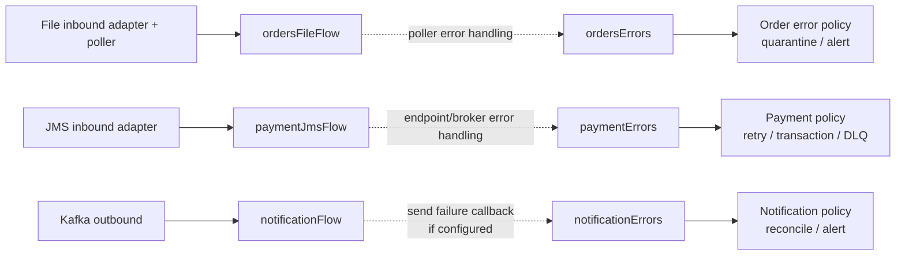
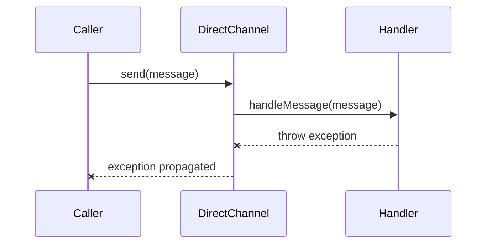
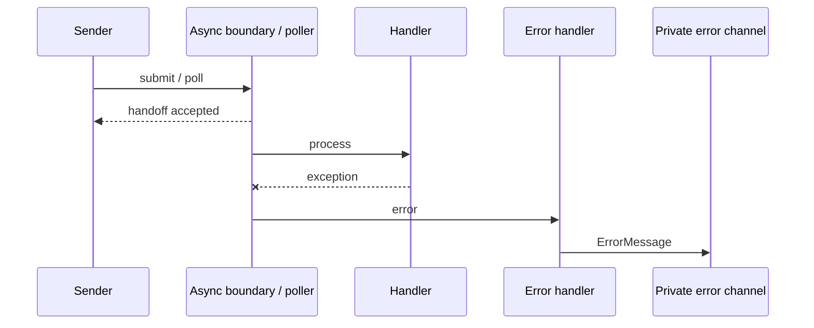
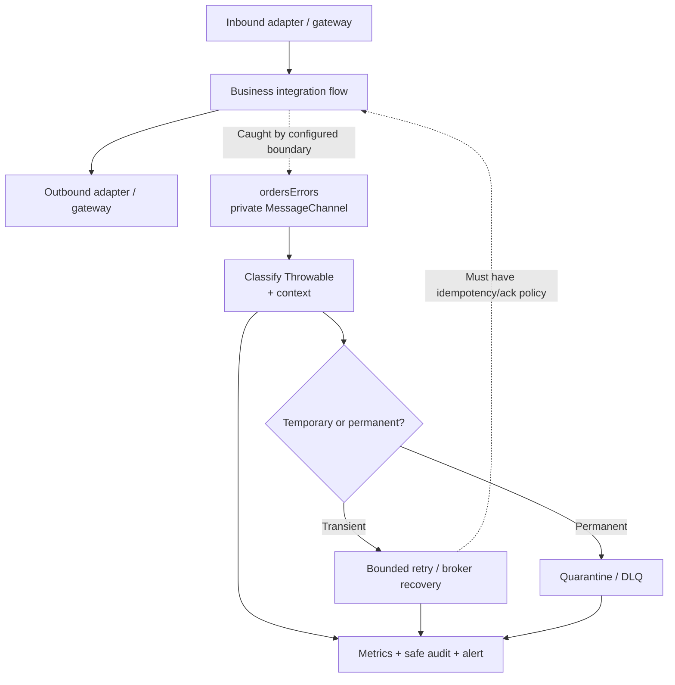
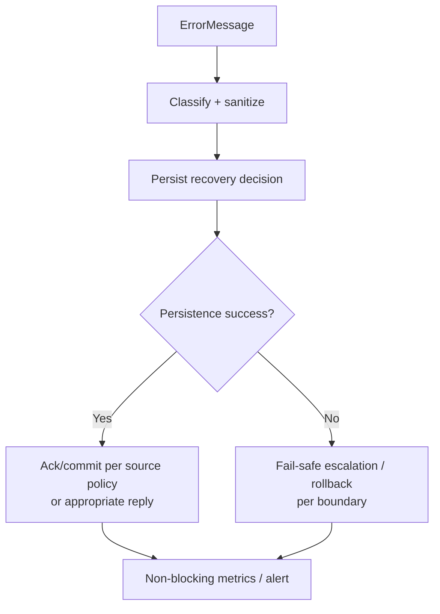

# Private Error Channel per Flow in Spring Integration Adapters

> **Chapter:** Error handling  
> **Module:** `SPRING_INTEGRATION_ADAPTERS`  
> **Scope:** Connecting external systems with Spring Integration via **inbound/outbound adapters, gateways, pollers, and MessageChannels**; applies to **file, SFTP, HTTP, JMS, AMQP, Kafka, and database** flows.  
> **Goal:** Design a **dedicated error channel per integration flow** to isolate failures, classify root causes, preserve message context, and handle retries, quarantine/DLQ, and monitoring, while understanding the boundary between synchronous and asynchronous errors.

## 1. Problem Statement: Why Do We Need a Private Error Channel?

In an integration application, there can be multiple flows receiving and sending data:

- `ordersFileFlow` reads CSV files from a directory, validates data, and saves to the database.
- `paymentJmsFlow` receives payment events from JMS, calls an HTTP API, and emits results.
- `inventorySftpFlow` downloads files from SFTP and reconciles inventory.
- `notificationKafkaFlow` sends events to Kafka.
- `billingAmqpFlow` receives messages from AMQP, updates state, and sends a reply.

These flows have **different error characteristics, SLAs, retry policies, ownership, and business requirements**. If all errors indiscriminately pour into a single place, handling becomes ambiguous:

- Malformed files are retried as if they were network glitches.
- Transient broker errors are sent straight to a DLQ even though they are recoverable.
- A flow with strict audit requirements gets its logs flooded by another flow's errors.
- Errors containing payment personal data are routed to the inventory operations team.
- Error replay accidentally re-runs operations that already produced side effects.
- Metrics and alerts fail to indicate **which flow** is impacted.

A **private error channel per flow** means each flow, or each **processing boundary sharing the same error policy**, has a `MessageChannel` dedicated to receiving related `ErrorMessage` instances. The word "private" in this article refers to **isolation by configuration and responsibility**, and does not automatically imply a special security mechanism, namespace, or channel type in the framework.

### 1.1. A Concrete Scenario

Suppose `ordersFileFlow` needs to move corrupted files to quarantine after attempting processing, whereas `paymentJmsFlow` must preserve the broker transaction so it can redeliver. If both share a handler that "catches exceptions, swallows them, and logs", the JMS transaction might commit even though work never finished, while the file keeps getting re-read and duplicated.

A more appropriate design:



Dashed lines represent **error paths that depend on endpoint type and configuration**, not a guarantee that an exception anywhere automatically becomes an `ErrorMessage` on the adjacent channel.

## 2. Distinguishing Error Channels from Business Processing Flows

Spring Integration uses **Message** with `payload` and `headers` to transfer data through `MessageChannel`. An **integration flow** connects inbound endpoints, channels, transformers, filters, routers, service activators, gateways, and outbound endpoints.

A **business channel** carries normal messages. An **error channel** carries error information, typically an `ErrorMessage`:

```text
Business path:
  inbound source -> Message<?> -> transform -> handle -> outbound

Error path:
  failed task / handler -> ErrorMessage(Throwable, headers, originalMessage?)
                         -> private error channel
                         -> error handler / recovery policy
```

A private error channel does not automatically:

- Retry a message.
- Nack a message from a broker.
- Roll back a database transaction.
- Delete or move a corrupted file.
- Produce the right HTTP response for a client.
- Persist messages durably across restarts.
- Prevent errors from being recorded on the global channel if configuration is incomplete.

Those actions must be explicitly performed by **endpoints, advice, transactions, brokers, or recovery flows**.

### 2.1. Key Terminology

| Term | Role |
|---|---|
| `MessageChannel` | Abstraction for transferring messages between endpoints |
| `DirectChannel` | Sends to subscriber on the same thread in a synchronous model |
| `ExecutorChannel` | Dispatches processing via an executor; changes thread and how errors propagate |
| `QueueChannel` | Buffers messages in the channel's queue; durability depends on configuration |
| `PublishSubscribeChannel` | Delivers to multiple subscribers, synchronously or asynchronously per configuration |
| `ErrorMessage` | Message whose payload is a `Throwable`, optionally carrying original message info |
| `errorChannel` | Global channel name typically created by the framework as a fallback error path |
| `MessagePublishingErrorHandler` | Component that can convert an exception into an `ErrorMessage` and publish to an error channel |
| `MessagingException` | Exception in the Spring Messaging ecosystem, which may carry `failedMessage` |
| `Poller` | Component fetching messages on a schedule; has its own error handling scope |
| `RequestHandlerRetryAdvice` | Retry advice wrapping a handler within the scope where it is applied |
| **DLQ / quarantine** | Mechanism for storing errors for investigation or replay, **not synonymous** with a plain `MessageChannel` |

## 3. Default Model: Global `errorChannel`

Spring Integration provides a global error channel mechanism typically named bean `errorChannel`. Some asynchronous components or pollers use an error handler to publish exceptions there when no specific error destination is set. The default mechanism may include a logging subscriber; exact behavior and configuration depend on version, endpoint, and application context.

Key points to remember:

- **Not every exception goes to global `errorChannel`.**
- A handler on a `DirectChannel` can throw an exception **directly to the caller**.
- A poller can catch errors and publish via `MessagePublishingErrorHandler`.
- A message-driven adapter may have its own error channel or exception/rollback mechanism.
- **Kafka outbound async send** errors may go through a specialized callback/success-failure channel.
- A synchronous gateway can convert exceptions into a response or throw to the client depending on configuration.

Therefore, do not create a separate channel and assume Spring automatically selects it because its name resembles the flow. You must **configure the exact error publishing point** and test it.

### 3.1. When Is the Global Channel Still Useful?

Global `errorChannel` can serve as a fallback for unexpected errors, logging, or "unrouted error" alerts. However, every critical flow should have an explicit error policy rather than relying on a shared handler to guess context from the payload.

A useful control is **alerting when an error from a flow designed with a private channel shows up on the global channel**. That can signal lost headers, an endpoint missing error-channel wiring, or an error occurring outside the configured scope.

## 4. Synchronous vs. Asynchronous Is the Most Important Boundary

Error handling behavior changes dramatically across **threads and boundaries**.

### 4.1. Synchronous Errors on `DirectChannel`



In this typical scenario, the exception is thrown back to the **sender**, not automatically turned into an `ErrorMessage` on a dedicated channel simply because an `ordersErrors` bean exists. If the caller is a **poller** with a configured error handler, the poller can catch the error and publish to that channel. If the caller is an HTTP gateway, it can handle the error according to request–reply semantics.

### 4.2. Errors at an Asynchronous Boundary

With `ExecutorChannel`, pollers, message-driven endpoints, or async send callbacks, the original sender may no longer be on the same thread to receive the exception. An appropriate component will **publish an ErrorMessage**, invoke a callback, throw the error for broker handling, or combine mechanisms depending on configuration.



This diagram is **one configured pattern**, not a mandatory description of every transport.

### 4.3. Decision Table

| Scenario | Where Does the Exception Usually Go? | How to Design Private Handling |
|---|---|---|
| Synchronous handler called directly | Returned to caller via exception | Identify caller; handle at gateway/poller/boundary |
| Handler inside a polling task | Poller/error handler can publish | Configure error channel on the poller |
| Executor/async channel | Error handler on worker thread | Check `ErrorMessage` mechanism at the boundary |
| HTTP inbound gateway | Gateway/request–reply error path | Define explicit HTTP response, status, and reply |
| JMS/AMQP message-driven | Listener/container and error handling | Consider transaction, ack/requeue, and error channel |
| Kafka outbound async | Producer callback or send-failure path | Configure failure channel/callback, monitor confirmation |
| JDBC outbound in transaction | Exception reaches transaction boundary | Choose rollback/retry; do not swallow accidentally |

**Design principle:** Locate **where the exception is actually caught** before deciding where to route `ErrorMessage`.

## 5. What Is a Private Error Channel Actually?

There is no mandatory generic `PrivateErrorChannel` bean type for each Spring Integration flow. A dedicated design can simply be:

1. Define a `MessageChannel` bean with a dedicated name, such as `ordersErrors`.
2. Configure the **appropriate poller or adapter/gateway** to send errors there.
3. Create a consumer that receives `ErrorMessage` and applies the flow's own error policy.
4. Choose storage/notification/retry suited to the source type.
5. Set up monitoring, access control, and retention per flow.
6. Test that errors from flow A are not mistakenly sent to flow B.

A channel name **does not by itself guarantee security privacy**. If you need to restrict access to sensitive data, you must add access control, tenant partitioning, redaction, and auditing.

### 5.1. When to Split Channels?

You can split channels when flows differ in:

- Handling owners and on-call schedules.
- Retry/timeout or transaction policies.
- Message contents and sensitivity levels.
- Transport types and ack/redelivery behavior.
- Quarantine/DLQ and retention rules.
- SLA, alerting, retry counts, and reconciliation requirements.
- Trust zones or tenants.

It is not necessary to create a channel for **every single endpoint** if multiple endpoints share the same error semantics and runbook. But do not merge them just because they run in the same Spring Boot application.

## 6. Recommended Architecture: Business Flow, Private Channel, and Recovery Flow



In this architecture, the error channel is only responsible for **transporting and isolating error events**. Retry or quarantine actions must be designed separately so they do not create loops or lose messages.

### 6.1. Error Policy Should Be Split into Two Parts

**Routing policy:** which channel does the error go to? For example, `ordersErrors`, `paymentsErrors`.

**Recovery policy:** should it retry, who decides, how many times, where is the DLQ, what info is retained, when to alert, and is rollback/negative acknowledgment needed?

Merging both into a single generic "catch everything" handler is hard to test and often breaks transactional semantics.

## 7. Java DSL Example: File Inbound Flow with a Dedicated Poller Error Channel

The example below illustrates a flow that reads order files, dispatches processing, and routes exceptions raised in the **polling task** to a dedicated channel. The code uses standard Spring Integration Java DSL components; method signatures and spec builders should be checked against your active Spring Integration version before going to production.

### 7.1. Flow and Channel Configuration

```java
import java.io.File;
import java.time.Duration;

import org.springframework.beans.factory.annotation.Qualifier;
import org.springframework.context.annotation.Bean;
import org.springframework.context.annotation.Configuration;
import org.springframework.integration.dsl.IntegrationFlow;
import org.springframework.integration.dsl.Pollers;
import org.springframework.integration.file.dsl.Files;
import org.springframework.integration.channel.DirectChannel;
import org.springframework.messaging.MessageChannel;

@Configuration
class OrdersIntegrationConfiguration {

    @Bean("ordersErrors")
    MessageChannel ordersErrors() {
        return new DirectChannel();
    }

    @Bean
    IntegrationFlow ordersFileFlow(OrderImporter importer) {
        return IntegrationFlow
            .from(
                Files.inboundAdapter(new File("/var/app/orders/in"))
                    .patternFilter("*.csv"),
                endpoint -> endpoint.poller(
                    Pollers.fixedDelay(Duration.ofSeconds(2))
                        .maxMessagesPerPoll(10)
                        .errorChannel("ordersErrors")
                )
            )
            .handle(File.class, (file, headers) -> {
                importer.importFile(file);
                return null; // Terminal handler: emits no reply.
            })
            .get();
    }
}

interface OrderImporter {
    void importFile(File file);
}
```

**Explanation:**

- `Files.inboundAdapter(...)` creates a polling file source; it does not automatically create a database transaction.
- `Pollers.fixedDelay(...)` determines the file polling cadence.
- `errorChannel("ordersErrors")` sets the error destination for the **poller** within the scope supported by the endpoint.
- `DirectChannel` delivers `ErrorMessage` to its subscriber synchronously on the publishing thread.
- The handler throws a runtime exception when it cannot process the file; the poller can publish the exception to the configured channel.
- `return null` ends the flow on success; it does not mean the file is archived, moved, or deleted.

**What to verify in a real application:** Java DSL API availability for your version, poller behavior when an exception occurs, subscribers on the error channel, file filter state, and how a file is marked "processed".

### 7.2. Dedicated Handler for `ordersErrors`

```java
import org.springframework.context.annotation.Bean;
import org.springframework.context.annotation.Configuration;
import org.springframework.integration.dsl.IntegrationFlow;
import org.springframework.messaging.Message;
import org.springframework.messaging.MessagingException;
import org.springframework.messaging.support.ErrorMessage;

@Configuration
class OrdersErrorHandlingConfiguration {

    @Bean
    IntegrationFlow ordersErrorFlow(OrdersFailureRecorder recorder) {
        return IntegrationFlow.from("ordersErrors")
            .handle(message -> {
                ErrorMessage error = (ErrorMessage) message;

                Throwable cause = error.getPayload();

                Message<?> failed = error.getOriginalMessage();
                if (cause instanceof MessagingException messagingException
                        && messagingException.getFailedMessage() != null) {
                    failed = messagingException.getFailedMessage();
                }

                recorder.recordSafely(
                    "ordersFileFlow",
                    cause,
                    failed
                );
            })
            .get();
    }
}

interface OrdersFailureRecorder {
    void recordSafely(
        String flowId,
        Throwable cause,
        Message<?> failedMessage);
}
```

This handler **intentionally does not log the raw payload**. `recordSafely` is a business interface to implement classification, redaction, quarantine/metrics persistence, and error control for the recording process itself. Do not forward raw `Throwable.toString()` and `failedMessage` to a public monitoring system because exception messages or payloads may contain PII/secrets.

**Note:** `getFailedMessage()` or `getOriginalMessage()` **may be absent** depending on the error source and how `ErrorMessage` was created. Handlers must tolerate `null` and also rely on correlation IDs, source metadata, and permitted logs.

### 7.3. When There Is No Subscriber

If an error channel has no consumer or the consumer fails, the system may raise a secondary error or fail to record the incident as intended, depending on channel type and configuration. Therefore, test **error flows when the handler fails**, startup health checks, or appropriate fallback mechanisms.

Do not consider declaring `@Bean("ordersErrors")` as completing error-handling implementation.

## 8. Separating Multiple Private Error Channels in the Same Application

Suppose orders and payments must not share a recovery policy:

```java
@Bean("ordersErrors")
MessageChannel ordersErrors() {
    return new DirectChannel();
}

@Bean("paymentErrors")
MessageChannel paymentErrors() {
    return new DirectChannel();
}
```

On endpoints supporting dedicated error channel configuration:

```text
orders poller       -> ordersErrors
payment listener    -> paymentErrors
inventory poller    -> inventoryErrors

ordersErrors        -> order quarantine + ops alert
paymentErrors       -> transaction-aware recovery + finance alert
inventoryErrors     -> SFTP retry + warehouse alert
```

**Do not route solely by a `flowId` header supplied by external data.** A message from an HTTP client or broker can carry a forged header. Error destinations should come from **trusted endpoint configuration** or verified internal context.

### 8.1. Why Use Clear Names?

Names should reflect **business domain and boundaries**:

| Name | Evaluation |
|---|---|
| `ordersErrors` | Easy to identify the flow and owner |
| `paymentsErrors` | Separates SLA and transaction policy |
| `sftpInventoryErrors` | Distinguishes SFTP file source |
| `error2` | Ambiguous in operations |
| `myErrors` | Does not indicate purpose |
| `tenantA.errors` | Suitable if tenant is truly a security boundary |

Dots in bean names are valid in Spring configuration but may affect metrics/naming conventions in other tools; agree on a convention within the team.

## 9. What Does `ErrorMessage` Contain and How Should It Be Handled?

`ErrorMessage` is a message whose `payload` is a `Throwable`. Spring Messaging allows attaching an original message; some exceptions of type `MessagingException` carry `failedMessage`. Not both are always present.

```text
ErrorMessage
  payload: Throwable
    type: MessageHandlingException, ...
    cause: root exception
    failedMessage?: Message<?>
  headers: error metadata / correlation data
  originalMessage?: Message<?>
```

### 9.1. Metadata to Extract for an Error Record

| Field | Useful For | Notes |
|---|---|---|
| `flowId` | Routing/metrics | Take from trusted configuration source |
| `correlationId` | Linking processing chains | Do not use as a credential |
| `messageId` | Event reconciliation | Not present by default on all connectors |
| `transport` | Identifying file, SFTP, HTTP, JMS, Kafka... | Should be normalized internally |
| `resourceRef` | Locating file, topic/partition, destination | May be sensitive |
| `exceptionClass` | Error classification | Avoid logging raw data values |
| `rootCauseCode` | Recovery policy | Use stable codes, not full stack traces |
| `attempt` | Retry budget | Must be controlled at the right layer |
| `firstFailureAt` | SLA and investigation | Avoid resetting on retry |
| `failedPayloadRef` | Quarantine in separate store | Do not copy payloads endlessly into logs |
| `tenantId` | Data isolation | Verify against endpoint/source |
| `policyVersion` | Decision auditing | Helpful for reproducing causes |

### 9.2. Do Not Lose the Cause Chain

An error can have nested layers:

```text
MessageHandlingException
    caused by DataIntegrityViolationException
        caused by constraint violation
```

Classifying solely by the outermost exception collapses every error into "message handling failed". Traverse the cause chain with a bound and map to an **error code** from an allowlist.

However, do not log raw exception messages that might contain SQL parameters, sensitive paths, tokens, or user data. Error codes and reference evidence are usually safer than stack traces on broad dashboards.

## 10. Configuring the `errorChannel` Header and Its Limits

Spring Messaging uses `MessageHeaders.ERROR_CHANNEL`, typically with header name `errorChannel`, to specify an error handling channel in message paths that support that mechanism. The value can be a channel reference or a name resolved against the appropriate context.

Example creating an **internal message** with the header:

```java
Message<String> message = MessageBuilder
    .withPayload("order-123")
    .setHeader(MessageHeaders.ERROR_CHANNEL, "ordersErrors")
    .setHeader("correlationId", "corr-1048")
    .build();
```

The corresponding imports are `org.springframework.messaging.Message`, `org.springframework.messaging.MessageHeaders`, and `org.springframework.messaging.support.MessageBuilder`.

**Important:** setting the header does not guarantee that a synchronously thrown exception in any handler will automatically publish to the channel. The endpoint must support it or have an error handler that actually reads that header. The precedence between **header error channel, endpoint configuration, poller configuration, and global fallback** must also be verified against the endpoint type and version in use.

### 10.1. Do Not Trust Headers from Untrusted Sources

When receiving HTTP headers, Kafka headers, or custom JMS properties, do not allow external callers to dictate the Spring internal error channel by passing an uncontrolled header named `errorChannel`.

A safe strategy:

1. Allowlist headers passing through inbound adapters.
2. Strip or overwrite headers used to control internal routing when necessary.
3. Set the error channel from **endpoint config** or trusted internal enrichment.
4. Test a client sending `errorChannel=paymentsErrors` in an order request.
5. Ensure tenant A cannot force its errors into tenant B's handler.

Per-flow isolation is meaningful only when **routing authority** resides inside the application, not in external input data.

## 11. Pollers and Polling Adapters: Easy Places to Configure Private Error Channels

Inbound adapters such as **file, SFTP, and JDBC polling** fetch messages on a schedule. A poller owns a task execution loop; in the common model, errors inside the task are caught by an error handler and sent to the error channel configured on the poller.

### 11.1. Poller-Level Error Policy

Points to determine:

- Which flow does the poller belong to, and which bean owns it?
- If `receive()` fails before creating a message, what error context exists?
- If a transformer/handler fails, is `failedMessage` available?
- Are exceptions routed to the right private channel?
- Does the error channel have a subscriber before the poller starts?
- Does one failing polling task skip other files/messages in the same batch?
- Is there a mechanism to avoid infinite re-reads or message loss?

### 11.2. Errors Before and After Message Creation

**Before a Message exists:** e.g., the SFTP session fails to connect. `ErrorMessage` may hold a connection exception without an original file payload.

**After a Message exists:** e.g., CSV parsing fails. `MessagingException.getFailedMessage()` may contain the message holding the `File` or transformed payload.

Handlers must not assume a file name or topic/offset is always present on the error. When context is missing, rely on poller/adapter metadata or application-managed correlation data.

### 11.3. Poller Errors Do Not Automatically Make Files "Reprocess Properly"

A file inbound adapter may use an **accept-once** filter or metadata store. Once a file is selected for processing, an exception does not necessarily return the file to the candidate list on the next poll.

You must explicitly design:

- On success, move the file to archive or mark processed.
- On transient error, provide a safe retry schedule, backoff, and idempotency.
- On permanent data error, move to quarantine and record the reason.
- For files still being written, use atomic rename/ready markers or an age filter.
- With multiple instances, use coordination/a shared metadata store to avoid duplicate reads.
- Do not assume file system rollback works like a database transaction.

## 12. File Inbound: Parse Errors and Quarantine

File-reading flows have two common error types:

| Error Type | Example | Appropriate Policy |
|---|---|---|
| **Permanent / invalid data** | CSV missing required column, wrong encoding | Quarantine, notify sender, do not retry infinitely |
| **Transient / system dependency** | Database timeout, downstream service temporarily unavailable | Bounded retry and idempotency |
| **Source readiness** | File still being written, incomplete | Wait until stable, do not treat as bad data |
| **Permission / storage** | Cannot read directory or write archive | Alert infrastructure, throttle or pause |
| **Partial side effect** | Partial inserts before failure | Transaction/idempotency and reconciliation |

### 12.1. What Does a Quarantine Record Need?

```json
{
  "failureId": "fail-order-1005",
  "flowId": "ordersFileFlow",
  "sourceType": "file",
  "sourceReference": "orders/2026-11-23/batch-18.csv",
  "errorCode": "CSV_INVALID_HEADER",
  "firstFailedAt": "2026-11-23T08:30:00Z",
  "attempts": 1,
  "status": "quarantined",
  "payloadStoreRef": "restricted-object-store/ref-1005"
}
```

This is an **illustrative business schema**, not a standard `ErrorMessage` structure. If the payload contains PII, do not store raw CSV directly inside error channel messages/logs. Use a protected area with access control, checksums, retention, and deletion policies.

### 12.2. Summary

A **private error channel** keeps file errors separate from JMS errors, but **accurate quarantine** additionally requires file lifecycle management, duplicate control, and handling in-progress writes.

## 13. SFTP Inbound/Outbound: Connections, Files, and Idempotency

SFTP adds layers of **remote sessions, credentials, networking, directory listings, remote file renames, and local staging**. Errors can occur **before message creation** or mid-transfer.

### 13.1. Classification

| Error | Group | Expected Action |
|---|---|---|
| SFTP server timeout | Transient if applicable | Backoff, retry limit, monitor |
| Authentication failed | Config/secret | Block hot retries, check credentials and rotation |
| Remote file missing | Race or operations | Inspect metadata/listing, do not assume file remains |
| Partial download | Transfer state | Use temp suffix/atomic move where appropriate |
| File content invalid | Permanent data | Quarantine after complete download |
| Remote permission denied | Permissions | Escalate to owner, do not retry infinitely |
| Duplicate file after restart | Idempotency | Persistent accept-once/filter and processing key |

### 13.2. Scoping the Error Channel

You can use `inventorySftpErrors` for SFTP polling errors and `ordersFileErrors` for file parsing errors **if** the two flows have different owners and workflows. Do not split arbitrarily: know at which endpoint exceptions are caught and `ErrorMessage` instances are published.

### 13.3. Be Careful When Replaying

Retrying an SFTP file download can create duplicate local files or duplicate database transactions. Use appropriate business keys/checksums and record state, rather than merely counting retry attempts in the error handler.

## 14. HTTP Inbound/Outbound Gateways: Synchronous Errors Must Return Proper Responses

HTTP gateways typically follow the **request–reply** pattern. Errors need to be translated into **HTTP responses with clear status codes** or exceptions according to Spring Integration/Spring Web mechanisms, not merely sent as an `ErrorMessage` while leaving the caller waiting.

### 14.1. Business Mapping Examples

| Error | Commonly Considered HTTP Result | Notes |
|---|---|---|
| Invalid payload | Appropriate 4xx | Client should not retry until content is fixed |
| Unauthenticated / unauthorized | 401/403 per semantics | Do not leak internal details |
| Resource does not exist | 404 when appropriate | Consider preventing enumeration |
| Downstream timeout | 502/503/504 depending on layer and cause | Requires explicit timeout and retry contract |
| Internal processing error | 500 when appropriate | Include correlation ID, omit stack trace |
| Rate limiting | 429 when aligned with policy | Backoff / Retry-After if applicable |

This table shows **reference classifications**; final status codes must comply with the API's protocol and business rules.

### 14.2. Private Error Channel with a Gateway

Gateways/endpoints can support an error channel and error reply flow; however, you must verify **reply channel, request timeout, reply timeout, and how error results convert into an HTTP response** for that specific gateway type.

If the error flow merely logs and returns `null`:

- The caller may **time out** instead of receiving a structured error response.
- A synchronous exception might propagate instead of going to the channel.
- Sending an `ErrorMessage` does not automatically make the HTTP status 500.

Good design requires an **error response contract** with a trace ID, permitted business error codes, and an accurate HTTP status; keep raw data/stack traces internal.

### 14.3. Outbound HTTP Gateway

When a handler makes an HTTP call to an external system, 4xx and 5xx errors may be handled differently depending on the client and configured error handler. Do not retry all 4xx responses; 429, 503, or network timeouts require examining the provider's policy and **request idempotency**.

## 15. JMS Message-Driven: Private Channels and Transaction Rollback

JMS introduces **acknowledgement and transactions**. An error flow that "receives the error and considers it handled" can affect whether the listener/container commits or rolls back.

### 15.1. Two Design Paths to Separate

**Path A — Broker redelivery:** the exception must reach the corresponding transaction/listener boundary to roll back or trigger redelivery per configuration. The broker must have a retry/redelivery policy and DLQ.

**Path B — Intentional application error handling:** the error handler decides to persist quarantine, write audit logs, and acknowledge the message once recovery work is durably stored.

You cannot assume that a `paymentErrors` consumer returning normally will automatically make JMS roll back. The outcome depends on whether the exception is **rethrown** or how the container receives the error.

### 15.2. Questions You Must Check

- Does the listener use a transacted session, and which ack mode?
- Does publishing the error to the channel mark it as **handled**?
- Is `RequestHandlerRetryAdvice` placed on the right handler?
- Are broker redelivery policy and DLQ configured?
- If the database update succeeded but reply publishing failed, will replay create duplicate side effects?
- Are message IDs, correlation IDs, and delivery count preserved?
- Does the transaction cover the involved resources? Never assume transactions automatically span database, JMS, and HTTP.
- If quarantine fails, how will the transaction behave?

### 15.3. Scenario Table

| Scenario | Expectation |
|---|---|
| Transient DB error before commit | Rollback/redeliver or retry per policy |
| Malformed JSON message schema | No infinite loop; DLQ/quarantine with evidence |
| Payment saved in DB, HTTP callback fails | Outbox/idempotency, decouple side effects |
| Error handler also fails | Clear fallback and never silently ack/lose message |
| Broker DLQ full or unavailable | Alert and fail-safe per business requirements |

**A private error channel is only an incident handling path**, not a replacement for transactional design.

## 16. AMQP: Adapter Errors and Ack/Requeue Decisions

AMQP inbound adapters have listeners/containers and ack/requeue mechanics determined by configuration. You must decide:

- Should transient errors requeue, and how is the **attempt limit** enforced?
- Should permanent payload errors go to a DLQ instead of looping infinitely?
- Are TTL, dead-letter exchange/routing, or retry infrastructure configured?
- Does an error handler receiving `ErrorMessage` alter ack semantics?
- Are publisher confirms enabled for outbound, and who receives publish failures?
- If using manual ack, **who** is responsible for ack/nack?
- When the broker closes the connection, is retry handled by the container or the application?

A flow can use `billingAmqpErrors` to route application errors to recovery logic while the broker manages redelivery/DLQ via container settings. Both systems must **align their decisions**; do not create unbounded two-tier retries.

### 16.1. Poison Messages

A message that consistently fails parsing (poison message) can occupy workers and spam logs if requeued forever. You need a **retry budget**, dead-letter/quarantine, and a replay mechanism after data correction.

Do not place raw bodies containing payment details into public alerts. Use message ID, routing key, and a reference to a protected store instead.

## 17. Kafka: Distinguishing Consumer Errors from Producer Send Failures

Kafka involves **topics, partitions, offsets, consumer groups, and producer acknowledgements**. Do not treat an error channel like a universal exception queue.

### 17.1. Kafka Inbound Consumer

When a Spring Integration Kafka inbound adapter receives a record, understand the mechanics:

- How is the adapter/message listener configured to ack/commit offsets?
- Does the handler fail synchronously or asynchronously?
- Does the consumer pause, retry, seek/replay, publish to a DLT, or commit?
- How are Kafka transactions, databases, or outboxes coordinated?
- Can a poison record stall a partition?
- Does the error message contain sufficient `topic`/`partition`/`offset`/`consumerGroup` or a source reference?

A private `kafkaOrdersErrors` channel can serve audit and policy routing, but **does not automatically commit/nack offsets**. Offset management must be tied to the container and the adapter's error handling.

### 17.2. Kafka Outbound Producer

An **asynchronous send** failure can occur after the initial handler has already returned. Spring Integration Kafka outbound adapters have mechanisms to report send success/failure based on configuration, such as a **send-failure channel** where supported.

Do not assume every producer error automatically flows into the inbound flow's `errorChannel`. Inspect the producer handler, callbacks, delivery timeout, broker acknowledgements, error/failure channels, and library version.

```text
application event
    -> Kafka outbound adapter
       -> accepted for send (does not mean broker confirmed)
       -> success callback / confirmation
       -> failure callback / configured send-failure channel
```

### 17.3. Idempotency When Replaying Kafka

Kafka provides its own producer/consumer mechanisms; however, **exactly-once across a multi-system pipeline** cannot be inferred from Kafka configuration alone. When consuming Kafka and calling HTTP/DB/SFTP, you need idempotency keys, transactions/outbox, or business reconciliation.

## 18. JDBC and Database Polling: Transactions, Locks, and Bad Data

A polling adapter reads rows with `status=NEW`, transforms them, and updates their status. An error can occur during:

- DB reads or connections.
- Parsing row data.
- Calling an external service.
- Writing success/failure status.
- Committing the transaction or concurrent updates.
- An outbound adapter executing SQL with invalid schema/constraints.

### 18.1. Do Not Just Emit ErrorMessage and "Swallow" the Exception

If polling marks a row `PROCESSING` or `DONE` before downstream work and the error handler counts as success, rows can be lost or stuck. You need transaction boundaries and recovery states:

```text
NEW -> CLAIMED -> PROCESSING -> DONE
                 \-> RETRY_WAIT
                 \-> QUARANTINED
```

This is an **illustrative business state model**, not a Spring Integration default.

### 18.2. Mandatory Questions

| Question | Risk |
|---|---|
| Are rows claimed via lock/version or plain SELECT? | Two workers processing concurrently |
| Does the claim have a timeout/lease? | Row stuck if worker crashes |
| What does the transaction span? | Partial success and unexpected rollback |
| Where are permanent errors stored? | Infinite retry |
| Do retries carry an idempotency key? | Duplicate payment/order writes |
| When DB is temporarily unavailable, is the error channel available? | Lost visibility due to shared dependency failure |
| Do error records contain PII? | Data exposure via audit/retry tables |

## 19. Retrying in the Right Place: Before or After Publishing the Error?

A key design decision is choosing the **retry layer**.

### 19.1. Retrying Around a Handler

`RequestHandlerRetryAdvice` can be applied to the corresponding handler. It suits bounded transient errors when combined with a retry template and recovery policy. Verify that the advice covers the exact operation needing retry and does not retry steps that already caused unintended side effects.

### 19.2. Broker/Container Retry

JMS, AMQP, or Kafka have their own redelivery/retry/offset handling mechanisms. You may need the exception to propagate back to the broker boundary. If an error handler already "consumed" the error, the broker may consider processing complete, depending on configuration.

### 19.3. Orchestrated Replay

For file/SFTP/DB or errors requiring intervention, you can record a **replay request** with an idempotency key and payload reference, then reprocess via a dedicated scheduler. This approach needs retention, access control, and protection against concurrent replays.

### 19.4. Retry Budget

```text
attempt 1: immediate
attempt 2: exponential backoff
attempt 3: exponential backoff with jitter
after budget exhausted: quarantine / DLQ + alert
```

This is illustrative, not the optimal retry schedule for every system. Any retry must define **which errors are retryable, max total time, side effects, and owner**.

**Forbidden infinite loop:** ErrorMessage → private channel → resend to business channel → error → private channel... without an attempt cap and idempotency.

## 20. Classifying Errors to Select a Recovery Policy

An operationally friendly taxonomy:

| Category | Examples | Basic Recovery |
|---|---|---|
| `VALIDATION` | Schema error, missing field | Quarantine, notify sender |
| `AUTHENTICATION` | Wrong SFTP/JMS credentials | Check secret/config, stop hot retries |
| `AUTHORIZATION` | API 403, directory permission | Escalate to owner, do not retry infinitely |
| `TRANSIENT_NETWORK` | Timeout, temporary DNS/network | Bounded retry/backoff |
| `RATE_LIMIT` | HTTP 429 | Respect provider's retry policy |
| `DEPENDENCY_UNAVAILABLE` | DB/broker unavailable | Circuit breaker/pause/backoff |
| `DATA_CONFLICT` | Duplicate key/optimistic lock | Check idempotency and business rules |
| `BUSINESS_REJECTION` | Invalid order | Business state and appropriate notification |
| `UNEXPECTED` | Null pointer, handler bug | Alert, preserve evidence, do not retry blindly |
| `RECOVERY_FAILURE` | Failed to write DLQ/quarantine | Escalate; fail-safe per source and transaction |

Classify using **exception types and reliable information**, not just exception message strings that can change or contain sensitive data.

### 20.1. Avoid Misclassifying 4xx Errors

Not every HTTP 4xx is permanent: `429 Too Many Requests` can be retried after an appropriate delay, whereas `400 Bad Request` due to an invalid schema typically requires fixing the data. Policies must align with the downstream API documentation.

## 21. How Do DLQ, Error Channel, and Quarantine Differ?

| Component | Function | Durable by Default? | Retries Automatically? |
|---|---|---|---|
| Private `DirectChannel` | Synchronously passes `ErrorMessage` to handler | No | No |
| `PublishSubscribeChannel` | Dispatches errors to multiple subscribers | Not by default | No |
| `QueueChannel` | Buffers messages in the channel | Depends on message store/config | Not by default |
| Broker DLQ/DLT | Stores failed messages inside the broker | Per broker/config | Needs replay policy |
| Quarantine object store | Stores failed payloads/files for investigation | Depends on infrastructure | No |
| Retry scheduler/table | Tracks schedule and attempts | Per implementation | Yes, per built policy |
| Audit/metrics | Observes status | Depends on backend | No |

**A private error channel is not a DLQ.** If the process crashes before the error handler persists the message durably, an `ErrorMessage` on a `DirectChannel` usually will not survive a restart for replay.

### 21.1. Defining "Handled" Clearly

An error should only be considered **handled** when the policy has completed its required action, such as:

- Persisted quarantine state along with the payload reference.
- Decided to roll back so the broker can redeliver.
- Sent a valid error response to the HTTP caller.
- Written a work item to a durable retry scheduler.
- Emitted an appropriate alert when operations action is needed.

**Writing a single log line** may not be enough to protect business integrity.

## 22. Error Handlers Can Fail Too

If the `ordersErrors` handler calls a quarantine database and that database is unavailable, a **secondary failure** occurs. With a synchronous channel, the subscriber's exception may return to the publishing thread; with an asynchronous channel, behavior depends on the executor and error handling.

### 22.1. Safe Structure



Design per transport; **do not automatically ack every source** after persisting, especially when transaction or processing semantics differ.

### 22.2. Preventing Infinite Error Loops

Do not let errors inside a private error handler loop infinitely back into that same handler. You can use:

- A dedicated fallback handler with minimal scope.
- An independent alerting mechanism that does not rely on the failing infrastructure.
- Bounded retries for writing recovery records.
- A circuit breaker or adapter pause when recovery storage is unavailable.
- Escalation and a protected manual runbook.

### 22.3. Separating Alerts from Evidence Persistence

Metrics/logging should generally **not alter transaction outcomes**. Saving to quarantine may be a mandatory business condition. Do not combine both responsibilities into one method where a metric failure causes message loss.

## 23. Choosing the Private Channel Type

| Channel | Good For | Trade-offs to Consider |
|---|---|---|
| `DirectChannel` | Simple, synchronous single-consumer error handling | Consumer throws can affect publisher; non-durable |
| `PublishSubscribeChannel` | Multiple subscribers like audit, alert, recovery | Fan-out, ordering, per-subscriber error handling, executor |
| `ExecutorChannel` | Avoiding blocking publisher on slow subscribers | Async exceptions, task rejection, lost transaction context |
| `QueueChannel` | Buffering errors and decoupling speed | Queue capacity, message store, consumer lifecycle, overflow |
| Channel backed by persistent store | Appropriate durability | Transactions, retention, replay, size, and backpressure |

**There is no "best" channel for every flow.** The choice depends on SLAs, transaction boundaries, and durability needs.

### 23.1. When Using `PublishSubscribeChannel`

If errors must be sent simultaneously to recovery, audit, and metrics, consider ordering and criticality:

- Recovery may determine the business outcome.
- Audit preserves evidence.
- Metrics/alerts should not disrupt the main handling path when avoidable.
- One failing subscriber can affect remaining subscribers depending on synchronous mode and configuration.

Designs should be tested when **one of multiple subscribers fails**, rather than assuming fan-out always succeeds.

## 24. Security and Sensitive Data in Error Channels

An `ErrorMessage` can carry the **entire `failedMessage` payload**, headers, and exception context. This easily leaks PII or credentials if a logger calls `message.toString()`.

### 24.1. Safe Logging Rules

Log:

- Flow ID, transport, error type, cause code.
- Correlation ID, timestamp, attempt.
- Privacy-reviewed resource reference.
- Handling status and owner.
- Reference to evidence/quarantine in an access-controlled store.

Do not log:

- Bearer tokens, API keys, session cookies.
- TOTP/recovery secrets or private keys.
- Personal payment details or unnecessary identifying data.
- Raw request/response bodies if they contain sensitive data.
- All external headers unfiltered.

### 24.2. Per-Flow Privacy Does Not Automatically Isolate Tenants

Two tenants sharing `ordersErrors` could let tenant A's operators view tenant B's errors. You need tenant scoping in data contracts, access permissions on recovery records, access auditing, and trusted routing.

If partitioning by tenant, do not allow external messages to set their own tenant ID to route into another tenant's error channel.

### 24.3. Error Retention

Quarantine records, audits, and copies of failed payloads also require retention/deletion policies. Repeated replays must not duplicate sensitive data indefinitely. Account for backups, dead-letter topics/queues, and vendor monitoring.

## 25. Per-Flow Observability: Enough to Operate, Without Leaking Payloads

A consolidated dashboard can include:

| Metric | Meaning |
|---|---|
| `integration_errors_total{flow,errorCode}` | Error count by flow and type |
| `error_handling_failures_total{flow}` | Count of failures in the error handler itself |
| `retry_attempts_total{flow}` | Retry volume, detecting hot loops |
| `quarantine_records_total{flow}` | Number of records awaiting action |
| `quarantine_oldest_age_seconds{flow}` | Age of oldest unresolved error |
| `dlq_messages_total{source}` | Number of messages in dead-letter |
| `broker_redelivery_total{flow}` | Redelivery volume at broker source |
| `source_to_success_latency_seconds{flow}` | Processing latency from source to confirmation |
| `unrouted_errors_total` | Errors appearing outside expected channels |
| `replay_success_total{flow}` | Recovery rate after fixes |

Metric names are **illustrative**, not metrics Spring Integration automatically creates. You can use Micrometer/system observability, but standardize names and label types.

**Avoid high-cardinality labels:** do not put `personId`, email, unique file paths, message IDs, or raw exception messages into metric labels. Use trace IDs and authorized logs to query individual cases.

### 25.1. Meaningful Alerts

- Transient errors spiking and retries nearly exhausting budget.
- Quarantine items sitting too long without an owner.
- Critical flow having zero successful messages in an expected window.
- Error handler failing or recovery store unavailable.
- Errors meant for a private channel appearing on global `errorChannel`.
- Abnormal redelivery/commit mismatch rates.
- Batch files quarantined en masse after a schema change.

## 26. Testing the Exact Error Path, Not Just the Happy Path

A good test must prove that **an exception raised at the exact failure site is routed properly**, not merely send a hand-crafted `ErrorMessage` directly to a channel and assert the handler was called.

### 26.1. Test Matrix

| Test | Input / Fault | Expectation |
|---|---|---|
| Poller source failure | SFTP connection timeout | `inventorySftpErrors` receives error or defined endpoint behavior triggers |
| File parse failure | Malformed CSV | `ordersErrors` receives error; file handled per quarantine policy |
| Other flow isolated | Malformed CSV in orders | `paymentErrors` is not triggered |
| Synchronous handler throws | Call `DirectChannel` directly | Exception propagates if no error boundary |
| Null failedMessage | Exception without attached message | Handler does not NPE, still logs metadata |
| Error handler throws | Quarantine store unavailable | Fallback/rollback per design, no silent loss |
| Message header injection | Client sends `errorChannel=paymentsErrors` | Endpoint rejects unauthorized routing |
| Transient retry | One-time DB timeout | Bounded retry without duplicate writes |
| Poison message | Persistent invalid schema | Sent to DLQ/quarantine, no hot loop |
| HTTP gateway failure | Downstream timeout | Client receives response/timeout per contract |
| JMS rollback | Error before commit | Broker redelivery/ack matches configuration |
| AMQP requeue | Permanent error | No infinite requeue, DLQ per policy |
| Kafka send failure | Producer callback fails | Send-failure path recorded, reconciled |
| Kafka offset behavior | Consumer handler fails | Commit/retry/DLT follows policy |
| Restart during error | Kill process before persist | Recovery prevents data loss beyond policy |
| Replay same message | Resend same idempotency key | Side effects are not duplicated |
| Sensitive payload | Failed message contains mock token | Logs/metrics do not expose token |
| Multi-tenant | Error in tenant B | Recovery records viewable only by authorized users |
| No subscribers | Misconfigured private channel | Test or health checks fail |
| Global fallback | Endpoint forgot private routing | Monitor detects unexpected unrouted error |

### 26.2. A Valuable Manual Test

1. Start the application with **ordersFileFlow** and **paymentJmsFlow** in a controlled environment.
2. Create a schema-invalid CSV file and place it in the orders source.
3. Confirm the error originates from the **actual polling task**.
4. Inspect evidence on `ordersErrors`, classification, and quarantine status.
5. Confirm `paymentErrors` has no corresponding event.
6. Confirm the file was not marked as successfully processed.
7. Fix the file or restore dependencies and replay per policy.
8. Verify the database has no duplicate records and logs contain no sensitive payloads.
9. Repeat with a connector error or an error occurring **before a message exists**.
10. Document any differences if the version/endpoint behaves differently and fix the configuration.

**Do not only test consumers by manually fabricating ErrorMessage:** that does not prove the poller/adapter actually routed the exception to the channel.

## 27. Example Error Contract Design Across Multiple Adapters

A multi-flow system can standardize **error metadata** while each flow retains its own channel and policy.

```json
{
  "failureId": "fail-2048",
  "flowId": "inventorySftpFlow",
  "transport": "sftp",
  "tenantId": "corp-a",
  "correlationId": "corr-884",
  "errorCode": "REMOTE_IO_TIMEOUT",
  "classification": "transient",
  "firstFailedAt": "2026-11-23T09:10:00Z",
  "attempt": 2,
  "recoveryDecision": "retry-later",
  "sourceReference": "remote-file-ref-18",
  "payloadReference": null,
  "policyVersion": "integration-errors-v3",
  "ownerTeam": "inventory-platform"
}
```

This is a **custom business contract**, not a mandatory Spring `ErrorMessage`. Extract metadata from the root exception at a trusted boundary and attach a correlation ID at the start of the flow whenever possible.

### 27.1. Benefits

- Unified dashboards even across different flow adapters.
- Avoids forcing teams to share raw payloads.
- Easy separation between transient and permanent errors.
- Tracks retry budget/age/owner.
- Reconcilable with broker DLQs or quarantine records.

### 27.2. Risks to Avoid

Do not turn the normalized error record into a full copy of the original message. The goal is **observability and orchestration**, not recreating a PII-filled data lake inside the error pipeline.

## 28. Per-Flow Operational Runbook Template

### 28.1. When `ordersErrors` Spikes

1. Check error codes and source file patterns.
2. Determine whether it is a schema issue or DB dependency failure.
3. If schema error, check upstream changes, quarantine, and notify sender.
4. If DB timeout, check DB health and retry budget.
5. Check files marked processed/accept-once and replay readiness.
6. Use idempotency keys/checksums to prevent duplicate writes.
7. Verify counts of succeeded, quarantined, and unprocessed records.
8. Verify payloads/PII do not appear in public logs.
9. Close only after resolving both backlog and root cause.

### 28.2. When `paymentErrors` Increases

1. Check broker/listener/container, transaction/ack mode.
2. Determine whether failure occurred before or after database commit.
3. Never blindly replay payment transactions without idempotency.
4. Check DLQ, redelivery count, and dead-letter policy.
5. Verify there are no double charges or lost events.
6. Stop hot retries for permanent errors; notify the owner.
7. Monitor alerts and telemetry until broker/backlog stabilizes.

### 28.3. When Errors Leak into Global `errorChannel`

1. Identify the exception source, thread, and originating endpoint.
2. Inspect poller, inbound adapter, gateway, or producer callback config.
3. Check whether the `errorChannel` header was stripped, lost, or overwritten.
4. Verify the private channel bean has the exact expected name and subscriber.
5. Write an integration test reproducing the error at that exact boundary.
6. Fix configuration without breaking transaction/ack semantics.
7. Add an alert to detect recurrence.

## 29. Common Anti-Patterns

**"Naming it `flowErrors` makes the framework use it automatically."** Spring Integration requires an endpoint, poller, or error handler configured to publish to that channel.

**"Every exception reaches global `errorChannel`."** Synchronous errors can propagate directly; some adapters have their own error mechanisms.

**"One private channel per flow guarantees tenant isolation."** You also need access control, trusted scope/headers, and separation of sensitive data.

**"Having an `ErrorMessage` means the broker will roll back."** Ack/rollback depends on the source, listener/container, and exception propagation.

**"Catching the exception and logging counts as success."** Can lose messages or mask transaction errors; recovery must produce durable results or proper propagation.

**"DirectChannel is a durable error queue."** It is a synchronous dispatch channel and does not persist messages across restarts.

**"Retry every exception."** Validation/auth failures will not fix themselves; infinite retries cause hot loops and backlogs.

**"The error flow can call the business flow indefinitely."** Enforce attempt caps, idempotency, and dead-lettering when budget is exhausted.

**"Failed files automatically reappear on the next poll."** Accept-once filters/metadata may have already recorded the file; an explicit file lifecycle is needed.

**"Kafka send succeeded when the method returned."** The producer may send asynchronously; inspect confirmations and failure callbacks/channels.

**"HTTP gateway just needs to send ErrorMessage for the client to get 500."** You must explicitly design request–reply, status codes, and error responses.

**"Using the same transaction for JMS, HTTP, and DB is automatically atomic."** Cross-system transactions do not happen automatically; use idempotency/outbox or appropriate patterns.

**"Every `ErrorMessage` has `failedMessage`."** Connection errors before message creation may have no original payload.

**"Printing stack traces and messages is harmless."** Exceptions, headers, or payloads can contain PII and tokens.

**"Attaching `flowId` from an inbound header is enough for routing."** External data can be spoofed; derive routing context from trusted endpoints.

**"Having a DLQ means no owner or retention is needed."** DLQ/quarantine can contain sensitive data and requires a replay workflow and retention limit.

## 30. Per-Flow Private Error Channel Design Checklist

| Question | Required Evidence |
|---|---|
| Have each flow and owner been identified? | Flow inventory, SLA, and data contract |
| Is there a boundary between business path and error path? | Diagrams, endpoint configuration |
| Do you know which thread exceptions originate on? | Real sync/async tests |
| Are propagated exceptions distinguished from `ErrorMessage` errors? | Boundary-level integration tests |
| Are private error channel beans and subscribers present? | Spring config, health/bean tests |
| Is the poller configured with the right error channel? | Poller spec and test with real source |
| Do message-driven adapters have error/ack policies? | JMS/AMQP/Kafka listener config |
| Does the HTTP gateway have an error response contract? | Status, timeout, reply tests |
| Does the Kafka producer monitor callbacks/failures? | Send confirmation/failure tests |
| Is missing `originalMessage` on `ErrorMessage` handled? | Null-safe error handler tests |
| Is there a transient/permanent taxonomy? | Classification table and examples |
| Does retry have reasonable budget/backoff/jitter? | Retry config and attempt tests |
| Are retry loops and duplicate side effects prevented? | Idempotency keys, replay tests |
| Are transaction/ack semantics consistent? | Rollback/redelivery/DLQ tests |
| Do File/SFTP filters support intentional replay? | Metadata store, quarantine policy |
| Are quarantine/DLQ durable and owned? | Storage config and monitoring |
| Does a failing error handler have a fallback? | Failure injection and recovery tests |
| Are errors isolated across flows? | Cross-flow isolation tests |
| Are routing headers protected? | Header allowlist, injection tests |
| Is tenant/data isolation enforced? | ACLs, scope verification |
| Do logs strip unnecessary secrets/PII? | Redaction tests and sample logs |
| Are metrics free of high-cardinality PII? | Label schema, telemetry review |
| Is global `errorChannel` monitored? | Unrouted error alerts |
| Are errors tested across restart/DR? | Recovery tests and backlog checks |
| Is completion verified at the destination? | DB/broker/file/HTTP outcomes |
| Are runbooks available for owners and escalation? | On-call, alert, incident playbooks |
| Is retention defined for error payloads and audits? | Quarantine/DLQ policies |
| Are tests re-run after adapter/version changes? | Regression suite and change gates |

## 31. Comprehensive Lab: Two Flows, Two Error Policies

### 31.1. Problem Statement

A Spring Boot + Spring Integration application runs:

- **Flow A:** polls order CSV files every 2 seconds, parses, and writes to PostgreSQL.
- **Flow B:** receives payment events from JMS, calls a partner API, and updates transactions.

Errors to handle:

1. CSV missing `orderId` column.
2. PostgreSQL timeout in Flow A.
3. JMS payment JSON fails schema validation.
4. Partner HTTP API returns 503 in Flow B.
5. Quarantine persistence handler is unavailable.
6. HTTP client error occurs before the application handler catches it.
7. A misconfiguration causes Flow B to publish errors to `ordersErrors`.

### 31.2. Proposed Design

| Error | Detection Point | Policy |
|---|---|---|
| 1 | Orders parse handler | `ordersErrors` → quarantine, no hot retry |
| 2 | Orders DB handler | Bounded retry/transaction + error handling, no duplicate writes |
| 3 | JMS listener/parse handler | Nack/rollback or DLQ per broker/container config |
| 4 | HTTP outbound in payment flow | Conditional retry, idempotency, and clear outcome |
| 5 | Error recovery handler | Fail-safe, alert, preserve message per source policy |
| 6 | HTTP gateway/client boundary | Inspect actual exception propagation/reply/failure path |
| 7 | Cross-flow routing | Fix endpoint configuration, test isolation |

### 31.3. Proof Requirements

- At least two private error channels with no cross-routing.
- Tests for real errors passing through **poller/file** and **JMS listener**.
- Business outcome record for every message.
- Verified retry budget and quarantine/DLQ.
- Test proving retry after partial success does not duplicate transactions.
- Handling when `failedMessage` is `null`.
- No raw payment data, bearer tokens, or identifying info in alerts.
- Backlog and error processing time reporting per flow.

### 31.4. Self-Check Questions

1. Why is an exception thrown by a `DirectChannel` handler not guaranteed to go to a private error channel?
2. How does configuring `errorChannel` on a poller differ from setting the header on a business `Message`?
3. If the `paymentErrors` consumer handles the exception successfully, will the JMS broker definitely roll back?
4. When SFTP fails to connect, why might `ErrorMessage` lack an original file message?
5. Once a file passes an accept-once filter, is retrying by simply re-polling enough?
6. Why must Kafka outbound errors inspect callbacks/confirmations instead of just the `send` call?
7. When a record is saved to the DB but the HTTP send fails, what mechanism prevents duplicate side effects?
8. When the error handler itself fails, what should determine the transaction outcome?
9. Why can `failedMessage.toString()` be a data exposure risk?
10. How do you prove Flow A errors are never misdispatched to Flow B's handler?

**Hint:** always start from **error source, thread/boundary, exception catch point, transaction/ack, and idempotency**, before deciding channels and recovery.

## 32. Key Takeaways

**Private error channel per flow** is a design pattern for **isolating error-handling responsibilities of each integration flow**, not magic that automatically catches, retries, or rolls back every exception. To use it effectively in **Spring Integration Adapters**, you need to know whether an error originates in a **synchronous DirectChannel, polling task, message-driven adapter, HTTP gateway, or async callback**. That **boundary** determines whether the error propagates to the caller, gets wrapped into an `ErrorMessage`, or is handled by the broker via ack/requeue/transaction.

With **file/SFTP**, think about filters, quarantine, and controlled replay. With **HTTP**, define response status and timeout contracts. With **JMS/AMQP**, handle acks, transactions, redelivery, and DLQs. With **Kafka**, distinguish consumer offsets from producer confirmation/failure channels. With **databases**, design transactions, claim/lease, and idempotency. In every flow, store error metadata safely, keep PII/secrets out of logs, and establish clear remediation paths.

A reliable design answers four questions: **"Where did the error occur?"**, **"Who turns the exception into an ErrorMessage or handles it directly?"**, **"What happens to the message and transaction after the error?"**, and **"Is there concrete evidence that recovery succeeded without creating duplicate side effects?"**

### References

- [Spring Integration Reference — Error Handling](https://docs.spring.io/spring-integration/reference/error-handling.html): error channels, error messages, and exception handling.
- [Spring Integration Reference — Messaging Channels](https://docs.spring.io/spring-integration/reference/channel.html): Direct, Queue, Executor, and PublishSubscribe channels.
- [Spring Integration Reference — Polling Consumer](https://docs.spring.io/spring-integration/reference/endpoint.html): scheduling/poller and endpoint lifecycle.
- [Spring Integration Reference — Java DSL](https://docs.spring.io/spring-integration/reference/dsl.html): configuring IntegrationFlow in Java.
- [Spring Integration Reference — File](https://docs.spring.io/spring-integration/reference/file.html), [SFTP](https://docs.spring.io/spring-integration/reference/sftp.html), [HTTP](https://docs.spring.io/spring-integration/reference/http.html), [JMS](https://docs.spring.io/spring-integration/reference/jms.html), [AMQP](https://docs.spring.io/spring-integration/reference/amqp.html), [Kafka](https://docs.spring.io/spring-integration/reference/kafka.html), and [JDBC](https://docs.spring.io/spring-integration/reference/jdbc.html): per-adapter specifics.
- [Spring Framework API — ErrorMessage](https://docs.spring.io/spring-framework/docs/current/javadoc-api/org/springframework/messaging/support/ErrorMessage.html): message type carrying a Throwable and optional original message reference; verify specific API against your active version.

> **Version Note:** Java DSL examples and API names in this lesson illustrate the design approach. When applying to a project, check against the versions of **Spring Integration, Spring Framework, and Spring Boot** in use; specifically verify poller, error channel, gateway, and module-specific adapter overloads with integration tests. This lesson does not replace execution testing or dedicated Content QA.
