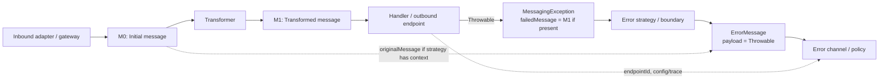
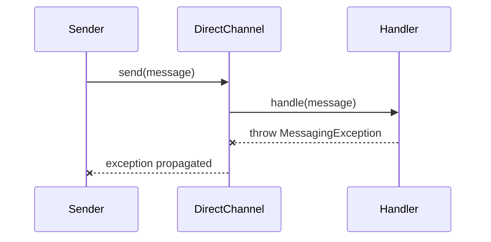
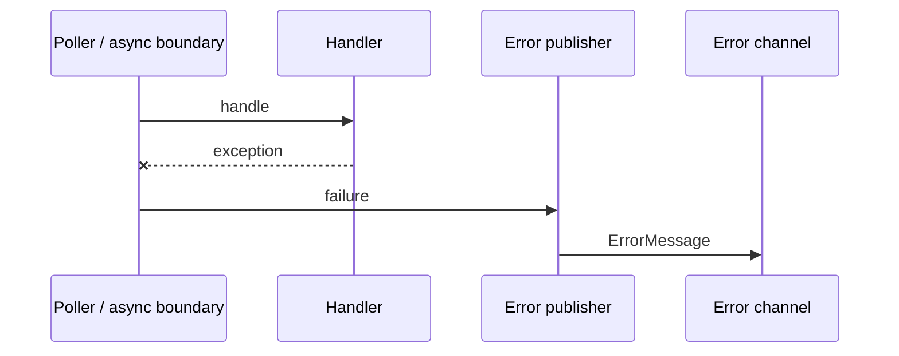
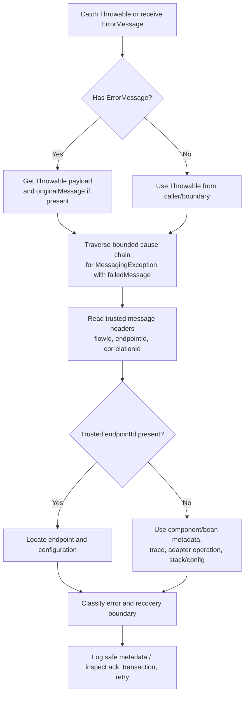
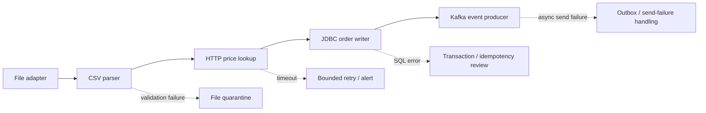

# failedMessage and failedEndpoint: Tracing Failing Messages and Endpoints in Spring Integration Adapters

> **Chapter:** Error handling  
> **Module:** `SPRING_INTEGRATION_ADAPTERS`  
> **Context:** Connecting external systems to Spring Integration via inbound/outbound adapters, gateways, pollers, and `MessageChannel`; handling files, SFTP, HTTP, JMS, AMQP, Kafka, and databases.  
> **Goal:** Correctly inspect the failing message using `MessagingException.getFailedMessage()`, distinguish it from `ErrorMessage.getOriginalMessage()`, and trace the **failed endpoint** using verifiable facts rather than assuming a field is always populated. From there, decide on retries, rollbacks, quarantine/DLQ, error responses, and safe monitoring.

## 1. Problem Statement: Knowing What Failed Is Not Enough

An application has an order processing flow:

```text
SFTP inbound -> file parser -> validate -> HTTP enrichment -> JDBC writer -> Kafka outbound
```

If monitoring only logs `IllegalArgumentException` or `MessageHandlingException`, the operations team struggles to know:

- **Which data failed?** Which file, record, message, or request?
- **At which step did it fail?** Parsing, validation, HTTP call, JDBC insert, or Kafka send callback?
- **Did the error happen before or after payload transformation?** A file may become an object and then JSON.
- **Were any prior side effects created?** The database may have committed before Kafka send failed.
- **Who owns remediation?** SFTP owner, HTTP service, DBA, or Kafka team?
- **Is it safe to retry?** Retrying from the start of the flow could duplicate transactions.
- **What response does the user or broker expect?** HTTP 4xx/5xx, JMS rollback, AMQP requeue, Kafka offset/DLT, or file quarantine.

Spring Integration provides key pieces of context such as `MessagingException.getFailedMessage()` and `ErrorMessage.getOriginalMessage()`. Identifying the **failed endpoint** requires combining configuration details, tracing/correlation, and context reliably attached by the application.

**Key point:** `failedMessage` is a real API on `org.springframework.messaging.MessagingException`. The term `failedEndpoint` in the title is used to mean **the failing endpoint to trace**; **do not assume** every `ErrorMessage` or `MessagingException` has a built-in `getFailedEndpoint()` method or a standard header named `failedEndpoint`.

## 2. Four Layers of Error Context

| Layer | Question | Typical Technical Data |
|---|---|---|
| **Throwable** | What error occurred? | Exception type, cause chain, sanitized message |
| **Failed message** | What was the message at the failure point? | `MessagingException.getFailedMessage()` |
| **Original/input message** | Which message was at the boundary known to the error strategy? | `ErrorMessage.getOriginalMessage()` if provided |
| **Failed endpoint** | Which specific component failed? | Endpoint ID, flow ID, bean/config source, trace/span, transport metadata |

Add a fifth layer in operations: **outcome**. Has it rolled back, retried, quarantined, nacked, committed offset, or moved to DLQ? Having `failedMessage` and `failedEndpoint` without knowing the outcome is still not enough to confirm a message was handled.

### 2.1. Their Positions in the Pipeline



This diagram is **one illustrative scenario**, not a contract for every adapter:

- `failedMessage` may be `M1` because the error occurred after the transformer.
- `originalMessage` may be `M0` if the error strategy had this reference.
- If the error occurred **before creating a Message**, one or both values may be absent.
- Endpoint ID may have to come from application-added metadata; it does not necessarily appear inside `Throwable`.

## 3. Classes and APIs That Actually Exist

| Concept | API/Type | Remember |
|---|---|---|
| Business message | `org.springframework.messaging.Message<T>` | Payload and headers |
| Message-context exception | `org.springframework.messaging.MessagingException` | Has `getFailedMessage()`, result can be null |
| Message handling error | `org.springframework.messaging.MessageHandlingException` | Extends `MessagingException` |
| Message delivery error | `org.springframework.messaging.MessageDeliveryException` | Can also carry a failed message |
| Error message | `org.springframework.messaging.support.ErrorMessage` | Extends `GenericMessage<Throwable>` |
| ErrorMessage payload | `error.getPayload()` | A `Throwable`, not guaranteed to always be a `MessagingException` |
| ErrorMessage original message | `error.getOriginalMessage()` | Nullable; distinct from failed message |
| Error routing header | `MessageHeaders.ERROR_CHANNEL` | Typically `errorChannel`; a destination, not the failing endpoint |
| Endpoint/component name | Bean ID or application-assigned ID | Must verify configuration and where the error arose |

**There is no single "IntegrationError" object containing all of these fields in every flow.** The sender, component, retry mechanism, and error strategy determine which pieces of context are created and retained.

### 3.1. Reading the `ErrorMessage` Structure Properly

```text
ErrorMessage
  |
  +-- payload: Throwable
  |     +-- cause: Throwable? ...
  |     +-- failedMessage: Message<?>?    [when Throwable is MessagingException]
  |
  +-- originalMessage: Message<?>?       [belongs to ErrorMessage]
  |
  +-- headers: MessageHeaders            [headers of ErrorMessage]
```

`failedMessage` is **not** a fixed top-level field of `ErrorMessage`. It is accessed **through the exception payload** when the payload is a `MessagingException` (or matching exception in the cause chain).

## 4. Which Message Is `failedMessage` Actually?

`MessagingException#getFailedMessage()` returns the message associated with the exception when the exception was created. For a `MessageHandlingException` wrapped by the framework around a handler failure, this is usually the **message arriving at the failing handler**.

Pipeline example:

```text
M0: payload=File("/orders/batch-18.csv")
       |
       v
transform File -> OrderBatch
       |
       v
M1: payload=OrderBatch(batchId="batch-18", orders=[...])
       |
       v
JDBC writer throws DataIntegrityViolationException
       |
       v
MessageHandlingException(failedMessage=M1, cause=...)
```

Looking at `failedMessage` and claiming it is always the **original file** is wrong. It can contain the **transformed payload**, with headers forwarded/copied across transformers.

### 4.1. What `failedMessage` Does Not Guarantee

- It is not always present.
- It is not necessarily the first message created by the inbound adapter.
- It may not preserve all headers from before a transformer, splitter, or router.
- It does not mean the sender was nacked or the transaction rolled back.
- It does not prove the fault lies in the message itself rather than an external dependency.
- It does not imply the payload can still be replayed from the start of the flow.
- It is not automatically safe to serialize completely into logs or DLQs.

### 4.2. When the Root Exception Is Not a `MessagingException`

An `IOException` from a remote server, `SQLException`, `TimeoutException`, or a plain Java application exception can arise before framework wrapping, or be passed directly by a handler. In those cases, do not blindly call `getFailedMessage()` on every `Throwable`. Check the type and cause first.

## 5. How Does `originalMessage` Differ from `failedMessage`?

`ErrorMessage#getOriginalMessage()` returns the initial message at the point where the **ErrorMessage was constructed** if the creator provided it. The source may be an error strategy that received the input message in its context.

| Property | `failedMessage` | `originalMessage` |
|---|---|---|
| Where it lives | `MessagingException` | `ErrorMessage` |
| Meaning | Message linked to the handling error | Input message retained at error message creation |
| Nullable? | Yes | Yes |
| After transformer | May be the transformed message | May be an earlier message |
| Guaranteed to be the original broker/file message? | Not guaranteed | Not guaranteed |
| Guaranteed safe source for replay? | Not guaranteed by itself | Not guaranteed by itself |
| Available for unpublished synchronous exceptions? | Possibly on the exception | No `ErrorMessage` if not created |

A completely valid `ErrorMessage` can be constructed solely with `new ErrorMessage(exception)` and have **no** original message.

### 5.1. Different Scenarios

```text
A. CSV parse fails directly in the handler:
   failedMessage: Message<File> or Message<String> depending on flow
   originalMessage: may be the same message if strategy knows the input

B. Validation fails after transformer:
   failedMessage: Message<OrderBatch>
   originalMessage: may be Message<File> or initial boundary message

C. SFTP connection failed in receive():
   failedMessage: may be null
   originalMessage: may be null

D. Kafka outbound producer callback failed after send():
   callback/error path: adapter-dependent, may carry record/source metadata
   failedMessage/originalMessage: must inspect the specific error emission mechanism
```

**Test these exact values at real boundaries**, rather than designing recovery on the assumption that "at least one of the two is always present".

## 6. `failedEndpoint`: Use the Right Meaning, Do Not Invent APIs

An endpoint in Spring Integration is an application component wiring messages to a handler or adapter, such as a service activator, transformer, inbound polling consumer, message-driven adapter, gateway, or outbound adapter.

**Failed endpoint** in practical terms means **the endpoint executing when the error occurred** or the endpoint responsible for the failed operation. This is a diagnostic question, not an official property guaranteed on every exception.

| Term | Usable? | Caveat |
|---|---|---|
| `failedMessage` | **Yes** via `MessagingException.getFailedMessage()` | May be null |
| `originalMessage` | **Yes** via `ErrorMessage.getOriginalMessage()` | May be null |
| `failedEndpoint` | **Understand as info to determine** | No built-in `getFailedEndpoint()` by default |
| `app.failedEndpointId` | **Can be custom-designed** as internal header/metadata | Not a standard Spring Integration header |
| `componentId`/`endpointId` | ID supplied by endpoint config | May be missing or differ from actual handler bean |
| `bean definition resource/source` | Config-locating info on some MessageHandlingExceptions | Depends on version and component type |
| `trace/span` | Observability context if instrumented | Does not explain transaction outcome on its own |

### 6.1. The "Failing" Endpoint Can Have Multiple Layers

A flow calling an HTTP outbound gateway:

```text
IntegrationFlow id=paymentsFlow
  -> service activator id=validatePayment
  -> HTTP outbound gateway id=bankHttpGateway
       -> underlying HTTP client
            -> java.net.SocketTimeoutException
```

On a timeout, the **root cause** is in the HTTP client/network; the **impacted endpoint** in Spring Integration is `bankHttpGateway`; the **owning flow** is `paymentsFlow`. Do not collapse all three into a single meaningless field.

### 6.2. Field Set to Standardize

```text
flowId               = paymentsFlow
endpointId           = bankHttpGateway
operation            = http.post.payment
dependency           = bank-api
exceptionType        = ResourceAccessException
rootCauseType        = SocketTimeoutException
correlationId        = corr-5901
sourceMessageRef     = restricted-ref-451
recoveryPolicy       = payment-http-retry-v3
```

These fields are an **application-defined error contract**, not mandatory parts of an `ErrorMessage`.

## 7. Synchronous vs. Asynchronous Determines Whether ErrorMessage Appears

### 7.1. Synchronous `DirectChannel`



When a synchronous handler throws an error, the exception typically **propagates to the caller**. There is no `ErrorMessage` unless some mechanism catches and publishes it. The caller can inspect `MessagingException.getFailedMessage()` if the exception type matches and the gateway has not unwrapped it.

### 7.2. Poller or Asynchronous Boundary



A poller or task executor can use `MessagePublishingErrorHandler` to publish. The `ErrorMessage` then has a `Throwable` payload; how complete its context is depends on the exception and error strategy.

### 7.3. Synchronous Gateway

A messaging gateway often **unwraps exceptions** for the caller per its interface contract. Thus, catching `MessagingException` in the caller does not always preserve `failedMessage` if the exception was converted to its underlying cause. For context-aware handling, design an explicit **gateway error channel/exception contract** and test it.

**Rule:** before asking what `failedMessage` or `failedEndpoint` contains, determine **who is catching the exception and whether an ErrorMessage exists at all**.

## 8. Practical Diagnostic Flow



**Important order:** locate `failedMessage` from the exception payload first, with `originalMessage` as supplementary context. Do not force every error to have a message, since connection/credential failures can occur **before message creation**.

## 9. Java: Safely Extracting failedMessage

The snippet below demonstrates inspecting an `ErrorMessage` using standard Spring Messaging APIs, with null checks and cause-chain handling.

```java
import java.util.Collections;
import java.util.IdentityHashMap;
import java.util.Set;

import org.springframework.messaging.Message;
import org.springframework.messaging.MessagingException;
import org.springframework.messaging.support.ErrorMessage;

public final class FailedMessageInspector {

    private FailedMessageInspector() {}

    /**
     * May return null when the error occurred before a Message existed.
     * Bounds traversal depth and guards against self-referencing Throwable cycles.
     */
    public static Message<?> findFailedMessage(Throwable error) {
        if (error == null) {
            return null;
        }

        Set<Throwable> visited =
                Collections.newSetFromMap(new IdentityHashMap<>());
        Throwable current = error;

        for (int depth = 0; current != null && depth < 24; depth++) {
            if (!visited.add(current)) {
                break;
            }

            if (current instanceof MessagingException messaging) {
                Message<?> failed = messaging.getFailedMessage();
                if (failed != null) {
                    return failed;
                }
            }
            current = current.getCause();
        }
        return null;
    }

    public static Message<?> chooseAvailableMessage(ErrorMessage error) {
        Message<?> failed = findFailedMessage(error.getPayload());
        if (failed != null) {
            return failed;
        }

        // Supplementary context only, not always the failedMessage.
        return error.getOriginalMessage();
    }
}
```

**Note:** falling back to `originalMessage` provides diagnostic data, but **never label it as `failedMessage`** without proof. A good envelope keeps **two separate fields** or explicitly records which field was used.

### 9.1. Avoid Leaking Information While Debugging

Do not write:

```java
// DO NOT use in production logs:
log.error("ErrorMessage: {}", errorMessage);
log.error("failedMessage: {}", failedMessage);
```

`toString()` on a `Message`/exception can pull in payloads and headers containing PII, authorization tokens, file contents, or sensitive attributes.

Instead, log event codes, flow/endpoint IDs, error classes, validated correlation IDs, and a **reference** to original data in an authorized store.

## 10. Java: Extracting Metadata from failedMessage and originalMessage

A handler can safely read permitted fields without serializing the payload:

```java
import org.springframework.messaging.Message;
import org.springframework.messaging.MessagingException;
import org.springframework.messaging.support.ErrorMessage;

public final class ErrorContextExtractor {

    public record ErrorContext(
            String exceptionType,
            String flowId,
            String endpointId,
            String correlationId,
            boolean hasFailedMessage,
            boolean hasOriginalMessage) {
    }

    public static ErrorContext inspect(ErrorMessage error) {
        Message<?> failed =
                FailedMessageInspector.findFailedMessage(error.getPayload());
        Message<?> original = error.getOriginalMessage();

        // Prefer the message at the point of failure for metadata.
        Message<?> selected = (failed != null) ? failed : original;

        String flowId = headerAsString(selected, "app.flowId");
        String endpointId = headerAsString(selected, "app.endpointId");
        String correlationId = headerAsString(
                selected, "app.correlationId");

        return new ErrorContext(
                error.getPayload().getClass().getSimpleName(),
                flowId,
                endpointId,
                correlationId,
                failed != null,
                original != null);
    }

    private static String headerAsString(Message<?> message, String name) {
        if (message == null) {
            return null;
        }
        Object value = message.getHeaders().get(name);
        return (value instanceof String str) ? str : null;
    }
}
```

The headers `app.flowId`, `app.endpointId`, and `app.correlationId` are **application conventions**. They do not exist by default on every Spring Integration message.

### 10.1. When Metadata Is Lost

A custom transformer might construct `new GenericMessage<>(payload)` without forwarding necessary headers. When a failure occurs downstream, `failedMessage` exists yet lacks flow/endpoint context.

You need to:

- Use transformer/`MessageBuilder` mechanisms that preserve appropriate headers when suitable.
- Test correlation IDs after every transformation step.
- Avoid blindly copying bearer tokens and sensitive headers across every boundary.
- Attach endpoint identity **at trusted boundaries** rather than relying on client headers.
- When needed, maintain context via traces/spans or a dedicated registry.

## 11. How to Attach Endpoint IDs Without Spoofing

You can enrich at the start of a flow or right before critical endpoints:

```text
Trusted adapter
  -> headerEnricher(app.flowId="ordersFlow")
  -> headerEnricher(app.endpointId="ordersCsvParser")
  -> parse CSV
  -> headerEnricher(app.endpointId="ordersJdbcWriter")
  -> JDBC write
```

**Warning:** setting `app.endpointId` once at the start of a flow **does not reveal which downstream endpoint actually failed**. For accurate attribution, update metadata at each critical boundary or use tracing/instrumentation with endpoint identity.

### 11.1. Avoid Trusting Inbound Headers

HTTP, JMS, AMQP, and Kafka can all receive externally supplied metadata. If a client sends `app.endpointId=paymentsWriter`, the system must not believe the failure happened in the writer.

Safeguards:

1. Allowlist/strip internal headers when receiving from external sources.
2. Generate correlation IDs from a trusted source or validate before use.
3. Attach flow/endpoint IDs from configuration after the inbound adapter.
4. Never let external sources dictate `errorChannel`, DLQ, or tenant routing via unverified headers.
5. Cross-check against endpoint registries/protected logs during investigations.

### 11.2. When Errors Occur Before Enrichment

SFTP connection, HTTP request parsing, or broker listener setup can fail before a message is created. Then you need the **adapter ID, connection factory/client ID, resource key, and operational logs** of the endpoint, rather than expecting `app.endpointId` on a nonexistent message.

## 12. Bean Name, Configuration, and "Configuration Source"

Spring Integration can include configuration location info in the description of some `MessageHandlingException` errors, depending on version and component. Spring Integration documentation describes attaching **BeanDefinition resource/source** on framework message-handling exceptions in supporting versions, helping locate the bean or declaration that created the endpoint.

Distinguish clearly:

- **Bean definition source/resource:** where the endpoint was declared, such as a `@Configuration` class, `@Bean` method, or XML config.
- **Endpoint bean name/ID:** the name of an endpoint in the application context.
- **Handler/component name:** may differ from the endpoint bean.
- **Flow ID:** logical group comprising multiple endpoints.
- **Root cause:** the actual fault such as HTTP timeout, SQL constraint, or SFTP auth failure.

### 12.1. Do Not Parse Stack Traces as a "Standard"

A stack trace may contain proxies/AOP, retry advice, message dispatchers, and many Spring layers. Method names in a stack trace **are not a stable API to key error routing on**. Use them as supporting diagnostic evidence, never as the sole basis for choosing a DLQ or owner.

If endpoint names matter for observability, intentionally design **endpoint ID/trace attribution** and test after refactoring.

### 12.2. Flows Passing Through Multiple Endpoints

When a JDBC error happens in `ordersJdbcWriter`, an `app.endpointId` from an earlier transformer might still read `ordersCsvParser` if it was not updated. Therefore:

- Prefer metadata from the **boundary catching the error**.
- Add span attributes or endpoint-scoped handler logging.
- Inspect the cause chain and configuration source for cross-checking.
- Conclude the endpoint only with sufficient evidence; otherwise record `unknown`.

## 13. Java DSL: Example of a File Flow Failing in the Parser

This example illustrates a file inbound adapter, poller, and a clearly identified parser endpoint. Depending on Spring Integration version and handler construction, verify the Java DSL API before production use.

```java
import java.io.File;
import java.time.Duration;

import org.springframework.context.annotation.Bean;
import org.springframework.context.annotation.Configuration;
import org.springframework.integration.channel.DirectChannel;
import org.springframework.integration.dsl.IntegrationFlow;
import org.springframework.integration.dsl.Pollers;
import org.springframework.integration.file.dsl.Files;
import org.springframework.messaging.MessageChannel;

@Configuration
class OrdersFlowConfiguration {

    @Bean("ordersErrors")
    MessageChannel ordersErrors() {
        return new DirectChannel();
    }

    @Bean
    IntegrationFlow ordersFileFlow(OrdersCsvParser parser) {
        return IntegrationFlow
            .from(
                Files.inboundAdapter(new File("/var/app/orders/in"))
                    .patternFilter("*.csv"),
                endpoint -> endpoint.poller(
                    Pollers.fixedDelay(Duration.ofSeconds(2))
                        .maxMessagesPerPoll(5)
                        .errorChannel("ordersErrors")
                )
            )
            .enrichHeaders(h -> h.header("app.flowId", "ordersFileFlow"))
            .enrichHeaders(h -> h.header(
                    "app.endpointId", "ordersFileFlow.csvParser"))
            .handle(File.class, (file, headers) -> {
                parser.parse(file);
                return null; // Terminal handler
            })
            .get();
    }
}

interface OrdersCsvParser {
    void parse(File file);
}
```

Key points:

- The parser runs in the **polling task**; exceptions raised in that scope can be published by the poller error handler to `ordersErrors`.
- `app.endpointId` is application-defined metadata; it is not an auto-generated framework `failedEndpoint` property.
- If an error occurs **at the file inbound source before enrichment**, this metadata may not exist.
- Returning `null` on parser success ends processing; it **does not automatically archive the file**.
- File accept-once/filters, DB transactions, checksums, deduplication, and quarantine must be configured separately.

### 13.1. Routing ErrorMessage to a Handler

```java
import org.springframework.integration.annotation.ServiceActivator;
import org.springframework.messaging.Message;
import org.springframework.messaging.support.ErrorMessage;
import org.springframework.stereotype.Component;

@Component
class OrdersFailureHandler {

    private final OrdersFailureStore store;

    OrdersFailureHandler(OrdersFailureStore store) {
        this.store = store;
    }

    @ServiceActivator(inputChannel = "ordersErrors")
    public void handle(ErrorMessage error) {
        ErrorContextExtractor.ErrorContext ctx =
                ErrorContextExtractor.inspect(error);

        Message<?> failed =
                FailedMessageInspector.findFailedMessage(error.getPayload());

        store.record(
                ctx.flowId(),
                ctx.endpointId(),
                ctx.correlationId(),
                ctx.exceptionType(),
                failed != null
        );
    }
}

interface OrdersFailureStore {
    void record(String flowId, String endpointId,
                String correlationId, String errorType,
                boolean hasFailedMessage);
}
```

This sample only illustrates **extracting and storing metadata**; it has no retry, quarantine, or transaction semantics yet. A real application should verify that Spring Integration selects the right endpoint method via integration tests on the target version.

### 13.2. Failure of the Error Handler Itself

If `store.record(...)` fails, do not treat "logged" as complete. There must be recovery/fallback aligned with the poller and durable persistence, avoiding infinite error-channel loops.

## 14. Errors at Inbound Sources: `failedMessage` May Not Exist Yet

Not every failure in a flow has a message.

| Source | Pre-Message Error | Remaining Usable Context |
|---|---|---|
| File inbound | Unreadable directory, permission denied | Directory, bean ID, polling task, error timestamp |
| SFTP inbound | Auth failure, handshake timeout, remote listing failure | Session factory, remote host ref, poller ID |
| HTTP inbound | Request parsing or mapping failed before creating message | Request ID, gateway ID, status, trusted access log |
| JMS inbound | Connection/session/listener startup failure | Connection factory, destination, listener container |
| AMQP inbound | Channel/consumer/broker setup failure | Queue, consumer/container ID, connection |
| Kafka inbound | Consumer authentication/assignment/deserializer failure | Topic/partition if available, group/client, listener |
| JDBC poller | Query/connection failed before fetching a row | Datasource ref, query ID, poller |
| Kafka outbound | Broker acknowledgement error after send | Callback, record metadata, producer client ID |

For this class of errors, **having no message for `failedMessage` can be completely normal**. Diagnostic envelope design must accept `null` or missing fields while capturing adapter/poller context.

### 14.1. Concrete SFTP Case

An SFTP poller calls `list(remoteDirectory)`, and the server returns an authentication failure. No `Message<File>` is ever created. The error handler should record:

```json
{
  "flowId": "inventorySftpFlow",
  "endpointId": "inventorySftpInbound",
  "operation": "sftp.list",
  "exceptionType": "AuthenticationFailure",
  "hasFailedMessage": false,
  "remoteLocationRef": "sftp-warehouse-prod",
  "recoveryDecision": "escalate-credentials"
}
```

Names are illustrative. Never log passwords, private keys, or raw URIs containing credentials.

## 15. Errors After Transformation: `failedMessage` and `originalMessage` Differ

Example of a message transformed across multiple steps:

```text
Inbound:
  Message<File>              id=M0

After parse:
  Message<OrderBatch>        id=M1

After enrichment:
  Message<OrderBatchV2>      id=M2

JDBC writer:
  exception with failedMessage=M2

Error strategy:
  ErrorMessage.originalMessage=M0 if corresponding input context exists
```

The difference aids diagnosis:

- What in **M2** caused JDBC to fail?
- Which file did **M0** come from?
- How was **M1** normalized?
- Which endpoint mutated headers/payload?
- Were there side effects in the parse/enrichment steps?

**Do not expect `ErrorMessage` to hold all of M0, M1, and M2.** If multi-step lineage is required, design bounded trace/step events or payload references in a separate store. Do not copy full payloads across every endpoint just for debugging.

### 15.1. Splitter/Aggregator

When one file splits into 500 row messages, `failedMessage` may be **a single row**. Replaying the original file from `originalMessage` could reprocess the 499 rows that already succeeded. You need group/sequence/correlation metadata, idempotency, and scoped recovery.

### 15.2. Router and Publish–Subscribe

A message may travel down multiple branches. If branch B fails, do not blame all subscribers or replay the whole flow if A already produced side effects. Track branch/handler IDs and handle each outcome independently.

## 16. Gateways and HTTP: `failedMessage` Does Not Create an Error Response Automatically

With an HTTP inbound gateway or Spring Integration messaging gateway, synchronous exceptions may be thrown back to the caller or handled via a configured error channel.

| Issue | What to Clarify |
|---|---|
| Which headers does `failedMessage` have? | Request info at the point of failure; not guaranteed to have HTTP response status |
| Does `originalMessage` exist? | Depends on error strategy/gateway |
| Was the failing endpoint inbound or outbound HTTP? | Use gateway ID and trace/span to distinguish |
| What will the client receive? | HTTP status + valid error body per contract |
| Are there timeouts? | Request/reply timeout differs from downstream timeout |
| Should it retry? | Distinguish 400/401/403/429/5xx errors and idempotency |

### 16.1. Do Not Return Exception Messages Directly

A `MessageHandlingException` can contain SQL, internal URLs, file names, and sensitive data values. HTTP responses should never use `error.getPayload().toString()` as the body.

A better design returns:

```json
{
  "errorCode": "PAYMENT_UPSTREAM_UNAVAILABLE",
  "message": "Service is currently unavailable",
  "correlationId": "corr-5901"
}
```

The HTTP status corresponds to the error and API contract. `failedMessage`/failed endpoint are for internal use; clients receive safe, actionable information.

### 16.2. Synchronous Gateways May Unwrap Exceptions

Spring Integration gateways often unwrap certain exceptions according to their method signature. Consequently, callers catch `SocketTimeoutException` or a business exception **without directly retaining `MessagingException`**. To use `failedMessage` for auditing, capture it at a context-aware boundary prior to unwrapping or configure an appropriate error flow.

## 17. JMS: `failedMessage` Does Not Determine Acknowledgement

A JMS inbound adapter may process payment records. An exception in the handler may carry `failedMessage`, yet **you cannot infer from it that the broker will redeliver**.

Check:

1. Is the listener/container transacted?
2. Does the exception still propagate to the container, or was it "handled" by an error handler?
3. When was the message acked/committed?
4. Is retry advice or broker redelivery active?
5. Which destination is the DLQ bound to?
6. Are `JMSMessageID`, correlation ID, and delivery count reliably extracted?
7. Did any DB/HTTP side effects occur before failure?

### 17.1. Example of a Wrong Conclusion

```text
ErrorMessage.payload = MessageHandlingException
failedMessage.headers["jms_messageId"] = "ID:..."
errorHandler: log + return
```

This result **does not prove** transaction rollback. If the container considers the exception handled, the message may be acked/committed depending on configuration. If redelivery is desired, keep the exception at the proper transaction boundary or use a properly integrated recovery mechanism.

### 17.2. When Replaying

A `failedMessage` may hold a converted JMS message payload without retaining all broker metadata. Replaying by sending a new message may not preserve the original broker identity or ordering. Use idempotency keys, transactions, and controlled DLQ/replay workflows.

## 18. AMQP: Knowing the Endpoint Still Requires Knowing Ack/Nack

With AMQP, messages traverse listener containers, adapters, channels, service activators, and outputs. Errors involve not just the exception class, but also:

- Which queue/consumer received it?
- Which scope owns the delivery tag and ack mode?
- What did the error handler do: rethrow, nack, requeue, reject, or publish to DLQ?
- Are there a retry budget and dead-letter exchange?
- Could redelivery cause duplicates?
- Do routing-key metadata contain sensitive information?

**Do not use a raw delivery tag from an old connection session as a long-lived replay key**; use an appropriate business ID/correlation ID.

A custom header `app.endpointId` can help attribute the error to `billingAmqpConsumer`, but does not replace broker/container logs for verifying ack/nack.

## 19. Kafka: Consumer Failed Records Differ from Producer Send Failures

### 19.1. Consumer

In Kafka inbound, errors can arise at:

- Poll/authentication/assignment.
- Deserialization before a Spring Message is created.
- Transformer/handler after the adapter builds a Message.
- Offset commit or seek/retry/DLT.
- Database/HTTP side effects inside the consumer flow.

If a deserialization error happens before a Message exists, `failedMessage` may be absent. If a handler fails after the adapter, a Message carrying source record headers may exist. Evaluate **topic, partition, offset, consumer group** accurately from adapter context rather than guessing from the payload.

**An `ErrorMessage` does not decide whether an offset was committed.** Check the adapter/container, error strategy, and transaction/retry policy.

### 19.2. Producer

Outbound Kafka can send asynchronously; exceptions from the send callback arrive **after** the initial handler returns. The failed endpoint then is the **producer operation/callback path**, not necessarily the last service activator on the original call stack.

Success/failure channels and callbacks depend on the Spring Integration Kafka adapter and version. A producer error **is not guaranteed** to appear on the global `errorChannel`.

### 19.3. Avoid Replaying the Entire Flow

If the DB committed yet Kafka publish failed, retrying from the inbound file/SFTP input could duplicate DB writes. Use a transactional outbox, idempotency, or reconciliation. `failedMessage` only supplies data for investigation—it **does not automatically choose a safe replay point**.

## 20. JDBC and Databases: Exceptions Have Context, Not Automatic Rollback for Everything

A JDBC outbound adapter or service activator can throw `DataIntegrityViolationException`, `SQLException`, or timeout errors. Spring Integration may wrap it in a `MessagingException` with `failedMessage`, yet:

- Where did the transaction start?
- Was auto-commit enabled, or did part of the work commit before the error?
- Did a poller already mark the row `PROCESSING` or `DONE`?
- Can retries cause duplicate inserts?
- Did the database save trigger external side effects outside the transaction?
- Is there an outbox queue or lease for recovery?

### 20.1. Separating Endpoint from Root Cause

```text
flowId = ordersFileFlow
endpointId = ordersJdbcWriter
rootCause = duplicate key constraint
failedMessage = OrderBatch(batchId=..., ...)
```

The fault occurred at a DB constraint, while the responsible endpoint is the JDBC writer. Remediation may mean marking duplicates as handled (if safe), quarantining bad data, or fixing idempotency—not defaulting to infinite retries.

### 20.2. Database Polling

If an error happens during `SELECT` before building a row message, `failedMessage` may be null. Debugging then relies on datasource/query ID, poller task, and timestamp. If a row was claimed and then the handler failed, examine the lease/transaction to prevent stuck rows.

## 21. Error Channels, Error Strategies, Retry Advice, and Recovery Callbacks

Commonly conflated concepts:

| Component | Job | Does Not Automatically Do |
|---|---|---|
| `ErrorMessageStrategy` | Builds `ErrorMessage` from Throwable and context | Decide broker rollback |
| `DefaultErrorMessageStrategy` | Can attach request message as original when context provides it | Guarantee original is always present |
| `MessagePublishingErrorHandler` | Publishes exceptions to error channel at supported boundaries | Catch every synchronous exception everywhere |
| `ErrorMessagePublisher` | Supports publishing error messages | Turn a channel into a durable DLQ |
| `RequestHandlerRetryAdvice` | Retries handler within advice scope | Atomically retry multi-system transactions |
| `ErrorMessageSendingRecoverer` | Sends errors to error channel when recovery callback runs | Verify all side effects rolled back |
| `ExpressionEvaluatingRequestHandlerAdvice` | Can emit to failureChannel or evaluation result | Give every Throwable a failed endpoint |
| Broker DLT/DLQ | Stores failed messages per broker config | Guarantee replay has no duplicate side effects |
| Quarantine store | Holds data/payload reference for handling | Determine user identity and retention automatically |

### 21.1. Error Strategy and `originalMessage`

Spring Integration documentation notes that an error strategy can receive `requestMessage` via context under key `ErrorMessageUtils.INPUT_MESSAGE_CONTEXT_KEY`; `DefaultErrorMessageStrategy` uses that context to build an `ErrorMessage` with `originalMessage`.

This explains why **the same handler throwing an exception** under different error publishers may yield an `originalMessage` in one place and not in another.

Do not write code assuming `originalMessage` always matches the inbound message at the very start of the entire pipeline; **where the strategy is invoked** defines "original".

### 21.2. Advice Failure Messages

With `ExpressionEvaluatingRequestHandlerAdvice`, a failure channel can receive an `ErrorMessage` holding a subtype of `MessagingException` with an added `evaluationResult`. When handling it, distinguish:

- The exception used to classify the cause.
- The advice's `failedMessage`, which is the message at the handler/advice.
- `evaluationResult`, which is the expression result—**not always an endpoint ID**.
- Trap/rethrow exception behavior depending on advice configuration.

## 22. Standardizing Error Envelopes Instead of Depending on Java Objects

An error handler can emit a dedicated record for monitoring or recovery:

```json
{
  "failureId": "fail-7021",
  "flowId": "ordersFileFlow",
  "endpointId": "ordersFileFlow.csvParser",
  "endpointSource": "trusted-flow-metadata",
  "boundary": "file-poller",
  "exceptionType": "MessageHandlingException",
  "rootCauseType": "InvalidCsvSchemaException",
  "failedMessagePresent": true,
  "originalMessagePresent": true,
  "sourceMessageRef": "restricted-ref-301",
  "correlationId": "corr-5901",
  "firstFailedAt": "2026-11-23T09:10:00Z",
  "attempt": 1,
  "recoveryDecision": "quarantine",
  "policyVersion": "orders-errors-v4"
}
```

This is an **illustrative internal schema**; Spring Integration does not emit this exact JSON automatically.

### 22.1. Recording Provenance to Avoid "False Diagnosis"

`endpointSource` can hold:

- `explicit-endpoint-metadata`: endpoint attached and verified by the application.
- `adapter-callback`: producer/listener callback identifying the originating endpoint.
- `span-attribute`: tracing recorded by framework/instrumentation.
- `exception-bean-source`: configuration source from the exception.
- `heuristic-stacktrace`: inferred; must carry a low-confidence label.
- `unknown`: insufficient evidence.

Do not promote a heuristic guess from a stack trace into a **confirmed endpoint** simply because it looks like a handler name.

### 22.2. Do Not Embed the Entire Message in the Envelope

Payloads can contain PII, order details, tokens, or binary files. Store a `payloadReference` with appropriate access control, encryption, TTL, and retention when recovery is needed; metrics/logs should only see metadata.

## 23. Retry: `failedMessage` Is Not a Free Replay Ticket

For safe replay, you need to know:

1. **Message source:** file/SFTP, HTTP request, JMS delivery, AMQP delivery, Kafka record, or DB row.
2. **Failing endpoint:** parsing error or outbound side effect?
3. **Which steps succeeded already?** DB commit, HTTP POST, file move, Kafka ack.
4. **Is there a transaction or idempotency key?**
5. **Where is the payload stored?** Input message reference, quarantine store, broker DLQ.
6. **Is there a source version/schema?**
7. **Remaining retry budget and deadline?**
8. **What happens if recovery fails?**

### 23.1. Wrong Example

```text
on ErrorMessage:
    Message<?> m = exception.getFailedMessage();
    inputChannel.send(m);
```

This pseudocode easily causes **infinite retries**, jumps into the wrong step, breaks broker ack semantics, or repeats already-committed side effects.

### 23.2. Better Approach

```text
classify failure
  -> transient? bounded retry at the right boundary
  -> permanent? quarantine/DLQ with source reference
  -> unknown? alert + evidence + owner
  -> on replay: idempotency check, target outcome check, attempt cap
```

For JMS/AMQP/Kafka, prefer coordinating with broker/container mechanisms when aligned with the transaction and offset model. For file/SFTP/JDBC, define explicit state/lease/filters and replay workflows.

## 24. Preserving Headers Across Transformers Without Leaking Secrets

When manually constructing a new message, copy only appropriate headers:

```java
import org.springframework.messaging.Message;
import org.springframework.messaging.support.MessageBuilder;

Message<String> transformed = MessageBuilder
    .withPayload("normalized-order")
    .setHeader("app.flowId", "ordersFileFlow")
    .setHeader("app.endpointId", "ordersFileFlow.transformer")
    .setHeader("app.correlationId", "corr-5901")
    .build();
```

When basing on an existing message, `MessageBuilder.fromMessage(...)` can be used where types/versions fit; when producing a different payload type, evaluate which headers to keep per contract.

**Never copy unconditionally**:

- `Authorization`, session cookies, bearer tokens.
- Raw client HTTP headers.
- `errorChannel` or `replyChannel` fields from untrusted sources.
- Unverified PII or tenant identifiers.
- Headers holding non-serializable Java objects when passing through durable queues.

### 24.1. Headers and Message Identity

A new message may receive a new `MessageHeaders.ID`. Therefore **the message ID of M0 is not always equal to the message ID of M1**. Use a **trusted internal correlation ID** to follow the chain, while also recording the message ID at the failing step when distinguishing the two messages matters.

### 24.2. After a Splitter

If an order batch splits into multiple items, preserve `batchId` or correlation ID and required sequence metadata; **do not replay the entire batch** simply because one item failed while other items already succeeded.

## 25. Logging, Metrics, and Tracing for Failed Endpoints

An observability record should answer:

- Which flow failed?
- Which endpoint failed, and based on what evidence?
- At what time, and on which attempt?
- Is there a failed message or original message?
- Which error class and dependency?
- What happened with retry/rollback/nack/commit/quarantine?
- Did it impact latency/SLA or backlog?

### 25.1. Illustrative Metrics

| Metric | Low-Cardinality Labels | Avoid |
|---|---|---|
| `integration_failures_total` | `flowId`, `endpointClass`, `errorCode` | `personId`, email, raw exception |
| `failed_message_missing_total` | `flowId`, `boundary` | Payload bytes |
| `endpoint_attribution_unknown_total` | `flowId`, `transport` | Unique IP/file path |
| `error_handler_failures_total` | `flowId`, `errorPolicy` | Tokens or stack traces as labels |
| `retry_exhausted_total` | `flowId`, `category` | Message ID as label |
| `dlq_backlog_count` | `source`, `ownerTeam` | Sensitive business data |
| `replay_success_total` | `flowId`, `policyVersion` | Correlation ID as label |

These metric names are application-defined; they do not appear by default in Spring Integration.

### 25.2. Tracing and Spans

With Micrometer/OpenTelemetry or equivalent observability, you can instrument per-endpoint spans to pinpoint whether an error occurred in `ordersCsvParser` or `ordersJdbcWriter`. However:

- Tracing may be sampled, so it is not complete evidence for every message.
- Do not put payloads/PII/tokens into span attributes.
- An async callback may lose the initial thread's context if not propagated.
- Link traces/spans to source records and actual outcomes.
- Bean names can change during refactoring, so use stable semantic names when metrics depend on them.

## 26. Unit Testing: Creating ErrorMessage with Two Distinct Messages

Pure Spring Messaging test example requiring no broker startup:

```java
import static org.junit.jupiter.api.Assertions.*;

import org.junit.jupiter.api.Test;
import org.springframework.messaging.Message;
import org.springframework.messaging.MessageHandlingException;
import org.springframework.messaging.support.ErrorMessage;
import org.springframework.messaging.support.MessageBuilder;

class FailedMessageInspectorTest {

    @Test
    void keepsFailedAndOriginalDistinct() {
        Message<String> original = MessageBuilder
                .withPayload("raw-order")
                .setHeader("app.flowId", "ordersFlow")
                .build();

        Message<String> transformed = MessageBuilder
                .withPayload("normalized-order")
                .setHeader("app.endpointId", "ordersWriter")
                .build();

        MessageHandlingException exception =
                new MessageHandlingException(
                        transformed, "JDBC failed",
                        new IllegalStateException("constraint")
                );

        ErrorMessage error = new ErrorMessage(exception, original);

        assertSame(transformed,
                FailedMessageInspector.findFailedMessage(
                        error.getPayload()));
        assertSame(original, error.getOriginalMessage());
    }

    @Test
    void handlesErrorWithoutFailedMessage() {
        ErrorMessage error = new ErrorMessage(
                new IllegalStateException("source unavailable"));

        assertNull(FailedMessageInspector.findFailedMessage(
                error.getPayload()));
        assertNull(error.getOriginalMessage());
    }

    @Test
    void findsNestedMessagingException() {
        Message<String> failed =
                MessageBuilder.withPayload("item-42").build();

        RuntimeException wrapped = new RuntimeException(
                "wrapper",
                new MessageHandlingException(
                        failed, new IllegalArgumentException("invalid")));

        assertSame(failed,
                FailedMessageInspector.findFailedMessage(wrapped));
    }
}
```

This test verifies **extraction logic** and the Spring Messaging API. It **does not prove** that a real adapter/poller will route errors into `errorChannel` or which exceptions are wrapped. That is the scope of integration tests.

## 27. Integration Testing: Faults Must Be Triggered at the Real Endpoint

A good Spring Integration test must generate faults from the **real flow**:

1. Start the context with the poller/file adapter, handler, and `ordersErrors`.
2. Supply a test file with invalid content.
3. Let the poller pick up the file and the handler throw an exception.
4. Wait for the error handler to record metadata using a sensible synchronous/await mechanism.
5. Assert `ErrorMessage.getPayload()` is a `Throwable`.
6. Check presence or absence of `failedMessage` according to the version and flow boundary.
7. Check `originalMessage` separately without forcing both values to match.
8. Assert `app.flowId`/`app.endpointId` if attached; if the error happened before enrichment, verify the fallback.
9. Assert no raw payload/token leaks into logs.
10. Verify quarantine/retry/transaction outcomes rather than merely counting error events.

### 27.1. Fault Matrix to Test

| Case | Available Information | Additional Evidence |
|---|---|---|
| Handler throws synchronously on DirectChannel | Exception with failedMessage | Did caller receive the exception? |
| Poller fails parsing file | ErrorMessage, failedMessage may exist | File lifecycle/quarantine |
| SFTP auth failure before message | Throwable, no failedMessage | Session/remote endpoint config |
| Transformer produces new payload then handler fails | Failed vs original may differ | Source reference/trace |
| Splitter single item fails | Failed item | Group/sequence/correlation |
| HTTP gateway outbound timeout | MessagingException or unwrapped exception | Response/status/timeout |
| JMS handler fails | Failed message | Container transaction/ack, broker redelivery |
| AMQP payload error | Message may be created | Nack/requeue/DLQ behavior |
| Kafka deserializer error | May lack Spring Message | Topic/partition/offset from container |
| Kafka producer async failure | Callback/failure path | Producer confirmation |
| JDBC query fails before row | No failedMessage | DataSource/poller/query ID |
| Error handler fails | Secondary exception | Fallback, no silent message loss |
| Forged header | Wrong app.endpointId if not overwritten | Inbound header policy |
| Custom transformer drops headers | Failed message lacks flowId | Propagation regression test |
| Multiple subscribers | One branch fails | Which branch had side effects |
| Process restart mid-retry | Message recovered from source or store | Durability/idempotency |

## 28. Real-World Scenario: File → HTTP → JDBC → Kafka

Suppose a system processes each order file:



### 28.1. Four Failures with Different Contexts

| Scenario | failedMessage | Diagnosed Failed Endpoint | Appropriate Recovery |
|---|---|---|---|
| CSV missing header | `Message<File>` or `Message<String>` depending on parser | `ordersCsvParser` | Quarantine, notify sender |
| HTTP timeout | `Message<OrderBatch>` if wrapped | `priceHttpGateway` | Bounded retry, timeout policy |
| JDBC duplicate key | Enriched message | `ordersJdbcWriter` | Idempotency or business conflict |
| Kafka callback error | May be on producer failure path | `ordersKafkaProducer` | Outbox/reconciliation, no blind DB replay |

Columns represent a **model to verify by testing**, not a guarantee that the framework always populates the exact message/endpoint IDs shown.

### 28.2. Common Mistake

If every exception retries the `File` from the beginning:

- The HTTP lookup may be called multiple times.
- The database may insert duplicates or hit conflicts.
- Kafka events may be emitted repeatedly.
- Accept-once filters may prevent the file from being polled again.
- Message IDs/correlations may change.

**Right approach:** each boundary has explicit retry and idempotency policies; the error envelope specifies **failing step, payload reference, source ID, transaction outcome**, and owner for handling.

## 29. Troubleshooting Missing failedMessage or Endpoint

### 29.1. Missing `failedMessage`

Check in order:

1. Is it actually an `ErrorMessage` or just a synchronous `Throwable`?
2. Is the `Throwable` payload a `MessagingException`?
3. Is there a wrapper/cause chain containing `MessagingException`?
4. Did the error happen before the adapter created a `Message`?
5. Did a custom error publisher call `new ErrorMessage(rawException)`?
6. Is `ErrorMessageStrategy` being used with input context?
7. Did the adapter/gateway unwrap the exception?
8. Did custom logic transform the exception and strip context?

**Do not fix this by fabricating a fake `GenericMessage<>("unknown")` as `failedMessage`**. When no message exists, explicitly record `hasFailedMessage=false` and add trusted operational context.

### 29.2. `failedMessage` Exists, Endpoint ID Missing

1. Was `app.endpointId` actually attached, or did you assume the framework attaches it?
2. Was the header dropped after a custom transformer?
3. Was the endpoint ID attached at the right boundary before the failure?
4. Did the error happen prior to enrichment?
5. Is an ID available from configuration source/bean or trace/span?
6. Did you confuse flow name directly with endpoint?
7. Does an adapter callback identify the operation separately?
8. Did a spoofed external header pollute the result?

**Do not treat `failedMessage.getHeaders().get("failedEndpoint")` as a standard API just because an internal example used that name.** Check the application contract.

### 29.3. `ErrorMessage` Exists, Transaction Did Not Roll Back

This is an **error-boundary semantics** bug, not a missing `failedMessage`. Identify who caught the exception, whether it was suppressed/rethrown, whether the listener/container already acked/committed, which sources/targets the transaction spans, and whether recovery is durable.

### 29.4. `ErrorMessage` Only Contains an Exception Message

If the input only provides a cause chain, use adapter/poller metadata to trace the source. Never log the full `Throwable` as a default solution; exception messages can contain payloads or secrets.

## 30. Anti-Patterns to Avoid

**"`failedEndpoint` is always a property of ErrorMessage."** False: endpoints usually must be traced through internal metadata, configuration, tracing, or source info.

**"`getFailedMessage()` always returns the initial input message."** False: it is usually the message at the failure point, possibly post-transformer or absent.

**"`getOriginalMessage()` always differs from `getFailedMessage()`."** Incorrect: depending on context, the two references may be identical, different, or absent.

**"The exception message is enough to know the endpoint."** Unreliable: messages can be generic, unstable, and contain sensitive data.

**"Logging raw `ErrorMessage` is the fastest way to debug."** Can expose the entire failed payload, headers, and secrets.

**"If there is no `failedMessage`, the framework is broken."** SFTP/JDBC errors prior to Message creation are valid scenarios.

**"With `failedMessage`, retry by sending it back to the input channel."** Can trigger duplicate side effects or break transaction/broker semantics.

**"A private error channel guarantees the exact failed endpoint."** The channel may only identify the **flow owner**, not which endpoint inside the flow failed.

**"An `app.endpointId` header from an HTTP client is trustworthy."** It can be spoofed; endpoint identity must be set at a trusted boundary.

**"Bean ID, flow ID, and root cause are the same thing."** They describe distinct layers.

**"Fix missing context by copying all headers across every message."** Can leak tokens/PII or internal routing headers to target systems.

**"Kafka send method returning successfully means the broker confirmed it."** With async producers, errors can arrive in the callback later.

**"Error handler not throwing means the broker will redeliver."** Verify ack/transaction behavior per transport.

**"With a stack trace, endpoint ID is never wrong."** Refactoring, proxies, async boundaries, and multiple handlers on the stack can cause misattribution.

**"Receiving an ErrorMessage means error handling is done."** You must still resolve recovery, retries, DLQ/quarantine, acknowledgements, and monitoring.

## 31. Design and Operations Checklist

| Question | Condition or Evidence |
|---|---|
| Identified flow, endpoint, and transport? | Flow registry, bean IDs, and diagrams |
| Distinguished `failedMessage` from `originalMessage`? | Unit test with 2 distinct messages |
| Handled null `failedMessage`? | Pre-message failure test |
| Traversed cause chain safely? | Bounded traversal, no cycles |
| Avoided assuming `getFailedEndpoint()` exists? | Version-accurate API, clear contract |
| Obtained endpoint ID from a trusted source? | Internal enrichment/tracing/config |
| Attached ID right before endpoints that can fail? | Per-boundary assertion |
| Captured source context for pre-Message errors? | Poller, adapter/client ID |
| Distinguished sync vs. async? | `DirectChannel` and poller/Executor tests |
| Gateway handles errors/replies/status properly? | HTTP/gateway error tests |
| JMS ack/rollback works properly? | Container redelivery evidence |
| AMQP nack/requeue/DLQ works properly? | Broker test |
| Kafka consumer offsets work properly? | Offset/retry/DLT tests |
| Kafka producer failures monitored? | Callback/channel confirmation |
| JDBC rollback and idempotency handled? | Transaction/duplicate tests |
| File/SFTP has quarantine/replay? | Filter/metadata/file lifecycle |
| Preserved correlation across transformers/splitters? | Trace and header tests |
| Blocked external headers from controlling routing? | Header sanitization test |
| Error metadata leaks no PII/secrets? | Log redaction review |
| Metrics have bounded cardinality? | Label schema review |
| Retries bounded and at the right boundary? | Backoff/idempotency tests |
| Preserves messages if recovery itself fails? | Fail-safe test |
| Captures outcome evidence, not just error messages? | Ack/commit/quarantine confirmation |
| Defined retention for payload references? | DLQ/quarantine lifecycle policy |
| Tested on real adapters, not just mocked ErrorMessage? | Integration tests |
| Verified active API/Javadoc versions? | Dependency versions and review |
| Runbook and owner exist for unclassified errors? | Alerts, escalation, review |

## 32. Lab Exercise: Investigating Two Errors of the Same Type from Different Endpoints

### 32.1. Problem Statement

Two `IllegalStateException`s occur inside the same `ordersFlow`:

- **Case A:** The parser throws `IllegalStateException` because a CSV field is missing.
- **Case B:** The HTTP client throws `IllegalStateException` due to invalid connection state.

One error handler receives both `ErrorMessage`s; both have the same root cause type. Classify them so Case A is not retried endlessly and Case B is not quarantined under the wrong policy.

### 32.2. Hypothetical Evidence Set

```json
[
  {
    "case": "A",
    "failedMessagePresent": true,
    "failedPayloadType": "File",
    "flowId": "ordersFlow",
    "endpointId": "ordersCsvParser",
    "rootCause": "IllegalStateException",
    "recoveryDecision": "quarantine"
  },
  {
    "case": "B",
    "failedMessagePresent": true,
    "failedPayloadType": "OrderBatch",
    "flowId": "ordersFlow",
    "endpointId": "ordersPriceHttpGateway",
    "rootCause": "IllegalStateException",
    "recoveryDecision": "bounded-retry"
  }
]
```

Endpoint/recovery fields are **application metadata or verified conclusions**, not properties automatically generated by Spring Messaging.

### 32.3. Learner Tasks

1. Show why **root cause type** alone is insufficient to select recovery.
2. Explain why `failedMessage` in A and B have different payload types.
3. Design where to attach `endpointId` so parser and HTTP gateway are not confused.
4. Handle Case B if it fails before Message creation with `failedMessage=null`.
5. For Case B, determine whether to retry just around the HTTP call or replay the whole flow.
6. Suppose HTTP already created the remote order before timing out—how should idempotency keys and reconciliation work?
7. Design an error envelope containing `endpointSource` and `recoveryOutcome`.
8. Test that logs contain no raw CSV, tokens, or HTTP `Authorization` headers.
9. Build an integration test starting from the real endpoint instead of manually sending `ErrorMessage`.
10. Define when to escalate to operators because evidence is insufficient to pinpoint the failed endpoint.

### 32.4. Solution Hints

Case A is invalid data; handle via quarantine and notify the data source. Case B may be transient, yet **the exception class alone is not enough proof**: inspect the actual request, status/timeout, idempotency, and whether the target partially succeeded. When information is insufficient, record `unknown` and do not retry blindly.

## 33. Key Takeaways

**`failedMessage`** is the message context at the failure point, retrievable from `MessagingException.getFailedMessage()` when the exception is of the right type. **`originalMessage`** is an input reference optionally retained in `ErrorMessage.getOriginalMessage()`. These two objects **do not always exist and are not always identical**, especially when flows have transformers, splitters, gateways, and pre-Message adapter errors.

**`failedEndpoint`** is used as a diagnostic concept: identifying **which endpoint actually failed**. Do not assume the framework supplies a universal field/header named `failedEndpoint`. Instead, use IDs and context attached from trusted points, bean/configuration info, traces/spans, and adapter callbacks/metadata, distinguishing the failing endpoint from the root cause and flow owner.

Finally, **debugging errors does not replace handling errors**. File/SFTP requires lifecycle and quarantine; HTTP requires error responses; JMS/AMQP requires ack/rollback/DLQ; Kafka requires consumer offsets and producer confirmations; JDBC requires transactions and idempotency. Conclude recovery is complete only after verifying the **actual outcome at source/target**, not merely upon receiving an `ErrorMessage`.

### References

- [Spring Integration Reference — Error Handling](https://docs.spring.io/spring-integration/reference/error-handling.html): sync/async errors, `errorChannel`, `ErrorMessageStrategy`, and configuration source info.
- [Spring Integration Reference — Messaging Gateways](https://docs.spring.io/spring-integration/reference/gateway.html): `MessagingException.failedMessage` and how gateways unwrap/route exceptions.
- [Spring Integration Reference — Adding Behavior to Endpoints](https://docs.spring.io/spring-integration/reference/handler-advice.html): retry and `ExpressionEvaluatingRequestHandlerAdvice`.
- [Spring Framework API — MessagingException](https://docs.spring.io/spring-framework/docs/current/javadoc-api/org/springframework/messaging/MessagingException.html): `getFailedMessage()`.
- [Spring Framework API — MessageHandlingException](https://docs.spring.io/spring-framework/docs/current/javadoc-api/org/springframework/messaging/MessageHandlingException.html): message handling exceptions.
- [Spring Framework API — ErrorMessage](https://docs.spring.io/spring-framework/docs/current/javadoc-api/org/springframework/messaging/support/ErrorMessage.html): `getOriginalMessage()` and `Throwable` payload.
- [Spring Integration Reference — Java DSL](https://docs.spring.io/spring-integration/reference/dsl.html): configuring `IntegrationFlow`, pollers, endpoints, and handlers.
- [Spring Integration Reference — File](https://docs.spring.io/spring-integration/reference/file.html), [SFTP](https://docs.spring.io/spring-integration/reference/sftp.html), [HTTP](https://docs.spring.io/spring-integration/reference/http.html), [JMS](https://docs.spring.io/spring-integration/reference/jms.html), [AMQP](https://docs.spring.io/spring-integration/reference/amqp.html), [Kafka](https://docs.spring.io/spring-integration/reference/kafka.html), and [JDBC](https://docs.spring.io/spring-integration/reference/jdbc.html): adapter mechanisms and per-transport error boundaries.

> **Application Note:** This article illustrates a diagnostic and design methodology; DSL APIs, exception wrapping, polling adapter errors, and producer callbacks may vary across Spring Integration/Spring Framework versions and endpoint configurations. Before applying to a real project, verify the Javadoc of your active dependencies and confirm with integration tests at the exact boundaries.
