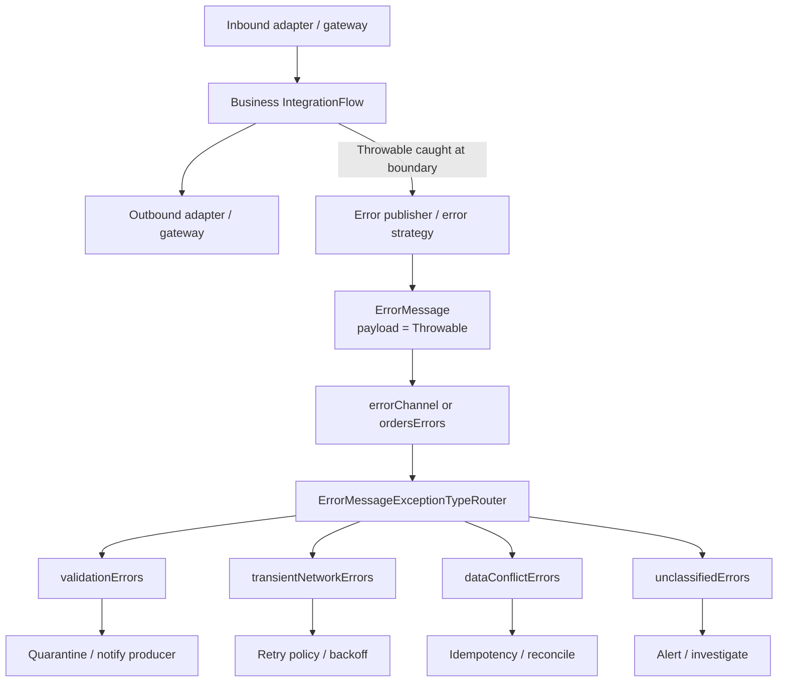
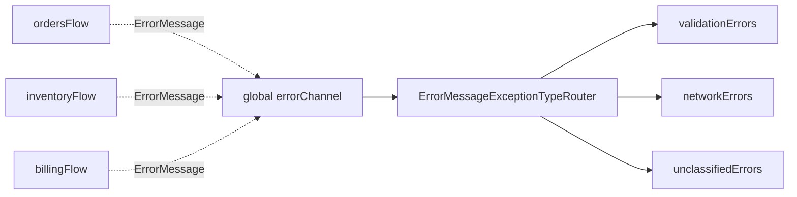
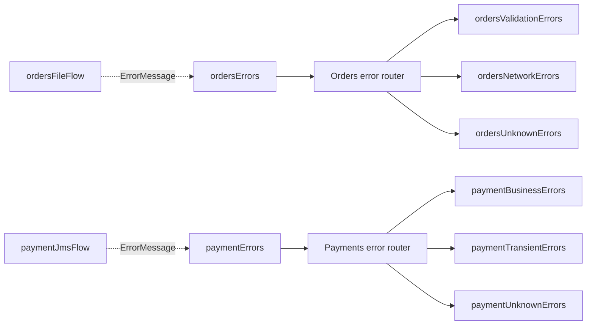
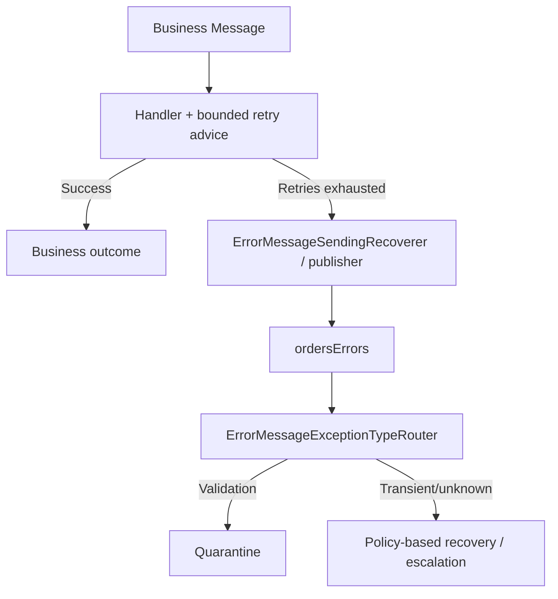

# ErrorMessageExceptionTypeRouter: Routing Errors by Exception Type in Spring Integration Adapters

> **Chapter:** Error handling  
> **Module:** `SPRING_INTEGRATION_ADAPTERS`  
> **Context:** Integrating external systems using inbound/outbound adapters, gateways, pollers, `MessageChannel`, and file, SFTP, HTTP, JMS, AMQP, Kafka, JDBC/database flows.  
> **Goal:** Use `ErrorMessageExceptionTypeRouter` to dispatch `ErrorMessage` to handling channels based on **exception type in the cause chain**, then coordinate with retries, transactions, acknowledgements, DLQ/quarantine, monitoring, and per-adapter connection lifecycles.

## 1. Problem Statement: One Error Channel, Many Causes

In a Spring Integration application, multiple endpoints can produce errors simultaneously:

- File inbound adapter reads a CSV and the parser throws `IllegalArgumentException` due to a missing column.
- SFTP inbound poller encounters an `IOException` or authentication error.
- HTTP outbound gateway times out calling a partner.
- JMS listener processes a duplicate event leading to a data validation failure.
- AMQP consumer receives invalid JSON.
- Kafka producer fails in an asynchronous send callback.
- JDBC outbound handler hits `DataIntegrityViolationException` or an unavailable database dependency.

If every error feeds into one generic handler that only logs stack traces, the application lacks **cause-based recovery policies**. Retrying invalid schemas infinitely accomplishes nothing; sending all timeouts straight to quarantine reduces availability; swallowing JMS exceptions can alter ack/rollback unexpectedly.

**`ErrorMessageExceptionTypeRouter`** solves part of this problem: given a message carrying a `Throwable`, the router selects the **destination channel** based on a mapping between **exception type** and **channel**. It is purpose-built for errors, unlike routers that pick channels by business payload type.

Desired example:

```text
ordersErrors
    |
    v
ErrorMessageExceptionTypeRouter
    |-- IllegalArgumentException --------> validationErrors
    |-- SocketTimeoutException ----------> transientNetworkErrors
    |-- DataIntegrityViolationException -> dataConflictErrors
    \-- Unmapped ------------------------> unclassifiedErrors
```

**Important limitation:** the router only **routes messages that reach it**. It does not catch every exception across all threads, does not create transactions, does not retry, and does not commit offsets or ack brokers.

## 2. Learning Outcomes

After this lesson, learners can:

1. Describe the role of `ErrorMessageExceptionTypeRouter` in Spring Integration architecture.
2. Distinguish `ErrorMessage`, `Throwable`, `MessagingException.getFailedMessage()`, and `ErrorMessage.getOriginalMessage()`.
3. Understand the difference between routing by **cause chain** and routing by payload type.
4. Configure Java DSL `routeByException`, mappings, and `defaultOutputChannel`.
5. Explain why **mapping order** must be tested when configuring overlapping exception types.
6. Connect the router to global `errorChannel` or per-flow private error channels.
7. Choose appropriate recovery policies for file/SFTP/HTTP/JMS/AMQP/Kafka/JDBC.
8. Properly test synchronous, asynchronous, poller, and callback error paths.
9. Avoid leaking PII, tokens, keys, and payloads in error handlers.
10. Prove a message was handled properly using **outcome evidence at source and target**.

## 3. Where Does the Router Sit in the Error Handling Flow?



There are **three distinct responsibilities**:

- **Error publication:** which exceptions become an `ErrorMessage`, on which thread, and sent to which channel?
- **Error routing:** choosing the next channel based on `Throwable`/cause type.
- **Recovery/outcome:** what does the target handler do with the original message, transaction, broker acknowledgement, quarantine, and alerts?

A synchronous error on `DirectChannel` can **throw directly back to the caller**. Without an error publisher or appropriate gateway/poller boundary, the router **will never receive any ErrorMessage** to route. That is why this lesson cannot focus solely on a single `routeByException` call.

## 4. API and Core Classes

| Component | Package/Concept | Role |
|---|---|---|
| `ErrorMessageExceptionTypeRouter` | `org.springframework.integration.router` | Router selecting channels by exception/cause |
| `AbstractMappingMessageRouter` | Superclass | Manages channel mappings, default output, channel name resolution |
| `Message<?>` | `org.springframework.messaging` | Payload + headers contract |
| `ErrorMessage` | `org.springframework.messaging.support` | Message with a `Throwable` payload |
| `MessagingException` | `org.springframework.messaging` | Exception that may carry `failedMessage` |
| `MessageHandlingException` | Spring Messaging | `MessagingException` subtype for message handling failures |
| `ErrorMessageStrategy` | Spring Integration | Builds error messages from exceptions and context |
| `MessagePublishingErrorHandler` | Spring Integration | Publishes errors via `MessageChannel` at supported boundaries |
| `MessageHeaders.ERROR_CHANNEL` | Spring Messaging | Header specifying error channel destination, not error type |
| `IntegrationFlow` | Java DSL | Connects routers with inbound endpoints and error handlers |
| `MessageChannel` | Spring Messaging | Transport path for business or error messages |

Per the Spring Integration Reference, the router is used for **messages with a `Throwable` payload** and selects based on **exception causes**. It also supports mapping by superclass so you do not have to declare every subclass. Therefore, do not assume the router only inspects `error.getPayload().getClass()`.

### 4.1. No Default Business Message "Transformation"

`ErrorMessageExceptionTypeRouter` is not responsible for transforming an `ErrorMessage` payload into a new business record. The downstream channel receives **the routed error message**, and downstream handlers then decide whether to convert it into a quarantine record, retry command, or HTTP reply if needed.

If you want a standardized JSON error envelope, build it in the **recovery flow** while preserving necessary evidence; do not assume the router adds fields like `errorCode`, `attempt`, or `flowId`.

## 5. Comparison with `PayloadTypeRouter`

| Characteristic | `PayloadTypeRouter` | `ErrorMessageExceptionTypeRouter` |
|---|---|---|
| Target to classify | Java type of ordinary payload | Type of `Throwable` in error message |
| Examples | `OrderCreated`, `InventoryUpdated` | `IllegalArgumentException`, `SocketTimeoutException` |
| Inspects cause chain? | Not in the exception-chain sense | **Yes** |
| Considers subclasses? | Can map by type hierarchy | Can map by `Throwable` superclasses |
| Goal | Business routing by object type | Error-handling policy routing |
| Auto retry/rollback? | No | No |
| Input requirement | Message carrying business payload | Message whose payload is a `Throwable` |

```text
Business payload:
  Message<OrderCreated>
     |
     v
  PayloadTypeRouter

Error payload:
  ErrorMessage(
      MessageHandlingException(
          cause = SocketTimeoutException
      )
  )
     |
     v
  ErrorMessageExceptionTypeRouter
```

If you feed an `ErrorMessage` into `PayloadTypeRouter` with a mapping for `SocketTimeoutException`, a plain payload router may only see the outer wrapper exception class and **does not use the same cause-traversal algorithm** as the error router.

## 6. Cause Chain: The Central Lesson of the Router

Spring Integration commonly wraps handler errors in `MessageHandlingException`. Inside it may sit a business or dependency exception:

```text
MessageHandlingException
  caused by ResourceAccessException
    caused by SocketTimeoutException
```

A router inspecting only the outer exception would lump every handler error into one bucket. `ErrorMessageExceptionTypeRouter` inspects the **cause chain** to find a matching mapping by exception type. Per official docs, the algorithm looks for the **most specific mapped cause**, using type compatibility checks such as `mappingClass.isInstance(cause)`.

For example, configuring a mapping from `SocketTimeoutException` to `transientNetworkErrors` can catch an `ErrorMessage` even though the outer class is `MessageHandlingException`.

### 6.1. "Most Specific" Does Not Always Mean Deepest Cause

A cause chain may have multiple classes, some without mappings. Selection depends on the **configured mappings**, class hierarchy, and the router logic of your Spring Integration version.

If both `IOException` and `SocketTimeoutException`—or `RuntimeException` and `IllegalArgumentException`—are mapped, **test the outcome**. Do not invent a mental rule assuming subclasses always win regardless of declaration order.

### 6.2. Exceptions Without a Cause

```java
new IllegalArgumentException("missing orderId");
```

The router can still match the outer exception type if a mapping is declared. `getCause() != null` is not required for it to work.

### 6.3. Application-Constructed Cause Chains

```java
throw new IllegalStateException(
    "Cannot import order batch",
    new java.net.SocketTimeoutException("supplier timeout")
);
```

If routed by the network cause, the flow can be treated as a transient error. Yet the cause content does not replace analyzing **whether side effects already occurred**, especially with HTTP POST, DB, or brokers.

## 7. Mapping Order Matters When Exception Types Overlap

**Note from Spring Integration documentation:** channel mapping configuration order can affect results for overlapping exception types. The official docs cite `IllegalArgumentException` and `RuntimeException`, emphasizing that order must not be ignored.

Example of two inheritance-related mappings:

```text
IllegalArgumentException extends RuntimeException

Mapping A: RuntimeException       -> genericRuntimeErrors
Mapping B: IllegalArgumentException -> validationErrors
```

The intuition "a subclass definitely always wins" **is not a sufficient contract to replace integration tests**. When distinguishing two types, run tests with the exact combination, order, and framework version you chose; do not guess from class names.

### 7.1. How to Reduce Ambiguity

- Prefer **minimally overlapping** mappings aligned with risk and business rules.
- Use `defaultOutputChannel` for **unclassified errors** instead of an overly broad `Throwable` mapping.
- If you must map a superclass, document the order, expectations, and add regression tests.
- Never map every `RuntimeException` to "retryable", since validation, bugs, and authorization failures can also be `RuntimeException`s.
- Test **wrapped**, **direct**, and **multi-level cause** exceptions.
- When upgrading Spring Integration, re-run precedence and routing tests.

### 7.2. Example Mandatory Test Matrix

| Throwable/Cause | Related Mapping | Expected Behavior to Verify |
|---|---|---|
| `IllegalArgumentException` | Exact type | `validationErrors` |
| `NullPointerException` | Exact type or default | `bugErrors` or default per config |
| `SocketTimeoutException` | Exact type | `transientNetworkErrors` |
| `MessageHandlingException → SocketTimeoutException` | Cause mapping | `transientNetworkErrors` |
| `IllegalArgumentException` | Both `RuntimeException` and `IllegalArgumentException` | Result matches tested ordering |
| `SQLException` | Unmapped | `unclassifiedErrors` |
| Plain undeclared `Exception` | Unmapped | Default or explicit fail policy |

Confirm that **the message is handled only at the intended destination** under the active router and endpoint context. Fan-out or multi-subscriber scenarios require extra verification.

## 8. Java DSL: Official Example with `routeByException`

The Spring Integration Reference provides this Java DSL syntax:

```java
@Bean
IntegrationFlow errorsByTypeFlow() {
    return f -> f.routeByException(r -> r
            .channelMapping(IllegalArgumentException.class,
                    "validationErrors")
            .channelMapping(NullPointerException.class,
                    "bugErrors")
            .defaultOutputChannel("unclassifiedErrors"));
}
```

This is the **router configuration**, though this short snippet does not show the source error channel or downstream consumers. In a real application, wire the flow to the channel receiving `ErrorMessage` and define the target channels.

### 8.1. More Complete Configuration: Source Channel and Mappings

```java
import java.net.SocketTimeoutException;

import org.springframework.context.annotation.Bean;
import org.springframework.context.annotation.Configuration;
import org.springframework.integration.channel.DirectChannel;
import org.springframework.integration.dsl.IntegrationFlow;
import org.springframework.messaging.MessageChannel;

@Configuration
class OrderErrorRoutingConfiguration {

    @Bean("ordersErrors")
    MessageChannel ordersErrors() {
        return new DirectChannel();
    }

    @Bean("validationErrors")
    MessageChannel validationErrors() {
        return new DirectChannel();
    }

    @Bean("transientNetworkErrors")
    MessageChannel transientNetworkErrors() {
        return new DirectChannel();
    }

    @Bean("unclassifiedErrors")
    MessageChannel unclassifiedErrors() {
        return new DirectChannel();
    }

    @Bean
    IntegrationFlow ordersErrorRouterFlow() {
        return IntegrationFlow.from("ordersErrors")
            .routeByException(r -> r
                .channelMapping(
                    IllegalArgumentException.class, "validationErrors")
                .channelMapping(
                    SocketTimeoutException.class, "transientNetworkErrors")
                .defaultOutputChannel("unclassifiedErrors"))
            .get();
    }
}
```

**Explanation:**

1. `ordersErrors` is the input channel of the error router. Endpoints/pollers/gateways must **actually publish** errors here.
2. `channelMapping` takes a `Throwable` class and target channel name.
3. `defaultOutputChannel` handles unmapped errors; **do not silently drop** errors.
4. Channels use `DirectChannel` for illustration; they are not durable across restarts.
5. This snippet does not yet include consumers, retries, transactions, quarantine, or logging; those are added separately.
6. Cross-check Java DSL APIs against your project's Spring Integration dependency; the code follows reference patterns, so do not assume all versions are identical.

### 8.2. Wiring Dedicated Handlers for Each Branch

```java
import org.springframework.integration.annotation.ServiceActivator;
import org.springframework.messaging.support.ErrorMessage;
import org.springframework.stereotype.Component;

@Component
class OrderErrorHandlers {

    private final OrderFailureService failures;

    OrderErrorHandlers(OrderFailureService failures) {
        this.failures = failures;
    }

    @ServiceActivator(inputChannel = "validationErrors")
    public void validation(ErrorMessage error) {
        failures.quarantineInvalidOrder(error);
    }

    @ServiceActivator(inputChannel = "transientNetworkErrors")
    public void network(ErrorMessage error) {
        failures.scheduleControlledRetry(error);
    }

    @ServiceActivator(inputChannel = "unclassifiedErrors")
    public void unknown(ErrorMessage error) {
        failures.recordAndEscalate(error);
    }
}

interface OrderFailureService {
    void quarantineInvalidOrder(ErrorMessage error);
    void scheduleControlledRetry(ErrorMessage error);
    void recordAndEscalate(ErrorMessage error);
}
```

The methods `quarantineInvalidOrder`, `scheduleControlledRetry`, and `recordAndEscalate` are **application contracts to implement**. In production, do not pass raw `ErrorMessage` straight to logs or external monitors. These methods must define **where error data is stored, retry conditions, idempotency, retention, and security**.

## 9. Java DSL: One Shared Error Router or Split per Flow?

There are two architectural patterns.

### 9.1. Pattern A: Shared Router Behind Global `errorChannel`



Pros: centralizes technical policies and shared error metrics. Cons: does not inherently distinguish owners, tenants, or per-flow recovery rules. A `SocketTimeoutException` in payments vs. SFTP may demand completely different actions.

### 9.2. Pattern B: Router Inside a Private Error Flow



Pros: isolates policies, retry/DLQ, and error-payload access by owner; tests remain decoupled. Cost: more beans/channels, requiring a standardized error contract and avoiding needless duplication.

**Recommendation:** if two flows differ in transactions, sensitive data, retry rules, or on-call ownership, consider splitting them. If they share policies and have no other boundaries, one shared router may suffice.

### 9.3. Avoid Routing by External `flowId` Headers

Never allow HTTP clients or message brokers to steer error branches using unvalidated headers. Source channels and ownership must come from endpoint configuration or trusted internal metadata; if using tenant IDs, verify the tenant against the actual connection/principal.

## 10. XML DSL: `exception-type-router`

For Spring Integration XML configuration, official documentation supports:

```xml
<int:exception-type-router
        input-channel="ordersErrors"
        default-output-channel="unclassifiedErrors">
    <int:mapping
            exception-type="java.lang.IllegalArgumentException"
            channel="validationErrors"/>
    <int:mapping
            exception-type="java.lang.NullPointerException"
            channel="bugErrors"/>
</int:exception-type-router>

<int:channel id="ordersErrors"/>
<int:channel id="validationErrors"/>
<int:channel id="bugErrors"/>
<int:channel id="unclassifiedErrors"/>
```

This is a **namespace configuration excerpt**: XML namespaces/schemas, bean context, and consumers are required for a complete application config. Use the exact `exception-type` attribute rather than invented text error names.

### 10.1. When Mapping a Nonexistent Class Name

Since Spring Integration 4.3, the documentation states that the router loads mapped classes during initialization to **fail-fast** if a class does not exist. This is why context startup should be tested after refactoring or dependency changes, rather than discovering a broken router only in production.

## 11. Programmatic Configuration and Managing Mappings

`ErrorMessageExceptionTypeRouter` inherits mapping management APIs such as `setChannelMapping(String, String)` and `setChannelMappings(Map<String,String>)` from the base router, along with runtime mapping management depending on configuration.

Illustrative example of the instance API:

```java
import org.springframework.integration.router.ErrorMessageExceptionTypeRouter;

ErrorMessageExceptionTypeRouter router =
        new ErrorMessageExceptionTypeRouter();

router.setChannelMapping(
        IllegalArgumentException.class.getName(),
        "validationErrors");

router.setChannelMapping(
        java.net.SocketTimeoutException.class.getName(),
        "transientNetworkErrors");
```

This is only **router creation/mapping**; it does not yet register the bean, start its lifecycle, or attach `inputChannel` or subscribers. In typical Java DSL applications, `routeByException` is clearer and easier to test.

### 11.1. Do Not Mutate Runtime Mappings Recklessly

Mappings represent **recovery policy**. Changing them in production can cause poison messages to retry, connection errors to be quarantined, or business errors to reach the wrong owner.

If your organization permits changing mappings via admin/Control Bus:

- Enforce owner, approval, and change auditing.
- Run tests covering exception hierarchies/cause chains.
- Record the routing policy version in events/metrics.
- Have rollback and alerts if error distributions shift suddenly.
- Never accept class/channel mappings from customer message payloads.

## 12. What Can ErrorMessage Carry?

`ErrorMessage` has a `Throwable` payload. Exceptions often have a cause chain; a `MessagingException` may hold `failedMessage`.

```text
ErrorMessage
  payload: Throwable
     MessageHandlingException
       failedMessage?: Message<?>
       cause -> SocketTimeoutException
  headers: MessageHeaders
  originalMessage?: Message<?>
```

**Do not confuse these three:**

- `ErrorMessage.getPayload()`: the exception being routed.
- `MessagingException.getFailedMessage()`: the message at the point of failure if provided by the exception.
- `ErrorMessage.getOriginalMessage()`: the input message retained by the error strategy if available.

The router routes by **Throwable type/cause**, not by inspecting business `orderId`, `tenantId`, or raw CSV to pick a mapping.

### 12.1. When Failed Message Is Absent

SFTP connection failures, JDBC polling query failures, or Kafka deserialization errors can occur **before creating a Spring Message**. The router can still classify the published `Throwable`, but recovery handlers must tolerate `failedMessage == null` and use context from the poller/adapter.

### 12.2. When Failed Message Has Already Been Transformed

If the flow converts `File` into `OrderBatch` and then fails on JDBC, `getFailedMessage()` may contain `Message<OrderBatch>`, not the original file. Do not attempt to replay file input from that payload or assume sufficient source metadata exists to move the file.

## 13. Why Routing by Exception Type Alone Is Not Enough for Retry Decisions

An exception type describes a **technical symptom**, not necessarily **whether re-execution is safe**.

```text
SocketTimeoutException
  A. HTTP GET reading a catalog:
       retry may be safe per contract

  B. HTTP POST creating a payment:
       server may have received and committed before timeout
       blind retry risks creating duplicate transactions
```

Same timeout type, completely different side effects. The router can send both to the "transient" branch, yet **the handler on that branch must still evaluate the operation, idempotency key, retry budget, and transaction outcome**.

### 13.1. Suggested Taxonomy

| Exception/Cause | Suggested Initial Category | Must Verify Before Recovery |
|---|---|---|
| Schema `IllegalArgumentException` | Validation/permanent | Is input truly invalid or a code bug? |
| `SocketTimeoutException` | Network/transient | Did downstream partially or fully succeed? |
| `ConnectException` | Connection not established | Credentials, dependency, and retry budget |
| `DataIntegrityViolationException` | Conflict/data | Valid duplicate or lost idempotency? |
| Adapter `AuthenticationException` | Credential/config | Do not hot-retry if secret is wrong |
| `AccessDeniedException` | Authorization | Misconfigured permissions or wrong policy? |
| `NullPointerException` | Bug or bad state | Do not default to infinite retry |
| Unmapped `MessagingException` | Unknown | Investigate cause, owner, and source |
| `Error`/`OutOfMemoryError` | Runtime/system failure | Do not treat as a normal business message failure |

**Do not map `Throwable.class` as an indiscriminate "retry everything".** Use `defaultOutputChannel` to alert on unclassified errors, preserve context, and decide next steps.

## 14. Separating the Router from Retry Advice

There are two different places to place retries:

1. **Before the router:** `RequestHandlerRetryAdvice` retries the handler with a bound. Once retries are exhausted, a recovery callback can publish an `ErrorMessage` for the router to classify and finalize.
2. **After the router:** the router forwards the error to a recovery flow with a scheduler/quarantine/reference, and the workflow conditionally issues reprocessing commands.



Never stack multiple independent **unbounded** retry layers: retry advice attempts times broker redeliveries times post-router replays can multiply execution counts uncontrollably.

### 14.1. One Question You Must Answer

By the time the router receives `ErrorMessage`, the handler exception has already been **caught and published**. Depending on the boundary, the source message may already be acked/committed, still inside a transaction, or awaiting broker retry. Hence, the error flow **cannot simply fix transaction outcomes by arbitrarily rethrowing**; you must understand the adapter/container mechanics.

## 15. Global `errorChannel` vs. Private Error Channels

Spring Integration provides a global error mechanism typically named bean `errorChannel`. Across many async boundaries, when a request message does not specify `errorChannel` and no endpoint-specific handling exists, the framework can publish errors to the global channel.

Some systems attach a router there to classify by `Throwable`. However:

- Synchronous errors on `DirectChannel` usually throw back to the caller.
- Pollers have their own error handlers and routing policies.
- Message-driven adapters may use container/broker error handling.
- Kafka outbound callbacks have a separate failure channel when configured.
- Gateways can return errors to callers or build error responses via an error flow.

**The router does not decide where it gets invoked.** Verify the source channel for each endpoint and configure error handling accordingly.

### 15.1. Scope of `MessageHeaders.ERROR_CHANNEL`

The `errorChannel` header only specifies an error address that a supporting error publisher can use. This header **does not guarantee** every exception becomes an `ErrorMessage`, nor does it decide which exception types are routed afterward.

Do not let external sources set headers to divert errors into another flow's or tenant's handler. Set/overwrite routing metadata at a trusted boundary.

### 15.2. Monitoring Errors Leaking to Global

If a flow has a dedicated `ordersErrors` channel yet errors appear on global `errorChannel`, check:

- Poller/adapter missing explicit error-channel wiring.
- Error occurring before message creation, lacking headers.
- Message headers dropped by a transformer or custom code.
- Error handler using a different default channel.
- Gateway or producer callback using its own mechanism.
- Bean name mismatch or unregistered subscriber.

Add an "unrouted errors" metric/alert to catch leaks rather than letting errors drift down an unowned default path.

## 16. Pollers, File, and SFTP: Routing Errors Before and After Message Creation

### 16.1. File Inbound

File inbound adapters typically poll a directory and construct `Message<File>` or a configured payload type. Errors can happen at:

- Unreadable directory (before message creation).
- Partially written file.
- Invalid CSV schema.
- Transformer parsing failure.
- Database write failure after parsing.
- File move/archive/quarantine failure.
- Metadata store/accept-once preventing re-reads.

If the parser throws `IllegalArgumentException`, the router can direct it to `validationErrors`; however, quarantining requires knowing the **original file path**, verifying file completion, permissions, and filter state. The router does not move files or reset accept-once filters.

### 16.2. SFTP Inbound

SFTP adds networking/sessions and remote state:

| Error | Possible Cause Type | Reasonable Recovery |
|---|---|---|
| Server timeout on listing | `IOException` or client subtype | Backoff, infrastructure alert |
| Authentication failure | Adapter/client-specific exception | Verify secret, no hot retries |
| File missing | Remote state/race | Reconcile listing, idempotency |
| Invalid content parse | Business `IllegalArgumentException` | Quarantine and notify sender |
| Partial download | I/O failure | Temp file/atomic rename and file check |
| Destination permission denied | Security/I/O exception | Escalate to owner |

**SFTP connection errors may lack `failedMessage`**, because no message was generated yet. The router still classifies by cause if the exception is published to it.

### 16.3. Mandatory Test

Trigger a real error inside the **polling task**, not merely sending `new ErrorMessage(...)` directly into the router. Verify the error channel is invoked and post-error file/SFTP state matches policy.

## 17. HTTP Gateways: Exception Type Router Does Not Build Responses Automatically

HTTP inbound/outbound gateways operate in request–reply or fire-and-forget patterns per config. From HTTP's perspective, clients expect a **status code and body** matching the contract; the router is an internal mechanism.

| HTTP Failure | Initial Category | What Must Be Decided |
|---|---|---|
| Invalid request | Validation | Corresponding 400/4xx, no internal details |
| Unauthorized/forbidden | Authentication/authorization | 401/403 per semantics |
| Downstream 429 | Rate limit | Backoff, `Retry-After` if applicable |
| Connection timeout | Transient/network | Is idempotency and deadline defined? |
| Downstream 5xx | Dependency failure | Bounded retry, circuit breaker |
| Business conflict | Domain | 409 or appropriate business response |
| Unknown internal error | Unexpected | 500/5xx, correlation ID, and alert |

**Not every 4xx is permanent**, and not every 5xx is safe to retry. Routing by exception class is only the first layer; handlers must understand HTTP method, status, request idempotency, and recipient protocol.

### 17.1. Synchronous Gateways

Exceptions from a synchronous handler can propagate directly to the gateway caller, or the gateway can process them via an error channel if configured. If you want to use a router to produce an error response, design a flow converting `ErrorMessage` into a reply payload and proper status.

A recovery handler that merely logs and returns `void` may cause HTTP callers to time out or get unintended responses. **Do not treat sending an ErrorMessage as completing the HTTP response.**

### 17.2. Outbound HTTP Timeout After Side Effects

An HTTP POST may have succeeded on the server while the client timed out before receiving the response. `SocketTimeoutException` is insufficient to conclude the transaction failed completely. Use idempotency keys, outcome lookups, or reconciliation before retrying.

## 18. JMS: The Router Does Not Replace Transactions/Acknowledgements

JMS inbound adapters/message-driven endpoints can use transactions and broker redelivery. Before acting on an `ErrorMessage` from JMS, know:

1. Does the listener have a transacted session?
2. When did the container ack, commit, or roll back?
3. Did the exception propagate to the listener boundary, or was it caught by an error publisher?
4. Does retry advice on the handler wrap the transaction as expected?
5. Does the broker have a redelivery policy and DLQ?
6. At the time of failure, might DB/HTTP side effects have already completed?
7. Are `JMSMessageID`, correlation ID, and delivery count available?

### 18.1. Dangerous Scenario

```text
JMS listener -> payment service -> exception
    -> ErrorMessage
    -> ErrorMessageExceptionTypeRouter
    -> paymentErrors handler: log and return
```

**You cannot conclude** JMS rolled back just because an `ErrorMessage` appeared. If the error counts as "handled" under the adapter/container semantics, the broker may treat delivery as complete. Behavior must be verified against **ack/transaction configuration** and integration tests.

### 18.2. DLQ by Error Type

A permanent validation error can go to a broker DLQ after the right workflow; a transient network error can redeliver. The router helps classify, yet **ack/nack decisions must be propagated and executed at the exact boundary**; never assume a downstream `DirectChannel` automatically nacks the broker.

## 19. AMQP: Classify Exceptions While Preserving Requeue Policy

AMQP inbound covers scenarios such as:

- Deserialization/parsing errors.
- Broker authentication/authorization.
- Connection resets.
- Invalid business handler input.
- Database outages.
- Outbound publish confirm or return failures.

`ErrorMessageExceptionTypeRouter` can branch by exception type once Spring Integration publishes `ErrorMessage`. However:

- The listener/container decides ack/reject/requeue per configuration.
- A persistently failing message can become a **poison message** and requeue infinitely.
- DLX/DLQ/TTL and retry counts are coordinated between broker and application.
- Manual ack requires clearly knowing who owns the ack.
- Publish failures do not always travel the same error path as inbound messages.

### 19.1. Proper Processing Order

1. Classify errors at the boundary.
2. Determine transient vs. permanent with evidence.
3. Apply retry budget and DLQ aligned with ack mode.
4. Retain authorized correlation/resource references.
5. Alert when DLQ grows or recovery handlers fail.
6. On replay, use idempotency keys to avoid duplicate side effects.

Never configure channel mappings alone and assume AMQP messages are safe.

## 20. Kafka: Consumer and Producer Have Different Error Paths

### 20.1. Kafka Inbound Consumer

An error can happen **before creating a Spring Message**: broker auth, assignment, or deserializer. Errors in business handlers after the adapter may produce `MessagingException`/`ErrorMessage` depending on configuration.

The router can dispatch published exception types, but **does not automatically commit offsets, seek, retry, or send to a DLT**. Those behaviors live in the adapter, listener/container, and Kafka error strategy.

Track `topic`, `partition`, `offset`, `consumerGroup`, retry policy, and whether the record was partially processed.

### 20.2. Kafka Outbound Producer

Producer sends can be asynchronous. Returning from the send call does not prove broker confirmation. Errors in callbacks/producer confirmations can go to the adapter's **send-failure channel** when configured.

If the router subscribes only to global `errorChannel` while failures go to `kafkaSendFailures`, the router will never see those errors. Wire the producer failure path to the classifier when needed.

### 20.3. Beware of Side Effects

If the DB committed yet Kafka publish failed, retrying the inbound file/JMS message from the beginning can cause duplicate inserts. Transactional outbox, idempotency, or reconciliation is normally required for reliable business results—not an exception router.

## 21. JDBC/Database: Routing Correctly Can Still Lose Data

In database flows, exceptions can come from:

- Unavailable connections.
- Polling query failing before returning rows.
- Constraint violations.
- Optimistic locking conflicts.
- Transaction commit failures.
- Database deadlocks/lock timeouts.
- Partial writer commits or upstream prematurely marking `DONE`.

Several errors share `DataAccessException` yet have different recoverability. The router can split by subtype, while you still verify **transaction boundaries and row states**.

### 21.1. Illustrative State Machine

```text
NEW
  -> CLAIMED
  -> PROCESSING
       |-> DONE
       |-> RETRY_WAIT
       \-> QUARANTINED
```

If a poller already marked `DONE` before the router received the error, routing cleanly to `transientNetworkErrors` **still cannot repair the lost row**. Designs need leases/locks, idempotency, and outcome verification.

### 21.2. Database Uniqueness Conflicts

`DataIntegrityViolationException` can mean:

- Duplicate event already processed successfully: treat as idempotent success after reconciliation.
- Invalid business data: quarantine.
- Bug or schema mismatch: alert and fix code.
- Race condition: retry per concurrency strategy.

Do not hardcode every `DataIntegrityViolationException` to "drop" or "retry"; inspect the domain state in the handler.

## 22. Error Handlers Must Know and Protect the Original Message

`ErrorMessage.getPayload()` is a `Throwable`; `MessagingException.getFailedMessage()` may contain the `Message` at the failing handler; `ErrorMessage.getOriginalMessage()` may carry initial context.

Safe extraction example:

```java
import org.springframework.messaging.Message;
import org.springframework.messaging.MessagingException;
import org.springframework.messaging.support.ErrorMessage;

final class ErrorContext {

    private ErrorContext() {}

    static Message<?> failedMessage(ErrorMessage error) {
        Throwable current = error.getPayload();

        // Illustrative code; production should guard cause cycles and bound depth.
        for (int depth = 0; current != null && depth < 16; depth++) {
            if (current instanceof MessagingException me
                    && me.getFailedMessage() != null) {
                return me.getFailedMessage();
            }
            current = current.getCause();
        }
        return null;
    }

    static Message<?> originalMessage(ErrorMessage error) {
        return error.getOriginalMessage();
    }
}
```

**Note:** the router classifies the `Throwable` and does not need to parse `failedMessage` to pick a class mapping. However, downstream handlers may need the message reference for quarantine/recovery. If absent, rely on adapter or error-strategy context rather than fabricating fake payloads.

### 22.1. Privacy and Secrets

Never log `error.toString()` or `failedMessage.toString()` because they can contain:

- File paths or CSV contents with personal data.
- Raw HTTP request/response bodies.
- JMS/AMQP message bodies with payment details.
- Kafka headers and payloads.
- SQL parameters, emails, or personal IDs.
- Bearer tokens, session cookies, API keys, or passwords.

Replace them with error metadata, verified IDs, references to ACL-protected storage, retention limits, and audits. Never use raw exception messages as metric labels.

## 23. Arbitrary String Matching Cannot Replace the Router

A common anti-pattern:

```java
if (error.getMessage().contains("timeout")) {
    retry();
} else if (error.getMessage().contains("invalid")) {
    quarantine();
}
```

Problems:

- Exception messages vary by locale, library version, and environment.
- Messages can contain untrusted input where clients control the text.
- Causes get wrapped, leaving the outer message without the word "timeout".
- JDBC/HTTP messages change across drivers/providers.
- String matching does not distinguish transient errors from **side effects that already happened**.

Use `ErrorMessageExceptionTypeRouter` to select channels by class/cause; use **domain policies** and trusted source facts inside handlers to decide outcomes. For library exceptions with generic types, throw a **domain-typed custom exception** at an appropriate boundary rather than classifying by text.

### 23.1. Custom Business Exceptions

```java
public class InvalidOrderSchemaException
        extends IllegalArgumentException {

    public InvalidOrderSchemaException(String message) {
        super(message);
    }
}
```

Then map `InvalidOrderSchemaException.class` to the validation channel. Keep PII out of exception messages. If a handler wraps a new exception, **preserve the cause** so the router still sees the original type:

```java
throw new IllegalStateException(
        "Order import failed",
        new InvalidOrderSchemaException("Missing required field"));
```

This only illustrates the cause chain; real applications should choose semantically accurate exception types and keep details safe.

## 24. Unclassified and Unknown Errors: A Mandatory Fallback Path

`defaultOutputChannel("unclassifiedErrors")` is a vital part of the configuration. It ensures exception types without mappings still have an owner for investigation.

An unclassified error handler should:

- Record a failure code and minimal context.
- Never log raw payloads or secrets.
- Keep an investigable reference when policy allows.
- Alert technical owners and assess business risk.
- Determine whether the source message was acked/committed/persisted to DB.
- Apply conditional retries to avoid hot loops.
- Once root cause is clear, add mappings or update policies and tests.

**Do not use `nullChannel` as default just to silence warnings.** That intentionally drops messages and risks data loss; if ever used, it must have business justification and confirmed completion at the source.

### 24.1. When There Are No Subscribers

If a destination channel lacks consumers, errors may keep failing or behave differently depending on channel/config. Test startup and health/readiness for the router, channels, and handlers—not just bean existence.

### 24.2. When the Error Handler Itself Fails

The quarantine store can become unavailable. Have a fallback and source-aligned transaction/fail-safe behavior:

- JMS/AMQP may need rollback/nack.
- Kafka may need to skip offset commit or move to DLT per config.
- File may need to retain the source and avoid falsely marking processed.
- HTTP must return a contract-compliant error.
- Recovery stores need bounded retries or pausing the flow to avoid losing messages.

A succeeding router **does not guarantee** destination handlers succeed.

## 25. DLQ, Quarantine, and Error Channel Are Not the Same Thing

| Component | Function | Durable by Default? | Retries Automatically? |
|---|---|---|---|
| `ErrorMessageExceptionTypeRouter` | Picks channel by exception type | No | No |
| `DirectChannel` | Synchronously transfers messages | No | No |
| `PublishSubscribeChannel` | Broadcasts to subscribers | Not by default | No |
| `QueueChannel` | Buffers messages | Depends on message store/config | Not by default |
| JMS/AMQP DLQ | Stores failed messages per broker policy | Per broker config | Replayable via workflow, not automatic |
| Kafka DLT | Topic storing failed records | Per Kafka retention/ack policy | Does not guarantee successful processing |
| Quarantine store | Holds failed payload/reference for human action | Per storage | No |
| Retry scheduler | Manages retry budget and schedule | Per implementation | Yes, per policy |
| Audit/metrics | Observes and explains decisions | Per backend | No |

If the error router sends an `ErrorMessage` to `validationErrors` and the downstream handler simply logs and returns, the source message may be marked complete even though it was never safely persisted or properly answered. That is a recovery design flaw, not a mapping flaw.

### 25.1. Idempotency on Replay

Before replaying, ask:

1. Which objects/files/DB rows were already created?
2. Were HTTP POSTs or Kafka events already sent?
3. Is there a stable idempotency key or source ID?
4. Must ordering be preserved (Kafka partition, JMS ordering)?
5. How much retry budget remains?
6. Did schemas or policies change since the failure?
7. Are permissions and retention sufficient to fetch the original payload?

## 26. Unit Testing Exception-Type Routing

There are two testing layers: **route classifier** and **adapter error publication**. The first can send `ErrorMessage` directly to the router's input channel; the second must trigger faults in the real poller/adapter.

### 26.1. Test Concept Example with `QueueChannel`

```java
import static org.junit.jupiter.api.Assertions.*;

import java.net.SocketTimeoutException;

import org.junit.jupiter.api.Test;
import org.springframework.beans.factory.annotation.Autowired;
import org.springframework.boot.test.context.SpringBootTest;
import org.springframework.integration.channel.QueueChannel;
import org.springframework.messaging.Message;
import org.springframework.messaging.MessageChannel;
import org.springframework.messaging.support.ErrorMessage;

@SpringBootTest
class ErrorRouterIntegrationTest {

    @Autowired
    MessageChannel ordersErrors;

    @Autowired
    QueueChannel validationErrors;

    @Autowired
    QueueChannel transientNetworkErrors;

    @Autowired
    QueueChannel unclassifiedErrors;

    @Test
    void mapsValidationError() {
        ordersErrors.send(
            new ErrorMessage(new IllegalArgumentException("bad schema")));

        Message<?> result = validationErrors.receive(1_000);
        assertNotNull(result);
        assertTrue(result.getPayload() instanceof Throwable);
    }

    @Test
    void mapsNestedNetworkCause() {
        RuntimeException wrapped =
            new RuntimeException("wrapped", new SocketTimeoutException());

        ordersErrors.send(new ErrorMessage(wrapped));

        Message<?> result = transientNetworkErrors.receive(1_000);
        assertNotNull(result);
    }

    @Test
    void defaultsForUnmappedException() {
        ordersErrors.send(new ErrorMessage(new UnsupportedOperationException()));

        assertNotNull(unclassifiedErrors.receive(1_000));
    }
}
```

**Important note:** in the Java DSL example in Section 8, target channels were declared as `DirectChannel`. To run tests using `QueueChannel.receive(...)` as shown above, your test config must **override output channels with QueueChannel**, or use `@ServiceActivator` test consumers/latches to capture messages. This snippet illustrates assertions against a **test configuration with QueueChannel**, not running verbatim alongside the `DirectChannel` config from Section 8.

### 26.2. Checking Output Isolation

When multiple `QueueChannel`s exist in a test, assert:

- `validationErrors` receives the right event.
- `transientNetworkErrors` does not receive validation events.
- `unclassifiedErrors` only receives unmapped events.
- No leftover messages from earlier tests: isolate fixtures/contexts.
- When mappings overlap, results obey the verified policy order.
- Downstream can still read the payload/error context rather than a degraded string.

## 27. Real Integration Testing: The Router Is Only Downstream of Error Publication

A realistic test for `ordersFileFlow`:

1. Start the context with the file inbound adapter, poller, parser, `ordersErrors`, and router.
2. Place a CSV file missing a required header in the test input directory.
3. Wait for the **real poller** to read the file and the parser to throw `InvalidOrderSchemaException` or `IllegalArgumentException`.
4. Confirm the exception is published to `ordersErrors`.
5. Confirm the router dispatches it to `validationErrors`.
6. Verify the quarantine file/reference is durably written and **not marked as success**.
7. Confirm no infinite retries and no duplicate file processing.
8. Verify metrics/logs contain no raw CSV or tokens.
9. Repeat with an **IOException before Message creation**.
10. Document the exact exception/cause types emitted by your version of Spring Integration.

A test that only calls `ordersErrors.send(new ErrorMessage(...))` proves **mapping**, not that a real poller, gateway, or broker actually sends errors to the channel.

### 27.1. Fault Matrix to Test

| Test | Injected Fault | Must Verify |
|---|---|---|
| DirectChannel handler throws | Synchronous exception | Caller receives exception if no error publisher |
| File parser | Invalid CSV | Validation route and file quarantine |
| SFTP connect | Timeout before message | Cause route and handling when failedMessage is null |
| HTTP outbound | 429 or timeout | Response/retry with idempotency |
| JMS listener | Handler throws | Broker ack/rollback/DLQ per config |
| AMQP poison message | Deserializer/validation | No infinite requeue |
| Kafka inbound | Deserialize before message | Container handling, offset, and DLT |
| Kafka outbound | Producer async callback | Send-failure path reaches classifier if configured |
| JDBC write | Duplicate key | Conflict route and no duplicate write |
| Mapping overlap | RuntimeException vs IllegalArgumentException | Order matches tested policy |
| Unmapped exception | UnsupportedOperationException | Default channel receives and alerts |
| Error handler fails | Quarantine storage unavailable | Fallback/fail-safe |
| Missing subscriber | Target channel lacks handler | Health/test catches it |
| Malicious header | Client sends fake errorChannel | Header does not steer internal routing |
| Raw secret in payload | Mock test token | Never appears in logs/metrics |
| Process crash | After router, before quarantine | Message recoverability per source policy |
| Retry same key | Message resent | Idempotency and accurate outcome |

### 27.2. Testing After Library Upgrades

After upgrading Spring Integration, run at least:

- DSL configuration startup.
- Class resolution in channel mappings.
- Matching order with superclasses and nested causes.
- `ErrorChannel` → router → handler pipeline.
- Poller and message-driven adapter exception propagation.
- Producer callback/failure channel.
- Retry, ack, and transaction outcomes.
- Error channel behavior when there are no subscribers.

## 28. Observability: Metrics by Exception and Flow

A production system needs visibility into both **error distribution by type** and **per-flow ownership**.

| Illustrative Metric | Bounded Labels | Meaning |
|---|---|---|
| `integration_errors_total` | flow, exceptionCategory, target | Recorded error volume |
| `error_router_routes_total` | router, destination, category | Distribution by channel |
| `unclassified_errors_total` | flow, transport | Unmapped errors |
| `retry_exhausted_total` | flow, policyVersion | Retry budget exhausted |
| `quarantine_pending_total` | flow, ownerTeam | Backlog awaiting action |
| `dlq_backlog_count` | source, consumerGroup | Pending DLQ/DLT items |
| `error_handler_failures_total` | flow, handlerType | Failures in recovery |
| `message_redelivery_total` | broker, flow | Rising redeliveries |
| `failed_source_reconciliation_total` | adapter, outcome | Source/target desync |
| `error_channel_unrouted_total` | flow, boundary | Errors bypassing expected channel |

These metric names **are not built-in metrics created automatically by Spring**. Use Micrometer or an appropriate observability stack, standardizing tags and avoiding high cardinality.

Never put unique `messageId`, `personId`, email, file path, tenant-private keys, or raw exception messages as metric labels. Use trace/correlation IDs and restricted audit logs for individual cases.

### 28.1. Practical Alerts

- `unclassifiedErrors` spiking right after a deployment.
- Timeouts rising while retries continually exhaust budget.
- Quarantine/DLQ breaching SLA without processing.
- Error handler or recovery storage unavailable.
- Kafka producer failure callbacks lacking an owner.
- Error routed while source stays active/inflight and gets reprocessed.
- A flow emitting error events to global channel instead of its private channel.

## 29. Security When Routing ErrorMessage

An `ErrorMessage` can contain:

- Exception classes/causes and stack traces.
- `failedMessage` with transformed payloads.
- `originalMessage` or source data.
- Headers: identity, correlation, credentials, tenant, routing.
- File/object references, database query parameters.

**Never forward full `ErrorMessage`s to third-party systems by default** just because classification succeeded. Every channel and handler needs an explicit purpose, ACL, retention, and privacy boundary.

### 29.1. Data Worth Recording

```json
{
  "failureId": "fail-order-801",
  "flowId": "ordersFileFlow",
  "exceptionCategory": "validation",
  "exceptionClass": "InvalidOrderSchemaException",
  "destination": "validationErrors",
  "correlationId": "corr-801",
  "sourceRef": "restricted-order-ref-801",
  "attempt": 1,
  "recoveryState": "quarantined",
  "policyVersion": "order-errors-v5"
}
```

This is an **application-defined contract**, not a format emitted by `ErrorMessageExceptionTypeRouter`.

### 29.2. Data Never to Log Directly

- Bearer tokens, API keys, session cookies, Basic auth.
- Recovery codes, private keys, SFTP passwords.
- Bank account/personal payment details.
- Unnecessary raw HTTP/JMS/AMQP/Kafka payloads.
- SQL statements containing real PII values.
- Stack traces on broad dashboards if they expose internal addresses or secrets.

### 29.3. Tenant and Role Isolation

Routing by exception type **does not isolate tenants automatically**. If orders for tenant A and tenant B both enter `validationErrors`, downstream storage and dashboards must still restrict access by verified tenant. Never trust `tenantId` from unvalidated headers.

## 30. Runbook: When the Router Dispatches the Wrong Error Type

### 30.1. Validation Error Lands in Transient Channel

1. Confirm the root exception, cause chain, and outer wrapper.
2. Check for overlapping superclass mappings.
3. Verify configuration order and policy version.
4. Re-test an `ErrorMessage` with the exact same cause chain.
5. Check whether the exception truly came from the parser or an internal dependency timeout.
6. If needed, introduce a custom exception and preserve its cause.
7. Recover the source message only after confirming idempotency.

### 30.2. Errors Appear in Global `errorChannel` Instead of the Router

1. Verify the router subscribes to the right error channel.
2. Check which channel the poller/gateway/adapter actually publishes to.
3. Check whether the error occurred synchronously and propagated to the caller.
4. Inspect channel subscriptions, bean names, and application context.
5. Check whether `errorChannel` message headers were dropped or forged.
6. Test faults at the real endpoint rather than manually injecting `ErrorMessage`.

### 30.3. Unmapped Errors

1. Confirm `unclassifiedErrors` received them.
2. Extract exception class and cause safely.
3. Assess business risk and impact already incurred.
4. Classify transient/permanent/unknown with an owner and deadline.
5. Decide whether to add a mapping or use general recovery.
6. Add unit + integration tests for the new error type.

### 30.4. Routed Correctly, Yet Messages Are Lost or Duplicated

1. Check who acked/committed.
2. Check whether the error handler persisted recovery state.
3. Check for overlapping retry advice, broker redelivery, and schedulers.
4. Inspect idempotency keys and already-committed side effects.
5. Verify actual state at DB/broker/file/HTTP/SaaS.
6. Fix transaction/recovery policies, not just mappings.

## 31. Common Anti-Patterns

**"The router automatically catches every exception in the app."** False: an `ErrorMessage` must be published to its input channel.

**"The router only inspects the outer Throwable."** False: per reference docs, it inspects the cause chain.

**"Declaring a subclass guarantees it always wins."** Never rely on guesswork with overlapping mappings; docs highlight ordering, so test it.

**"Mapping `RuntimeException` covers all retries."** `RuntimeException` includes validation, bugs, and many non-retryable failures.

**"No default channel needed because we know every error."** New errors will appear; keep an unclassified branch and owner.

**"Routing to `retryErrors` means it has been retried."** The router only forwards messages to a channel; recovery handlers must implement retries explicitly.

**"The router decides JMS rollback or Kafka commit."** Ack/transaction/offset live in adapters/containers and brokers.

**"`ErrorMessage.getOriginalMessage()` always holds the original payload."** False for pre-message errors or when the error strategy did not supply one.

**"`failedMessage` means you can replay from the start."** It may be a post-transformer message or follow an existing side effect.

**"ErrorMessage type router works just like PayloadTypeRouter."** They differ in cause-chain evaluation.

**"SocketTimeoutException means the HTTP POST failed on the server."** The server may have processed it before client timeout.

**"DataIntegrityViolationException always goes to quarantine."** It could be an already-processed duplicate requiring domain/idempotency checks.

**"One channel for all flows is safe once routed by class."** It fails to separate owners/tenants/transactions without extra design.

**"Printing the raw ErrorMessage helps debugging."** It can expose PII, tokens, and payloads.

**"A DLQ handles replay properly on its own."** A DLQ holds failed messages; replay needs policy, schema/version, and idempotency.

**"Without subscribers, errors are definitely saved."** Depends on channel type and configuration; enforce via startup/tests/monitoring.

**"Testing by sending ErrorMessage directly proves broker rollback works."** That tests only the router, not adapter/source boundaries.

## 32. `ErrorMessageExceptionTypeRouter` Implementation Checklist

| Question | Verification Evidence |
|---|---|
| Identified error sources and thread/boundaries? | Flow diagrams, poller/gateway/adapter config |
| Created ErrorMessage at the right boundary? | Real-fault integration tests |
| Router subscribes to the right input error channel? | Bean/config test |
| Specific exception-type mappings configured? | Java DSL/XML/bean config |
| `defaultOutputChannel` configured? | Unmapped exception test |
| Cause chain and wrappers tested? | Nested exception test |
| Subclass/superclass overlap tested? | Ordered mapping test |
| Routing policy has version and owner? | Config/operations |
| Every target channel has a downstream handler? | Startup/consumer test |
| Avoided overly broad Throwable/RuntimeException mappings? | Policy review |
| Distinguished validation/network/data conflict/bugs? | Error taxonomy |
| Retry budget, backoff, and timeouts set? | Retry tests |
| Separated retry advice from broker retry? | Ack/transaction diagram |
| File/SFTP has quarantine and accept-once handling? | File lifecycle tests |
| HTTP gateway returns valid status/reply? | Contract tests |
| JMS handles rollback/ack properly? | Broker redelivery test |
| AMQP handles nack/requeue/DLQ properly? | Listener integration test |
| Kafka inbound handles offsets/DLT properly? | Consumer tests |
| Kafka outbound monitors callback/failure channel? | Producer failure test |
| JDBC handles transactions/idempotency? | Duplicate/rollback tests |
| Null `failedMessage`/`originalMessage` handled? | Pre-message failure test |
| Error handler is fail-safe when storage fails? | Fault-injection test |
| Routing headers/tenants protected? | Header injection test |
| Logs avoid exposing payloads/secrets? | Redaction and metrics review |
| Observability segmented by flow/category? | Metrics and alerts |
| Unclassified errors have an owner? | On-call/runbook |
| Retention defined for DLQ/quarantine/recovery records? | Data lifecycle policy |
| Restart/replay tested? | Durability tests |
| Re-tested on Spring Integration upgrades? | CI regression suite |
| Real outcome evidence captured? | Source/target confirmation |

## 33. Comprehensive Lab: Routing Three Error Types Across Two Adapters

### 33.1. Problem Statement

An application has:

- `ordersFileFlow`: CSV file → parser → HTTP pricing → JDBC store.
- `paymentsJmsFlow`: JMS event → validate → payment API.

Goals:

1. CSV missing `orderId` routes to `validationErrors`.
2. Pricing HTTP `SocketTimeoutException` routes to `transientNetworkErrors`.
3. JDBC duplicate key routes to `dataConflictErrors` if mapped appropriately.
4. Any unknown error routes to `unclassifiedErrors`.
5. Every error record has an owner and metadata without raw PII.
6. JMS rollback or recovery must be tested separately with the container.
7. Never replay the payment API without idempotency.

### 33.2. Test Error Message List

```text
E1: ErrorMessage(IllegalArgumentException("missing orderId"))
E2: ErrorMessage(MessageHandlingException(
        cause=SocketTimeoutException("read timed out")))
E3: ErrorMessage(DataIntegrityViolationException("duplicate key"))
E4: ErrorMessage(UnsupportedOperationException("unknown operation"))
```

`E3` needs an appropriate mapping if a dedicated channel is desired; otherwise it must go to `defaultOutputChannel`.

### 33.3. Expected Test Verification

| Test | Expected Channel | Cannot Be Concluded from Route Alone |
|---|---|---|
| E1 | `validationErrors` | Was the file quarantined? |
| E2 | `transientNetworkErrors` | Did the HTTP server already commit? |
| E3 | `dataConflictErrors` if mapped | Is the duplicate an idempotent success? |
| E4 | `unclassifiedErrors` | Is it safe to replay? |

### 33.4. Advanced Questions

1. Why can the router match `SocketTimeoutException` even though the outer `ErrorMessage` payload is `MessageHandlingException`?
2. What changes if you add a `RuntimeException` mapping alongside `IllegalArgumentException`?
3. Why must mapping order be tested after an upgrade?
4. Why use `defaultOutputChannel` instead of dropping unknown errors?
5. If JMS already acked before the error handler saved to quarantine, can the router restore the message?
6. On an HTTP POST timeout, what information determines safe retry?
7. If SFTP authentication fails before creating a Message, where does the handler find source metadata?
8. Can `error.getPayload().toString()` be used as a metrics label?
9. When a Kafka producer callback fails after a DB commit, where should replay start from?
10. What must be observed to prove each error branch actually handled business semantics correctly?

**Answer hint:** choose channels via cause mapping, then execute recovery by source boundary, operation, and idempotency. Routing does not replace acknowledgements, transactions, durable storage, or auditing.

## 34. Key Takeaways

**`ErrorMessageExceptionTypeRouter`** is Spring Integration's specialized router for messages with a `Throwable` payload. It uses the **exception cause chain** and class or superclass mappings to pick the **appropriate error channel**; thus it is helpful for separating validation, network, database, and unclassified errors.

Typical configurations use Java DSL `routeByException(r -> r.channelMapping(...).defaultOutputChannel(...))` or XML `exception-type-router`. **Mapping order can matter** when exception types overlap, so test against your framework version instead of relying solely on Java inheritance intuition.

To use it properly with **Spring Integration Adapters**, first ensure the adapter/poller/gateway/producer callback **actually publishes ErrorMessage** to the router; only then decide retry, quarantine, DLQ, rollback, ack, and outcome across file/SFTP/HTTP/JMS/AMQP/Kafka/JDBC. Synchronous errors may propagate directly; some connection errors occur before a `failedMessage` exists.

The closing question for every design is: **"Which exception was published from which boundary, which channel did the router send it to, and do we have proof the transaction/message was actually handled properly after the error?"**

### References

- [Spring Integration Reference — Router Implementations / Routing and Error Handling](https://docs.spring.io/spring-integration/reference/router/implementations.html): `ErrorMessageExceptionTypeRouter`, cause chain, superclass mappings, configuration order, Java DSL, and XML.
- [Spring Integration API — ErrorMessageExceptionTypeRouter](https://docs.spring.io/spring-integration/docs/6.5.0/api/org/springframework/integration/router/ErrorMessageExceptionTypeRouter.html): API, inheritance, and class description.
- [Spring Integration Reference — Error Handling](https://docs.spring.io/spring-integration/reference/error-handling.html): `errorChannel`, sync/async errors, poller, `ErrorMessageStrategy`, and `MessagePublishingErrorHandler`.
- [Spring Integration Reference — Java DSL](https://docs.spring.io/spring-integration/reference/dsl.html): integrating routers, channels, and endpoints into `IntegrationFlow`.
- [Spring Integration Reference — Handler Advice](https://docs.spring.io/spring-integration/reference/handler-advice.html): retry advice, recovery, and handler boundaries.
- [Spring Framework API — ErrorMessage](https://docs.spring.io/spring-framework/docs/current/javadoc-api/org/springframework/messaging/support/ErrorMessage.html) and [MessagingException](https://docs.spring.io/spring-framework/docs/current/javadoc-api/org/springframework/messaging/MessagingException.html): `Throwable` payload, `originalMessage`, and `failedMessage`.
- [Spring Integration Reference — File](https://docs.spring.io/spring-integration/reference/file.html), [SFTP](https://docs.spring.io/spring-integration/reference/sftp.html), [HTTP](https://docs.spring.io/spring-integration/reference/http.html), [JMS](https://docs.spring.io/spring-integration/reference/jms.html), [AMQP](https://docs.spring.io/spring-integration/reference/amqp.html), [Kafka](https://docs.spring.io/spring-integration/reference/kafka.html), [JDBC](https://docs.spring.io/spring-integration/reference/jdbc.html): adapter traits and per-transport error paths.

> **Application Note:** Academic examples use APIs from the Spring Integration/Spring Messaging ecosystem; DSL methods, router versions, exception wrapping, transactions, and error propagation must be confirmed against actual dependencies and integration tests. STEP 4 only authors and saves content, and does not replace dedicated Content QA or running the project.
