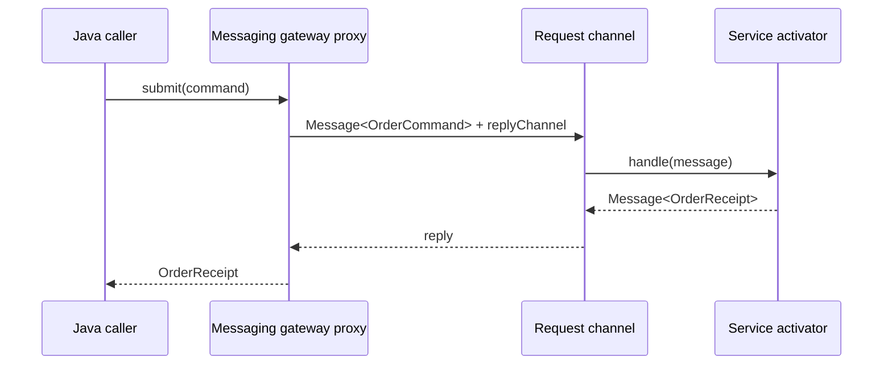
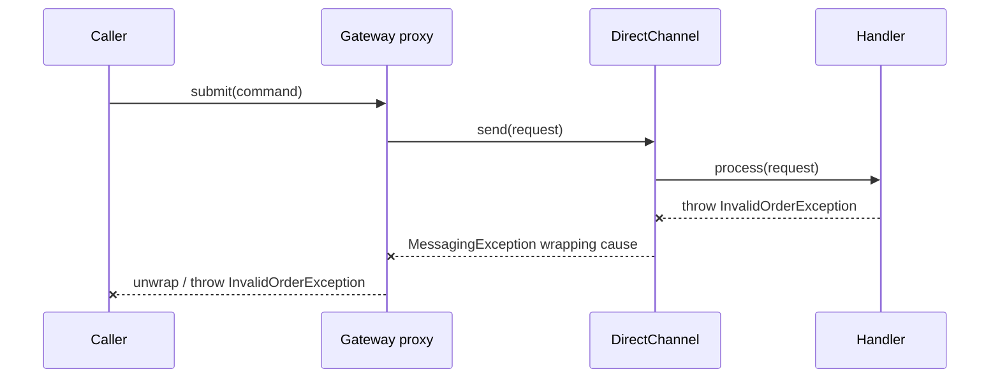
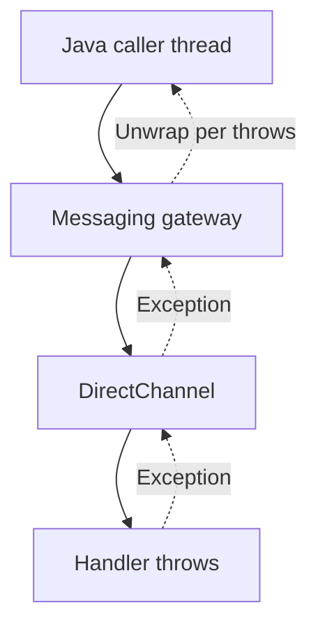
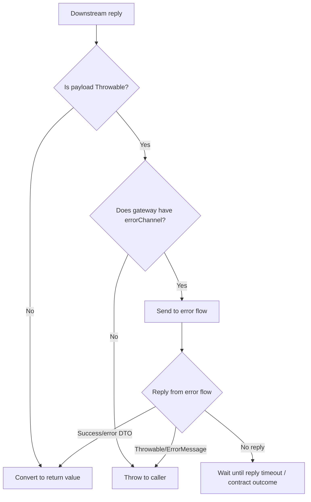
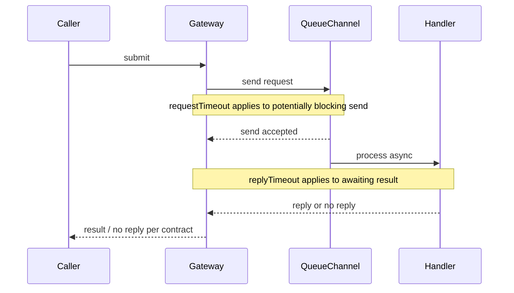
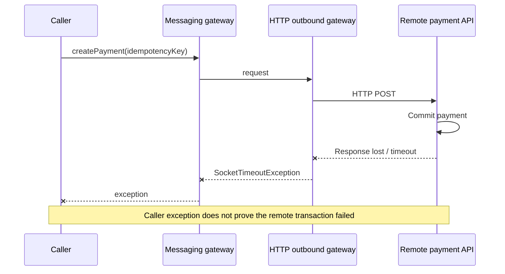

# Gateway Throwing Errors to the Caller in Spring Integration Adapters

> **Chapter:** Error handling  
> **Module:** `SPRING_INTEGRATION_ADAPTERS`  
> **Context:** Connecting external systems using inbound/outbound adapters, gateways, pollers, and `MessageChannel`; handling file, SFTP, HTTP, JMS, AMQP, Kafka, and database flows.  
> **Focus:** Understand **when a messaging gateway throws an exception back to the caller**, when errors are sent via `errorChannel` or returned as data, and how this impacts timeouts, transactions, broker acknowledgments, retries, and message preservation.

## 1. Why Understand "Gateway Throws Errors to the Caller"?

A messaging gateway makes a message-driven system look like an ordinary Java method call:

```java
OrderReceipt receipt = ordersGateway.submit(command);
```

The caller does not need to know that behind it sit a `DirectChannel`, a service activator, an HTTP outbound gateway, a JDBC writer, or a flow calling JMS/Kafka. Yet when a handler fails, that abstraction raises tough questions:

- Does `submit()` throw `IllegalArgumentException`, `MessagingException`, or another exception?
- Do you have to configure `errorChannel` to return errors to the caller?
- Can an error behind an `ExecutorChannel` return to the waiting thread?
- Does waiting past the **reply** timeout mean the target system definitely did not process the request?
- If a handler returns a `Throwable` as a payload, will the gateway return the object or throw an error?
- What will the caller see if an error flow only logs and returns no reply?
- Does returning an exception to the caller roll back JMS, avoid committing Kafka offsets, or automatically retry files?
- How do gateway methods returning `void`, `Future<T>`, or `Mono<T>` differ from synchronous methods?

**Lesson goal:** establish a **clear error contract** at the caller–gateway boundary, verify it with tests, and never confuse **a Java exception** with the **actual outcome of external systems**.

## 2. What Is a Gateway in Spring Integration?

Spring Integration supports the **Messaging Gateway** pattern: exposing a Java/POJI interface in front of the messaging system and creating a proxy via `GatewayProxyFactoryBean`, typically using `@MessagingGateway` and `@Gateway`.

Example:

```java
@MessagingGateway
public interface OrdersGateway {

    @Gateway(requestChannel = "ordersRequestChannel")
    OrderReceipt submit(OrderCommand command);
}
```

Logically:



The gateway converts method calls into request messages and converts replies into return values. It is **not automatically** an HTTP endpoint or a message broker; it is a Java-method-to-message boundary. HTTP inbound/outbound gateways and adapters have protocol-specific semantics, distinguished in later sections.

### 2.1. Two Meanings of "Gateway" to Distinguish

| Type | Who Is the Caller? | Where Are Errors Observed? |
|---|---|---|
| **Messaging interface gateway** | Java method caller | Java exceptions, reply values, `Future`/`Mono` |
| **HTTP inbound gateway** | HTTP client | HTTP status, body, connection/timeout |
| **HTTP outbound gateway** | Component in integration flow | Exception or reply message from HTTP client/response |
| **JMS/AMQP outbound gateway** | Flow sending request and awaiting response | Timeout/reply per messaging protocol and container |
| **Kafka adapter/gateway pattern** | Producer/consumer flow | Ack/callback, offset, reply correlation per config |
| **File/SFTP inbound/outbound adapter** | Poller or flow owner | I/O errors, file lifecycle; not POJI request–reply by default |

The phrase "gateway throws errors to the caller" applies most precisely to a **messaging interface gateway**. When discussing HTTP/JMS or Kafka, you must also consider the **specific protocol and endpoint**.

## 3. Default Behavior: Downstream Exceptions Propagate Back to the Caller

Official Spring Integration docs state: for a **messaging gateway** without an error flow converting errors into another reply, downstream errors are typically **rethrown to the caller**, and the framework can **unwrap** exceptions wrapped inside `MessagingException`.

A typical path:



**Key points:**

1. The handler throws a business or infrastructure error.
2. The framework may wrap the error into a `MessagingException` carrying `failedMessage`.
3. The gateway inspects the cause chain and the method's **throws clause rules**.
4. The caller receives the exception per declared contract and unwrapping behavior.
5. You do not need to add `errorChannel` just to throw errors back to the caller along the default path.

### 3.1. What Does "Rethrow As Is" Mean in Practice?

The high-level description "the error is rethrown" **does not mean the class seen by the caller is always the outermost Throwable** in Spring Integration. A `MessagingException` wrapper retains message context, while the gateway applies unwrapping logic to surface the business exception when appropriate.

Therefore, test **both the exception type and its cause and failed message** if the caller needs accurate diagnostics.

## 4. `MessagingException` and `failedMessage`

`org.springframework.messaging.MessagingException` carries messaging error details; `getFailedMessage()` returns the associated `Message<?>` if available. Common subtypes include `MessageHandlingException` and `MessageDeliveryException`.

Example:

```text
MessageHandlingException:
  failedMessage:
    payload: OrderCommand(orderId="o-104")
    headers:
      id: ...
      correlationId: ...
  cause:
    InvalidOrderException("missing customer reference")
```

When the gateway unwraps and throws `InvalidOrderException` to the caller, **the caller may no longer directly see `failedMessage`**. If diagnostics need message context, see declaring `throws` on the gateway method in the next section.

### 4.1. Do Not Misunderstand failedMessage

- It is not guaranteed to exist on every `Throwable`.
- It is the message at the point of failure, **not always the initial request**.
- After transformers/splitters, the payload may have changed shape.
- It may contain PII, tokens, or internal headers; never log it verbatim.
- It does not prove the message was rolled back, retried, nacked, or quarantined.
- If the error occurred before message creation, only the exception and endpoint metadata may exist.

### 4.2. ErrorMessage Is a Separate Object

`org.springframework.messaging.support.ErrorMessage` has a `Throwable` payload and may have `getOriginalMessage()`. Do not equate them:

| Component | Retrieved From | Meaning |
|---|---|---|
| `MessagingException.getFailedMessage()` | Exception | Message at the failure point when provided |
| `ErrorMessage.getOriginalMessage()` | Error message | Input message retained by the error strategy if present |
| `ErrorMessage.getPayload()` | Error message | The `Throwable` being handled/routed |
| `MessageHeaders.ERROR_CHANNEL` | Request header | Error destination at supporting boundaries |
| `replyChannel` | Header/request–reply mechanism | Where the gateway awaits replies |

When the default path throws exceptions directly, **an `ErrorMessage` may never have existed** on `errorChannel`.

## 5. Gateway Method `throws` Clauses Change Which Exception Type Is Seen

Spring Integration lets you declare `throws` on gateway interfaces to influence how it searches for a matching exception in the **cause chain**.

Example interface wanting the caller to see `MessagingException`:

```java
import org.springframework.integration.annotation.Gateway;
import org.springframework.integration.annotation.MessagingGateway;
import org.springframework.messaging.MessagingException;

@MessagingGateway
public interface DiagnosticOrdersGateway {

    @Gateway(requestChannel = "ordersRequestChannel")
    OrderReceipt submit(OrderCommand command)
            throws MessagingException;
}
```

Official docs describe declaring `throws MessagingException` to receive the messaging error context rather than always unwrapping down to the business exception.

### 5.1. Interface Without `throws`

```java
@MessagingGateway
public interface OrdersGateway {
    @Gateway(requestChannel = "ordersRequestChannel")
    OrderReceipt submit(OrderCommand command);
}
```

If the handler throws `InvalidOrderException extends RuntimeException`, the gateway typically unwraps and throws the matching exception back to the caller. Without a matching `throws` clause, docs state the gateway traverses the cause chain looking for a `RuntimeException` that is not a `MessagingException`; if none is found, it may throw `MessagingException`.

### 5.2. Declaring a Specific Checked Exception

```java
@MessagingGateway
public interface DocumentGateway {

    @Gateway(requestChannel = "documentRequestChannel")
    StoredDocument store(DocumentRequest request)
            throws DocumentRejectedException;
}
```

When `DocumentRejectedException` is in the cause chain and allowed by the signature, the gateway can unwrap to deliver the matching exception to the caller per framework rules. Do not claim any checked exception automatically passes through the interface without testing the exact wrapping layer and signature.

### 5.3. Avoid Overusing `throws Throwable`

Declaring an overly broad clause makes it hard for calling code to separate recoverable failures from technical errors and couples callers too tightly to internals. A clear contract like `throws DocumentRejectedException` or a runtime domain exception is easier to operate; declare `MessagingException` only when the caller genuinely needs `failedMessage` and metadata.

## 6. Java DSL: A Flow Where the Gateway Throws an Exception

Self-contained example following common Spring Integration setup. Uses modern Java (`record`); verify against your project's Spring Boot/Spring Integration and Java versions before running.

### 6.1. Domain Contract

```java
public record OrderCommand(String orderId, int quantity) {}

public record OrderReceipt(String orderId, String status) {}

public class InvalidOrderException extends RuntimeException {
    public InvalidOrderException(String message) {
        super(message);
    }
}
```

### 6.2. Gateway Interface

```java
import org.springframework.integration.annotation.Gateway;
import org.springframework.integration.annotation.MessagingGateway;

@MessagingGateway
public interface OrdersGateway {

    @Gateway(
        requestChannel = "ordersRequestChannel",
        requestTimeout = 1000,
        replyTimeout = 5000)
    OrderReceipt submit(OrderCommand command);
}
```

Timeout values in the example use the units supported by the annotation (typically milliseconds); verify the API contract for your version. Never rely blindly on default timeouts without documenting them.

### 6.3. Handler and IntegrationFlow

```java
import org.springframework.context.annotation.Bean;
import org.springframework.context.annotation.Configuration;
import org.springframework.integration.config.EnableIntegration;
import org.springframework.integration.config.IntegrationComponentScan;
import org.springframework.integration.dsl.IntegrationFlow;

@Configuration
@EnableIntegration
@IntegrationComponentScan
class OrdersIntegrationConfiguration {

    @Bean
    IntegrationFlow ordersFlow() {
        return IntegrationFlow.from("ordersRequestChannel")
            .handle(OrderCommand.class, (cmd, headers) -> {
                if (cmd.quantity() <= 0) {
                    throw new InvalidOrderException(
                        "Quantity must be positive");
                }
                return new OrderReceipt(cmd.orderId(), "ACCEPTED");
            })
            .get();
    }
}
```

When the caller invokes it:

```java
try {
    OrderReceipt receipt =
            gateway.submit(new OrderCommand("o-104", 0));
} catch (InvalidOrderException ex) {
    // Caller handles the business contract error.
    // Do not return ex.getMessage() straight out to public APIs.
}
```

In a synchronous flow like this, the handler exception propagates through the gateway to the caller. You do not need to configure global `errorChannel` here just to return errors to the caller.

### 6.4. Assumptions of This Example

- Component scanning registers `@MessagingGateway` properly.
- The request channel connects to the intended flow.
- No intervening `ExecutorChannel` or `QueueChannel` alters error propagation.
- No gateway `errorChannel` converts exceptions into replies.
- No advice catches and recovers the exception before the gateway sees it.
- The classpath includes Spring Integration DSL and matching dependencies.

This example teaches error semantics; production applications must test against real configurations and policies.

## 7. Synchronous Errors: `DirectChannel` Returns Errors on the Same Call Stack

`DirectChannel` normally invokes subscribers on the sending thread. If a handler throws an exception, the caller on the same call stack can receive the error.



### 7.1. When Does the Caller Receive It Immediately?

- The gateway method executes synchronously.
- The message traverses endpoints on the same thread or has a return error path.
- No interceptor/advice error recovery swallows the error.
- No error channel is configured to convert errors into reply values.
- No wrapper around the gateway alters the exception on the caller side.

**Using Spring Integration does not mean every exception is published to global `errorChannel`.** On synchronous paths, propagation behaves close to a normal Java method call.

### 7.2. Do Not Confuse with Sending Directly to a Channel

If application code calls:

```java
requestChannel.send(message);
```

it is using a `MessageChannel` directly, **not** calling a gateway interface. Errors from `DirectChannel` can throw back to the caller of `send()`; gateway-specific unwrapping rules do not automatically apply identically.

## 8. Gateway `errorChannel`: Turning Errors into Replies or Handling Separately

Beyond default throwing, a messaging gateway can specify a **dedicated error channel**. When the gateway catches a downstream error per supported mechanisms, the error goes to the **error flow**, which can:

- Convert the exception into an **error reply DTO**.
- Route via `ErrorMessageExceptionTypeRouter`.
- Audit/alert and still return an exception.
- Classify errors by policy and decide whether returning a value is safe.

Spring Integration documentation gives an XML example:

```xml
<int:gateway
    id="sampleGateway"
    service-interface="example.OrdersGateway"
    default-request-channel="ordersRequestChannel"
    error-channel="orderGatewayErrors"/>

<int:transformer
    input-channel="orderGatewayErrors"
    ref="orderErrorTransformer"
    method="toErrorReply"/>
```

`toErrorReply` returns a payload matching the caller contract; **never simply log and forget to reply**.

### 8.1. Annotation `@MessagingGateway(errorChannel = ...)`

```java
@MessagingGateway(errorChannel = "orderGatewayErrors")
public interface SafeOrdersGateway {

    @Gateway(
        requestChannel = "ordersRequestChannel",
        replyTimeout = 5000)
    OrderOutcome submit(OrderCommand command);
}
```

If the error flow turns the error into a valid `OrderOutcome` and replies to the gateway, the caller receives a **value** instead of an exception. This is a **contract change**, not just adding a logging hook.

### 8.2. Define the Contract Before Choosing the Mechanism

| Caller Contract | Design |
|---|---|
| `submit()` throws an exception on failure | Default propagation; catch/convert only at intentional boundaries |
| `submit()` returns `OrderOutcome` with error status | Error flow converts exceptions into valid values |
| `submit()` returns `Result<T>` | Standardize success/error value semantics |
| HTTP API returns status+body | Dedicated HTTP gateway/controller mapping |
| `Future<OrderReceipt>` | Errors become exceptional completion/`ExecutionException` |
| `void` one-way | No reply value to inform caller of async outcomes |

Never declare a return type of `OrderReceipt` while the error flow returns the String `"ERROR"` hoping a converter handles it implicitly; that easily triggers new conversion errors.

## 9. `Throwable` in a Reply: Not an Ordinary Return Value

An easily overlooked point in gateway documentation: **if downstream returns an `ErrorMessage` or a message whose payload is a `Throwable`, the gateway treats it as an error**.

- If no gateway error channel is configured, the `Throwable` can be thrown to the caller.
- If an error channel exists, the `Throwable` can be routed to the error flow.
- If the error flow itself returns an `ErrorMessage` or a message with a `Throwable` payload, the gateway can throw that `Throwable` to the caller.



**Example:** if a handler returns `new IllegalStateException("...")` as a payload for the caller to inspect error info, a messaging gateway does not necessarily treat that as a "valid return value" for the method; it handles `Throwable` replies as errors.

### 9.1. If You Actually Want to Return Error Details as Data

Define a DTO:

```java
public record OrderOutcome(
        boolean success,
        String code,
        String orderId,
        String message) {

    public static OrderOutcome rejected(String orderId) {
        return new OrderOutcome(
                false, "ORDER_REJECTED",
                orderId, "Order is invalid");
    }
}
```

This value is a **business payload**, not a `Throwable`. Callers read `success` and `code` per contract. Never copy stack traces or raw exception messages into externally returned DTOs.

## 10. Error Flow Returning a DTO: Intentional Design

An error channel handler can transform a `Throwable` into an `OrderOutcome`.

Illustrative annotation example:

```java
import org.springframework.integration.annotation.Transformer;
import org.springframework.messaging.MessagingException;
import org.springframework.stereotype.Component;

@Component
class OrderErrorTransformer {

    @Transformer(inputChannel = "orderGatewayErrors")
    public OrderOutcome toErrorReply(Throwable failure) {

        // Record safe metadata in a dedicated service if needed.
        // Do not expose stack traces or raw failedMessage.
        String code = "ORDER_PROCESSING_FAILED";

        Throwable cursor = failure;
        for (int depth = 0; cursor != null && depth < 16; depth++) {
            if (cursor instanceof InvalidOrderException) {
                code = "ORDER_INVALID";
                break;
            }
            cursor = cursor.getCause();
        }

        return new OrderOutcome(
            false, code, null,
            "Unable to process the order at this time");
    }
}
```

This illustrates transforming errors into values, not a complete error policy. A production implementation should:

- Guard cause cycles and depth.
- Persist necessary metadata to an authorized audit store.
- Choose accurate status/error codes.
- Never turn infrastructure outages into "business completed".
- Test that replies return **to the right gateway invocation** under concurrent callers.
- Verify idempotency and transaction outcomes before labeling anything "safe to retry".

### 10.1. Special Note: The Error Flow Itself Can Throw

If a transformer in the error flow throws another exception, the caller may receive the new exception. That can obscure the root cause if evidence isn't saved. Design controlled fallbacks, log correlation IDs, and preserve relevant causes.

### 10.2. Do Not Treat Null as "Error Handled"

If an error flow produces no reply on a synchronous gateway, the caller may **block until reply timeout** or get a missing result per contract. A logger that sends no reply is not equivalent to "throwing immediately to the caller".

## 11. Error Flow Wanting to Preserve the Exception for the Caller

Sometimes you need auditing while still surfacing the error to the caller. You can:

1. Keep default propagation, letting the caller at the Java boundary write bounded audit logs.
2. Configure an error channel if classification/routing is needed and **return `Throwable`/`ErrorMessage`** per gateway-supported behavior.
3. Wrap in a contract-compliant domain exception while retaining the root cause in internal evidence.

```text
gateway
  -> business flow
  -> error channel
  -> classify + audit metadata
  -> error reply as Throwable
  -> gateway throws to caller
```

What to check: errors can occur in the audit/quarantine handler itself; operation order affects outcomes and source data. Never claim rethrowing automatically preserves JMS rollback or Kafka offsets if the transaction boundary sits elsewhere.

### 11.1. When to Keep Default Throwing?

- The caller can handle exceptions directly.
- No DTO conversion is required.
- You want a simple call stack with fewer channels and publishers.
- Transaction/ack boundaries are clear and no async handoff breaks propagation.

**Do not build a dedicated error flow just to rethrow the exact same exception as default** unless you truly need auditing, classification, alerting, or redaction.

## 12. `void` Gateways: No Reply Value to Carry Post-Return Errors

A gateway method returning `void` is typically one-way, though two cases differ:

**Synchronous send:** errors during sending or immediate handling on the same call stack can still impact the method call depending on gateway and downstream.

**Asynchronous handoff:** once the method returns, errors in an executor, queue, broker, or callback cannot "travel back in time" to throw a Java exception on an already-finished caller thread.

```java
@MessagingGateway(errorChannel = "notificationErrors")
interface NotificationGateway {
    @Gateway(requestChannel = "notificationRequests")
    void dispatch(NotificationCommand command);
}
```

In modern Spring Integration versions, configuring `errorChannel` on a `void` gateway can set the `errorChannel` header so downstream async errors find the right path. Even then, the caller still has **no return value or Future to observe later outcomes**.

### 12.1. Do Not Overuse Fire-and-Forget for Operations Requiring Confirmation

If you must prove an email, payment, Kafka message, or database update was confirmed by the target system, do not use a `void` method and treat "no exception thrown" as final success. Consider `Future<Void>`, `CompletableFuture<T>`, callbacks/idempotency, or reconciliation.

## 13. `@Async void`: Exceptions Do Not Automatically Rethrow to the Caller

With an `@Async void` method, the caller regains control before work finishes. Spring Integration docs explicitly state that downstream exceptions **do not propagate back to the caller like a synchronous Java call**.

```java
@MessagingGateway
interface AsyncNotificationGateway {

    @Gateway(requestChannel = "notificationRequests")
    @Async
    void dispatchAsync(NotificationCommand command);
}
```

This does not mean errors go unhandled: you need an error channel, executor error handling, audit/alerts, and an appropriate retry mechanism. Never write:

```java
try {
    gateway.dispatchAsync(command);
} catch (RuntimeException ex) {
    // Cannot expect to catch errors occurring after the method returned.
}
```

### 13.1. When Completion Must Be Observed

Per modern Spring Integration, use appropriate async return types such as `Future<Void>` or `Mono<Void>` depending on version and executor config, so completion/exceptions surface through the async result. Do not switch `void` to `Future<Void>` and assume every case works without verifying the API/reply flow.

## 14. `Future<T>` and `CompletableFuture<T>`: Errors Appear When Observing the Result

A gateway interface can return `Future<OrderReceipt>` or `CompletableFuture<OrderReceipt>`. In the appropriate mode, the method immediately returns a future; downstream errors surface when the future completes exceptionally.

```java
@MessagingGateway
interface AsyncOrdersGateway {

    @Gateway(requestChannel = "ordersRequestChannel")
    CompletableFuture<OrderReceipt> submitAsync(OrderCommand command);
}
```

Callers can observe:

```java
CompletableFuture<OrderReceipt> future =
        gateway.submitAsync(new OrderCommand("o-104", 0));

future.whenComplete((receipt, failure) -> {
    if (failure != null) {
        // Handle failure; may wrap the original exception.
        // Do not log raw payloads/messages.
    } else {
        // Confirm business result from reply.
    }
});
```

With `Future#get()`, callers typically receive `ExecutionException` wrapping the cause; with `CompletableFuture#join()`, typically `CompletionException`. Those are **Java async API wrappers**, distinct from `MessagingException` at the Spring Integration boundary.

### 14.1. Two Modes to Distinguish

Spring Integration docs describe:

- When the gateway uses an `AsyncTaskExecutor` and a supported return type, execution can run on the executor and return a future to the caller.
- When gateway async execution is explicitly disabled, downstream can return a **future payload** directly; contracts and threading differ.
- Newer versions add async gateway operators in Java DSL; read version-specific docs.

Never assume any `CompletableFuture` proves the gateway spawned a thread or the downstream broker confirmed delivery.

### 14.2. Pitfall of Ignoring the Future

If the caller never observes completion, a failure after async send may exist only in logs/error channels. Assign owners for callbacks, tracing, timeouts, and retry budgets.

## 15. `Mono<T>` and Reactive Handling

In gateway interfaces returning `Mono<T>`, execution may depend on subscription rather than starting immediately at method invocation, depending on reactive/adapter configuration.

```java
@MessagingGateway
interface ReactiveOrdersGateway {
    @Gateway(requestChannel = "ordersRequestChannel")
    Mono<OrderReceipt> submit(OrderCommand command);
}
```

Callers should handle it like:

```java
gateway.submit(command)
    .doOnError(error -> {
        // Bounded telemetry/alerting; avoid unintended swallowing.
    })
    .onErrorResume(error ->
        Mono.error(new OrderProcessingUnavailableException(
            "Order processing could not complete", error)));
```

This illustrates **keeping failures inside the reactive pipeline**; in real code, avoid duplicate wrapping and handle types/cancellations carefully. With `Mono`, exceptions are not necessarily thrown directly by calling `submit()`; they can surface when subscribed.

### 15.1. Cancellation and Timeouts

If a subscriber cancels or times out before downstream completes, upstream or external systems **do not roll back automatically**. Put timeouts, idempotency, cancel semantics, and reconciliation at the right layers.

## 16. Request Timeout Differs from Reply Timeout

Spring Integration gateways distinguish:

- **`requestTimeout`:** limits how long sending the request waits **when sending can block**, such as a full bounded `QueueChannel`.
- **`replyTimeout`:** limits how long the gateway waits for a matching reply to the request.

These two timeouts **do not prove the same event**.



### 16.1. `replyTimeout` Does Not Always Throw a Timeout Exception

Docs explain that a gateway may **return `null` when waiting for a reply times out**, depending on method contract and configuration. Never assume "reply timeout = throws `TimeoutException`".

If the application requires **fail-fast** and forbids null:

- Design an explicit outcome type and handle `null`.
- Enable `requiresReply` or filter rejection behavior on downstream endpoints where applicable.
- Define a gateway/error policy interpreting no-reply scenarios.
- Add contract tests so callers never confuse no-reply with success.

### 16.2. Do Not Rely Blindly on Default Timeouts

Default timeouts can differ across Spring Integration versions or declaration styles. Explicitly configure request/reply timeouts and verify limits at deployment. Avoid infinite waits on APIs/thread pools with short SLAs.

## 17. No Reply: Logic Bugs, Filters, or Async Branches Losing Responses

A request–reply gateway normally expects a result, yet the message flow might:

- Drop the message in a filter without sending a discard reply.
- Send to `nullChannel` or have a handler return `null`.
- Route via a router to a channel with no reply.
- End at a one-way service activator.
- Stall inside a queue, executor, or external gateway.
- Catch/swallow an exception without returning a reply.
- Wait on an incomplete aggregator correlation group.
- Finish an async callback after the `replyChannel` expired.

### 17.1. Distinguish Four Outcomes

| Outcome | Caller Observes |
|---|---|
| Handler succeeds and replies | Value matching method contract |
| Handler throws exception by default | Exception propagated/unwrapped by gateway |
| Handler/error flow returns `Throwable` | Gateway treats as error, may throw |
| No reply | Blocks, times out, or returns null per contract |

**Never equate "no exception" with "succeeded"** when a gateway can return null or the method is `void`.

### 17.2. Supporting Flags

Some endpoints support `requiresReply` to treat missing replies as errors, and some filters offer `throwExceptionOnRejection`/equivalent options to avoid silent drops. API names and placement vary by endpoint/version; test real flows.

## 18. ExecutorChannel, QueueChannel, and Thread Boundaries

Switching from `DirectChannel` to `ExecutorChannel` or `QueueChannel` changes exception propagation:

- `ExecutorChannel` typically dispatches execution to another executor.
- `QueueChannel` buffers messages for a consumer to handle later.
- The original caller may have left the call stack when the handler throws.
- Error publication using the `errorChannel` header or global fallback may activate.
- A request–reply gateway can await a reply or a `Throwable` reply to receive errors, yet **not every kind of async failure** is guaranteed to return to the caller.

### 18.1. Async Error Publishers and the errorChannel Header

At some async boundaries, `MessagePublishingErrorHandler` builds an `ErrorMessage` from the exception, using `MessageHeaders.ERROR_CHANNEL` if applicable or global `errorChannel`. A gateway must specifically check:

- Is the `replyChannel` header preserved across all steps?
- Do errors reach the right error channel/gateway reply handler?
- Can producer callbacks fire after the gateway already timed out?
- Does any subscriber convert `ErrorMessage` into a `Throwable` reply?
- Why did an error hit the global channel while the caller saw only `null`?
- Can another subscriber's error be lost due to `PublishSubscribe` fan-out?

### 18.2. Do Not Trust Routing Control from Clients

Never allow externally supplied HTTP/JMS/Kafka headers to dictate internal `errorChannel` or `replyChannel`. Inbound flows should allowlist and override control headers using trusted configuration.

## 19. `@MessagingGateway`, `@Gateway`, and Java DSL Gateways

There are several ways to configure messaging gateways:

| Approach | Key Point |
|---|---|
| `@MessagingGateway` | Interface-based proxy with default request/reply/error config |
| `@Gateway` on method | Customizes request channel, reply timeout, headers, and method-specific contract |
| XML `<int:gateway>` | Declares `service-interface`, request/reply/error channels, and method overrides |
| Java DSL `gateway()` operator | Invokes a subflow/gateway endpoint inside `IntegrationFlow`; version-specific options |
| `GatewayProxyFactoryBean` | Low-level proxy factory requiring standard lifecycle/context setup |

**Note:** Not every DSL handler named "gateway" shares the exact contract of a `@MessagingGateway` interface called from Java. To predict exception propagation, know **who awaits the reply** and **which gateway boundary** is involved.

### 19.1. How Are Interface Gateways Registered?

Docs state `@IntegrationComponentScan` scans gateway interfaces and builds proxies; plain `@ComponentScan` does not create proxies for `@MessagingGateway` interfaces in every case.

After configuring, test that the application context registers the gateway bean and invokes the request channel—do not rely on compilation alone.

### 19.2. Method Headers and Private Data

`@Header`/`@GatewayHeader` allow adding context. Never attach bearer tokens, raw passwords, or full HTTP headers unnecessarily. When the system captures `failedMessage`, those headers can surface inside exceptions.

## 20. Gateways Returning Errors and the HTTP Inbound Boundary

An **HTTP inbound gateway** receives requests from HTTP clients. When downstream fails, besides throwing exceptions inside Spring, the system needs an **HTTP status + body** contract.

Example scenario:

```text
HTTP client
   -> HTTP inbound gateway
      -> validate
      -> JDBC write (throws)
      -> error handling
   <- HTTP response (status/body)
```

**Throwing `IllegalArgumentException` does not automatically give the HTTP client a business-appropriate `400`.** You need exception–status mapping at the HTTP layer or an error response flow, via inbound gateway/Spring Web mechanisms.

### 20.1. Reference Response Table

| Scenario | Reference HTTP Classification |
|---|---|
| Invalid data | 400/4xx per API contract |
| Missing authentication | Appropriate 401 |
| Insufficient permissions | Appropriate 403 |
| Resource not found | 404 or approved mapping |
| Business state conflict | 409 when semantically accurate |
| Rate limit | 429, consider `Retry-After` |
| Dependency temporarily unavailable | 503 or appropriate status |
| Gateway timeout | 504 or status matching failure point |
| Unclassified internal error | 500 |

Actual status codes must follow HTTP semantics and the API contract, not generic exception classes alone.

### 20.2. Safe Response

```json
{
  "errorCode": "ORDER_PROCESSING_FAILED",
  "message": "Unable to complete request",
  "correlationId": "corr-591"
}
```

Never return `MessagingException.toString()`, stack traces, raw SQL, SFTP credentials, or PII-bearing payloads to clients. In operations, keep evidence in a protected store with ACLs and retention.

## 21. HTTP Outbound Gateways: Exceptions May Not Describe Server-Side Outcomes

An HTTP outbound gateway sends requests to external systems. Common errors include:

- Connection refused, DNS/TLS errors.
- Read timeouts or connection resets.
- 4xx/5xx converted to exceptions by the client per error handler.
- Response deserialization failures.
- Invalid response bodies.
- Timeouts after the remote server **already executed side effects**.

### 21.1. The HTTP POST Timeout Trap



The caller catches an exception, yet must check **idempotency keys, payment status APIs, reconciliation, or outbox** before retrying. Never treat "gateway threw an error" as a cross-network rollback.

### 21.2. 4xx Is Not One Uniform Bucket

- `400` validation errors usually require fixing the payload.
- `401/403` may indicate credential/config/policy issues.
- `409` may be a conflict or an already-processed duplicate.
- `429` may retry per quota and `Retry-After`.
- `5xx` may be transient, yet retrying side effects is not always safe.

Routing by exception class is a starting point, not a substitute for operation-specific logic.

## 22. File Inbound and SFTP: The Real Caller May Be a Poller

With file/SFTP inbound **polling adapters**, there is no Java method caller calling `gateway.submit()` in a default client request–reply model. The **poller** typically injects messages into the flow.

```text
Scheduled poller
   -> File/SFTP inbound adapter
   -> handler
   -> exception
   -> poller error handler / error channel
```

If the handler throws inside a polling task, the exception can be caught and published as an `ErrorMessage` to the channel configured on the poller. It **does not automatically travel to an external Java caller**.

### 22.1. Why Distinguish This?

- Files past an accept-once filter may not be polled again.
- SFTP connection failures happen before `Message<File>` exists.
- Moving files to archive/quarantine does not auto-rollback.
- Error handlers may lack the original file message.
- Retrying an entire file can duplicate already-committed DB writes.

### 22.2. When a File Flow Calls a Gateway Internally

A file poller might call `ordersGateway.submit(...)` from a service activator. The gateway can throw an exception **back to the poller's thread**, and then the poller decides whether to publish to `ordersErrors`. Always identify the **true caller** before predicting where errors go.

## 23. JMS: Java Gateway Exceptions Differ from Broker Rollback

JMS has message-driven listeners or outbound gateways. A gateway interface can throw exceptions to a Java caller, whereas a JMS broker only rolls back/redelivers when the **transaction/listener boundary** handles errors per config.

| Scenario | What Caller Sees | What JMS Decides |
|---|---|---|
| Java gateway runs on same thread | Exception when handler throws | Rolls back only if enlisted transaction is marked appropriately |
| JMS listener receives message and calls gateway | Listener can catch exception | Container decides ack/rollback per config |
| Gateway error flow returns DTO instead of throwing | Caller receives DTO | Container may treat processing as succeeded if no error remains |
| JMS outbound gateway awaits response | Can get reply/timeout/error | Request/reply correlation and broker transactions differ |
| Async error already published | May not return to original caller | Must verify redelivery/DLQ via tests |

### 23.1. Risk of "Swallowing Exceptions"

If a handler previously threw exceptions so the listener rolled back, and then adding `@MessagingGateway(errorChannel=...)` converts errors into `OrderOutcome(success=false)`, the listener may **stop receiving Throwables**, altering commit behavior.

Before switching **throw → value**, test:

- Listener transaction and acknowledgment mode.
- Broker redelivery count.
- DLQ destination when exhausted.
- Idempotency on reprocessing.
- Durability of recovery records.

### 23.2. Never Assume Transactions Span HTTP + JMS + DB

A local JMS or DB transaction does not cover HTTP calls. If remote side effects already occurred, use outbox, saga/compensation, or reconciliation.

## 24. AMQP: Gateway Errors and Ack/Nack

AMQP inbound adapters use listener containers; outbound gateways use request/reply protocols and correlation per module. Java gateway exceptions and AMQP acks are not the same thing.

Questions to verify:

1. Does the listener use auto-ack or manual-ack?
2. Does the exception propagate to the container?
3. If an error handler converts to a DTO, will the consumer still nack/requeue?
4. Does the broker have a dead-letter exchange and retry budget?
5. Will poison message parse errors requeue forever?
6. Do outbound gateway replies handle timeouts/correlation properly?
7. Are publisher confirms enabled for publish steps and error callbacks?
8. If the recovery handler fails, how is the message preserved?

An `ErrorMessage` on a private channel **does not automatically ack/nack**. Test against real AMQP or test containers with matching config.

## 25. Kafka: Offsets and Callbacks Do Not Automatically Follow POJI Exceptions

Kafka has two distinct error paths:

**Inbound consumer:** Listener receives records, transforms, and processes. Errors can trigger seek/retry/DLT or offset commits depending on adapter/container.

**Outbound producer:** Handler sends records; producer callbacks can emit errors **after the initial send call returned**.

### 25.1. If a Java Gateway Calls a Kafka Outbound Adapter

```text
Java caller -> messaging gateway -> Kafka outbound adapter
                                  |
                                  +-- send handed to producer
                                         |
                                         +-- async broker confirmation/failure later
```

Never claim that a gateway method returning without throwing means the Kafka broker committed. Check adapter sync/async mode, send timeouts, success/failure channels, callbacks, and confirmations.

### 25.2. If a Kafka Listener Calls a Java Gateway

The gateway's caller is the **Kafka listener thread**, not the Kafka record producer. Whether throwing to the listener preserves the offset depends on listener container error handling and ack policies.

### 25.3. Idempotency and Outbox

A DB insert succeeding followed by a Kafka publish failure can be solved via a transactional outbox or reconciliation job. Retrying the entire gateway without idempotency risks duplicates. Gateways do not provide "cross-system exactly-once" merely through exception propagation.

## 26. JDBC/Database: Transactions Must Encompass Real Operations

In the flow:

```text
gateway -> validate -> JDBC writer -> reply
```

if the JDBC handler throws inside an uncommitted transaction, the transaction manager can roll back per propagation/rollback rules. But **never assume** rollback just because the gateway threw:

- Is a transaction manager configured?
- Did the transaction start before or after the gateway?
- Did a channel switch threads?
- Did anything commit before an exception from a later step?
- Are there external side effects outside the transaction?
- Was the exception converted into a DTO so the transaction treated it as success?

### 26.1. Beware of `@Transactional` and Async

Spring transactions normally bind to the execution context/thread. If a gateway request crosses an `ExecutorChannel`, the caller thread's transaction **does not automatically flow onto another executor**. Establish worker-level transaction boundaries and/or dedicated coordination.

### 26.2. Duplicate Key Does Not Mean Terminal Failure

`DataIntegrityViolationException` can stem from an already-processed duplicate event or invalid data. Callers should act on **domain idempotency keys and DB state**, not exception type alone.

### 26.3. Database Pollers Have No Continuous Java Caller

When a JDBC inbound poller reads `status=NEW` and calls a gateway, the caller may be the poller task. Gateway exceptions can return to that task, while row claim/lease/retry strategies must be managed by the pipeline to prevent stuck rows or double processing.

## 27. Retry: Caller Retries Gateway or Downstream Retry Advice?

Two common patterns:

**Caller retry:**

```text
Java caller -> gateway -> downstream -> exception
Java caller -> retry gateway -> downstream -> ...
```

**Handler retry:**

```text
Java caller -> gateway -> handler + RequestHandlerRetryAdvice
                                      | bounded retry
                                      | exhausted -> exception/recoverer
                             -> caller
```

Choose **one primary retry strategy**; never stack retries across caller, gateway advice, broker redelivery, and batch replay without an overall budget.

### 27.1. Required Parameters

- Retryable error classes: transient/permanent/unknown.
- Max attempts and total deadline.
- Suitable backoff/jitter.
- Request and reply timeouts.
- Idempotency key/operation.
- Transaction and source/target states.
- Exhaustion action: DLQ/quarantine, response, or exception?
- Data/log/PII scope in recovery records.

### 27.2. When Retries Fail Yet Remote Already Committed

For example, HTTP timeout after POST or lost Kafka broker confirmation: callers must **query the outcome** instead of recreating side effects. Exceptions detect uncertainty; never turn uncertainty into "transaction definitely failed".

## 28. `ErrorMessageExceptionTypeRouter` and Returning Errors to the Caller

In an error flow, `ErrorMessageExceptionTypeRouter` can classify:

```text
gateway
  -> business handler throws
  -> gateway error channel
  -> ErrorMessageExceptionTypeRouter
        |-- ValidationException -> create validation response
        |-- NetworkException    -> create unavailable response
        |-- unknown             -> return Throwable / escalation
```

The router **selects a channel**; it does not throw exceptions or build reply DTOs on its own. For the caller to see the right outcome, each branch must:

- Return a valid object matching the method contract.
- Or return a `Throwable`/`ErrorMessage` per gateway semantics.
- Or intentionally omit a reply while accounting for timeout/one-way behavior.
- Or propagate the exception across the proper boundary.

### 28.1. Avoid Overly Broad Mappings

`RuntimeException` encompasses validation, programming bugs, and dependency outages. Routing every `RuntimeException` to retry risks infinitely retrying permanent errors and causing hot loops. Classify using cause chains, operation context, and a default/unclassified owner.

## 29. Choosing the Caller Contract: Exception or Error Value?

| Context | Recommendation | Why |
|---|---|---|
| Internal Java service, synchronous processing | Throw clear domain exception on failure | Caller handles directly, simple stack |
| External-facing HTTP API | Translate error to HTTP status + safe DTO | Protocol contract, hides internals |
| Async command with deferred result | `Future`/`CompletionStage`/`Mono` where suitable | Caller observes completion instead of assuming success |
| Fire-and-forget telemetry | `void` + monitoring/DLQ | No reply; requires owner for async failures |
| Transactional JMS/AMQP consumer | Prefer contract preserving ack/rollback | Avoid accidentally swallowing errors |
| File/SFTP polling | Poller error channel + quarantine/replay | Poller is the caller; files lack broker rollback |
| Transactional DB write | Throw for rollback, combine with idempotency | Preserves proper transaction outcomes |
| Payment request with remote side effects | Exception + state query/idempotency | Exceptions do not prove remote failure |

**There is no universal best choice for every flow.** Choose based on the consumer, recoverability, observability, and transaction boundaries.

## 30. Tracing Errors Back to the Exact Gateway Invocation

With concurrent callers, maintain **correlation** so `ErrorMessage`s and replies never mix across invocations.

Fields to capture:

| Field | Purpose |
|---|---|
| `flowId` | Identifies owning flow |
| `gatewayMethod` | Which API contract was invoked |
| `correlationId` | Links request/reply/error per invocation |
| `messageId` | Tracks `Message` at each step |
| `endpointId` | Pinpoints failing handler/adapter |
| `sourceRef` | Finds file/record/broker message when needed |
| `attempt` | Policy attempt number |
| `policyVersion` | Explains retry/recovery decisions |
| `replyOutcome` | Success, error reply, exception, no-reply |
| `targetConfirmation` | Whether target system confirmed side effects |

Never trust client-supplied correlation IDs without validation/sanitization. Gateways and error flows must protect internal `replyChannel`/`errorChannel` headers from spoofing or leaking to external systems.

### 30.1. Do Not Copy All Headers to External Messages

Headers carrying reply channels can contain non-serializable internal references; across brokers/JSON, copy only permitted metadata. Never export all Spring `Message` headers to JMS/Kafka/HTTP without a safe header mapper.

## 31. Testing Default Gateway Exception Throwing

### 31.1. Unit/Integration Test with Spring Context

With the configuration from Section 6, you can use JUnit:

```java
import static org.junit.jupiter.api.Assertions.*;

import org.junit.jupiter.api.Test;
import org.springframework.beans.factory.annotation.Autowired;
import org.springframework.boot.test.context.SpringBootTest;

@SpringBootTest
class OrdersGatewayFailureTest {

    @Autowired
    OrdersGateway gateway;

    @Test
    void invalidOrderExceptionReturnsToCaller() {
        InvalidOrderException failure = assertThrows(
            InvalidOrderException.class,
            () -> gateway.submit(new OrderCommand("o-104", 0))
        );

        assertNotNull(failure);
    }

    @Test
    void validOrderProducesReply() {
        OrderReceipt receipt =
            gateway.submit(new OrderCommand("o-105", 2));

        assertEquals("ACCEPTED", receipt.status());
    }
}
```

This test verifies the throw contract in a matching synchronous flow. Do not infer from it that all async gateways/adapters in the app propagate identically.

### 31.2. Testing `throws MessagingException`

For the diagnostic interface in Section 5, verify that the caller receives `MessagingException` and `getFailedMessage()` per your version/config, rather than merely asserting a nested cause exists.

### 31.3. Testing Error Channel Converted to Reply

When configuring `@MessagingGateway(errorChannel = "orderGatewayErrors")`:

1. Trigger a real handler failure.
2. Verify the error flow is invoked.
3. Verify `OrderOutcome(success=false)` returns to the gateway.
4. No unexpected `Throwable` is thrown.
5. No concurrent call receives the wrong error reply.
6. If the error flow fails, the caller sees the result and timeout per contract.
7. Assert raw failed messages/stack traces never appear in public results/logs.

## 32. Integration Matrix to Test with Async and External Adapters

| Case | Fault/Signal to Trigger | What to Observe |
|---|---|---|
| `DirectChannel` handler throws | Runtime domain exception | Caller receives expected type/cause |
| `throws MessagingException` | Handler throws with message context | Caller sees `failedMessage` when framework supplies it |
| Gateway `errorChannel` → DTO | Validation failure | Caller gets DTO, no exception thrown |
| Error flow → `Throwable` | Failure | Caller gets exception per contract |
| Error flow sends no reply | Handler logs only | Reply timeout/null per version/contract |
| Filter drops message | Reject | `requiresReply`/`throwOnRejection` or no-reply handled |
| `ExecutorChannel` | Async handler throws | Error publishing/reply/future outcome |
| Full `QueueChannel` | Send blocks | Request timeout behavior |
| `QueueChannel` with no consumer | No reply | Reply timeout, avoids hanging forever |
| `@Async void` | Downstream failure | Caller cannot catch post-return errors |
| `Future<OrderReceipt>` | Async failure | Future completes exceptionally |
| `Mono<OrderReceipt>` | Reactive failure | Error signal upon subscribe |
| HTTP inbound | Validation/timeout | Safe status/body |
| HTTP outbound POST | Timeout after remote commit | Idempotency/reconcile before retry |
| File/SFTP poller | Parse, connect fail | Poller `errorChannel`/quarantine/replay |
| JMS inbound | Exception / value recovery | Redelivery/ack/transaction behavior |
| AMQP inbound | Permanent error | Nack/DLQ without looping |
| Kafka inbound | Deserialize, handler failure | Offset/seek/DLT behavior |
| Kafka outbound | Producer callback failure | Send-failure channel/confirmation |
| JDBC write | Constraint/timeout | Transaction, idempotency, committed state |
| Recovery handler fails | Quarantine storage unavailable | No silent message loss |
| Concurrent gateways | Multiple failing requests | Correlation/reply isolation |
| Spoofed `errorChannel` header | External request | Internal routing not hijacked |
| Secret in `failedMessage` | Mock token in payload/header | No leak to logs/metrics |
| Replay after timeout | Request with same idempotency key | No duplicate side effects |

A test that **manually sends an `ErrorMessage` to the error channel** only verifies the channel handler; **it does not prove** the real gateway catches and routes exceptions there. Integration tests at real boundaries are required.

## 33. Observing Gateway Errors Without Leaking Data

Useful monitoring signals:

- Gateway request count by method/flow.
- Exceptions thrown to callers by category.
- Error reply DTOs returned.
- Request send timeouts and reply timeouts.
- Unexpected `null`/no-reply calls.
- Exceptionally completed futures.
- Failing error flows or missing subscribers.
- Retries exhausted, DLQ/quarantine backlogs.
- Confirmation latency from external systems.
- Side effects reconciled after timeouts.

### 33.1. Sample Metrics

| Illustrative Metric | Recommended Labels |
|---|---|
| `gateway_invocations_total` | gateway, method, outcome |
| `gateway_thrown_exceptions_total` | gateway, exceptionCategory |
| `gateway_error_replies_total` | gateway, errorCode |
| `gateway_reply_timeout_total` | gateway, transport |
| `gateway_no_reply_total` | gateway, flow |
| `gateway_async_failed_total` | gateway, completionType |
| `gateway_error_handler_failures_total` | gateway, handler |
| `gateway_reconciliation_pending_total` | downstream, operation |
| `broker_redelivery_total` | flow, broker |
| `quarantine_pending_total` | flow, ownerTeam |

Metric names are application-designed, **not guaranteed built-in framework metrics**.

### 33.2. Data Never to Put in Metric Labels or Broad Logs

Never use emails, person IDs, raw order payloads, API keys, session cookies, tokens, unique file paths, or full exception messages as metric labels. For individual investigations, use correlation IDs inside access-controlled logs and evidence references with proper retention.

## 34. Troubleshooting: Caller Did Not Receive the Expected Exception

### 34.1. Caller Only Sees `null`

Check:

1. Did the business handler return a reply?
2. Did a filter/router drop the message?
3. Did the error flow only log without replying?
4. What is `replyTimeout`?
5. Did an async channel delay the reply?
6. Does the caller method's return type match the response?
7. Are `requiresReply` or reject-to-exception policies enabled where needed?
8. Did `replyChannel` header routing break?

**Never just increase timeouts:** find why the reply was lost.

### 34.2. Caller Sees `MessagingException` Instead of Domain Exception

Check:

- Does the method declare `throws MessagingException`?
- Is there another `RuntimeException` in the cause chain?
- Is there a checked exception disallowed by the signature?
- Did a converter/advice throw a new wrapper exception?
- Did a framework version upgrade change unwrapping?
- Is a custom gateway proxy or `RequestReplyExchanger` in use?

### 34.3. Caller Cannot Catch Async Errors

Check whether the method returns `void`, `Future`, or `Mono`; when the task runs, who observes completion, and whether error channels, callbacks, subscriptions, and exception handlers exist. Once the caller leaves the thread, synchronous `catch` blocks cannot catch later errors.

### 34.4. `ErrorMessage` Appears on Global Channel While Caller Times Out

An async error may have gone to global `errorChannel` instead of the gateway-specific error channel/reply path. Inspect request headers, publishers, endpoint config, thread boundaries, and correlation. Add an integration test proving errors return to the right caller.

### 34.5. Caller Gets Error Yet Source Message Was Acked

This is a transaction/ack boundary issue. Check the listener container, commit timing, whether an `ErrorMessage` publisher caught the exception, whether the error flow converted it to a DTO, and whether the source actually redelivers.

### 34.6. Caller Times Out While Remote Side Effects Occurred

Use idempotency keys and reconciliation to check whether DB/HTTP/Kafka/partner applied the transaction. Never blindly retry the entire flow.

## 35. Common Anti-Patterns

**"Gateways are just for sending; exceptions always go to global errorChannel."** False for default synchronous gateways; downstream exceptions can propagate back to the Java caller.

**"Gateways always throw outer `MessagingException`."** Gateways unwrap according to causes and `throws` clauses.

**"Declaring `throws Exception` guarantees keeping full `failedMessage`."** Understand exact unwrapping and declare appropriate types; `throws MessagingException` is the documented pattern.

**"Even with errorChannel, errors still throw immediately to the caller as before."** The error flow can turn `Throwable` into a reply DTO or omit replies.

**"If the error flow logs it, the caller knows it failed."** Callers may wait until timeout or get no-reply; logging is not a reply.

**"Returning a Throwable payload means the caller gets a normal error object."** Gateways have mechanics treating `Throwable` replies as errors.

**"`replyTimeout` definitely throws `TimeoutException`."** Docs describe cases returning `null`; test the contract.

**"`requestTimeout` and `replyTimeout` are the same."** One bounds blocking sends; the other bounds waiting for replies.

**"`@Async void` downstream failures can still be caught at the caller."** The caller thread already returned and cannot catch later errors.

**"Returning a `Future` means side effects completed."** Only when completion/result is observed and target systems confirm.

**"Creating a `Mono` means it already ran."** Reactive execution may wait for subscription depending on config.

**"Gateway exception guarantees DB/JMS/Kafka rolled back."** Inspect transaction/ack/offset boundaries.

**"HTTP timeout proves remote did not commit."** Side effects may have completed before the response was lost.

**"Swallowing exceptions into a DTO does not affect the broker."** It can alter redelivery because the listener no longer receives a `Throwable`.

**"Logging raw `failedMessage` is harmless."** Payloads/headers can hold PII and credentials.

**"Testing the router directly proves gateway propagation."** Faults must be triggered in the real flow/adapter.

**"Increasing timeout fixes missing replies."** That can mask filter, router, header, or deadlock bugs.

## 36. Checklist Before Designing a Gateway Exception Contract

| Question | Evidence or Decision |
|---|---|
| Is this an interface gateway or HTTP/broker gateway? | Specific component/contract |
| Is the caller a Java thread, poller, or broker listener? | Call graph, thread boundary |
| Does the method return a value, `void`, `Future`, or `Mono`? | Interface signature |
| Does downstream use `DirectChannel` or an async boundary? | Flow diagram/config |
| Is there a default `errorChannel`? | Gateway annotation/XML/DSL |
| Do you want to throw an exception or return an error DTO? | API contract and consumer tests |
| Does `throws` clause reflect diagnostic needs? | `MessagingException`/domain exception tests |
| Is `failedMessage` context needed? | Authorization and never log raw payloads |
| Does the error flow return a valid reply when needed? | Error transformation test |
| Are `Throwable`/`ErrorMessage` replies handled properly? | Propagation test |
| Is there a no-reply risk from filters/handlers? | `requiresReply`/reject policy where applicable |
| Is `requestTimeout` explicit? | Channel send/block test |
| Is `replyTimeout` explicit? | No-reply test, null handling |
| Does async caller observe completion? | `Future`/`Mono` callbacks/subscriptions |
| Are timeouts distinguished from remote commits? | Idempotency/reconciliation |
| Are retry budget and backoff defined? | Retry tests/metrics |
| Are multi-layer retries prevented? | Caller/broker/advice review |
| Are transaction/ack semantics preserved when catching? | JMS/AMQP/Kafka tests |
| Does JDBC run transactions on the right thread? | Commit/rollback tests |
| Do File/SFTP have quarantine and replay? | Filter/file lifecycle tests |
| Does Kafka outbound confirm sends? | Callback/channel tests |
| Does HTTP inbound return clear status/error bodies? | Contract tests |
| Is correlation ID trustworthy? | Concurrent request test |
| Are external headers blocked from controlling `replyChannel`? | Header mapping/security tests |
| Does a failing error handler have a fallback? | Fault injection |
| Are PII/secrets kept out of exceptions/metrics? | Redaction tests |
| Is there an owner for unclassified errors? | Runbook, escalation |
| Is outcome evidence captured at source/target? | Target confirmation |
| Re-tested after upgrading Spring Integration? | Gateway regression suite |

## 37. Comprehensive Lab: Three Callers, One Error Flow

### 37.1. Problem Statement

An application processes orders through the flow:

```text
OrdersGateway.submit
  -> validate order
  -> HTTP pricing
  -> JDBC persist
  -> Kafka publish
  -> OrderReceipt
```

Three invocation styles:

- **Caller A:** Java service calling `OrderReceipt submit()` synchronously.
- **Caller B:** HTTP API using the gateway to build responses.
- **Caller C:** Kafka consumer calling the gateway upon receiving `OrderCreated`.

Three simulated failures:

1. `InvalidOrderException` from negative quantity.
2. `SocketTimeoutException` during HTTP pricing call.
3. Kafka producer callback fails after JDBC commit.

### 37.2. Expectations per Caller

| Case | Caller A | Caller B | Caller C |
|---|---|---|---|
| 1: Validation | Catch domain exception or error DTO per contract | 4xx + safe body | Decide whether to reject/DLT instead of infinite retry |
| 2: Pricing timeout | Exception/timeout then reconcile if side effects exist | Appropriate 5xx and correlation | Retry per policy/idempotency, offset handling |
| 3: Producer async fail | May not see immediately if send is async | Never claim published if confirmation required | Do not commit/rewind per container; needs outbox |

### 37.3. Implementation Requirements

1. Create a default-throwing gateway and test `InvalidOrderException`.
2. Create another gateway with `errorChannel`, converting validation errors to `OrderOutcome`; test that the caller receives the value.
3. Design a test for a non-replying error flow; verify timeout/null per contract.
4. Design a `Future<OrderReceipt>` gateway and assert exceptional completion.
5. Define how to detect/record outcomes if Kafka async send fails.
6. Verify DB transactions and duplicate risk on retry.
7. Attach correlation IDs from a trusted boundary.
8. Log error categories without raw payloads/tokens.
9. Distinguish Java callers, HTTP responses, and broker acks.
10. Include a fault injection test forcing the error handler to fail to verify the fallback.

### 37.4. Self-Check Questions

1. Why might a default gateway throw a domain exception instead of `MessagingException`?
2. When should you declare `throws MessagingException`?
3. Why is a `Throwable` reply not always treated as a normal return value?
4. If the error flow only logs, what does the Java caller wait for?
5. Does `requestTimeout` matter when sending to a non-blocking `DirectChannel`?
6. Why does `replyTimeout` not prove the remote system hasn't processed the request?
7. When does the caller catch a `Future` exception?
8. Why is `@Async void` unsuitable when confirmation is mandatory?
9. What can change in JMS if an exception is converted into a DTO?
10. How should a Kafka producer callback failure after DB commit be remediated?

**Hint:** separate three questions: **"What error did the gateway return?"**, **"What did the source ack/commit?"**, and **"Did the remote side effect actually happen?"**. These three answers can differ.

## 38. Key Takeaways

With a **messaging gateway interface**, downstream errors normally propagate back to the caller under **default behavior**. The framework can wrap exceptions in `MessagingException` to preserve `failedMessage`, then **unwrap** according to `throws` clauses and the cause chain. If callers need message context, declare `throws MessagingException` per documentation and verify with tests.

When configuring a **gateway error channel**, the contract can shift from **throwing exceptions** to returning an **error reply DTO**, or back to throwing if the error flow returns a `Throwable`/`ErrorMessage`. When no reply is sent, callers may time out or see `null`; **logging an error does not replace a reply**.

When flows involve **`ExecutorChannel`, `QueueChannel`, `@Async void`, `Future`, or `Mono`**, errors can surface after the initial invocation finishes. Observe completion, correlation, timeouts, and error publishers. Crucially, a gateway throwing an error **does not prove** a message broker rolled back, Kafka offsets stayed uncommitted, files were replayed, or an HTTP server avoided side effects.

Before closing an incident, answer all four: **"What did the caller see?"**, **"What state is the source transaction/message in?"**, **"What did the target system actually do?"**, and **"Can we retry without duplicating side effects?"**.

### References

- [Spring Integration Reference — Messaging Gateways](https://docs.spring.io/spring-integration/reference/gateway.html): default error propagation, `MessagingException` unwrapping, `throws` clauses, `error-channel`, `Throwable` replies, `Future`/`Mono`, and gateway timeouts.
- [Spring Integration Reference — Error Handling](https://docs.spring.io/spring-integration/reference/error-handling.html): `ErrorMessage`, `errorChannel`, sync/async boundaries, and `MessagePublishingErrorHandler`.
- [Spring Integration Reference — Messaging Channels](https://docs.spring.io/spring-integration/reference/channel.html): `DirectChannel`, `ExecutorChannel`, `QueueChannel`, and thread boundaries.
- [Spring Integration Reference — Java DSL](https://docs.spring.io/spring-integration/reference/dsl.html): configuring `IntegrationFlow` and gateway endpoints.
- [Spring Integration Reference — Handler Advice](https://docs.spring.io/spring-integration/reference/handler-advice.html): retry advice and error recovery.
- [Spring Framework API — MessagingException](https://docs.spring.io/spring-framework/docs/current/javadoc-api/org/springframework/messaging/MessagingException.html) and [ErrorMessage](https://docs.spring.io/spring-framework/docs/current/javadoc-api/org/springframework/messaging/support/ErrorMessage.html): `failedMessage` and `originalMessage`.
- [Spring Integration Reference — HTTP](https://docs.spring.io/spring-integration/reference/http.html), [File](https://docs.spring.io/spring-integration/reference/file.html), [SFTP](https://docs.spring.io/spring-integration/reference/sftp.html), [JMS](https://docs.spring.io/spring-integration/reference/jms.html), [AMQP](https://docs.spring.io/spring-integration/reference/amqp.html), [Kafka](https://docs.spring.io/spring-integration/reference/kafka.html), and [JDBC](https://docs.spring.io/spring-integration/reference/jdbc.html): semantics and error paths per adapter.

> **Version Note:** Java examples and gateway behaviors are presented per Spring Integration/Spring Messaging docs; certain overloads, default timeouts, and async gateway semantics vary across versions. Verify APIs, thread boundaries, and real adapter outcomes with integration tests. STEP 4 creates lesson content and does not replace dedicated Content QA or running a project build.
