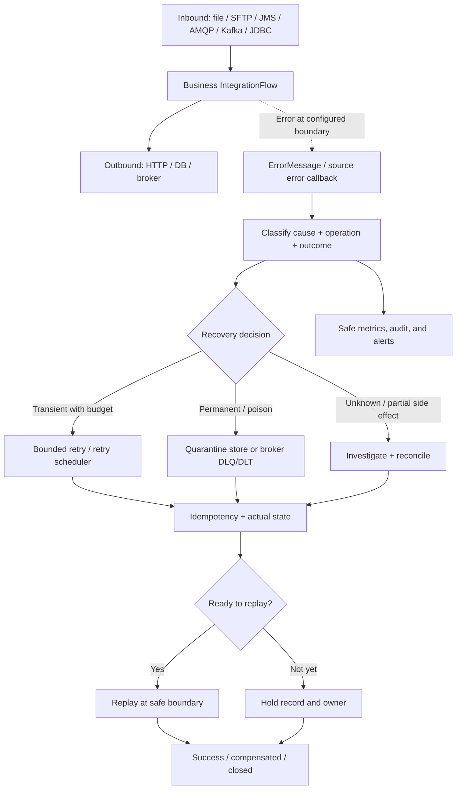
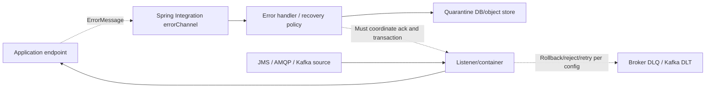
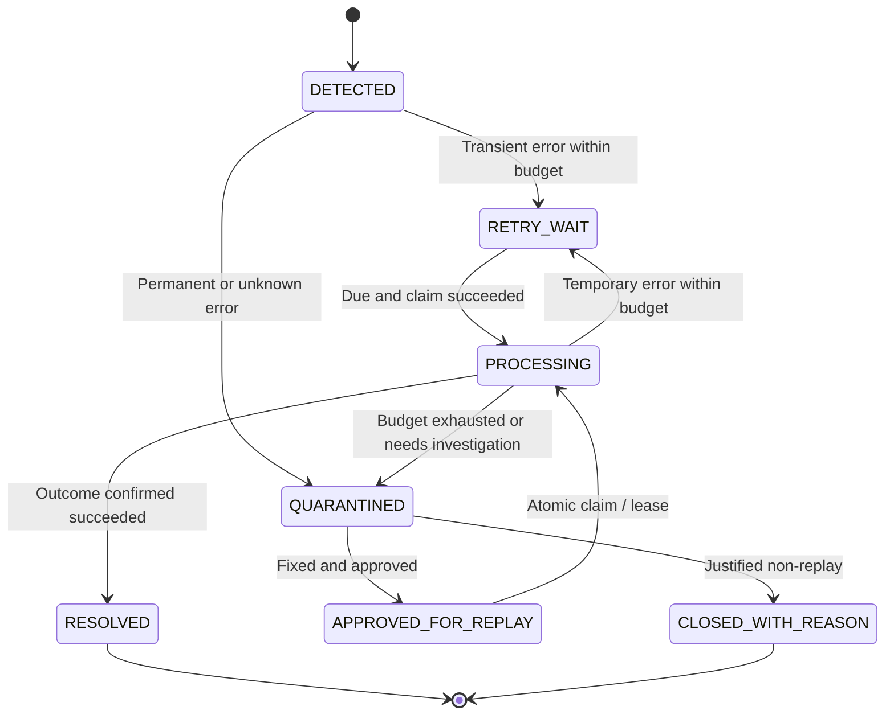
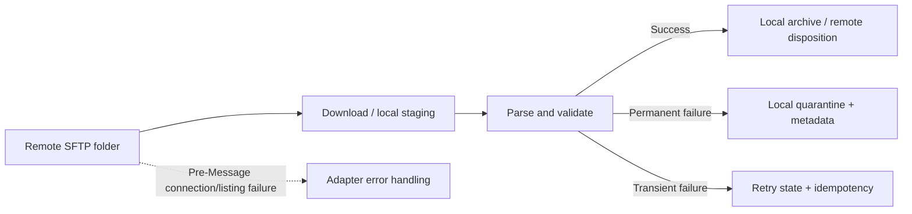
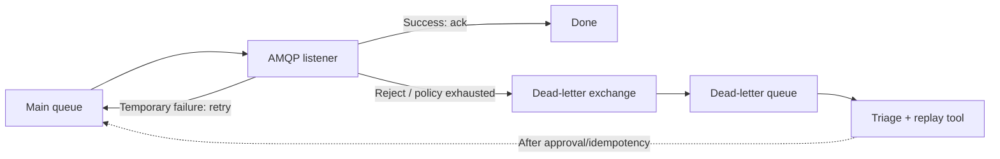
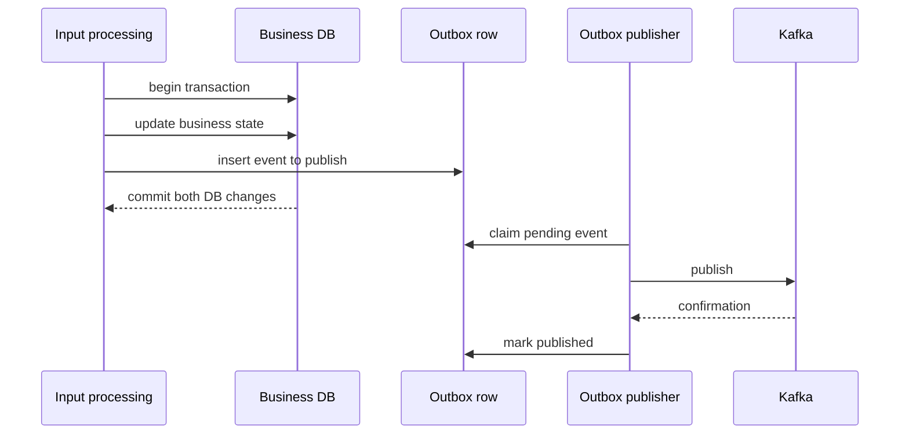
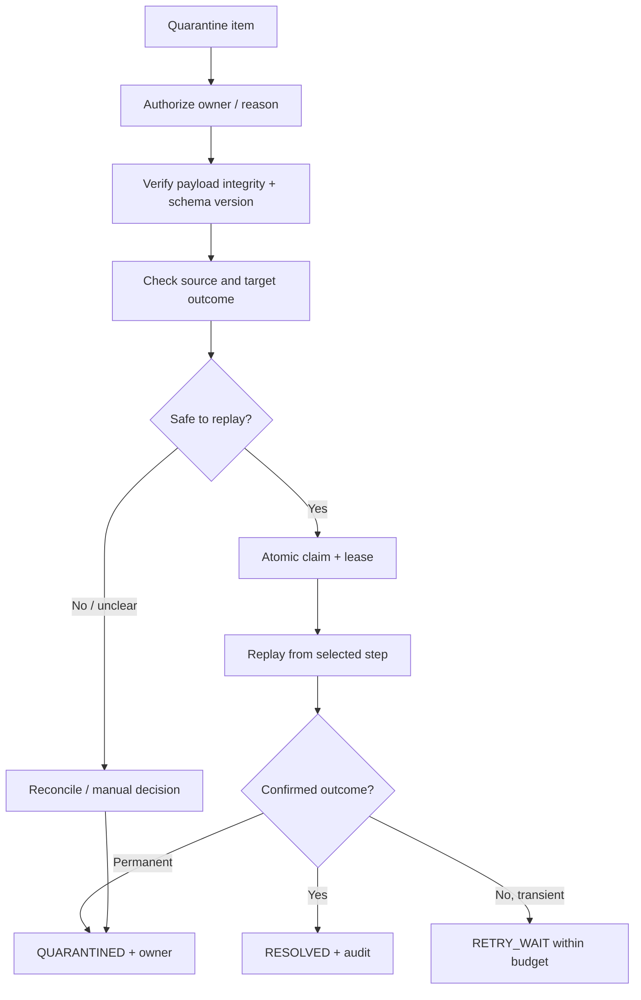
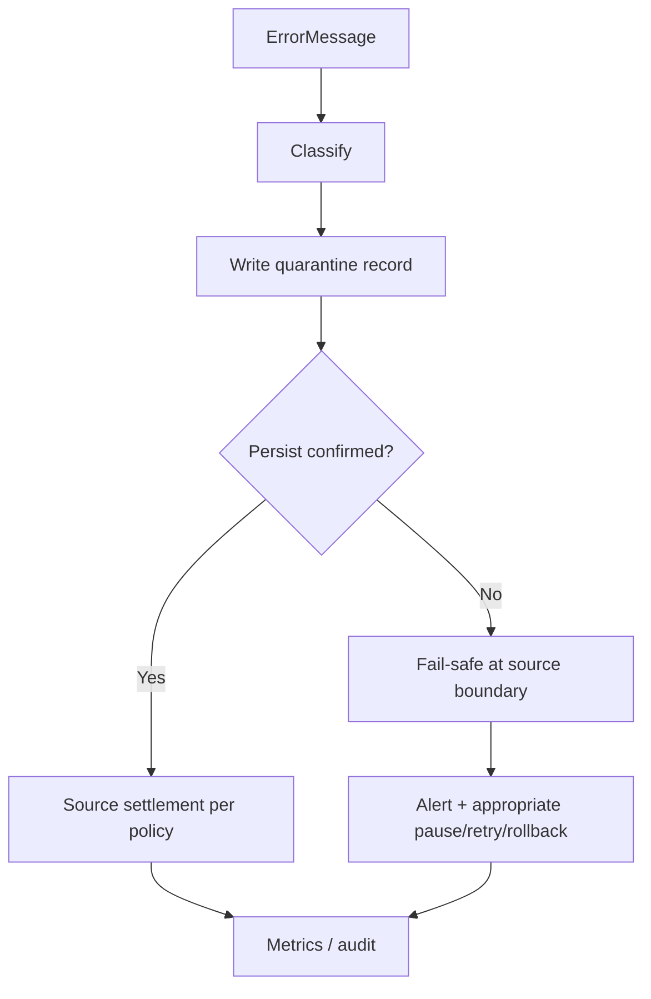
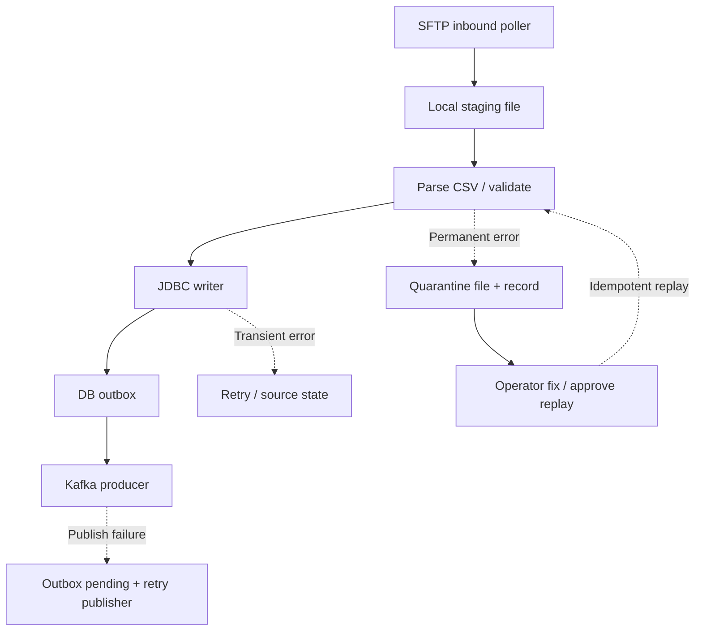

# Dead-Letter Channels and Quarantine in Spring Integration Adapters

> **Chapter:** Error handling  
> **Module:** `SPRING_INTEGRATION_ADAPTERS`  
> **Context:** Connecting external systems to Spring Integration via inbound/outbound adapters, gateways, pollers, and `MessageChannel`; implementing exchange flows across **file, SFTP, HTTP, JMS, AMQP, Kafka, and databases**.  
> **Goal:** Distinguish **error channel, dead-letter channel, broker DLQ/Kafka DLT, and quarantine**, design mechanisms to retain and reprocess faulty messages **safely, with evidence, and with bounded retries**, while avoiding message loss or duplicate side effects when an adapter fails.

## 1. Why Can't You Just "Log the Exception and Move On"?

An integration flow can pull data from SFTP, convert CSV into orders, write to a database, and emit events to Kafka. Whenever any step fails, the system must decide **whether the message still needs processing, where to keep it, who owns it, and which step to resume from**.

Example:

```text
SFTP poller -> parse CSV -> validate -> JDBC writer -> Kafka outbound
                                  |
                                  +-- invalid schema
                                  +-- database timeout
                                  +-- Kafka producer failure
```

Three failures should not share one recovery approach:

- **Invalid CSV schema:** the record may never be valid without fixing the data. Retrying endlessly just burns CPU and floods logs.
- **Database timeout:** may be transient; perform controlled retry or wait for dependency recovery while verifying transactions.
- **Kafka publish failure after JDBC commit:** replaying the entire file from the start risks duplicate DB writes; use outbox/reconciliation rather than blind replay.

If a handler merely logs `log.error(...)` and returns normally, the adapter may treat the message as complete depending on transaction/ack semantics. Then the message **can be lost to the business** despite having a log line.

A solid solution combines:

1. **Error identification and classification** by cause, operation, and recoverability.
2. **Retaining enough details to reprocess or conclude** without leaking sensitive data.
3. **Preserving accurate source outcomes**: file filters, broker acks, Kafka offsets, row states.
4. **Assigning owners, SLAs, retry budgets, replay, and audits** for every unresolved error.
5. **Verifying idempotency and side effects** before every reprocessing action.

## 2. Definitions: Error Channel, Dead-Letter Channel, DLQ/DLT, and Quarantine

These terms are frequently conflated:

| Concept | Nature | When Used? | Does Not Guarantee by Itself |
|---|---|---|---|
| **`errorChannel`** | `MessageChannel` carrying `ErrorMessage` in Spring Integration | Captures errors from supporting endpoints/pollers/async publishers | Durability, retry, rollback |
| **Private error channel** | Error channel configured per flow/endpoint | Isolates error responsibility, owners, and access rights | Tenant isolation or durability from naming alone |
| **Dead-letter channel** | **Internal architectural** name for a channel receiving messages unable to continue per policy | Final error route to a handler capable of persisting | Not an automatic broker DLQ |
| **JMS/AMQP DLQ** | Broker-side queue for failed deliveries per policy | Exhausted redelivery, reject/dead-letter | Auto-fixing payloads or safe replay |
| **AMQP DLX** | Dead-letter exchange routing dead-lettered messages to another queue | Determines where messages go after reject/TTL/limit | Auto-creating a target queue if unconfigured |
| **Kafka DLT** | Dead-letter topic storing failed records | Consume/deserialize/processing failures per policy | Auto-committing offsets or cross-DB exactly-once |
| **Quarantine** | Isolated, controlled storage for payloads/files/records needing investigation | Poison data, malformed input, unrecoverable errors | Built-in Spring Integration API |
| **Retry store/scheduler** | Tracks messages awaiting retry, timing, and attempts | Transient failures needing backoff, avoiding hot loops | Preventing duplicates without idempotency |
| **Audit/incident log** | Diagnostic metadata and evidence | Observability, auditing, investigation | Sufficient data to replay |

**Important:** A `DirectChannel` named `deadLetterChannel` **does not become a durable DLQ** by virtue of its name. If the process crashes before the subscriber handles and persists it durably, error data in an in-memory channel can vanish.

### 2.1. "Dead-Letter" Does Not Necessarily Mean "Discard"

Dead-letter means a message **left the normal processing path** under failure rules. Subsequent tasks usually involve investigation, fixing data/config, replay, compensation, or closing with justification. Never build a "dead-letter sink" by routing everything to `nullChannel` and declaring completion.

### 2.2. Quarantine Is Not a Retry Queue

Quarantine prioritizes **isolation for investigation and harm containment**. A retry queue/scheduler prioritizes **when to try again**. For invalid data, quarantine fits best; for recoverable timeouts, bounded retries can precede quarantine.

## 3. Overall Structure of a Failure Pipeline



This diagram is an **architectural pattern**, not a one-line Spring Integration feature. Each adapter emits errors differently: synchronous exceptions, error channels, listener/container error handlers, producer callbacks, or database states.

### 3.1. Three Milestones to Distinguish

- **Error observed:** `Throwable`/failure response seen.
- **Message safely retained:** recovery record saved or broker delivery/DLQ preserved per policy.
- **Business outcome resolved:** verified succeeded, discarded with evidence, compensated, or closed after review.

Only the second milestone guarantees a recovery path exists, and only the third confirms the business issue is resolved.

## 4. Decision Priority: Retry, Dead-Letter, or Quarantine?

Never route solely by exception name:

| Condition | Example | Priority Direction |
|---|---|---|
| Invalid data, not self-healing | CSV missing `orderId`, invalid JSON schema | Quarantine, notify sender |
| Transient dependency failure | DB connection timeout, HTTP 503 | Bounded retry, backoff/jitter |
| Wrong credentials or permissions | SFTP auth failure, HTTP 403 | Stop hot retries, inspect config/secrets |
| Rate limited | HTTP 429 | Retry per provider policy, deadline |
| Code bug or invariant breach | `NullPointerException`, impossible state | Alert, quarantine if needed, prioritize code fix |
| Processing error with unclear side effects | HTTP POST timeout, ambiguous Kafka send | Reconcile before retrying |
| Poison broker message | Payload always crashes parser | DLQ/DLT per container/broker mechanics |
| Retries exhausted | Transient failure unrecovered within budget | DLQ/quarantine with review schedule |
| Error handler itself fails | Cannot write quarantine database | Fail-safe/rollback or pause source per policy |
| Data security violation | Payload contains secret or forbidden fields | Isolate, restrict readers, open security incident |

**Transient vs. permanent is not an immutable property of a Java class.** `SocketTimeoutException` can be transient, yet an HTTP POST that already committed on the server before timing out could create duplicate side effects if replayed.

### 4.1. Embracing the "Unknown" State

When lacking information to tell whether a record committed or a broker received a message, record `unknownOutcome` and investigate/reconcile. Never force every failure into "failed" or "success" just to keep dashboards tidy.

## 5. `ErrorMessage` and Data Worth Retaining

`org.springframework.messaging.support.ErrorMessage` has a `Throwable` payload. A `MessagingException` in the cause chain may carry `getFailedMessage()`; `ErrorMessage` may carry `getOriginalMessage()` if the error publisher knew the input message.

```text
ErrorMessage
  payload: Throwable
    type: MessageHandlingException or other type
    cause: root cause
    failedMessage?: Message<?>   if Throwable/MessagingException provides it
  originalMessage?: Message<?>   if strategy had input data
  headers: MessageHeaders
```

There is no guarantee SFTP connect errors, pre-row JDBC query errors, Kafka deserialization errors, or broker connection failures have a `failedMessage`. Then rely on source metadata such as adapter ID, polling task, destination, timestamp, or callback context.

### 5.1. Principles for Storing Failure Data

| Field | Retain? | Considerations |
|---|---|---|
| `failureId`, `flowId` | Yes | Identifies incident and owner |
| `messageId`, `correlationId` | When present | Tracing and avoiding source confusion |
| `sourceType`, `sourceRef` | Bounded | Paths may be sensitive |
| `errorCode`, `exceptionClass` | Yes | Use stable codes; avoid full raw messages |
| `attempt`, `firstFailedAt` | Yes | Retry budget, SLA |
| `policyVersion` | Yes | Tracks which handling logic applied |
| `transactionOutcome` | Yes | Commit, rollback, unknown must be separated |
| `payloadReference` | When replay needed | Separate store, encrypted, ACLs, retention |
| `payloadHash/checksum` | When integrity check needed | Hashes do not anonymize |
| `ownerTeam`, `nextAction` | Yes | Prevents unowned backlogs |
| Full raw payload | Only when truly needed | Never embed in metrics/tickets |
| Bearer token/secret | Never | Revoke/rotate if leaked; keep metadata only |

**Never dump `errorMessage.toString()` to public logs**: `Throwable`, `failedMessage`, and headers can drag along PII, credentials, or payment data.

## 6. Spring Integration `errorChannel` Differs from Broker DLQ

Spring Integration provides `errorChannel` at the application messaging layer. Broker DLQs/DLTs live at the transport/storage layer; they solve overlapping yet distinct problems.



An application can **use both**:

- Business errors are classified on the error channel for auditing/quarantine.
- When a message needs broker redelivery, exceptions propagate at the right boundary.
- After redeliveries exhaust, the broker moves it to the DLQ per policy.
- Admin workers processing the DLQ can create separate quarantine records with owners and states.
- Avoid **two inconsistent stores** or duplicate replays of the same message.

### 6.1. Do Not Merge Infrastructure Errors with Payload Errors

If the broker is unreachable, there may **not even be a delivery** to send to a DLQ. That is a connection/runtime fault; monitoring/quarantine can record a failure incident, yet never assume "the broker dead-lettered an unreceived message".

## 7. Internal Dead-Letter Channel: A Design Pattern, Not a Built-In Java Type

Inside Spring Integration, you can define a `MessageChannel` named `ordersDeadLetterInput` to receive **error events whose retries exhausted**. A consumer behind it persists quarantine records into durable storage.

```text
ordersErrors
    -> classify / bounded retry exhausted
        -> ordersDeadLetterInput
            -> persist quarantine record + payload reference
            -> metrics / alert / audit
```

**Durability depends on downstream persistence**, not the channel name. `DirectChannel` dispatches synchronously, `QueueChannel` may need a `MessageStore` for durability, and other channels have their own semantics.

### 7.1. Why Use Dedicated Names?

- Separates error owners between `ordersFileFlow` and `paymentJmsFlow`.
- Simplifies per-flow ACLs, data classification, and retention.
- Alerts accurately on per-flow backlog/quarantine.
- Prevents payment flows from being governed by SFTP error policies.
- Gives audits and recovery workflows a uniform attachment point.

Still, if multiple flows share a recovery service, enforce **namespace, tenant, source type, idempotency, and owner**—do not rely on channel names alone.

## 8. Choosing Channels and Durability

| Channel Type | Characteristics | Good For | What to Verify |
|---|---|---|---|
| `DirectChannel` | Subscriber runs synchronously; non-durable by default | Pushing errors immediately to quarantine writer | How caller/error publisher reacts if writer throws |
| `PublishSubscribeChannel` | Fan-out to multiple subscribers | Separating audit/metrics/recovery | Whether one failing subscriber impacts others |
| `ExecutorChannel` | Hands off via thread executor | Decoupling failure handler latency | Task rejection, async loss, transaction context |
| `QueueChannel` | Buffers messages | Backpressure, decoupling producer/consumer | Capacity, persistence, consumers, restarts |
| `QueueChannel` with persistent `MessageStore` | Can survive restarts | Storage-backed durability | Transactions, serialization, retention, failover |
| Broker DLQ/DLT | Source transport storage | Exhausted redelivery, poison messages | Ack/offset, retention, replay, ownership |
| Quarantine DB/object store | Stores references/payloads with custom schema | Audited investigation, fixing, and replay | Atomicity, encryption, ACLs, state machine |

**Never assume** an in-JVM channel guarantees exactly-once or atomic commits across database + broker. Transactions/outbox/inbox are often needed to bridge boundaries.

### 8.1. Note on `PublishSubscribeChannel`

If one subscriber writes quarantine and another only increments a metric, a metric failure should not fail quarantine or vice versa unless desired by policy. Choose sync/async mode, subscriber ordering, and error handling based on real needs; test with fault injection.

## 9. Java DSL: Defining a Dedicated Error Channel for a File Flow

The example below illustrates a polling file flow sending polling-task exceptions to `ordersErrors`. It does **not** yet guarantee files are quarantined or transactions rolled back.

```java
import java.io.File;
import java.time.Duration;

import org.springframework.context.annotation.Bean;
import org.springframework.context.annotation.Configuration;
import org.springframework.integration.channel.DirectChannel;
import org.springframework.integration.dsl.IntegrationFlow;
import org.springframework.integration.dsl.Pollers;
import org.springframework.integration.file.dsl.Files;
import org.springframework.messaging.MessageChannel;

@Configuration
class OrderFileIntegrationConfig {

    @Bean("ordersErrors")
    MessageChannel ordersErrors() {
        return new DirectChannel();
    }

    @Bean("ordersDeadLetterInput")
    MessageChannel ordersDeadLetterInput() {
        return new DirectChannel();
    }

    @Bean
    IntegrationFlow ordersFileFlow(OrderFileProcessor processor) {
        return IntegrationFlow
            .from(
                Files.inboundAdapter(new File("/var/app/orders/in"))
                     .patternFilter("*.csv"),
                endpoint -> endpoint.poller(
                    Pollers.fixedDelay(Duration.ofSeconds(2))
                        .maxMessagesPerPoll(5)
                        .errorChannel("ordersErrors")
                ))
            .handle(File.class, (file, headers) -> {
                processor.process(file); // may throw exception
                return null;             // terminal handler
            })
            .get();
    }
}

interface OrderFileProcessor {
    void process(File file);
}
```

### 9.1. Accurate Explanation

- The File inbound adapter is a **polling source**.
- `Pollers.fixedDelay(...)` controls polling cadence.
- `errorChannel("ordersErrors")` wires the error path at the supporting **poller boundary**—the framework does not discover it merely by channel naming.
- `ordersDeadLetterInput` is an **application-named** channel.
- `return null` terminates the flow after processing; it does not delete, archive, or move the file.
- If an exception happens **before creating a Message**, `ErrorMessage` may have no file payload.

Production configurations must verify Spring Integration version, file filters, file completion checks, metadata stores, retries, transactions, and error publisher behavior.

### 9.2. Do Not Create Two Uncoordinated "Final Error Handlers"

If the poller writes errors to `ordersErrors` while a handler also pushes to `ordersDeadLetterInput`, define clearly which point **classifies** and which **persists**. Avoid having both write quarantine records causing duplicate replays.

## 10. Java: Router Classifying Errors Before Routing to Quarantine

You can use `ErrorMessageExceptionTypeRouter` via Java DSL `routeByException` to branch by exception/cause.

```java
import java.net.SocketTimeoutException;

import org.springframework.context.annotation.Bean;
import org.springframework.context.annotation.Configuration;
import org.springframework.integration.dsl.IntegrationFlow;

@Configuration
class OrderErrorRoutingConfig {

    @Bean
    IntegrationFlow ordersErrorRouterFlow() {
        return IntegrationFlow.from("ordersErrors")
            .routeByException(r -> r
                .channelMapping(
                    InvalidOrderSchemaException.class,
                    "ordersDeadLetterInput")
                .channelMapping(
                    SocketTimeoutException.class,
                    "ordersRetryDecisionInput")
                .defaultOutputChannel("ordersUnclassifiedErrors"))
            .get();
    }
}

// Custom domain exception to distinguish bad data from timeouts.
class InvalidOrderSchemaException extends RuntimeException {
    InvalidOrderSchemaException(String message) {
        super(message);
    }
}
```

This example requires **also defining channels and subscribers** for `ordersRetryDecisionInput`, `ordersUnclassifiedErrors`, and `ordersDeadLetterInput` before running.

### 10.1. When Superclass Mappings Overlap

Mapping `RuntimeException.class` alongside `InvalidOrderSchemaException.class` or `IOException.class` alongside `SocketTimeoutException.class` can depend on **mapping order and version-specific router algorithms**. Test your exact cause chain/ordering rather than assuming subclasses always win.

### 10.2. Routing Alone Is Not Retrying

`ordersRetryDecisionInput` only receives classified errors. Its subscriber must enforce **retry budgets, backoff, idempotency, side effects, and source ack policies**. You cannot "retry" simply by throwing the raw `ErrorMessage` back onto the business channel hoping everything recovers.

## 11. Java: Handler Persisting Failure Records Durably

A handler can consume `ErrorMessage` and call a service to persist quarantine records:

```java
import org.springframework.integration.annotation.ServiceActivator;
import org.springframework.messaging.MessagingException;
import org.springframework.messaging.Message;
import org.springframework.messaging.support.ErrorMessage;
import org.springframework.stereotype.Component;

@Component
class OrdersQuarantineHandler {

    private final OrdersQuarantineService quarantine;

    OrdersQuarantineHandler(OrdersQuarantineService quarantine) {
        this.quarantine = quarantine;
    }

    @ServiceActivator(inputChannel = "ordersDeadLetterInput")
    public void onFailure(ErrorMessage error) {
        Message<?> failed = null;
        Throwable cause = error.getPayload();

        for (int depth = 0; cause != null && depth < 16; depth++) {
            if (cause instanceof MessagingException messaging
                    && messaging.getFailedMessage() != null) {
                failed = messaging.getFailedMessage();
                break;
            }
            cause = cause.getCause();
        }

        Message<?> original = error.getOriginalMessage();

        // Persist metadata and payload reference in an ACL-protected store.
        // Do not log raw Throwable/Message or treat this as a broker DLQ.
        quarantine.persistFailure(
            "ordersFileFlow",
            error.getPayload(),
            failed,
            original
        );
    }
}

interface OrdersQuarantineService {
    void persistFailure(
        String flowId,
        Throwable failure,
        Message<?> failedMessage,
        Message<?> originalMessage);
}
```

**Why not write `new QuarantineRecord(error.toString())`?** A raw `ErrorMessage` can carry payloads/headers and sensitive details, and exception messages can contain PII, SQL parameters, or tokens.

### 11.1. What Should `persist` Do?

- Assign a stable `failureId` and source-based idempotency key.
- Determine `sourceType`, `sourceRef`, tenant, and operation from trusted context.
- Create a **payload reference** pointing to an authorized file/object/record store; avoid unbounded duplication.
- Save cause category, timestamps, version, attempts, and recovery status.
- Record audit trail and responsible owner.
- Return confirmation of **durable persistence**, or throw so the boundary executes fail-safe behavior.
- Record the exact **ack/commit outcome** when known; never fill in `committed` without verification.

The snippet above **is not runnable standalone** because the service and supporting channels are application contracts. When implementing, define transactions and failure handling for the quarantine writer itself.

## 12. Quarantine Records: Do Not Turn the Error Store into an "Uncontrolled Data Lake"

A failure record can use a schema like:

```json
{
  "failureId": "fail-orders-8842",
  "flowId": "ordersFileFlow",
  "sourceType": "file",
  "sourceRef": "inbound/orders/batch-22.csv",
  "sourceVersion": "sha256:restricted-checksum-ref",
  "tenantId": "tenant-a",
  "errorCode": "CSV_MISSING_REQUIRED_COLUMN",
  "exceptionClass": "InvalidOrderSchemaException",
  "firstFailedAt": "2026-11-23T08:15:00Z",
  "lastAttemptAt": "2026-11-23T08:15:00Z",
  "attempts": 1,
  "retryBudget": 3,
  "status": "QUARANTINED",
  "payloadStoreRef": "restricted-store/fail-orders-8842",
  "sourceOutcome": "unknown",
  "targetOutcome": "not-attempted",
  "policyVersion": "order-errors-v4",
  "ownerTeam": "order-platform",
  "nextReviewAt": "2026-11-24T03:00:00Z"
}
```

This is an **illustrative data contract**, not a built-in Spring Integration, Kafka, or JMS schema.

### 12.1. Context-Dependent Required Fields

| Field | Why Needed? |
|---|---|
| `failureId` | Unique reference for the case, distinct from business message ID |
| `sourceRef` and scope | Locates exact file/broker record/row, prevents tenant mixups |
| `idempotencyKey` when present | Prevents duplicate processing across restarts/retries |
| `errorCode` | Drives stable recovery decisions |
| `attempts` and timestamps | Prevents hot loops and measures backlog age |
| `sourceOutcome` / `targetOutcome` | Prevents equating "routed" with "committed" |
| `status` | Workflow state and claim control during replay |
| `payloadStoreRef` | Identifies recoverable data |
| `schemaVersion` / `policyVersion` | Handles older payloads after upgrades |
| `ownerTeam` | Prevents unowned dead letters |
| `retentionPolicyRef` | Avoids retaining data indefinitely |
| `securityClassification` | Restricts read/export permissions |

If the record contains personal data, `failureId` and `sourceRef` can still be linkable personal data. Hashing does not automatically anonymize.

## 13. Lifecycle of a Quarantine Item

A quarantine item needs a verifiable state machine, not just a boolean `isDeadLetter` flag.



### 13.1. Never Skip Controlled Transitions

- `DETECTED` does not mean the record is **persisted**.
- `RETRY_WAIT` needs a deadline and owner/worker.
- `APPROVED_FOR_REPLAY` must verify permissions, payload integrity, and source state.
- `PROCESSING` needs a lease/lock so two workers never process the same failure.
- `RESOLVED` requires evidence of actual outcome at the target.
- `CLOSED_WITH_REASON` requires a reason code and approver where appropriate.

If a broker retains the original message for redelivery, the quarantine store may not need to store the full payload again. Know **which copy is the source of truth** for replay.

### 13.2. Never Reset Attempt Budgets Automatically

When moving messages between a retry scheduler and a DLQ, keep the **original attempt count** or total policy attempts. Resetting `attempt=0` every time a message enters a new channel allows poison messages to loop endlessly across layers.

## 14. Retry Budgets, Exponential Backoff, and Jitter

For transient errors, use `RequestHandlerRetryAdvice`, listener/broker retries, or a dedicated scheduler. Never enable all of them simultaneously without an overall budget.

```text
Attempt 1: initial processing
Attempt 2: wait/backoff
Attempt 3: wait/backoff with jitter
Attempt 4: optional per policy
Exhausted: dead-letter / quarantine + alert
```

Values above are illustrative; SLAs and upstream/downstream contracts govern actual deadlines.

### 14.1. Two Opposite Mistakes

**Retry everything:** permanent errors never self-heal, causing loops, queue lag, and worker starvation.

**Quarantine everything immediately:** brief network timeouts can recover; immediate quarantine increases manual toil and latency.

### 14.2. Total Budget Across Layers

Suppose the caller retries 3 times, advice retries 4 times per call, and broker redelivery retries 5 times. Worst-case execution can perform **dozens of business attempts**, multiplying across tiers. Define a total attempt/deadline cap and guard side effects.

### 14.3. Classify Unknowns Explicitly

If an HTTP POST times out after the server may have committed, "retryable by exception type" does not mean **safe to retry**. Route to `PENDING_RECONCILIATION` before entering a retry scheduler.

## 15. Idempotency Is a Prerequisite Before Replay

**At-least-once delivery** and retries mean a message may be processed multiple times. An integration flow must define the identity of the **business action**, not generate a fresh UUID per retry.

```text
Source event ID: order-created-718
Business idempotency key: tenant-a/order-718/create
Processing step: jdbc.insertOrder
Target outcome: committed | rolled-back | unknown
```

### 15.1. Keys by Source Type

| Source | Idempotency Key to Consider |
|---|---|
| File | Checksum + source namespace + business batch ID |
| SFTP | Remote file ID/path + version/checksum + tenant |
| HTTP | Verified `Idempotency-Key`/client request ID + operation |
| JMS | Business event ID; `JMSMessageID` aids investigation yet can change on republish |
| AMQP | Business event ID; delivery tags bind only to the active channel delivery |
| Kafka | `topic`/`partition`/`offset` for source position; business event ID for cross-publish side effects |
| Database | Row business key + version + operation |
| Quarantine replay | Failure ID + source key + target action; never mint arbitrary new keys |

### 15.2. Do Not Misunderstand Kafka Offsets

`topic + partition + offset` identifies a record's position in one specific log, yet does not prevent duplicate business effects if the same event is republished to a new offset or another topic. Use **business keys** for business idempotency.

### 15.3. Record Already-Succeeded Steps

If a `DB insert → Kafka publish` pipeline committed the DB and only Kafka failed, retrying from the beginning can cause duplicates. Use a **transactional outbox** to retain unpublished events, or a recovery record specifying **only resend to Kafka** after checking outcome.

## 16. Source Acknowledgement and When Is Something "Handled"?

The most critical question after error routing:

> After the error handler finished writing to quarantine, **what did the source system do** with the original message?

| Source | Completion Signal | Pitfall |
|---|---|---|
| File | Accept-once/filter, archive/quarantine move | No broker rollback; file may never be polled again |
| SFTP | Listing/download marker, remote rename/delete | Remote file and local staging have separate states |
| HTTP inbound | HTTP response returned to client | Client retries can duplicate requests |
| JMS | Session commit/ack or rollback | Error handler swallowing errors alters redelivery |
| AMQP | Ack/nack/reject and requeue policy | Infinite requeue of poison messages |
| Kafka inbound | Offset commit/retry/seek/DLT | Routing `ErrorMessage` does not decide offsets |
| Kafka outbound | Producer acknowledgement/callback | Send accepted does not equal broker confirmed |
| JDBC poller | Commit row state/lease | Marking row `DONE` prematurely loses messages |
| Quarantine writer | Durable write confirmation | Log/metric success does not replace persistence |

### 16.1. Fail-Safe Condition

If the **quarantine store is unavailable**, never silently return "handled" while the source message lacks a recovery path. Depending on the adapter:

- Propagate the exception so the listener/broker rolls back or retries.
- Do not commit/ack offsets if framework and transaction policies support it.
- Pause/throttle polling to preserve source files/rows.
- Route to a managed backup store (not an unbounded RAM buffer).
- Alert with source ID and indeterminate state.

**There is no single command** in a Spring Integration error handler that automatically reverts every source to its initial state.

## 17. File Adapter: Dead-Lettering Often Means Moving/Updating File State

With file inbound adapters, faulty data exists as files on a filesystem. A practical quarantine design typically:

1. Ensures source files are **completely written** (ready markers, atomic renames, or age filters where suitable).
2. Reads via the file adapter and parses/validates.
3. Separates permanent (schema) errors from transient (DB/network) errors.
4. For permanent errors, writes metadata then performs a **controlled move** to a quarantine directory; verifies the move.
5. For transient errors, applies budgeted retries without marking the file succeeded.
6. On success, archives/deletes per separate retention rules.
7. Guards against two processes handling the same file simultaneously.
8. Allows approved replays with checksums/idempotency.

```text
/in/orders/incoming/batch-22.csv
             |
             +-- success --> /in/orders/archive/...
             |
             +-- invalid --> /in/orders/quarantine/batch-22.csv
             |
             +-- transient --> retry state / controlled source retention
```

### 17.1. `AcceptOnceFileListFilter` and Metadata

A file picked up by the adapter can be recorded by an **accept-once filter**, so after a handler failure it **does not automatically reappear on the next poll**. Design filters/metadata stores and recovery upfront rather than treating exceptions as filter rollbacks.

### 17.2. Moves Are Not Atomic Across All Volumes

On the same filesystem, atomic renames may work; across volumes or remote storage, they may not. If copying then deleting, verify checksums, verify target writes, and handle crashes between steps to prevent **losing files or creating two replayable copies**.

### 17.3. Files Containing Personal Data

Quarantine directories must enforce restricted user access, encryption where appropriate, retention, and cleanup; never keep faulty copies forever simply because a file was "unprocessable".

## 18. SFTP: Separating Remote Sources from Local Quarantine

SFTP inbound typically spans two state domains:

- **Remote:** original file, directory, rename/permissions, connector session.
- **Local:** downloaded file, temp suffix/staging, filters, and data processor.



### 18.1. When SFTP Connect Fails Before a Message Exists

There may **not yet be a `failedMessage` or file payload** to send to a dead-letter channel. Diagnose using session factory, host alias, operation, timestamp, and exception cause. Never fabricate a fake record claiming "file sent to DLQ" if no file was ever received.

### 18.2. Duplicate Download Trap

If the remote file stays in place and the connector restarts, the file may be downloaded again. Use persistent metadata filters, checksums, business batch keys, or remote move workflows to avoid duplicate processing. Also check whether remote files can be overwritten at the same path—path alone does not establish version.

### 18.3. Credentials and Permission Errors

SFTP auth/permission failures usually require config/secret investigation, not endless hot retries. Never write username+password or private keys into failure payloads, especially when error messages include remote URIs with credentials.

## 19. HTTP Gateways: "Dead Letter" Is a Business Model, Not an HTTP Status

HTTP has no native DLQ like a message broker. For inbound/outbound HTTP gateways:

- Callers expect a **status code and response** per contract.
- Internal error handlers can write pending/quarantine records for post-incident handling.
- Client retries require idempotency keys and deadlines.
- Timeouts do not prove remote side effects failed.
- A request rejected by validation does not necessarily need its full payload stored in quarantine if a clear 4xx can be returned.

### 19.1. Inbound HTTP

| Error | Response to Consider | Quarantine Needed? |
|---|---|---|
| Invalid JSON/field | Appropriate 400/4xx | May log metadata only, skip raw body |
| Unauthorized/forbidden | 401/403 | Prioritize security audit; avoid keeping secrets |
| Rate limit | 429 | Usually do not store full request |
| Internal dependency unavailable | 503/5xx | May need retry work item if workflow is async |
| Conflict/duplicate request | 409 or idempotent success | Reconcile before creating a dead letter |
| Timeout after remote commit | Cannot deduce outcome from timeout alone | May need pending reconciliation |

### 19.2. Outbound HTTP POST

A payment API may have created a transaction before the client received `SocketTimeoutException`. If quarantine records `"FAILED"` and replays POST without checking status, the system risks double charging. Records should store `UNKNOWN_REMOTE_OUTCOME`, operation ID, and a **lookup/reconciliation** step.

### 19.3. Gateway Error Channels Do Not Return HTTP Statuses Automatically

A Spring Integration gateway error flow can convert exceptions into replies; explicitly map status/body at the HTTP boundary. If the error handler only logs and never replies, the caller can time out or get unexpected results. Quarantine and client responses are **two separate responsibilities**.

## 20. JMS: Broker Redelivery, DLQ, and Container Responsibilities

With JMS inbound, message delivery is shaped by **session transactions and acknowledgment modes**. A broker may support redelivery policies and dead-letter destinations, yet activation depends on provider/container settings.

### 20.1. Two Handling Models to Separate

**Model A — Broker manages retry/DLQ**

```text
JMS queue -> listener/handler
               |
               +-- success -> ack/commit
               |
               +-- failure propagates -> rollback
                                            -> redelivery
                                            -> provider DLQ when exhausted
```

**Model B — Application intentionally writes quarantine**

```text
JMS queue -> handler
              -> classify permanent error
              -> persist durable quarantine (within verified transaction strategy)
              -> then settle source delivery consistently
```

Do not assume Model B is automatically atomic with JMS merely because both happen inside one Java method. For cross-resource consistency, configure proper transactions, outbox/inbox, or reconciliation.

### 20.2. When the Error Flow "Swallows" Exceptions

If an exception is caught and turned into an `ErrorMessage` and the error handler returns normally, the listener/container may **not see the exception** to roll back, depending on adapter configuration. Therefore test:

- Do pre-commit errors trigger redelivery?
- Is the message acked after merely logging?
- When the quarantine store fails, does the source retain the message?
- After retries exhaust, does the message genuinely land in the provider DLQ?
- Are `JMSMessageID`/delivery count still sufficient to locate the source?
- Does replay from DLQ reuse the business idempotency key?

### 20.3. Broker DLQ Does Not Delete Source Data

A message can remain in a broker DLQ after the application "closes the case"; enforce retention, purging, and audits with source owners. Never let DLQs become unbounded stores of personal data.

## 21. AMQP: Dead-Letter Exchange, Dead-Letter Queue, and Requeue

In RabbitMQ/AMQP, dead-lettering is typically implemented via a **dead-letter exchange (DLX)** and queues configured to receive dead-lettered messages. A message can be dead-lettered when rejected/nacked without requeue, upon TTL expiration, or on queue limits per broker rules.



This is the basic model: exact dead-letter conditions and routes must be configured in RabbitMQ/AMQP containers.

### 21.1. `x-dead-letter-exchange` and Routing

Queue policy/arguments can specify a dead-letter exchange and dead-letter routing key:

```yaml
queue: orders.processing
arguments:
  x-dead-letter-exchange: orders.dlx
  x-dead-letter-routing-key: orders.failed
```

This is an **illustrative config**, not runnable Spring application YAML properties. Declare real exchanges, bindings, and target queues or broker policies.

### 21.2. Never Requeue Poison Messages Infinitely

If a consumer continuously rejects/requeues schema-invalid JSON, the message bounces back immediately and starves workers. Choose **bounded retries** or broker-managed retries with eventual dead-lettering. Account for TTL queues/retry topologies, dead-letter cycles, and broker versions; avoid configurations that loop back to the exact same processing queue forever.

### 21.3. Manual Ack: Who Is Responsible?

With manual ack, ensure only the valid owning consumer/session acks/nacks an active delivery. Never persist delivery tags as long-lived replay keys; use stable business event IDs or idempotency keys.

An `ErrorMessage` routed to Spring `errorChannel` **does not automatically emit** RabbitMQ `basicNack`. Moving messages to a DLQ is coordinated by the listener/container and broker per ack/requeue policy.

## 22. Kafka: Dead-Letter Topics, Consumer Offsets, and Producer Callbacks

Kafka uses **topics** rather than JMS/RabbitMQ-style queues. A **dead-letter topic (DLT)** receives failed records according to configured consumer/recovery policies; the Kafka broker **does not automatically move every failing message to a DLT**.

### 22.1. Kafka Consumer Flow

```text
Kafka topic orders.events
  -> Spring Integration Kafka inbound adapter / listener
      -> transform / handler
          -> success: offset progression per policy
          -> failure: retry/seek/recoverer per config
              -> dead-letter topic when policy selects
```

Spring Kafka offers components such as `DefaultErrorHandler` and `DeadLetterPublishingRecoverer` inside supporting listener/container setups. Never treat them as **built-in features of every Spring Integration `MessageChannel`**; verify your adapter, listener mode, and Spring Kafka version.

### 22.2. Offsets and Data Inside the DLT

When writing to a DLT, determine:

- Which `topic`, `partition`, `offset`, and consumer group did the source record belong to?
- Was the error deserialization, validation, or a business handler failure?
- Did the broker confirm the DLT producer write?
- Which strategy commits/seeks the source offset?
- Could DLT publish succeed while the source offset failed to commit, creating two copies?
- After replaying the DLT, might consumers reprocess an old business event that already had side effects?

**An `ErrorMessage` on an error channel does not commit or hold offsets.** Route success does not prove the broker accepted the DLT record.

### 22.3. Kafka Producer Outbound

If a flow runs `JDBC write → Kafka publish`, outbound Kafka sends may be asynchronous; failure callbacks arrive after the handler returns. Spring Integration Kafka outbound adapters provide success/failure channels or callbacks depending on configuration/version.

When a producer failure occurs, quarantine may hold an **outbox row or unpublished event reference**, rather than replaying from the initial file/JMS message. Never equate "send invoked" with "broker confirmed".

### 22.4. DLT Retention and Schema Evolution

DLTs may retain data longer than main topics. When replaying an old message, serializers/schemas or data policies may have changed; manage versions, controlled converters/migrations, and retention checks. A DLT is not default infinite storage.

## 23. JDBC/Database: Quarantine Rows, Claims, Leases, and Transactions

With JDBC inbound pollers or outbound handlers, errors frequently involve **transactions and row state**.

State example:

```text
NEW -> CLAIMED -> PROCESSING -> DONE
                  |               ^
                  +-> RETRY_WAIT --+
                  |
                  +-> QUARANTINED
```

If a poller marks `DONE` before downstream succeeds, subsequent errors can cause the message to **vanish from `NEW` queries**, even though a dead-letter channel received a notification.

### 23.1. Minimal Recovery Table Design

```sql
CREATE TABLE integration_failure (
    failure_id        VARCHAR(100) PRIMARY KEY,
    flow_id           VARCHAR(100) NOT NULL,
    source_ref        VARCHAR(300) NOT NULL,
    idempotency_key   VARCHAR(300),
    error_code        VARCHAR(100) NOT NULL,
    status            VARCHAR(40) NOT NULL,
    attempt_count     INTEGER NOT NULL,
    next_attempt_at   TIMESTAMP NULL,
    lease_until       TIMESTAMP NULL,
    payload_store_ref VARCHAR(500),
    policy_version    VARCHAR(100),
    created_at        TIMESTAMP NOT NULL,
    updated_at        TIMESTAMP NOT NULL
);
```

This DDL is conceptual and omits indexes, tenant partitioning, schema migrations, state transition constraints, and database-specific timestamp types. Production setups must add **tenant scoping, ACLs, encryption, retention, and load-appropriate partitions/indexes**.

### 23.2. Claim Atomically—Never Rely on SELECT Followed by UPDATE

Two workers can both read `status=RETRY_WAIT` and replay simultaneously. Use locking/versioning or `UPDATE ... WHERE status=...` checking affected row counts; for leases, enforce expiration and recovery after worker crashes.

### 23.3. Quarantine and Business Transactions

Where possible, write business state and recovery state in the **same database transaction** for consistency. Yet when sources are Kafka/JMS or targets are HTTP/SFTP, never assume a DB transaction spans those external systems. Design explicit commits, inbox/outbox, or reconciliation.

## 24. Outbox, Inbox, and Transaction Boundaries

Many systems cannot atomically commit **database + Kafka + HTTP + file** together using `@Transactional` alone.

### 24.1. Transactional Outbox



An outbox prevents committing DB business state while dropping the event completely; the publisher can retry **only the publish step**. Even then, publishers can resend on ambiguous ack/DB status updates, so consumers still need idempotency.

### 24.2. Inbox/Deduplication

With at-least-once sources, persist `processedEventId` in the same transaction as the business update. When the source redelivers, processing sees the event already finished and skips repeating side effects.

### 24.3. Choosing the Recovery Point

A quarantine record should specify:

```json
{
  "sourceEventId": "order-719",
  "lastConfirmedStep": "jdbc-committed",
  "failedStep": "kafka-publish",
  "targetOutcome": "unknown",
  "replayFrom": "outbox-publisher",
  "mustReconcileBeforeReplay": true
}
```

This is an **application schema**, not auto-generated by Spring Integration. It guards against the common mistake of "resending the entire source event".

## 25. Protecting Personal Data and Secrets in DLQ/Quarantine

DLQ/quarantine can retain **payloads that successful flows normally purge quickly**, including sensitive data. Therefore it is a store requiring dedicated privacy/security policies.

### 25.1. Four Protection Layers

1. **Access:** more users may view metadata than raw payloads; enforce RBAC/ABAC and auditing.
2. **At rest/in transit:** encryption and secret management matched to the store; never embed decryption keys inside error records.
3. **Retention:** lifetimes aligned with recovery needs, legal mandates, and sensitivity; lift legal holds narrowly.
4. **Disclosure:** never copy full payloads into tickets, email alerts, Slack-like channels, or broad dashboards.

### 25.2. Data Never to Send to Error Analytics

- Authorization headers, bearer tokens, refresh tokens, session cookies.
- SFTP passwords/private keys, database credentials.
- Unnecessary customer profiles and raw payment details.
- Identity/verification documents.
- SQL statements containing sensitive parameters.
- Long exception texts that can leak request bodies.
- Unverified headers supplied by external sources.

### 25.3. Store References Instead of Raw Payloads

A `QuarantineRecord` can hold a `payloadStoreRef` pointing to an encrypted, access-controlled object; dashboards show only `failureId`, error code, age, status, and owner.

**Checksums/hashes do not automatically anonymize payloads**, especially when originals exist or IDs can be reversed.

### 25.4. Deletion Workflows

When an item resolves or expires per policy, handle **payloads, record metadata, backups, original DLQ/DLT entries, and investigative exports** within regulatory and technical scope. Never let a failure record become an excuse to keep all data forever.

## 26. Replay: A Risky Operation, Not a Simple "Resend" Button

Replay requires authorization and precondition checks:



### 26.1. Steps Before Replay

1. Verify **who requested** replay and whether they are authorized for the scope/tenant.
2. Identify source message, schema/version, business ID, and whether data remains valid.
3. Verify the root cause was fixed (e.g., field mapping, code, permissions).
4. Reconcile DB/HTTP/Kafka/source to see which operations already succeeded.
5. Select the **smallest safe replay point**, never defaulting to the start of the flow.
6. Set idempotency key, total attempt budget, and deadline.
7. Claim the record atomically to block concurrent operators.
8. Audit actor, reason, policy, and target confirmation.
9. Monitor post-replay and close only once outcome is confirmed.

### 26.2. Cases Where You Must Not Replay

Do not replay when:

- Data violates policy or is no longer permitted to process.
- A record already produced side effects and replaying risks harm.
- Keys/credentials were revoked and the operation is no longer valid.
- The original is irreparably corrupted or past valid retention.
- The business owner explicitly decided to reject/cancel with justification.

**Closing a case with a reason** is not silently dropping a record; retain appropriate audit metadata while limiting sensitive copies.

## 27. Designing Replay APIs and Operations Interfaces

An admin API can accept **`failureId` and a decision**, without receiving raw payloads back from a browser.

```http
POST /admin/integration-failures/fail-orders-8842/replay HTTP/1.1
Content-Type: application/json
Authorization: Bearer <redacted>

{
  "reasonCode": "UPSTREAM_SCHEMA_CORRECTED",
  "expectedVersion": 3,
  "requestedStep": "csv-parser"
}
```

This is an **illustrative API**, not a built-in Spring Integration endpoint. Enforce authorization server-side, binding authenticated principals to tenants and owners; never rely on caller-supplied `tenantId`.

### 27.1. Responses Should Distinguish Accepted from Completed

```json
{
  "failureId": "fail-orders-8842",
  "replayRequestId": "replay-2991",
  "status": "ACCEPTED",
  "idempotencyKeyRef": "order-719/import"
}
```

`ACCEPTED` means the replay request was recorded/queued for execution, **not that the business step succeeded**. Provide a status endpoint or notification to observe `RESOLVED` and target confirmation.

### 27.2. APIs Must Guard Against Duplicate Replays from Client Retries

Use optimistic versioning/leases, replay-request idempotency keys, and guarded state transitions. If an operator double-clicks replay or a browser retries after timeout, the system must never process the item twice uncontrollably.

## 28. Routing by Exception Type and Message Contract Boundaries

`ErrorMessageExceptionTypeRouter` can split errors by class/cause, yet classification is only the **first step**.

| Exception | Initial Branch | Further Questions |
|---|---|---|
| `InvalidOrderSchemaException` | `validationDeadLetters` | Is payload complete enough to fix? Past file filter? |
| `SocketTimeoutException` | `transientFailures` | Could downstream side effects have occurred? |
| `DataIntegrityViolationException` | `dataConflictFailures` | Valid duplicate or invalid data? |
| `AccessDeniedException` | `securityReviewFailures` | Which permission failed; avoid hot retries? |
| `NullPointerException` | `unclassifiedFailures` | Which bug; can we fail safely? |
| Unmapped error | `unclassifiedFailures` | Are owner, alert, and evidence present? |

**Matching caveat:** when superclass and subclass mappings overlap, test configuration order and version-specific router behavior. Never route all `RuntimeException`s to `retry`.

### 28.1. Preserving `failedMessage` and `originalMessage` Properly

- `MessagingException.getFailedMessage()` is usually the message at the failure point; it may already be transformed.
- `ErrorMessage.getOriginalMessage()` can hold the error strategy's input, not always the initial source message.
- Both can be `null`.
- Never blindly push a message to `deadLetterChannel` without knowing it holds a complete replayable payload.

### 28.2. Prevent Routing via Forged Headers

Never allow HTTP/JMS/AMQP/Kafka clients to dictate `errorChannel`, `replyChannel`, or tenant recovery partitions via unvalidated headers. Internal channels must be configured by trusted sources, with allowlisted/overridden header mappings.

## 29. Observability: Monitoring Backlogs and Error Lifecycles

With only an `errors_total` metric, operations cannot see how many messages still await action.

| Illustrative Metric | Question Answered |
|---|---|
| `integration_failures_total{flow,errorCode}` | Which flow and error types are rising? |
| `dead_lettered_total{source,reason}` | How many messages left normal processing? |
| `quarantine_items_current{flow,status}` | How many items are currently backlogged? |
| `quarantine_oldest_age_seconds{flow}` | How old is the oldest unresolved failure? |
| `retry_attempts_total{flow,category}` | Are there hot retry loops? |
| `retry_exhausted_total{flow}` | How many errors exhausted budget? |
| `replay_requests_total{flow,outcome}` | How are replays requested and resolved? |
| `replay_duplicate_prevented_total{flow}` | How many duplicate replays did idempotency/leases block? |
| `quarantine_persist_failures_total{flow}` | Is the recovery store failing? |
| `unrouted_errors_total{flow}` | Are errors bypassing expected routes? |
| `broker_dlq_backlog_count{source}` | Are DLQs/DLTs accumulating? |
| `unknown_outcome_current{flow}` | How many cases need reconciliation? |
| `retention_overdue_items{store}` | Are quarantine items held past retention? |

These are **application-designed metric names**, not built-in metrics provided by Spring Integration/Micrometer.

### 29.1. Avoid High Cardinality and PII in Metrics

Never place `email`, `personId`, unique message IDs, raw file paths, exception messages, or tokens in labels. Use `flow`, `category`, `owner`, `source`; when investigating individual cases, query by `failureId` in access-controlled logs.

### 29.2. Essential Alerts

- Unowned DLQ/quarantine items or SLA breaches.
- Poison messages spiking after deployment.
- Error handler/quarantine store failures.
- Rising source lag or broker redelivery while retries make no progress.
- Rising pending reconciliations after HTTP/Kafka timeouts.
- A `RESOLVED` item reappearing with the same key.
- Retry policy altered or budget exhausted across multiple flows.
- Errors meant for private channels leaking onto global `errorChannel`.

## 30. Errors Inside the Dead-Letter Pipeline Itself

What happens if **the quarantine writer also fails**?



### 30.1. Avoid Making One Error Store a Single Point of Failure

If the business DB and quarantine DB share an outage-stricken cluster, quarantine persistence cannot succeed while that DB is down. You may need broker durability, retaining source files, a backup journal, or pausing ingestion to avoid losses.

### 30.2. When Error Handlers Run on a Synchronous Thread

With `DirectChannel`, exceptions from a quarantine-writing subscriber can return to the `ErrorMessage` publisher. Final behavior depends on the **poller error handler/adapter**: never assume a secondary exception automatically triggers exact broker rollback.

### 30.3. When Error Handlers Run Asynchronously

With `ExecutorChannel` or another task executor, the publisher may return success before persistence fails. Use a **durable intermediate store** or source retention to avoid message loss. An in-memory async queue does not solve durability.

## 31. Testing: Separate Router Unit Tests from Source Integration Tests

Two complementary test levels exist:

**Unit/router tests:** construct `ErrorMessage` and verify mappers/routers select the right channel.

**Integration tests:** inject faults **at real adapters, pollers, gateways, broker containers, or producer callbacks**, then verify source settlement, quarantine, and outcomes.

### 31.1. Mandatory Test Matrix

| Test | Injected Fault | Result to Prove |
|---|---|---|
| Invalid CSV | Missing required field | Quarantined once, no hot loop |
| File accept-once | Parse fails after filter | Controlled replay, no lost file |
| File copy crash | Crash after copy, before delete | Neither replayed twice nor lost source |
| SFTP connect | Credential/timeout before Message | Error context captured even if `failedMessage` null |
| SFTP partial download | Disconnect mid-transfer | Incomplete file never parsed |
| HTTP inbound | Validation error | Proper 4xx response, no full body in logs |
| HTTP POST timeout | Remote committed yet reply lost | Reconciliation/idempotency before retry |
| JMS handler fails | Pre-commit failure | Redelivery/rollback per config |
| JMS quarantine fails | Quarantine DB unavailable | Message not silently acked and lost |
| AMQP poison | Permanently invalid JSON | DLQ, no infinite requeue |
| AMQP manual ack | Nack/ack decision | Exact delivery settled, no double ack |
| Kafka deserialize | Pre-Spring-Message error | Container recovery/record context |
| Kafka DLT publish fails | Broker error inside recoverer | Fail-safe offset/DLT behavior tested |
| Kafka producer callback | Async send failure | Tracked via failure channel/outbox |
| JDBC row claim | Two workers contend for same row | Only one worker replays |
| JDBC timeout | Transaction does not commit | Row state recovers and retries safely |
| Router overlap | Parent/child class mappings | Matches versioned mapping policy |
| Null `failedMessage` | Pre-Message source failure | Handler is null-safe |
| Quarantine store failure | Recovery write error | Fallback/rollback/pause activates |
| Crash after persist | Process restarts | No duplicate side effects |
| Duplicate replay click | Two requests for same failure ID | Lease/idempotency blocks duplicate |
| Sensitive payload | Mock token inside failed message | Never appears in logs/metrics/alerts |
| Multi-tenant | Replay across tenants | Authorization denies |
| Retention expiration | Expired per policy | Data and copies cleaned properly |

**Passing an `ErrorMessage` router unit test does not mean JMS rollback or Kafka offset tests pass.** Verify both source and target real states.

### 31.2. Unknown Failures Need Explicit Tests

When commit evidence is missing, the system must store `UNKNOWN`/`PENDING_RECONCILIATION` with an owner. Never replace it with `FAILED` and auto-replay before checking side effects.

## 32. Fault-Injection Drills and Post-Restart Recovery

A drill can be executed in a test environment:

1. Prepare a source event with a stable **business idempotency key**.
2. Configure processing service, retry policy, and quarantine store.
3. Trigger a permanent validation failure; verify move to quarantine.
4. Trigger a DB timeout; verify bounded retry/backoff.
5. Kill the process after quarantine persistence yet before source settlement.
6. Restart and confirm source replay creates neither duplicate quarantine nor duplicate business effects.
7. Kill the process right after DB commit yet before Kafka confirmation.
8. Verify outbox/reconciliation detects the pending publish.
9. Simulate quarantine storage unavailability; observe fail-safe behavior.
10. Inspect metrics, audits, retention, and payload access permissions.

### 32.1. Outcomes to Reconcile

```text
sourceReceivedCount
  = businessResolvedCount
  + activeRetryCount
  + quarantinedCount
  + pendingInvestigationCount
  + exceptions reconciled by explicit evidence
```

This equation is a **state-accounting concept**, not an exact formula when batches split, fan out, or duplicate messages arrive. In those cases use consistent counting units and reconciliation tables keyed by business event ID.

### 32.2. "Zero Message Loss" Must Be Defined

What constitutes loss depends on source and contract:

- Source file disappeared with no archive/quarantine record.
- JMS/AMQP acked before business effect/quarantine was durably stored.
- Kafka source offset advanced past a failed record with no replacement in DLT/outbox.
- JDBC row marked `DONE` while downstream failed.
- HTTP client received accepted with no work item or confirmation.

## 33. Case Study: SFTP CSV → JDBC → Kafka

Suppose each day an `orders-YYYYMMDD.csv` file arrives via SFTP; the app parses orders, writes PostgreSQL, and emits Kafka events.



### 33.1. Decisions per Failure

| Scenario | Appropriate Outcome |
|---|---|
| Incomplete file write | Do not parse; wait for ready marker/stable file |
| CSV missing column | Quarantine file and validation error, notify upstream |
| JDBC timeout before commit | Bounded retry, preserve transaction and row state |
| JDBC duplicate order | Reconcile idempotency, do not blindly re-insert |
| DB committed yet Kafka failed | Outbox pending, retry publish only |
| SFTP connection timeout before download | Alert/connect retry; never fake a quarantined file |
| Operator replays partially processed file | Check per-order key/step, never duplicate writes |
| Quarantine store unavailable | Fail-safe retains source, never mark success |

### 33.2. Final Outcome Assessment

Close a batch only when knowing:

- How many files/source events arrived.
- How many order records succeeded and their business IDs.
- Which records remain in retry/quarantine.
- Which outbox events Kafka confirmed.
- Which items were skipped from replay because results already existed.
- All faulty files/payloads are protected with retention.
- Owners assigned for any unresolved errors.

## 34. Operations Runbook: When Dead-Letter Backlogs Grow

### 34.1. Triage Steps

1. Identify the **source**: file/SFTP, JMS, AMQP, Kafka, HTTP, or JDBC.
2. Inspect error categories and start time; check recent deploy/config changes.
3. Separate poison payloads from transient infrastructure outages.
4. Inspect broker/consumer lag, source acks/offsets, and the quarantine store.
5. Check whether there is a **failure inside the recovery pipeline itself**.
6. Verify privacy/security classification of payloads.
7. Assign owners and deadlines for unowned backlogs.
8. Enable replay only after confirming root cause fixes and side effects.
9. Track resolved items and business outcomes—not just messages leaving the DLQ.

### 34.2. When Source and Quarantine Disagree

- If the source recorded ack while quarantine has no record: investigate potential message loss.
- If quarantine has a record while the source keeps redelivering: check idempotency and dual stores.
- If Kafka source offset committed yet DLT publish isn't confirmed: inspect recoverer/transactions and potential record loss.
- If a file moved to quarantine yet no metadata record exists: reconcile the file store via checksum/reference.
- If HTTP returned accepted with no work item: open an incident and trace via request idempotency key.

### 34.3. When Errors Spike After Schema Migration

Inspect message versions, schema readers/converters, backward compatibility, policy changes, and already-processed items. Never replay old payloads under a new schema without evaluating business-meaning shifts.

## 35. Anti-Patterns That Cause Data Loss

**"Creating `deadLetterChannel` gives us a DLQ."** A nicely named channel does not persist messages across restarts.

**"Retry every Throwable."** Validation, auth, or bugs may never recover on retry.

**"Once logged, the message is handled."** Can cause source ack/commit without durable persistence.

**"Quarantine must copy every payload to the dashboard."** Creates an uncontrolled store of PII/secrets.

**"ErrorMessage always has `originalMessage`."** Pre-Message connection failures may lack one.

**"SCIM/HTTP/JMS/Kafka all share identical DLQ semantics."** Each transport has distinct error/ack/storage semantics.

**"Continuous AMQP requeue will self-heal."** Poison messages loop infinitely and lock workers.

**"Kafka brokers dead-letter all consumer errors automatically."** Requires proper container/recoverer/DLT config.

**"Kafka send returning means publish succeeded."** Async producers still need confirmations/callbacks.

**"JMS listener having an ErrorMessage means it rolled back."** Inspect exception propagation and transactions.

**"Failed files reappear automatically on the next poll."** Accept-once filters may have already marked them.

**"Outboxes don't need idempotency."** Senders can republish after ambiguous acknowledgements.

**"Replay all errors from the start of the flow."** Can duplicate DB writes, payments, or events.

**"DLQs/DLTs can keep data forever for auditing."** Failed data needs retention, ACLs, and cleanup.

**"Deleting the failure record deletes the data."** Payloads may linger in brokers, object stores, exports, and backups.

**"Without access logs, no side effects happened."** Missing evidence must be recorded as `unknown`.

**"Failing error handlers return automatically to the source."** Depends on channel, poller, container, and transaction.

**"Counting items leaving the DLQ is our success KPI."** Verify business outcomes and prevent duplicates.

## 36. Pre-Production Checklist

| Question | Evidence or Verification |
|---|---|
| Defined every flow and owner? | Flow inventory, on-call |
| Separated error channels from DLQ/quarantine? | Diagrams, channel config |
| Know whether exceptions arise sync or async? | Boundary tests |
| Pollers/adapters route errors to expected channels? | Integration tests |
| Classified transient/permanent/unknown? | Error taxonomy |
| Set retry budgets and backoff? | Retry config and exhaustion tests |
| Assigned owners for unclassified errors? | Alerts/runbooks |
| Default route never drops errors silently? | Router test |
| Verified durability of dead-letter store? | Restart/crash tests |
| Quarantine schema includes source references? | Record contract |
| Verified payload integrity and version? | Checksum + schema controls |
| Restricted PII/secrets in logs? | Redaction tests |
| Separate permissions for reading raw payloads? | ACL/RBAC/ABAC and audits |
| Defined quarantine retention/deletion? | Schedules and cleanup evidence |
| Distinguished ack/rollback/offset? | Adapter-specific tests |
| JMS has proper broker redelivery/DLQ? | Container/broker confirmation |
| AMQP has proper DLX/DLQ bindings? | Broker topology test |
| Kafka has proper DLT and offset semantics? | Consumer/recoverer tests |
| Kafka producer has failure callbacks? | Confirmation test |
| File accept-once has a replay policy? | File lifecycle test |
| SFTP has remote/local reconciliation? | Download/restart tests |
| HTTP POST timeouts have idempotency/reconciliation? | Remote outcome test |
| JDBC claim/lease prevents duplicate workers? | Concurrency test |
| Outbox exists when DB + broker must coordinate? | Crash-after-commit test |
| Source/business idempotency keys exist? | Duplicate replay test |
| Operator approval required for sensitive replays? | Authorization workflow |
| Atomic claim and version guard for replays? | Concurrent requests |
| Schema evolution handled prior to replay? | Version migration tests |
| Quarantine store failures have fail-safe behavior? | Fault injection |
| Metrics track backlog age and unknown outcomes? | Dashboards/alerts |
| Metric label cardinality bounded? | Observability review |
| Tenant isolation tested? | Cross-tenant negative test |
| Audits/reasons captured when closing without replay? | Closure records |
| Broker DLQ/DLT retention monitored? | Broker/topic policies |
| Reconciliation confirms business outcomes? | Source/target confirmation |
| Restart drilled between persist and commit? | Recovery drill |

## 37. Comprehensive Lab: Designing Multi-Adapter Dead-Letter and Quarantine

### 37.1. Problem Statement

A Spring Boot + Spring Integration application runs:

- **Flow A:** receives CSV via SFTP, validates schema, persists to PostgreSQL.
- **Flow B:** receives payment events from JMS, calls HTTP payment API.
- **Flow C:** receives inventory events from Kafka, writes database, and emits Kafka events.
- **Flow D:** receives stock events from AMQP, updates inventory.

Simulated faults:

1. SFTP CSV missing `orderId` column.
2. Database timeout in Flow A.
3. Payment API times out after **possibly recording the transaction**.
4. JMS message contains malformed JSON.
5. Kafka consumer receives an undeserializable record.
6. Kafka producer invokes failure callback after DB commit.
7. AMQP poison message requeues repeatedly.
8. Quarantine writer cannot connect to the database.
9. Two operators click replay on the same failure simultaneously.
10. A failed payload contains a mock test bearer token.

### 37.2. Required Design Deliverables

- Diagram of business flows and error boundaries per adapter.
- Which failures go to retry, DLQ/DLT, quarantine, or pending reconciliation.
- Error channel locations and conditions creating `ErrorMessage`.
- Source acknowledgment/transaction/offset policies.
- Quarantine schema, owner, retention, and PII protection.
- Idempotency keys and safe replay points.
- Handling when the recovery pipeline itself fails.
- Test matrix covering crashes/restarts and operator replays.
- Metrics/alerts for backlog, age, and states.
- Runbook for manually resolving an item.

### 37.3. Suggested Mapping Table

| Fault | Appropriate Decision | Must Prove |
|---|---|---|
| Schema-invalid CSV | Quarantine file | File moved/stored, not polled twice |
| DB timeout | Budgeted retry | Consistent transaction/row state |
| Payment POST timeout | Pending reconciliation | No double charge |
| JMS poison JSON | Provider/container DLQ or durable quarantine | Broker does not ack and lose record |
| Kafka deserialize | Container DLT per config | Offset/DLT outcome |
| Producer callback fail | Outbox pending | No redundant business DB re-writes |
| AMQP requeue loop | Bounded retry → DLQ | No hot loop |
| Quarantine writer fail | Source fail-safe | Original preserved for recovery |
| Concurrent replay | Atomic claim/lease | One consumer executes |
| Payload with test token | Redaction/ACL | Never leaks to logs/metrics |

### 37.4. Discussion Questions

1. Why is a `DirectChannel` named `deadLetterChannel` insufficient as a DLQ?
2. When should the broker handle redelivery vs. writing application quarantine?
3. If an `errorChannel` handler returns normally, will JMS definitely roll back?
4. Why must Kafka DLT publishing and source offsets be verified together?
5. When an HTTP POST times out, how do you know whether to retry?
6. Why do accept-once files need a dedicated replay workflow?
7. If a `QuarantineRecord` holds `payloadRef`, what permissions are needed for operators to fetch data?
8. When deploying a new schema, what should happen to messages in an old DLT?
9. If the process crashes after quarantine persist yet before source ack, how are duplicates prevented?
10. When can an item be closed without replay?

**Hint:** always separate **error emission path**, **durable error storage**, **source settlement**, and **verified business outcome**.

## 38. Key Takeaways

**Dead-letter channels and quarantine** are vital parts of a resilient error-handling strategy, yet they must not be equated with Spring Integration's `errorChannel` or broker DLQs/Kafka DLTs. `errorChannel` transports `ErrorMessage` to appropriate handlers; an **internal dead-letter channel** is merely a routing pattern defined by the application; and a **DLQ/DLT/quarantine store** requires durability, access controls, retention, and reprocessing workflows.

With **file/SFTP**, mind accept-once filters, file lifecycles, and remote/local reconciliation. With **HTTP**, enforce response contracts and idempotency for side-effecting calls. With **JMS/AMQP**, control acks, rollbacks, redeliveries, and DLQs via containers/brokers. With **Kafka**, verify offsets, DLTs, and producer confirmations; with **JDBC**, design transactions, claims/leases, and outboxes or inboxes across multi-system workflows.

A good quarantine answers: **which source, what error, where is the data, who owns it, how many attempts ran, what are source/target states, is replay safe, and when is it purged**. An item is complete only when backed by **business outcome evidence** or a valid closure decision—never merely when a router receives an `ErrorMessage`.

### References

- [Spring Integration Reference — Error Handling](https://docs.spring.io/spring-integration/reference/error-handling.html): `ErrorMessage`, global/private error channels, and publishing mechanics.
- [Spring Integration Reference — Messaging Channels](https://docs.spring.io/spring-integration/reference/channel.html): `DirectChannel`, `QueueChannel`, `PublishSubscribeChannel`, `ExecutorChannel`, and message storage.
- [Spring Integration Reference — Router Implementations](https://docs.spring.io/spring-integration/reference/router/implementations.html): `ErrorMessageExceptionTypeRouter` and exception-type routing.
- [Spring Integration Reference — Handler Advice](https://docs.spring.io/spring-integration/reference/handler-advice.html): retry advice and recovery.
- [Spring Integration Reference — File](https://docs.spring.io/spring-integration/reference/file.html), [SFTP](https://docs.spring.io/spring-integration/reference/sftp.html), [HTTP](https://docs.spring.io/spring-integration/reference/http.html), [JMS](https://docs.spring.io/spring-integration/reference/jms.html), [AMQP](https://docs.spring.io/spring-integration/reference/amqp.html), [Kafka](https://docs.spring.io/spring-integration/reference/kafka.html), and [JDBC](https://docs.spring.io/spring-integration/reference/jdbc.html): adapter traits and per-transport error paths.
- [Spring for Apache Kafka Reference — Handling Exceptions](https://docs.spring.io/spring-kafka/reference/kafka/annotation-error-handling.html): listener error handlers, DLT, and `DeadLetterPublishingRecoverer` in supporting configs.
- [RabbitMQ Documentation — Dead Letter Exchanges](https://www.rabbitmq.com/docs/dlx): dead-letter conditions, exchanges, routing, and broker policies.
- [OWASP Logging Cheat Sheet](https://cheatsheetseries.owasp.org/cheatsheets/Logging_Cheat_Sheet.html): controlling sensitive data and log safety.

> **Application Note:** Java DSL examples, broker topologies, and DDL are educational illustrations, not complete production configurations. Cross-check active versions of Spring Integration, Spring Kafka, Spring AMQP/JMS, database drivers, and brokers; verify ack/transaction, durable storage, idempotency, and replay via integration tests at real boundaries. STEP 4 only authors lessons and does not run builds or dedicated Content QA.
