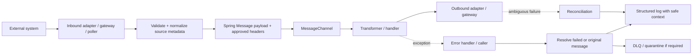
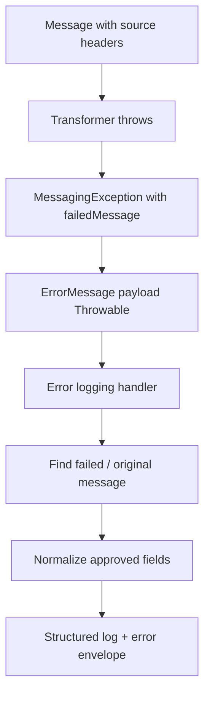
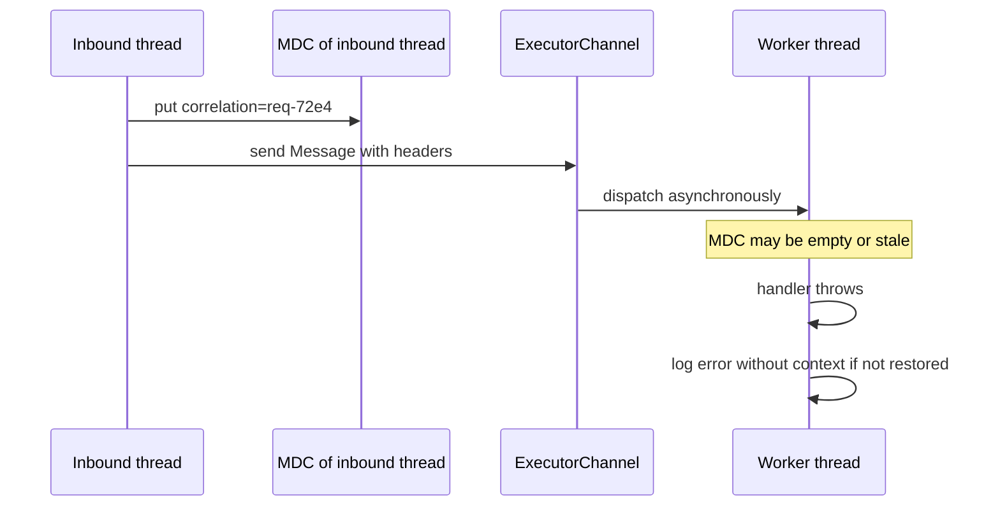
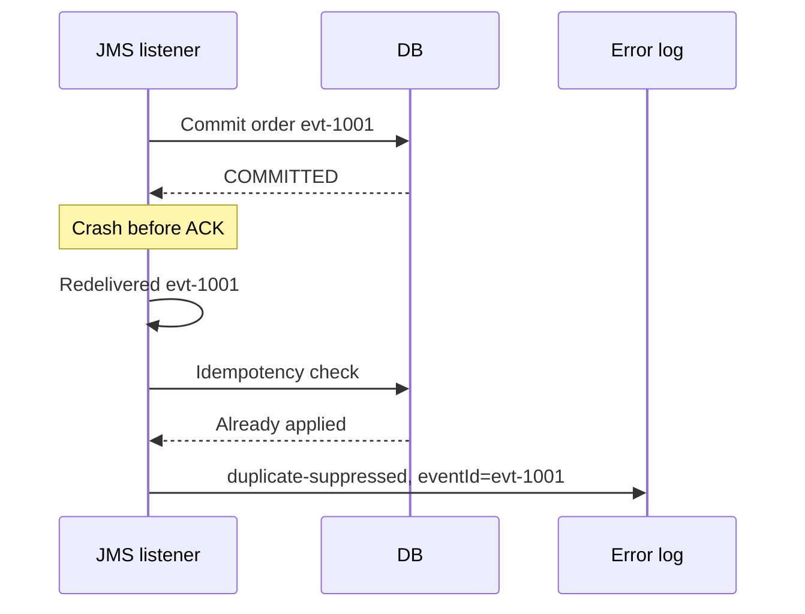

# Error Logging Without Losing Context in Spring Integration Adapters

In an integration application, a log line reading **"Failed to process message"** is rarely enough to investigate. As data flows from files or SFTP through `MessageChannel`, gets transformed via JSON/XML, written to a database, and sent to HTTP, JMS, AMQP, or Kafka, errors can occur at any step. When logs contain only a stack trace without **message source, correlation ID, event ID, processing step, retry state, and outcome certainty**, operations cannot answer: which partner failed, which records are impacted, whether business work committed, and whether replaying is safe or will cause duplicate effects.

The lesson **"Error Logging Without Losing Context"** belongs to the **Error handling** chapter of the **SPRING_INTEGRATION_ADAPTERS** module. Its goal is designing structured logging with enough evidence to connect **inbound/outbound adapters, gateways, pollers, and `MessageChannel`**, preserving context across **async threads and transport boundaries** without leaking sensitive information. A trustworthy system logs both the **failure event and the handling decision**, not merely an exception class.

> **Core principle:** Business context must reside in a **durable data source** (verified message headers, event envelopes, transaction metadata, or dedicated context), whereas **MDC is a temporary per-thread copy used to enrich logs**. Never treat MDC as the sole context store, never trust unverified client-supplied headers, and never copy full payloads/headers into logs.

## 1. Learning Objectives

After this lesson, learners can:

1. Specify the minimum log fields needed to analyze integration failures by **source, event, correlation, stage, outcome, and retry**.
2. Distinguish **payload**, **Spring Message headers**, **SLF4J MDC**, **trace/span context**, **transport metadata**, and **error envelopes**.
3. Explain why context gets lost when using `ExecutorChannel`, pollers, task schedulers, Kafka/JMS/AMQP listeners, or HTTP gateways.
4. Write an error handler reading `ErrorMessage`, `MessagingException.getFailedMessage()`, and `originalMessage` when present.
5. Emit structured log events with **stable reason codes** instead of relying on exception messages.
6. Manage MDC safely in `try/finally` to prevent context leaking across pooled threads.
7. Know when to use `TaskDecorator`/tracing instrumentation and when to rebuild context from the message.
8. Preserve context across conversion, routing, retries, dead-lettering, quarantine, replays, and unknown outcomes.
9. Design per-adapter logging for **file, SFTP, HTTP, JMS, AMQP, Kafka, and JDBC/database**.
10. Test missing headers, mismatched header types, redelivery, multi-threading, multi-tenancy, and secret redaction.

## 2. What Does "Without Losing Context" Concretely Mean?

Context in logging is data explaining **which request, source, and process an event belongs to**.

Example of a Kafka consumer failing while converting JSON to a DTO:

```text
Context-poor log:
ERROR Conversion failed: InvalidFormatException

Context-rich log:
event=integration.message.failed
source=kafka-orders
stage=payload-validation
correlationId=req-72e4
eventId=evt-1001
topic=orders.v1
partition=3
offset=48102
schemaVersion=v2
reason=INVALID_ORDER_AMOUNT
attempt=2
outcome=NOT_APPLIED_CONFIRMED
```

The difference is not message length, but the **ability to link logs to source evidence and operational decisions**.

### 2.1. Questions a Good Error Record Must Help Answer

- **What:** which error, at which stage, for which operation type?
- **Where:** which adapter, endpoint, channel, and external dependency?
- **Which:** which event ID, command ID, or file/batch/row?
- **Who/Scope:** which **verified** producer and tenant are impacted?
- **When:** timestamp of error, processing duration, deadline, and record age?
- **Why:** stable reason code, exception category, contract version?
- **Then what:** retry, reject, DLQ, pause consumer, or reconcile?
- **Did it apply:** was the business commit confirmed, confirmed not applied, or still **UNKNOWN**?

Do not construct a log line dumping whatever happens to be in scope. Choose fields that are **well-defined, normalized, and permitted to store**.

## 3. Six Places Where "Context" Can Live

| Storage Place | Examples | Lifecycle | Notes |
| --- | --- | --- | --- |
| **Payload / domain envelope** | `eventId`, `orderId`, `schemaVersion` | Travels with event | May contain PII; read only parsed and validated fields. |
| **Spring `MessageHeaders`** | `correlationId`, `sourceSystem`, `contentType` | Per `Message<?>` | Can change across endpoints; does not cross every transport automatically. |
| **Transport metadata** | Kafka topic/partition/offset, JMS message ID, SFTP filename | Per adapter/broker | Field names/types and availability timing vary. |
| **SLF4J MDC** | `correlationId`, `flowId`, `stage` | Per thread | Not durable storage; easily lost or leaked across thread pools. |
| **Trace/span context** | Trace ID, span ID, parent relationship | Via instrumentation and propagation | Not equivalent to business event ID; sampling may drop traces. |
| **Error envelope/audit store** | `failureId`, `reasonCode`, `outcome`, `payloadRef` | Durable across DLQ/replay | Needs schema, retention, access controls, and idempotency. |

### 3.1. A Useful Design Rule

**Message headers/domain envelopes carry context with the message**, **tracing context links activities**, **MDC lets logs on a thread read that context**, and **error envelopes store necessary evidence after failure**.

If a handler relies solely on `MDC.get("eventId")`, crossing an executor, listener, or task scheduler can drop the value; worse, a reused worker thread can retain the **previous message's value** if not cleaned properly.

## 4. Flow of Context from Adapter to Error Logging



Errors can occur **before the inbound adapter builds a Spring Message**. Then context comes from the adapter/listener and transport; you cannot require every error to have `failedMessage`.

### 4.1. Trusted Information Originates at Ingress

For example, an HTTP client sends `X-Tenant-ID: tenant-b`, while the authenticated principal belongs to tenant A. Logging and authorization must use the **verified tenant context** from the gateway/security layer; never record tenant B simply because the client claimed it.

Similarly, Kafka topics or JMS queues may come from connector configs; `sourceSystem` fields supplied by producers should be bound to producer identity. **Logging the wrong source** misleads triage and opens spoofing risks.

## 5. Design the Log Schema Before Writing Code

A standard logging schema enables cross-adapter search and stable dashboards.

| Field | Example | Meaning |
| --- | --- | --- |
| `event` | `integration.message.failed` | Logging event name, not exception type. |
| `timestamp` | UTC ISO-8601 | Log emission timestamp. |
| `service` | `spring-integration-adapters` | Emitting service. |
| `environment` | `prod` | Runtime environment. |
| `flow` | `orders-import` | Managed integration flow. |
| `adapter` | `kafka-inbound` | Adapter/endpoint type. |
| `stage` | `transform-json` | Failing step. |
| `eventId` | `evt-1001` | A single logical event. |
| `correlationId` | `req-72e4` | Links a multi-hop workflow. |
| `traceId` / `spanId` | IDs per tracing implementation | Links to distributed trace. |
| `sourceSystem` | `partner-a` | Verified source. |
| `tenantScope` | `tenant-a` or log-approved scope code | Never use logs for authorization. |
| `schemaVersion` | `order-v2` | Interprets payload/contract. |
| `reasonCode` | `INVALID_ORDER_AMOUNT` | Stable error code for routing/metrics. |
| `failureStage` | `VALIDATION` | Pinpoints failing layer. |
| `retryAttempt` | `2` | Current attempt when known accurately. |
| `retryable` | `false` | Policy decision, not an immutable exception trait. |
| `outcome` | `UNKNOWN` | Certainty of business effect. |
| `failureId` | `fail-00981` | Links to audit/DLQ. |
| `durationMs` | `87` | Measured duration at a stage. |

Not every log line needs every field. **Success logs**, **error logs**, and **audit events** have distinct needs. In all cases, unknown fields should appear as **unknown/absent**, never fabricated "plausible" values.

### 5.1. Illustrative JSON Log

```json
{
  "timestamp": "2026-11-23T08:50:12.421Z",
  "level": "ERROR",
  "event": "integration.message.failed",
  "service": "spring-integration-adapters",
  "flow": "orders-import",
  "adapter": "kafka-inbound",
  "stage": "transform-json",
  "sourceSystem": "partner-a",
  "correlationId": "req-72e4",
  "eventId": "evt-1001",
  "schemaVersion": "order-v2",
  "reasonCode": "INVALID_ORDER_AMOUNT",
  "retryAttempt": 2,
  "outcome": "NOT_APPLIED_CONFIRMED",
  "failureId": "fail-00981",
  "exceptionType": "InvalidFormatException"
}
```

This is **illustrative data**, not default output built into Spring Integration. Logging plans must pair with real encoder/appender configs, access controls, indexing, and retention.

## 6. Correlation ID, Event ID, and Trace ID Are Not the Same

### 6.1. Correlation ID

Connects multiple steps of one request/workflow:

```text
HTTP request
  correlationId=req-72e4
    -> validation
    -> DB transaction
    -> publish Kafka
    -> consumer
```

One correlation ID can span **multiple events**.

### 6.2. Event/Command ID

Identifies **one logical event or business intent**. It must stay stable across retries and replays when the same intent is re-executed. It can serve as part of an idempotency key alongside tenant/source/operation.

### 6.3. Trace ID and Span ID

Tracing IDs link operations in distributed tracing. One trace can hold many spans; span IDs change across steps. Traces may be sampled or fail to propagate across some brokers/adapters. Therefore:

- **Never use trace ID in place of business event ID.**
- **Never use correlation ID by default as an idempotency key.**
- **Never expect every log to have a trace ID**, especially messages sitting in a DLQ for days and replayed in a new context.
- If replay starts a new trace, keep **`originalEventId`** and link **`replayRunId`/`failureId`**.

### 6.4. Client-Supplied IDs Must Be Validated

A client might send an oversized correlation ID containing newlines or control characters. Enforce length limits, charset rules, trust levels, and safe rendering before logging. Never use correlation IDs to authorize tenants or steer destinations.

## 7. What Is MDC and What Are Its Limits?

SLF4J/Logback's **Mapped Diagnostic Context (MDC)** lets you attach key/value pairs to the executing thread's logging context:

```java
import org.slf4j.MDC;

MDC.put("correlationId", "req-72e4");
MDC.put("eventId", "evt-1001");
```

A logging layout/structured encoder **configured to output MDC** can automatically include those fields on every log emitted on the same thread.

MDC saves repeating fields on every `log.info(...)` call, yet it is **not a message metadata store**:

- It does not automatically survive serialization to Kafka/JMS/HTTP.
- It does not automatically cross executor threads.
- It is not automatically cleared when threads return to a pool unless the app manages it.
- It should never hold payload objects, secrets, cookies, or raw header maps.
- It is not proof that a business transaction committed.

### 7.1. How Severe Is an MDC Leak?

```text
Worker thread-1 handles tenant-A:
  MDC[tenantScope] = tenant-A
  handler throws, code forgets to clear

Worker thread-1 handles tenant-B:
  application fails to set new context
  logs still show tenant-A
```

This is not merely an observability glitch; logs can **misattribute tenant B's data to tenant A**, causing wrong triage or security risks. Always use **`try/finally` and restore the previous context**.

## 8. Java: Safe MDC Scoping with try/finally

Utility example for a message scope, using Java 17 and SLF4J:

```java
import java.util.HashMap;
import java.util.Map;
import org.slf4j.MDC;

public final class MessageLogScope implements AutoCloseable {

    private final Map<String, String> previous;

    private MessageLogScope(Map<String, String> fields) {
        this.previous = MDC.getCopyOfContextMap();

        Map<String, String> next = previous == null
            ? new HashMap<>()
            : new HashMap<>(previous);

        // 'fields' must already pass allowlist validation.
        next.putAll(fields);
        MDC.setContextMap(next);
    }

    public static MessageLogScope open(Map<String, String> fields) {
        return new MessageLogScope(fields);
    }

    @Override
    public void close() {
        if (previous == null) {
            MDC.clear();
        } else {
            MDC.setContextMap(previous);
        }
    }
}
```

Usage:

```java
try (MessageLogScope scope = MessageLogScope.open(Map.of(
        "flow", "orders-import",
        "eventId", safeEventId,
        "correlationId", safeCorrelationId))) {

    log.info("event=integration.processing.started");
    orderHandler.handle(message);

} // Restores prior MDC even when handler throws
```

### 8.1. Production Notes

1. `Map.of(...)` rejects null keys/values; if an ID is absent, **omit that field** or use a safe `unknown` convention rather than passing null.
2. `fields` must pass **validation, max length, and allowlists**.
3. Restoring is safer than a bare `MDC.clear()` when code runs inside a parent MDC scope (such as an HTTP request filter).
4. Even though restoring prevents leaking the new scope, also check whether other interceptors/handlers write to MDC outside this scope.
5. If using `MDC.putCloseable` per key, understand how pre-existing keys behave; saving/restoring the whole context map is clearer.
6. Error logs emitted **after the scope closes** no longer have the message's MDC; use explicit fields or open a new scope from the message/error envelope.

## 9. Build Context from the Message, Not from Stale MDC

A solid approach is constructing **`IntegrationLogContext`** from trusted data.

```java
public record IntegrationLogContext(
    String flow,
    String adapter,
    String stage,
    String correlationId,
    String eventId,
    String sourceSystem,
    String schemaVersion
) {}
```

Avoid unsafe casts:

```java
// Dangerous if Kafka/JMS header mapper returns byte[] instead of String:
String eventId =
    (String) message.getHeaders().get("eventId");
```

Instead, enforce explicit rules:

```java
import java.util.regex.Pattern;

public final class SafeHeaderValues {

    private static final Pattern SAFE_ID =
        Pattern.compile("[A-Za-z0-9._:-]{1,128}");

    private SafeHeaderValues() {}

    public static String id(Object raw) {
        if (!(raw instanceof String value)) {
            return null;
        }

        return SAFE_ID.matcher(value).matches()
            ? value : null;
    }
}
```

**Note:** the method above **rejects** unnormalized `byte[]` headers instead of decoding arbitrarily. For Kafka, if the contract specifies event IDs are UTF-8 bytes in record headers, decode **at the adapter boundary** with a strict converter into canonical `MessageHeaders`. Never call `byteArray.toString()`.

### 9.1. Verified Source vs. Claimed Source

If a payload/header claims `sourceSystem=trusted-partner` while transport authentication proves it is another producer, logs must record the **verified source** or separate `claimedSource`/`verifiedSource` fields with appropriate access controls. Never trust something "because a log printed it".

## 10. Transformer Errors: Retain failedMessage So Loggers Have Context

A transformer can return a new payload or construct a new `Message<?>`. On error, if the exception references the failed message, the error handler gains another source of context.

Example:

```java
import com.fasterxml.jackson.core.JsonProcessingException;
import com.fasterxml.jackson.databind.ObjectMapper;
import org.springframework.integration.annotation.Transformer;
import org.springframework.messaging.Message;
import org.springframework.messaging.MessageHandlingException;
import org.springframework.stereotype.Component;

@Component
public class OrderDecoder {

    private final ObjectMapper mapper;

    public OrderDecoder(ObjectMapper mapper) {
        this.mapper = mapper;
    }

    @Transformer(
        inputChannel = "rawOrdersChannel",
        outputChannel = "parsedOrdersChannel"
    )
    public OrderCreated decode(Message<byte[]> input) {
        try {
            return mapper.readValue(
                input.getPayload(),
                OrderCreated.class
            );
        } catch (JsonProcessingException ex) {
            throw new MessageHandlingException(
                input, "ORDER_JSON_DECODE_FAILED", ex
            );
        }
    }
}
```

### 10.1. Why Not Log the Exception and Return Fake Success?

An anti-pattern:

```java
try {
    return parse(payload);
} catch (Exception ex) {
    log.error("Parse failed", ex);
    return new OrderCreated(...placeholder...);
}
```

Downstream handlers may treat the placeholder as a valid order. Logging is an **observability signal**, not a substitute for reporting failure via exceptions or typed error results.

### 10.2. One Error Can Be Logged Multiple Times

If the transformer logs ERROR, the gateway logs ERROR, the error handler logs ERROR, and the DLQ publisher logs ERROR for the exact same exception, the system creates a **log storm** without adding evidence. Assign clear ownership:

- At the **detection point**: log a bounded diagnostic/reason code, or throw a contextual exception.
- At the **owning error boundary**: emit the primary structured error log.
- At the **retry/DLQ decision**: emit one handling-decision event.
- Once **verified/reconciled**: emit an outcome/audit event.

There is no need to print stack traces at every layer.

## 11. ErrorMessage and Failed Message Headers

In Spring Messaging, `org.springframework.messaging.support.ErrorMessage` typically holds a `Throwable` payload. The error message itself has **its own headers**, not automatically a copy of the failed message's headers.

When the payload is a `MessagingException`, you can inspect `getFailedMessage()`. Some error messages also retain `getOriginalMessage()`.



**Note:** not every exception is guaranteed to have `failedMessage`. In particular, errors occurring before a deserializer/adapter builds a Spring Message require **adapter-specific error context**.

## 12. Java: Resolving Failed/Original Message Through the Cause Chain

Errors may be wrapped multiple times by the framework. A small utility can locate the nearest available message, bounded to avoid cycles or pathological chains:

```java
import java.util.Collections;
import java.util.IdentityHashMap;
import java.util.Set;
import org.springframework.messaging.Message;
import org.springframework.messaging.MessagingException;
import org.springframework.messaging.support.ErrorMessage;

public final class FailedMessageResolver {

    private FailedMessageResolver() {}

    public static Message<?> resolve(ErrorMessage error) {
        if (error == null) {
            return null;
        }

        Set<Throwable> seen =
            Collections.newSetFromMap(new IdentityHashMap<>());

        Throwable current = error.getPayload();
        int depth = 0;

        while (current != null
                && depth++ < 16
                && seen.add(current)) {

            if (current instanceof MessagingException messagingException
                    && messagingException.getFailedMessage() != null) {
                return messagingException.getFailedMessage();
            }

            current = current.getCause();
        }

        return error.getOriginalMessage();
    }
}
```

### 12.1. What Does the Resolver Not Do?

- It does not guarantee the found message is the **initial ingress message**; it may be from a post-transform stage.
- It does not infer source/tenant from exception messages.
- It does not fabricate a fake failed message on pre-deserialization errors.
- It does not read raw payloads outside access-controlled stores.
- It does not ensure the error handler is properly subscribed to the error channel.

When messages span multiple stages, store `originalEventId`, `originalMessageId`, and `failedStageMessageId` separately where needed rather than using one ambiguous label.

## 13. Java: Error Handler Logging a Structured Event

Example Spring Integration error handler for a **dedicated error channel**. It prioritizes ingress-normalized metadata, refuses to print raw payloads, and flags missing lineage.

```java
import org.slf4j.Logger;
import org.slf4j.LoggerFactory;
import org.springframework.integration.annotation.ServiceActivator;
import org.springframework.messaging.Message;
import org.springframework.messaging.support.ErrorMessage;
import org.springframework.stereotype.Component;

@Component
public class OrderErrorLogger {

    private static final Logger log =
        LoggerFactory.getLogger(OrderErrorLogger.class);

    @ServiceActivator(inputChannel = "ordersErrorChannel")
    public void onError(ErrorMessage error) {
        Message<?> failed = FailedMessageResolver.resolve(error);

        String eventId = id(failed, "eventId");
        String correlation = id(failed, "correlationId");
        String source = id(failed, "verifiedSource");
        String schema = id(failed, "schemaVersion");

        Throwable cause = error.getPayload();

        // Field names are shown in the message pattern.
        // A structured JSON encoder must be configured separately to emit JSON fields.
        log.error(
            "event=integration.message.failed flow={} stage={} " +
            "eventId={} correlationId={} sourceSystem={} " +
            "schemaVersion={} reasonCode={} exceptionType={} " +
            "lineageMissing={}",
            "orders-import",
            "transform-json",
            eventId, correlation, source, schema,
            "ORDER_JSON_DECODE_FAILED",
            cause.getClass().getSimpleName(),
            failed == null
        );

        // Retry/DLQ/ACK policies are handled by dedicated components.
        // This logger does not ack sources or treat logs as durable capture.
    }

    private static String id(Message<?> message, String headerName) {
        if (message == null) {
            return null;
        }
        return SafeHeaderValues.id(
            message.getHeaders().get(headerName)
        );
    }
}
```

**Significance:** errors retain searchable metadata without leaking raw payloads. However, this is **key=value text logging**, which does not automatically become structured JSON fields in every logging backend. For true JSON, configure a structured encoder or structured logging API matching your stack.

### 13.1. Do Not Always Attach Throwable to Public Logs

Many systems call:

```java
log.error("Conversion failed", cause);
```

This helps in protected internal logs, yet exception messages, stack traces, and suppressed exceptions can carry URIs, SQL literals, request bodies, or tokens. For logs sent to broadly accessible systems, prefer **reason code + exception type + error reference**; keep detailed stack traces in restricted security zones with redaction and retention.

### 13.2. Why Is Logging Alone Insufficient for Error Handling?

If a message was dropped before ACK, a logger cannot guarantee:

- DLQ publishing persisted durably.
- Database transactions rolled back or committed.
- HTTP callers received the right status.
- Kafka offsets committed.
- SFTP files moved to archive/quarantine.
- Business operations did not already execute.

Logging and error handling are **two separate responsibilities**; logs explain decisions rather than replacing the decision mechanism.

## 14. SLF4J Placeholders and Structured Logging

Several logging styles exist:

### 14.1. Hard-to-Query Free Text

```java
log.error("Could not process order " + orderId
    + " from " + source + " because " + ex.getMessage());
```

Risks:

- Message strings shift with exceptions.
- Can leak payloads, sensitive IDs, or newlines.
- Hard to aggregate by reason code.
- String concatenation incurs cost even when the level is disabled.

### 14.2. Parameterized Logging

```java
log.warn(
    "event=integration.retry.decision adapter={} reason={} attempt={}",
    adapter, reasonCode, attempt
);
```

Components stay separated without manual concatenation, yet **querying structured fields properly** requires a matching parser/encoder.

### 14.3. Native Structured Fields

Some stacks support fluent SLF4J APIs, key-value pairs, or JSON encoders. Example with SLF4J 2.x API:

```java
log.atError()
    .addKeyValue("event", "integration.message.failed")
    .addKeyValue("flow", "orders-import")
    .addKeyValue("eventId", eventId)
    .addKeyValue("correlationId", correlationId)
    .addKeyValue("reasonCode", reasonCode)
    .log("Order conversion failed");
```

**Never assume key-value pairs automatically serialize as JSON** if your backend/layout does not support them. Under some layouts they render as plain text or are omitted. Inspect real log output after configuring the logging backend.

## 15. Structured JSON Output and Logback/Spring Boot

Spring Boot can be configured to emit structured logs via an appropriate logging backend. Exact declarations for JSON, MDC, and key-value pairs vary by **Spring Boot, SLF4J/Logback, and encoder versions**.

Configuration rules:

1. Standardize on **one governed log schema**.
2. Configure the encoder/layout to emit one JSON object per line with approved fields.
3. Include trace/span IDs from instrumentation when present.
4. Bound and sanitize MDC fields.
5. Keep `exceptionType`/`reasonCode` separate from raw exception messages.
6. Enforce redaction at both the **application layer** and log ingestion pipeline.
7. Verify index mappings/cardinality, retention, and access controls.
8. Test that emitted logs actually parse as JSON—do not merely test that the Java logger was called.

### 15.1. Expected JSON Event

```json
{
  "timestamp": "2026-11-23T09:20:40.123Z",
  "level": "WARN",
  "event": "integration.retry.decision",
  "flow": "sftp-orders",
  "adapter": "sftp-inbound",
  "correlationId": "batch-2026-42",
  "eventId": "file-record-108",
  "reasonCode": "REMOTE_READ_TIMEOUT",
  "attempt": 2,
  "decision": "RETRY_WITH_BACKOFF",
  "retryDelayMs": 2000
}
```

This is an illustrative output target; Spring Integration does not emit all of these fields automatically.

## 16. Thread Hops: Why Does MDC Disappear?

`DirectChannel` usually dispatches handlers synchronously on the calling thread. Crossing an `ExecutorChannel` or another executor can move execution onto a new thread:



**MDC is thread-local**, whereas `Message<?>` traveling across channels carries context with the message. Choose how to reconstruct context on the worker thread. Two options:

- **Preferred for message processing:** open an MDC scope **from normalized `MessageHeaders`** when the handler starts, and restore in `finally`.
- **Supporting tasks sharing a call chain:** use task decorators/context propagation instrumentation to pass context into executors in a controlled way.

Never assume **MDC automatically follows `MessageChannel`** across async boundaries.

## 17. TaskDecorator for Executors: Utility and Limits

With a Spring `ThreadPoolTaskExecutor` supporting `TaskDecorator`, you can snapshot MDC when tasks are submitted.

```java
import java.util.Map;
import org.slf4j.MDC;
import org.springframework.core.task.TaskDecorator;

public final class MdcTaskDecorator implements TaskDecorator {

    @Override
    public Runnable decorate(Runnable task) {
        // Capture at task submission time.
        Map<String, String> submittingContext =
            MDC.getCopyOfContextMap();

        return () -> {
            // Worker thread may have executed a previous task.
            Map<String, String> oldWorkerContext =
                MDC.getCopyOfContextMap();

            try {
                if (submittingContext == null) {
                    MDC.clear();
                } else {
                    MDC.setContextMap(submittingContext);
                }

                task.run();
            } finally {
                if (oldWorkerContext == null) {
                    MDC.clear();
                } else {
                    MDC.setContextMap(oldWorkerContext);
                }
            }
        };
    }
}
```

Executor configuration example:

```java
import org.springframework.context.annotation.Bean;
import org.springframework.context.annotation.Configuration;
import org.springframework.scheduling.concurrent.ThreadPoolTaskExecutor;

@Configuration
public class IntegrationExecutorConfig {

    @Bean
    public ThreadPoolTaskExecutor integrationExecutor() {
        ThreadPoolTaskExecutor executor =
            new ThreadPoolTaskExecutor();

        executor.setCorePoolSize(4);
        executor.setMaxPoolSize(8);
        executor.setQueueCapacity(200);
        executor.setThreadNamePrefix("integration-");
        executor.setTaskDecorator(new MdcTaskDecorator());
        executor.initialize();
        return executor;
    }
}
```

### 17.1. Limits You Must Understand

1. The decorator affects only **tasks actually running on that executor**.
2. It does not automatically propagate context across brokers, HTTP, SFTP, other JVMs, or other task schedulers.
3. If a message is submitted from a thread with stale/wrong MDC, the decorator copies the **wrong context**.
4. If tasks sit queued for a long time, submission-time context may drift from current state; treat verified message metadata as primary.
5. Never put credentials in MDC just because it propagates.
6. When using tracing/observability context propagation frameworks, avoid **two conflicting context set/restore mechanisms**; test against your exact versions and config.

**`TaskDecorator` is a helper, not a replacement for reading event/correlation IDs from headers.**

## 18. Scheduled Pollers: No Incoming HTTP Request to Inherit Context From

An SFTP/file/JDBC poller is triggered by a `TaskScheduler` with no parent HTTP request. Never expect MDC from a bean-creation thread or configuration thread to exist when polls execute.

Reliable flow:

```text
TaskScheduler triggers poll
  -> message source returns file/row
  -> inbound adapter creates Message
  -> attach verified source + event/batch ID
  -> MessageChannel
  -> handler opens MDC scope from Message
  -> success/error log with same context
  -> handler closes MDC scope
```

### 18.1. Source Returns No Message

When a poll finds **no data**, no event ID exists. A source-level log can record `adapter=sftp-inbound`, `pollRunId`, `durationMs`, and `itemsFound=0`. **Never fabricate an event ID** for empty polls or reuse a previous message's ID.

### 18.2. Poller Fails Before Creating a Message

If SFTP directory listing times out or a JDBC query fails, the error belongs to the **poll attempt**, not necessarily a specific event. Generate a dedicated `pollRunId`, pull endpoint/source from config, and flag `eventIdUnavailable=true` where needed.

## 19. Header Preservation When Transformers Build New Messages

A transformer may convert payloads from `byte[]` → `String` → DTO. Returning a brand-new `Message<?>` with only the payload can drop needed custom headers depending on endpoint config.

Illustrative example building an internal header allowlist:

```java
Message<OrderCreated> converted = MessageBuilder
    .withPayload(order)
    .setHeader(
        "correlationId",
        input.getHeaders().get("correlationId")
    )
    .setHeader(
        "eventId",
        input.getHeaders().get("eventId")
    )
    .setHeader(
        "verifiedSource",
        input.getHeaders().get("verifiedSource")
    )
    .setHeader(
        "originalMessageId",
        String.valueOf(input.getHeaders().getId())
    )
    .build();
```

### 19.1. Why Not Copy All Headers?

- `replyChannel` and `errorChannel` may be internal routing objects.
- `contentType` attached to **wire bytes** may no longer fit the DTO.
- Transport headers may be non-serializable across another broker.
- HTTP `Authorization` or sessions/cookies can leak secrets.
- A client-supplied `tenantId` may not be the verified tenant.

Inside **trusted zones** you can policy-filter with `copyHeaders(...)` and strip unsuitable ones; at **trust boundaries**, use a strict normalized allowlist.

## 20. Where to Log Errors Without Multiplying Logs

Consider a pipeline:

```text
Inbound adapter
  -> Transformer
  -> DB handler
  -> HTTP outbound gateway
  -> Error handler
  -> DLQ/quarantine
```

Assign **ownership** for each log type:

| Point | Appropriate Log | What to Avoid |
| --- | --- | --- |
| Inbound boundary | Accepted/rejected and verified metadata. | Logging full payloads/tokens on every request. |
| Transformer | Conversion reason code when needed for diagnosis. | Repeating ERROR stack traces that the boundary will log. |
| Business handler | Domain rejection/result, transaction stage. | Calling every business rejection a system outage. |
| Outbound gateway | Dependency, request identity, latency, status/unknown outcome. | Logging "failed" when only a timeout is known. |
| Error handler | One primary structured error event, retry/DLQ decision. | Losing event/correlation, logging raw `ErrorMessage.toString()`. |
| DLQ publisher | Capture success/failure, failure ID, approved destination. | Treating DLQ publish success as business success. |
| Replay dispatcher | Approval, replay run/attempt, and result. | Minting a new event ID or faking success. |

One message can have multiple **distinct types** of logs: started, failed, retry scheduled, dead-lettered, verified. Avoid emitting floods of identical ERROR records that add no new information.

## 21. HTTP Inbound Gateways: Logging Errors Without Reflecting Secrets

HTTP gateways receive requests carrying metadata like method, route, content type, client-generated request ID, and security principal. When transformation/handlers fail, correlate logs with the request without dumping all HTTP headers.

### 21.1. HTTP Logging Contract

| Data | Do | Don't |
| --- | --- | --- |
| HTTP route | Log route templates like `/api/orders/{id}` when possible. | Log raw URLs containing tokens or query PII. |
| Request ID | Validate external IDs or mint internal request IDs. | Trust IDs with control chars or unbounded length. |
| Authentication | Log policy-approved identifier codes. | Log Authorization bearer tokens, cookies, or API keys. |
| Tenant | Take from verified principal/context. | Trust client-supplied `X-Tenant-ID` as authoritative. |
| Content-Type | Log parsed media type/charset. | Print full request bodies "for debugging". |
| Status | Log response code and exception class/reason. | Claim every `5xx` definitely had no side effects. |
| Duration | Measure at gateway/handler. | Infer from a single log line's timestamp. |

### 21.2. Synchronous Paths May Not Emit ErrorMessage

```text
POST /orders
  -> HTTP inbound gateway
  -> DirectChannel
  -> transformer / business handler throws
  -> exception propagates to gateway/caller
  -> HTTP error mapping
```

Errors on synchronous paths can return to callers **without automatically entering global `errorChannel`**. Therefore log where response/error mapping is owned, and preserve `correlationId` in a safe response:

```json
{
  "code": "ORDER_PAYLOAD_INVALID",
  "requestId": "req-72e4",
  "message": "Request payload does not match the contract"
}
```

Never return stack traces, table names, tokens, or raw request contents to clients.

### 21.3. Outbound HTTP Timeouts: Do Not Conclude Side Effects Failed

When an outbound gateway POSTs to a payment/booking API and times out, log:

```text
event=integration.outbound.unknown
stage=http-outbound
operation=capture-payment
commandId=cmd-42
providerReference=pay-42
reasonCode=HTTP_RESPONSE_TIMEOUT
outcome=UNKNOWN
decision=RECONCILE_OR_RETRY_SAME_KEY
```

Never log `outcome=FAILED` without proof the provider did not commit. On retry, preserve the **same idempotency key** when supported; never treat a `retryAttempt` ID as a fresh business command ID.

## 22. JMS: Logging Across TextMessage, BytesMessage, and Redelivery

JMS listeners/adapters convert `TextMessage` or `BytesMessage` into Spring Messages with mapped headers/properties per config.

Fields commonly needed:

- Verified producer/application/queue.
- Business `eventId` and `correlationId` per contract.
- JMS destination and `JMSMessageID` **when observable**.
- Redelivery flag/delivery count when supplied by the provider and mapper.
- Message type, converter stage, and error reason.
- Transaction/ACK outcome, when the endpoint has confirming evidence.

### 22.1. `JMSMessageID` Differs from `eventId`

Brokers can assign a new `JMSMessageID` when an event is republished. Business `eventId` should stay stable across retries/replays so deduplication works properly. Log both when useful, but never substitute one for the other.

### 22.2. Redelivery After DB Commit



Good logs separate `businessEffect=ALREADY_APPLIED` from `transportDelivery=REDELIVERED`. A listener running multiple times **is not necessarily an error** when the business effect executes only once.

### 22.3. Converter Failures Before the Integration Flow

If a JMS message converter fails before creating `Message<?>`, Integration cannot find `failedMessage` normally. Use the JMS provider/container's error strategy/listener context with actually available metadata. Record `eventIdMissing=true` if no event ID could be read.

## 23. AMQP/RabbitMQ: Log Sufficient Routing Without Bloating Headers

AMQP typically carries exchange, routing key, queue, consumer tag, delivery tag, and properties like content type/encoding. Spring AMQP adapters/converters map this metadata to Spring Messages with varying names and types.

### 23.1. Useful Metadata

| Field | Use | Limit |
| --- | --- | --- |
| Queue/exchange alias | Scopes consumer and routing. | Never treat queue names as verified tenants. |
| Routing key | Traces message route. | Sanitize; never make uncontrolled text a metric label. |
| Broker delivery/requeue metadata | Shows message redelivery. | Does not replace event ID. |
| Content type/encoding | Picks proper decoder. | Might mismatch body; still validate. |
| DLX/DLQ destination | Tracks error routing. | Only governed config destinations. |
| Business event ID | Idempotency/correlation. | Must remain stable across republishing. |

### 23.2. Requeue Loops

Schema-invalid JSON repeatedly NACKed/requeued can generate thousands of identical errors. Do not react by logging stack traces every time. Instead:

- Enforce bounded retries and permanent classification.
- Log one `integration.message.deadlettered` event with attempt count and reason.
- Route to DLQ per broker policy.
- Replay only after fixing the root cause.
- Alert on backlog/oldest age instead of flooding ERROR logs.

### 23.3. Dead-Letter Metadata Does Not Replace Business Lineage

Brokers may attach dead-letter history headers. Useful for investigation, yet never blindly copy/accumulate all headers across multiple replays. Build a **canonical error envelope** and preserve the original event ID.

## 24. Kafka: Deserializers, Topic-Partition-Offset, and Context-Rich Logging

A Kafka consumer receives records like:

```text
topic=orders.v1
partition=3
offset=48102
key=ORD-42
headers: eventId=evt-1001, correlationId=req-72e4
value=byte[] JSON
```

Entering Spring Integration, headers can map to a Spring Message. Yet errors occur at two layers:

1. **Kafka deserializer/listener layer**: key/value fails deserialization; no Spring Message exists yet.
2. **Integration transformer/handler**: Spring Message exists; exceptions may carry `failedMessage`.

### 24.1. Do Not Wait for the Integration Error Channel to Handle All Kafka Errors

For key/value deserialization errors, use Kafka-specific listener/container error handling (such as **Spring Kafka** components per version/config). Verify they actually extract **topic, partition, offset, and headers** at failure time; never fabricate dummy data.

### 24.2. Kafka Record Headers Can Be `byte[]`

Unsafe example:

```java
String correlation =
    (String) message.getHeaders().get("correlationId");
```

If the mapper leaves raw `byte[]`, casting throws an exception right inside the error logger. Normalize at the Kafka adapter boundary per charset/type contracts, or read with explicit type checks like `SafeHeaderValues.id(...)` and flag missing context.

### 24.3. Offset Is Not a Business Event ID

The tuple `topic + partition + offset` pinpoints a **record's position in a Kafka log**, not logical event identity across DLT/replay. When republished to a dead-letter topic, the offset changes. Keep `originalTopic`, `originalPartition`, and `originalOffset` in dedicated metadata alongside a stable `originalEventId`.

### 24.4. Offset Commit Does Not Equal Business Commit

```text
Kafka record consumed
 -> DB transaction COMMIT
 -> process crash before offset commit
 -> record delivered again
```

Structured logs can distinguish:

```json
{
  "event": "integration.duplicate.suppressed",
  "adapter": "kafka-inbound",
  "eventId": "evt-1001",
  "originalTopic": "orders.v1",
  "originalPartition": 3,
  "originalOffset": 48102,
  "reasonCode": "ALREADY_APPLIED",
  "businessEffectAdditional": false
}
```

Log `businessEffectAdditional=false` only when backed by dedup/transaction proof. Never deduce it solely from seeing the same offset again.

## 25. File and SFTP: Log Names, Paths, and Batches per Policy

File/SFTP inbound adapters typically detect data via pollers. Errors happen at stages:

- Listing remote directory.
- Acquiring SFTP session or downloading.
- Waiting for file readiness.
- Reading local file/stream.
- Decoding charset and parsing CSV/XML/JSON.
- Validating individual records.
- Business commit.
- Archiving/quarantining or updating metadata store.

### 25.1. Context Granularity Must Be Clear

| Level | Suggested Metadata | When Available |
| --- | --- | --- |
| Poll attempt | `pollRunId`, connector, directory alias, duration | Even when zero files exist. |
| File/batch | `batchId`, source ID, sanitized file reference, checksum, file size | Once file is detected/downloaded. |
| Record | `recordId`, record index, schema version, source batch | Once parser identifies record. |
| Business effect | `commandId`, transaction ID/domain result | During processing/commit. |
| Quarantine | `failureId`, payload reference, reason code, state | After durable failure persistence. |

**Never use raw remote paths or untrusted filenames directly as unbounded log fields, clickable links, or local write paths.** Canonicalize/sanitize and separate storage keys from display metadata.

### 25.2. File Re-Read After Restart

```text
File: orders-2026-11-23.csv
  -> 999 records committed
  -> process crashes before archive
  -> poller sees file again
```

Logs reading only "import started" and "import error" are insufficient. Include batch ID, record-level identity, checkpoints, processed/skipped counts, and outcomes. Replaying an entire file is safe only if committed records are deduped; otherwise use record-level replay/quarantine per contract.

### 25.3. CSV Physical Line Differs from Logical Record

Quoted CSV fields can span newlines. If the parser reports record 71, do not convert it into "line 71" without exact line mapping. Log the exact **logical record index from the parser**, adding physical line numbers only if the parser provides evidence.

### 25.4. SFTP Session Failure Before Message Creation

When a file cannot be downloaded, no event ID exists. Log:

```text
event=integration.poll.failed
adapter=sftp-inbound
sourceSystem=verified-partner-a
pollRunId=poll-2026-82
stage=remote-list
reasonCode=SFTP_SESSION_TIMEOUT
eventIdUnavailable=true
decision=RETRY_POLL_WITH_BACKOFF
```

Never reuse the previous file's event ID from scheduler thread MDC.

## 26. JDBC/Database: Log Row Keys and Transaction Stages

A JDBC polling adapter may read an integration outbox table. When row mappers/parsers fail, context should include:

- Governed database source alias and query/flow ID.
- Row ID/event ID and schema version.
- Lease/claim attempt when multiple pollers run.
- Transaction stage: before commit, committed, rollback, unknown.
- Outcome of side effects.
- Retry/quarantine state.

Never log raw SQL with bind parameters holding PII or secrets. With some JDBC drivers, exception messages contain SQL literals or connection strings; redact them when stack traces are allowed.

### 26.1. Query Failures Before Fetching Rows

If the database connection times out **before returning any row**, there is no `eventId`. Log `pollRunId`, datasource alias, query category, connection pool state, and timeout—never attach the error to a fabricated row.

### 26.2. Errors After Commit, Before Checkpoint

If a row applied business changes yet `PROCESSED` wasn't saved or the poller didn't ack, the next poll may re-read it. Logs must link both attempts via **stable event ID** and log `DUPLICATE_SUPPRESSED` only after dedup proof.

### 26.3. Transactional Inbox/Outbox

A unique-key table preventing duplicates inside the same DB transaction provides solid proof. Logging should separate:

```text
event=integration.business.applied       // first apply committed
event=integration.duplicate.suppressed  // repeated delivery, no extra apply
event=integration.outbox.publish.unknown // outbound ACK not known
```

"Saved to DB successfully" does **not** prove the broker received the event; log at every boundary.

## 27. When `Message<?>` Does Not Exist: What Minimum Error Context Remains?

Errors can arise before Spring Integration creates `Message<?>`:

- HTTP parser cannot read body.
- Kafka key/value deserializer fails.
- JMS/AMQP message converter fails.
- SFTP session/listing times out.
- File reader cannot open file.
- JDBC query/row mapping throws before emitting a message.

Then the error handler must extract context from objects **that actually exist** at the adapter layer.

### 27.1. Fallback Strategy

1. Get verified source/connector identity from adapter config or security layer.
2. Get available transport locator (`topic`/`partition`/`offset`, queue, file, row, request ID).
3. Mint `failureId`/`pollRunId` for the failure attempt.
4. Record `eventIdPresent=false` or `lineageMissing=true` when no event ID exists.
5. Never infer tenant/event ID from exception messages.
6. Hand off to adapter-level error strategy or quarantine per policy.
7. If persisting the failure fails, log **`captureFailed`** and preserve appropriate redelivery/terminal alerts.

### 27.2. Missing Context Is a Measurable Signal

A system can emit a metric:

```text
integration_error_context_missing_total{
  adapter="kafka",
  missing_field="eventId",
  failure_stage="deserialization"
}
```

This reveals missing mappings and instrumentation. Never turn dynamic event IDs into metric labels due to high cardinality and leak risk.

## 28. Retries, Redelivery, and Non-Misleading Logs

A message processed three times can emit events like:

```text
attempt=1 event=integration.processing.failed   reason=DEPENDENCY_TIMEOUT
attempt=1 event=integration.retry.scheduled     backoffMs=1000

attempt=2 event=integration.processing.failed   reason=DEPENDENCY_TIMEOUT
attempt=2 event=integration.retry.scheduled     backoffMs=2000

attempt=3 event=integration.processing.failed   reason=DEPENDENCY_TIMEOUT
attempt=3 event=integration.deadletter.created  failureId=fail-88
```

Never print **the same full stack trace three times across five layers**. Choose:

- Debug/traces with sampling for granular steps.
- One structured failure event per attempt when required by policy.
- One decision event for retry/dead-letter.
- One alert upon threshold breach, not one alert per retry.
- One outcome event once verified/reconciled.

### 28.1. Attempt Counts Must State Their Scope

Attempts can come from Spring Retry, broker redelivery, HTTP client retries, or replay generations. These numbers **are not interchangeable**:

```text
brokerDeliveryAttempt = 2
handlerRetryAttempt   = 3
httpClientAttempt     = 2
manualReplayRun       = 1
```

When nested, one message can trigger multiple outbound calls. Never sum or dump all attempts into one generic field without clear definitions.

### 28.2. Outcome Differs from Exception

A timeout after HTTP POST may be **`UNKNOWN`**. Log `integration.outbound.unknown` and decide `RECONCILE`. Never report `FAILED_NOT_APPLIED` merely because the caller caught an exception.

## 29. DLQ/Quarantine Logging: Closing the Trace Loop Without Leaking Data

When retries exhaust and the message goes to DLQ/DLT/quarantine, error logs must connect:

```text
originalEventId=evt-1001
correlationId=req-72e4
failureId=fail-88
sourceSystem=partner-a
adapter=kafka-inbound
reasonCode=INVALID_SCHEMA
retryAttempt=3
deadLetterDestination=orders-v1-dlt-alias
captureStatus=CONFIRMED
businessOutcome=NOT_APPLIED_CONFIRMED
```

Keep this separate from **raw payloads**. If bytes are needed for replay, store them in a quarantine store with encryption, retention, ACLs, integrity hashes, and audits.

### 29.1. Do Not Log "Dead-Letter Succeeded" Prematurely

DLT publish might succeed, yet the app crashes before committing the source offset, resulting in two DLT entries. Conversely, if the source ACKs before durable DLT capture and publish fails, messages can be lost.

Record separately:

- `deadLetterPublishAttempted` when sending.
- `deadLetterCaptureConfirmed` when backed by proof.
- `sourceCommit/ackOutcome` per adapter policy.
- `businessOutcome` independent of capture.
- `failureId` and stable identity to dedupe failure records if needed.

### 29.2. Replays Must Carry Their Own Context

```json
{
  "event": "integration.replay.dispatched",
  "originalEventId": "evt-1001",
  "originalFailureId": "fail-88",
  "replayRunId": "replay-2026-42",
  "replayAttempt": 1,
  "schemaVersion": "v1",
  "sourceSystem": "partner-a",
  "dispatchStatus": "BROKER_ACKNOWLEDGED",
  "businessOutcome": "PENDING_VERIFICATION"
}
```

**Replay run ID does not replace business event ID.** Mark `VERIFIED` only once the business outcome is proven per contract, not merely upon receiving a broker ACK in an async pipeline.

## 30. Distributed Tracing Across HTTP/Brokers and Logging

Distributed tracing visualizes relationships across services, message handlers, and outbound calls. Systems can use **Micrometer Observation/Tracing** and propagation standards (such as OpenTelemetry/W3C Trace Context), depending on library and instrumentation versions.

### 30.1. Do Not Assume Tracing Is Complete Across Every Adapter

Verify in practice:

- Do HTTP clients/servers create and propagate trace context?
- Do Kafka/JMS/AMQP adapters read/write propagation headers with your instrumentation?
- Do handlers on executors carry trace context?
- File/SFTP/JDBC pollers have no parent trace: where do new traces begin?
- When replaying from DLT days later, should business metadata link back to old traces?
- Does trace sampling drop some spans?

A message `eventId` remains a more durable identifier than a trace/span that may be unsampled or past retention.

### 30.2. Never Blindly Trust `traceparent` from Untrusted Sources

Trace context can come from upstream, yet must obey trust boundaries, format/length checks, and external-trace policies. Never let arbitrary trace headers override verified tenants, auth principals, or business correlation.

### 30.3. Start a Fresh Trace on Replay

A replay run is typically a **new operational activity**. Start a new trace and attach `originalEventId`, `replayRunId`, `failureId`, or framework span links. Do not reuse an old trace ID pretending the original request is still running days later.

## 31. Connection-Lifecycle Logging

Connection failures are not necessarily event failures.

| Connection Stage | Example | Recommended Context |
| --- | --- | --- |
| Acquire | Cannot obtain SFTP session/DB connection | Adapter, endpoint, pool alias, `pollRunId`, timeout. |
| Authenticate | HTTP 401/JMS credentials rejected | Source/endpoint, reason code; never log secrets. |
| Send | Kafka publish failure, AMQP confirm timeout | Event/command ID, destination alias, attempt, outcome. |
| Receive | Connection reset before full body | Transport locator if present, stage, retry policy. |
| Reconnect | Broker or SFTP session re-established | Connection lifecycle event, duration, source alias. |
| Shutdown/drain | Poller/consumer stops during deploy | Endpoint, in-flight count, checkpoint/ack status when measurable. |

### 31.1. Avoid Multiplying Logs on Every Reconnect Attempt

A dependency outage can trigger thousands of reconnect attempts. You should:

- Rate-limit or sample **connection attempt logs**.
- Keep lossless **counter/timer metrics**.
- Emit **state transition** events: `UP → DEGRADED → DOWN → RECOVERING → UP`.
- Alert on outage duration/impact.
- Never suppress novel errors or sudden reason-code changes.

## 32. Log Level Rules and Flood Control

| Level | Reasonable Example | Caution |
| --- | --- | --- |
| DEBUG/TRACE | Step/serializer details in permitted environments. | Can expose payloads; disable/restrict in prod. |
| INFO | Stage confirmed, connection recovered, replay verified. | Never log every empty poll at high volume. |
| WARN | Retry scheduled, transient dependency issue, single malformed message isolated. | Never spam WARN every millisecond. |
| ERROR | DLQ capture failure, prolonged unknown business effect, terminal incident, data loss risk. | Never treat every validation error as an outage. |

These levels are guidelines; exact severity depends on SLOs and organizational conventions.

### 32.1. Sampling and Rate Limiting Must Preserve Audits

Repeated technical logs can be sampled, yet:

- Audits of replays/approvals/privileged actions normally require 100% capture.
- Metric counters must preserve total event/attempt counts.
- Terminal dead-letter capture errors must always alert.
- Sampling must never mask sensitive-data incidents or lost transactions.

At millions of records, logging "received file/record" per item is too expensive; use **batch summaries**, aggregate metrics, and controlled traces while retaining critical failure records.

## 33. Security and Privacy: Preserving Context Does Not Mean Preserving Secrets

Error logs are the #1 place unintended data gets printed, because exceptions can embed inputs, headers, SQL, or bodies.

### 33.1. Fields Never Logged by Default

- Passwords, API keys, bearer tokens, refresh tokens, cookies/session IDs.
- HTTP `Authorization` headers.
- Raw payment card numbers or personal identifiers unnecessary for investigation.
- SFTP file contents containing personal data.
- Full Kafka/JMS/AMQP message bodies without explicit approval.
- SQL bind parameters containing emails/addresses.
- Connection URLs with embedded credentials.
- Raw exception `toString()` or `Message<?>.toString()` when payloads may hold secrets.

### 33.2. Sanitization and Field Bounds

A safe logging pipeline should:

1. Extract only **allowlisted metadata**; never iterate all request headers.
2. Validate value types before converting to String.
3. Cap length and strip control/newline characters.
4. Separate trusted source/tenant from client-claimed fields.
5. Remove or pseudonymize PII per policy.
6. Never use raw user-supplied values as metric labels.
7. Protect log transport, storage, access, retention, and deletion.
8. Check stack traces/exception chains for embedded secrets.
9. Audit operator access to logs/audits.
10. Enforce the same policy across logs, traces, DLQ metadata, and alerts.

### 33.3. Log Injection

A filename containing newlines can cause **log forging** if interpolated straight into text logs. Structured JSON encoders escape strings, yet you still must validate lengths/types; never use JSON escaping as an excuse to log untrusted payloads verbatim.

### 33.4. Separate Audits from Diagnostic Logs

- **Diagnostic logs:** aid debugging; can use sampling and short retention.
- **Operational events:** track retries, DLQs, recovery; use stable schemas.
- **Audit trail:** records legally/business-accountable actions; needs integrity, access control, and dedicated retention.

Never mistake an ERROR line on stdout for a durable audit system.

## 34. Example Business Handler Logging While Preserving Context

This Java snippet illustrates opening MDC per message, throwing an exception carrying the failed message, and **not relying on MDC in another thread's error handler**.

```java
import java.util.HashMap;
import java.util.Map;
import org.slf4j.Logger;
import org.slf4j.LoggerFactory;
import org.springframework.dao.DataAccessException;
import org.springframework.integration.annotation.ServiceActivator;
import org.springframework.messaging.Message;
import org.springframework.messaging.MessageHandlingException;
import org.springframework.stereotype.Component;

@Component
public class OrderPersistenceHandler {

    private static final Logger log =
        LoggerFactory.getLogger(OrderPersistenceHandler.class);

    private final OrderRepository repository;

    public OrderPersistenceHandler(OrderRepository repository) {
        this.repository = repository;
    }

    @ServiceActivator(inputChannel = "parsedOrdersChannel")
    public void handle(Message<OrderCreated> input) {
        Map<String, String> fields = new HashMap<>();
        String correlationId = SafeHeaderValues.id(
            input.getHeaders().get("correlationId")
        );
        String eventId = SafeHeaderValues.id(
            input.getHeaders().get("eventId")
        );

        fields.put("stage", "persist-order");
        fields.put("flow", "orders-import");

        if (correlationId != null) {
            fields.put("correlationId", correlationId);
        }
        if (eventId != null) {
            fields.put("eventId", eventId);
        }

        try (MessageLogScope scope =
                 MessageLogScope.open(fields)) {
            try {
                repository.save(input.getPayload());
                log.info("event=integration.stage.completed");

            } catch (DataAccessException ex) {
                log.warn(
                    "event=integration.stage.failed " +
                    "reasonCode=ORDER_DB_WRITE_FAILED " +
                    "exceptionType={}",
                    ex.getClass().getSimpleName()
                );

                throw new MessageHandlingException(
                    input,
                    "ORDER_DB_WRITE_FAILED",
                    ex
                );
            }
        }
    }
}
```

For a self-contained data contract, a DTO can be:

```java
public record OrderCreated(
    String eventId,
    String orderId,
    long amountCents
) {}
```

`OrderRepository` is an application business abstraction, not a built-in Spring Integration API. Production requires real transactions, idempotency, and rollback semantics. If DB save committed and a downstream exception occurs, never log `NOT_APPLIED` without checking.

### 34.1. Error Handlers Do Not Inherit MDC from Previous Handlers

In this example, `MessageLogScope` closes when the handler exits, even when throwing. If the error handler runs on another thread or after the scope closes, it must inspect `failedMessage` or the error envelope to build fresh log context.

That is the **right design**: never leave dirty MDC behind to "preserve" correlation.

## 35. Unit Test: MDC Must Restore After Success and Exceptions

Fundamental technical test:

```java
import static org.junit.jupiter.api.Assertions.*;

import java.util.Map;
import org.junit.jupiter.api.AfterEach;
import org.junit.jupiter.api.Test;
import org.slf4j.MDC;

class MessageLogScopeTest {

    @AfterEach
    void cleanup() {
        MDC.clear();
    }

    @Test
    void restoresParentContextAfterSuccess() {
        MDC.put("correlationId", "parent");

        try (MessageLogScope scope =
                 MessageLogScope.open(Map.of(
                     "correlationId", "event-42",
                     "stage", "transform"))) {
            assertEquals(
                "event-42", MDC.get("correlationId")
            );
            assertEquals("transform", MDC.get("stage"));
        }

        assertEquals("parent", MDC.get("correlationId"));
        assertNull(MDC.get("stage"));
    }

    @Test
    void restoresContextWhenHandlerFails() {
        assertThrows(IllegalStateException.class, () -> {
            try (MessageLogScope scope =
                     MessageLogScope.open(Map.of(
                         "correlationId", "event-42"))) {
                throw new IllegalStateException("failure");
            }
        });

        assertNull(MDC.get("correlationId"));
    }
}
```

### 35.1. Testing Context Across Async Boundaries

An integration test should configure a real `ExecutorChannel` or async endpoint, send two messages with distinct `eventId`s sequentially through **the same worker thread**, and verify:

- The handler receives the right headers.
- Log fields match each message accurately.
- MDC contains no prior message's event ID once the scope closes.
- A message missing correlation does not "borrow" another message's correlation.
- Exceptions still reach the error path with proper context.
- `TaskDecorator` affects only the configured executor.

Never check only thread names or handler invocation counts. The goal is **zero cross-contamination of logs between messages**.

## 36. Unit Test: Extracting Context from ErrorMessage

```java
import static org.junit.jupiter.api.Assertions.*;

import java.util.Map;
import org.junit.jupiter.api.Test;
import org.springframework.messaging.Message;
import org.springframework.messaging.MessageHandlingException;
import org.springframework.messaging.support.ErrorMessage;
import org.springframework.messaging.support.MessageBuilder;

class FailedMessageResolverTest {

    @Test
    void extractsOriginalFromNestedMessagingException() {
        Message<byte[]> original = MessageBuilder
            .withPayload(new byte[] { 1, 2, 3 })
            .setHeader("eventId", "evt-1001")
            .setHeader("correlationId", "req-72e4")
            .build();

        MessageHandlingException inner =
            new MessageHandlingException(
                original, "INVALID_JSON",
                new IllegalArgumentException("malformed")
            );

        RuntimeException outer =
            new RuntimeException("wrapper", inner);

        ErrorMessage error = new ErrorMessage(
            outer, Map.of("errorStage", "parse"), original
        );

        Message<?> failed = FailedMessageResolver.resolve(error);

        assertSame(original, failed);
        assertEquals(
            "evt-1001", failed.getHeaders().get("eventId")
        );
    }

    @Test
    void returnsNullWhenNoEvidenceOfOriginalMessage() {
        ErrorMessage error = new ErrorMessage(
            new IllegalStateException("failure without source")
        );

        assertNull(FailedMessageResolver.resolve(error));
    }
}
```

This test proves resolver logic, not automatic error-channel routing, broker ACKs, or that the logging backend emitted JSON. Those require integration tests.

## 37. Cross-Adapter Test Matrix

| Flow | Fault Injection | Context That Must Remain | Additional Checks |
| --- | --- | --- | --- |
| HTTP inbound | Invalid JSON | Validated request ID, route, reason code | Response leaks no exceptions/tokens. |
| HTTP outbound | Timeout after target commit | Command ID, provider reference, outcome `UNKNOWN` | Never conclude `NOT_APPLIED` blindly. |
| File inbound | CSV parse fails on record N | Batch ID, file reference, record ID | Never log raw file, never duplicate replay. |
| SFTP poller | Remote session timeout | Connector/`pollRunId`, failure stage | Never fabricate event ID. |
| SFTP file | Downloaded yet parse fails | File checksum, schema version | Quarantine holds reference. |
| JMS `TextMessage` | Business validation failure | `eventId`, correlation, JMS location | Verify redelivery & ACK. |
| JMS `BytesMessage` | Converter fails before Message | Available transport metadata | Never demand nonexistent `failedMessage`. |
| AMQP | NACK/requeue loop | Broker routing, event ID, attempt | Alert and DLQ, avoid log storms. |
| Kafka | JSON transformer fails | Topic/partition/offset + event ID | DLT publish/offset commit behavior. |
| Kafka | Deserializer fails | Listener-layer metadata | Never fake Spring headers. |
| JDBC | Invalid row payload JSON | Row/event ID, datasource, schema | Quarantine and row claim. |
| JDBC | Query timeout before row | `pollRunId` + datasource alias | Never log old event ID. |
| `ExecutorChannel` | Two messages on same worker | Each message gets exact correlation | MDC cleared/restored. |
| Sync gateway | Handler exception | Request correlation, reason | Propagates to caller; not `errorChannel` by default. |
| DLQ publisher | Publish failure | Original `failureId`/`eventId` | Terminal alert, never mis-ACK. |
| Replay | Same event after 7 days | Original event ID, replay run ID | Business dedup/ordering and outcome. |

### 37.1. Mandatory Negative Tests

- Correlation header containing `byte[]` of wrong type.
- Header containing newlines, NUL, Unicode control chars, or megabyte strings.
- `tenantId` header mismatched with security principal.
- `ErrorMessage` holding only `Throwable` with no failed/original message.
- Deeply nested cause chains or unexpected errors.
- Error handler throwing an exception while logging.
- Unparseable JSON log encoder output or missing fields.
- Stale MDC from previous message when thread pool reuses thread.
- DLQ record inheriting credentials via header copying.
- Two retry layers logging the same attempt label ambiguously.
- Inbound file lacking event ID before parsing.
- Replay creating a fresh trace yet needing linkage to the original event.

## 38. How Metrics, Logs, and Traces Complement Each Other

### 38.1. Metrics for Trends and Alerting

Suggested metrics:

| Metric | Purpose |
| --- | --- |
| `integration_failures_total{adapter,stage,reason}` | Error rate by source/step. |
| `integration_error_context_missing_total{field,adapter}` | Loss of critical metadata. |
| `integration_retry_attempts_total{adapter,reason}` | Retry rate and storm risk. |
| `integration_deadletter_created_total{adapter,reason}` | Quarantined error records. |
| `integration_deadletter_capture_failed_total` | Failures persisting errors. |
| `integration_ambiguous_outcome_total{dependency}` | Operations with unclear side effects. |
| `integration_duplicate_suppressed_total{flow}` | Protection of business effects. |
| `integration_handler_duration_seconds{flow}` | Latency and saturation. |
| `integration_source_backlog{adapter}` | Source backlog. |
| `integration_log_export_dropped_total` | Log pipeline drops from collector when measurable. |

These metric names are design suggestions, not automatically emitted by Spring Integration by default.

### 38.2. Logs for Detailed Investigation

Logs store event/correlation/failure IDs, reason codes, stages, outcomes, and retry/DLQ choices, structured cleanly with access controls. Search by business event ID, then correlate with broker locators and trace IDs where present.

### 38.3. Traces for Observing Paths

Traces reveal latency and parent-child span relationships. Sampling/retention may differ from logs. **Audits and business idempotency must never depend solely on a sampled trace**.

### 38.4. Never Use High-Cardinality Metric Labels

Never put `eventId`, `orderId`, `correlationId`, raw URLs, arbitrary filenames, or full exception messages into metric labels. Use allowlisted `reason`/`adapter`/`stage`, keeping details inside access-controlled logs.

## 39. Runbook: Error Logs Missing Correlation After Deployment

**Scenario:** After a release, dashboards show Kafka parse failures while error logs lack `correlationId`.

1. **Scope it:** adapter/topic, deployment version, consumer group, when errors started.
2. **Grab a safe event ID/locator:** topic/partition/offset or `failureId` from DLT, without fetching raw payloads unless needed and authorized.
3. **Check ingress headers:** did the consumer adapter map `correlationId` as `String` or `byte[]`? Does the header follow a charset contract?
4. **Check transformers:** does the output message keep context, or did `MessageBuilder.withPayload(...)` drop custom headers?
5. **Check error paths:** does the logger inspect failed/original messages or only `ErrorMessage` headers?
6. **Check thread boundaries:** did a new `ExecutorChannel`/task executor omit MDC propagation?
7. **Check scoping:** did the error happen in a stage where MDC had already restored before logging? If so, the error handler must rebuild context from the `Message`.
8. **Check validation:** was the value rejected due to type/length/format? If so, log `"invalid-context-field"` rather than assigning blindly.
9. **Check log encoder/collector:** is the app emitting the field while the pipeline drops it, or is it truly missing at source?
10. **Fix at the source:** adapter normalization, header propagation, failed-message resolver, MDC scoping, or encoder mapping.
11. **Regression test:** Kafka `byte[]` headers, two messages on the same executor thread, exceptions before Spring Message.
12. **Verify results:** `context_missing` metrics drop, correlation links properly per permissions, zero cross-tenant contamination.
13. **Document cause and owner:** who changed config/mappers, before/after evidence, rollback/release version.

**Never fix by dumping all headers to logs**, as that risks leaking tokens and violating trust boundaries.

## 40. Common Anti-Patterns

| Anti-Pattern | Consequence | Improvement |
| --- | --- | --- |
| `log.error("Failed", ex)` at every tier | Log storms, hard to find root reason. | Assign ownership for error events and retry decisions. |
| Only exception messages | Unknown source/event/stage. | Structured fields + correlation/event IDs. |
| Relying only on HTTP thread MDC | Context lost in pollers/executors. | Message context + handler MDC scopes. |
| Not clearing MDC after errors | Previous tenant/request leaks into next. | `try/finally` restoring previous map. |
| Using trace ID as business idempotency key | Fails across replays, wrong scope. | Stable event/command ID per contract. |
| Reading only `ErrorMessage.getHeaders()` | Misses failed message context. | Inspect `MessagingException.getFailedMessage()` and original message. |
| Assuming every error has `failedMessage` | Nulls or fabricated lineage. | Adapter-level error handling + missing-context flag. |
| Copying raw headers into MDC/logs | Leaks tokens, internal channel objects. | Header allowlists, typing, redaction. |
| Blindly casting Kafka headers to `String` | `ClassCastException` inside error handler. | Typed normalization at ingress. |
| Logging raw message `toString()` | Can expose entire payloads. | Minimal metadata, protected references. |
| Logging unsanitized filenames/paths | Log forging, PII/path leaks. | Safe identifiers, length/control-char checks. |
| Labeling every timeout `FAILED` | Triggers duplicate replay side effects. | `UNKNOWN` + reconciliation. |
| Logging ACK as business success | Downstream may not have processed. | Separate transport from business outcomes. |
| Retrying without attempt scope | Hides retry amplification. | Separate broker/handler/client attempts. |
| Using event ID as metric label | Cardinality explosion. | Keep IDs in logs/traces. |
| Treating client tenant header as authority | Mixups or privilege escalation. | Verified source/security principal. |
| Sampling replay audits | Missing production change evidence. | Separate durable audits; sample technical logs. |
| Enabling cluster-wide raw payload debug logs | High cost and data exposure. | Approved, targeted temporary diagnostics. |

## 41. Exercises and Scenario Questions

### Exercise 1 — MDC Vanishes After ExecutorChannel

An HTTP gateway puts `correlationId=req-72e4` in MDC. After sending to `ExecutorChannel`, handler logs lack the ID.

**Question:** Should you pass MDC directly across all systems?

**Hint:** MDC is thread-local. Use normalized `MessageHeaders`/domain context, recreate MDC inside handlers or via an appropriate executor `TaskDecorator`; never treat MDC as a messaging protocol.

### Exercise 2 — MDC Leaks to Another Tenant

An executor processes tenant A's event, throws, and skips `MDC.clear()`. The next tenant B event logs as tenant A.

**Question:** How do you fix this without wiping a parent MDC scope?

**Hint:** Snapshot previous MDC, open scope, restore in `finally`/`AutoCloseable`; test thread reuse and nested scopes.

### Exercise 3 — ErrorMessage Lacks `eventId`

An error handler reads `error.getHeaders().get("eventId")` and gets `null`, even though the input message had `eventId`.

**Question:** Which metadata sources should be checked?

**Hint:** Check `MessagingException.getFailedMessage()` or `originalMessage` when available. Never assume `ErrorMessage` headers copy source headers.

### Exercise 4 — Kafka Deserializer Fails

A Kafka record fails before a Spring Message exists. Integration's handler logs `eventId=unknown`.

**Question:** What can be done better?

**Hint:** Capture `topic`/`partition`/`offset`, verified source, and reason in adapter/listener error context, flagging `eventId` missing. Never invent a fake event ID and mislink transactions.

### Exercise 5 — SFTP Timeout Before Download

A poller fails opening an SFTP connection; logs show only a stack trace without identifying the connector.

**Question:** What context can always be added at the poller layer?

**Hint:** Connector ID, partner config alias, `pollRunId`, acquire/list stage, timeout, duration, retry policy; never require a filename before listing.

### Exercise 6 — JMS Redelivery After DB Commit

A handler receives the same event twice because ACK didn't reach the broker. Logs call the second delivery ERROR "duplicate request".

**Question:** What distinction is needed?

**Hint:** Duplicate delivery differs from duplicate business effect. Log `eventId`, broker attempt, idempotency outcome, and ACK status; do not page an incident when dedup handled it properly.

### Exercise 7 — HTTP Authorization Appears in DLQ

An error logger copies raw `MessageHeaders` into JSON published to a broadly readable DLQ.

**Question:** Where must changes be made?

**Hint:** Apply allowlists at trust boundaries, strip secrets/internal framework headers, standardize error envelopes, restrict read ACLs, and assess exposure of already-leaked data.

### Exercise 8 — Kafka Offset Used as `eventId`

After replaying from a DLT, the new offset differs from the original offset. Dedup fails to recognize the same event and processes it again.

**Question:** What is the better identity design?

**Hint:** Stable business event ID; `topic`/`partition`/`offset` locators are only for investigation and reading source records.

### Exercise 9 — Logs Implicitly Conclude Payment Failed

An HTTP POST times out after the provider captured funds. The app logs `paymentFailed=true` and retries with a new key.

**Question:** Where is the bug?

**Hint:** A timeout is an ambiguous outcome. Log `UNKNOWN` and perform status lookup or retry with the same provider idempotency key when guaranteed safe, avoiding double capture.

### Exercise 10 — Alert Storm in RabbitMQ

A poison message requeues 100 times/second, printing stack traces and firing alerts every time.

**Question:** How do you solve both logging and error handling?

**Hint:** Detect permanent failures, apply bounded retry/DLQ, rate-limit diagnostic logs, emit aggregate metrics, and fire one owned incident alert.

### Exercise 11 — Context Has Trace ID Without Event ID

A new trace is started when replaying from DLQ 10 days later. Operators cannot link back to the original message.

**Question:** What metadata must be added?

**Hint:** `originalEventId`, `failureId`, `replayRunId`, schema version, source, and business outcome. Traces link execution spans, not full business history.

### Exercise 12 — Structured JSON Logs Do Not Emit Fields

The app calls `log.atError().addKeyValue(...).log(...)`, yet the collector sees only a single `message` field.

**Question:** Is the Java API broken or the encoder?

**Hint:** Check SLF4J/backend versions, JSON layout/encoder, and key-value field mapping; test actual emitted JSON lines rather than guessing from code.

## 42. Production Checklist

- [ ] Every flow has log ownership at inbound, transform, business, outbound, and error boundaries.
- [ ] Standard log schema covers `event`, `stage`, `adapter`, `reasonCode`, and `outcome`.
- [ ] `correlationId` and `eventId` have distinct meanings, sources, and validation.
- [ ] Verified tenant/source is separated from client-claimed headers.
- [ ] Never rely on MDC as the sole data source.
- [ ] MDC opens via scopes and restores/clears properly in `finally`.
- [ ] Thread pool reuse, exceptions, and nested MDC scopes are tested.
- [ ] Executor/task scheduler/tracing propagation tested against real config.
- [ ] Spring Messages preserve required business headers across transformers/routers.
- [ ] `ErrorMessage` handlers use failed/original messages when present, flagging missing when absent.
- [ ] Pre-Message adapter-level errors still capture connector/`pollRunId`/locator.
- [ ] HTTP request/response logs never expose `Authorization`/cookies/sensitive bodies.
- [ ] JMS delivery/ACK and business event IDs are distinguished.
- [ ] AMQP routing/requeue/dead-letter logs do not cause log storms.
- [ ] Kafka `topic`/`partition`/`offset` are never used as global business event IDs.
- [ ] File/SFTP batch/record metadata controls paths, readiness, and idempotency.
- [ ] JDBC transaction/claim/error stages are logged with evidence.
- [ ] Retry attempts have explicit scopes; broker/client/handler/replay counts stay separate.
- [ ] Timeouts on side-effectful operations classify as `UNKNOWN` when appropriate.
- [ ] DLQ/quarantine records `failureId`, event ID, and capture status accurately.
- [ ] Replays keep original identity, add `replayRunId`, and verify business outcomes.
- [ ] Structured JSON encoders actually emit JSON fields, not flat `key=value` strings.
- [ ] Logs, metrics, and traces correlate without conflating roles.
- [ ] Dynamic event IDs/filenames/full URLs are never used as metric labels.
- [ ] Log sampling/rate limiting preserves mandatory audits.
- [ ] Log pipeline/collector enforces retention, encryption, RBAC, and drop alerts.
- [ ] Exceptions/stack traces/payloads/headers are redacted per policy.
- [ ] Runbooks exist for lost correlation and cross-tenant MDC contamination.
- [ ] Integration tests cover HTTP/JMS/AMQP/Kafka/file/SFTP/JDBC.
- [ ] Dashboards monitor missing context, DLQs, retries, and ambiguous outcomes.
- [ ] Every replay/rollback remediation records actor, timestamp, and evidence.

## 43. Key Takeaways

**Error logging without losing context** means designing integration logging so every failure connects accurately to **source, event, correlation, stage, schema, retry, and outcome**, even as data crosses **multiple adapters, message channels, threads, brokers, and replays**.

Always separate three layers:

1. **Per-message context data**: normalized and verified headers/domain envelopes; survives retries/replays when preserved per contract.
2. **MDC/tracing context**: equips logs/spans on a thread/call chain with metadata, yet is not durable storage and does not cross every boundary automatically.
3. **Error envelopes/audits**: durably record reasons, states, decisions, and references needed to run DLQ/reconciliation.

In Spring Integration, `ErrorMessage` and `MessagingException.getFailedMessage()` help recover the failing input, though that message does not always exist. **HTTP gateways**, **JMS/AMQP/Kafka listeners**, **file/SFTP pollers**, and **JDBC adapters** fail at different moments; logging context must be designed at the **right layer**.

**Five self-check questions:**

1. **If an error happens here, do I still know the event/source/flow/stage, or only have a stack trace?**
2. **If a handler runs on another thread, is MDC accurate and cleanly restored?**
3. **If a request times out or a message redelivers, do logs separate `UNKNOWN`/`RETRIED`/`ALREADY_APPLIED`?**
4. **If the error flow lacks `failedMessage`, is the gap explicitly recorded instead of guessed?**
5. **Do log fields suffice for investigation without leaking secrets, PII, channel objects, or forged metadata?**

A reliable integration system does not need to log all data—it needs the **right metadata, at the right moment, with the right ownership and security boundaries**. Only then do error detection, retry handling, DLQ isolation, and replays have verifiable footing without losing context.
