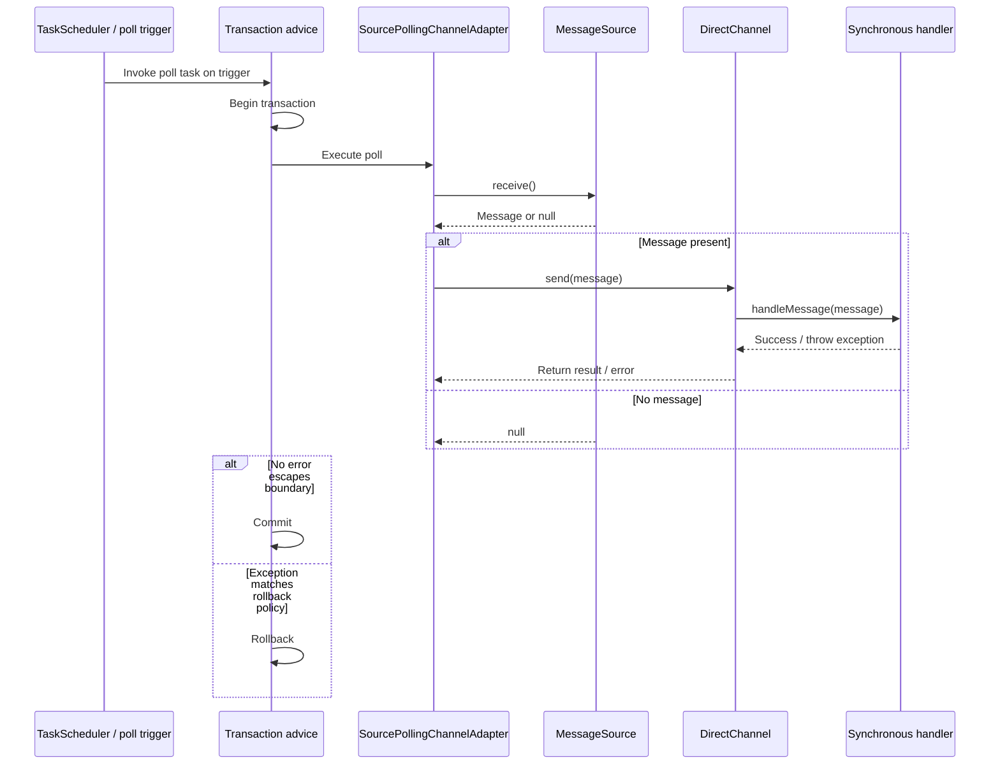
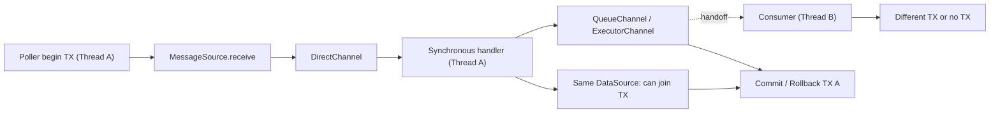
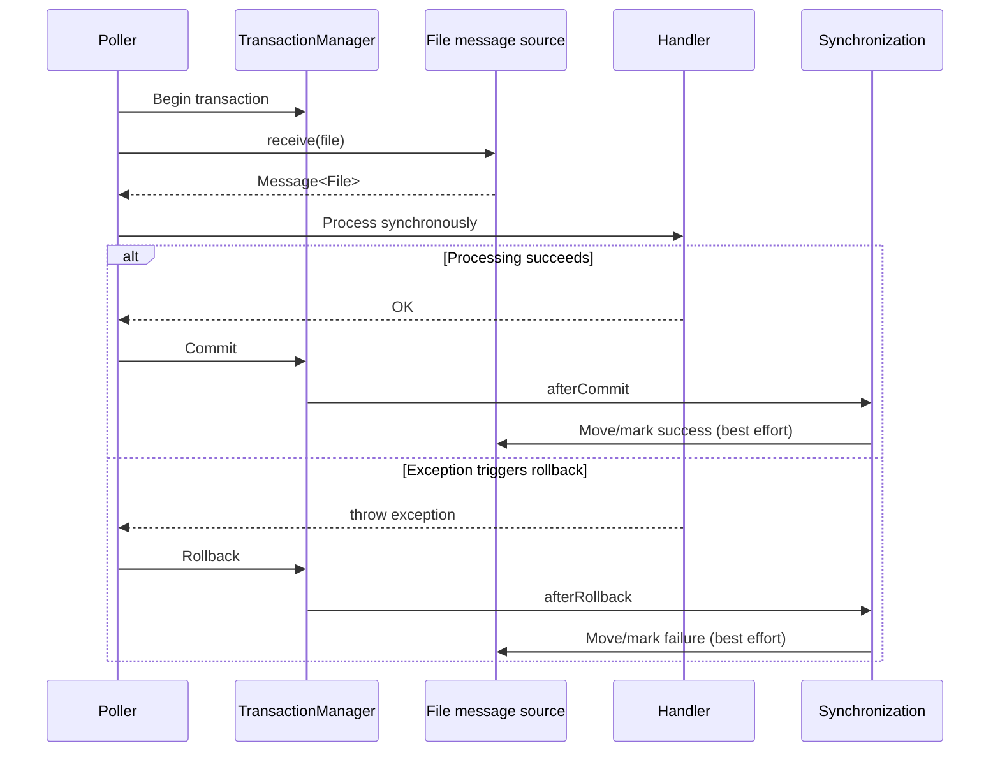
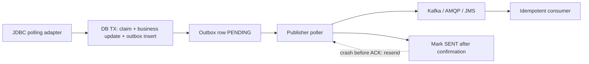

# Transaction Advice for Polling Adapters in Spring Integration

## 1. The Problem: Polling a Message Does Not Guarantee Safe Processing

An integration application frequently fetches data from external sources: reading new records from a database, scanning a file directory, synchronizing via SFTP, receiving messages from a broker, or pulling pending work items from a `QueueChannel`. If the process fails midway, the system must be able to answer:

- Has the input data already been marked as processed?
- Are the partial changes already written to the database rolled back?
- Will the message be redelivered, or is it permanently lost?
- If another system has already received the data, can a local rollback retract the effect on the other side?

**Transaction advice for polling adapters** is a technique that wraps the **poll/receive-and-forward** operation initiated by a poller with Spring's transaction mechanism. When participating resources support transactions, eligible changes can **commit together** if the flow succeeds or **roll back** if an error propagates to the proper transaction boundary.

This topic belongs to the **Transactions** chapter of the **SPRING_INTEGRATION_ADAPTERS** module: connecting external systems via inbound/outbound adapters, gateways, pollers, and `MessageChannel`, across file, SFTP, HTTP, JMS, AMQP, Kafka, and database protocols. The focus of this lesson is not just adding `transactional()`, but understanding its **actual effective scope** when multiple systems and multiple threads are involved.

### Quick Example

The application polls the `inbound_order` table:

1. Fetch `NEW` orders.
2. Mark them as `CLAIMED` so the next poll does not pick them up again.
3. Forward the payload into the processing channel.
4. A handler saves additional business data.

If step 4 throws an exception **before the transaction commits**, a poller with transaction advice and a synchronous flow can roll back both the status update and the handler's database changes, provided they use resources managed by the same transaction manager.

Conversely, if step 3 sends the message to an `ExecutorChannel` or an external broker, successful handoff **does not mean** the final handler has completed. The initial transaction may commit before an error occurs on the receiving side.

### Learning Objectives

After this lesson, you will be able to:

1. Distinguish `SourcePollingChannelAdapter`, `PollingConsumer`, `MessageSource`, `PollerMetadata`, and `MessageChannel`.
2. Configure transaction advice for a poller using XML or Java DSL.
3. Identify transaction boundaries by thread, channel, transaction manager, and protected resources.
4. Predict commit/rollback/retry behavior with JDBC, File, SFTP, JMS, AMQP, Kafka, and HTTP.
5. Apply transaction synchronization, idempotency, and the outbox pattern when distributed transactions are unavailable.
6. Write test scenarios proving no message loss, no invalid claim escalation, and no unintended duplicate side effects.

## 2. Polling Mechanism in Spring Integration

### 2.1 Inbound Adapters and Polling Consumers

A **polling inbound channel adapter** uses `SourcePollingChannelAdapter` to call `MessageSource.receive()` on a schedule and emit the received message into a channel. Examples include a JDBC inbound adapter running a `SELECT`, a file inbound adapter scanning a directory, or an SFTP inbound adapter reading files synchronized according to configuration.

A **polling consumer** uses `PollingConsumer` to pull messages from a `PollableChannel` and then invoke a handler. For example, a `QueueChannel` connected to a service activator via a poller.

| Component | Role | Example |
|---|---|---|
| `MessageSource<T>` | Supplies a message when `receive()` is called | JDBC polling source, file reading source |
| `SourcePollingChannelAdapter` | Actively invokes the source on schedule and sends to a channel | Inbound JDBC/File/SFTP |
| `PollableChannel` | Stores/exposes messages for consumers to actively pull | `QueueChannel` |
| `PollingConsumer` | Pulls a message from a channel and invokes `MessageHandler` | Service activator reading a queue |
| `PollerMetadata` | Trigger, receive count, timeout, advice, and polling policy | Fixed delay + transactional advice |
| `DirectChannel` | Invokes subscriber **synchronously in the current thread** | Handler participates in the poller's transaction when eligible |
| `ExecutorChannel` | Dispatches processing to an executor/another thread | Thread-bound transaction does not automatically follow |
| `QueueChannel` | Decouples send/receive via an internal queue | Poller on the receiving side opens a new unit of work |

**Not every adapter needs a poller.** An HTTP inbound gateway is request-driven; many JMS/AMQP/Kafka inbound endpoints are message-driven via listener containers. Transaction configuration on a **poller** only applies where a poller actually exists.

### 2.2 How Does a Poller Run?



The diagram illustrates the general flow. Transaction advice is attached to the poll execution; rollback effectiveness depends on the exception, `TransactionAttribute`, enlisted resources, channel characteristics, and specific endpoint configuration.

### 2.3 A Poll Trigger Is Not a Transaction

`fixed-delay`, `fixed-rate`, or `cron` determines **when** to poll; they do not create a transaction by themselves. `maxMessagesPerPoll` specifies the **number of receive attempts** in one trigger cycle, and does not automatically define a DB batch or the number of query rows.

For `SourcePollingChannelAdapter`, when not explicitly configured, `maxMessagesPerPoll` usually defaults to **1**. For `PollingConsumer`, the documented default is **-1**, meaning it keeps attempting to receive until the source returns `null` or a stop condition is met. This setting affects load, workload per cycle, and shutdown latency, but you should not assume `maxMessagesPerPoll=10` means "one transaction for 10 messages." Determine the transaction boundary from how the endpoint and advice are implemented, then verify it with integration tests.

## 3. Why Attach Transaction Advice to the Poller?

### 3.1 Wrapping the Receive Step in the Transaction

Placing `@Transactional` on a downstream handler can protect **the handler's** database operations, but it **does not automatically** wrap `MessageSource.receive()`. If the source performs a `SELECT` and an `UPDATE` to mark records as claimed, we typically want to start the transaction **before** calling receive.

Poller transaction advice does exactly this: it uses Spring's `TransactionInterceptor` to create/join a transaction around the poll operation and any synchronous downstream components still within the transaction scope.

### 3.2 The Transaction Manager Must Manage the Right Resources

For example:

- JDBC uses `DataSourceTransactionManager` or `JdbcTransactionManager` bound to the exact `DataSource`.
- JPA requires `JpaTransactionManager` and the matching `EntityManagerFactory`.
- JMS/AMQP have their own transaction/acknowledgment mechanisms per listener/broker and product-supported transaction managers.
- Many file systems, SFTP, and HTTP do not support true rollback via a JDBC transaction.

**Merely having the name `transactionManager` in the configuration does not prove every resource is enlisted.** Two different database connections, a file write, and an HTTP POST do not become an atomic transaction simply because of one interceptor.

### 3.3 Advice Chain and Ordering

A poller allows an **AOP advice chain** consisting of a transaction interceptor, retry advice, logging, metrics, or poll control. The chain order can determine:

- Whether retries occur **within the same transaction** or each attempt starts a new transaction.
- Whether an exception is rethrown or caught by an advice/handler and treated as success.
- Whether tracing observes transaction begin/commit or only the handler execution.

In XML namespace configuration, when defining `<int:advice-chain>`, **do not also declare** `<int:transactional>` under the same poller; include the configured `TransactionInterceptor` as an advice inside the chain. Using transaction advice on a poller must be distinguished from **request-handler advice** attached solely to a `MessageHandler`, which may not cover reading from the source.

## 4. Transaction Boundaries Across Channels and Threads

Standard Spring transactions bind their context to the **current thread**. Therefore, how `MessageChannel` instances are wired determines whether a handler shares the same transaction.



### 4.1 The `DirectChannel` Case

When a message passes through a `DirectChannel`, the subscriber normally runs immediately on the polling thread. If the handler uses the same transactional resource, the receive, mark, processing, and DB update operations can all occur within a single transaction. An exception thrown up to the transaction boundary can cause those DB changes to roll back.

### 4.2 The `QueueChannel` or `ExecutorChannel` Case

When sending a message to an internal queue or executor, **the thread boundary is severed**. The sender succeeds once handoff satisfies the channel contract; the poller's transaction may commit right there. A worker on another thread throwing an exception later **cannot automatically roll back the poller's already-committed transaction**.

A `QueueChannel` backed by a transactional `MessageStore` or a JMS-backed channel can provide durable handoff when properly configured, but that is not proof of a single continuous DB transaction spanning all threads.

### 4.3 Asynchronous Work Inside a Handler

`CompletableFuture`, Reactor, manually spawned threads, or async HTTP calls also split the execution path. A handler returning normally before the background task finishes can cause the poller to commit prematurely. **Do not design correctness on the assumption that a ThreadLocal transaction automatically propagates across async boundaries.**

### 4.4 Outcome Prediction Table

| Topology | Where the failure occurs | Does the source DB update roll back? |
|---|---|---|
| JDBC source → DirectChannel → DB handler using same TX | Handler throws exception before commit | Can roll back if the exception triggers rollback |
| JDBC source → ExecutorChannel → DB handler | Handler on another thread fails after handoff | Does not automatically roll back the committed source transaction |
| JDBC source → DirectChannel → HTTP outbound | Remote HTTP receives request, then local throws error | DB may roll back; HTTP side effect **does not** roll back |
| File source → DirectChannel → handler fails | Poller has JDBC TX | Only resources participating in the JDBC TX roll back; reading/moving the file is not reversed by default |
| PollingConsumer pulling `QueueChannel` → handler | Handler fails | Requeue/redelivery behavior depends on MessageStore/transaction strategy and specific configuration |

## 5. XML Configuration: Transaction Advice with JDBC Inbound Adapter

With the JDBC inbound adapter, Spring Integration supports a `SELECT` to fetch a set of rows and an `UPDATE` to mark fetched rows so the next poll does not select them again. When using a poller with a transaction manager for the same `DataSource`, `SELECT` and `UPDATE` can execute within the same transaction.

### 5.1 Minimal Schema

```sql
CREATE TABLE inbound_order (
    id BIGINT PRIMARY KEY,
    external_ref VARCHAR(100) NOT NULL UNIQUE,
    payload VARCHAR(2000) NOT NULL,
    status VARCHAR(24) NOT NULL
);

INSERT INTO inbound_order(id, external_ref, payload, status)
VALUES (101, 'order-101', '{"amount": 150}', 'NEW');
```

The example below uses the Spring Integration XML namespace as an **illustrative configuration snippet**; a real application must declare full namespaces, schemas, and supporting beans:

```xml
<!-- ordersTxManager must manage the exact dataSource of the JDBC adapter. -->
<bean id="ordersTxManager"
      class="org.springframework.jdbc.datasource.DataSourceTransactionManager">
    <constructor-arg ref="dataSource"/>
</bean>

<int:channel id="ordersToHandle"/>

<int-jdbc:inbound-channel-adapter
        id="ordersPoller"
        data-source="dataSource"
        channel="ordersToHandle"
        query="SELECT id, external_ref, payload
               FROM inbound_order WHERE status = 'NEW'"
        update="UPDATE inbound_order
                SET status = 'CLAIMED'
                WHERE id IN (:id)">
    <int:poller fixed-delay="2000" max-messages-per-poll="1">
        <int:transactional
                transaction-manager="ordersTxManager"
                propagation="REQUIRED"
                isolation="READ_COMMITTED"/>
    </int:poller>
</int-jdbc:inbound-channel-adapter>

<int:service-activator
        input-channel="ordersToHandle"
        ref="orderHandler"
        method="handle"/>
```

In this example, the source returns **a single message whose payload is a list of rows** (typically `List<Map<String,Object>>` with the default mapper), not one message per row. The named parameter `:id` in `UPDATE` is populated from the rows containing the `id` column according to JDBC inbound adapter conventions.

**Expected outcome in the synchronous case:**

1. The poller opens a DB transaction.
2. `SELECT` reads `NEW` rows, and `UPDATE` marks them `CLAIMED`.
3. The message enters `ordersToHandle`, which is a `DirectChannel` by default; `orderHandler` is invoked on the same thread.
4. If the handler updates the **same DataSource** and finishes normally, the changes can commit together.
5. If the handler throws an exception matching the rollback rules, the transaction rolls back: the row remains `NEW` for re-polling, and DB changes in the same transaction are also reverted.

What must **not** be inferred: that messages sent to external systems, emails dispatched, or HTTP calls made are rolled back along with it. Those side effects lie outside the reach of `DataSourceTransactionManager`.

### 5.2 Spring Rollback Rules

In standard Spring transactions, `RuntimeException` and `Error` trigger rollback by default; checked exceptions do not roll back by default unless appropriate rules are configured. This directly impacts the poller: a handler that swallows an error and returns normally can cause the poller to **commit**, even though the business operation actually failed.

If rollback is required for other exception types, appropriate transaction attributes must be configured. Do not rely on `ERROR` log counts to infer that a rollback occurred.

## 6. Java DSL Configuration and Where to Place Advice

Spring Integration Java DSL allows configuring the poller directly on the inbound endpoint. The example below illustrates commonly used modern Spring Integration APIs; you must declare imports, beans, and choose dependency versions compatible with your project:

```java
@Configuration
@EnableIntegration
class JdbcPollingFlowConfig {

    @Bean
    PlatformTransactionManager ordersTxManager(DataSource dataSource) {
        return new DataSourceTransactionManager(dataSource);
    }

    @Bean
    IntegrationFlow ordersInbound(
            DataSource dataSource,
            PlatformTransactionManager ordersTxManager,
            OrderHandler orderHandler) {

        return IntegrationFlow
            .from(Jdbc.inboundAdapter(dataSource)
                    .selectQuery("SELECT id, external_ref, payload "
                               + "FROM inbound_order WHERE status = 'NEW'")
                    .updateSql("UPDATE inbound_order SET status = 'CLAIMED' "
                             + "WHERE id IN (:id)"),
                endpoint -> endpoint.poller(
                    Pollers.fixedDelay(Duration.ofSeconds(2))
                        .maxMessagesPerPoll(1)
                        .transactional(ordersTxManager)))
            .handle(orderHandler, "handle")
            .get();
    }
}
```

`OrderHandler.handle` in this example must accept the list or message payload according to the actual configuration. To prove atomicity, in an integration test use the same `DataSource` for both the adapter and handler, intentionally throw an exception, and read back the DB state.

### 6.1 Explicit `PollerMetadata` and `TransactionInterceptor`

When you need to add logging, retry, or control advice ordering, you can create a `TransactionInterceptor` with a suitable `TransactionAttributeSource` and attach it to the poller's advice chain. This provides precise control over rules such as propagation, isolation, timeout, and rollback.

```text
PollerSpec / PollerMetadata
  └── advice chain
        ├── metrics / tracing advice
        ├── transaction advice (TransactionInterceptor)
        └── additional tested advices
             └── poll receive -> channel -> synchronous handler
```

**Do not combine a transaction advice with a retry advice without verifying their order.** Retrying inside a transaction already marked rollback-only may fail to commit; retrying outside the transaction creates a new transaction on each attempt. With non-transactional outbound side effects, both approaches also risk duplicate sends. A retry strategy must be grounded in idempotency and an explicit failure policy.

## 7. Tuning the Poller: Trigger, Batch, Timeout, and Concurrency

### 7.1 Fixed Delay vs. Fixed Rate

- `fixed-delay`: waiting interval after the previous cycle completes; useful to avoid back-to-back polls when processing takes a long time.
- `fixed-rate`: attempts to follow a fixed schedule; when processing is slow and the task executor/concurrency changes, you must monitor backlog and overlap.
- `cron`: suitable for hourly/daily scheduled runs.

A transaction held open across long-running processing holds connections, locks, and degrades throughput. Prefer small units of work, deliberate timeouts, and avoid long external network calls inside a DB transaction whenever a better architectural option exists.

### 7.2 `maxMessagesPerPoll` Is Different from `maxRows`

For the JDBC inbound adapter:

- `maxMessagesPerPoll` controls the **number of poll/`receive()` calls** per scheduler trigger.
- `maxRows` limits the **number of rows in a single `SELECT`** as configured on the adapter.
- One `receive()` typically returns **a single message containing a list of rows**.

If `maxRows=100` and `maxMessagesPerPoll=2`, you cannot automatically conclude there will be exactly 200 messages; it depends on selected rows, the `UPDATE` statement, transactions, and available data. For high performance, restrict the result set in SQL using vendor syntax and design explicit claim/locking semantics.

### 7.3 Concurrency and Multiple Instances

Two pollers selecting `status='NEW'` concurrently can read duplicates if locking/claiming is not implemented properly. Transaction advice **does not automatically provide exclusive work distribution** across multiple instances.

Consider:

- Row locking or `FOR UPDATE SKIP LOCKED` on supported databases; each vendor has specific semantics.
- Conditional status updates or compare-and-set.
- A lease/claim design with expiration and reclaim when a consumer dies.
- Unique constraints/idempotency keys to prevent duplicate business effects.
- Limiting the number of connections holding open transactions and processing duration.

### 7.4 Task Executor and Threads

A poller can use a `TaskExecutor` to schedule work, yet the transaction remains bound to the thread performing the poll. Any downstream handoff to another thread must be treated as a **new transaction boundary**. Do not assume configuring `taskExecutor` turns a transaction into a distributed one.

### 7.5 Poller Running with No Messages

A source may return `null`, meaning there is no message at poll time. This is not an error requiring retry. Monitor `receive null` separately from exceptions, source-failure backoff, and request timeouts. Setting an unbounded `maxMessagesPerPoll` with a source that always returns non-null can cause prolonged processing loops; account for lifecycle shutdown, backpressure, and capacity.

## 8. Transaction Synchronization: Actions After Commit/Rollback

Not every operation can truly roll back. With a file inbound adapter, teams often want to move a file to `success/` after processing and to `failed/` on error. Spring Integration supports **transaction synchronization** with callbacks such as `beforeCommit`, `afterCommit`, and `afterRollback`.

### 8.1 Concept



### 8.2 Illustrative Configuration with File Adapter

```xml
<bean id="pseudoTxManager"
      class="org.springframework.integration.transaction.PseudoTransactionManager"/>

<int-file:inbound-channel-adapter
        id="filesIn"
        directory="/data/incoming"
        channel="filesToHandle">
    <int:poller fixed-delay="5000" max-messages-per-poll="1">
        <int:transactional transaction-manager="pseudoTxManager"
                           synchronization-factory="fileSyncFactory"/>
    </int:poller>
</int-file:inbound-channel-adapter>

<int:transaction-synchronization-factory id="fileSyncFactory">
    <int:after-commit expression="payload.renameTo(
        new java.io.File('/data/processed/' + payload.name))"/>
    <int:after-rollback expression="payload.renameTo(
        new java.io.File('/data/failed/' + payload.name))"/>
</int:transaction-synchronization-factory>
```

This is an educational configuration demonstrating callbacks; adjust paths, filters, bean names, filesystem permissions, and file-moving mechanisms before deploying. `renameTo()` can return `false` due to permission errors or cross-filesystem moves; callbacks **do not turn a file move into an atomic transaction**. Furthermore, moving a file to `failed` on rollback may be unsuitable if you intend to retry automatically.

### 8.3 What Are the Limits of `PseudoTransactionManager`?

`PseudoTransactionManager` merely provides a context for success/failure callbacks. It **does not roll back** files, FTP/SFTP, HTTP, or side effects lacking a real transaction manager. Using `afterCommit` to move a file helps coordinate the workflow, but if the move fails after the database has committed, **the DB cannot revert to an unprocessed state** just because the callback failed.

### 8.4 Consequences of Failures Inside Callbacks

- `beforeCommit` can influence the commit decision and cause the transaction to roll back if it throws an appropriate error.
- `afterCommit` runs after the commit has already occurred; failures here usually require **reconciliation**, not rolling back the committed DB changes.
- `afterRollback` is intended for cleanup/quarantine/recording failure state; the callback itself can also fail.

Therefore, you need separate auditing, retries, idempotent processing, and a reconciliation job for files not yet moved or confirmed.

## 9. File and SFTP Sources: Do Not Confuse Operation Sync with Transactions

### 9.1 File Adapter

A file might become visible while an external writer is still writing to it; transaction advice does not turn a file appearance into a complete snapshot. Good designs should:

- Have the writer create a temporary file and then **atomically rename when supported by the filesystem** into the ingest directory; do not rely on the poller detecting partially written files.
- Use file filters, metadata stores, and persistent accept-once filters suited for restarts.
- Define when a file is considered received, processed, or eligible for re-polling.
- Manage read errors, parse errors, DB write errors, and directory move errors as distinct states.
- Use content hashes, filename + version, or business IDs to detect duplicate messages.

### 9.2 SFTP

SFTP inbound adapters typically synchronize files from remote to local before local file reading/polling. Downloading, renaming, or deleting files **on the SFTP server** does not participate in a JDBC DB transaction.

Example: the application downloads `invoice.csv`, writes invoices into the DB, and then the SFTP connection drops while renaming the remote source file. The DB may have committed while the file remains on the remote server; the next poll may download the file again. This is practical **at-least-once processing**, requiring idempotency in the DB or a durable manifest/ledger.

### 9.3 HTTP and REST

An outbound HTTP gateway sending a POST to another service may produce a side effect before returning a timeout. If the local DB transaction rolls back, the remote side does not automatically roll back. Consider:

- A stable `Idempotency-Key` on APIs that support it.
- An outbox to decouple DB commits from HTTP delivery.
- Retries with backoff/jitter and classification of retryable errors.
- Querying status from the remote service when a timeout leaves the outcome unknown.
- Saga/compensation for multi-system workflows when business reversal operations exist.

**Never make an HTTP call inside a DB transaction and claim "exactly once."** A single `DataSource` transaction cannot guarantee atomicity with an independent API.

## 10. JMS, AMQP, and Kafka: Poller Transactions Differ from Broker Transactions

### 10.1 JMS

JMS supports transacted sessions, acknowledgments, and redelivery mechanisms depending on the broker/client/container. However, distinguish clearly:

- **Message-driven inbound JMS** usually relies on a listener container, not a `SourcePollingChannelAdapter` with a default poller.
- A **PollingConsumer** reading a `QueueChannel` is different from a broker listener managing a JMS session.
- A JMS transaction can roll back consume/send operations within a supported **JMS session**.
- A JDBC transaction opened around a poller **does not automatically control JMS acknowledgment** on a separate connection/session.

For example, the database commits `status='DONE'` while JMS publishing fails, or the JMS message is acknowledged while the JDBC handler rolls back. If you require zero-data-loss processing between DB and broker, design with appropriate transactional resources (such as XA/JTA when truly needed and supported by all resources), a **transactional outbox**, or retry/idempotency mechanisms.

### 10.2 AMQP / RabbitMQ

AMQP adapters can use listener containers and acknowledgment modes such as auto or manual depending on the framework and configuration. If broker transactions are used, atomicity applies within the supported channel/broker scope and does not automatically enlist an arbitrary DB transaction.

States that must be verified:

- Is the message acked/nacked or requeued when the handler throws an exception?
- Does the broker redeliver after a consumer crash?
- Does the handler commit the DB before acking?
- Does the queue have a DLQ, retry policy, TTL, and poison message detection?
- Are publisher confirms or appropriate transactions used for outbound messages?

Do not treat DB `afterCommit` as proof that the broker successfully received a message unless proper confirmation and publish-state persistence are in place. If sending to the broker fails **after** DB commit, retry outside the original transaction.

### 10.3 Kafka

Kafka provides consumer offsets and producer transactions within their supported scope. However, **poller transaction advice does not automatically coordinate** a database transaction, Kafka consumer offsets, and HTTP requests into a global ACID transaction.

For instance, a Kafka inbound flow using a Spring Kafka/Spring Integration listener container should configure ack mode, error handler, container transaction manager, and producer transactions according to the product; you cannot replace all of that with `Pollers.fixedDelay(...).transactional(dataSourceTxManager)`.

If offsets commit early while the DB fails, messages can be lost. If the DB commits before offsets commit, messages can be re-read. Designs typically require:

- Business keys and idempotent processing.
- Upserts/unique constraints in the DB.
- Offsets/acks aligned with the true transaction scope.
- Retries and dead-letter topics for persistently failing messages.
- Monitoring lag, rebalances, and redelivery scenarios.

### 10.4 Adapter Matrix

| Adapter / transport | Where poller transaction is most useful | Real transaction to verify | Side effects unlikely to roll back |
|---|---|---|---|
| **JDBC inbound** | Wraps `SELECT` + `UPDATE` and synchronous downstream DB work | Same `DataSource` and transaction manager | Broker/HTTP calls already sent |
| **JPA inbound** | Wraps entity read/mark/delete per configuration | `JpaTransactionManager` / Persistence Context | External APIs outside the DB |
| **File inbound** | Coordinates callbacks when flow finishes | Downstream DB transaction if present; files are not ACID with it | File read/move/delete |
| **SFTP inbound** | Synchronizes local state and success/failure actions | Local resources actually enlisted in the transaction | Remote download/rename/delete |
| **JMS** | Poller only when using a true polling endpoint; listeners have separate TX | JMS session/local tx or JTA where supported | Another database if uncoordinated |
| **AMQP** | Must inspect adapter/listener and ack strategy | Broker channel/transaction/ack per configuration | Un-enlisted HTTP/DB |
| **Kafka** | Many flows use message-driven containers, not poller advice | Producer transaction, offsets, container integration | Database, SFTP, HTTP |
| **HTTP outbound** | May be called from a polled flow wrapped in a DB TX | Only local resources inside the TX | Side effects at the HTTP service |

**Note:** These columns describe general boundaries; actual versions, brokers, listener containers, and transactional resources determine exact rollback/ack behavior.

## 11. When to Use an Outbox Instead of Stretching a Transaction?

Suppose a requirement states: "After polling an order, update the DB and send a Kafka/AMQP event, with zero lost orders and zero duplicate sends." A single local transaction around the poller cannot guarantee two separate systems commit atomically together.

### 11.1 Transactional Outbox

Instead of both writing to the DB and publishing to the broker inside the same handler call:

1. Within **a single DB transaction**, read/claim the work, perform business updates, and insert an **outbox event** row.
2. Commit the DB transaction.
3. An independent publisher polls the outbox and sends the message to the broker.
4. Mark the outbox row as sent only after receiving proper confirmation.
5. If a crash occurs between publishing and updating to `SENT`, the publisher may resend; the consumer must be **idempotent**.



### 11.2 Illustrative Schema

```sql
CREATE TABLE integration_outbox (
    event_id VARCHAR(80) PRIMARY KEY,
    aggregate_id VARCHAR(80) NOT NULL,
    event_type VARCHAR(80) NOT NULL,
    payload VARCHAR(4000) NOT NULL,
    state VARCHAR(20) NOT NULL,
    attempt_count INTEGER NOT NULL DEFAULT 0
);

CREATE TABLE processed_message (
    consumer_name VARCHAR(100) NOT NULL,
    event_id VARCHAR(80) NOT NULL,
    processed_at TIMESTAMP NOT NULL,
    PRIMARY KEY (consumer_name, event_id)
);
```

A stable `event_id` lets the consumer detect duplicate processing. Keys should be scoped by tenant/aggregate in multi-tenant systems. `processed_message` and the consumer's business updates should ideally share the same DB transaction so the duplicate check is meaningful.

### 11.3 Failure Ordering and Expected Behavior

| Crash timing | Observable state | Design handling required |
|---|---|---|
| Before DB commit | Claim/outbox not committed | DB rolls back, re-polled |
| After DB commit, before publish | Outbox `PENDING` row still exists | Publisher reads and sends it |
| Broker receives, before ACK reaches publisher | Unknown whether publish succeeded | Retry may send duplicate; consumer is idempotent |
| After broker ACK, before marking outbox `SENT` | Broker already has event, DB still `PENDING` | Safe resend keyed by `event_id` |
| After marking `SENT` | Publisher recorded completion state | Maintain audit, retention, reconciliation |

The core goal is **leaving no gap where an event can be lost**. Outbox typically provides **at-least-once delivery** rather than promising **end-to-end exactly-once** when systems and side effects are independent.

## 12. Message Contracts and Intentional Error Handling

### 12.1 Classify Errors Before Deciding to Roll Back

| Error category | Examples | Handling approach |
|---|---|---|
| **Transient** | DB deadlock, network timeout, temporary broker error | Appropriate rollback, retry with backoff/jitter |
| **Permanent / validation** | Invalid JSON schema, missing required field | Quarantine/DLQ, do not retry indefinitely |
| **Duplicate** | Event ID already processed | Safely ignore or return prior result, with audit |
| **Unknown outcome** | HTTP timeout after remote already accepted | Query status or retry with idempotency key |
| **Resource unavailable** | SFTP server down, DB pool exhausted | Circuit breaker, throttle polling, alert |
| **Poison message** | A record that always causes the handler to throw | Attempt-count policy, DLQ, and intervention |

### 12.2 Exceptions Must Reach the Right Transaction Boundary

A common trap:

```java
void handle(Order order) {
    try {
        remoteGateway.send(order);
    } catch (Exception ex) {
        log.warn("Send failed, handle later", ex);
        // Method returns normally: the poller may COMMIT!
    }
}
```

If business rules require **not committing** when sending fails, the handler must rethrow an appropriate exception or persist a durable pending state inside the transaction instead of merely logging. If the remote send cannot roll back, the sturdier choice is usually an outbox rather than wrapping an HTTP call in a DB transaction.

### 12.3 Error Channel Does Not Mean Automatic Rollback

`errorChannel` receives `ErrorMessage` for error handling in Spring Integration. However, you must check **where the error is caught and handled**:

- An exception escaping the synchronous flow within `TransactionInterceptor` scope: has the opportunity to roll back per rules.
- An exception caught by an advice/handler and converted into a "normal" return before the transaction advice sees it: the transaction may commit.
- An exception occurring after handoff to an executor/queue: the original transaction may already have committed; the consumer's error channel will not roll it back.

Spring Integration supports preserving the source message details in polling endpoint errors when using transaction advice and appropriate transaction synchronization. Still, how `failedMessage` surfaces, logging timing, and exception types depend on the specific error path; verify in integration tests for your version.

### 12.4 Retry and Transaction Ordering

```text
Option A (usually preferred for DB retries):
Retry advice [each attempt can start a new TX if configured properly]
    -> Transaction advice
        -> poll/handle

Option B (requires careful thought):
Transaction advice
    -> Retry advice
        -> poll/handle
```

In Option B, once a resource marks the transaction rollback-only, subsequent retries cannot commit within that same transaction. In Option A, an external request sent before rollback may be sent again multiple times. Thus **both** options require understanding semantics, retry limits, and idempotency.

### 12.5 DLQ, Quarantine, and Reprocessing

A poison message should not keep the poller infinitely processing the same row/file every second. You can use:

- A `FAILED` or `QUARANTINED` status with a reason/attempt count in the persistent source.
- A DLQ for brokers where supported.
- A controlled reprocess channel with operator tracking.
- Retained input data and schema version so records can be reprocessed after fixes.

An `afterRollback` callback can help move failed files, but if automatic retries are desired, clearly define **when** to retry only and **when** to quarantine. Do not mark a file permanently failed while expecting the poller to pick it up again automatically.

## 13. Behavior Walkthrough: Four Polls of One Order

Consider a system with a JDBC inbound adapter, a synchronous handler sharing the DB, and an external broker send step:

| Attempt | Event | DB transaction | Consequence to watch |
|---|---|---|---|
| #1 | `SELECT` returns order 101; handler rejects invalid data | Rollback | Order may remain `NEW`; poison message classification needed |
| #2 | Valid data; DB inserts ledger; broker receives event; handler throws due to timeout | DB Rollback | Broker may already have received it; retry easily creates duplicate event |
| #3 | Re-polls order 101; broker receives duplicate event ID | Commit after processing | Consumer uses `event_id` for idempotency |
| #4 | No more NEW orders | No message received | Empty poll is not an error; no new business transaction created |

If broker publishing is decoupled into an outbox, attempt #2 no longer performs a broker-send side effect inside the DB transaction. Once the DB commits, the independent publisher sends it; publisher failures are handled via retries and deduplication.

### 13.1 At-Most-Once, At-Least-Once, Effectively-Once

- **At-most-once:** messages may be lost on failure; avoids duplicates but does not guarantee delivery.
- **At-least-once:** messages may be redelivered/re-read; handlers must be idempotent.
- **Effectively-once at the business level:** even though delivery may repeat, unique constraints/idempotency ensure the business effect executes only once within the designed scope.
- **End-to-end exactly-once:** this claim requires clearly defining scope; a single DB or Kafka broker transaction does not automatically encompass SFTP, HTTP, JMS, other DBs, and SaaS systems.

## 14. Designing Tests for Transaction Advice

A trustworthy test suite requires a **real database or equivalent integration environment**, realistically configured `MessageChannel`/adapters, and controlled fault injection points. Unit tests that only invoke the handler will not prove `MessageSource.receive()` runs inside the transaction.

### 14.1 Core Test Matrix

| Scenario | Expectation | Evidence |
|---|---|---|
| JDBC poll and handler succeed | Row claimed/processed per policy | DB readback, commit logs |
| Handler throws `RuntimeException` in DirectChannel | DB updates in same transaction roll back | Row stays `NEW` or desired state, no ledger entry |
| Handler throws checked exception | Behavior matches declared rollback rules | Transaction outcome and exception trace |
| Handler catches error and returns normally | Poller may commit; check to prevent logic bugs | DB state, business alerts |
| Handler behind ExecutorChannel, worker fails | Source DB TX may already have committed | Timeline of thread IDs, row state, error channel |
| DB update succeeds, HTTP times out | Remote outcome may be unknown | Idempotency key and remote readback |
| SFTP file downloaded, then DB rolls back | File is not automatically deleted/moved back | Local/remote file state and metadata store |
| Transaction synchronization `afterCommit` fails | DB already committed; cleanup may be incomplete | DB state, retry/reconciliation queue |
| Two pollers concurrently claim the same row | No double business effect | Unique key, claimed row owner, load test |
| Broker redelivery after consumer crash | No duplicate business effect | Processed-message ledger |
| Poll with no messages | No message emitted or false error spike | Receive-null metrics |
| Database down or pool exhausted | Poller degrades, alerts, and retries with limits | Error rate, connections, backoff |

### 14.2 A JDBC Integration Test

Prepare tables `inbound_order` and `order_ledger`. Configure a test handler that intentionally throws an exception after inserting into `order_ledger`:

```java
// Sketch of test code, not a complete test class.
void handle(List<Map<String, Object>> rows) {
    for (Map<String, Object> row : rows) {
        Long id = ((Number) row.get("id")).longValue();
        jdbcTemplate.update(
            "INSERT INTO order_ledger(order_id, state) VALUES (?, ?)",
            id, "ACCEPTED"
        );
    }
    throw new IllegalStateException("Fault injection: handler failed");
}
```

When the handler runs synchronously with the same transaction manager and `DataSource`, verify:

```sql
-- After rollback:
SELECT status FROM inbound_order WHERE id = 101;
-- Expected: NEW

SELECT COUNT(*) FROM order_ledger WHERE order_id = 101;
-- Expected: 0
```

Then remove the exception and poll again; expect the transaction to succeed per policy. **Do not wrap a JUnit test method in `@Transactional` and conclude the poller has a transaction**, because JUnit/Spring Test's test transaction can mask real configuration mistakes. If a fixture sets up data transactionally, verify commit/rollback independently of that transaction.

### 14.3 Testing the Difference Between `DirectChannel` and `ExecutorChannel`

1. Use the flow `JDBC source → DirectChannel → handler throws error`, verify rollback.
2. Replace with `JDBC source → ExecutorChannel → handler throws error later`.
3. Record `thread name`, `transaction active`, DB state, and timestamp when the handler throws.
4. Pinpoint the exact handoff/commit point; do not attribute downstream errors to an already-closed transaction.

In Java/Spring, you can observe the context for **diagnostics**:

```java
boolean txActive =
    TransactionSynchronizationManager.isActualTransactionActive();
String threadName = Thread.currentThread().getName();
// Log with correlationId; never log tokens or passwords.
```

`txActive=true` proves a transaction context exists at the measurement point, **not** that a specific resource is enlisted, capable of rolling back, or configured to roll back under the expected rules.

### 14.4 Testing Restarts and Concurrent Claims

Run two poller instances against the same database and intentionally kill one instance at various moments: before claim, after claim, inside the handler, after commit, and before publish. Reconcile that no work is permanently lost, no stale leases remain, and no duplicate business effects occur. For lease-based workers, test expiry/reclaim mechanisms and verify valid in-flight work is not stolen.

## 15. Observing and Operating Polling Transactions

### 15.1 Useful Metrics

| Metric / signal | Used to detect |
|---|---|
| `poll.invocations`, `poll.empty` | Poll frequency and how often the source has no data |
| `poll.receive.duration` | Latency of `MessageSource.receive()` |
| `tx.commit.count`, `tx.rollback.count` | Transaction success/failure ratio |
| `tx.duration.p95/p99` | Long transactions holding connections/locks |
| `db.lock.wait`, `deadlocks` | Contention during claim/scan |
| `pool.active`, `pool.pending` | DataSource connection pool exhaustion |
| `integration.errorChannel.events` | Errors by message/correlation |
| `retry.attempts`, `dlq.depth` | Repeated errors and poison messages |
| `outbox.pending.age`, `outbox.publish.failures` | Unpublished events, ambiguous acks |
| `broker.redeliveries` / consumer lag | Redeliveries or slow processing from the broker |
| `file.quarantine.count`, `sftp.sync.failures` | Failed files, remote retries |
| `idempotency.duplicate.detected` | Number of duplicates prevented |

Metric names in this table are **design suggestions**, not default metrics built into every version of Spring Integration/Micrometer. When implementing, define names, labels, cardinality, and retention per system conventions.

### 15.2 Logging and Correlation

Attach `messageId`, `correlationId`, source record ID, or external event ID to trace execution:

```text
pollId=2026-11-23T01:00:00Z-17
sourceType=JDBC
sourceId=101
txResult=ROLLED_BACK
attempt=2
errorClass=TransientDatabaseException
businessEventId=order-101-accepted
```

Do not log full sensitive files, bearer tokens, passwords, SFTP credentials, or payloads containing unnecessary personal data. Correlation enables reconciliation across DB rows, outbox events, broker deliveries, and handler outcomes.

### 15.3 Runbook When Rollbacks Spike

1. Identify whether errors originate from the source, handler, broker, filesystem, DB pool, or timeouts.
2. Verify `TransactionInterceptor` is actually attached to the intended poller endpoint.
3. Check the DataSource/transaction manager, resource participation, and transaction timeout.
4. Locate poison messages, cap retries, and prevent one record from blocking the entire pipeline.
5. Inspect backlog/outbox, DLQ, file/SFTP states, and the idempotency ledger.
6. If pausing the poller is required, use endpoint lifecycle controls; avoid killing mid-transaction when a graceful stop option is available.
7. After recovery, read back source/target states and inspect events with unknown outcomes.

## 16. Common Anti-Patterns

**"Putting `@Transactional` on the service activator automatically rolls back JDBC receive."** Handler transactions do not automatically wrap `MessageSource.receive()`; to include receive in the scope, configure polling transactions properly.

**"Every adapter supports transactions like a database."** File, SFTP, and HTTP do not participate in DB transactions by default.

**"Sending to an `ExecutorChannel` stays inside the poller's transaction."** Thread boundaries break standard transactions; use durable handoffs and separate transactions.

**"`maxMessagesPerPoll=100` guarantees one transaction for 100 rows."** This is the count of receive/polling tasks; it does not equate to JDBC max rows or an assumed atomic batch.

**"Adding retry advice automatically prevents message loss."** Retries outside a transaction can create duplicates; retries inside a rollback-only transaction can be futile. Establish proper ordering and idempotency.

**"If the handler catches the exception and logs WARN, it will still roll back."** If the exception never reaches the interceptor, the transaction may commit.

**"`afterCommit` sending to Kafka means publishing is guaranteed."** The DB has already committed beforehand; the publish callback can still fail. An outbox is better suited when eventual delivery must be guaranteed.

**"`PseudoTransactionManager` can roll back file moves."** It only provides callbacks and does not turn a filesystem or SFTP into an ACID resource.

**"One transaction manager can handle DB + JMS + HTTP."** You must check the actual resources and coordination mechanism; HTTP side effects do not participate in standard XA.

**"Setting the highest isolation level on every poller is always safest."** It can cause lock contention, deadlocks, and reduced throughput; pick isolation based on claim/consistency needs and database vendor semantics.

**"Idempotency isn't needed because we have rollback."** Crashes after publishing but before commit or ack can still repeat side effects.

**"Poller health only requires checking that the scheduler is running."** Measure source receives, backlog, transaction outcomes, and target completion.

## 17. Pre-Production Checklist

### Transaction Boundaries

- [ ] Confirmed the endpoint actually uses `SourcePollingChannelAdapter` or `PollingConsumer` and a real poller?
- [ ] Advice attached to the poller itself, not only a downstream handler?
- [ ] Transaction manager manages the exact `DataSource` or transactional resource?
- [ ] Clear where `DirectChannel` is used versus where execution splits to a thread/queue/executor?
- [ ] Rollback policy covers critical exceptions; errors are not accidentally swallowed?
- [ ] Timeout, isolation, and transaction duration sized appropriately for load?

### Message Reliability

- [ ] Source claim/locking protects against multiple pollers or multiple concurrent instances?
- [ ] Durable retry/DLQ/quarantine in place for transient vs. permanent errors?
- [ ] Idempotency key/unique constraint protects every repeatable side effect?
- [ ] Transactional outbox or equivalent mechanism used when DB and broker/HTTP must coordinate?
- [ ] File/SFTP move, rename, delete operations have reconciliation when callbacks fail?
- [ ] Acknowledgment/offset and broker transactions verified for the specific container?

### Operations and Testing

- [ ] Tested handler exceptions and proved JDBC row/ledger rollback?
- [ ] Tested the behavioral difference between `DirectChannel` and `ExecutorChannel`?
- [ ] Tested crashes before/after DB commit and broker publish?
- [ ] Tested poison messages and idempotent redelivery?
- [ ] Metrics in place for commit/rollback, backlog, lock wait, and duplicate detection?
- [ ] Runbook prepared for stopping the poller, reprocessing, and reconciling unknown outcomes?

## 18. Scenario Exercises

### Scenario A — Order Re-Polled Without Data Loss

A JDBC poller fetches a `NEW` row, forwards it to a `DirectChannel`, and the handler inserts into `order_ledger` before throwing a `RuntimeException`. Both adapter and handler share the same DataSource.

**Question:** Where should the transaction advice be placed? After rollback, what are the states of the row and the ledger? What changes if the handler catches the exception and returns normally?

*Hint:* Poller `TransactionInterceptor`, `DataSourceTransactionManager`, same thread, and rollback rules.

### Scenario B — Kafka Send Succeeds While DB Rolls Back

A handler sends a Kafka event, then hits a deadlock writing to the DB and rolls back. The next poll resends the event.

**Question:** Why doesn't the DB rollback make the broker "forget" the event? How should you design the outbox and consumer idempotency?

*Hint:* Two independent resources, unknown outcome, stable event ID, commit outbox before publishing.

### Scenario C — `ExecutorChannel` Changes the Outcome

A flow previously used `DirectChannel` and rolled back properly. To increase throughput, the team switched to `ExecutorChannel`; since then, JDBC rows stay marked `CLAIMED` even when the handler on another thread fails.

**Question:** Analyze the transaction boundary and propose durable handoff, retry, or a queue backed by a transactional store.

*Hint:* Successful handoff does not mean final processing succeeded; choose outbox/queue/lease and idempotency.

### Scenario D — SFTP Re-Sends File After Timeout

The application polls SFTP, downloads `daily.csv`, inserts 300 rows into the database, and commits. While renaming the file on the remote server, the connection drops. On the next poll, the system reads the file again.

**Question:** Does `PseudoTransactionManager` prevent duplicates? Propose business keys, persistent metadata, reconciliation, and a retry strategy.

*Hint:* Nontransactional remote operation, at-least-once delivery, unique constraint, and file status ledger.

### Scenario E — Poller Running Concurrently on Two Nodes

Two instances run `SELECT status='NEW'` at the same time and pick up the same record. Both use `@Transactional`.

**Question:** Why doesn't the annotation/transaction advice necessarily prevent duplicates? How do you design atomic claiming or row locking, and what race conditions should be tested?

*Hint:* Isolation, DB vendor lock semantics, conditional update, stable business key.

### Scenario F — Advice Chain Alters Rollback

A retry advice is added to the poller and inadvertently swallows the exception after exhausting retries. In the database, the row remains marked `CLAIMED` even though the final handler never completed.

**Question:** How do advice ordering and exception propagation affect commit? How should you measure and fix this?

*Hint:* Transaction interceptor, rollback-only, error channel, DLQ, and testing commit outcomes.

## 19. Decision Model Summary

When adding `transactional()` to a polling adapter, ask in order:

1. **What is the source?** A `MessageSource` reading JDBC/JPA, file/SFTP, or a pollable channel? Does the endpoint actually use a poller?
2. **Which resources should roll back?** Database, JMS session, or just file-rename callbacks? Does the transaction manager support that resource?
3. **Where is the boundary?** Does downstream stay on the same thread via `DirectChannel`, or hand off to an executor, queue, broker, or HTTP?
4. **Do errors reach the right interceptor?** Could retry, an error channel, or a handler mask the error before commit?
5. **Can a crash cause duplicates?** If yes, rely on idempotency, an outbox, or reconciliation rather than rollback alone.
6. **Has it been tested?** Prove it via DB state, broker acknowledgments, file statuses, and audits—not just "poll success" logs.

## 20. Key Takeaways

**Transaction advice for polling adapters** establishes a transaction boundary **before polling receives the message**, enabling resources such as JDBC/JPA to participate in the same unit of work as synchronous downstream processing. The strength of this mechanism lies in **knowing exactly what the transaction protects**: the same thread, the same transactional resource, and exceptions propagating per rollback rules. Files, SFTP, HTTP, brokers, and async handoffs do not automatically join the same database transaction. Across multi-system workflows, resilient design relies on **idempotency, durable queues, transactional outbox, transaction synchronization, and intentional failure testing** rather than promising rollback across every adapter.

## References

- Spring Integration Reference — [Transaction Support](https://docs.spring.io/spring-integration/reference/transactions.html): poller transactions, transaction boundaries, synchronization, and pseudo transactions.
- Spring Integration Reference — [Message Endpoints](https://docs.spring.io/spring-integration/reference/endpoint.html): pollers, advice chains, task executors, and transaction configuration.
- Spring Integration Reference — [Channel Adapter](https://docs.spring.io/spring-integration/reference/channel-adapter.html): inbound polling and `maxMessagesPerPoll`.
- Spring Integration Reference — [JDBC Inbound Channel Adapter](https://docs.spring.io/spring-integration/reference/jdbc/inbound-channel-adapter.html): `SELECT`/`UPDATE` inside transactions, `maxRows` vs. `maxMessagesPerPoll`.

Examples are used to explain the mechanisms; before applying them to a specific project, verify exact API signatures and detailed behavior against the **versions of Spring Integration, Spring Framework, database, and broker in use**.
