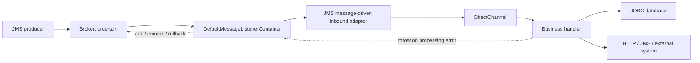
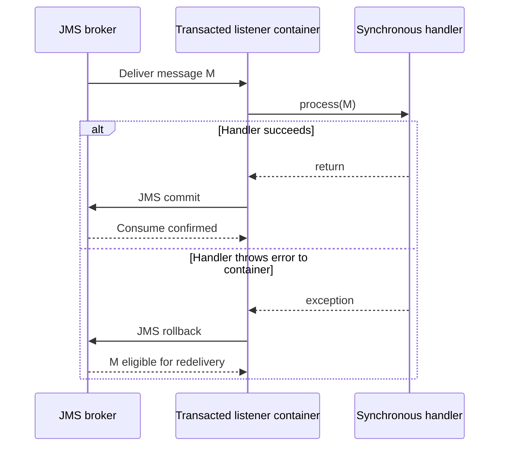
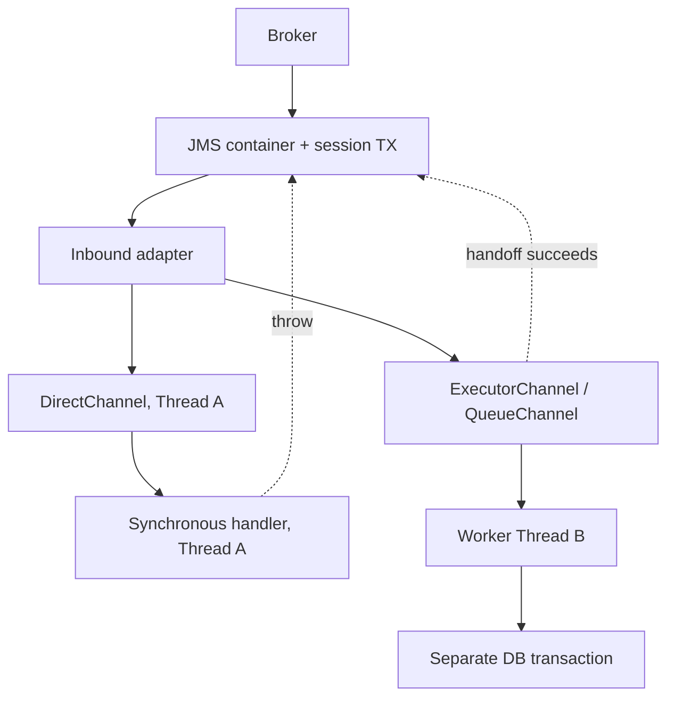
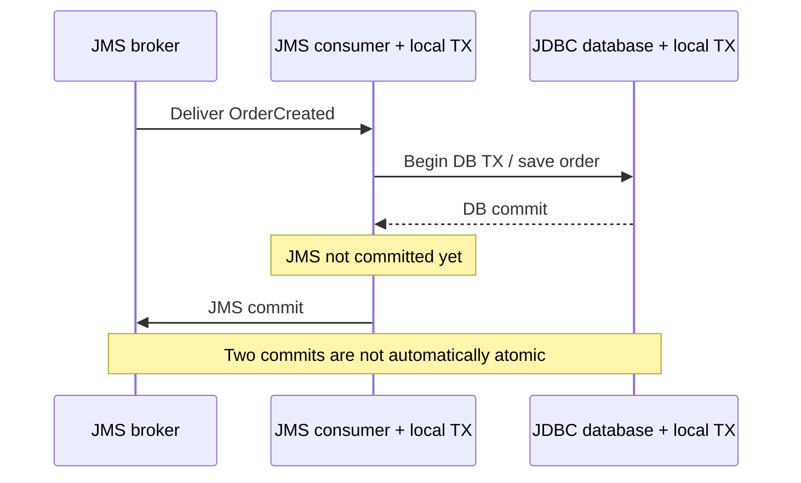
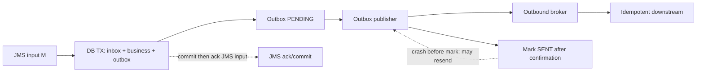

# JMS Transactions and Acknowledgment in Spring Integration Adapters

## 1. Why Receiving a JMS Message Does Not Mean Processing Is Finished

In an integration application, a broker may deliver a message successfully while the target system has not yet finished its work. For example, queue `orders.in` holds an order-processing request. Spring Integration receives the request via a JMS inbound adapter, passes it into a `MessageChannel`, and a service activator writes to a database. If the process fails right after writing to the DB, you must be able to answer:

- Does the broker already consider the message consumed?
- Did the consumer `acknowledge` or did the JMS session `commit`?
- Did the DB commit or roll back?
- Can the broker redeliver the message?
- If redelivered, will the business operation execute twice?

**Acknowledgment** is the mechanism for confirming message consumption in JMS. A **JMS transaction** groups receive/send operations within a managed session into a commit/rollback unit. When the flow also touches a database, HTTP, File, SFTP, AMQP, or Kafka, you must identify each resource's transaction boundary rather than assuming they commit together.

This lesson belongs to the **Transactions** chapter of the **SPRING_INTEGRATION_ADAPTERS** module: using inbound/outbound adapters, gateways, pollers, and `MessageChannel` to connect external systems while managing message contracts, errors, and connection lifecycles.

### Learning Objectives

1. Distinguish JMS `AUTO_ACKNOWLEDGE`, `CLIENT_ACKNOWLEDGE`, `DUPS_OK_ACKNOWLEDGE`, and `SESSION_TRANSACTED` modes.
2. Understand commit, rollback, recover, redelivery, duplicates, and DLQs in JMS.
3. Configure a message-driven JMS inbound adapter with a transacted listener container.
4. Analyze the effects of `DirectChannel`, `QueueChannel`, `ExecutorChannel`, and `errorChannel`.
5. Distinguish local JMS transactions, JDBC transactions, XA/JTA, and transactional outboxes.
6. Test failure points to prove no messages are lost and no unintended duplicate side effects occur.

## 2. Distinct Events in a Message's Lifecycle

| Event | Actor | Meaning | What it does NOT prove |
|---|---|---|---|
| Producer sends message | JMS producer / outbound adapter | Sends to destination per API and delivery policy | Consumer completed business logic |
| Broker delivers message | JMS provider | Message delivered to consumer/session | Database handler committed |
| Application processes | Listener / Spring Integration handler | Validation, transformation, and side effects invoked | Broker received ack or remote systems committed |
| Consumer acknowledges | Session, container, or client | Confirms consumption per ack mode | All non-JMS side effects finished |
| JMS transaction commits | Transacted JMS session or transaction manager | Finalizes receive/send inside the JMS transaction scope | JDBC, HTTP, or Kafka committed atomically |

A JMS producer may succeed and the broker accept the message before any consumer runs. A consumer may also receive and acknowledge prematurely, fail while writing to the database, and lose the ability to reprocess the work. **The timing of ack/commit relative to side-effect completion is the central issue.**

### 2.1 Message Identity and Idempotency

`JMSMessageID` helps trace provider-assigned messages. `JMSCorrelationID` typically links request–reply flows. However, when a producer retries a business event, that event may become a new JMS message with a different ID. Therefore, emit a **stable `businessEventId`/idempotency key** from the source system so consumers detect repeated side effects instead of relying solely on `JMSMessageID`.

## 3. JMS Sessions, Listener Containers, and Message-Driven Adapters

In the classic JMS API:

- **Connection** represents a connection to the JMS provider.
- **Session** is the logical scope for receive, send, acknowledgment, and local transactions.
- **Destination** can be a queue or topic.
- **MessageProducer / MessageConsumer** send and receive messages.
- **MessageListener** handles asynchronous callbacks.

Spring JMS provides listener containers such as `DefaultMessageListenerContainer` to manage connections/sessions, consumers, concurrency, and recovery. Spring Integration adds **JMS inbound/outbound adapters and gateways** to bridge broker messages into the `Message<?>` / `MessageChannel` model.

`JMSContext` in JMS 2.x is a simplified API combining connection and session roles. Modern Spring apps may use `jakarta.jms` packages, whereas older projects use `javax.jms`. Keep your dependency ecosystem consistent; never mix both packages.

### 3.1 Inbound Flow Diagram



The arrow from handler back to container represents **synchronous exception propagation**; if the handler offloads work to another thread, errors will not automatically return to the initial transaction.

### 3.2 Queues and Topics

With a **queue**, consumers on the same queue typically compete for messages. With a **topic**, each matching subscription receives messages under publish/subscribe semantics; durable subscriptions can retain messages per provider contract while a subscriber is offline. Transactions/acknowledgments belong to each respective session/subscription, not a single transaction shared across all subscribers.

## 4. Four JMS Acknowledgment Modes

| Mode | Who coordinates acknowledgment? | Consequences to watch |
|---|---|---|
| `Session.AUTO_ACKNOWLEDGE` | Session/provider or container auto-acks | Simple, but ack timing may not protect business failures after delivery |
| `Session.CLIENT_ACKNOWLEDGE` | Client calls `message.acknowledge()`, or container does so | Ack is **cumulative across the session**, not necessarily per-message |
| `Session.DUPS_OK_ACKNOWLEDGE` | Provider may defer acks | Duplicates can occur in exchange for throughput |
| `Session.SESSION_TRANSACTED` | `commit()` / `rollback()` | Ack is an outcome of the transaction, not standard non-transacted ack rules |

### 4.1 `AUTO_ACKNOWLEDGE`: Do Not Misread as "After DB Commit"

`AUTO_ACKNOWLEDGE` follows the JMS contract and container behavior. For instance, `DefaultMessageListenerContainer` under `AUTO_ACKNOWLEDGE` in common Spring configurations acknowledges **before the listener executes**; thus a listener exception may not trigger redelivery. Another container may have different timing and guarantees. **Never assume `AUTO_ACKNOWLEDGE` protects critical business work** simply because the service activator has `@Transactional`.

### 4.2 `CLIENT_ACKNOWLEDGE`: Ack Can Cover Multiple Messages

In a non-transacted session, calling `acknowledge()` on one message in client acknowledgment mode can acknowledge **all messages consumed by that session up to that point**. For example, if a session receives A then B and calls `B.acknowledge()`, A may be acknowledged simultaneously. Never assume independent per-message ack like some other APIs unless using a tested provider extension.

Spring's listener container can handle acknowledgment on behalf of the listener; verify exact behavior for your container, version, and broker.

### 4.3 `DUPS_OK_ACKNOWLEDGE`

The provider is permitted to delay acknowledgments. When failures occur, duplicate deliveries can happen. Your system needs idempotency; never choose this mode if business logic assumes an event executes strictly once.

### 4.4 `SESSION_TRANSACTED`: Ack via Commit/Rollback

With a JMS `Session` running a local transaction:

1. The consumer receives a message within the session scope.
2. The listener/handler runs; it may also perform other JMS sends within the same valid transaction/session.
3. `commit()` finalizes the transaction-managed receives/sends.
4. `rollback()` aborts the receives/sends; the broker may redeliver the message per its redelivery policy.

**The guarantee covers the JMS session**, not all side effects. JDBC on a separate `DataSource`, file renames, HTTP POSTs, or Kafka sends do not automatically roll back with the JMS session.

### 4.5 Comparing Behavior on a Timeline



Retry/redelivery ordering, wait intervals, max attempts, and DLQs depend on the broker/provider. If the handler already committed a separate DB transaction before JMS rolled back, redelivery can still cause duplicate DB effects.

## 5. Redelivery and Handling Duplicate Messages

### 5.1 Common Triggers for Redelivery

- The listener throws an exception that the container treats as requiring rollback.
- The consumer crashes before commit/ack.
- Broker or network connectivity drops while commit/ack outcome is uncertain.
- The session is recovered/rolled back per provider workflow.
- The producer resends a business event after a timeout.

`JMSRedelivered` is a provider flag marking redelivery; `JMSXDeliveryCount` may help count attempts depending on provider contract/version. However, a producer sending a **new** message carrying the same business event may not set the redelivered flag. Distinguish **broker redelivery** from **business duplicates**.

```text
businessEventId = purchase-2026-00127
JMSMessageID    = ID:broker:example-0001
JMSRedelivered  = true
deliveryCount   = 3   # illustrative if provided by broker
```

### 5.2 Poison Messages and Dead-Letter Queues

If a schema-invalid payload causes the listener to fail permanently, rollbacks can cause endless redelivery. Therefore you need:

- Classification of transient vs. permanent errors.
- Backoff/redelivery delays, max attempts, and broker dead-letter destinations.
- Logging event ID, exception class, attempts, and correlation for investigation.
- Controlled data repair and reprocessing workflows.
- Instead of infinite retries, route poison messages to a DLQ/quarantine with operational ownership.

There is no single DLQ configuration universal to all JMS providers; policies may live on the broker, listener container, or error flow.

## 6. Listener Container as a Key Transaction Boundary

`DefaultMessageListenerContainer` (DMLC) manages asynchronous listeners, connections/sessions, concurrency scaling, and recovery. Key settings to review:

- `connectionFactory`, `destinationName`, or destination resolver.
- `sessionTransacted` vs. `transactionManager` when using transactions.
- `sessionAcknowledgeMode` when using non-transacted sessions.
- `concurrentConsumers` and `maxConcurrentConsumers`.
- Recovery interval/backoff and cache level.
- Error handling and how exceptions propagate back to the container.

### 6.1 Configuring a Local JMS Session Transaction

The example below defines a listener container bean; the Spring Integration endpoint must bind its listener accordingly. Never manually register another listener on the same container when the endpoint manages it.

```java
@Bean
DefaultMessageListenerContainer ordersJmsContainer(ConnectionFactory cf) {
    DefaultMessageListenerContainer container =
        new DefaultMessageListenerContainer();
    container.setConnectionFactory(cf);
    container.setDestinationName("orders.in");
    container.setSessionTransacted(true);
    container.setConcurrentConsumers(1);
    container.setMaxConcurrentConsumers(4);
    return container;
}
```

When `sessionTransacted=true`, the container coordinates JMS session commit/rollback based on listener outcome; it **does not** open a matching database transaction by itself.

### 6.2 Using `JmsTransactionManager` When Spring Transaction Abstraction Is Needed

`JmsTransactionManager` manages local JMS transactions over a `ConnectionFactory`:

```java
@Bean
JmsTransactionManager jmsTransactionManager(ConnectionFactory connectionFactory) {
    return new JmsTransactionManager(connectionFactory);
}

// One option when configuring the container per Spring JMS support:
container.setTransactionManager(jmsTransactionManager);
```

Choose between `setSessionTransacted(true)` and attaching a transaction manager based on specific requirements and container contracts. **Never pair two managers and assume XA.** `JmsTransactionManager` does not enlist a separate `DataSource`'s JDBC transaction into one atomic transaction.

### 6.3 What Is the Risk of DMLC with `AUTO_ACKNOWLEDGE`?

If a message is acknowledged before the callback and the handler later fails writing to the database, the broker may never redeliver the message. Prefer a **local transacted JMS session** or a rigorously tested ack/recovery contract whenever work must not be lost. Safety also depends on how errors traverse the Spring Integration flow.

## 7. Spring Integration JMS Adapters and Gateways

### 7.1 Message-Driven Inbound Channel Adapter

A message-driven inbound adapter converts a JMS message into a Spring Integration `Message<?>` and sends it to a `MessageChannel`. In the standard architecture, the **listener container receives messages in message-driven mode**, not via a `SourcePollingChannelAdapter` running `Pollers.fixedDelay(...)`.

```text
JMS queue orders.in
    -> DefaultMessageListenerContainer (session transacted)
    -> Spring Integration message-driven inbound channel adapter
    -> DirectChannel
    -> service activator
```

If a handler on the same call stack throws an exception and it reaches the container, the JMS session can roll back/redeliver. If an error flow handles the error without rethrowing, the container may treat processing as successful.

### 7.2 Outbound Channel Adapter

An outbound adapter takes a Spring message and sends it to a JMS destination. `send` returning success does not mean the final consumer finished. If the outbound send joins an active JMS transaction under supported config, the message is finalized when that transaction commits; this does not mean external JDBC/HTTP commits with it.

### 7.3 Inbound and Outbound Gateways

Gateways support request/reply via JMS correlation and reply destinations. Verify:

- Are `JMSCorrelationID` / `JMSReplyTo` mapped properly?
- Does a gateway timeout guarantee the business request never ran? **No**.
- Is the reply emitted after business completion or merely after a handoff?
- When the client retries on timeout, does a business idempotency key prevent duplicate processing?
- Which separate sessions/transactions handle request receipt and reply sending?

A gateway does not create a global distributed transaction across two independent apps merely via a correlation ID.

### 7.4 When Does Poller Transaction Advice Apply to JMS?

Endpoints that genuinely poll a JMS source or a `PollableChannel` can configure poller advice. However, a **message-driven JMS adapter** relies on a **listener container**. Wrapping `SourcePollingChannelAdapter.receive()` with poller transaction advice cannot be mechanically applied to a listener container: place transactions where messages are actually received.

## 8. Boundaries by `MessageChannel`: Same Thread or Handoff?



### 8.1 `DirectChannel`

`DirectChannel` invokes subscribers synchronously on the current thread. When the handler throws out without intermediate layers swallowing the error, the container receives it and can roll back the local JMS transaction.

**Limitation:** if the handler committed JDBC independently before throwing, JMS rollback **does not** undo the DB commit. Idempotent DB operations are needed so redelivery avoids duplicates.

### 8.2 `ExecutorChannel`

When dispatching to an executor, the listener thread can finish delivering the message before the worker processes it. The JMS session may commit/ack; any exception thrown later **cannot roll back the already-closed JMS transaction**.

### 8.3 `QueueChannel`

`QueueChannel` decouples send from receive. An in-memory queue loses messages on process crash; a durable `MessageStore` has its own transaction and recovery behavior by design. The JMS input being acked only proves handoff per channel contract—**not that downstream business handlers finished**.

### 8.4 `errorChannel`

Spring Integration can wrap errors into an `ErrorMessage` to route error handling. Clarify whether errors are **rethrown to the listener container** or treated as handled. Logging `ERROR` or emitting an `ErrorMessage` **does not guarantee rollback**.

- Want broker redelivery: the error must reach the rollback boundary and satisfy the rollback policy.
- Want quarantine / permanent-error marking: persist durable evidence before committing/acking per design.
- If errors are handled on an async thread: the original JMS receive transaction may already have finished.

### 8.5 Transaction Context Does Not Cross Threads Automatically

Spring's standard transaction context binds to the executing thread. `CompletableFuture`, executors, queues, or external consumers require their own transactions and retries. Never assume Spring propagates a local JMS session across an `ExecutorChannel`.

## 9. Spring Integration Java DSL Example with JMS Transacted Inbound

The snippet below illustrates the flow structure using a message-driven inbound adapter and a listener container with `sessionTransacted=true`. Verify bean/import syntax and builders against your **Spring Integration version**; this is not a complete runnable project.

```java
@Configuration
@EnableIntegration
class IncomingOrdersIntegrationConfig {

    @Bean
    DefaultMessageListenerContainer ordersContainer(ConnectionFactory cf) {
        DefaultMessageListenerContainer c =
            new DefaultMessageListenerContainer();
        c.setConnectionFactory(cf);
        c.setDestinationName("orders.in");
        c.setSessionTransacted(true);
        c.setConcurrentConsumers(1);
        return c;
    }

    @Bean
    IntegrationFlow ordersFlow(DefaultMessageListenerContainer ordersContainer,
                               OrderHandler handler) {
        return IntegrationFlow
            .from(Jms.messageDrivenChannelAdapter(ordersContainer))
            .handle(handler, "handle")
            .get();
    }
}
```

In this setup, verify through tests:

1. The JMS endpoint actually uses the declared **transacted container**.
2. The handler executes synchronously on the receiving thread.
3. When the handler throws, the exception **is not swallowed by an error flow** before returning to DMLC.
4. The broker redelivers the message per policy after rollback.
5. On success, the message commits and is not redelivered as unconfirmed.

Outcomes 4 and 5 also depend on crashes at commit boundaries or broker disconnects. Never extrapolate integration test results from one broker to every JMS provider.

### 9.1 Converting JMS Messages to Spring Messages

Spring Integration uses a `MessageConverter` / header mapper to translate JMS payloads and metadata into Spring `Message<?>`. Parse or conversion errors can occur **before the service activator is called**. Check:

- Is the payload `TextMessage`, `BytesMessage`, `ObjectMessage`, or another type; is there a clear schema contract?
- What are the content type, encoding, schema version, and size limits?
- Which headers are mapped, and which must be validated from trusted sources?
- Does the data contain bearer tokens, passwords, or sensitive info that must not be logged?
- If the converter throws, does the container roll back, route to error, or commit?

Avoid unrestricted deserialization of untrusted objects. For external inputs, prefer schema-governed formats with validation and size caps.

### 9.2 Using an Explicit Channel to Highlight the Boundary

```java
// Illustrative Java DSL fragment (requires matching imports and beans).
return IntegrationFlow
    .from(Jms.messageDrivenChannelAdapter(ordersContainer))
    .channel(MessageChannels.direct("orders.input"))
    .handle(orderValidationHandler, "validate")
    .handle(orderHandler, "handle")
    .get();
```

This snippet uses a `DirectChannel` and synchronous handlers. Replacing it with `ExecutorChannel` invalidates the assumption that "handler exceptions roll back JMS receive" in standard cases. Evaluate all asynchronous components in the flow the same way.

## 10. Does a JMS Transaction Protect a JDBC Transaction?

**Not automatically.** This is the most important fact when pairing JMS with a database.

Suppose a consumer receives `OrderCreated` from JMS and writes to a database:



### 10.1 Two Distinct Local Transactions

`JmsTransactionManager` manages the JMS transaction. `DataSourceTransactionManager` (or `JdbcTransactionManager`) manages the `DataSource` transaction. Even if the handler uses `@Transactional` for JDBC, the database and broker remain **two independent resources** unless real XA/JTA coordination is used.

| Scenario | DB state | JMS state | Consequence |
|---|---|---|---|
| Handler fails before DB commit; JMS rolls back | DB rolled back | Message eligible for redelivery | Safe to retry if no other side effect ran |
| DB commits; process dies before JMS commit | DB persisted | JMS uncertain, may redeliver | **Duplicate DB effect** if handler isn't idempotent |
| JMS commits, then DB write outside TX fails | DB not saved | Broker treats message as consumed | Risk of **lost work** |
| DB commits; JMS commit succeeds | DB persisted | Message confirmed | Both scopes succeeded; keep audit |
| Network error sending JMS commit | DB may be committed | JMS outcome unknown to client | Must tolerate redelivery; check broker |

Never pick a commit order and claim it eliminates both message loss and duplicates. You must explicitly handle failures between the two commits.

### 10.2 `@Transactional` Alone Does Not Create a Distributed Transaction

`@Transactional(transactionManager = "dbTransactionManager")` on a service governs the DB. It does not turn a JMS `Session` into an XA participant. Conversely, `@Transactional(transactionManager = "jmsTransactionManager")` does not protect arbitrary JDBC updates.

In projects with multiple `PlatformTransactionManager`s, explicitly specify **manager names**, propagation, and interceptor order. When a flow layers transactions, verify via broker and DB outcomes rather than merely checking `TransactionSynchronizationManager.isActualTransactionActive()`.

## 11. XA/JTA vs. Local JMS Transactions

**JTA/XA** can coordinate a global transaction across multiple XA-capable resources (for example, a JMS provider with an XA connection factory and a database with an XA `DataSource`) through a transaction coordinator. When properly configured, the coordinator uses two-phase commit across XA participants.

Conditions to evaluate:

1. The JMS provider and database **genuinely support XA** on the versions and drivers in use.
2. A reliable transaction coordinator exists with durable recovery logs and in-doubt transaction recovery.
3. The listener container participates in the JTA transaction, properly enlisting JMS sessions and JDBC connections.
4. Timeouts, crash recovery, heuristic outcomes, and network splits are tested and drilled.
5. Higher latency and longer lock holds are acceptable.

**Not every external system supports XA.** HTTP, SFTP, and most cloud/SaaS APIs cannot share a global transaction with your DB. Kafka supports Kafka-scoped transactions, yet does not automatically become an XA resource inside a Spring JMS/JDBC transaction merely by living in the same app.

### 11.1 When to Consider XA?

When atomicity between JMS receive/send and a database is strictly required, the stack supports XA, you can operate the coordinator, and consistency demands justify it, XA is an option. However, complex recovery and operational overhead lead many teams to prefer **local transactions + idempotency/outbox** where feasible.

### 11.2 Why Isn't "Best-Effort 1-Phase Commit" Atomic?

A design may commit two resources in a fixed order expecting most cases to succeed. That is a pragmatic optimization for some systems, yet it leaves a **failure window between the two commits**. If a design accepts that window, it must document the assumption, retry mechanisms, inconsistency detection, and reconciliation procedures—never describe it as XA.

## 12. Inbox Idempotency When JMS Can Redeliver

Under at-least-once delivery, **business-layer idempotency** is a critical line of defense.

### 12.1 Concept

Each event carries a stable producer-assigned `businessEventId`. The consumer records a "processed" ledger entry in the same transaction as the business update. On redelivery, if the ID already exists, the consumer skips repeating the side effect.

```sql
CREATE TABLE processed_inbox (
    consumer_name VARCHAR(80) NOT NULL,
    business_event_id VARCHAR(120) NOT NULL,
    processed_at TIMESTAMP NOT NULL,
    PRIMARY KEY (consumer_name, business_event_id)
);

CREATE TABLE purchase_accounting (
    purchase_id VARCHAR(80) PRIMARY KEY,
    total_amount DECIMAL(18, 2) NOT NULL,
    state VARCHAR(32) NOT NULL
);
```

The unique constraint protects even when multiple consumers race on the same event. **A two-step `SELECT` then `INSERT` without atomic locking/constraints** suffers from race conditions.

### 12.2 Java Pseudocode Using a DB Transaction

```java
@Service
class PurchaseConsumer {
    private final InboxRepository inbox;
    private final PurchaseRepository purchases;

    @Transactional(transactionManager = "dbTransactionManager")
    public void handle(PurchaseCreated event) {
        // tryInsertIfAbsent must be atomic, backed by a unique constraint
        // and upsert semantics appropriate for the target database.
        boolean firstTime =
            inbox.tryInsertIfAbsent("purchase-consumer", event.eventId());
        if (!firstTime) {
            return; // event already processed previously
        }

        purchases.applyBusinessUpdate(event);
        // Both the inbox record and business update commit or roll back together.
    }
}
```

`tryInsertIfAbsent` is an **illustrative repository API**, not a built-in Spring Data method. Implement it using database-appropriate mechanisms (conditional insert-if-not-exists/upsert), handling duplicate keys and concurrent attempts cleanly.

If a crash occurs after DB commit and before JMS commit, the broker redelivers the event. The second delivery sees the ledger entry, skips the side effect, and completes the JMS transaction. If the DB rolled back, the ledger rolled back too, so the next delivery processes normally.

### 12.3 Limits of an Inbox Ledger

An inbox only protects side effects **inside the same transaction** as the ledger. If the handler called HTTP or sent an email before the ledger committed, a crash can still repeat those calls. You need remote idempotency, an outbox, or workflow compensation.

## 13. Transactional Outbox When Consumers Must Publish Other Messages

Suppose a JMS consumer processes an order, updates a database, and must send an `OrderAccepted` event to JMS/AMQP/Kafka. Sending directly inside the DB transaction risks the broker receiving the event before the DB rolls back. An outbox decouples the two steps while durably storing the send intent in the DB.

### 13.1 Outbox Flow

1. Consumer receives JMS message M.
2. Within **one DB transaction**, persist business changes, inbox deduplication, and an outbox row.
3. DB commits.
4. JMS consumer commits/acks M (redelivery is still possible if crashing before this step; inbox handles it).
5. An independent publisher reads the outbox and sends to the broker.
6. Upon appropriate broker send confirmation, the publisher marks the row `SENT`.
7. If the publisher crashes after sending and before marking `SENT`, it may resend; downstream consumers deduplicate.



### 13.2 Illustrative Schema

```sql
CREATE TABLE integration_outbox (
    event_id VARCHAR(120) PRIMARY KEY,
    destination VARCHAR(160) NOT NULL,
    payload VARCHAR(4000) NOT NULL,
    state VARCHAR(24) NOT NULL,
    attempt_count INTEGER NOT NULL DEFAULT 0
);
```

An outbox guarantees **send intent is durably stored with the DB update** and provides a replay path; it generally delivers at-least-once rather than end-to-end exactly-once. Handling crashes and unknown send outcomes requires consumer idempotency, publisher leases/claims, retries, and reconciliation.

### 13.3 Why Doesn't `afterCommit` Replace an Outbox?

A callback sending to JMS **after DB commit** can fail or the app can die before the callback runs. The DB would then hold the committed data with no durable record that the event was never sent. An outbox writes `PENDING` data **before commit**, enabling recovery after restarts.

## 14. Outbound Acknowledgments and Request/Reply Gateways

### 14.1 Outbound Producer: "Send Success" Has Multiple Meanings

`JmsTemplate.send` or an outbound adapter returns once the provider executes the send per its contract and active transaction; delivery mode, TTL, broker persistence, and transaction commit all matter. It does not confirm that a consumer completed business processing. To guarantee business outcomes, use **application-level** acknowledgments, reply messages, status events, or downstream status queries.

### 14.2 Gateway Timeout Does Not Mean Request Failure

Suppose a client sends a payment request via a JMS outbound gateway and waits 5 seconds. The server commits the payment to its DB, yet the reply arrives at 6 seconds. The client sees a timeout and retries; the server could charge twice without an idempotency key.

Solution:

- Attach a stable `requestId`/business key across retries.
- Set timeouts and correlation per business SLA.
- On timeout, treat the outcome as **unknown** until reconciled.
- Make the consumer idempotent so it can return the prior result for the same request.
- Manage late replies, temporary reply destinations, and resource cleanup per gateway configuration.

### 14.3 Reply Destinations and Transaction Boundaries

A request/reply flow may involve multiple sessions: the request-receiving session, the reply-sending session, and the client's reply-listening session. Never assume they share one local transaction. If atomic receive+send inside the broker is required, verify they genuinely share a transacted JMS session/transaction; if the reply depends on JDBC, revisit XA or outbox.

## 15. Errors and Retries: Where to Roll Back, Where to Commit?

### 15.1 Error Classification

| Category | Examples | Recommended policy |
|---|---|---|
| Transient dependency failure | DB timeout, temporary connection loss | Roll back JMS; broker redelivers with delay and limit |
| Validation / permanent failure | Invalid JSON schema, missing required field | Quarantine/DLQ with audit; avoid infinite loops |
| Duplicate event | `eventId` already in inbox ledger | Safe no-op and complete ack |
| Unknown remote outcome | HTTP timeout after POST | Query status or perform idempotent retry |
| Downstream async failure | Worker fails after `QueueChannel` handoff | Retry on worker queue; do not expect JMS input rollback |
| Resource / config error | Invalid credentials, TLS, or destination | Alert and fix configuration; avoid tight infinite retries |

### 15.2 Do Errors Reach the Container?

```java
void handle(OrderEvent event) {
    try {
        saveOrder(event);
    } catch (Exception ex) {
        log.warn("Order processing failed", ex);
        // Normal return -> listener may treat as success
        // and the JMS transaction may COMMIT.
    }
}
```

If broker redelivery is desired, let the error propagate to the listener container or mark rollback per framework contract. If you want to **commit and quarantine** a permanent data error, persist durable failure evidence/next-step state before returning normally.

### 15.3 Listener, Broker, and Application Retries Can Multiply

A broker configured with 5 max attempts, a listener with 3 retry-advice attempts, and an outbound HTTP client with 4 retries can turn one business event into far more HTTP calls than expected. Enforce a **total retry budget**, distinguish in-delivery retries from broker redeliveries, and set an overall deadline.

Best practices:

- Use backoff/jitter and circuit breakers for failing dependencies.
- Terminate permanent errors in a DLQ/quarantine.
- Preserve the idempotency key across all retries.
- Track retry attempts by event ID and origin.
- Never drop or return success merely upon exhausting retries without persisting failure state and ownership.

## 16. Concurrency, Prefetch, Ordering, and Backpressure

### 16.1 DMLC Concurrent Consumers

`concurrentConsumers` and `maxConcurrentConsumers` scale consumer threads. Increasing concurrency allows parallel processing, changing **business completion order** even when the broker preserves queue order.

If "events for one aggregate must process in order," consider:

- Partitioning/keying by aggregate or JMS message groups per provider support.
- Sequence/version numbers in business events with reordering or stale-event rejection.
- Concurrency tuned to both throughput and ordering constraints.
- Idempotency, timeouts, and duplicate handling during rebalances/recovery.

### 16.2 Prefetch and Unprocessed Deliveries

Brokers may prefetch multiple messages to a consumer, affecting fairness, memory footprint, queue wait times, and distribution when one consumer stalls. **Prefetch does not mean messages are committed/acked**, though you must understand provider semantics to measure backlogs and redeliveries accurately.

### 16.3 Backpressure and DLQs

When the DB is slow or down, letting consumers continuously receive and roll back creates tight redelivery loops and extra load. Cap concurrency, tune retry/redelivery delays, add circuit breakers, monitor backlogs, and pause the listener container per runbook if needed. Never raise concurrency blindly to "drain the queue" when the DB is the bottleneck.

## 17. How JMS Differs Transactionally from File, SFTP, HTTP, AMQP, and Kafka

Spring Integration Adapters connects diverse systems. JMS offers local session transactions, while other systems use their own contracts. A message may cross multiple adapters and **no single commit/rollback covers them all**.

| Source/Target | Typical confirmation/success mechanism | What to check on failure |
|---|---|---|
| **JMS inbound** | Session ack or commit/rollback; provider redelivery | Does a listener exception actually roll back, and what is the DLQ policy? |
| **JMS outbound** | Producer send + JMS transaction if active | Did the broker accept/finalize it, and did the consumer process it? |
| **JDBC** | Local DB transaction commit/rollback | Same transaction manager and connection/DB scope? |
| **File** | File exists, read, moved/renamed/deleted | Filesystem doesn't join JMS TX; what state does a crash leave? |
| **SFTP** | Download/upload/rename on remote server | Remote operations do not auto-rollback with JMS/DB |
| **HTTP** | HTTP response and API idempotency contract | Timeouts can hide server-side success |
| **AMQP** | Broker ack/nack/requeue/confirm or product-specific TX | Ack semantics differ from JMS; don't confuse with JMS `CLIENT_ACKNOWLEDGE` |
| **Kafka** | Consumer offsets, producer transactions, container TX | Offsets and Kafka TX don't globally coordinate DB/JMS |

Example flow `JMS inbound → HTTP outbound gateway → JDBC write`:

1. Consumer receives JMS message in a local JMS transaction.
2. HTTP server processes POST, yet client times out.
3. Handler throws; JMS rolls back and broker redelivers.
4. Handler calls HTTP again, risking duplicate business effects.

**Remedy:** use idempotency keys on remote APIs, query status after timeouts, or decouple remote calls with an outbox/durable workflow. Never try to fix this by raising JMS timeouts or adding a single transaction annotation.

### 17.1 Other Transactions in Spring Integration

Transaction advice on a **poller** typically wraps a poll/receive task. A message-driven JMS adapter is orchestrated by a **listener container**. Spring Integration's `TransactionSynchronizationFactory` or pseudo transactions can coordinate post-processing callbacks for File/SFTP, yet **never turn files or HTTP into JMS XA resources**. Always align transaction boundaries with the **actual endpoint type**.

## 18. Testing JMS Transactions and Acknowledgments

### 18.1 Why Unit Tests Are Insufficient

A unit test calling `OrderHandler.handle(...)` directly may verify business logic, yet misses:

- Whether the listener container uses a transacted session.
- Whether messages are acked before or after the handler.
- Whether an error flow swallows errors before reaching the JMS listener.
- Broker redelivery after rollback/crash.
- Independent JDBC commits and duplicate effects on redelivery.
- DLQs, prefetch, reconnection, and ordering under multiple consumers.

To test properly, use a **real JMS broker in a test environment** (such as a JMS-compatible broker via test containers) paired with a database and production-like adapter configuration. Avoid touching production directly; enforce test isolation, safe credentials, and cleanup.

### 18.2 Mandatory Test Matrix

| Scenario | Expected result | Evidence |
|---|---|---|
| Synchronous handler succeeds | JMS message commits/acks; business state persisted | Broker queue state, DB readback |
| Handler throws with transacted listener | JMS rolls back; message eligible for redelivery | Delivery attempts, listener error, broker state |
| `AUTO_ACKNOWLEDGE` with DMLC and failing handler | Ack timing understood; no false assumption of redelivery | Broker consumption and message-loss test |
| `CLIENT_ACKNOWLEDGE` across multiple messages in one session | Acknowledgment follows session semantics | Delivery/ack observation |
| Handler swallows exception | JMS may commit; test catches mismatch | Event state, listener outcome |
| `DirectChannel` switched to `ExecutorChannel` | JMS input may commit before async failure | Two-thread timeline, broker, DB |
| DB commits, crash before JMS commit | Message redelivered; DB has no double update | Inbox unique key, DB rows |
| JMS commits before non-TX DB write fails | Exposes risk of lost work | Fault injection, reconciliation |
| Permanent validation failure | Routed to DLQ/quarantine after budget | Queue depth, attempts, error record |
| Transient DB outage retry | Reasonable backoff, no hot spin | Retry timestamps, DB load |
| Outbox published, crash before marking `SENT` | May resend, yet consumer deduplicates | Outbox row, broker event ID |
| Gateway request timeout, late reply | Transaction not executed twice | Correlation, idempotency ledger |
| Consumer crashes mid-processing | Restarts and recovers cleanly | Broker redelivery, process restart |
| Broker network partition | Container reconnects; never assumes commit succeeded | Recovery logs, duplicate handling |
| Multiple consumers on same aggregate | Ordering constraints preserved | Sequence, group key, business state |
| DLQ reprocessing | Traced and reprocessed without duplicate side effects | Reprocess audit, inbox/readback |

### 18.3 Crucial Integration Test: DB Commits, Then JMS Rolls Back

This scenario is frequently overlooked. Create `OrderCreated(eventId=E100)` and process it:

1. Handler inserts order and event ledger into DB inside one database transaction.
2. Allow the DB to commit.
3. Inject failure so the listener fails to complete the JMS transaction (or simulate a crash right before JMS commit).
4. Broker redelivers `E100`.
5. Consumer receives the second delivery, sees `E100` in `processed_inbox`, and skips re-creating the order.
6. JMS receive commits on the second delivery.

**PASS criteria:** one business event yields exactly **one business effect**, even across two JMS deliveries. A test that asserts the handler ran strictly once fails to reflect true at-least-once behavior.

### 18.4 JUnit-Style Test Pseudocode

```java
// Contract pseudocode: TestJmsHarness, BrokerProbe, and OrderProbe
// are project-defined abstractions, not built-in JUnit/Spring APIs.
@Test
void redeliveryDoesNotDuplicateBusinessEffect() {
    String eventId = "purchase-test-100";
    harness.sendOrder(eventId);
    harness.failAfterDbCommitBeforeJmsCommit(eventId);

    harness.awaitRedelivery(eventId, testDeadline);
    harness.allowConsumerToFinish(eventId);

    assertEquals(1, orders.countByEventId(eventId));
    assertTrue(inbox.contains(eventId));
    assertTrue(broker.noUnsettledDelivery(eventId));
}
```

An actual test runner must prove **injection timing**: if the fault fires before DB commit, it fails to test duplicate-after-commit. Retain transaction traces and broker confirmations to distinguish cases. Never run fault injection against production queues without explicit approval.

### 18.5 Crash/Restart Testing

Kill/restart consumers in a test environment at key stages:

- Before the listener receives the message.
- After broker delivery, before business update.
- After DB commit, before JMS commit.
- After JMS commit, before client learns the outcome.
- While broker connectivity is severed.
- During error handling or DLQ routing.

Inspect queues, DB, and outbox after restart. Record outcomes—"success", "rollback", "redelivered", "unknown"—separately. A listener logging success is insufficient to prove the broker committed if the connection dropped immediately afterward.

## 19. Observability: Measuring Receipt and Processing Accurately

### 19.1 Suggested Metrics

| Category | Metric | Meaning |
|---|---|---|
| Broker | Queue depth, oldest message age | Backlog and delivery lag |
| Delivery | Received/redelivered rates, attempts | Retry storms, poison messages |
| Transaction | JMS commit/rollback counts, commit latency | Message processing boundaries |
| Handler | Success/failure rates, p95/p99 duration | Business errors or slow processing |
| Database | TX commits/rollbacks, lock waits, deadlocks | DB contention or bottlenecks |
| Error flow | DLQ depth, rejected/quarantined counts | Unprocessable messages |
| Idempotency | Duplicates detected, suppressed side effects | Redelivery protection effectiveness |
| Outbox | Pending count/oldest age, send attempts | Stored but unpublished events |
| Connectivity | JMS connection failures/recovery time | Broker or network incidents |
| Resources | Concurrent consumers, session counts, pool usage | Connection/session leaks or overload |

Metric names are **design suggestions**, not automatically provided out-of-the-box by every Spring Integration, Micrometer, or broker version.

### 19.2 Tracing and Correlation

Every event should carry a traceable path:

```text
traceId=trace-1290
businessEventId=purchase-2026-00127
jmsMessageId=ID:broker:000A
jmsRedelivered=true
deliveryAttempt=2
listenerContainer=ordersJmsContainer
handlerOutcome=SUCCESS
dbOutcome=COMMITTED
jmsOutcome=COMMITTED
outboxEventId=purchase-2026-00127-accepted
```

Never log raw payloads containing sensitive PII, bearer tokens, passwords, broker credentials, or secret keys. When a broker/session yields an **unknown outcome**, log the unknown state rather than guessing `COMMITTED`.

### 19.3 Distinguish ACK from "Business Success"

Monitoring might show queue depth falling while revenue/order state is wrong because:

- `AUTO_ACK` consumed messages despite handler failures.
- JMS input committed right after handing work to an `ExecutorChannel`.
- A handler returned normally after merely logging an error.
- A downstream DB transaction failed independently.

Measure both **broker delivery settlement** and **business outcomes** at the database/target. Across multi-system flows, add periodic reconciliation and discrepancy alerts.

## 20. Runbook: Abnormal JMS Redelivery or Message Loss

### Phase A — Detect and Classify

1. Check JMS connection, destination, listener container, session transaction mode, and broker health.
2. Compare queue depth, redelivery counts, DLQ, and handler logs.
3. Determine whether messages are being redelivered or producers are emitting duplicate business events.
4. Identify which transaction managers protect JDBC and JMS.
5. Classify root cause: converter, validation, DB, HTTP/SFTP, broker commit, or connection recovery.

### Phase B — Contain Blast Radius

1. If a poison message causes a tight retry loop, apply delay/DLQ policies or pause the consumer per runbook.
2. Preserve source data and audits; never purge queues/DLQs merely to turn dashboards green.
3. Reduce concurrency if the DB pool is exhausted/deadlocked, or isolate traffic by destination.
4. For unknown outcomes, inspect ledgers and broker state before resending manually.
5. Never disable transaction/ack safety solely to drain queue depth.

### Phase C — Recover

1. Fix root cause: config, converter schema, credentials, network, or downstream availability.
2. Verify synchronous handlers throw errors to the proper listener boundary.
3. Inspect the idempotency ledger, pending outbox, and processed sources.
4. Resume consumers gradually; watch commits/rollbacks, attempts, and backlog.
5. Selectively reprocess the DLQ after fixes while preserving event IDs and audits.

### Phase D — Reconcile

1. Compare emitted business events against persisted business effects.
2. Identify unprocessed events, duplicates, or unknown outcomes.
3. Verify every `PENDING` outbox event has an owner and active retries.
4. Report residual backlog, recovery time, and remaining risks.
5. Add integration regression tests covering the exact failure point encountered.

## 21. Anti-Patterns to Avoid

**"`AUTO_ACKNOWLEDGE` always acks after the handler commits the DB."** Ack timing depends on JMS/container behavior. With DMLC, `AUTO_ACK` may not redeliver on listener error; check your real configuration.

**"`CLIENT_ACKNOWLEDGE` acts like independent per-message ack."** Traditional JMS client acknowledgment is cumulative per session.

**"Setting `sessionTransacted=true` rolls back the database too."** Local JMS sessions do not automatically enlist JDBC.

**"Putting `@Transactional` on the handler protects both broker and DB."** You must specify managers, thread boundaries, and coordination strategies explicitly.

**"Sending to `ExecutorChannel` preserves the JMS transaction until the worker finishes."** Async handoff lets the listener commit before the worker fails.

**"Message acked means the order finished processing."** Ack is only a JMS event; check business state independently.

**"A broker redelivery is a design bug."** Redelivery can be valid crash recovery; the bug is non-idempotent side effects.

**"Set infinite max retries so no message is lost."** Poison messages trigger retry storms and clog queues; use DLQs/quarantine.

**"`JMSMessageID` is enough to stop all duplicates."** Producer retries can send a brand-new `JMSMessageID` for the same business event.

**"JMS gateway timeout means the other side did nothing."** Late replies or dropped connections can hide committed business effects.

**"XA solves any HTTP/SFTP integration."** Resources must support XA and join the coordinator; most external APIs lack that contract.

**"Sending JMS in an `afterCommit` callback guarantees no lost events."** The app can crash after DB commit before the callback runs; an outbox is more durable.

**"Once a message lands in the DLQ, we're done."** DLQs need ownership, reprocessing schedules, repair criteria, retention, and auditing.

## 22. Transactional JMS Adapter Design Checklist

### Transactions and Acknowledgment

- [ ] Identified whether the inbound endpoint is **message-driven JMS** or genuine polling JMS?
- [ ] Intentionally chosen `sessionTransacted` / `transactionManager` or acknowledge mode?
- [ ] Verified actual listener container and broker versions?
- [ ] Tested that handler exceptions reach the listener and trigger JMS rollback/redelivery per policy?
- [ ] Distinguished JMS `Session` transactions from JDBC transactions?
- [ ] Evaluated XA/JTA vs. local transactions + idempotency/outbox when spanning multiple resources?

### `MessageChannel` and Side Effects

- [ ] Audited whether the flow switches from `DirectChannel` to `ExecutorChannel`/`QueueChannel`?
- [ ] Checked handoff points and ack/commit timing relative to downstream processing?
- [ ] Enforced a stable `businessEventId`/idempotency key?
- [ ] Made inbox ledger and business updates atomic in the DB?
- [ ] Added retries/reconciliation for all HTTP/File/SFTP/Kafka/AMQP side effects?
- [ ] Handled timeouts and late replies in request/reply gateways?

### Error Handling and Operations

- [ ] Configured retry budgets, backoff, and DLQ/quarantine for poison messages?
- [ ] Ensured error flows preserve exception propagation when rollback is required?
- [ ] Tested crashes after DB commit and before JMS commit?
- [ ] Tested consumer restarts, broker outages, and unknown ack outcomes?
- [ ] Added metrics for redeliveries/rollbacks, queue age, duplicate detection, and outbox age?
- [ ] Written runbooks for DLQ reprocessing, pausing consumers, and reconciling business effects?

## 23. Scenario Exercises

### Scenario A — `AUTO_ACK` Causes Lost Work

A Spring Integration JMS inbound adapter uses DMLC with `AUTO_ACKNOWLEDGE`. The service activator throws because the database is down. Broker queue depth dropped, yet the database has no order.

**Question:** Analyze ack timing; why wasn't `@Transactional` on the handler enough? What listener config changes and tests prove redelivery?

*Hint:* DMLC ack policy, `sessionTransacted=true`, exception propagation, and broker readback.

### Scenario B — DB Committed, JMS Redelivers

A handler receives `E101`, writes the business record to the DB, and dies before JMS commit. After restart, the broker redelivers `E101`.

**Question:** Which failure between two commits is this? How do you design inbox idempotency to avoid duplicating business effects?

*Hint:* Business event ID, DB unique constraint, single DB transaction for inbox and business update.

### Scenario C — `ExecutorChannel` Alters Rollback

The original flow was `JMS inbound → DirectChannel → handler`. To boost throughput, the team changed it to `JMS inbound → ExecutorChannel → handler`. Handler errors no longer trigger broker redelivery.

**Question:** Which boundary changed? If durable async processing is required, what handoff and new transaction strategy should you choose?

*Hint:* Listener thread finishes early, persistent queue/outbox, separate worker, DLQ, and idempotency.

### Scenario D — `CLIENT_ACKNOWLEDGE` Is Not Per-Message

A consumer session receives A and B, then the application calls `acknowledge()` on B assuming only B is acked. The application crashes before processing A.

**Question:** Explain the risk. How do you choose modes and session/thread boundaries to avoid misreading the ack contract?

*Hint:* Cumulative acknowledgment, transacted session, verify provider/container.

### Scenario E — Gateway Timeout Causes Double Payment

A JMS gateway sends `charge(paymentId=P55)`. The server commits to the DB successfully, yet the reply is slow; the client times out and retries. Both requests could execute the charge.

**Question:** Why is a timeout an unknown outcome rather than an unprocessed error? What business keys, correlation, and prior-result lookup are needed?

*Hint:* Stable `paymentId`, idempotent command handling, inbox ledger, and response lookup.

### Scenario F — Stacked Retries Overload Broker and HTTP

The broker redelivers 5 times, listener advice retries 3 times, and the HTTP client retries 4 times. The remote API is slow and each attempt issues a new request.

**Question:** Design an end-to-end retry budget, backoff, DLQ, and idempotency plan to prevent a request storm.

*Hint:* Distinguish delivery attempts from application retries, avoid excessive nested retries, add circuit breakers and persistent failure state.

### Scenario G — Outbox Event Re-Sent

A publisher sends `OrderAccepted` to JMS successfully, yet crashes before marking the outbox `SENT`. After restart, the publisher reads the same row again.

**Question:** Is re-publishing permitted? What conditions must the consumer satisfy to avoid processing it twice?

*Hint:* At-least-once, stable `event_id`, inbox ledger, and unique constraints.

## 24. Decision Model for Configuring JMS Transactions

When designing a Spring Integration JMS flow, ask in order:

1. **Which endpoint receives messages?** A message-driven listener container or a polling JMS source? Configure transactions on the actual receiving endpoint.
2. **When should consumption be acknowledged?** Upon broker delivery, when synchronous handlers finish, or when an async worker succeeds? You cannot pick an ack policy before deciding this.
3. **Which resources must be atomic?** Only JMS send/receive, only JDBC, or both? Local JMS transactions do not automatically protect JDBC.
4. **Which `MessageChannel` is used?** `DirectChannel` preserves the call stack; `ExecutorChannel`/`QueueChannel` shifts the transaction boundary.
5. **What happens on a crash?** DB commits before JMS commits, JMS commits before DB updates, broker timeouts, late replies, duplicate outbox sends.
6. **Are idempotency and durable error states in place?** Business event IDs, unique constraints, inbox, outbox, DLQs, and reconciliation.
7. **Is it proven by integration tests?** Use a real broker + DB (or equivalent), fault injection, audits, and readbacks from source/target.

## 25. Key Takeaways

**JMS transactions and acknowledgment** determine when a consumer is considered to have consumed a message and when the broker may redeliver it. In **Spring Integration Adapters**, the listener container is the critical place to configure local JMS transactions; behavior further depends on whether errors propagate across `DirectChannel` back to the container or branch onto `QueueChannel`/`ExecutorChannel`. **A JMS commit does not mean JDBC/HTTP/Kafka committed alongside it**. Reliable designs do not rest on vague "exactly-once" promises—they rest on **transparent transaction boundaries, idempotency, outbox/inbox, bounded retries, DLQs, crash testing, and business-outcome reconciliation**.

## Guided References

- Spring Framework — JMS: listener containers, `DefaultMessageListenerContainer`, `JmsTransactionManager`, and transaction management.
- Spring Integration Reference — JMS Support: message-driven inbound channel adapters, outbound adapters, inbound/outbound gateways, message conversion, and error handling.
- Jakarta Messaging / JMS Specification — session acknowledge modes, local transactions, redelivery, and message headers.
- Spring Integration Reference — Message Channels and Error Handling: `DirectChannel`, `ExecutorChannel`, `QueueChannel`, and `ErrorMessage`.
- Spring Framework — Transaction Management: local resource transactions, propagation, rollback semantics, and JTA/XA.

All code fragments in this lesson are illustrative. Before implementing, verify against the **actual versions of Spring Integration, Spring Framework, Jakarta JMS, broker, JDBC driver, and listener configuration**; differences in acknowledgment, converters, redelivery, and resource enlistment must be verified through end-to-end tests.
